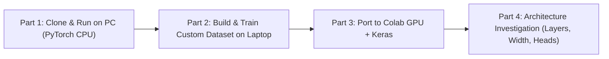

# Homework Assignment: Training, Customizing, and Scaling a Tiny Transformer (PC → Colab GPU + Keras)

> [!NOTE]
> **Assignment Goal:** In this homework, you will take a complete, minimal Transformer language model (**Tiny-2.1**, ~367K parameters) from GitHub, run and train it locally on your own computer, build and train it on a **custom dataset** you design, port the training pipeline to **Google Colab GPU using Keras**, and investigate how changing the Transformer’s architecture (layers, heads, width) affects learning.

> [!IMPORTANT]
> **How Next Class Works (Jigsaw Method):** This homework prepares you to share your work with your classmates when we meet next time using the **Jigsaw method**. Each of you will build your own custom dataset, port the training pipeline to Colab GPU with Keras, and investigate a specific set of architectural experiments (Part 4). In our next session, you will first compare findings with classmates who investigated similar questions, and then **present your custom model, live Q&A examples, and experimental takeaways** to your Jigsaw group so everyone learns from each other's discoveries. Keep clear notes, logs, and examples as you work—and after the class presentation, you will submit your complete training data, trained model files, and documentation (`README.md`).


> [!TIP]
> **Using Your Favorite LLM:** You are encouraged to use your favorite AI assistant (such as ChatGPT, Claude, Gemini, or GitHub Copilot) throughout this assignment to help debug environment issues, brainstorm diverse Q&A training pairs, translate PyTorch code into Keras/TensorFlow, and interpret results. However, **you are responsible for running every experiment yourself, verifying all code works, and explaining every result in your own words.**



---

## Part 1: Clone the Repository and Run a Local Baseline (Your PC)

Start by getting the original PyTorch codebase running locally on your computer.

### What to Do
1. Install Python 3 with `torch` and `numpy` on your PC (if not already installed).
2. Clone the repository and move into the `training` directory:
   ```bash
   git clone https://github.com/WollyMonjac/Tiny-2.1.git
   cd Tiny-2.1/training
   ```
3. Run the built-in CPU speed benchmark to see how fast your laptop trains different model sizes:
   ```bash
   python3 train2.py bench
   ```
4. Train a short local baseline for **3 minutes** on the repository’s built-in dataset (`gen2.py`), then evaluate and export it:
   ```bash
   python3 train2.py train 3 local_3m.pt
   python3 train2.py eval local_3m.pt 15
   python3 train2.py export local_3m.pt local_3m.bin
   ```
5. Write a small interactive test script (or ask your LLM to help write a 15-line prompt loop using `train2.load_model("local_3m.pt")` and `train2.answer_many`) to chat with your 3-minute model directly on your PC.

> [!NOTE]
> **Good to Know:** `train2.py` trains for a fixed number of **minutes**, not epochs. A 3-minute CPU run will have low accuracy (~20–35%)—this is expected and gives you a baseline to compare against later. Also note that `train2.py`'s built-in `load_model()` reads `.pt` checkpoints (like `local_3m.pt`) and older v1 `.bin` files; if you want to load the pre-trained `../dos/TINY.BIN` (`TNY2` format) in PyTorch, you can ask your LLM to help write a small v2 binary loader by reading `export()` in `train2.py`.

---

## Part 2: Create Your Own Dataset and Train It on Your Laptop

Next, replace the built-in trivia/math dataset with a **custom Q&A dataset of your own choosing** (for example: a course study guide, movie/game trivia, personal flashcards, programming facts, or bilingual vocabulary).

### Dataset Rules (Required by `Tiny-2.1`)
* `Tiny-2.1` uses **character-level tokenization** (`VOCAB = 97`): only printable ASCII characters (`space` through `~`, codes `32..126`) and `\n` are supported. Avoid emojis or accented characters unless you clean/transliterate them first.
* Keep each `question + "\n" + answer + "\n"` under `128` characters (`CTX = 128`).
* Aim for at least **80–150+ varied Q&A pairs**. Include multiple ways of phrasing the same question (e.g., *"What is X?"* and *"Tell me about X"*) and hold back **5–10 phrasing variations** as a test set that you do *not* train on!

### Starter Scaffolding
Create `my_data.py` inside `Tiny-2.1/training/` and populate `PAIRS` with your custom dataset (you can use an LLM to help brainstorm and format clean ASCII pairs, then review them carefully):

```python
# my_data.py
PAIRS = [
    ("Who wrote Hamlet?", "William Shakespeare wrote Hamlet."),
    ("What does HTTP stand for?", "Hypertext Transfer Protocol."),
    # Add 80–150+ varied ASCII Q&A pairs here...
]

def sample(rng):
    q, a = rng.choice(PAIRS)
    return q, a, "custom"
```

Create a short runner `train_hw.py` that swaps `gen2.sample` with `my_data.sample`, trains on your laptop CPU (for example, 5–10 minutes), and tests both **seen** questions and **unseen paraphrased** questions:

```python
# train_hw.py — example: python3 train_hw.py 5 my_pc_model.pt
import sys, train2, my_data

train2.gen2.sample = lambda rng, *args, **kwargs: my_data.sample(rng)

minutes = float(sys.argv[1]) if len(sys.argv) > 1 else 5.0
out_pt  = sys.argv[2] if len(sys.argv) > 2 else "my_pc_model.pt"

# Smaller config so laptop CPU training converges quickly
cfg = train2.Cfg(D=64, L=3, H=4, HID=128)
model = train2.train(minutes, out_pt, cfg=cfg, bs=32, log_every=100)
train2.export(model, "my_pc_tiny.bin")

test_questions = [
    my_data.PAIRS[0][0],          # exact seen question
    "Your unseen paraphrase?",    # paraphrased question not in PAIRS
    "Capital of Mars?",           # out-of-distribution question
]
for q, a in train2.answer_many(model, test_questions).items():
    print(f"Q: {q}\nA: {a}\n")
```

### What to Observe
* Watch the training loss drop from initial random guessing ($\ln(97) \approx 4.57$) toward `< 0.5`.
* Test **memorization vs. generalization**: What happens when you ask an exact question from `PAIRS` vs. a reworded version vs. a completely unknown question?

---

## Part 3: Move to Google Colab GPU and Add Keras

Now move your workflow to **Google Colab** with a **GPU runtime** (`Runtime → Change runtime type → T4 GPU`) and rebuild/port the training pipeline using **Keras** (`keras` / `tf.keras`).

### High-Level Tasks
1. **Set up Colab with GPU:** Clone `Tiny-2.1` in Colab, upload your `my_data.py`, and verify TensorFlow/Keras detects the GPU (`tf.config.list_physical_devices('GPU')`).
2. **Implement the Model & Training Loop in Keras:**
   Convert `train2.py`’s components into Keras (`tf.keras` / `keras.ops` / `keras.layers`):
   * `Norm`: RMSNorm layer (`x * rsqrt(mean(x^2) + 1e-5) * g`).
   * `Block`: Pre-norm multi-head causal attention (`Q, K, V, O` linear projections without bias, `H` heads, causal lower-triangular mask) + residual connection + `ReLU` MLP (`f1 → ReLU → f2`) + residual connection.
   * `Model`: Token & position embeddings + `L` stacked blocks + final `Norm` + weight-tied output logits (`nf(x) @ emb^T`).
   * `Training`: Masked next-token cross-entropy loss + `AdamW` optimizer (excluding 1D norm gains from weight decay) + gradient clipping (`global_clipnorm=1.0`).
   * **Important GPU optimization hint:** Because `batch()` pads each batch to a different length `T`, compile your training step with a dynamic input signature (`@tf.function(input_signature=[tf.TensorSpec((None, None), tf.int32), tf.TensorSpec((None, None), tf.float32)])`) so TensorFlow compiles the GPU graph **once** instead of retracing on every batch!
3. **Train and Compare (PC CPU vs. Colab GPU, PyTorch vs. Keras):**
   * Benchmark `seconds/step` on your **laptop CPU** vs. **Colab GPU**.
   * Train on your **custom dataset (`my_data.py`)** in Colab and compare how many steps you complete in the same time budget (e.g., 3–5 minutes).
   * Optional: Also run a 5–10 minute Colab GPU run on the original `gen2.py` dataset (`D=96, L=4, H=4, HID=256`) and compare float32 vs. 8-bit quantized accuracy.

> [!TIP]
> **Example Prompts to Use With Your LLM:**
> * *"Here is a PyTorch `Block` class using `nn.Linear`, `F.scaled_dot_product_attention(..., is_causal=True)`, and `F.relu`. Help me rewrite it using TensorFlow/Keras (`tf.keras`) with `self.add_weight` and dynamic `(None, None)` `@tf.function` support."*
> * *"My `@tf.function` GPU training step is slow because sequence length `T` changes every batch. How do I prevent retracing?"*
> * *"Help me generate 100 diverse, clean ASCII Q&A pairs under 100 characters each about [your topic] for a character-level language model."*

---

## Part 4: Investigate Further — Architecture & Hyperparameter Experiments

Once your Keras Colab GPU pipeline is running cleanly, treat it like a mini-research lab. Choose **at least 3 controlled experiments** to investigate how Transformer design choices affect learning, speed, and model size:

1. **Depth (Number of Blocks `L`):** Compare `L = 1` vs. `L = 4` vs. `L = 6` (or `L = 8`) while keeping `D` and `HID` fixed. Does adding layers always improve accuracy in a 3–5 minute run, or do smaller models sometimes learn faster early on?
2. **Width & MLP Capacity (`D` and `HID`):** Compare `Cfg(D=64, L=4, H=4, HID=128)` vs. `Cfg(D=96, L=4, H=4, HID=256)` vs. `Cfg(D=128, L=4, H=4, HID=384)`. How does parameter count scale, and does a wider MLP reduce memorization errors on your custom dataset?
3. **Number of Attention Heads (`H`):** Fix `D = 96, L = 4, HID = 256` and compare `H = 1` (`Dh=96`) vs. `H = 4` (`Dh=24`) vs. `H = 8` (`Dh=12`). Does splitting into more heads help or hurt?
4. **Training Dynamics (`bs` and `lr`):** Compare batch size `bs = 32` vs. `bs = 256` on GPU. Measure both `steps/second` and `tokens/second`—when does Python CPU data generation become the bottleneck for your GPU?
5. **Activation or Normalization Ablation (Optional Bonus):** In Keras, try replacing `ReLU` with `GELU`, or temporarily removing `pos` embeddings or `RMSNorm`, and observe what breaks.

---

## Deliverables: Jigsaw Presentation & Post-Class Submission

This assignment has **two stages**: (1) preparing to present your work to classmates in the next session, and (2) submitting your complete, reproducible package afterward.

### Stage 1: Prepare for the Next Class (Jigsaw Presentation)
Bring a **short presentation or 1-page visual summary** (3–5 slides or a clean Colab/Markdown walkthrough) so you can clearly explain and demonstrate your work to your Jigsaw group:
1. **Your Custom Dataset & Demo:** Topic, number of Q&A pairs, and 4–6 live or recorded test prompts (showing exact matches, unseen paraphrases, and at least one failure/hallucination).
2. **PC CPU vs. Colab GPU (Keras):** Your benchmark table (`seconds/step`, `steps/sec`, and loss achieved in the same time budget) plus one key lesson from porting PyTorch to Keras.
3. **Your Part 4 Investigation:** A concise comparison table/plot of your **3+ architecture or hyperparameter experiments** (`Config`, `Parameters`, `Speed`, `Final Loss`, `Model Size`) and the main takeaway you are teaching your group (for example, how adding blocks `L` or changing width `D`/`HID` affected your results).

### Stage 2: Submit After Class (Complete Repository / Zip Package)
After our Jigsaw session (incorporating any insights or feedback from your classmates), submit a single organized folder or GitHub repository containing:
1. **Complete Training Data:** `my_data.py` (and any raw text/CSV files or helper scripts used to create your custom Q&A pairs).
2. **Trained Model Files:** Your saved checkpoints and exported 8-bit binaries from both PC and Colab (e.g., `my_pc_model.pt`, `my_pc_tiny.bin`, and your Colab Keras checkpoint + exported `.bin`).
3. **All Code & Notebook:** `train_hw.py` and your Colab `.ipynb` notebook (or Keras training script).
4. **Model Description & `README.md`:** A clear `README.md` (and experiment description) that allows someone else to understand and reproduce your project, including:
   * **Dataset & Model Card:** Description of your dataset, model configuration (`D, L, H, HID`), parameter count, file sizes (float32 vs. 8-bit), and observed strengths/limitations.
   * **How to Run:** Step-by-step instructions and exact commands to train and test your model on PC and Colab.
   * **Results & Analysis:** Your PC vs. Colab GPU comparison, Part 4 architecture experiment table, and a 1–2 paragraph analysis of which configuration gave the best tradeoff between accuracy, speed, and model size.
   * **AI Assistant Reflection (3–5 sentences):** Which LLM(s) you used, one way it accelerated your work, and one error or limitation from the LLM that you had to catch and fix yourself.