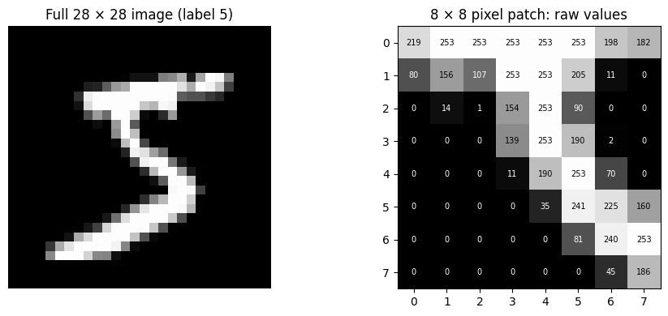
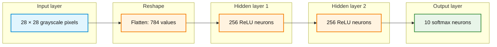
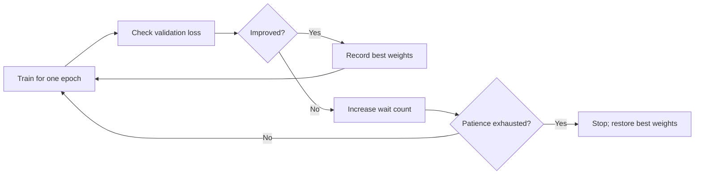

# Activity 1: Classifying Handwritten Digits with a Deep Neural Network (MNIST)


## How to use this guided activity

This activity extends the earlier work on forward propagation, backpropagation, and gradient-based optimization to **ten-class image classification**. It uses the **original MNIST handwritten-digit dataset** (digits 0–9), not Fashion-MNIST.

Read each question before opening its worked answer. Run the Python cells in the given order in one Google Colab notebook or a compatible local Jupyter notebook. When a plot is requested, open the separate collapsible **supplied Python code** section, run the code, and explain the resulting figure. **Writing plotting code from scratch is not assessed.** Training results can differ across machines and runs.

**Python setup:** [Python setup for Week 3](1-python_setup.md). Google Colab is the main environment; a local Conda/Jupyter environment is an alternative.

For Google Colab:

1. Open a notebook and select a Python runtime. A GPU is optional for this activity.
2. Run the import and setup code below. If a package import fails, follow `1-python_setup.md` and install only the missing package in a separate cell.
3. `keras.utils.plot_model()` additionally uses **pydot** and a working **Graphviz** installation. In Colab, install `pydot` with `%pip install pydot` if necessary; if Graphviz is missing, install the system package with `!apt-get -qq install graphviz`.
4. If a package installation requires a runtime restart, restart and rerun the notebook from the beginning. The first dataset download requires internet access.

```python
import numpy as np
import matplotlib.pyplot as plt
import tensorflow as tf
from tensorflow import keras
from tensorflow.keras import layers

keras.utils.set_random_seed(42)
print("TensorFlow:", tf.__version__)
print("Keras backend: TensorFlow (via tf.keras)")
```

## Learning objectives

By the end of the activity, the following distinctions should be clear:

1. A grayscale image is a matrix of pixel intensities; a `Flatten` layer changes its shape but does not learn parameters.
2. Integer class IDs and one-hot vectors are **alternative label representations**, not measures of class importance.
3. Softmax represents **one class among ten**; independent sigmoids are suitable for a different kind of task.
4. A forward pass produces predictions, cross-entropy measures loss, backpropagation calculates gradients, and an optimizer updates weights.
5. An **epoch** is one pass through the training examples; a **mini-batch update** processes only a subset of those examples.
6. Training loss and validation loss answer different questions; early stopping uses validation results to decide when to stop training.
7. `model.summary()` and `keras.utils.plot_model()` describe the network architecture, whereas training curves describe how the model learns.

> **Key distinction:** A low training loss does not guarantee good performance on new images. Validation data are used to monitor training; test data are reserved for final evaluation.

---

## 1. The task and the dataset

MNIST contains **70,000** grayscale images of handwritten digits. Each image is **28 × 28 pixels**. The standard split contains **60,000 training images** and **10,000 test images**. Every image has one correct class ID from `0` through `9`.

Load the data and inspect its shapes:

```python
(x_train_full, y_train_full), (x_test_raw, y_test) = keras.datasets.mnist.load_data()

print("Original training images:", x_train_full.shape)
print("Original training labels:", y_train_full.shape)
print("Test images:", x_test_raw.shape)
print("Test labels:", y_test.shape)
print("First 10 training labels:", y_train_full[:10])
print("Pixel data type:", x_train_full.dtype)
```

**Question 1:** What does the shape `(60000, 28, 28)` mean? What does the shape `(60000,)` mean? Why does the model need ten output classes?

<details>
<summary>Show worked answer</summary>

The first shape describes 60,000 images. Every image has 28 rows and 28 columns of grayscale pixel values. The second shape describes 60,000 integer labels, one per image. Labels 0 through 9 identify ten distinct digits, so the model needs ten class scores or probabilities at its output.

The leading dimension of the image array counts images. It is not a color-channel dimension.

</details>

Run the supplied code to view a sample of the images. Inspect the variety of handwriting styles and the labels shown above each image.

<details>
<summary>Show supplied Python code: Display a grid of MNIST images</summary>

```python
import matplotlib.pyplot as plt

fig, axes = plt.subplots(3, 5, figsize=(10, 6))
for i, ax in enumerate(axes.flat):
    ax.imshow(x_train_full[i], cmap="gray", vmin=0, vmax=255)
    ax.set_title(f"Label: {y_train_full[i]}")
    ax.axis("off")
fig.suptitle("Original MNIST: handwritten digits", fontsize=14)
plt.tight_layout()
plt.show()
```

</details>

**Question 2:** Does every handwritten `3` look identical? Does the image label describe the entire image or the position of each pixel?

<details>
<summary>Show worked answer</summary>

Different writers produce different shapes, thicknesses, and angles for the same digit. The label represents the identity of the entire image. The task is **image classification**, not object detection or pixel-by-pixel segmentation.

</details>

---

## 2. From pixels to model inputs

A grayscale image is a matrix of numbers. In this dataset, raw pixel intensities are integers from **0** (black) to **255** (white). Normalization converts them to values between 0 and 1 without changing the spatial arrangement.

```python
print("One image shape:", x_train_full[0].shape)
print("One image minimum:", x_train_full[0].min())
print("One image maximum:", x_train_full[0].max())

# Reserve the last 12,000 original training images for validation.
# The test set is not used during model selection or training.
x_train = x_train_full[:48000].astype("float32") / 255.0
y_train = y_train_full[:48000]
x_val = x_train_full[48000:].astype("float32") / 255.0
y_val = y_train_full[48000:]
x_test = x_test_raw.astype("float32") / 255.0

print("Training:", x_train.shape, y_train.shape)
print("Validation:", x_val.shape, y_val.shape)
print("Test:", x_test.shape, y_test.shape)
print("Normalized value range:", x_train.min(), x_train.max())
```

The complete data split is now:

| Subset | Number of images | Role |
|---|---:|---|
| Training | 48,000 | Used to calculate gradients and update weights |
| Validation | 12,000 | Used to monitor training and select the stopping epoch |
| Test | 10,000 | Used for final evaluation only |

**Question 3:** A pixel has raw intensity 153. What is its normalized value? Why is normalization useful, and why must the test images receive the same scaling?

<details>
<summary>Show worked answer</summary>

The normalized value is 153 / 255 = **0.6**. Scaling keeps input magnitudes in a consistent, smaller range and often makes optimization easier. The same scaling must be applied to training, validation, and test images because the model expects inputs expressed in the same way at training and evaluation time.

Normalization does not change the digit's true label.

</details>

The following plot places a complete digit beside a zoomed pixel grid. It helps connect an image to its numerical representation.



<details>
<summary>Show supplied Python code: Display grayscale pixels and their intensities</summary>

```python
import matplotlib.pyplot as plt

image = x_train_full[0]
patch = image[8:16, 8:16]

fig, axes = plt.subplots(1, 2, figsize=(10, 4))
axes[0].imshow(image, cmap="gray", vmin=0, vmax=255)
axes[0].set_title(f"Full 28 × 28 image (label {y_train_full[0]})")
axes[0].axis("off")

axes[1].imshow(patch, cmap="gray", vmin=0, vmax=255)
axes[1].set_title("8 × 8 pixel patch: raw values")
axes[1].set_xticks(range(patch.shape[1]))
axes[1].set_yticks(range(patch.shape[0]))
for r in range(patch.shape[0]):
    for c in range(patch.shape[1]):
        value = int(patch[r, c])
        axes[1].text(c, r, str(value), ha="center", va="center",
                     fontsize=7, color="black" if value > 130 else "white")
plt.tight_layout()
plt.show()
```

</details>

---

## 3. Build a dense neural network

The image begins as a two-dimensional matrix. A `Flatten` layer converts it into a vector of **784 values** (`28 × 28`). The vector passes through **two hidden dense layers**, each containing 256 neurons with ReLU activation, followed by ten softmax output neurons.

The two hidden layers make this network a **deep multilayer perceptron (MLP)**. A dense network connects each neuron to all outputs from the preceding layer. It does not explicitly preserve neighboring-pixel relationships after flattening.



The diagram summarizes whole layers. Each dense layer contains individual weighted connections and trainable biases, not just one connection between the displayed boxes. Softmax acts on the **ten output scores together**.

Define the architecture using the Keras Functional API. The function will also be reused to build a fresh model for the early-stopping experiment.

```python
def build_model():
    inputs = keras.Input(shape=(28, 28), name="Image")
    h = layers.Flatten(name="Flatten")(inputs)
    h = layers.Dense(256, activation="relu", name="Hidden_1")(h)
    h = layers.Dense(256, activation="relu", name="Hidden_2")(h)
    outputs = layers.Dense(10, activation="softmax", name="Digit_probabilities")(h)
    return keras.Model(inputs=inputs, outputs=outputs, name="MNIST_DNN")

keras.utils.set_random_seed(42)
model = build_model()
model.summary()
```

**Question 4:** Why does flattening produce 784 features? Does flattening have trainable weights? How many parameters does each dense layer contain, including biases?

For a dense layer with `m` inputs and `n` neurons, the trainable parameter count is:

$$
\text{parameters}=m\times n+n
$$

<details>
<summary>Show worked answer</summary>

A 28 × 28 image has 784 pixel values, and `Flatten` rearranges them into one vector. `Flatten` has **zero trainable parameters**.

- Hidden layer 1: 784 × 256 + 256 = **200,960** parameters.
- Hidden layer 2: 256 × 256 + 256 = **65,792** parameters.
- Output layer: 256 × 10 + 10 = **2,570** parameters.
- Total: 200,960 + 65,792 + 2,570 = **269,322** trainable parameters.

Each neuron has one weight for each input plus one bias. The ten output neurons correspond to the ten digit classes, not ten separate binary classification models.

</details>

The next code block uses **`keras.utils.plot_model()`** to visualize the exact architecture defined above. This is an **architecture plot**, not a plot of individual weights or training performance.

<details>
<summary>Show supplied Python code: Plot the Keras neural-network architecture</summary>

```python
from IPython.display import Image, display

# Requires pydot and Graphviz as noted in the setup section.
keras.utils.plot_model(
    model,
    to_file="mnist_dnn_architecture.png",
    show_shapes=True,
    show_layer_names=True,
    dpi=110,
)
display(Image(filename="mnist_dnn_architecture.png"))
```

</details>

**Question 5:** In `model.summary()` and the architecture plot, which layers have trainable parameters? Why does the output shape end in `10`?

<details>
<summary>Show worked answer</summary>

The three `Dense` layers have trainable weights and biases. The `Input` and `Flatten` layers do not. The final layer produces ten scores transformed into ten probabilities, one for each class ID from 0 to 9.

An architecture plot shows how tensors pass between layers. It does not show how accurate a trained model is.

</details>

---

## 4. Class labels: sparse integers versus one-hot vectors

The label of a handwritten `3` can be represented in two ways:

| Representation | Target |
|---|---|
| Sparse integer | `3` |
| One-hot vector | `[0, 0, 0, 1, 0, 0, 0, 0, 0, 0]` |

The class ID **3 is a name/index**, not a measurement. It does not mean that class 3 is more important than class 1. One-hot vectors make this visually obvious, but the correct **sparse categorical loss** treats integer labels the same way: it uses the integer to identify which output probability belongs to the correct class.

**Question 6:** Would the model be correct to assume that a handwritten `8` is twice as important as a handwritten `4`? Would one-hot labels change the meaning of the classification problem?

<details>
<summary>Show worked answer</summary>

No. The labels are category identifiers. The model is not predicting a numerical quantity where the distance between 8 and 4 matters. Correct sparse categorical cross-entropy uses the integer label to choose a probability, while categorical cross-entropy uses the position of the `1` in a one-hot vector. Both describe the same classification target.

If labels 0–9 were incorrectly trained as **regression targets with squared error**, their numeric differences would affect the loss. That is not how this classifier is configured.

</details>

Run the short check below to see that both categorical cross-entropy formulations give the same result for the same predicted probabilities and target digit. This is a numerical check, not a plot.

```python
probabilities = np.array([0.04, 0.03, 0.05, 0.70, 0.04,
                          0.03, 0.03, 0.02, 0.03, 0.03], dtype="float64")
label_sparse = 3
label_one_hot = np.eye(10)[label_sparse]

loss_sparse = -np.log(probabilities[label_sparse])
loss_one_hot = -np.sum(label_one_hot * np.log(probabilities))
print("Sparse loss:", round(float(loss_sparse), 6))
print("One-hot loss:", round(float(loss_one_hot), 6))
print("Same result:", np.isclose(loss_sparse, loss_one_hot))
```

**Question 7:** Which Keras loss function matches the original MNIST integer labels? What must change if the labels are converted into one-hot vectors?

<details>
<summary>Show worked answer</summary>

Integer labels pair with **`sparse_categorical_crossentropy`**. One-hot vectors pair with **`categorical_crossentropy`**. The model can keep the same ten softmax outputs in both cases; only the target format and matching loss configuration change.

Since MNIST already supplies integer labels, sparse encoding avoids an unnecessary conversion. Neither representation gives higher class IDs more weight.

</details>

---

## 5. Softmax: one digit, ten possible classes

The final dense layer first computes **logits**, which are unrestricted numerical scores. Softmax converts all ten logits into a single probability distribution. A digit image has **one target class**, so the probabilities across its ten classes should sum to 1.

For class index `k`, with logit $z_k$, the softmax probability is:

$$
p_k=\frac{e^{z_k}}{\sum_{j=0}^{9}e^{z_j}}
$$

The network chooses the class with the largest probability. Cross-entropy penalizes the model when the correct class receives low probability. For an integer correct class $y$, the loss for one example is:

$$
L=-\ln(p_y)
$$

With one-hot target entries $y_k$, the same loss is written as:

$$
L=-\sum_{k=0}^{9}y_k\ln(p_k)
$$

**Question 8:** Consider ten logits with a score of `2` for digit `3` and a score of `0` for each other digit. What probability does softmax assign to digit 3? What is the loss if the true label is 3?

<details>
<summary>Show worked answer</summary>

The denominator is e squared plus nine copies of e to the power zero: approximately **7.389 + 9 = 16.389**.

- Correct-class probability: 7.389 / 16.389 = approximately **0.4509**.
- Each other class: 1 / 16.389 = approximately **0.0610**.
- Cross-entropy loss: negative natural log of 0.4509 = approximately **0.7966**.

The ten probabilities sum to 1 (apart from numerical rounding). A larger correct-class probability gives a smaller cross-entropy loss.

</details>

**Question 9:** Why not use ten independent sigmoid outputs for MNIST? In what kind of image task would independent sigmoids be appropriate?

<details>
<summary>Show worked answer</summary>

Ten independent sigmoid outputs do not force their probabilities to sum to 1. Several classes could receive high probabilities simultaneously. MNIST assigns one class per image, so softmax represents the mutually exclusive alternatives more directly.

Independent sigmoids are appropriate for **multilabel classification**, where one image may contain several independently true categories, such as both a dog and a bicycle.

The distinction depends on the classification task. One-hot encoding alone does not imply that sigmoid should be used.

</details>

Run the supplied plot to compare softmax with independent sigmoids applied to the **same ten illustrative logits**. This figure is a mathematical demonstration, not a prediction from the trained network.

<details>
<summary>Show supplied Python code: Compare softmax with independent sigmoids</summary>

```python
import numpy as np
import matplotlib.pyplot as plt

logits = np.array([0., 0., 0., 2., 0., 0., 0., 0., 0., 0.])
shifted = logits - np.max(logits)
exp_scores = np.exp(shifted)
softmax = exp_scores / exp_scores.sum()
sigmoids = 1.0 / (1.0 + np.exp(-logits))

fig, axes = plt.subplots(1, 2, figsize=(11, 4), sharey=True)
axes[0].bar(range(10), softmax)
axes[0].set_title(f"Softmax (sum = {softmax.sum():.2f})")
axes[1].bar(range(10), sigmoids)
axes[1].set_title(f"Independent sigmoids (sum = {sigmoids.sum():.2f})")
for ax in axes:
    ax.set_xticks(range(10))
    ax.set_xlabel("Digit class ID")
    ax.set_ylabel("Output value")
    ax.set_ylim(0, 1)
plt.tight_layout()
plt.show()
```

</details>

---

## 6. From forward propagation to a parameter update

The earlier training cycle still applies to a multilayer classifier:


The forward pass uses the current weights and biases to calculate class probabilities. Loss summarizes how well those probabilities match the labels. Backpropagation computes derivatives of loss with respect to model parameters. The optimizer uses those derivatives to update parameters. **The optimizer, not the forward pass or backpropagation alone, performs the update.**

For a mini-batch of size $B$, training typically uses the mean of the individual example losses:

$$
L_{\mathrm{batch}}=\frac{1}{B}\sum_{i=1}^{B}L_i
$$

A simple gradient-descent parameter update uses learning rate $\eta$:

$$
w_{\mathrm{new}}=w_{\mathrm{old}}-\eta\frac{\partial L_{\mathrm{batch}}}{\partial w}
$$

**Question 10:** Which stage computes the probabilities? Which stage computes the gradients? Which stage changes the trainable parameters? Does `Flatten` need a parameter update?

<details>
<summary>Show worked answer</summary>

- **Forward pass:** computes predictions and class probabilities.
- **Loss:** evaluates how well probabilities match the target labels.
- **Backpropagation:** computes gradients using the chain rule.
- **Optimizer:** changes weights and biases based on those gradients.
- **Flatten:** rearranges data and has no trainable weights to update.

Backpropagation is not itself the parameter-update operation.

</details>

### Epochs, iterations, and mini-batches

An **epoch** is one complete pass through the training set. An **iteration** or **training step** is one parameter update. How many updates occur in an epoch depends on the batch size.

$$
\text{steps per epoch}=\left\lceil\frac{\text{number of training examples}}{\text{batch size}}\right\rceil
$$

| Training method | Examples per update | Updates per epoch with 48,000 images |
|---|---:|---:|
| Full-batch gradient descent | 48,000 | 1 |
| Single-example SGD (strict definition) | 1 | 48,000 |
| Mini-batch training, batch size 64 | 64 | 750 |

In deep-learning discussions, **SGD** is also sometimes used informally for mini-batch training. Strictly, one-example SGD and mini-batch SGD have different batch sizes. The activity below uses **Adam**, not the SGD optimizer, but its updates are still computed from mini-batches.

**Question 11:** How many optimizer updates are performed per epoch with `batch_size=64`? How many updates are planned across 25 epochs if every epoch completes? Would doubling the batch size double or halve the number of steps per epoch?

<details>
<summary>Show worked answer</summary>

With 48,000 training images and a batch size of 64, each epoch contains 48,000 / 64 = **750 steps**. Across 25 completed epochs, that would be 25 × 750 = **18,750 updates**.

Doubling the batch size to 128 gives 48,000 / 128 = **375 steps per epoch**, half as many. The same training examples are processed during an epoch, but each gradient uses more examples.

Early stopping may cause fewer than 25 epochs to run in a later experiment.

</details>

Compile the model. The output layer already uses softmax, so the standard sparse categorical cross-entropy loss expects probabilities rather than raw logits. Adam will use gradients to update weights; the learning rate is set explicitly.

```python
model.compile(
    optimizer=keras.optimizers.Adam(learning_rate=0.001),
    loss="sparse_categorical_crossentropy",
    metrics=["accuracy"],
)

batch_size = 64
max_epochs = 25
```

**Question 12:** Which line defines the optimizer? Which line tells Keras how to measure classification loss? Is `accuracy` the same quantity as cross-entropy loss?

<details>
<summary>Show worked answer</summary>

The `optimizer=` argument configures Adam, which applies parameter updates. The `loss=` argument selects sparse categorical cross-entropy, matching the integer class labels. The `metrics=` argument requests classification accuracy for reporting.

Accuracy counts the fraction of correctly classified examples; cross-entropy also reflects how much probability the model assigns to the correct label. They are related but **not interchangeable**.

</details>

---

## 7. Train the network and inspect generalization

First, train **without early stopping**. Training and validation histories will be compared later. The validation set does not supply gradients for weight updates.

```python
baseline_history = model.fit(
    x_train, y_train,
    validation_data=(x_val, y_val),
    batch_size=batch_size,
    epochs=max_epochs,
    verbose=2,
)

print("Completed epochs:", len(baseline_history.history["loss"]))
print("Final training loss:", baseline_history.history["loss"][-1])
print("Final validation loss:", baseline_history.history["val_loss"][-1])
```

**Question 13:** When training loss falls, what does that show? If validation loss decreases and later rises, what might it indicate? Is the lowest training loss necessarily the best place to stop?

<details>
<summary>Show worked answer</summary>

Falling training loss indicates that the model is improving its objective on examples used for parameter updates. Validation loss measures performance on examples not used for weight updates. A sustained increase in validation loss while training loss keeps decreasing can indicate **overfitting**.

The epoch with the lowest training loss need not have the best validation loss. A model can fit training examples increasingly closely without improving generalization. Curves are empirical results, so an increase in validation loss at a particular epoch is not guaranteed for every run.

</details>

Run the supplied code to plot **training versus validation loss and accuracy**. The curves are computed from the actual `model.fit()` history; they are not illustrative curves invented in advance.

<details>
<summary>Show supplied Python code: Plot training and validation curves</summary>

```python
import numpy as np
import matplotlib.pyplot as plt

hist = baseline_history.history
epoch_numbers = np.arange(1, len(hist["loss"]) + 1)

fig, axes = plt.subplots(1, 2, figsize=(12, 4))
axes[0].plot(epoch_numbers, hist["loss"], marker="o", label="Training")
axes[0].plot(epoch_numbers, hist["val_loss"], marker="o", label="Validation")
axes[0].set_title("Cross-entropy loss")
axes[0].set_xlabel("Epoch")
axes[0].set_ylabel("Loss")
axes[0].legend()
axes[0].grid(alpha=0.25)

axes[1].plot(epoch_numbers, hist["accuracy"], marker="o", label="Training")
axes[1].plot(epoch_numbers, hist["val_accuracy"], marker="o", label="Validation")
axes[1].set_title("Classification accuracy")
axes[1].set_xlabel("Epoch")
axes[1].set_ylabel("Accuracy")
axes[1].legend()
axes[1].grid(alpha=0.25)

plt.tight_layout()
plt.show()
```

</details>

**Question 14:** Locate the epoch with the smallest validation loss. Does it match the last epoch? What evidence, if any, suggests overfitting?

<details>
<summary>Show worked answer</summary>

The answer depends on the observed training run. The smallest point on the validation-loss curve identifies the best recorded validation-loss epoch. If later validation loss remains higher while training loss continues to decrease, the model may be overfitting.

If the smallest validation loss occurs at the last epoch, the run does not establish that early stopping would help; more epochs or a different experiment might be needed to reveal a sustained divergence. No particular curve shape is guaranteed.

</details>

---

## 8. Early stopping as regularization

**Early stopping** monitors a validation metric and ends training when that metric has stopped improving for a specified number of epochs. With `restore_best_weights=True`, the model is returned to the weights associated with its best recorded validation loss.

The experiment below uses the **same train/validation split, architecture, optimizer, learning rate, and maximum epoch count** as the baseline. The model is rebuilt from a fresh initialization using the same random seed. Hardware and library details may still cause small differences between runs.



Train with the early-stopping callback:

```python
keras.utils.set_random_seed(42)
early_model = build_model()
early_model.compile(
    optimizer=keras.optimizers.Adam(learning_rate=0.001),
    loss="sparse_categorical_crossentropy",
    metrics=["accuracy"],
)

early_stop = keras.callbacks.EarlyStopping(
    monitor="val_loss",
    patience=3,
    restore_best_weights=True,
)

early_history = early_model.fit(
    x_train, y_train,
    validation_data=(x_val, y_val),
    batch_size=batch_size,
    epochs=max_epochs,
    callbacks=[early_stop],
    verbose=2,
)

best_epoch = int(np.argmin(early_history.history["val_loss"])) + 1
last_epoch = len(early_history.history["loss"])
print("Best recorded validation-loss epoch:", best_epoch)
print("Last completed training epoch:", last_epoch)
print("Best recorded validation loss:", min(early_history.history["val_loss"]))
```

**Question 15:** What does `patience=3` mean? Does early stopping choose the smallest training loss, the smallest validation loss, or the highest test accuracy? What does `restore_best_weights=True` do?

<details>
<summary>Show worked answer</summary>

The callback monitors **validation loss**. With patience 3, training stops when three consecutive epochs fail to improve that metric, unless the maximum epoch count is reached first. The callback does not use test accuracy to make this decision.

When best-weight restoration is enabled, the final model parameters are those associated with the best observed validation loss rather than necessarily the final completed epoch. Restoring weights does not erase the recorded training history.

</details>

Run the plot below to compare the recorded validation losses. A vertical line marks the best validation-loss epoch in the early-stopping run.

<details>
<summary>Show supplied Python code: Compare baseline and early-stopping validation loss</summary>

```python
import numpy as np
import matplotlib.pyplot as plt

baseline_epochs = np.arange(1, len(baseline_history.history["val_loss"]) + 1)
early_epochs = np.arange(1, len(early_history.history["val_loss"]) + 1)

plt.figure(figsize=(9, 5))
plt.plot(baseline_epochs, baseline_history.history["val_loss"],
         marker="o", label="Without early stopping")
plt.plot(early_epochs, early_history.history["val_loss"],
         marker="o", label="With early stopping")
plt.axvline(best_epoch, linestyle="--", color="gray",
            label=f"Best early-stop epoch: {best_epoch}")
plt.xlabel("Epoch")
plt.ylabel("Validation cross-entropy loss")
plt.title("Observed validation loss: two training runs")
plt.legend()
plt.grid(alpha=0.25)
plt.tight_layout()
plt.show()
```

</details>

**Question 16:** Did early stopping activate before the maximum epoch count? Was the selected best epoch equal to the last completed epoch? Does early stopping guarantee a better test score than a fixed number of epochs?

<details>
<summary>Show worked answer</summary>

The first two answers depend on the printed epoch numbers. When validation loss stops improving long enough, training may end before the maximum number of epochs. The selected best epoch can be earlier than the last completed epoch because the callback waits through its patience period.

Early stopping is a **regularization strategy**, not a guarantee of higher test accuracy on every run. Its main purpose is to reduce unnecessary fitting after validation performance stops improving. Small validation fluctuations and different random initializations can affect the selected epoch.

</details>

### A brief note on dropout

Another regularization technique is **dropout**, which randomly disables some hidden-unit outputs during training to reduce reliance on particular feature combinations. Its full implementation and mathematical details are not required in this activity. **Dropout is not used in either MNIST training run above**, so the comparison isolates early stopping more clearly.

---

## 9. Final evaluation and interpreting predictions

The test set has not been used for gradient updates, early-stopping decisions, or other model selection. Evaluate the restored early-stopping model on the previously held-out test images:

```python
test_loss, test_accuracy = early_model.evaluate(x_test, y_test, verbose=0)
print(f"Test loss: {test_loss:.4f}")
print(f"Test accuracy: {test_accuracy:.4%}")

sample_index = 0
sample_probs = early_model.predict(x_test[sample_index:sample_index + 1], verbose=0)[0]
sample_prediction = int(np.argmax(sample_probs))
print("Sample true digit:", int(y_test[sample_index]))
print("Sample predicted digit:", sample_prediction)
print("Sum of sample probabilities:", sample_probs.sum())
```

**Question 17:** What is the distinction between validation accuracy and test accuracy? Can a model have high test accuracy and still misclassify individual images? What should the ten softmax probabilities sum to?

<details>
<summary>Show worked answer</summary>

Validation accuracy is measured on held-out examples used to monitor training and select the stopping point. Test accuracy is measured on a separate held-out set used for the final assessment. Neither accuracy metric means that every image is classified correctly.

The ten softmax probabilities for each image sum to **1**, apart from tiny numerical rounding differences. The predicted digit is the class with the largest predicted probability.

</details>

This supplied plot displays one test image and the model's ten actual predicted probabilities.

<details>
<summary>Show supplied Python code: Display a test digit and its softmax probabilities</summary>

```python
import numpy as np
import matplotlib.pyplot as plt

sample_index = 0
probs = early_model.predict(x_test[sample_index:sample_index + 1], verbose=0)[0]
predicted = int(np.argmax(probs))
true_digit = int(y_test[sample_index])

fig, axes = plt.subplots(1, 2, figsize=(10, 4))
axes[0].imshow(x_test[sample_index], cmap="gray", vmin=0, vmax=1)
axes[0].set_title(f"True digit: {true_digit} | Predicted: {predicted}")
axes[0].axis("off")

bars = axes[1].bar(range(10), probs)
bars[predicted].set_color("green" if predicted == true_digit else "red")
axes[1].set_xticks(range(10))
axes[1].set_ylim(0, 1)
axes[1].set_xlabel("Digit class ID")
axes[1].set_ylabel("Predicted probability")
axes[1].set_title(f"Softmax probabilities (sum = {probs.sum():.3f})")
plt.tight_layout()
plt.show()
```

</details>

A model's incorrect predictions can also be informative. Run the following optional plot to inspect a sample of errors from the test set.

<details>
<summary>Show supplied Python code: Display incorrectly classified test digits</summary>

```python
import numpy as np
import matplotlib.pyplot as plt

# Inspect a fixed subset; use more images if very few errors occur.
subset_size = 1000
predicted_probs = early_model.predict(x_test[:subset_size], verbose=0)
predicted_digits = np.argmax(predicted_probs, axis=1)
wrong_indices = np.flatnonzero(predicted_digits != y_test[:subset_size])[:9]

if len(wrong_indices) == 0:
    print("No mistakes found in the first", subset_size, "test images.")
else:
    fig, axes = plt.subplots(3, 3, figsize=(7, 7))
    for ax in axes.flat:
        ax.axis("off")
    for ax, idx in zip(axes.flat, wrong_indices):
        ax.imshow(x_test[idx], cmap="gray", vmin=0, vmax=1)
        ax.set_title(f"True: {y_test[idx]} | Pred: {predicted_digits[idx]}")
    fig.suptitle("Examples of incorrect MNIST predictions")
    plt.tight_layout()
    plt.show()
```

</details>

**Question 18:** Choose one incorrect prediction from the figure. What makes it visually ambiguous? Does the example alone prove that early stopping failed?

<details>
<summary>Show worked answer</summary>

Potential reasons include unusual handwriting, overlapping strokes, unclear shapes, or similarities between particular digits. The explanation should refer to the actual image observed.

One incorrect prediction does not establish that early stopping failed. Early stopping controls training using validation behavior; it does not guarantee that every image will be classified correctly.

</details>

---

## 10. Concept questions: reveal the answers

**Question 19:** Why is `model.summary()` not a replacement for a loss-versus-epoch graph?

<details>
<summary>Show answer</summary>

`model.summary()` describes the architecture, output shapes, and parameter counts. A loss-versus-epoch plot shows how training and validation losses changed during optimization. They answer different questions.

</details>

**Question 20:** If the batch size changes but the number of training images stays fixed, does the definition of one epoch change?

<details>
<summary>Show answer</summary>

No. An epoch remains one pass through the full training set. The number of parameter updates per epoch changes because each mini-batch contains a different number of images.

</details>

**Question 21:** Would switching the targets from sparse integer labels to one-hot labels require changing the final layer from ten softmax outputs to ten sigmoid outputs?

<details>
<summary>Show answer</summary>

No. The task is still one class among ten, so ten softmax outputs remain appropriate. Switching target representation requires selecting the corresponding `categorical_crossentropy` loss and supplying one-hot labels. It does not change the nature of the classification task.

</details>

**Question 22:** What is the difference between a training parameter, such as a weight, and a training setting, such as batch size or learning rate?

<details>
<summary>Show answer</summary>

The network learns weights and biases from data. Batch size and learning rate are **hyperparameters** chosen before or during experimentation; they control how training proceeds. They are not weights learned by the usual backpropagation update.

</details>

**Question 23:** Why should test loss not be monitored by early stopping?

<details>
<summary>Show answer</summary>

Using the test set to select a stopping point would make it part of the model-selection process. The test results would then no longer provide an independent assessment of a model chosen without reference to those test labels. Validation data serve the selection role; test data serve the final evaluation role.

</details>

---

## Final summary

- **Representation:** A 28 × 28 grayscale image contains 784 pixel values. `Flatten` reshapes those values for dense layers without learning weights.
- **Classification:** The model has ten softmax outputs because one handwritten digit belongs to one of ten classes.
- **Labels and loss:** Integer class IDs use sparse categorical cross-entropy; one-hot vectors use categorical cross-entropy. A larger ID does not imply a more important class.
- **Training cycle:** Forward pass → loss → backpropagation → optimizer update → evaluate and repeat.
- **Epochs and batches:** An epoch processes the training set once; a batch size of 64 gives 750 updates per epoch for 48,000 training images.
- **Generalization:** Early stopping monitors validation loss and can restore the best observed weights. Test data are used for final evaluation.
- **Visualization:** `plot_model()` depicts architecture, training-history plots depict learning, and probability plots depict one prediction.

**Connection to the next activity:** CIFAR-10 contains color images with three channels rather than one grayscale intensity per pixel. The same classification and training workflow will be revisited with a different input shape and a more challenging visual task.


<details>
<summary><b>Evaluating Classification Models Beyond Accuracy</b></summary>

Accuracy reports the proportion of correctly classified examples.

Although accuracy is useful, it does not explain **which classes the model predicts well and which classes it frequently confuses**.

This distinction remains important for multiclass image classification, including MNIST, Fashion-MNIST, and CIFAR-10.

**Recall: Classification metrics**

| Metric | What it helps examine |
|---|---|
| Accuracy | Overall proportion of correct predictions |
| Precision | How often predictions of a particular class are correct |
| Recall | How many actual examples of a particular class the model identifies |
| F1-score | Balance between precision and recall |
| Confusion matrix | Which classes are confused with one another |

For multiclass classification, precision, recall, and F1-score can be calculated separately for each class.

A model may achieve high overall accuracy while performing noticeably worse on certain classes. This can occur even when the dataset is reasonably balanced.

**Python: Classification report and confusion matrix**

After training a multiclass Keras model, predictions can be compared with the true labels using scikit-learn.

The following code assumes that `model`, `x_test`, and `y_test` are already available. The class names below correspond to original MNIST; replace them when using a different dataset.

Run the supplied Python code — Classification metrics and confusion matrix

```python
import numpy as np
import matplotlib.pyplot as plt

from sklearn.metrics import (
    classification_report,
    ConfusionMatrixDisplay
)

# MNIST class names
class_names = [str(i) for i in range(10)]

# Obtain class probabilities
probabilities = model.predict(x_test, verbose=0)

# Select the predicted class
y_pred = np.argmax(probabilities, axis=1)

# Ensure labels are a one-dimensional array
y_true = np.asarray(y_test).reshape(-1)

# Print classification metrics
print(
    classification_report(
        y_true,
        y_pred,
        labels=list(range(10)),
        target_names=class_names,
        zero_division=0
    )
)

# Display confusion matrix
fig, ax = plt.subplots(figsize=(9, 8))

ConfusionMatrixDisplay.from_predictions(
    y_true,
    y_pred,
    labels=list(range(10)),
    display_labels=class_names,
    cmap="Blues",
    ax=ax,
    colorbar=False
)

ax.set_title("Confusion Matrix")
plt.tight_layout()
plt.show()
```

**Interpretation questions**

1. Which class has the lowest recall?
2. Which class has the lowest precision?
3. Which two classes are most frequently confused?
4. Does overall accuracy adequately describe the classifier's performance?
5. If the dataset has unequal class frequencies, how might macro-average and weighted-average F1 scores differ?

These questions reinforce previously studied evaluation metrics while connecting them to neural-network image classification.

</details>