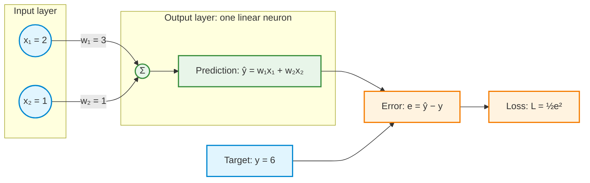
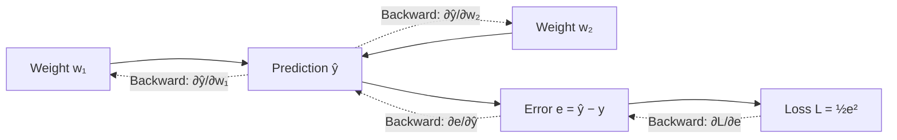
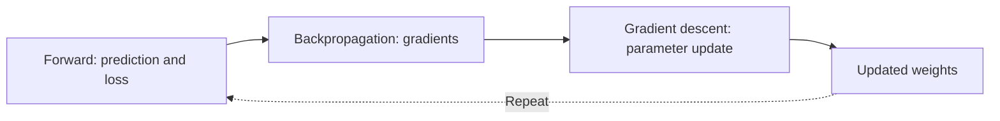
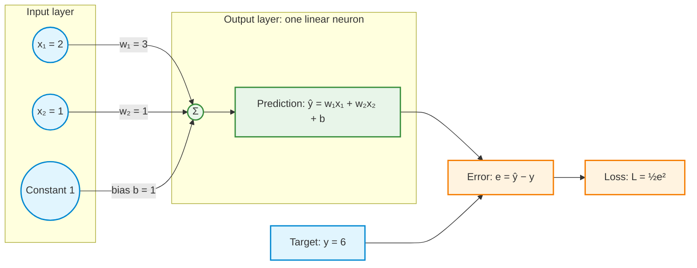
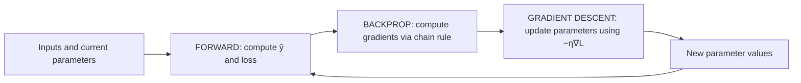

# Activity 2 — From One Weight to Two Weights: Partial Derivatives, Backpropagation, and Gradient Descent

**Guided reinforcement | One linear neuron, two inputs, two weights, and an optional bias**

## How to use this guided activity

This activity reinforces the theory through short calculations and explanations. Attempt each question before opening its worked answer. The emphasis is on explaining the reasoning, not merely obtaining the same numbers.

Use paper or a notebook to record predictions, losses, gradients, and updated parameters. The arithmetic simulations use basic Python; the supplied visualizations use NumPy and Matplotlib where indicated. **For every visualization, run the provided Python code, inspect the resulting figure, and explain what it shows. Creating plotting code from scratch is not an assessed task.** The core tasks are the forward pass, partial derivatives, and one parameter update; repeated-update and learning-rate explorations are extensions.

## Learning objectives

By the end of this activity, the following distinctions should be clear:

1. A **forward pass** produces a prediction and computes a loss.
2. **Backpropagation** applies the chain rule to calculate the gradient of the loss with respect to each trainable parameter.
3. **Gradient descent** uses those gradients and a learning rate to update the parameters.
4. A **partial derivative** measures how the loss changes when *one parameter* changes while the other parameters are held fixed.
5. A **bias** adds another trainable parameter; its gradient is calculated in the same way.

> **Key distinction:** Backpropagation computes gradients; gradient descent uses them to update parameters. Backpropagation is not itself the parameter-update step.

---

## 1. The network: two inputs, two weights, no bias

The model predicts a continuous output:

$$
\hat y = w_1x_1 + w_2x_2
$$

For one training example, use these values:

| Quantity | Value |
|---|---:|
| First input, $x_1$ | 2 |
| Second input, $x_2$ | 1 |
| Target output, $y$ | 6 |
| Initial first weight, $w_1$ | 3 |
| Initial second weight, $w_2$ | 1 |
| Learning rate, $\eta$ | 0.1 |
| Loss function | $L=\tfrac12(\hat y-y)^2$ |



There is only **one output neuron**. There is no hidden layer or nonlinear activation. The output uses the identity (linear) activation, so the weighted sum is the prediction.

## 2. Forward pass: prediction, error, loss

**Question 1:** Using the initial values above, calculate the prediction, signed error, and half squared-error loss. What does the loss tell you, and what does it not tell you?

<details>
<summary>Show worked answer</summary>

The **forward pass** evaluates the network from inputs to loss using the current weights.

**Prediction**

$\displaystyle \hat y=w_1x_1+w_2x_2=(3)(2)+(1)(1)=\boxed{7}$

**Error**

$\displaystyle e=\hat y-y=7-6=\boxed{1}$

**Loss**

$\displaystyle L=\frac12(\hat y-y)^2=\frac12(1)^2=\boxed{0.5}$

The loss measures the size of the prediction error. It does **not** directly tell which weight to change or by how much.

</details>

## 3. Why partial derivatives are needed

With one weight, a derivative describes how the loss changes as that weight changes. With two weights, the loss depends on **both** $w_1$ and $w_2$:

$$
L(w_1,w_2)=\frac12(w_1x_1+w_2x_2-y)^2
$$

For the numerical example:

$$
L(w_1,w_2)=\frac12(2w_1+w_2-6)^2
$$

Two separate questions are required:

- $\frac{\partial L}{\partial w_1}$: How does loss change when $w_1$ changes and $w_2$ stays fixed?
- $\frac{\partial L}{\partial w_2}$: How does loss change when $w_2$ changes and $w_1$ stays fixed?

The partial-derivative symbol $\partial$ signals that the function has multiple independent variables. **It does not mean a partial differential equation is being solved.**

## 4. Backpropagation: calculate both gradients

**Question 2:** Apply the chain rule to calculate both partial derivatives. Which quantities are held fixed for each derivative? Explain the signs of the two results.

<details>
<summary>Show worked answer</summary>

Backpropagation works backward through the computation, applying the **chain rule**. It calculates the derivatives needed for the parameter update but does not change weights.



### 4.1 Shared part of the chain rule

With $e=\hat y-y$, the derivative of the loss with respect to the error is

$\displaystyle \frac{\partial L}{\partial e}=e=1$

The derivative of error with respect to prediction is

$\displaystyle \frac{\partial e}{\partial\hat y}=1$

### 4.2 Gradient with respect to $w_1$

The prediction is $\hat y=w_1x_1+w_2x_2$. When differentiating with respect to $w_1$, $x_1,x_2,w_2$ are fixed:

$\displaystyle \frac{\partial\hat y}{\partial w_1}=x_1=2$

By the chain rule:

$\displaystyle \frac{\partial L}{\partial w_1} =\frac{\partial L}{\partial e} \frac{\partial e}{\partial\hat y} \frac{\partial\hat y}{\partial w_1}$

$\displaystyle =e\cdot1\cdot x_1$

$\displaystyle =1\cdot2=\boxed{2}$

### 4.3 Gradient with respect to $w_2$

When differentiating with respect to $w_2$, $x_1,x_2,w_1$ are fixed:

$\displaystyle \frac{\partial\hat y}{\partial w_2}=x_2=1$

Again, by the chain rule:

$\displaystyle \frac{\partial L}{\partial w_2} =\frac{\partial L}{\partial e} \frac{\partial e}{\partial\hat y} \frac{\partial\hat y}{\partial w_2}$

$\displaystyle =e\cdot1\cdot x_2$

$\displaystyle =1\cdot1=\boxed{1}$

**Both gradients together form a vector:**

$\displaystyle \nabla L=\begin{bmatrix}\frac{\partial L}{\partial w_1}\\\frac{\partial L}{\partial w_2}\end{bmatrix} =\boxed{\begin{bmatrix}2\\1\end{bmatrix}}$

The positive components indicate that *slightly increasing* either weight at the current point would increase the loss.

</details>

## 5. Gradient descent: update both weights

**Question 3:** Use learning rate 0.1 to update both weights, then calculate the new prediction and loss. Evaluate both gradients at the same original parameter values before changing either weight.

<details>
<summary>Show worked answer</summary>

Gradient descent is the **optimizer**. It uses the gradients calculated by backpropagation and a learning rate $\eta$:

$\displaystyle w_{1,\mathrm{new}} = w_{1,\mathrm{old}}-\eta\frac{\partial L}{\partial w_1}$

$\displaystyle w_{2,\mathrm{new}} = w_{2,\mathrm{old}}-\eta\frac{\partial L}{\partial w_2}$

With $\eta=0.1$:

$\displaystyle w_{1,\mathrm{new}}=3-0.1(2)=\boxed{2.8}$

$\displaystyle w_{2,\mathrm{new}}=1-0.1(1)=\boxed{0.9}$

A new forward pass evaluates the updated model:

$\displaystyle \hat y=(2.8)(2)+(0.9)(1)=\boxed{6.5}$

$\displaystyle L=\frac12(6.5-6)^2=\boxed{0.125}$

**The loss fell from 0.5 to 0.125 after one weight update.**



</details>

### Directions and movement: a hill metaphor

Imagine a landscape whose height is the loss. The position is the current pair of weights $(w_1,w_2)$.

- **Backpropagation gives a compass and slope readings:** it computes the gradient, which points in the direction of the steepest **uphill** increase in loss (using the standard Euclidean notion of distance).
- **Gradient descent takes the step:** it moves in the **negative-gradient direction**, toward lower loss, with step size controlled by the learning rate.
- The gradient contains **both direction and magnitude**. The learning rate scales how far the parameters move.

The metaphor is therefore: **backpropagation identifies the slope; gradient descent makes the move.** Backpropagation does not move the weights, and the raw gradient points uphill, not downhill.

Both gradients must be evaluated at the same old parameter vector. Successive assignment lines in Python still implement this simultaneous update when both gradients (or their shared error) have already been calculated. Do not recompute the second gradient using an already updated first weight.

### Repeat the cycle

**Question 4:** Predict what happens over repeated updates. Calculate the second update. Does a zero-loss prediction identify a unique pair of weights?

<details>
<summary>Show worked answer</summary>

| Update count | $w_1$ | $w_2$ | Prediction $\hat y$ | Loss $L$ |
|---:|---:|---:|---:|---:|
| 0 | 3.0000 | 1.0000 | 7.0000 | 0.500000 |
| 1 | 2.8000 | 0.9000 | 6.5000 | 0.125000 |
| 2 | 2.7000 | 0.8500 | 6.2500 | 0.031250 |
| 3 | 2.6500 | 0.8250 | 6.1250 | 0.007813 |
| 4 | 2.6250 | 0.8125 | 6.0625 | 0.001953 |

One possible zero-loss solution is $(w_1,w_2)=(2.6,0.8)$, which is the limiting solution reached by these updates. However, **it is not the only solution**. Every pair satisfying $2w_1+w_2=6$ yields zero loss on this one example. With one data point and two adjustable weights, the target does not uniquely determine both weights.

</details>

## 6. Try the Python simulation: two weights, no bias

The following implementation uses basic Python arithmetic. Each loop iteration performs a forward pass, backpropagation, and a gradient descent update.

```python
x1, x2 = 2.0, 1.0
y = 6.0
w1, w2 = 3.0, 1.0
learning_rate = 0.1

print("step      w1      w2   prediction       loss")
for step in range(8):
    # Forward pass
    y_hat = w1 * x1 + w2 * x2
    error = y_hat - y
    loss = 0.5 * error**2
    print(f"{step:>4}  {w1:7.4f} {w2:7.4f} {y_hat:12.4f} {loss:10.6f}")

    # Backpropagation (partial derivatives)
    dL_dw1 = error * x1
    dL_dw2 = error * x2

    # Gradient descent (simultaneous update)
    w1 = w1 - learning_rate * dL_dw1
    w2 = w2 - learning_rate * dL_dw2
```

## 7. Explore the two-weight loss landscape with supplied Python code

The two-weight loss is a surface $L(w_1,w_2)$. A contour plot looks down on this surface. Each contour joins weight pairs with the same loss.

The dashed line $2w_1+w_2=6$ is a **valley of zero-loss solutions**. Gradient descent moves from $(3,1)$ toward that line. **Try the supplied code below to see the contour plot; the task is to interpret the trajectory, not to implement plotting.**

<details>
<summary>Show supplied Python code — Contour map and gradient descent trajectory</summary>

```python
import numpy as np
import matplotlib.pyplot as plt

x1, x2, y = 2.0, 1.0, 6.0
eta = 0.1
w1, w2 = 3.0, 1.0
path = [(w1, w2)]

for _ in range(12):
    error = w1*x1 + w2*x2 - y
    w1 -= eta * error * x1
    w2 -= eta * error * x2
    path.append((w1, w2))

w1_grid = np.linspace(1.4, 3.5, 300)
w2_grid = np.linspace(-0.6, 3.6, 300)
W1, W2 = np.meshgrid(w1_grid, w2_grid)
L = 0.5 * (2*W1 + W2 - 6)**2

plt.figure(figsize=(8, 6))
contours = plt.contour(W1, W2, L,
    levels=[0.01, 0.05, 0.125, 0.5, 1, 2, 4, 8])
plt.clabel(contours, inline=True, fontsize=8)
plt.plot(w1_grid, 6 - 2*w1_grid, "--", label="All zero-loss solutions")
path = np.array(path)
plt.plot(path[:, 0], path[:, 1], "o-", label="Gradient descent")
plt.annotate("Start (3, 1)", path[0], xytext=(8, 12), textcoords="offset points")
plt.annotate("Approaching (2.6, 0.8)", path[-1],
             xytext=(-125, -28), textcoords="offset points")
plt.xlabel("Weight w1")
plt.ylabel("Weight w2")
plt.title("Two-weight loss contours and gradient descent")
plt.xlim(1.4, 3.5)
plt.ylim(-0.6, 3.6)
plt.legend()
plt.grid(alpha=0.2)
plt.tight_layout()
plt.show()
```

</details>

## 8. Experiment: different learning rates

**Extension question 5:** Restart from `(3,1)` for each learning rate in the table below. Compare one update at rates 0.1, 0.2, 0.4, and 0.5. Which reduces loss, which fits exactly, and which fails to reduce it? After checking, use the code to investigate repeated updates.

<details>
<summary>Show worked answer</summary>

The **learning rate** $\eta$ multiplies each gradient during an update. It controls step size, not the gradient itself.

Starting from $(w_1,w_2)=(3,1)$, the initial gradient is $(2,1)$. The following results show the outcome **after one update**:

| Learning rate $\eta$ | Updated $(w_1,w_2)$ | New prediction | New loss | Interpretation |
|---:|---|---:|---:|---|
| 0.05 | (2.90, 0.95) | 6.75 | 0.28125 | Small, steady step |
| 0.10 | (2.80, 0.90) | 6.50 | 0.12500 | Loss decreases |
| 0.20 | (2.60, 0.80) | 6.00 | 0.00000 | Exact fit in one step for this example |
| 0.30 | (2.40, 0.70) | 5.50 | 0.12500 | Overshoots but can converge |
| 0.40 | (2.20, 0.60) | 5.00 | 0.50000 | Oscillates without reducing loss |
| 0.50 | (2.00, 0.50) | 4.50 | 1.12500 | Loss increases; repeated steps diverge |

Why these particular outcomes? For the no-bias example, the prediction error $e=2w_1+w_2-6$ after an update satisfies

$\displaystyle \boxed{e_{\mathrm{new}}=(1-5\eta)e_{\mathrm{old}}}$

Thus repeated updates reduce the magnitude of the error when $\lvert1-5\eta\rvert<1$, equivalent to $0<\eta<0.4$. This stability interval is **specific to this example**, not a universal recommendation for learning rates in neural networks. At $\eta=0.2$, the error becomes zero after one update. At $\eta=0.4$, the error alternates sign but keeps the same magnitude.

</details>

**Try the code:** Run the following supplied Python program to compare the learning rates visually. Explain the differences between decreasing loss, oscillation, and divergence. Writing the plotting code is not required.

<details>
<summary>Show supplied Python code — Learning-rate comparison</summary>

```python
import matplotlib.pyplot as plt

x1, x2, y = 2.0, 1.0, 6.0
rates = [0.05, 0.10, 0.20, 0.30, 0.40, 0.50]
steps = 12

plt.figure(figsize=(9, 5))
for eta in rates:
    w1, w2 = 3.0, 1.0
    losses = []
    for step in range(steps + 1):
        error = w1*x1 + w2*x2 - y
        losses.append(0.5*error**2)
        if step < steps:
            # Gradients are computed from the current parameters
            dw1, dw2 = error*x1, error*x2
            w1 -= eta*dw1
            w2 -= eta*dw2
    # Positive floor permits displaying zero loss on a log scale
    plt.semilogy(range(steps + 1),
                 [max(value, 1e-12) for value in losses],
                 marker="o", label=f"learning rate = {eta:.2f}")

plt.xlabel("Number of updates")
plt.ylabel("Loss (log scale; zeros shown at 1e-12)")
plt.title("Effect of learning rate on training loss")
plt.xticks(range(steps + 1))
plt.grid(alpha=0.25)
plt.legend()
plt.tight_layout()
plt.show()
```

</details>

## 9. Adding a bias: three trainable parameters

Now extend the **same architecture** by adding a trainable bias $b$:

$$
\boxed{\hat y=w_1x_1+w_2x_2+b}
$$

The bias allows the output to shift even when both inputs are zero. Equivalently, the bias can be represented as a weight on a constant input of 1.



For this separate bias demonstration, restart at $w_1=3$, $w_2=1$, and set $b=1$. Keep $x_1=2$, $x_2=1$, $y=6$, and $\eta=0.1$.

### 9.1 Forward pass with bias

**Question 6:** After the stated restart with bias 1, calculate the prediction, error, and loss.

<details>
<summary>Show worked answer</summary>

$\displaystyle \hat y=(3)(2)+(1)(1)+1=\boxed{8}$

$\displaystyle e=8-6=\boxed{2}$

$\displaystyle L=\frac12(2)^2=\boxed{2}$

</details>

### 9.2 Backpropagation with bias

**Question 7:** Calculate the gradients for both weights and the bias. Why does differentiating with respect to the bias contribute a factor of 1?

<details>
<summary>Show worked answer</summary>

The same error influences **three** trainable parameters:

$\displaystyle \frac{\partial L}{\partial w_1}=e x_1=2(2)=\boxed{4}$

$\displaystyle \frac{\partial L}{\partial w_2}=e x_2=2(1)=\boxed{2}$

Since $\partial\hat y/\partial b=1$:

$\displaystyle \frac{\partial L}{\partial b}= \frac{\partial L}{\partial e} \frac{\partial e}{\partial\hat y} \frac{\partial\hat y}{\partial b} =e(1)(1)=\boxed{2}$

The gradient vector is now

$\displaystyle \nabla L=\begin{bmatrix}\frac{\partial L}{\partial w_1}\\\frac{\partial L}{\partial w_2}\\\frac{\partial L}{\partial b}\end{bmatrix} =\boxed{\begin{bmatrix}4\\2\\2\end{bmatrix}}$

</details>

### 9.3 Gradient descent with bias

**Question 8:** Update all three parameters using learning rate 0.1. Check the new prediction and loss.

<details>
<summary>Show worked answer</summary>

The same learning rate scales each gradient:

$\displaystyle w_{1,\mathrm{new}} = 3-0.1(4)=\boxed{2.6}$

$\displaystyle w_{2,\mathrm{new}} = 1-0.1(2)=\boxed{0.8}$

$\displaystyle b_{\mathrm{new}} = 1-0.1(2)=\boxed{0.8}$

Verify with another forward pass:

$\displaystyle \hat y=(2.6)(2)+(0.8)(1)+0.8=\boxed{6.8}$

$\displaystyle L=\frac12(6.8-6)^2=\boxed{0.32}$

**The loss fell from 2 to 0.32 after one update.** The process has not changed: forward pass computes the loss, backpropagation computes gradients, and gradient descent updates every trainable parameter.

</details>

### 9.4 Try the Python simulation with bias

```python
x1, x2 = 2.0, 1.0
y = 6.0
w1, w2, b = 3.0, 1.0, 1.0
learning_rate = 0.1

print("step      w1      w2       b   prediction      loss")
for step in range(8):
    # Forward pass
    y_hat = w1*x1 + w2*x2 + b
    error = y_hat - y
    loss = 0.5*error**2
    print(f"{step:>4}  {w1:7.4f} {w2:7.4f} {b:7.4f} {y_hat:11.4f} {loss:9.5f}")

    # Backpropagation: calculate all gradients first
    dL_dw1 = error*x1
    dL_dw2 = error*x2
    dL_db  = error

    # Gradient descent: update all parameters
    w1 -= learning_rate*dL_dw1
    w2 -= learning_rate*dL_dw2
    b  -= learning_rate*dL_db
```

**Try the code:** Run the supplied program to view both loss curves. Describe what differs at the start and why this is not a controlled comparison of learning speed. Creating the plot is not an assessed task.

<details>
<summary>Show supplied Python code — Compare training loss with and without bias</summary>

```python
import matplotlib.pyplot as plt

x1, x2, y = 2.0, 1.0, 6.0
eta = 0.1
updates = 12

plt.figure(figsize=(8, 5))
for use_bias in [False, True]:
    w1, w2 = 3.0, 1.0
    b = 1.0 if use_bias else 0.0
    losses = []

    for step in range(updates + 1):
        y_hat = w1*x1 + w2*x2 + b
        error = y_hat - y
        losses.append(0.5*error**2)
        if step < updates:
            g1, g2, gb = error*x1, error*x2, error
            w1 -= eta*g1
            w2 -= eta*g2
            if use_bias:
                b -= eta*gb

    label = "With bias (initial b = 1)" if use_bias else "No bias"
    plt.plot(range(updates + 1), losses, marker="o", label=label)

plt.xlabel("Number of updates")
plt.ylabel("Loss")
plt.title("Training loss: two weights, with and without bias")
plt.xticks(range(updates + 1))
plt.grid(alpha=0.25)
plt.legend()
plt.tight_layout()
plt.show()
```

</details>

**Interpretation note:** The two runs start with different predictions and different initial losses because the initial bias differs. This figure demonstrates two valid training procedures; it is **not** a controlled test showing that adding a bias necessarily improves learning speed. One training example also cannot uniquely identify three parameters.

---

## 10. Concept questions: reveal the answers

**Q1. What is the difference between a derivative and a partial derivative?**

<details>
<summary>Show answer</summary>

A derivative measures the rate of change of a function with respect to its variable. A partial derivative measures the rate of change with respect to **one variable** of a function that depends on multiple variables, while the others are held constant. For $L(w_1,w_2)$, the quantities $\partial L/\partial w_1$ and $\partial L/\partial w_2$ are separate partial derivatives.

</details>

**Q2. How is the derivative of the loss with respect to the first weight calculated?**

<details>
<summary>Show answer</summary>

For $\hat y=w_1x_1+w_2x_2$ and $L=\tfrac12(\hat y-y)^2$, the chain rule gives

$\displaystyle \frac{\partial L}{\partial w_1}= \frac{\partial L}{\partial e} \frac{\partial e}{\partial\hat y} \frac{\partial\hat y}{\partial w_1} =e\cdot1\cdot x_1.$

At $e=1$ and $x_1=2$, the gradient is **2**. The second weight is treated as constant for this calculation.

</details>

**Q3. Does backpropagation update the weights?**

<details>
<summary>Show answer</summary>

**No.** Backpropagation computes gradients by working backward through the operations of the network. Gradient descent (or another optimizer) uses those gradients to update the weights and bias.

</details>

**Q4. What is the learning rate?**

<details>
<summary>Show answer</summary>

The learning rate $\eta$ is the scalar that multiplies the gradient in an update:

$\displaystyle w_{\mathrm{new}}=w_{\mathrm{old}}-\eta\frac{\partial L}{\partial w}.$

It controls the **size of the adjustment**. It does not change the derivative calculated by backpropagation at the current parameter values.

</details>

**Q5. Why is the learning rate needed? What happens if it is too small or too large?**

<details>
<summary>Show answer</summary>

A gradient provides a direction and magnitude, but an optimizer still needs a rule for choosing the step length. A small learning rate usually produces modest, stable changes but may require many updates. A large learning rate can overshoot the minimum, oscillate, or cause the loss to grow. The useful range depends on the model, data, loss, and parameterization.

</details>

**Q6. If the gradient points uphill, why subtract it?**

<details>
<summary>Show answer</summary>

The gradient points in the local direction of steepest increase in loss. Minimizing loss requires moving the opposite way, hence the **minus sign** in gradient descent. For the initial two-weight example, $\nabla L=(2,1)$, so the update direction is $(-2,-1)$.

</details>

**Q7. Why is the derivative of prediction with respect to bias equal to 1?**

<details>
<summary>Show answer</summary>

For $\hat y=w_1x_1+w_2x_2+b$, the bias enters as $+b$. Holding everything else constant, increasing $b$ by a small amount increases $\hat y$ by the same amount. Therefore $\partial\hat y/\partial b=1$ and $\partial L/\partial b=e$.

</details>

**Q8. Does loss equal to zero determine the true weights uniquely?**

<details>
<summary>Show answer</summary>

**Not with this single training example.** Without bias, any $(w_1,w_2)$ satisfying $2w_1+w_2=6$ gives the correct prediction. With bias, any $(w_1,w_2,b)$ satisfying $2w_1+w_2+b=6$ does so. Additional independent examples or constraints are needed to identify a unique solution.

</details>

**Q9. How does this example connect to deeper neural networks?**

<details>
<summary>Show answer</summary>

A deep network has many intermediate operations. The forward pass composes them to produce predictions and loss. Backpropagation repeatedly applies the same chain rule through those operations to compute gradients for every trainable parameter. The optimizer then updates those parameters. The procedure is the same in principle, even though the chain of derivatives is longer.

</details>

## Transfer question: change the sign of an input

Restart at $w_1=3$, $w_2=1$, $y=6$, with no bias and learning rate $0.1$. Keep $x_1=2$ but change $x_2$ to $-1$. Predict the signs of both gradients. Then calculate the prediction, loss, gradients, updated weights, and new loss. Why do the weights move in different directions?

<details>
<summary>Show worked answer</summary>

The prediction is $3(2)+1(-1)=5$, so $e=-1$ and $L=0.5$. The gradients are $ex_1=-2$ and $ex_2=+1$. The updated weights are $(3.2,0.9)$, giving prediction $3.2(2)-0.9=5.5$ and loss $0.125$.

The same negative error is multiplied by inputs with opposite signs, giving opposite gradient signs. Subtracting these gradients increases $w_1$ and decreases $w_2$; both changes raise the prediction toward 6.

</details>

## Final summary



- **Forward pass:** calculates the prediction, error, and loss.
- **Backpropagation:** calculates the partial derivatives of the loss with respect to each parameter.
- **Gradient descent:** uses the learning rate and gradients to change the parameters.
- **Bias:** is an additional parameter with its own gradient and update.
- **Learning rate:** sets the step size; overly large values can prevent convergence.

**One-sentence mental model:** Backpropagation identifies the local slopes; gradient descent moves the parameters in the opposite direction of those slopes to reduce loss.
