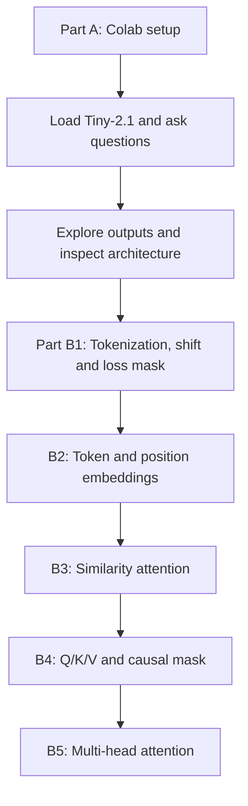
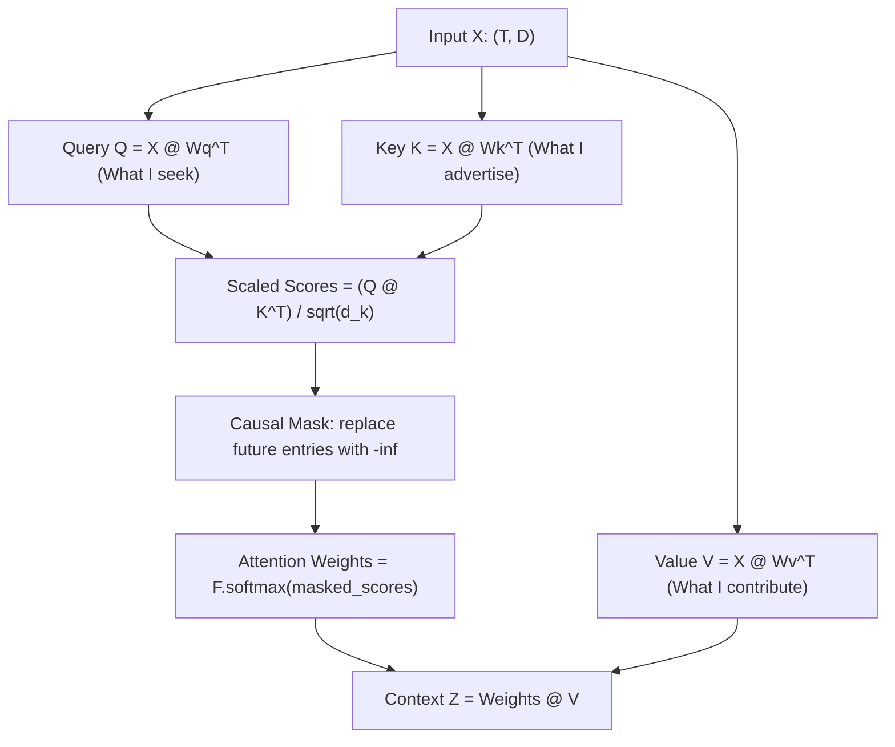

# Activity 1 — Run Tiny-2.1, Then Explore How Attention Works

This activity has **two parts**. Complete Part A first, then continue to Part B **in the same Google Colab session**. The exercises in Part B reuse the model and imports from Part A; you do **not** need to download or load the model again.

- **Part A — Run and explore Tiny-2.1:** Get the model working, ask questions, observe its behavior, and inspect the architecture.
- **Part B — Investigate the internals:** Tokenization, embeddings, similarity, Q/K/V, causal masking, and multi-head attention. Work through the small calculations before checking the corresponding model operation.

Open the supplied interactive HTML visualizations alongside the exercises if helpful (Visualizations 1–5). The small 3D examples below match the numerical vectors used in Visualizations 2–4. The real model uses 96 features per token.



---

# Part A — Run Tiny-2.1 and Explore Its Behavior

## A0 — Set up Google Colab

Run these cells **once**, in order, in a fresh Colab notebook.

**Cell A1 — Get the project files**

```python
!git clone https://github.com/WollyMonjac/Tiny-2.1.git
%cd /content/Tiny-2.1/training
```

**Cell A2 — Load the pretrained PyTorch model**

```python
import torch
import train2

model = train2.load_model("tiny2.pt")
model.eval()

print("Tiny-2.1 loaded successfully")
print("PyTorch version:", torch.__version__)
```

`train2.load_model()` is provided by the repository. `model.eval()` switches the model to evaluation mode. We will reuse this `model` object throughout Part B.

## A1 — Ask the model questions

**Cell A3 — Run a small question-and-answer experiment**

```python
questions = [
    "what is 2+2?",
    "what is the capital of france?",
    "what is the largest planet?",
    "what is the capital of mars?",
]

answers = train2.answer_many(model, questions)
for question, answer in answers.items():
    print(f"Q: {question}\nA: {answer}\n")
```

**Observe before checking explanations:** Which answers look reasonable? Which question has a false assumption? Are the answers equally reliable?

**Cell A4 — Try two questions of your own**

```python
my_questions = [
    "what is 3+5?",
    "what is the capital of jupiter?",
]

for question, answer in train2.answer_many(model, my_questions).items():
    print(f"Q: {question}\nA: {answer}\n")
```

Change the strings in `my_questions` and rerun the cell. Different wording may change the output. The exercise is about observing actual behavior; it does not assume a particular answer.

<details>
<summary>Hint — What is the model doing?</summary>

The model predicts the answer one character at a time, based on the current text prefix. A fluent-looking answer is not a guarantee that the factual claim is correct.

</details>

## A2 — Inspect the model architecture

**Cell A5 — Display the model and important dimensions**

```python
print(model)
print("Total parameters:", f"{sum(p.numel() for p in model.parameters()):,}")
print("Token embedding table:", tuple(model.emb.weight.shape))
print("Position embedding table:", tuple(model.pos.weight.shape))
print("Transformer blocks:", len(model.blocks))
print("Attention Q projection:", tuple(model.blocks[0].q.weight.shape))
```

### Questions to discuss

**Q A1:** Why are there four linear projections (`q`, `k`, `v`, `o`) in every Transformer block? Why do the token and position embeddings have different numbers of rows?

<details>
<summary>Hint</summary>

Look at the names `q`, `k`, `v`, `o`, the vocabulary size `VOCAB = 97`, and the maximum sequence length `CTX = 128`.

</details>

<details>
<summary>Answer</summary>

* `q`, `k`, and `v` produce Query, Key, and Value representations. `o` combines the outputs of the attention heads.
* `emb` contains 97 vectors of width 96, one for each supported token ID.
* `pos` contains 128 vectors of width 96, one for each supported position index.
* Four Transformer blocks run sequentially; inside each block, four attention heads can operate in parallel.

</details>

**Q A2:** Why might the model invent an answer to `"what is the capital of mars?"` instead of pointing out that Mars has no capital?

<details>
<summary>Hint</summary>

Consider what often follows the text pattern `"what is the capital of ...?"` in question-answer examples.

</details>

<details>
<summary>Answer</summary>

The model generates characters according to patterns learned during training. It does not independently verify the premise of a question. It may produce a plausible-looking city name even though the premise is false. The actual output can vary, so inspect what your model generated.

</details>

---

# Part B — Investigate the Inner Workings of Attention

> [!NOTE]
> **Continue in the same Colab session after Part A.** The following sections assume `train2` and `model` are already available. Core tasks are intended for in-class work; optional and take-home tasks are clearly identified. Discuss each **Why?** question before opening the expandable Hint or Answer.

**Cell B0 — Import the mathematical and plotting tools**

```python
import math
import numpy as np
import torch
import torch.nn.functional as F
import matplotlib.pyplot as plt
```

The small calculations in B2–B4 use illustrative 3D vectors that are consistent with Visualizations 2–4. In the real model, we inspect tensors of width `D = 96`. The B5 reshape exercise intentionally uses four features so that it can split them evenly into two heads.

## B1 — Tokenization, Next-Token Shift, and Loss Masking

### Step B1a — Small Example by Hand & Code (3–7 characters)
Inspect how text turns into integer IDs and how training constructs input–target pairs with a loss mask.

```python
# Tiny-2.1 character rule (from train2.py):
#   0      -> padding
#   1      -> newline '\n'
#   2..96  -> ASCII(c) - 30

word = "cat"
word_ids = train2.encode(word)
print("Word:", word, "-> IDs:", word_ids, "-> Decoded:", repr(train2.decode(word_ids)))

q, a = "2+2?", "4"
full_text = q + "\n" + a + "\n"
ids = train2.encode(full_text)

# Loss mask: 0 for question + first '\n', 1 for answer + final '\n'
mask = [0] * (len(q) + 1) + [1] * (len(ids) - len(q) - 1)

inputs_x  = ids[:-1]
targets_y = ids[1:]
loss_mask = mask[1:]

print("\nAligned training table for '2+2?\\n4\\n':")
for pos in range(len(inputs_x)):
    in_c  = repr(train2.decode([inputs_x[pos]]))[1:-1]
    tgt_c = repr(train2.decode([targets_y[pos]]))[1:-1]
    print(f"  pos {pos}: input={in_c:>3} (ID {inputs_x[pos]:2d}) -> target={tgt_c:>3} (ID {targets_y[pos]:2d}) | mask={loss_mask[pos]}")
```

### Code Explanation
* `train2.encode(s)`: Converts `'\n'` to `1` and printable ASCII (`32..126`) to `ord(c) - 30` (values `2..96`).
* `ids[:-1]` and `ids[1:]`: Creates the training pair by shifting the sequence one step.
* `mask = [0]*(len(q)+1) + [1]*(...)`: Sets the question tokens to `0` and answer tokens to `1`.
* `loss_mask = mask[1:]`: Aligns mask values with `targets_y` so the cross-entropy loss only computes gradients for the answer tokens.

### "Why?" Questions

**Q B1.1:** Why does `Tiny-2.1` tokenize **individual characters** (`VOCAB = 97`) instead of whole English words or subwords (which commonly use `VOCAB = 32,000+`)?

<details>
<summary>Hint</summary>

Multiply `VOCAB × 96` for both vocabulary sizes to compare embedding parameter counts.

</details>

<details>
<summary>Answer</summary>

With `D = 96`, a 97-character embedding table requires only $97 \times 96 = 9,312$ parameters (~37 KB). A 32,000-token subword vocabulary would require $32,000 \times 96 \approx 3.07\text{ million}$ parameters—nearly $8\times$ larger than the entire `Tiny-2.1` model combined. This vocabulary covers supported printable ASCII characters and newline; unsupported characters require additional handling.

</details>

---

**Q B1.2:** Why does token ID `1` (`"\n"`) appear **twice** in `"2+2?\n4\n"`, and why is the first `"\n"` masked with `0` while the second `"\n"` is masked with `1`?

<details>
<summary>Hint</summary>

Think about which newline is part of the prompt vs. which newline signals the model to stop generating.

</details>

<details>
<summary>Answer</summary>

* The **first `\n`** separates the user's question from the answer. It belongs to the input prompt, so its target has a loss mask of `0` (not graded).
* The **second `\n`** marks the end of the answer. Its target has a loss mask of `1` because the model **must learn** to emit token `1` to stop generation.

</details>

---

### Hands-On Task B1: Inspect Target Alignment on a Sentence
Write a short script using `train2.encode` for `"capital of france?\nparis\n"`:
1. Print total sequence length `T`, `inputs_x`, `targets_y`, and `loss_mask`.
2. Count how many target tokens are graded (`sum(loss_mask)`) vs. ignored (`len(loss_mask) - sum(loss_mask)`).

<details>
<summary>Hint</summary>

Use `mask = [0] * (len(q) + 1) + [1] * (len(ids) - len(q) - 1)` where `q = "capital of france?"` and `a = "paris"`.

</details>

<details>
<summary>Answer / Sample Code</summary>

```python
q, a = "capital of france?", "paris"
ids = train2.encode(q + "\n" + a + "\n")
mask = [0] * (len(q) + 1) + [1] * (len(ids) - len(q) - 1)

inputs_x, targets_y, loss_mask = ids[:-1], ids[1:], mask[1:]
print("Total length T:", len(ids))
print("Graded answer tokens:", sum(loss_mask))
print("Ignored question tokens:", len(loss_mask) - sum(loss_mask))
print("Graded targets:", repr(train2.decode([y for y, m in zip(targets_y, loss_mask) if m == 1])))
```
**Expected observation:** Exactly `6` targets (`'p', 'a', 'r', 'i', 's', '\n'`) have `loss_mask == 1`, while the `18` question targets are ignored (`loss_mask == 0`).

</details>

---

## B2 — Token Embeddings and Positional Embeddings

### Step B2a — Small Calculation First (3D Toy Vectors)
Verify token embedding lookup and positional addition using the **same illustrative 3-dimensional vectors** as Visualization 2 for `"2+2?"`. These numbers are chosen for demonstration; they are not the model's learned weights.

```python
# Toy embedding table: row 0 = '2', row 1 = '+', row 2 = '?'
emb_small = torch.tensor([
    [1.0, 0.0, 0.2],  # '2'
    [0.0, 1.0, 0.1],  # '+'
    [0.3, 0.4, 0.9],  # '?'
])

# Toy position table for positions 0, 1, 2, 3
pos_small = torch.tensor([
    [ 0.1,  0.2, 0.0],
    [ 0.2, -0.1, 0.1],
    [ 0.4, -0.1, 0.3],
    [-0.2,  0.3, 0.2],
])

toy_ids = torch.tensor([0, 1, 0, 2], dtype=torch.long)  # '2+2?'

tok_vecs = emb_small[toy_ids]          # (4, 3)
pos_vecs = pos_small[torch.arange(4)]  # (4, 3)
X_small = tok_vecs + pos_vecs          # (4, 3)

print("Token vectors (the two '2' rows are identical):\n", tok_vecs.numpy())
print("Position vectors:\n", pos_vecs.numpy())
print("Combined X = token + position:\n", np.round(X_small.numpy(), 2))
assert tuple(X_small.shape) == (4, 3)
```

**Expected combined vectors**, shared with Visualizations 2, 3, and 4:

| Token position | Vector (3D) |
|---|---|
| First `2` | `[1.10, 0.20, 0.20]` |
| `+` | `[0.20, 0.90, 0.20]` |
| Second `2` | `[1.40, -0.10, 0.50]` |
| `?` | `[0.10, 0.70, 1.10]` |

### Step B2b — Scale Up to `Tiny-2.1` (`D = 96`)
Run the exact same lookup and addition inside `Tiny-2.1`:

```python
ids_22 = torch.tensor([train2.encode("2+2?\n4\n")], dtype=torch.long)  # shape: (1, 7)
T = ids_22.shape[1]

with torch.no_grad():
    tok_96 = model.emb(ids_22)                # shape: (1, 7, 96)
    pos_96 = model.pos(torch.arange(T))       # shape: (7, 96)
    X_96 = tok_96 + pos_96                    # broadcasts (7, 96) -> (1, 7, 96)

print("tok_96 shape:", tuple(tok_96.shape))
print("pos_96 shape:", tuple(pos_96.shape))
print("X_96 shape  :", tuple(X_96.shape))
print("First 5 values of '2' at pos 0:", np.round(X_96[0, 0, :5].numpy(), 3))
print("First 5 values of '2' at pos 2:", np.round(X_96[0, 2, :5].numpy(), 3))
```

### "Why?" Questions

**Q B2.1:** Why do we map integer IDs to `96`-dimensional vectors (`model.emb`) instead of passing raw integer IDs directly into layers?

<details>
<summary>Hint</summary>

What does linear algebra do with scalar numbers? If `'t'` is ID `86` and `' '` is ID `2`, would multiplying by a weight imply `'t'` has $43\times$ the value of a space?

</details>

<details>
<summary>Answer</summary>

Integer IDs impose an artificial ordering and magnitude scale (`86 > 2`) where none exists semantically. Projecting each ID into a `96`-dimensional continuous vector allows the model to learn independent coordinates for each character and group characters with related roles (such as digits or punctuation) near one another in embedding space.

</details>

---

**Q B2.2:** Does an autoregressive Transformer *completely* lose all sense of order without positional embeddings? Why are positional embeddings still essential?

<details>
<summary>Hint</summary>

Review Theory Section 3. Think about what a lower-triangular causal mask does to token visibility: can token 0 see token 3? But can the model easily tell whether a token was 2 steps away vs. 10 steps away?

</details>

<details>
<summary>Answer</summary>

In causal attention, the triangular mask breaks full permutation symmetry because early tokens can only attend to earlier positions while later tokens can attend to more positions. So a causal model is not strictly order-blind. 

However, without explicit positional embeddings, the model cannot readily measure exact token distances, differentiate identical tokens appearing at different positions, or establish absolute slot coordinates. Adding $P[t]$ equips each token with an explicit coordinate in the sequence.

</details>

---

### Hands-On Task B2: Verify Distinct Representations on `"12"` vs. `"21"`
Using `model.emb` and `model.pos`:
1. Compute `tok_12` and `tok_21` (without `model.pos`).
2. Compute `(tok_12[0, 1] - tok_21[0, 0]).abs().max()` (comparing `'2'` in `"12"` with `'2'` in `"21"`).
3. Repeat **after** adding `model.pos(torch.arange(2))`.

<details>
<summary>Hint</summary>

Wrap your evaluation in `with torch.no_grad():` and use `.item()` to extract Python floats.

</details>

<details>
<summary>Answer / Sample Code</summary>

```python
id_12 = torch.tensor([train2.encode("12")], dtype=torch.long)
id_21 = torch.tensor([train2.encode("21")], dtype=torch.long)

with torch.no_grad():
    tok_12 = model.emb(id_12)
    tok_21 = model.emb(id_21)
    diff_no_pos = (tok_12[0, 1] - tok_21[0, 0]).abs().max().item()
    print("Max absolute difference for '2' WITHOUT pos:", diff_no_pos)

    pos_2 = model.pos(torch.arange(2))
    x_12 = tok_12 + pos_2
    x_21 = tok_21 + pos_2
    diff_with_pos = (x_12[0, 1] - x_21[0, 0]).abs().max().item()
    print("Max absolute difference for '2' WITH pos   :", diff_with_pos)
```
**Expected observation:** `diff_no_pos` is `0.0` (both are identical embedding lookups). `diff_with_pos` is positive because position `1` and position `0` add distinct positional coordinates.

</details>

---

## B3 — Similarity-Based Attention Without Learned Q/K/V Projections

### Step B3a — Small Calculation First (Four 3D Token Vectors)
Reuse `X_small` from Step B2a, as in Visualization 3. At this stage **there are no Q/K/V projection matrices and no causal mask**: we calculate similarities between original input vectors and combine those same vectors.

```python
X_tiny = X_small                   # shape (4, 3): '2', '+', '2', '?'

# 1. Dot products: (4, 3) @ (3, 4) = (4, 4)
scores_tiny = X_tiny @ X_tiny.T
print("Raw similarity scores:\n", np.round(scores_tiny.numpy(), 3))

# 2. Softmax along the candidate-token dimension
weights_tiny = F.softmax(scores_tiny, dim=-1)
print("\nAttention weights:\n", np.round(weights_tiny.numpy(), 3))
print("Row sums:", weights_tiny.sum(dim=-1).numpy())

# 3. Weighted sums: (4, 4) @ (4, 3) = (4, 3)
context_tiny = weights_tiny @ X_tiny
print("\nContext vectors:\n", np.round(context_tiny.numpy(), 3))
```

Verify **row 0 (the first `2`)** by hand:

* Dot products with the four positions: approximately `[1.29, 0.44, 1.62, 0.47]`.
* Softmax: approximately `[0.307, 0.131, 0.427, 0.135]` (sum is `1`).
* Weighted-sum context vector: approximately `[0.975, 0.231, 0.450]`.

**Why is the second `2` assigned more weight than the first?** The dot product measures both vector alignment and magnitude, not token identity. The second `2` has a different position embedding, and this **unmasked** toy mechanism allows the first position to look ahead. We introduce the causal mask in B4, which prevents looking at future positions.

### Step B3b — Scale Up to the 4 Tokens `"2+2?"` (Heatmap)
Visualize unprojected similarity-based attention on `X_small` (`4×3`):

```python
scores_4 = X_small @ X_small.T
weights_4 = F.softmax(scores_4, dim=-1)

labels_4 = ["2 (pos 0)", "+", "2 (pos 2)", "?"]
plt.figure(figsize=(4.5, 4))
plt.imshow(weights_4.numpy(), cmap="Blues", vmin=0.0, vmax=0.5)
plt.xticks(range(4), labels_4, rotation=30)
plt.yticks(range(4), labels_4)
plt.title("Unprojected Similarity Attention on '2+2?'")
plt.colorbar(label="Weight")
plt.show()
```

### "Why?" Questions

**Q B3.1:** Why do we use the **dot product** (`X @ X.T`) to score tokens, and why do we apply **`F.softmax`**?

<details>
<summary>Hint</summary>

What geometric relationship does a dot product measure? And what mathematical property turns raw scores into valid blending weights?

</details>

<details>
<summary>Answer</summary>

1. **Dot product:** Depends on both vector direction and magnitude—similarly aligned vectors can yield large positive scores; orthogonal vectors yield `0`; opposing vectors yield negative scores.
2. **Softmax:** Raw dot products are unconstrained real numbers. Softmax maps them to strictly positive values in $(0, 1)$ that sum to `1.0` along each row, turning the context computation into a convex weighted average.

</details>

---

**Q B3.2:** Why is similarity-based attention **without learned Q/K/V projections** inadequate for modeling complex language and reasoning tasks?

<details>
<summary>Hint</summary>

Can a question mark `'?'` be mathematically identical to a digit `'2'`, while still needing to pay attention to that digit?

</details>

<details>
<summary>Answer</summary>

Without learned projections, the raw score matrix $XX^T$ is symmetric, but the row-wise softmax attention weights need not be symmetric. This mechanism is constrained to similarities of the existing input features, including their magnitudes. In language tasks, tokens frequently must attend to functionally dissimilar tokens (e.g., an operator `'+'` or punctuation `'?'` querying numerical arguments). Learned $Q, K, V$ projections enable asymmetric relationships.

</details>

---

### Hands-On Task B3 [Optional In-Class]: Evaluate Unprojected Similarity on Embeddings
Using `X_96` (`(1, 7, 96)` for `"2+2?\n4\n"`) from Step B2b:
1. Extract `X_mat = X_96[0]` (shape `(7, 96)`), compute `scores = X_mat @ X_mat.T`, and apply `F.softmax(scores, dim=-1)`.
2. Print row `4` (`'\n'`). Check whether row `4` assigns **nonzero** weight to future positions (`'4'` and the final `'\n'`).

<details>
<summary>Hint</summary>

Without a causal mask, all positions—including later positions—are available. Sharing a token embedding can increase similarity, but positional vectors also affect the scores.

</details>

<details>
<summary>Answer / Sample Code</summary>

```python
X_mat = X_96[0]                                # (7, 96)
sc_unweighted = X_mat @ X_mat.T                # (7, 7)
w_unweighted = F.softmax(sc_unweighted, dim=-1)

chars_7 = [repr(c)[1:-1] for c in "2+2?\n4\n"]
print("Tokens:", chars_7)
print("Row 4 ('\\n') weights across sequence:", np.round(w_unweighted[4].numpy(), 3))
```
**Expected observation:** Without causal masking, future positions receive nonzero softmax weights. The exact weight assigned to position `6` depends on the learned embeddings and positions; it is not guaranteed to be the largest.

</details>

---

## B4 — Trainable Attention ($Q, K, V$), Scaling ($\sqrt{d_k}$), and Causal Masking



### Step B4a — Small Calculation First (3D Q, K, V, Scaling, and Causal Mask)
Continue with **exactly the same four 3D input vectors** from Steps B2a and B3a. Visualization 4 uses illustrative, fixed matrices to explain what trainable projections can do. Real `Tiny-2.1` uses trained `96 × 96` projection matrices.

```python
# Toy matrices written for right multiplication (matching Visualization 4).
# Each input and projected vector has 3 features.
Wq_small = torch.tensor([
    [1.0, 0.2, 0.0],
    [0.0, 1.0, 0.2],
    [0.1, 0.0, 1.0],
])
Wk_small = torch.tensor([
    [0.6, 0.3, 0.0],
    [0.2, 1.0, 0.1],
    [0.0, 0.2, 0.8],
])
Wv_small = torch.tensor([
    [0.5, 0.0, 0.2],
    [0.0, 0.8, 0.0],
    [0.1, 0.1, 1.2],
])

Q_sm = X_small @ Wq_small          # (4, 3)
K_sm = X_small @ Wk_small          # (4, 3)
V_sm = X_small @ Wv_small          # (4, 3)
print("Q, K, V first-row vectors:", Q_sm[0], K_sm[0], V_sm[0])

# Scale by sqrt(3): each key has d_k = 3 components.
dk = 3
scores_sm = (Q_sm @ K_sm.T) / math.sqrt(dk)   # (4, 4)
print("\nScaled scores:\n", np.round(scores_sm.numpy(), 3))

# A causal mask blocks all positions to the right of the diagonal.
mask_4 = torch.tril(torch.ones(4, 4, dtype=torch.bool))
masked_scores_sm = scores_sm.masked_fill(~mask_4, float("-inf"))
attn_sm = F.softmax(masked_scores_sm, dim=-1)
context_sm = attn_sm @ V_sm                  # (4, 3)
print("\nCausal mask (1 = allowed):\n", mask_4.int().numpy())
print("Causal attention weights:\n", np.round(attn_sm.numpy(), 3))
print("Context vectors:\n", np.round(context_sm.numpy(), 3))
print("First position weights:", attn_sm[0].numpy())  # [1, 0, 0, 0]

# Compare softmax when scores become very large.
print("\nSoftmax [1, 2]:", np.round(F.softmax(torch.tensor([1.0, 2.0]), dim=0).numpy(), 3))
print("Softmax [10, 20]:", np.round(F.softmax(torch.tensor([10.0, 20.0]), dim=0).numpy(), 5))
```

**Expected observation:** In causal attention, the first `2` receives weight `1.0` on itself and `0.0` on every future position. In this toy calculation, $d_k=3$, so scores are divided by $\sqrt{3}$. In the real model, each of four heads has 24 features, so we divide by $\sqrt{24}$.

> **Matrix convention:** The small example writes the toy matrices for `X @ W`. In the real PyTorch model, `torch.nn.Linear` stores a weight matrix and internally computes `X @ weight.T`. Both are just notational conventions for the same kind of learned linear transformation.

### Step B4b — Scale Up to `Tiny-2.1` (`Block 0`)
Inspect the real `n1`, `q`, `k`, and `v` layers inside `Tiny-2.1`:

```python
blk = model.blocks[0]
with torch.no_grad():
    h = blk.n1(X_96)  # RMSNorm before attention -> shape (1, 7, 96)
    Q_96 = blk.q(h)
    K_96 = blk.k(h)
    V_96 = blk.v(h)

print("Q_96, K_96, V_96 shapes:", tuple(Q_96.shape), tuple(K_96.shape), tuple(V_96.shape))
print("Weight matrix shape of blk.q.weight:", tuple(blk.q.weight.shape))  # (96, 96)
```

### "Why?" Questions

**Q B4.1:** Using the search-engine metaphor from the theory lesson, describe the distinct roles of **Query ($Q$)**, **Key ($K$)**, and **Value ($V$)**. Why are three distinct matrices necessary?

<details>
<summary>Hint</summary>

Think of searching a video database: (1) what you enter in the search query box, (2) the title tags and keywords indexed on each video file, and (3) the actual video content streamed to your screen.

</details>

<details>
<summary>Answer</summary>

* **Query ($Q = X W_Q^T$):** Formulates what the current token is seeking from other tokens.
* **Key ($K = X W_K^T$):** Formulates the tags or profile that each token exposes to searchers.
* **Value ($V = X W_V^T$):** The actual informational payload a token transmits if its Key matches a Query.

Having separate learned projections allows the model to match tokens that serve complementary roles without forcing their queries, advertised keys, and transmitted values to be identical.

</details>

---

**Q B4.2:** Compare `blk.q`, `blk.k`, `blk.v` with traditional deep neural network layers:
* Do `q, k, v` apply non-linearities like `ReLU` or `GELU`?
* Where does non-linearity enter the attention mechanism?

<details>
<summary>Hint</summary>

Inspect `Block.forward` in `train2.py`. Notice where activations appear inside the attention mechanism vs. inside the feedforward MLP (`f1 -> relu -> f2`).

</details>

<details>
<summary>Answer</summary>

`blk.q`, `blk.k`, and `blk.v` are **strictly linear projections** without bias or activation functions. The non-linearity in attention originates entirely from the cross-token **`softmax`** operation. Standard pointwise activations like `ReLU` are deferred to the feedforward MLP network (`f1` and `f2`).

</details>

---

**Q B4.3:** Based on your Step B4a experiment comparing `[1.0, 2.0]` with `[10.0, 20.0]`, why is it critical to scale by $\sqrt{d_k}$?

<details>
<summary>Hint</summary>

Look at the probabilities for `[10.0, 20.0]`: one entry is `0.99995` and the other is `0.00005`. What happens to the derivative (gradient) of softmax when outputs saturate at 0 or 1?

</details>

<details>
<summary>Answer</summary>

Under the simplifying assumption of independent, zero-centered, unit-variance query and key components, the dot-product variance grows approximately in proportion to $d_k$. Unchecked large dot products push `softmax` into extreme saturation regions where outputs collapse toward one-hot vectors. In saturation, gradients become vanishingly small, stalling backpropagation. Dividing by $\sqrt{d_k}$ counters that typical growth and helps keep softmax from becoming excessively concentrated.

</details>

---

**Q B4.4:** Why do we overwrite masked positions with **`-inf` before `F.softmax`** instead of setting them to `0` before `softmax` or zeroing them out *after* `softmax`?

<details>
<summary>Hint</summary>

Calculate $e^0$ vs. $e^{-\infty}$. Also check the sum of a probability row if elements are zeroed out after softmax.

</details>

<details>
<summary>Answer</summary>

* Setting masked scores to `0` *before* `softmax` fails because $e^0 = 1.0$, which assigns positive probability mass to future tokens.
* Multiplying by `0` *after* `softmax` breaks the probability distribution because the remaining entries will no longer sum to $1.0$.
* Setting scores to `-inf` before `softmax` guarantees $e^{-\infty} = 0$, completely blocking future positions while naturally renormalizing the remaining valid tokens to sum to $1.0$.

</details>

---

### Hands-On Task B4: Demonstrate Potential Information Leakage Without Causal Masking
Compute attention weights for Head 0 of `model.blocks[0]` on `"2+2?\n4\n"` ($T = 7$) both **with** and **without** the causal mask. Print row `4` (`'\n'`, the token immediately preceding `'4'`):

<details>
<summary>Hint</summary>

Extract the first 24 channels of $Q$ and $K$ (`[:, :, :24]`), scale by $\sqrt{24}$, and compare unmasked `F.softmax(sc, dim=-1)` with masked `F.softmax(sc.masked_fill(mask == 0, float("-inf")), dim=-1)`.

</details>

<details>
<summary>Answer / Sample Code</summary>

```python
q_h0 = Q_96[:, :, :24]  # (1, 7, 24)
k_h0 = K_96[:, :, :24]  # (1, 7, 24)

sc_h0 = (q_h0 @ k_h0.transpose(-2, -1)) / math.sqrt(24)
mask_7 = torch.tril(torch.ones(7, 7))

w_masked   = F.softmax(sc_h0.masked_fill(mask_7 == 0, float("-inf")), dim=-1)
w_unmasked = F.softmax(sc_h0, dim=-1)

chars_7 = [repr(c)[1:-1] for c in "2+2?\n4\n"]
print("Tokens:", chars_7)
print("Row 4 ('\\n') WITH causal mask   :", np.round(w_masked[0, 4].numpy(), 3))
print("Row 4 ('\\n') WITHOUT causal mask:", np.round(w_unmasked[0, 4].numpy(), 3))
```
**Expected observation:** With the causal mask applied, positions `5` (`'4'`) and `6` (`'\n'`) are strictly `0.000`. Without the mask, the unmasked row can access future tokens (such as `'4'` at index `5`), which would enable the model to cheat during training instead of learning to compute the next character.

</details>

---

## B5 — Multi-Head Attention ($H = 4$) and Output Projection $o$

### Step B5a — Small Reshape and Transpose Mechanics ($D = 4$, $H = 2$)
Before splitting 96 dimensions into $4 \times 24$, trace the tensor reshaping used in `train2.py` on a toy tensor with $B=1, T=3, D=4$ split into $H=2$ heads of width $d_k=2$:

```python
# 1 sequence, 3 tokens, 4 features per token
tiny_q = torch.tensor([[
    [10.0, 11.0, 12.0, 13.0],
    [20.0, 21.0, 22.0, 23.0],
    [30.0, 31.0, 32.0, 33.0],
]])  # shape: (1, 3, 4)

B_s, T_s, D_s, H_s = 1, 3, 4, 2
Dh_s = D_s // H_s  # 2

# 1. Reshape last dimension D -> (H=2, Dh=2): shape -> (1, 3, 2, 2)
reshaped = tiny_q.view(B_s, T_s, H_s, Dh_s)

# 2. Swap sequence dimension (1) and head dimension (2): shape -> (1, 2, 3, 2)
split_q = reshaped.transpose(1, 2)

print("Original shape (B, T, D):", tuple(tiny_q.shape))
print("Split shape (B, H, T, Dh):", tuple(split_q.shape))
print("Head 0 across all 3 tokens:\n", split_q[0, 0].numpy())
print("Head 1 across all 3 tokens:\n", split_q[0, 1].numpy())

# 3. Concatenate heads back and verify equality
merged = split_q.transpose(1, 2).reshape(B_s, T_s, D_s)
print("Merged tensor matches original:", torch.equal(merged, tiny_q))
```

### Step B5b — Scale Up to `Tiny-2.1` ($D = 96$, $H = 4$, $d_k = 24$)
Run all 4 heads of `Block 0` on `"what is 2+2?\n"`, plot the attention weight distributions, and verify the manual multi-head code against PyTorch's native `F.scaled_dot_product_attention`:

```python
prompt = "what is 2+2?\n"
p_ids = torch.tensor([train2.encode(prompt)], dtype=torch.long)
T_p = p_ids.shape[1]
chars_p = [repr(c)[1:-1] for c in prompt]

with torch.no_grad():
    x_p = model.emb(p_ids) + model.pos(torch.arange(T_p))
    blk = model.blocks[0]
    h_p = blk.n1(x_p)

    # Tensor splitting helper matching train2.py
    sp = lambda t: t.view(1, T_p, 4, 24).transpose(1, 2)
    qh, kh, vh = sp(blk.q(h_p)), sp(blk.k(h_p)), sp(blk.v(h_p))

    # Manual multi-head causal attention calculation
    scores_p = (qh @ kh.transpose(-2, -1)) / math.sqrt(24)
    mask_p = torch.tril(torch.ones(T_p, T_p))
    attn_p = F.softmax(scores_p.masked_fill(mask_p == 0, float("-inf")), dim=-1)  # (1, 4, T_p, T_p)

    context_p = attn_p @ vh                                                        # (1, 4, T_p, 24)
    context_merged = context_p.transpose(1, 2).reshape(1, T_p, 96)                 # (1, T_p, 96)
    attn_output = blk.o(context_merged)                                            # (1, T_p, 96)

    # Cross-check against optimized PyTorch operator
    fast_a = F.scaled_dot_product_attention(qh, kh, vh, is_causal=True)
    fast_out = blk.o(fast_a.transpose(1, 2).reshape(1, T_p, 96))
    max_discrepancy = (attn_output - fast_out).abs().max().item()
    print("Maximum absolute difference vs F.scaled_dot_product_attention:", max_discrepancy)

# Plot attention distributions across all 4 heads
fig, axes = plt.subplots(2, 2, figsize=(10, 9))
for head_idx, ax in enumerate(axes.flat):
    im = ax.imshow(attn_p[0, head_idx].numpy(), cmap="viridis", vmin=0.0)
    ax.set_title(f"Block 0 — Head {head_idx}")
    ax.set_xticks(range(len(chars_p))); ax.set_xticklabels(chars_p, fontsize=8)
    ax.set_yticks(range(len(chars_p))); ax.set_yticklabels(chars_p, fontsize=8)
fig.colorbar(im, ax=axes.ravel().tolist(), shrink=0.75)
plt.suptitle(f"Block 0 Attention Weight Distributions on '{prompt.strip()}'")
plt.show()
```

> [!WARNING]
> **Interpreting Early-Layer Attention Plots:**
> The 4 heatmaps above illustrate **how particular heads distribute routing weights across tokens** in the first block. They do **not** serve as proof that a head "knows arithmetic" or has a permanent, human-interpretable linguistic assignment. True computational processing is distributed across multiple layers and subsequent MLP transformations.

### "Why?" Questions

**Q B5.1:** Why does `sp` transpose dimensions `(1, 2)` (`(B, T, H, Dh) → (B, H, T, Dh)`) before multiplying `qh @ kh.transpose(-2, -1)`?

<details>
<summary>Hint</summary>

PyTorch matrix multiplication (`@`) performs batch matrix multiplication on the final two dimensions of a tensor.

</details>

<details>
<summary>Answer</summary>

By arranging the tensor as `(B, H, T, Dh)`, PyTorch treats both `B` (batch) and `H` (head) as batch dimensions. The `@` operator computes `(T, Dh) @ (Dh, T) = (T, T)` for all heads simultaneously in parallel, avoiding a slow sequential loop over heads.

</details>

---

**Q B5.2:** Why do we split the $D=96$ representation into $H=4$ heads of dimension $24$ instead of running a single 96-dimensional attention head? And why is the output projection `blk.o` needed?

<details>
<summary>Hint</summary>

If you only have one head, each token can only form a single attention distribution over past tokens. After concatenating the outputs of 4 heads side-by-side, have their features been combined yet?

</details>

<details>
<summary>Answer</summary>

* **Multiple Heads ($4 \times 24$):** Allows different heads to focus on distinct relationships concurrently (e.g., one head attending to immediate neighbors, another attending to whitespace boundaries, and another attending to operator symbols).
* **Output Projection (`blk.o`):** Concatenation simply places four 24-dimensional outputs side by side. The linear layer `blk.o` ($96 \times 96$) projects and mixes information across all four heads into a unified 96-dimensional representation.

</details>

---

### Hands-On Task B5 [Take-Home Challenge]: Analyze Head Attention Distributions
Using `attn_p` from Step B5b:
1. Write a function that prints the **top-3 attended tokens** for the final token `'\n'` (row index `-1`) across all 4 heads of Block 0.
2. Evaluate two prompts with different structures—such as `"what is 2+2?\n"` versus `"what is the capital of france?\n"`.
3. Compare the distributions. Do any heads seem to focus on immediate predecessors (local attention) while others distribute attention across earlier question tokens?

<details>
<summary>Hint</summary>

For a given head, extract weights with `w = attn_p[0, head_idx, -1].numpy()`, then sort descending using `np.argsort(w)[::-1][:3]`.

</details>

<details>
<summary>Answer / Sample Code</summary>

```python
@torch.no_grad()
def inspect_last_token_heads(prompt_str):
    ids = torch.tensor([train2.encode(prompt_str)], dtype=torch.long)
    T_len = ids.shape[1]
    ch = [repr(c)[1:-1] for c in prompt_str]
    x = model.emb(ids) + model.pos(torch.arange(T_len))
    blk = model.blocks[0]
    h = blk.n1(x)
    sp_fn = lambda t: t.view(1, T_len, 4, 24).transpose(1, 2)
    q, k = sp_fn(blk.q(h)), sp_fn(blk.k(h))
    sc = (q @ k.transpose(-2, -1)) / math.sqrt(24)
    mk = torch.tril(torch.ones(T_len, T_len))
    at = F.softmax(sc.masked_fill(mk == 0, float("-inf")), dim=-1)

    print(f"\n=== Prompt: {repr(prompt_str)} ===")
    for h_i in range(4):
        w = at[0, h_i, -1].numpy()
        top3 = np.argsort(w)[::-1][:3]
        desc = ", ".join(f"pos {i} ('{ch[i]}'): {w[i]:.2f}" for i in top3)
        print(f"  Head {h_i}: {desc}")

inspect_last_token_heads("what is 2+2?\n")
inspect_last_token_heads("what is the capital of france?\n")
```
**Takeaway:** Notice how attention distributions vary between heads. Some heads may attend predominantly to immediate prefix characters, others spread their weights across earlier prompt tokens. Remember that these plots reflect routing patterns in layer 0 rather than definitive proof of semantic reasoning.

</details>

