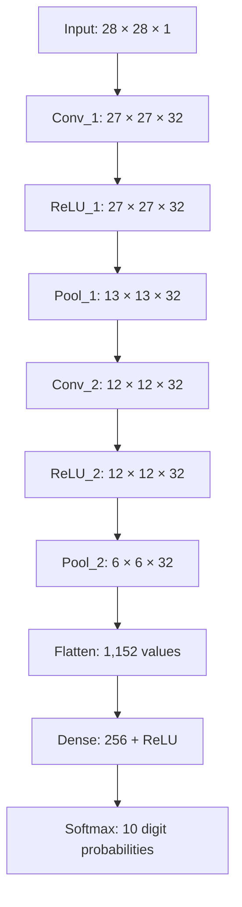
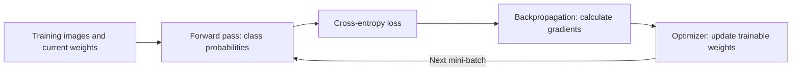
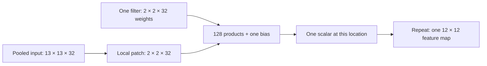

# Activity 1: Building and Inspecting a CNN for Handwritten Digits (MNIST)


## How to use this guided activity

Read each question before opening its **Hint** or **Show worked answer** section. Run the Python cells in order in one Google Colab notebook or a compatible Jupyter environment. Later experiments reuse variables and the CNN trained earlier in the activity.

For environment preparation, use the separate [Python setup for CNN activities](../../part2/activity/1-python_setup.md). A CPU can run the examples; a GPU is optional. Training results and execution times vary by environment. No uploaded CNN model file or external image assets are needed.

For visual questions, run the complete code in the separate **Show supplied Python code** block and interpret the resulting figure. Writing Matplotlib code from scratch is not assessed. A GPU may accelerate CNN training, but is not required. The MNIST dataset will be downloaded automatically if it is not cached.

**Dataset:** MNIST contains handwritten digits labelled 0–9. This activity trains a new model on MNIST rather than reusing the Fashion-MNIST model from Demo 1.

## Learning objectives

By the end of the activity, the following distinctions should be clear:

1. Flattening retains pixel values but does not build spatial locality or weight sharing into a dense layer.
2. A convolutional filter computes a familiar weighted sum, using the **same** weights at successive spatial positions.
3. Horizontal and vertical contrast filters produce signed feature maps; their responses depend on local pixel arrangements.
4. Convolutional filters can be learned through the same loss → backpropagation → optimizer cycle used by dense networks.
5. ReLU acts **after** the convolutional weighted sum, preserving positive values and setting negative values to zero.
6. A deeper standard convolutional filter spans **all incoming channels** and produces one spatial feature map.
7. `model.summary()`, feature-map plots, training histories, and confusion matrices answer different questions about a CNN.

---

## Python setup

```python
import numpy as np
import matplotlib.pyplot as plt
import tensorflow as tf
from tensorflow import keras
from tensorflow.keras import layers

keras.utils.set_random_seed(42)
print("TensorFlow:", tf.__version__)
```

## 1. Revisit the image-classification task

MNIST contains 60,000 training images and 10,000 test images. Each image has 28 rows, 28 columns, and one grayscale channel. The classification target is an integer identifying one of ten handwritten digits.

```python
(x_train_full, y_train_full), (x_test_raw, y_test) = keras.datasets.mnist.load_data()

print("Original training images:", x_train_full.shape)
print("Original training labels:", y_train_full.shape)
print("Test images:", x_test_raw.shape)
print("First ten labels:", y_train_full[:10])
```

**Question 1.** What does `(60000, 28, 28)` describe? Why is the channel dimension missing from the raw MNIST array? What does `(60000,)` describe?

<details>
<summary>Hint: Question 1</summary>

Separate the number of examples from the dimensions of **one** example. Raw MNIST stores grayscale images as two-dimensional matrices, but `Conv2D` expects an explicit channel axis.

</details>

<details>
<summary>Show worked answer: Question 1</summary>

There are 60,000 training images, each containing 28 × 28 grayscale pixel values. The raw loader omits the channel axis because each pixel has only one intensity. `(60000,)` means there is one integer class label for each training image. After adding the channel axis, the training image shape becomes `(60000, 28, 28, 1)`.

</details>

Prepare training, validation, and test data. The split matches the earlier MNIST dense-network activity: 48,000 images for training, 12,000 for validation, and 10,000 for final testing. The test images remain separate from training and model selection.

```python
x_train = x_train_full[:48000].astype("float32")[..., np.newaxis] / 255.0
y_train = y_train_full[:48000]
x_val = x_train_full[48000:].astype("float32")[..., np.newaxis] / 255.0
y_val = y_train_full[48000:]
x_test = x_test_raw.astype("float32")[..., np.newaxis] / 255.0

image_index = 0  # the default MNIST test image is a handwritten 7
image_batch = x_test[image_index:image_index + 1]

print("Train:", x_train.shape, y_train.shape)
print("Validation:", x_val.shape, y_val.shape)
print("Test:", x_test.shape, y_test.shape)
print("Selected digit:", int(y_test[image_index]))
print("One image batch:", image_batch.shape)
```

<details>
<summary>Show supplied Python code: View MNIST digits and the selected image</summary>

```python
fig, axes = plt.subplots(2, 5, figsize=(11, 5))
for i, ax in enumerate(axes.flat):
    ax.imshow(x_test[i, :, :, 0], cmap="gray", vmin=0, vmax=1)
    ax.set_title(f"Digit {int(y_test[i])}")
    ax.axis("off")
plt.tight_layout()
plt.show()

plt.figure(figsize=(3, 3))
plt.imshow(image_batch[0, :, :, 0], cmap="gray", vmin=0, vmax=1)
plt.title(f"Selected digit: {int(y_test[image_index])}")
plt.axis("off")
plt.show()
```

</details>

**Question 2.** What does `Flatten` do to a 28 × 28 image? Does flattening remove pixel values? Does it explicitly preserve the two-dimensional neighborhood structure for subsequent dense layers?

<details>
<summary>Hint: Question 2</summary>

Compare the shapes `(28, 28)` and `(784,)`. Distinguish a reversible rearrangement of values from an architectural rule about which pixels share connections.

</details>

<details>
<summary>Show worked answer: Question 2</summary>

Flattening rearranges 784 pixel values into a one-dimensional vector. It does not discard values. A dense layer can still learn useful relationships from that vector, but it has no built-in rule that applies the same local detector to neighboring pixels at every image position. Convolution introduces local connectivity and **weight sharing** directly into the architecture.

</details>

The default selection, test image 0, is a **handwritten 7**. Keep the same `image_index` throughout the filter experiments so responses can be compared on one input. If another index is selected, use its printed label and displayed image rather than assuming the digit remains 7.

### Compare the size of a dense layer with a convolutional layer

The following comparison uses the same 28 × 28 grayscale image. It compares **individual layers**, not complete classifiers with identical outputs.

| Layer | Trainable parameter calculation | Output for one image |
|---|---:|---|
| `Dense(32)` after flattening | `784 × 32 + 32` | 32 values |
| `Conv2D(32, 2 × 2)` with valid padding | `(2 × 2 × 1 + 1) × 32` | 27 × 27 × 32 values |

**Question 3.** Calculate both parameter totals. Why does the convolutional layer reuse so few parameters despite producing many more output values? Does a lower parameter count guarantee that a model will not overfit?

<details>
<summary>Hint: Question 3</summary>

Each convolutional filter has four input weights and one bias. Those five parameters are shared across all valid spatial positions; they are not recreated at each location.

</details>

<details>
<summary>Show worked answer: Question 3</summary>

The dense layer contains **25,120 parameters**. The convolutional layer contains **160 parameters**: 32 filters, each with four weights and one bias. Each filter is applied at 27 × 27 = 729 positions using the same parameters. Convolution produces many activations but does not require new weights for every spatial position. Fewer parameters may help control capacity, but they do **not** guarantee better generalization or eliminate overfitting.

</details>

### Local processing and the biological-vision analogy

Biological visual processing provides an **analogy**, not an exact engineering blueprint: responses to local contrast and boundaries can contribute to representations of larger structures. CNNs use local filters and multiple processing layers to make such combinations possible. The two systems are not identical.

**Question 4.** What two useful design ideas does this analogy suggest? Why would it be inaccurate to say that a CNN reproduces the eye or visual cortex?

<details>
<summary>Hint: Question 4</summary>

Consider **where** visual information is processed and **how** responses from earlier stages might be combined by later stages. Keep the claim at the level of analogy.

</details>

<details>
<summary>Show worked answer: Question 4</summary>

The two useful ideas are **local processing** of nearby visual information and **hierarchical combination** of earlier responses. CNN layers can use these ideas through spatial kernels and stacked feature-map transformations. Biological vision includes far more complex mechanisms, learning processes, and feedback pathways; a CNN is an engineering architecture inspired by selected principles, not an exact biological model.

</details>

The next step replaces the all-pixels-at-once dense calculation with a **local weighted sum**.

---

## 2. From a dense neuron to a local filter

A dense neuron combines input values using weights and usually a bias. A convolutional filter performs a similar weighted sum, but on a **small neighboring patch**. It repeats that calculation at every valid spatial position with the same weights.

Use a deliberately chosen vertical-contrast filter:

| −1 | +1 |
|---:|---:|
| −1 | +1 |

```python
vertical_kernel = np.array([
    [-1.0, 1.0],
    [-1.0, 1.0]
], dtype=np.float32)

bright_right = np.array([
    [0.0, 0.9],
    [0.1, 0.8]
], dtype=np.float32)
bright_left = bright_right[:, ::-1]

print("Right brighter:", np.sum(bright_right * vertical_kernel))
print("Left brighter:", np.sum(bright_left * vertical_kernel))
```

**Question 5.** Before running the code, predict the sign of each response. Calculate the four products and their sum for the right-brighter patch. What changes if the contrast direction is reversed?

<details>
<summary>Hint: Question 5</summary>

Multiply matching entries. Negative weights belong to the left column; positive weights belong to the right column. Add the four products, without ReLU or a bias in this example.

</details>

<details>
<summary>Show worked answer: Question 5</summary>

For the right-brighter patch, the calculation is `0 × (-1) + 0.9 × 1 + 0.1 × (-1) + 0.8 × 1 = 1.6`. Reversing the columns gives **−1.6**. The filter detects *signed left-to-right contrast*: the response indicates both direction and strength. These responses are not yet digit classifications.

</details>

**Question 6.** What is the essential similarity between a dense neuron and a convolutional filter? What is the main difference in their connectivity and outputs?

<details>
<summary>Hint: Question 6</summary>

Both use weighted sums. Consider how many image positions reuse the same filter parameters and whether one filter produces one scalar or a whole grid.

</details>

<details>
<summary>Show worked answer: Question 6</summary>

Both combine inputs using weights and often a bias, and both may be followed by an activation function. A typical dense neuron uses the whole incoming feature vector to produce one scalar per example. A convolutional filter uses a local spatial patch across **all input channels**, then repeats that weighted sum with shared weights at many positions, producing **one feature map**. Each output position is a neuron-like computation, but the filter's weights are shared across positions.

</details>

A local filter becomes a convolutional operation when it **moves** across the image.

---

## 3. Make the sliding operation explicit

A 3 × 3 input and a 2 × 2 filter with stride 1 provide four valid starting positions. The short Python loop below performs the same local arithmetic without using TensorFlow's convolution implementation.

```python
toy_image = np.array([
    [10, 20, 10],
    [10, 20, 10],
    [10, 20, 10]
], dtype=np.float32)

toy_output = np.zeros((2, 2), dtype=np.float32)
for row in range(2):
    for col in range(2):
        patch = toy_image[row:row + 2, col:col + 2]
        toy_output[row, col] = np.sum(patch * vertical_kernel)
        print(f"Patch at ({row}, {col}):\n{patch}")
        print(f"Output[{row}, {col}] = {toy_output[row, col]:.0f}\n")
print("Full output:\n", toy_output)
```

**Question 7.** Write the coordinates of the four input-patch starting positions. Predict the complete 2 × 2 output before reading the printed results. Why are the two output rows identical?

<details>
<summary>Hint: Question 7</summary>

With stride 1, the starting row and column can each be 0 or 1. The input's second and third rows have the same values as its first row.

</details>

<details>
<summary>Show worked answer: Question 7</summary>

The starting positions are `(0,0)`, `(0,1)`, `(1,0)`, and `(1,1)`. The output is `[[20, -20], [20, -20]]`. The left patch has brighter values on its right side; the right patch reverses the contrast. Every input row is identical, so moving the filter down by one row produces the same two responses. The weights are never changed or flipped.

</details>

For a square input of width $n$ and a square filter of width $k$, using stride 1 and no padding, the number of valid starting positions per dimension is:

$$
n_{\mathrm{out}}=n-k+1
$$

**Question 8.** Why does a 2 × 2 filter produce a 27 × 27 output on a 28 × 28 image? How many values does one filter calculate? Is every output location associated with a different set of filter weights?

<details>
<summary>Hint: Question 8</summary>

Count starting positions from input index 0 to the last index at which the 2 × 2 patch still fits. Then multiply the two output dimensions.

</details>

<details>
<summary>Show worked answer: Question 8</summary>

A 2 × 2 patch can start at indices 0 through 26 along either axis: `28 - 2 + 1 = 27` positions. There are `27 × 27 = 729` output values per filter. The same filter weights are reused for all 729 calculations. Padding and larger strides can change this spatial count; their detailed treatment belongs to Activity 2.

</details>

### Apply two fixed filters to a handwritten digit

The vertical filter responds to left-to-right contrast. A horizontal filter responds to top-to-bottom contrast.

```python
horizontal_kernel = np.array([
    [-1.0, -1.0],
    [ 1.0,  1.0]
], dtype=np.float32)

vertical_filter_tf = vertical_kernel.reshape(2, 2, 1, 1)
horizontal_filter_tf = horizontal_kernel.reshape(2, 2, 1, 1)

vertical_map = tf.nn.conv2d(
    image_batch, vertical_filter_tf, strides=1, padding="VALID"
).numpy()[0, :, :, 0]
horizontal_map = tf.nn.conv2d(
    image_batch, horizontal_filter_tf, strides=1, padding="VALID"
).numpy()[0, :, :, 0]

print("Digit input:", image_batch.shape)
print("Vertical map:", vertical_map.shape)
print("Horizontal map:", horizontal_map.shape)
```

<details>
<summary>Show supplied Python code: Original digit and two signed feature maps</summary>

```python
scale = max(float(np.abs(vertical_map).max()),
            float(np.abs(horizontal_map).max()), 1e-6)
fig, axes = plt.subplots(1, 3, figsize=(12, 4))
axes[0].imshow(image_batch[0, :, :, 0], cmap="gray", vmin=0, vmax=1)
axes[0].set_title(f"Input digit: {int(y_test[image_index])}")
axes[1].imshow(vertical_map, cmap="coolwarm", vmin=-scale, vmax=scale)
axes[1].set_title("Left-to-right contrast")
im = axes[2].imshow(horizontal_map, cmap="coolwarm", vmin=-scale, vmax=scale)
axes[2].set_title("Top-to-bottom contrast")
for ax in axes:
    ax.axis("off")
fig.colorbar(im, ax=axes[1:], shrink=0.75)
plt.show()
```

</details>

**Question 9.** For the selected digit (7 with the default index), which filter produces responses along parts of the digit's strokes that change from left to right? Where does the horizontal filter respond? Why can the same filter produce both positive and negative values?

<details>
<summary>Hint: Question 9</summary>

Use the colors to locate the sign of each weighted sum. Compare local contrast on opposite sides of the same stroke; the orientation and direction of the intensity change matter.

</details>

<details>
<summary>Show worked answer: Question 9</summary>

The vertical-contrast filter responds strongly where neighboring left and right columns differ; the horizontal-contrast filter responds where neighboring top and bottom rows differ. A stroke can have opposite contrast directions on its two sides, producing positive and negative responses. The weights do not change across the image; the local patches do. Exact locations depend on the displayed digit. These maps are **signed local responses**, not identified digit parts or class probabilities.

</details>

**Question 10.** Did the manual-filter experiment train any CNN parameters? If a human-designed edge filter cannot detect every useful digit pattern, what could replace the fixed filter weights?

<details>
<summary>Hint: Question 10</summary>

The two arrays containing −1 and +1 were created manually. Recall the forward-pass → loss → backpropagation → optimizer-update cycle from the dense-network lesson.

</details>

<details>
<summary>Show worked answer: Question 10</summary>

No parameters were trained. `tf.nn.conv2d` applied fixed, manually supplied weights to the image. A trainable CNN begins with filter weights that are adjusted by backpropagated loss gradients and optimizer updates. The network can learn many filters suited to recognizing handwritten digits without manually specifying each kernel's purpose.

</details>

---

## 4. Construct a CNN that learns its own filters

The following CNN uses the same overall architecture as Demo 1, but is **newly trained on MNIST** rather than Fashion-MNIST. Convolution and ReLU are separate layers so the pre- and post-activation values can be inspected independently.

Pooling is part of the architecture, but detailed pooling-window mechanics, padding, and stride comparisons are reserved for Activity 2.



```python
def build_mnist_cnn():
    inputs = keras.Input(shape=(28, 28, 1), name="Digit_image")
    h = layers.Conv2D(32, (2, 2), padding="valid",
                      name="Conv_1")(inputs)
    h = layers.ReLU(name="ReLU_1")(h)
    h = layers.MaxPooling2D((2, 2), name="Pool_1")(h)
    h = layers.Conv2D(32, (2, 2), padding="valid",
                      name="Conv_2")(h)
    h = layers.ReLU(name="ReLU_2")(h)
    h = layers.MaxPooling2D((2, 2), name="Pool_2")(h)
    h = layers.Flatten(name="Flatten")(h)
    h = layers.Dense(256, activation="relu", name="Hidden")(h)
    outputs = layers.Dense(10, activation="softmax",
                           name="Digit_probabilities")(h)
    return keras.Model(inputs, outputs, name="MNIST_CNN")

keras.utils.set_random_seed(42)
model = build_mnist_cnn()
model.summary()
```

**Question 11.** Which layers have trainable weights and biases? Which operations only transform or rearrange activations? Why is ReLU shown separately from convolution?

<details>
<summary>Hint: Question 11</summary>

Look for `Conv2D` and `Dense` layers in `model.summary()`. Recall that `ReLU`, `MaxPooling2D`, and `Flatten` do not store trainable filters or dense matrices.

</details>

<details>
<summary>Show worked answer: Question 11</summary>

The two `Conv2D` and the two `Dense` layers have trainable parameters. `ReLU`, `MaxPooling2D`, and `Flatten` have none. ReLU is defined separately to make the **convolution output before activation** available for analysis. This preserves the same computation as a `Conv2D` layer with `activation="relu"` when its weights are the same.

</details>

**Question 12.** Explain each spatial shape in the diagram, especially 28 → 27, 27 → 13, 13 → 12, and 12 → 6. How many features enter the first dense layer?

<details>
<summary>Hint: Question 12</summary>

For each valid convolution, use `input width - kernel width + 1`. For each 2 × 2 valid max-pooling layer with stride 2, count complete non-overlapping windows. Flatten multiplies the final height, width, and channel count.

</details>

<details>
<summary>Show worked answer: Question 12</summary>

The first valid 2 × 2 convolution produces `28 - 2 + 1 = 27` positions. The first 2 × 2 max pool produces 13 complete non-overlapping windows per dimension. The second valid 2 × 2 convolution produces `13 - 2 + 1 = 12` positions. The second pool produces six windows per dimension. Flatten therefore outputs `6 × 6 × 32 = 1,152` features. ReLU does not change tensor shape.

</details>

The parameter-count rule for a standard convolution is:

$$
\text{trainable parameters}=(k_h\,k_w\,C_{\mathrm{in}}+1)\,C_{\mathrm{out}}
$$

The added `1` counts **one bias per output filter**. A dense layer with $m$ inputs and $n$ neurons has $mn+n$ parameters.

**Question 13.** Calculate the parameters in `Conv_1`, `Conv_2`, `Hidden`, and `Digit_probabilities`. Verify the total against `model.summary()`. Why does `Conv_2` have more parameters than `Conv_1` even though both have 32 output filters?

<details>
<summary>Hint: Question 13</summary>

The first convolution receives one input channel. The second receives 32 channels. For the first dense layer, use 1,152 incoming values and 256 neurons.

</details>

<details>
<summary>Show worked answer: Question 13</summary>

`Conv_1`: `(2 × 2 × 1 + 1) × 32 = 160` parameters. `Conv_2`: `(2 × 2 × 32 + 1) × 32 = 4,128`. `Hidden`: `1,152 × 256 + 256 = 295,168`. `Digit_probabilities`: `256 × 10 + 10 = 2,570`. Total = **302,026 trainable parameters**. `Conv_2` uses 32 input channels, so each of its filters contains 128 weights and one bias, rather than four weights and one bias.

</details>

The optional Keras drawing needs `pydot`, notebook image display, and the Graphviz `dot` executable. If they are unavailable, continue using the Mermaid diagram and `model.summary()` above; the CNN calculations and training do not depend on this drawing. The [shared setup guide](../../part2/activity/1-python_setup.md#optional-architecture-diagrams-with-graphviz) explains optional installation.

<details>
<summary>Show supplied Python code: Visualize the Keras model architecture (optional)</summary>

```python
import importlib.util
import shutil

missing_packages = [
    name for name in ("pydot", "IPython")
    if importlib.util.find_spec(name) is None
]
if missing_packages:
    print("Optional architecture plot skipped; missing packages:",
          ", ".join(missing_packages))
elif shutil.which("dot") is None:
    print("Optional architecture plot skipped: Graphviz 'dot' is not on PATH.")
else:
    from IPython.display import display
    try:
        architecture_image = keras.utils.plot_model(
            model,
            to_file="mnist_cnn_architecture.png",
            show_shapes=True,
            show_layer_names=True,
            dpi=110,
        )
    except (ImportError, OSError) as error:
        print(f"Optional architecture plot could not run: {error}")
    else:
        if architecture_image is None:
            print("No architecture image was returned; use the diagram and model summary above.")
        else:
            display(architecture_image)
```

</details>

The architecture is now defined. The next step is to **learn** the filter weights rather than choosing them manually.

---

## 5. Train the CNN and inspect learning

A CNN uses the same training cycle as the previous dense classifier:



The training labels are integers 0–9, so sparse categorical cross-entropy matches the label representation. Softmax produces ten probabilities for each image.

Training runs for five epochs. **Wait for the training cell to finish before running the plotting or inspection cells.** Runtime depends on the CPU/GPU, software, and other workloads; the cell prints the elapsed time for the actual run.

```python
from time import perf_counter

model.compile(
    optimizer=keras.optimizers.Adam(learning_rate=0.001),
    loss="sparse_categorical_crossentropy",
    metrics=["accuracy"],
)

batch_size = 128
max_epochs = 5
training_started = perf_counter()
history = model.fit(
    x_train, y_train,
    validation_data=(x_val, y_val),
    batch_size=batch_size,
    epochs=max_epochs,
    verbose=2,
)
print(f"Training complete: {len(history.epoch)} epochs in "
      f"{perf_counter() - training_started:.1f} seconds.")
```

**Question 14.** Which stage calculates predictions, which stage calculates gradients, and which stage updates filter weights? Are the fixed kernels from Section 3 automatically updated by `model.fit()`?

<details>
<summary>Hint: Question 14</summary>

Distinguish the `tf.nn.conv2d` call using manually supplied arrays from the `Conv2D` layers inside the compiled Keras model.

</details>

<details>
<summary>Show worked answer: Question 14</summary>

The forward pass calculates predictions. Sparse categorical cross-entropy calculates loss. Backpropagation calculates gradients of that loss with respect to trainable parameters. Adam applies updates. The two `Conv2D` layers inside `model` are trained; the independent, manually supplied horizontal and vertical NumPy kernels remain unchanged.

</details>

**Question 15.** With 48,000 training images and batch size 128, how many parameter-update steps occur per completed epoch? Across five completed epochs? Does validation data update filter weights?

<details>
<summary>Hint: Question 15</summary>

Divide the training-set size by batch size. Every mini-batch produces one optimizer step. Validation measures performance without training on its examples.

</details>

<details>
<summary>Show worked answer: Question 15</summary>

There are `48,000 / 128 = 375` steps per completed epoch and `375 × 5 = 1,875` optimizer steps across five completed epochs. The validation set supplies performance measurements, not gradient-based parameter updates in this training call. Training and validation accuracy may differ, and their exact values depend on the run.

</details>

<details>
<summary>Show supplied Python code: Plot training and validation learning curves</summary>

```python
epochs = np.arange(1, len(history.history["loss"]) + 1)
fig, axes = plt.subplots(1, 2, figsize=(12, 4))
axes[0].plot(epochs, history.history["loss"], marker="o", label="Training")
axes[0].plot(epochs, history.history["val_loss"], marker="o", label="Validation")
axes[0].set_xlabel("Epoch")
axes[0].set_ylabel("Cross-entropy loss")
axes[0].set_title("Loss during CNN training")
axes[1].plot(epochs, history.history["accuracy"], marker="o", label="Training")
axes[1].plot(epochs, history.history["val_accuracy"], marker="o", label="Validation")
axes[1].set_xlabel("Epoch")
axes[1].set_ylabel("Accuracy")
axes[1].set_title("Accuracy during CNN training")
for ax in axes:
    ax.legend()
    ax.grid(alpha=0.2)
plt.tight_layout()
plt.show()
```

</details>

**Question 16.** Examine the actual loss curves. Did validation loss decrease? Did it always decrease? What would a sustained increase in validation loss while training loss falls suggest?

<details>
<summary>Hint: Question 16</summary>

Training loss is measured on examples used for updates. Validation loss is measured on separate examples. An isolated upward fluctuation is not the same as a sustained divergence.

</details>

<details>
<summary>Show worked answer: Question 16</summary>

The first two answers depend on the observed curves. A sustained rise in validation loss alongside continued improvement in training loss may suggest **overfitting**. A single upward movement does not prove overfitting. The test set is reserved for final evaluation rather than deciding when to stop training.

</details>

### Optional calculation: Why does a shared weight receive gradient contributions from several locations?

This miniature example revisits the one-weight gradient calculation from Theory 1. It is an analogy for convolutional **weight sharing**, not the loss function used by the full MNIST CNN.

One scalar weight $w$ is used at **two** spatial positions. At $w=1$, the local inputs are 2 and 1, and the desired responses are 3 and 0. The total half-squared error is:

$$
L(w)=\frac{1}{2}(2w-3)^2+\frac{1}{2}(w-0)^2
$$

The derivative includes both uses of the same parameter:

$$
\frac{dL}{dw}=(2w-3)\cdot2+(w-0)\cdot1
$$

**Question 17 (optional).** Evaluate the loss and gradient at $w=1$. Apply one gradient-descent step with learning rate 0.1. Does changing the single shared weight affect one position or both?

<details>
<summary>Hint: Question 17</summary>

At `w = 1`, the local responses are 2 and 1. Substitute them into the loss and derivative. For the update, subtract 0.1 times the derivative from the original weight.

</details>

<details>
<summary>Show worked answer: Question 17</summary>

The initial loss is `0.5 × (2 − 3)^2 + 0.5 × (1 − 0)^2 = 1`. The gradient is `(2 − 3) × 2 + (1 − 0) × 1 = −1`. The updated shared weight is `1 − 0.1 × (−1) = 1.1`. Both responses therefore change: they become 2.2 and 1.1. The new loss is 0.925. In a real convolutional layer, the gradient for one shared parameter likewise reflects its influence through multiple spatial uses.

</details>

The model has now learned its convolutional filters. The next step is to **inspect what happens inside the forward pass** for the same selected digit.

---

## 6. Inspect learned filters, feature maps, and ReLU

The 32 kernels in `Conv_1` are now learned parameters. They are not required to match the hand-designed contrast filters, and their visualizations are not automatically human-readable object-part detectors.

The separate ReLU layers allow comparison between the signed convolution output and the nonnegative activated output.

```python
conv1 = model.get_layer("Conv_1")
conv2 = model.get_layer("Conv_2")
W1, b1 = conv1.get_weights()
W2, b2 = conv2.get_weights()

probe = keras.Model(
    inputs=model.inputs,
    outputs=[
        conv1.output,
        model.get_layer("ReLU_1").output,
        model.get_layer("Pool_1").output,
        conv2.output,
        model.get_layer("ReLU_2").output,
    ],
)
conv1_pre, conv1_post, pooled1, conv2_pre, conv2_post = probe.predict(
    image_batch, verbose=0
)

np.testing.assert_allclose(np.maximum(conv1_pre, 0), conv1_post,
                           rtol=1e-5, atol=1e-6)
np.testing.assert_allclose(np.maximum(conv2_pre, 0), conv2_post,
                           rtol=1e-5, atol=1e-6)

print("Conv_1 kernel bank:", W1.shape)
print("Conv_1 before ReLU:", conv1_pre.shape)
print("Conv_1 after ReLU:", conv1_post.shape)
print("Pool_1 output:", pooled1.shape)
print("Conv_2 kernel bank:", W2.shape)
print("Conv_2 after ReLU:", conv2_post.shape)
```

<details>
<summary>Show supplied Python code: Inspect eight learned 2 × 2 kernels (optional)</summary>

```python
# These are learned kernel WEIGHTS, not image-dependent feature maps.
fig, axes = plt.subplots(2, 4, figsize=(10, 5))
weight_scale = max(float(np.abs(W1).max()), 1e-6)
for channel, ax in enumerate(axes.flat):
    ax.imshow(W1[:, :, 0, channel], cmap="coolwarm",
              vmin=-weight_scale, vmax=weight_scale)
    ax.set_title(f"Kernel {channel}")
    ax.set_xticks(range(2))
    ax.set_yticks(range(2))
plt.tight_layout()
plt.show()
```

</details>

**Question 18.** For the same selected digit (7 with the default index), what does the shape `(2, 2, 1, 32)` mean for `Conv_1`? Why does it produce 32 output maps? Why should different filters produce different responses to the same digit?

<details>
<summary>Hint: Question 18</summary>

Interpret the axes as kernel height, kernel width, input channels, and output filters. Each output filter has its own learned weights and bias.

</details>

<details>
<summary>Show worked answer: Question 18</summary>

The kernel bank contains **32 separate 2 × 2 × 1 filters**. Each one spans the grayscale input channel and is applied at all 27 × 27 valid positions, producing one spatial map. Different filters have different learned weights and biases and can therefore respond to different local arrangements of digit pixels.

</details>

<details>
<summary>Show supplied Python code: Six learned feature maps from Conv_1</summary>

```python
first_maps = conv1_post[0]
chosen_first = np.argsort(first_maps.std(axis=(0, 1)))[-6:][::-1]
fig, axes = plt.subplots(1, 6, figsize=(15, 3))
for ax, channel in zip(axes, chosen_first):
    ax.imshow(first_maps[:, :, channel], cmap="viridis")
    ax.set_title(f"Channel {channel}")
    ax.axis("off")
fig.suptitle("Learned Conv_1 responses after ReLU")
plt.tight_layout()
plt.show()
```

</details>

**Question 19.** Do the six learned feature maps all look identical? Does one map that resembles a digit stroke prove the filter recognizes a complete digit or a named digit part?

<details>
<summary>Hint: Question 19</summary>

A feature map shows **responses**, not the filter's semantic meaning. The first filter sees only a 2 × 2 input patch at any one output position.

</details>

<details>
<summary>Show worked answer: Question 19</summary>

Different learned kernels generally produce different activation patterns. A response may emphasize some local stroke boundary or intensity arrangement. The visualization alone does not establish that a filter has learned a named semantic concept or recognizes the complete digit. A first-layer 2 × 2 filter cannot inspect the whole 28 × 28 image at one location.

</details>

### ReLU as a separate operation

ReLU changes each pre-activation value independently: negative values become zero, while positive values remain unchanged.

$$
\operatorname{ReLU}(z)=\max(0,z)
$$

Select a filter with both positive and negative responses, **if one exists for this input**. The selection is based on the trained MNIST model, not on channel numbers from the Fashion-MNIST demonstration. If none has both signs, the code reports that fact and displays a channel with the largest spatial variation instead. A constant or all-zero map is a possible result to interpret, not proof that the plotting code failed.

```python
before_maps = conv1_pre[0]
after_maps = conv1_post[0]
def select_relu_channel(maps):
    negative_fraction = np.mean(maps < 0, axis=(0, 1))
    positive_fraction = np.mean(maps > 0, axis=(0, 1))
    mixed = np.flatnonzero((negative_fraction > 0) & (positive_fraction > 0))
    if mixed.size:
        balance = np.minimum(negative_fraction[mixed], positive_fraction[mixed])
        return int(mixed[np.argmax(balance)]), True
    variation = maps.std(axis=(0, 1))
    return int(np.argmax(variation)), False

relu_channel, has_both_signs = select_relu_channel(before_maps)
if not has_both_signs:
    print("No channel has both positive and negative responses for this input.")
    print("Displaying a channel with the largest spatial variation instead.")

before = before_maps[:, :, relu_channel]
after = after_maps[:, :, relu_channel]
print("Selected channel:", relu_channel)
print("Negative fraction before ReLU:", round(float(np.mean(before < 0)), 4))
print("Positive fraction before ReLU:", round(float(np.mean(before > 0)), 4))
print("Zero fraction after ReLU:", round(float(np.mean(after == 0)), 4))
```

<details>
<summary>Show supplied Python code: One trained filter before and after ReLU</summary>

```python
scale = max(float(np.abs(before).max()), 1e-6)
fig, axes = plt.subplots(1, 3, figsize=(12, 4))
axes[0].imshow(image_batch[0, :, :, 0], cmap="gray", vmin=0, vmax=1)
axes[0].set_title(f"Input digit: {int(y_test[image_index])}")
axes[1].imshow(before, cmap="coolwarm", vmin=-scale, vmax=scale)
axes[1].set_title(f"Conv_1 channel {relu_channel}: before ReLU")
im = axes[2].imshow(after, cmap="coolwarm", vmin=-scale, vmax=scale)
axes[2].set_title("After ReLU")
for ax in axes:
    ax.axis("off")
fig.colorbar(im, ax=axes[1:], shrink=0.75)
plt.show()
```

</details>

**Question 20.** Which values change after ReLU? What happens if an entire feature map has no positive values? Does ReLU preserve all information from the signed map?

<details>
<summary>Hint: Question 20</summary>

Compare each position before and after activation. ReLU acts on the **complete sum**, including bias. Consider a channel whose pre-activation maximum is zero or negative.

</details>

<details>
<summary>Show worked answer: Question 20</summary>

All strictly negative values become zero. Positive values remain unchanged, and existing zeros stay zero. If every pre-activation is nonpositive, the output feature map is entirely zero. ReLU **does discard negative information in that channel**. Its nonlinearity allows stacked layers to represent functions that cannot be obtained by composing only affine transformations. ReLU's zeros do not by themselves guarantee faster arithmetic or better accuracy.

</details>

---

## 7. Why are deeper feature maps different?

`Conv_1` produces 32 feature maps. The first pooling layer reduces the spatial grid to 13 × 13 while preserving 32 channels. `Conv_2` receives all 32 pooled channels and produces a new collection of 32 output maps.

The detailed decision of which values survive pooling belongs to Activity 2. For this activity, the important point is that **pooling changes spatial resolution**, and a second convolution can combine earlier learned responses.

**Question 21.** `Conv_1` and `Conv_2` both produce 32 channels. Must they represent the same patterns or level of abstraction? Explain using their input-channel counts and receptive fields.

<details>
<summary>Hint: Question 21</summary>

Compare a 2 × 2 × 1 filter with a 2 × 2 × 32 filter. The second layer receives maps produced by previous computations, rather than raw grayscale input values.

</details>

<details>
<summary>Show worked answer: Question 21</summary>

No. Both layers produce 32 channels, but that number describes **how many output maps** are created, not their semantic complexity. A first-layer filter uses 2 × 2 pixels from the original image. A second-layer filter uses 2 × 2 positions across 32 pooled feature maps and can combine earlier responses. Its effective receptive field also spans a larger region of the original image (5 × 5 pixels for this architecture). This makes more complex representations possible but does not prove that any particular map identifies a digit part.

</details>

<details>
<summary>Show supplied Python code: Compare representative Conv_1 and Conv_2 maps</summary>

```python
fig, axes = plt.subplots(2, 6, figsize=(15, 6))
for row, maps in enumerate((conv1_post[0], conv2_post[0])):
    selected = np.argsort(maps.std(axis=(0, 1)))[-6:][::-1]
    for ax, channel in zip(axes[row], selected):
        ax.imshow(maps[:, :, channel], cmap="viridis")
        ax.set_title(f"Conv_{row + 1}: {channel}")
        ax.axis("off")
fig.suptitle("Early and deeper learned representations")
plt.tight_layout()
plt.show()
```

</details>

**Question 22.** How do the shapes `(27, 27, 32)` and `(12, 12, 32)` differ? Why should a smaller spatial map not automatically be interpreted as a more meaningful or more abstract feature?

<details>
<summary>Hint: Question 22</summary>

Recall that max pooling lies between the two convolutional layers. Spatial size and semantic interpretation answer different questions.

</details>

<details>
<summary>Show worked answer: Question 22</summary>

`Conv_1` produces 27 × 27 positions per channel; `Conv_2` produces 12 × 12. The reduction reflects the intervening 2 × 2 pooling operation and the second valid convolution. The deeper filters combine earlier channels over a larger receptive field, but smaller plots alone do not demonstrate a particular level of abstraction. Independent colormap ranges also mean colors across panels cannot be compared as absolute activation values without an explicitly shared scale.

</details>

The next experiment inspects **one** `Conv_2` output filter to reveal what “combine 32 channels” actually means.

---

## 8. One deeper filter combines 32 input channels

A standard convolutional filter spans the full input depth. Here, a single `Conv_2` filter contains 2 × 2 × 32 = **128 weights** plus one bias. At one location, the 128 products are added into **one pre-activation scalar**. Repeating this across valid locations produces **one 12 × 12 output map**.



```python
# Select one Conv_2 filter whose post-ReLU map responds to this digit.
out_channel = int(np.argmax(conv2_post[0].mean(axis=(0, 1))))
patch_3d = pooled1[0, 0:2, 0:2, :]
filter_3d = W2[:, :, :, out_channel]

channel_contributions = np.sum(patch_3d * filter_3d, axis=(0, 1))
pre_activation = channel_contributions.sum() + b2[out_channel]
post_activation = max(0.0, float(pre_activation))

np.testing.assert_allclose(
    pre_activation, conv2_pre[0, 0, 0, out_channel],
    rtol=1e-4, atol=1e-5
)
np.testing.assert_allclose(
    post_activation, conv2_post[0, 0, 0, out_channel],
    rtol=1e-4, atol=1e-5
)

print("Input patch:", patch_3d.shape)
print("Filter shape:", filter_3d.shape)
print("Channel contributions:", channel_contributions.shape)
print("Selected output channel:", out_channel)
print("Sum + bias before ReLU:", round(float(pre_activation), 5))
print("After ReLU:", round(float(post_activation), 5))
print("Matches the trained network at (0, 0).")
```

**Question 23.** Why are the input patch and one filter both shaped `(2, 2, 32)`? Does this one filter produce 32 different output maps, or one output map? Which operation combines the channels?

<details>
<summary>Hint: Question 23</summary>

The local patch includes 32 input channels. Multiply matching values, then sum across all 128 entries before adding one bias. The output-channel axis in `W2` selects **different filters**, not different pieces of one filter's output.

</details>

<details>
<summary>Show worked answer: Question 23</summary>

The patch and filter must match across height, width, and all 32 input channels so that corresponding values can be multiplied. The 128 products are summed, and one bias is added. This gives a single scalar at that spatial position. Repeating the calculation across positions produces **one output map per filter**. The complete `Conv_2` layer has 32 filters and therefore makes 32 output maps.

</details>

**Question 24.** Could the contribution of one input channel be positive while another is negative? Can they cancel before ReLU? Where is the bias added?

<details>
<summary>Hint: Question 24</summary>

Inspect `channel_contributions`: some values may have different signs. The complete sum is formed **before** activation. The bias belongs to the output filter, not separately to each input channel.

</details>

<details>
<summary>Show worked answer: Question 24</summary>

Yes. Signed contributions from different channels may offset each other when summed. The filter's one learned bias is added **once after summing all channel contributions**, and ReLU then sets a negative combined result to zero. The exact number and sign of contributions depend on the trained model and selected image; cancellation is possible but not required at every position.

</details>

<details>
<summary>Show supplied Python code: Inspect signed contributions at one spatial position</summary>

```python
largest = np.argsort(np.abs(channel_contributions))[-8:][::-1]
for channel in largest:
    value = float(channel_contributions[channel])
    print(f"Input channel {channel:2d}: contribution {value:+.5f}")

fig, ax = plt.subplots(figsize=(10, 3))
ax.bar(range(32), channel_contributions)
ax.axhline(0, color="black", linewidth=0.8)
ax.set_xlabel("Input channel")
ax.set_ylabel("Signed contribution")
ax.set_title(f"Conv_2 filter {out_channel} at output position (0, 0)")
plt.tight_layout()
plt.show()
```

</details>

### Reconstruct the entire output map of one Conv_2 filter

The following calculation repeats the 3D weighted sum at each position and retains the 32 separate contributions **only for visualization**. They are not 32 separate outputs of the selected filter.

```python
height, width = conv2_pre.shape[1:3]
contributions = np.zeros((height, width, 32), dtype=np.float32)
for row in range(height):
    for col in range(width):
        patch = pooled1[0, row:row + 2, col:col + 2, :]
        contributions[row, col, :] = np.sum(
            patch * filter_3d, axis=(0, 1)
        )

combined = contributions.sum(axis=-1) + b2[out_channel]
activated = np.maximum(combined, 0)

np.testing.assert_allclose(
    combined, conv2_pre[0, :, :, out_channel],
    rtol=1e-4, atol=1e-5
)
np.testing.assert_allclose(
    activated, conv2_post[0, :, :, out_channel],
    rtol=1e-4, atol=1e-5
)
print("Full reconstructed map matches the trained CNN.")
```

<details>
<summary>Show supplied Python code: Four contributions, complete sum, and ReLU</summary>

```python
strength = np.abs(contributions).mean(axis=(0, 1))
selected = np.argsort(strength)[-4:][::-1]
scale = max(float(np.abs(contributions[:, :, selected]).max()),
            float(np.abs(combined).max()), 1e-6)

fig, axes = plt.subplots(2, 3, figsize=(12, 7))
for ax, channel in zip(axes.flat[:4], selected):
    ax.imshow(contributions[:, :, channel], cmap="coolwarm",
              vmin=-scale, vmax=scale)
    ax.set_title(f"Input channel {channel}")
    ax.axis("off")
axes.flat[4].imshow(combined, cmap="coolwarm", vmin=-scale, vmax=scale)
axes.flat[4].set_title("All 32 contributions + bias")
axes.flat[5].imshow(activated, cmap="coolwarm", vmin=-scale, vmax=scale)
axes.flat[5].set_title("After ReLU")
for ax in axes.flat[4:]:
    ax.axis("off")
plt.tight_layout()
plt.show()
```

</details>

**Question 25.** Why do the four pictured channel-contribution maps not add up by themselves to the displayed combined map? How can the numerical assertions check the interpretation?

<details>
<summary>Hint: Question 25</summary>

The visual shows only four selected input channels. The calculation includes 32 channel contributions and one learned bias.

</details>

<details>
<summary>Show worked answer: Question 25</summary>

The four panels display selected contributions, not all 32. The complete map sums **every** channel contribution and adds one bias, then applies ReLU. The assertions compare the reconstructed pre- and post-activation maps with the actual outputs of the trained `Conv_2` and `ReLU_2` layers. Agreement verifies the numerical reconstruction within floating-point tolerance; it does not prove that individual filters correspond to named semantic concepts.

</details>

---

## 9. Classify digits and evaluate the trained model

The convolutional feature extractor produces maps that the classifier converts into probabilities for digits 0–9. `Flatten` changes the 6 × 6 × 32 activations into a vector; the dense layers then compute ten class probabilities with softmax.

```python
test_loss, test_accuracy = model.evaluate(x_test, y_test, verbose=0)
sample_probs = model.predict(image_batch, verbose=0)[0]
sample_pred = int(np.argmax(sample_probs))

print("Test loss:", round(float(test_loss), 4))
print("Test accuracy:", round(float(test_accuracy), 4))
print("Actual digit:", int(y_test[image_index]))
print("Predicted digit:", sample_pred)
print("Probability sum:", round(float(sample_probs.sum()), 6))
```

**Question 26.** Why are there ten softmax outputs? What does their sum represent? Why is the predicted class the index of the maximum probability rather than the largest digit label?

<details>
<summary>Hint: Question 26</summary>

MNIST has ten mutually exclusive classes. A digit label is a category identifier, not a ranking or a numerical quantity to regress.

</details>

<details>
<summary>Show worked answer: Question 26</summary>

The ten outputs represent a probability distribution over digits 0 through 9; they sum to approximately one. The class with the largest predicted probability is selected because it is the model's most probable class, not because its **label number** is numerically largest. `sparse_categorical_crossentropy` uses integer labels to identify the correct class probability.

</details>

<details>
<summary>Show supplied Python code: Selected digit and its predicted probabilities</summary>

```python
fig, axes = plt.subplots(1, 2, figsize=(10, 4))
axes[0].imshow(image_batch[0, :, :, 0], cmap="gray", vmin=0, vmax=1)
axes[0].set_title(f"True: {int(y_test[image_index])}, predicted: {sample_pred}")
axes[0].axis("off")
axes[1].bar(range(10), sample_probs)
axes[1].set_xticks(range(10))
axes[1].set_ylim(0, 1)
axes[1].set_xlabel("Digit class")
axes[1].set_ylabel("Predicted probability")
axes[1].set_title("Softmax outputs")
plt.tight_layout()
plt.show()
```

</details>

Inspect errors and class-level confusions rather than relying on overall accuracy alone.

```python
all_probs = model.predict(x_test, verbose=0)
predictions = np.argmax(all_probs, axis=1)
wrong_indices = np.flatnonzero(predictions != y_test)
counts = tf.math.confusion_matrix(
    y_test, predictions, num_classes=10
).numpy()

print("Incorrect predictions:", len(wrong_indices))
print("Confusion matrix shape:", counts.shape)
```

<details>
<summary>Show supplied Python code: Misclassified test digits</summary>

```python
n = min(9, len(wrong_indices))
if n == 0:
    print("No test errors found in this run.")
else:
    selected_wrong = np.random.default_rng(42).choice(
        wrong_indices, size=n, replace=False
    )
    fig, axes = plt.subplots(3, 3, figsize=(8, 8))
    for ax in axes.flat:
        ax.axis("off")
    for ax, index in zip(axes.flat, selected_wrong):
        ax.imshow(x_test[index, :, :, 0], cmap="gray", vmin=0, vmax=1)
        ax.set_title(f"True: {int(y_test[index])} | Pred: {int(predictions[index])}")
    fig.suptitle("Examples of incorrect CNN predictions")
    plt.tight_layout()
    plt.show()
```

</details>

<details>
<summary>Show supplied Python code: Confusion matrix for MNIST digits</summary>

```python
fig, ax = plt.subplots(figsize=(8, 7))
im = ax.imshow(counts, cmap="Blues")
ax.set_xticks(range(10), range(10))
ax.set_yticks(range(10), range(10))
ax.set_xlabel("Predicted digit")
ax.set_ylabel("True digit")
ax.set_title("MNIST CNN confusion matrix")
for row in range(10):
    for col in range(10):
        value = int(counts[row, col])
        ax.text(col, row, value, ha="center", va="center", fontsize=8,
                color="white" if value > counts.max() / 2 else "black")
fig.colorbar(im, ax=ax, shrink=0.8)
plt.tight_layout()
plt.show()
```

</details>

**Question 27.** Examine one incorrectly classified digit. What might make it difficult? What does the confusion matrix show that a single overall accuracy score does not show?

<details>
<summary>Hint: Question 27</summary>

Look for unusual stroke shapes, missing or extra-looking strokes, or resemblance to another digit. Off-diagonal matrix entries represent specific mistakes.

</details>

<details>
<summary>Show worked answer: Question 27</summary>

The explanation should refer to an actual misclassified image. Ambiguous handwriting and similarities among digit shapes are possible sources of error, but the image alone does not prove the network's internal reason for a mistake. The confusion matrix shows which **true classes are predicted as which other classes**; an accuracy percentage does not reveal these class-specific error patterns.

</details>

**Question 28.** Suppose training accuracy improves while validation accuracy stagnates or declines. Is a lower training loss alone evidence of better generalization? Does a successful MNIST result prove this architecture will classify all types of images equally well?

<details>
<summary>Hint: Question 28</summary>

Distinguish measurements on the images used to update weights from measurements on unseen data. Consider differences between handwritten digits, clothing, and color photographs.

</details>

<details>
<summary>Show worked answer: Question 28</summary>

No. Lower training loss means the optimizer has improved the objective on training images; it does not guarantee performance on unseen images. A persistent gap between training and validation results can indicate overfitting. A good MNIST score applies to the tested handwritten-digit distribution and cannot establish equal performance on clothing, photographs, or other image domains.

</details>

---

## 10. Consolidation and preparation for Activity 2

**Question 29.** Complete the sequence in words: original image → local filters → feature maps → ReLU → deeper feature combinations → Flatten → softmax. Which stage shares weights across spatial positions? Which stage is responsible for updating those weights during training?

<details>
<summary>Hint: Question 29</summary>

Convolution shares filter weights. The optimizer performs updates after gradients have been calculated by backpropagation.

</details>

<details>
<summary>Show worked answer: Question 29</summary>

The image enters local convolutional filters, which repeatedly compute shared weighted sums and produce spatial feature maps. ReLU introduces nonlinearity. Pooling reduces spatial resolution, and deeper filters combine earlier channel responses. Flatten converts the final maps to a vector; dense layers and softmax produce class probabilities. Convolution **shares** weights, backpropagation **calculates gradients**, and the optimizer **updates** those weights.

</details>

**Question 30.** Why can `Conv_2` combine earlier feature maps even though it uses the same 2 × 2 spatial kernel size as `Conv_1`? What is the difference between its kernel's spatial size and its depth?

<details>
<summary>Hint: Question 30</summary>

Compare `(2, 2, 1)` with `(2, 2, 32)`. The first two dimensions determine the local spatial window; the last dimension spans input channels.

</details>

<details>
<summary>Show worked answer: Question 30</summary>

Each second-layer filter spans a 2 × 2 **spatial** window and all **32** input channels, rather than just the original grayscale channel. A single output value is formed by combining 128 products plus one bias. The spatial kernel remains 2 × 2, but its depth grows to match the incoming representation, allowing combinations of earlier learned responses.

</details>

**Question 31.** The CNN uses a 2 × 2 convolution that reduces 28 → 27, and a max-pooling operation that reduces 27 → 13. Do these operations reduce spatial dimensions for the same reason? What new design choices could change those results?

<details>
<summary>Hint: Question 31</summary>

The valid convolution computes only where its filter fits; the pooling layer keeps one summary of each complete window. Consider adding border values or changing the distance between adjacent filter positions.

</details>

<details>
<summary>Show worked answer: Question 31</summary>

The valid convolution has 27 starting positions because a 2 × 2 kernel must fit within a 28-pixel side. The valid 2 × 2 max pool with stride 2 keeps 13 complete windows along a 27-pixel side. **Padding** can change available border positions; **stride** controls the spacing between evaluated positions; and different **pooling** methods summarize different information. Activity 2 investigates these choices on the same MNIST dataset.

</details>

### Final concept checklist

- [ ] A dense neuron and a convolutional filter both compute weighted sums, but a convolutional filter shares weights across spatial locations.
- [ ] The four positions in a 3 × 3 input with a 2 × 2 filter can be calculated without a convolution library.
- [ ] A hand-designed contrast filter can produce positive and negative responses from different digit patches.
- [ ] Learned filters and hand-designed filters serve different purposes in the experiments.
- [ ] ReLU suppresses negative pre-activations and provides nonlinearity.
- [ ] One standard Conv_2 filter combines all 32 incoming channels to create one output map.
- [ ] Layer shapes and parameter counts match the CNN's actual architecture.
- [ ] Training curves, individual predictions, and the confusion matrix provide different views of model performance.

**Connection to [Activity 2](activity2.md):** Continue with the same MNIST dataset to investigate padding, stride, pooling, global average pooling, and the concepts behind transfer learning.
