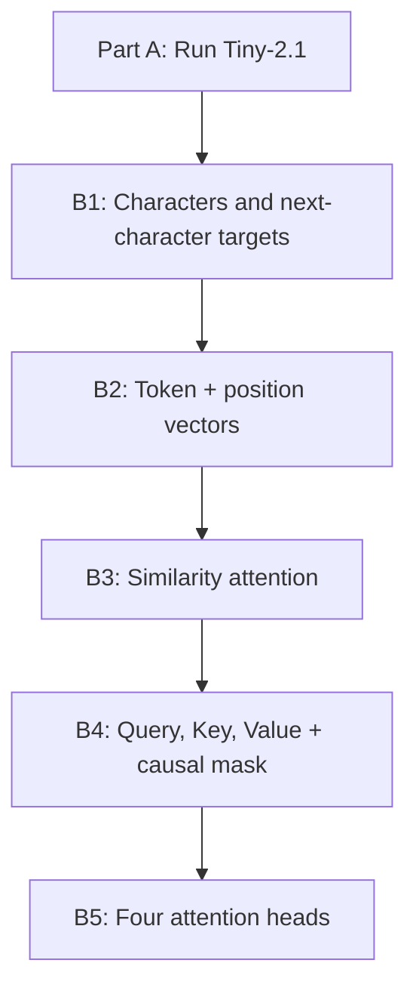

# Activity 1 — Simplified: Run Tiny-2.1 and Discover Attention


This activity has **two parts**. Complete Part A first, then continue to Part B **in the same Google Colab session**. The exercises in Part B reuse the model and imports from Part A; you do **not** need to download or load the model again.

**Part A:** Run the model and explore its answers.  
**Part B:** Explore characters, vectors, and attention through small examples.


**Learning goals**

By the end of this activity, you should be able to:

1. Run Tiny-2.1 and describe something it does well and something it may get wrong.
2. Explain that Tiny-2.1 reads **characters**, not whole words, and predicts the **next** character.
3. Show how token embeddings and position embeddings are added.
4. Interpret an attention-weight row and a causal mask.
5. Explain why Tiny-2.1 uses Query, Key, Value, and four attention heads.

**Helpful visualizations:** Visualization 1 (generation and training), Visualization 2 (embeddings), Visualization 3 (similarity attention), Visualization 4 (Q/K/V and causal attention), and Visualization 5 (multi-head attention).



---

# Part A — Run and Explore Tiny-2.1

## A1. Set up Colab

**Cell A1 — Get the project**

Run this cell once in a fresh Colab notebook.

```python
!git clone https://github.com/WollyMonjac/Tiny-2.1.git
%cd /content/Tiny-2.1/training
```

**Cell A2 — Load the trained model**

```python
import torch
import train2

model = train2.load_model("tiny2.pt")
model.eval()
print("Tiny-2.1 is ready!")
```

**Expected output:** `Tiny-2.1 is ready!`

<details>
<summary>What did this code do?</summary>

- `import` makes Python tools available.
- `load_model(...)` loads Tiny-2.1's already-trained weights. **We are not training it today.**
- `model.eval()` prepares the model for making predictions.

</details>

## A2. Ask Tiny-2.1 some questions

**Cell A3 — Try two questions**

```python
questions = [
    "what is the capital of france?",
    "what is the largest planet?",
]

answers = train2.answer_many(model, questions)
for question, answer in answers.items():
    print("Question:", question)
    print("Answer:  ", answer)
    print()
```

**Expected observation:** In the supplied preparation notebook, the model answered that France's capital is Paris and the largest planet is Jupiter. Examine your own output; it is the model's prediction, not a guaranteed fact.

**Cell A4 — Change one question**

```python
questions = [
    "what is 2+2?",
    "what is the capital of mars?",
]

answers = train2.answer_many(model, questions)
for question, answer in answers.items():
    print("Question:", question)
    print("Answer:  ", answer)
    print()
```

**Observe:** Which question has a false assumption? Did the model notice?

**Your answer:** ______________________________________________

<details>
<summary>Hint</summary>

Think about whether Mars is a country with a capital city.

</details>

<details>
<summary>Answer / Explanation</summary>

Mars has no capital city. Tiny-2.1 generates text using patterns learned during training. It may give a plausible-looking but incorrect answer instead of checking whether the question makes sense. The specific response may vary.

</details>

## A3. Look inside the model

**Cell A5 — Inspect a few important numbers**

```python
print("Number of Transformer blocks:", len(model.blocks))
print("Token embedding shape:", tuple(model.emb.weight.shape))
print("Position embedding shape:", tuple(model.pos.weight.shape))
print("Number of learned parameters:", sum(p.numel() for p in model.parameters()))
```

**Expected output:**

```text
Number of Transformer blocks: 4
Token embedding shape: (97, 96)
Position embedding shape: (128, 96)
Number of learned parameters: 366528
```

**What do these numbers mean?**

| Number | Meaning |
|---|---|
| `97` | The number of possible token IDs (characters and special tokens). |
| `96` | The length of each token vector inside the model. |
| `128` | The maximum number of positions supported in one input sequence. |
| `4` | The number of Transformer blocks, one after another. |

**Check your understanding:** Does `97` mean the model has 97 Transformer blocks?

<details>
<summary>Answer</summary>

No. The model has **4 Transformer blocks**. The number `97` is the vocabulary size.

</details>

---

# Part B — Discover How Attention Works

> [!NOTE]
> Continue in the **same Colab session**. Start with the next import cell, then follow B1 to B5 in order. The numerical vectors in B2–B4 are **small teaching examples**, not values measured from the trained model.

**Cell B0 — Tools for the small experiments**

```python
import math
import numpy as np
import torch
import torch.nn.functional as F
import matplotlib.pyplot as plt
```

## B1. Characters, Next-Character Targets, and the Newline

**Main idea:** Tiny-2.1 works with **one character at a time**. During training, the target is the **next** character.

### Worked example

```text
Text:     c   a   t
Input:    c   a
Target:   a   t
```

A model that reads `c` tries to predict `a`. After reading `ca`, it tries to predict `t`.

**Cell B1a — Turn characters into IDs**

```python
word = "cat"
ids = train2.encode(word)
print("Text:", word)
print("Character IDs:", ids)
print("Decoded:", train2.decode(ids))
```

**Expected output:**

```text
Text: cat
Character IDs: [69, 67, 86]
Decoded: cat
```

**Try it:** Change only `word = "cat"` to `word = "dog"` and rerun. Are the IDs different? Can you decode them back to the original word?

### A question and an answer

For training, a question and answer can be written like this:

```text
2 + 2 ? ↵ 4 ↵
```

Here `↵` is a visible symbol for the newline character `\n`. The **first** newline separates the question from its answer. The **second** newline marks the end of the answer.

**Cell B1b — See the shifted targets and the simple loss mask**

```python
question = "2+2?"
answer = "4"
text = question + "\n" + answer + "\n"
ids = train2.encode(text)

# 0 = ignore this target during training; 1 = learn this target
mask = [0] * (len(question) + 1) + [1] * (len(answer) + 1)

input_ids = ids[:-1]
target_ids = ids[1:]
target_mask = mask[1:]

for x, y, m in zip(input_ids, target_ids, target_mask):
    input_char = train2.decode([x]).replace("\n", "↵")
    target_char = train2.decode([y]).replace("\n", "↵")
    print(f"Input: {input_char:>1}  ->  Target: {target_char:>1}  |  Learn: {m}")
```

**Expected output:**

```text
Input: 2  ->  Target: +  |  Learn: 0
Input: +  ->  Target: 2  |  Learn: 0
Input: 2  ->  Target: ?  |  Learn: 0
Input: ?  ->  Target: ↵  |  Learn: 0
Input: ↵  ->  Target: 4  |  Learn: 1
Input: 4  ->  Target: ↵  |  Learn: 1
```

**Observe:** Which two predictions have `Learn: 1`?

**Your answer:** ______________________________________________

<details>
<summary>Hint</summary>

Look for the target `4` and the final `↵`.

</details>

<details>
<summary>Answer</summary>

The model is graded on predicting the answer character **`4`** and the **final newline**. The first newline belongs to the supplied question; the second newline teaches the model when to stop its answer.

</details>

---

## B2. Token Embeddings + Position Embeddings

**Main idea:** The model converts each character ID into a vector, then adds a vector describing **where** that character appears.

### Worked example: two copies of `2`

For the first `2` in `2+2?`:

\[
[1.0,\ 0.0,\ 0.2] + [0.1,\ 0.2,\ 0.0] = [1.1,\ 0.2,\ 0.2]
\]

For the second `2`, the **token vector is the same**, but the position vector is different:

\[
[1.0,\ 0.0,\ 0.2] + [0.4,\ {-}0.1,\ 0.3] = [1.4,\ {-}0.1,\ 0.5]
\]

**Cell B2a — Run the 3D teaching example**

```python
# Three character vectors: '2', '+', '?'
emb_small = torch.tensor([
    [1.0, 0.0, 0.2],
    [0.0, 1.0, 0.1],
    [0.3, 0.4, 0.9],
])

# A different position vector for each location
pos_small = torch.tensor([
    [ 0.1,  0.2, 0.0],
    [ 0.2, -0.1, 0.1],
    [ 0.4, -0.1, 0.3],
    [-0.2,  0.3, 0.2],
])

# The sequence '2+2?' looks up rows 0, 1, 0, 2
character_rows = torch.tensor([0, 1, 0, 2])
token_vectors = emb_small[character_rows]
X_small = token_vectors + pos_small

print("First '2' token vector: ", token_vectors[0].tolist())
print("Second '2' token vector:", token_vectors[2].tolist())
print("First '2' with position: ", np.round(X_small[0].numpy(), 2))
print("Second '2' with position:", np.round(X_small[2].numpy(), 2))
```

**Expected observation:** The two **token vectors** are identical. Their **combined vectors** are approximately `[1.1, 0.2, 0.2]` and `[1.4, -0.1, 0.5]`.

**Try it:** Change the first position vector from `[0.1, 0.2, 0.0]` to `[0.0, 0.0, 0.0]` and rerun. What happens to the first combined vector?

<details>
<summary>Answer</summary>

It becomes `[1.0, 0.0, 0.2]`, exactly the first token vector, because adding zero changes nothing. The second `2` remains unchanged.

</details>

### Connect to the real model

**Cell B2b — Inspect the model's 96-dimensional vectors**

```python
text = "2+2?"
ids_real = torch.tensor([train2.encode(text)], dtype=torch.long)

with torch.no_grad():
    real_token_vectors = model.emb(ids_real)
    real_position_vectors = model.pos(torch.arange(len(text)))
    X_real = real_token_vectors + real_position_vectors

print("Token vectors:", tuple(real_token_vectors.shape))
print("Combined vectors:", tuple(X_real.shape))
print("Same token embedding for both '2's?",
      torch.equal(real_token_vectors[0, 0], real_token_vectors[0, 2]))
print("Same combined vector for both '2's?",
      torch.equal(X_real[0, 0], X_real[0, 2]))
```

**Expected output:**

```text
Token vectors: (1, 4, 96)
Combined vectors: (1, 4, 96)
Same token embedding for both '2's? True
Same combined vector for both '2's? False
```

**Why is the combined vector different?**

<details>
<summary>Answer</summary>

Although both characters are `2`, they occur at different positions. Tiny-2.1 adds different learned position vectors to them.

</details>

---

## B3. Similarity Attention — Who Pays Attention to Whom?

**Main idea:** An attention score can be calculated using a **dot product**. We then use **softmax** to turn scores into weights that add up to 1.

> [!NOTE]
> This first example is deliberately simple: **no learned Query/Key/Value matrices and no causal mask yet**. That means a position can also compare itself with *future* positions. We will correct that in B4.

### Worked example: compare the first `2` to the second `2`

Using the 3D vectors from B2:

\[
[1.1,\ 0.2,\ 0.2]\cdot[1.4,\ {-}0.1,\ 0.5]
=1.1(1.4)+0.2(-0.1)+0.2(0.5)=1.62.
\]

A larger score means this pair is given more emphasis **before** softmax.

**Cell B3a — Calculate one attention row**

```python
# Restore the four original vectors from B2, even if you changed a position.
X_attention = torch.tensor([
    [1.1,  0.2, 0.2],
    [0.2,  0.9, 0.2],
    [1.4, -0.1, 0.5],
    [0.1,  0.7, 1.1],
])

scores = X_attention @ X_attention.T
weights = F.softmax(scores, dim=-1)

print("Scores for the first '2':", np.round(scores[0].numpy(), 3))
print("Weights for the first '2':", np.round(weights[0].numpy(), 3))
print("Sum of weights:", round(weights[0].sum().item(), 3))
```

**Expected output (rounded):**

```text
Scores for the first '2': [1.29 0.44 1.62 0.47]
Weights for the first '2': [0.307 0.131 0.427 0.135]
Sum of weights: 1.0
```

**Observe:** The first `2` gives the largest weight to the **second `2`** at position 2. This is possible because the toy example does not use a causal mask.

**Try it:** Change both `[0]` indices in the two `print` statements to `[2]`. You are now looking at the **second** `2`'s attention scores. Does it assign exactly the same weights?

<details>
<summary>Hint</summary>

Each row describes which other positions **one particular position** attends to. Softmax is applied separately to each row.

</details>

<details>
<summary>Answer</summary>

Not necessarily. The dot-product score matrix is symmetric, but each row is normalized separately by softmax, so the weights can differ.

</details>

### See attention as a picture

**Cell B3b — Heatmap**

```python
labels = ["2", "+", "2", "?"]
plt.figure(figsize=(5, 4))
plt.imshow(weights.numpy(), cmap="Blues", vmin=0.0)
plt.xticks(range(4), labels)
plt.yticks(range(4), labels)
plt.xlabel("Position being attended to")
plt.ylabel("Position asking")
plt.title("Simple similarity attention — no causal mask")
plt.colorbar(label="Attention weight")
plt.show()
```

**Observe:** Darker cells represent stronger weights. Find the cell in the first row under the **second** `2`.

---

## B4. Query, Key, Value, and the Causal Mask

**Main idea:** Real attention learns three different ways to represent each token:

| Name | Think of it as... |
|---|---|
| **Query (Q)** | What am I looking for? |
| **Key (K)** | What information do I have that others can search for? |
| **Value (V)** | What information should I send? |

In Tiny-2.1, trained matrices transform the input vectors into Q, K, and V. These let tokens interact for reasons beyond simply having similar original vectors.

### Worked example: which positions are allowed?

In **causal attention**, position 0 can see only position 0. Position 2 can see positions **0, 1, and 2**, but not position 3.

```text
                         Can attend to →
                       0   1   2   3
Asking position 0       1   0   0   0
Asking position 1       1   1   0   0
Asking position 2       1   1   1   0
Asking position 3       1   1   1   1

1 = allowed, 0 = blocked
```

**Cell B4a — Apply the causal mask to the small example**

```python
mask = torch.tril(torch.ones(4, 4, dtype=torch.bool))

# Use the simple scores from B3 to isolate the masking idea.
# Real Tiny-2.1 uses learned Q and K, and scales scores by sqrt(head width).
masked_scores = scores.masked_fill(~mask, float("-inf"))
masked_weights = F.softmax(masked_scores, dim=-1)

print("Causal mask:\n", mask.int().numpy())
print("Without mask, first position:", np.round(weights[0].numpy(), 3))
print("With mask, first position:   ", np.round(masked_weights[0].numpy(), 3))
```

**Expected observation:** With the mask, the first position's attention weights are `[1.0, 0.0, 0.0, 0.0]`. It cannot look at future tokens.

**Try it:** Change the two `[0]` indices in the final `print` statements to `[2]` to inspect the third position. How many positions remain available after masking?

<details>
<summary>Answer</summary>

**Three:** positions 0, 1, and 2. Position 3 is in the future and must receive weight zero.

</details>

### Connect Q, K, V to Tiny-2.1

**Cell B4b — Inspect the real projections in Block 0**

```python
prompt = "2+2?\n"
prompt_ids = torch.tensor([train2.encode(prompt)], dtype=torch.long)

with torch.no_grad():
    x = model.emb(prompt_ids) + model.pos(torch.arange(len(prompt)))
    block0 = model.blocks[0]
    h = block0.n1(x)
    Q = block0.q(h)
    K = block0.k(h)
    V = block0.v(h)

print("Q shape:", tuple(Q.shape))
print("K shape:", tuple(K.shape))
print("V shape:", tuple(V.shape))
```

**Expected output:**

```text
Q shape: (1, 5, 96)
K shape: (1, 5, 96)
V shape: (1, 5, 96)
```

The three outputs have the same **shape** but come from **different learned matrices**.

**Check your understanding:** Why would it be a problem if the first character could see an answer character that appears later in the training example?

<details>
<summary>Answer</summary>

It could use information from the future instead of learning to predict the next character from the text already available. A causal mask prevents that information leakage.

</details>

---

## B5. Multi-Head Attention — Four Views of the Same Sequence

**Main idea:** Tiny-2.1 uses **four attention heads in parallel inside each block**. Each head has `96 ÷ 4 = 24` features.

This is different from the **four Transformer blocks**, which run **one after another**.

### Worked example: splitting features

```text
One token vector: 96 features

Head 0: features  0–23    (24 features)
Head 1: features 24–47    (24 features)
Head 2: features 48–71    (24 features)
Head 3: features 72–95    (24 features)
```

**Cell B5a — View the four heads in Block 0**

The code is already written. Run it and focus on the **four pictures**, not on memorizing the reshape commands.

```python
prompt = "2+2?\n"
ids = torch.tensor([train2.encode(prompt)], dtype=torch.long)
T = ids.shape[1]

with torch.no_grad():
    x = model.emb(ids) + model.pos(torch.arange(T))
    block0 = model.blocks[0]
    h = block0.n1(x)

    # Split 96 features into 4 heads of 24 features each.
    def split_heads(t):
        return t.reshape(1, T, 4, 24).transpose(1, 2)

    q = split_heads(block0.q(h))
    k = split_heads(block0.k(h))

    head_scores = (q @ k.transpose(-2, -1)) / math.sqrt(24)
    causal = torch.tril(torch.ones(T, T, dtype=torch.bool))
    head_weights = F.softmax(
        head_scores.masked_fill(~causal, float("-inf")), dim=-1
    )

print("Attention weights shape:", tuple(head_weights.shape))

fig, axes = plt.subplots(2, 2, figsize=(9, 8))
labels = ["↵" if ch == "\n" else ch for ch in prompt]

for head_index, ax in enumerate(axes.flat):
    image = ax.imshow(head_weights[0, head_index].numpy(),
                      cmap="Blues", vmin=0.0, vmax=1.0)
    ax.set_title(f"Block 0 — Head {head_index}")
    ax.set_xticks(range(T), labels)
    ax.set_yticks(range(T), labels)
    ax.set_xlabel("Attends to")
    ax.set_ylabel("Asking position")

fig.tight_layout()
plt.show()
```

**Expected output:**

```text
Attention weights shape: (1, 4, 5, 5)
```

You should also see **four heatmaps** for the five-character input `2+2?↵`.

**Observe and discuss:**

1. Why are the cells above the diagonal zero in every head?
2. Do all four heads give exactly the same attention weights?
3. What does the shape `(1, 4, 5, 5)` tell you about the number of heads and positions?

**Try it:** Change only `prompt = "2+2?\n"` to `prompt = "3+3?\n"`, then rerun **Cell B5a**. Do the attention patterns change?

<details>
<summary>Hint</summary>

The Q and K matrices are learned. When the input characters change, the resulting scores can change. The causal rule, however, stays the same.

</details>

<details>
<summary>Answers</summary>

1. The causal mask prevents positions from using future tokens.
2. The heads have different learned parameters, so they can produce different patterns. Avoid assigning each head a fixed human-readable job based only on one heatmap.
3. The shape means **1 sequence, 4 heads, 5 query positions, and 5 key positions**.

Changing the prompt may alter the heatmaps. The upper-right triangular region remains blocked in every head.

</details>

---

# Wrap-Up — Five Key Ideas

Complete these short statements in your own words:

1. Tiny-2.1 processes text as individual **__________**.
2. A token's input vector is its **__________ embedding + __________ embedding**.
3. **Softmax** turns attention scores into weights that add up to **__________**.
4. A **causal mask** prevents a position from seeing **__________** positions.
5. Tiny-2.1 has **__________ attention heads inside each block** and **__________ Transformer blocks** in sequence.

<details>
<summary>Check your answers</summary>

1. Characters.
2. Token; position.
3. 1.
4. Future (later).
5. 4; 4.

</details>

**Connection to Activity 2:** We will use the attention output as part of a complete Transformer block, then explore how the model generates an answer character by character.
