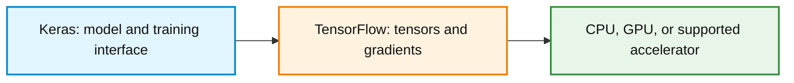
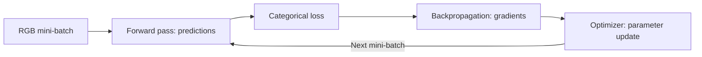
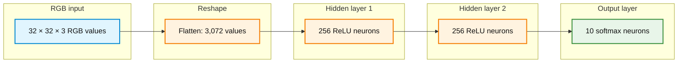
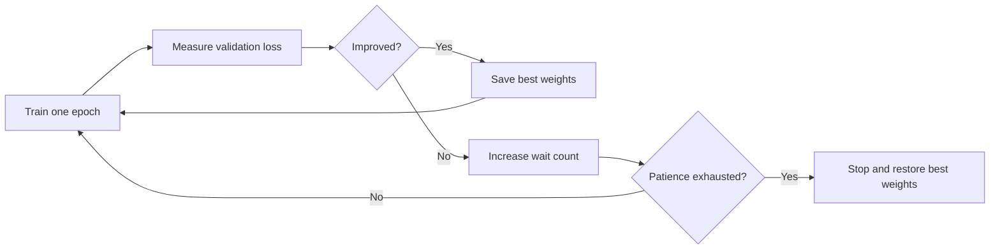

# Activity 2: Classifying Color Images with a Deep Neural Network (CIFAR-10)

## How to use this guided activity

This activity extends **Activity 1 (MNIST handwritten digits)** from grayscale image classification to **color image classification**. The same learning sequence remains in place: **forward pass → loss → backpropagation → optimizer update → evaluation**. The new challenges are the RGB channels, larger input tensors, and more complex visual categories.

Read each question before opening its answer. Run the Python cells in order in one Google Colab notebook or a compatible local Jupyter notebook. For every figure, open its separate **supplied Python code** section, run the code, observe the output, and explain what it shows. **Writing Matplotlib plotting code from scratch is not assessed.** Training results vary with initialization, hardware, and software versions.

**Python setup:** [Python setup for Week 3](1-python_setup.md). Google Colab is the main environment; local Conda/Jupyter is an alternative.

For Google Colab:

1. Open a Python notebook. A GPU is **recommended** for the training sections but is not required for the earlier image and tensor explorations.
2. Run the imports below. If an import reports `ModuleNotFoundError`, use the linked setup instructions and install only the missing package (for example, `%pip install numpy matplotlib tensorflow keras`). Restart the runtime if requested.
3. The optional architecture plot uses **pydot** and **Graphviz**. In Colab, install `pydot` with `%pip install pydot` if missing. If the Graphviz system executable is missing, use `!apt-get -qq install graphviz` in a separate cell.
4. CIFAR-10 downloads on first use. The training section fits **two models**; it can take longer on a CPU.

```python
import numpy as np
import matplotlib.pyplot as plt
import tensorflow as tf
from tensorflow import keras
from tensorflow.keras import layers

keras.utils.set_random_seed(42)
print("TensorFlow version:", tf.__version__)
print("TensorFlow is available:", bool(tf.executing_eagerly()))
```

## Learning objectives

By the end of the activity, the following distinctions should be clear:

1. An RGB image contains **three intensity values per pixel**; a grayscale image generally contains one.
2. A **tensor** has a rank (number of axes) and a shape (size of each axis). A batch of RGB images is a rank-4 tensor in the channel-last representation used here.
3. `Flatten` converts a `32 × 32 × 3` image into **3,072 inputs**, changing representation but not introducing trainable weights.
4. TensorFlow performs tensor computations and automatic differentiation; Keras provides an interface for defining and training layers and models.
5. The ten CIFAR-10 classes still require **ten softmax outputs** and a categorical loss. Integer class IDs do not express class importance.
6. A complete epoch, a mini-batch, a parameter update, and an optimizer are different ideas.
7. Training/validation curves and early stopping reveal information about generalization, but early stopping cannot solve every model limitation.
8. A dense network can classify RGB images, but flattening does not explicitly preserve spatial neighborhoods as a learning mechanism.

> **Key distinction:** Changing from MNIST to CIFAR-10 changes the **input representation and problem difficulty**, not the basic forward → loss → backpropagation → update learning cycle.

---

## 1. From MNIST to CIFAR-10

CIFAR-10 contains **60,000 labeled color images** from ten categories. The standard dataset contains **50,000 training images** and **10,000 test images**. Every image has **32 rows, 32 columns, and 3 color channels**.

| Class ID | Class | Class ID | Class |
|---:|---|---:|---|
| 0 | airplane | 5 | dog |
| 1 | automobile | 6 | frog |
| 2 | bird | 7 | horse |
| 3 | cat | 8 | ship |
| 4 | deer | 9 | truck |

The model assigns exactly **one target class** to each dataset image. This is *multiclass classification*, not multilabel classification, even though a real scene may contain more than one recognizable object.

Load the images and inspect their initial shapes. Keras provides CIFAR-10 labels as arrays with shape `(N, 1)`.

```python
(x_train_full, y_train_full_raw), (x_test_raw, y_test_raw) = keras.datasets.cifar10.load_data()

class_names = [
    "airplane", "automobile", "bird", "cat", "deer",
    "dog", "frog", "horse", "ship", "truck"
]

print("Training images:", x_train_full.shape)
print("Training labels:", y_train_full_raw.shape)
print("Test images:", x_test_raw.shape)
print("Test labels:", y_test_raw.shape)
print("One image shape:", x_train_full[0].shape)
print("Pixel data type:", x_train_full.dtype)

# Remove the unnecessary single-column axis from the labels.
y_train_full = y_train_full_raw.reshape(-1)
y_test = y_test_raw.reshape(-1)
print("Reshaped training labels:", y_train_full.shape)
```

**Question 1:** Explain the shapes `(50000, 32, 32, 3)` and `(50000, 1)`. What is different about these images compared with the grayscale `(28, 28)` MNIST images?

<details>
<summary>Show worked answer</summary>

`(50000, 32, 32, 3)` means 50,000 images, each with 32 rows, 32 columns, and three color channels (red, green, blue). `(50000, 1)` means 50,000 target labels, each stored in a one-element array. Reshaping the labels to `(50000,)` removes that unnecessary axis without changing the class IDs.

In Activity 1, each MNIST image had 28 × 28 grayscale values and no explicit channel axis. CIFAR-10 images have three values per pixel and therefore 32 × 32 × 3 = 3,072 values per image.

</details>

Run the supplied plot to view examples. The raw image arrays can be displayed directly because they contain eight-bit RGB intensities.

<details>
<summary>Show supplied Python code: Display a grid of CIFAR-10 images</summary>

```python
import matplotlib.pyplot as plt

fig, axes = plt.subplots(3, 5, figsize=(11, 7))
for i, ax in enumerate(axes.flat):
    ax.imshow(x_train_full[i])
    ax.set_title(class_names[int(y_train_full[i])])
    ax.axis("off")
fig.suptitle("CIFAR-10: original 32 × 32 RGB images", fontsize=14)
plt.tight_layout()
plt.show()
```

</details>

**Question 2:** Why might a 32 × 32 CIFAR-10 image be harder to classify than a 28 × 28 handwritten digit? Does the increased number of pixels by itself prove that the model will be more accurate or less accurate?

<details>
<summary>Show worked answer</summary>

CIFAR-10 includes varied objects, different backgrounds, viewpoint changes, color, and visual similarities between categories. A handwritten digit usually occupies a much simpler scene. A larger input alone does not determine accuracy: task complexity, architecture, training procedure, and data quality also matter. Any comparison of measured accuracies must refer to the particular trained models and datasets rather than assume a guaranteed result.

</details>

---

## 2. How an RGB image is represented

A grayscale pixel can be represented by one intensity. An RGB pixel is represented by **three intensities**: red, green, and blue. In an eight-bit RGB image, each channel intensity is an integer from **0** to **255**.

For an image of height $H$ and width $W$, the channel-last RGB shape is:

$$
(H,W,3)
$$

The three channels can be viewed as separate $H \times W$ matrices. Combining the values at each position reconstructs the displayed color image.

```python
image_rgb = x_train_full[0]
row, col = 16, 16
red = image_rgb[:, :, 0]
green = image_rgb[:, :, 1]
blue = image_rgb[:, :, 2]
reconstructed = np.stack([red, green, blue], axis=-1)

print("RGB image shape:", image_rgb.shape)
print("Red-channel matrix:", red.shape)
print("One RGB pixel [R, G, B]:", image_rgb[row, col].tolist())
print("Reconstructed image identical:", np.array_equal(image_rgb, reconstructed))
```

**Question 3:** What do the three values at `image_rgb[16, 16]` represent? How many intensities are stored in one CIFAR-10 image? Why does each color channel have shape `(32, 32)`?

<details>
<summary>Show worked answer</summary>

The three values record red, green, and blue intensity at row 16, column 16. A complete image contains 32 × 32 × 3 = **3,072** channel-intensity values. Each channel contains one intensity at each of the 32 × 32 pixel locations, so its shape is `(32, 32)`. The three channels represent the same spatial grid, not three different photographs.

</details>

Run the visualization to inspect the RGB image, its **separate red/green/blue contributions**, and an image reconstructed by stacking the three original channels. The final panel displays the channel values of one example pixel.

<details>
<summary>Show supplied Python code: Decompose and reconstruct an RGB image</summary>

```python
import numpy as np
import matplotlib.pyplot as plt

image = x_train_full[0]
channels = [image[:, :, k] for k in range(3)]
colors = ["Red", "Green", "Blue"]
reassembled = np.stack(channels, axis=-1)

fig, axes = plt.subplots(2, 3, figsize=(12, 7))
axes[0, 0].imshow(image)
axes[0, 0].set_title("Original RGB image")

for channel_index in range(3):
    contribution = np.zeros_like(image)
    contribution[:, :, channel_index] = channels[channel_index]
    ax = axes.flat[channel_index + 1]
    ax.imshow(contribution)
    ax.set_title(f"{colors[channel_index]} contribution")

axes[1, 1].imshow(reassembled)
axes[1, 1].set_title("Reconstructed from R, G, B")

pixel_values = image[16, 16]
axes[1, 2].bar(colors, pixel_values, color=["red", "green", "blue"])
axes[1, 2].set_ylim(0, 255)
axes[1, 2].set_ylabel("8-bit channel intensity")
axes[1, 2].set_title("Pixel at row 16, column 16")

for ax in axes.flat[:5]:
    ax.axis("off")
plt.tight_layout()
plt.show()
print("Exact reconstruction:", np.array_equal(image, reassembled))
```

</details>

A channel can also be displayed as a **grayscale intensity map**. Such a map shows how strong that individual color component is; it is not the same thing as converting the entire RGB image into a single grayscale image.

<details>
<summary>Show supplied Python code: Display the three channel intensity maps</summary>

```python
import matplotlib.pyplot as plt

image = x_train_full[0]
fig, axes = plt.subplots(1, 4, figsize=(13, 3.5))
axes[0].imshow(image)
axes[0].set_title("RGB image")

for index, label in enumerate(["Red intensity", "Green intensity", "Blue intensity"]):
    axes[index + 1].imshow(image[:, :, index], cmap="gray", vmin=0, vmax=255)
    axes[index + 1].set_title(label)

for ax in axes:
    ax.axis("off")
plt.tight_layout()
plt.show()
```

</details>

**Question 4:** Why does the same object appear differently in the red-, green-, and blue-channel maps? Does displaying an individual channel in grayscale mean that the original color image was grayscale?

<details>
<summary>Show worked answer</summary>

Each color component has different intensity values at the same pixels. Displaying a channel as a grayscale map makes its numerical intensities easier to inspect, but the original input still has three channels. The three channel maps together reconstruct the original color image.

</details>

### Optional connection: converting RGB to grayscale

MNIST is already provided as grayscale. As a separate illustration, an RGB image can be converted to an approximate grayscale image with a weighted combination of its red, green, and blue intensities. One common conversion is:

$$
I_{\mathrm{gray}}=0.299R+0.587G+0.114B
$$

Here $I_{\mathrm{gray}}$ is the approximate grayscale intensity, and $R$, $G$, and $B$ are the three RGB channel intensities. This is a commonly used approximate image conversion, **not a description of how MNIST images were originally collected or processed**.

<details>
<summary>Show supplied Python code: Compare a CIFAR-10 color image with an approximate grayscale conversion</summary>

```python
import numpy as np
import matplotlib.pyplot as plt

rgb = x_train_full[0].astype("float32")
grayscale = 0.299 * rgb[:, :, 0] + 0.587 * rgb[:, :, 1] + 0.114 * rgb[:, :, 2]

fig, axes = plt.subplots(1, 2, figsize=(8, 4))
axes[0].imshow(rgb.astype("uint8"))
axes[0].set_title("Original RGB")
axes[1].imshow(grayscale, cmap="gray", vmin=0, vmax=255)
axes[1].set_title("Approximate grayscale conversion")
for ax in axes:
    ax.axis("off")
plt.tight_layout()
plt.show()
print("Original shape:", rgb.shape)
print("Grayscale shape:", grayscale.shape)
```

</details>

---

## 3. Tensor rank, shape, and batches

A **tensor** is a multidimensional array used to hold inputs, weights, intermediate activations, and other numerical data. **Rank** counts axes; **shape** gives the number of entries along each axis. Rank is not the size of an array and not the same thing as matrix rank from linear algebra.

| Example | Shape | Tensor rank |
|---|---|---:|
| One number (scalar) | `()` | 0 |
| Ten class probabilities | `(10,)` | 1 |
| One grayscale MNIST image without a channel axis | `(28, 28)` | 2 |
| One color CIFAR-10 image | `(32, 32, 3)` | 3 |
| Batch of 64 color CIFAR-10 images | `(64, 32, 32, 3)` | 4 |

For a batch of color images in Keras's channel-last format:

$$
(\text{batch size},\text{height},\text{width},\text{channels})
$$

```python
one_image = x_train_full[0]
small_batch = x_train_full[:64]
image_tensor = tf.convert_to_tensor(one_image)
batch_tensor = tf.convert_to_tensor(small_batch)

print("NumPy image shape/rank:", one_image.shape, one_image.ndim)
print("TensorFlow image shape/rank:", image_tensor.shape, image_tensor.ndim)
print("TensorFlow batch shape/rank:", batch_tensor.shape, batch_tensor.ndim)
print("TensorFlow dtype:", batch_tensor.dtype)
```

**Question 5:** Why is a batch of 64 CIFAR-10 images a rank-4 tensor? What is the meaning of each axis? If the batch size becomes 32, which dimension changes?

<details>
<summary>Show worked answer</summary>

The tensor has four axes: **number of images, height, width, and color channels**. Its shape is `(64, 32, 32, 3)`, which gives rank 4. Replacing the batch with 32 images changes only the first dimension, making the shape `(32, 32, 32, 3)`.

The last `3` is the number of color channels, not the number of class labels.

</details>

**Question 6:** Is an image tensor the same object as a Keras `Flatten` layer? What is the rank and shape of a batch of 64 images *after* flattening to 3,072 values per image?

<details>
<summary>Show worked answer</summary>

A tensor is the numerical data structure; `Flatten` is an operation or layer that rearranges its dimensions. The result is a **rank-2** tensor of shape `(64, 3072)`. Flattening does not discard the 3,072 values but removes the explicit row, column, and channel axes. It also has no trainable parameters.

</details>

---

## 4. TensorFlow, Keras, and the training cycle

**Keras** provides layers, model-building interfaces, `compile()`, `fit()`, `evaluate()`, and callbacks. **TensorFlow** supplies tensor computations, automatic differentiation (gradient calculation), and accelerated numerical operations. This activity uses **Keras with the TensorFlow backend**.



The same parameter-learning cycle studied previously applies to the color-image model:




<!-- 
A small numerical example makes the separation explicit. **This example uses one scalar weight, not the CIFAR-10 network.** With `prediction = weight × input`, input `3`, target `4`, and initial weight `2`, the prediction is `6` and the half-squared-error loss is `2`. TensorFlow can calculate the gradient; applying the update is a separate action.

```python
weight = tf.Variable(2.0)
input_value = tf.constant(3.0)
target = tf.constant(4.0)
learning_rate_demo = 0.1

with tf.GradientTape() as tape:
    prediction = weight * input_value
    loss_demo = 0.5 * tf.square(prediction - target)

gradient_demo = tape.gradient(loss_demo, weight)
print("Prediction before update:", float(prediction.numpy()))
print("Loss before update:", float(loss_demo.numpy()))
print("Gradient:", float(gradient_demo.numpy()))

# This explicit assignment is the optimizer-style update step.
weight.assign_sub(learning_rate_demo * gradient_demo)
new_prediction = weight * input_value
new_loss = 0.5 * tf.square(new_prediction - target)
print("Weight after update:", float(weight.numpy()))
print("Prediction after update:", float(new_prediction.numpy()))
print("Loss after update:", float(new_loss.numpy()))
```

**Question 7:** What does `tf.GradientTape()` compute? Does that computation automatically update the weight? Verify the old and new loss values from the output.

<details>
<summary>Show worked answer</summary>

The initial prediction is `2 × 3 = 6`; the signed error is `6 − 4 = 2`; the initial half-squared-error loss is `0.5 × 2² = 2`. The derivative with respect to the weight is `(prediction − target) × input = 2 × 3 = 6`.

`GradientTape` supplies the gradient **6**. The weight changes only when the explicit `assign_sub` update is applied: `2 − 0.1 × 6 = 1.4`. The new prediction is `1.4 × 3 = 4.2`, and the new loss is `0.5 × 0.2² = 0.02`. Backpropagation/automatic differentiation supplies gradients; the optimizer or explicit update changes parameters.

</details> 

**Question 25:** What is the difference between `tf.GradientTape()`, `model.compile()`, and the weight changes performed during `model.fit()`?

<details>
<summary>Show answer</summary>

`tf.GradientTape()` can calculate gradients for watched operations. `model.compile()` configures the loss, optimizer, and metrics. During `model.fit()`, Keras performs forward passes, calculates losses and gradients, and invokes the optimizer to update trainable weights. Gradient computation and the update step are distinct.

</details> 
-->

---

## 5. Prepare the data and build the dense network

Normalize the RGB channel values from 0–255 to 0–1. Reserve 10,000 images from the original **training** set for validation. The 10,000 official test images remain separate until final evaluation.

```python
x_train = x_train_full[:40000].astype("float32") / 255.0
y_train = y_train_full[:40000]
x_val = x_train_full[40000:].astype("float32") / 255.0
y_val = y_train_full[40000:]
x_test = x_test_raw.astype("float32") / 255.0

print("Training:", x_train.shape, y_train.shape)
print("Validation:", x_val.shape, y_val.shape)
print("Test:", x_test.shape, y_test.shape)
print("Training data range:", x_train.min(), x_train.max())
```

| Set | Number of images | Purpose |
|---|---:|---|
| Training | 40,000 | Forward passes, gradients, and updates |
| Validation | 10,000 | Generalization monitoring and early stopping |
| Test | 10,000 | Final evaluation only |

**Question 8:** Why does normalization not change the image's class ID? Why is the test set not used to select the early-stopping epoch?

<details>
<summary>Show worked answer</summary>

Dividing the numerical intensities by 255 changes the input scale, not the image's correct category. All splits must receive the same scaling. The validation set is used to select training decisions such as the best epoch, so the test set is kept separate to provide a less biased final estimate of generalization.

</details>

For a controlled comparison with Activity 1, use the **same two hidden-layer widths**: 256 ReLU neurons in each hidden layer. Only the input shape changes from `(28, 28)` to `(32, 32, 3)`. The output remains ten softmax neurons.



The arrows summarize connections between **layers** rather than drawing every weight. Hidden and output dense layers have trainable weights and biases. Softmax operates jointly on ten class scores.

```python
def build_cifar_model():
    inputs = keras.Input(shape=(32, 32, 3), name="RGB_image")
    h = layers.Flatten(name="Flatten")(inputs)
    h = layers.Dense(256, activation="relu", name="Hidden_1")(h)
    h = layers.Dense(256, activation="relu", name="Hidden_2")(h)
    outputs = layers.Dense(10, activation="softmax", name="Class_probabilities")(h)
    return keras.Model(inputs=inputs, outputs=outputs, name="CIFAR10_DNN")

keras.utils.set_random_seed(42)
model = build_cifar_model()
model.summary()
```

For a dense layer with `m` input values and `n` neurons, the parameter count is:

$$
\text{parameters}=m\times n+n
$$

**Question 9:** What is the output shape of `Flatten` for one CIFAR-10 image? Calculate the parameters in each dense layer and the total. Why is the first layer larger than its counterpart in Activity 1?

<details>
<summary>Show worked answer</summary>

One image is flattened to **3,072** values. The `Flatten` layer itself has **zero trainable parameters**.

- Hidden layer 1: `3072 × 256 + 256 = 786688` parameters.
- Hidden layer 2: `256 × 256 + 256 = 65792` parameters.
- Output layer: `256 × 10 + 10 = 2570` parameters.
- Total: **855050** trainable parameters.

The corresponding MNIST network in Activity 1 contained **269322** parameters, because its first hidden layer received 784 grayscale intensities rather than 3,072 RGB intensities. Holding the hidden layer widths constant reveals the effect of the larger input representation on the first weight matrix.

</details>

Use the supplied architecture plot to examine the actual layer output shapes. This displays **layers and tensor shapes**, not every neuron, weight, or training curve.

<details>
<summary>Show supplied Python code: Plot the CIFAR-10 Keras network architecture</summary>

```python
from IPython.display import Image, display

keras.utils.plot_model(
    model,
    to_file="cifar10_dnn_architecture.png",
    show_shapes=True,
    show_layer_names=True,
    dpi=110,
)
display(Image(filename="cifar10_dnn_architecture.png"))
```

</details>

**Question 10:** Compare the architecture plot with the MNIST network. Which parts remain the same? Does a larger parameter count guarantee better generalization?

<details>
<summary>Show worked answer</summary>

Both models have `Flatten → Dense(256, ReLU) → Dense(256, ReLU) → Dense(10, softmax)`. Their ten output classes and hidden-layer widths are the same. Their input shapes, flattened feature counts, first-layer weight matrices, and total parameter counts differ.

More parameters increase model capacity but do **not guarantee** better generalization. They can increase the opportunity to overfit, especially when training data and model architecture do not support learning the relevant structure efficiently.

</details>

---

## 6. Categorical labels, softmax, and loss: what stays the same?

CIFAR-10 images have a single integer class ID. As with MNIST, the class number is an **index**, not a magnitude. For instance, class `8` (ship) is not more important than class `3` (cat), and its numerical distance from `3` has no special meaning in the categorical loss.

| Representation | Example: cat |
|---|---|
| Sparse integer target | `3` |
| One-hot target | `[0, 0, 0, 1, 0, 0, 0, 0, 0, 0]` |

The network converts ten logits to ten probabilities with softmax:

$$
p_k=\frac{e^{z_k}}{\sum_{j=0}^{9}e^{z_j}}
$$

For integer target class $y$, sparse categorical cross-entropy uses:

$$
L=-\ln(p_y)
$$

For a one-hot target $y_k$, standard categorical cross-entropy uses:

$$
L=-\sum_{k=0}^{9}y_k\ln(p_k)
$$

They describe the same target when exactly one class is correct, and give equivalent losses for the same probabilities. The numbers in the next cell are an **illustrative distribution**, not a trained CIFAR-10 prediction. One-hot labels are more visually explicit; **sparse labels are simpler here because CIFAR-10 already supplies integers**.

```python
example_probabilities = np.array(
    [0.03, 0.02, 0.02, 0.72, 0.03, 0.04, 0.03, 0.03, 0.04, 0.04],
    dtype="float64",
)
example_sparse_label = 3
example_one_hot_label = np.eye(10)[example_sparse_label]

sparse_loss = -np.log(example_probabilities[example_sparse_label])
one_hot_loss = -np.sum(example_one_hot_label * np.log(example_probabilities))
print("Sparse class ID:", example_sparse_label)
print("One-hot target:", example_one_hot_label.astype(int).tolist())
print("Sparse loss:", round(float(sparse_loss), 6))
print("One-hot loss:", round(float(one_hot_loss), 6))
print("Equivalent:", np.isclose(sparse_loss, one_hot_loss))
```

**Question 11:** Does using class ID `8` make the model train harder on ships than on cats (ID `3`)? Would one-hot encoding change the number of output neurons or require sigmoid instead of softmax?

<details>
<summary>Show worked answer</summary>

No. Sparse categorical cross-entropy uses the class ID to **select** the probability assigned to the correct class. It does not multiply the loss by the number of the class ID. One-hot encoding makes the categories visually distinct but conveys the same information for a single correct class.

The classifier still has **ten softmax outputs** with either target representation. Switching to one-hot targets would require the matching `categorical_crossentropy` loss, not ten independent sigmoid outputs. Sigmoids are appropriate when several labels may simultaneously be correct for one image (multilabel classification).

</details>

**Question 12:** If the correct class has probability `0.72`, what is its categorical loss? What happens to that loss when the correct-class probability decreases?

<details>
<summary>Show worked answer</summary>

The loss is the negative natural logarithm of 0.72, approximately **0.3285**. When the probability assigned to the correct class decreases toward zero, its negative-log loss increases. In the limit, assigning zero probability to the correct class would produce an unbounded cross-entropy penalty. These conclusions do not depend on the numeric class ID.

</details>

---

## 7. Epochs, mini-batches, and model training

The model uses the same training cycle as Activity 1:

- **Forward pass:** predictions from current weights.
- **Loss:** mismatch between predictions and integer targets.
- **Backpropagation:** gradients with respect to trainable weights and biases.
- **Optimizer step:** changes parameters using gradients and a learning rate.
- **Repeat/evaluate:** processes further mini-batches and monitors held-out validation data.

For `N` training images and mini-batch size `B`, the number of optimizer updates in one completed epoch is:

$$
\text{steps per epoch}=\left\lceil\frac{N}{B}\right\rceil
$$

| Method | Examples used per update | Updates per full epoch with 40,000 training images |
|---|---:|---:|
| Full-batch gradient descent | 40,000 | 1 |
| Single-example SGD (strict meaning) | 1 | 40,000 |
| Mini-batch training, size 64 | 64 | 625 |

Keras will use **Adam** as the optimizer. It is **not** the SGD optimizer, but it computes updates from successive mini-batches. A full epoch still means that every training example has been used once.

**Question 13:** With 40,000 training images, batch size 64, and a planned maximum of 20 epochs, how many updates occur per completed epoch? How many would occur if all 20 epochs finish? What changes when batch size becomes 128?

<details>
<summary>Show worked answer</summary>

`40000 / 64 = 625` optimizer steps per completed epoch. Across 20 complete epochs, the planned total is `625 × 20 = 12500` steps. At batch size 128, the number of steps per epoch is `40000 / 128 = 312.5`, rounded **up** to **313**, because the last mini-batch contains the remaining 64 images. The definition of one epoch does not change. Early stopping can reduce the actual number of completed epochs.

</details>

Compile the model. Sparse categorical cross-entropy matches the integer labels and the softmax output. Classification accuracy is a reporting metric, not the loss being optimized.

```python
batch_size = 64
max_epochs = 20

model.compile(
    optimizer=keras.optimizers.Adam(learning_rate=0.001),
    loss="sparse_categorical_crossentropy",
    metrics=["accuracy"],
)
```

**Question 14:** Identify the optimizer, learning rate, loss, and metric in `model.compile()`. Which part of the workflow actually updates the trainable parameters?

<details>
<summary>Show worked answer</summary>

Adam is the optimizer and uses learning rate `0.001`. The loss is sparse categorical cross-entropy, appropriate for single integer class labels with ten softmax probabilities. Accuracy measures the fraction of correct predicted classes. During `model.fit()`, TensorFlow/Keras computes gradients and Adam applies updates to the model's trainable weights and biases. `model.compile()` configures these operations; it does not train the model by itself.

</details>

### First training run: without early stopping

Train the full maximum number of epochs to observe how training and validation metrics develop. **No test images are used for training or model selection.** A GPU can reduce training time.

```python
baseline_history = model.fit(
    x_train, y_train,
    validation_data=(x_val, y_val),
    batch_size=batch_size,
    epochs=max_epochs,
    verbose=2,
)

print("Completed baseline epochs:", len(baseline_history.history["loss"]))
print("Final training loss:", baseline_history.history["loss"][-1])
print("Final validation loss:", baseline_history.history["val_loss"][-1])
```

Run the training-history plot and examine the loss and accuracy curves. These are **recorded outputs from the executed training run**, not idealized examples.

<details>
<summary>Show supplied Python code: Plot training and validation loss and accuracy</summary>

```python
import numpy as np
import matplotlib.pyplot as plt

history_values = baseline_history.history
epoch_numbers = np.arange(1, len(history_values["loss"]) + 1)

fig, axes = plt.subplots(1, 2, figsize=(12, 4))
axes[0].plot(epoch_numbers, history_values["loss"], marker="o", label="Training")
axes[0].plot(epoch_numbers, history_values["val_loss"], marker="o", label="Validation")
axes[0].set_title("CIFAR-10: cross-entropy loss")
axes[0].set_xlabel("Epoch")
axes[0].set_ylabel("Loss")
axes[0].legend()
axes[0].grid(alpha=0.25)

axes[1].plot(epoch_numbers, history_values["accuracy"], marker="o", label="Training")
axes[1].plot(epoch_numbers, history_values["val_accuracy"], marker="o", label="Validation")
axes[1].set_title("CIFAR-10: classification accuracy")
axes[1].set_xlabel("Epoch")
axes[1].set_ylabel("Accuracy")
axes[1].legend()
axes[1].grid(alpha=0.25)

plt.tight_layout()
plt.show()
```

</details>

**Question 15:** Does training loss decrease across the run? Which epoch has the smallest recorded validation loss? What would count as evidence of overfitting, and what conclusion would **not** be justified by a single curve?

<details>
<summary>Show worked answer</summary>

Answers depend on the observed curves. The epoch with the minimum validation loss can be located on the validation-loss line. A sustained divergence—training loss decreasing while validation loss rises—suggests overfitting. A single noisy validation increase does not prove permanent deterioration. Training loss alone does not measure performance on unseen data, and no fixed epoch is guaranteed to be best across machines or seeds.

</details>

---

## 8. Early stopping and generalization

**Early stopping** monitors the validation loss and ends the training run if that loss fails to improve for a specified number of epochs. Restoring the best weights selects the parameters from the best recorded validation epoch.



Build a **fresh model** and train it using the same architecture, training/validation split, optimizer, learning rate, mini-batch size, and maximum epoch count as the baseline. A reset seed supports a more meaningful comparison, although exact reproducibility across different environments is not guaranteed.

```python
keras.utils.set_random_seed(42)
early_model = build_cifar_model()
early_model.compile(
    optimizer=keras.optimizers.Adam(learning_rate=0.001),
    loss="sparse_categorical_crossentropy",
    metrics=["accuracy"],
)

early_stop = keras.callbacks.EarlyStopping(
    monitor="val_loss",
    patience=3,
    restore_best_weights=True,
)

early_history = early_model.fit(
    x_train, y_train,
    validation_data=(x_val, y_val),
    batch_size=batch_size,
    epochs=max_epochs,
    callbacks=[early_stop],
    verbose=2,
)

best_epoch = int(np.argmin(early_history.history["val_loss"])) + 1
last_epoch = len(early_history.history["loss"])
print("Best validation-loss epoch:", best_epoch)
print("Last completed epoch:", last_epoch)
print("Best recorded validation loss:", min(early_history.history["val_loss"]))
```

**Question 16:** What do `patience=3`, `monitor="val_loss"`, and `restore_best_weights=True` each do? Why is the best validation epoch not necessarily the last completed epoch?

<details>
<summary>Show worked answer</summary>

`monitor="val_loss"` chooses validation loss as the selection signal. `patience=3` allows three consecutive epochs without improvement before stopping, subject to the maximum epoch count. `restore_best_weights=True` returns the model to the best recorded validation-loss weights. Training may continue for a few epochs after the best epoch while the callback checks whether improvement resumes. The test set is not used to choose this stopping point.

</details>

Compare the recorded baseline and early-stopping validation curves. The vertical marker identifies the best validation-loss epoch in the early-stopping run.

<details>
<summary>Show supplied Python code: Plot baseline versus early-stopping validation loss</summary>

```python
import numpy as np
import matplotlib.pyplot as plt

baseline_epochs = np.arange(1, len(baseline_history.history["val_loss"]) + 1)
early_epochs = np.arange(1, len(early_history.history["val_loss"]) + 1)

plt.figure(figsize=(9, 5))
plt.plot(baseline_epochs, baseline_history.history["val_loss"],
         marker="o", label="Without early stopping")
plt.plot(early_epochs, early_history.history["val_loss"],
         marker="o", label="With early stopping")
plt.axvline(best_epoch, color="gray", linestyle="--",
            label=f"Best early-stop epoch: {best_epoch}")
plt.title("CIFAR-10: recorded validation loss")
plt.xlabel("Epoch")
plt.ylabel("Validation cross-entropy loss")
plt.legend()
plt.grid(alpha=0.25)
plt.tight_layout()
plt.show()
```

</details>

**Question 17:** Did the callback stop training before 20 epochs? Did restoring the best weights erase later recorded loss values? Does early stopping guarantee the highest possible test accuracy?

<details>
<summary>Show worked answer</summary>

Whether training stops before 20 epochs depends on the validation history. The history still records all completed epochs, including those after the best one. Weight restoration changes the final model parameters; it does **not** rewrite the training history. Early stopping may reduce unnecessary fitting but does not guarantee the best possible test accuracy, nor does it overcome limitations in model architecture or data.

</details>

### Dropout: high-level reminder only

**Dropout** is another regularization technique that randomly disables some hidden-unit outputs during training. It can discourage reliance on specific combinations of features. Unlike early stopping, dropout changes what happens inside training passes. **No dropout layers are used in either CIFAR-10 run here.** Detailed dropout behavior is reserved for a later lesson.

---

## 9. Test evaluation and visual interpretation

The test set has not been used for weight updates or early-stopping decisions. Evaluate the model with restored best weights only after the training comparisons are complete.

```python
test_loss, test_accuracy = early_model.evaluate(x_test, y_test, verbose=0)
print(f"Final test loss: {test_loss:.4f}")
print(f"Final test accuracy: {test_accuracy:.2%}")

sample_index = 12
sample_probabilities = early_model.predict(
    x_test[sample_index:sample_index + 1], verbose=0
)[0]
predicted_class = int(np.argmax(sample_probabilities))
print("True class:", class_names[int(y_test[sample_index])])
print("Predicted class:", class_names[predicted_class])
print("Sum of probabilities:", float(sample_probabilities.sum()))
```

Run the plot to view the test image and the associated ten **softmax class probabilities**. The probabilities reflect the particular trained model; they are not human-labeled confidence scores.

<details>
<summary>Show supplied Python code: Plot a color test image and its softmax probabilities</summary>

```python
import numpy as np
import matplotlib.pyplot as plt

idx = 12
image = x_test[idx]
true_id = int(y_test[idx])
probs = early_model.predict(image[None, ...], verbose=0)[0]
pred_id = int(np.argmax(probs))

fig, axes = plt.subplots(1, 2, figsize=(12, 4))
axes[0].imshow(image)
axes[0].set_title(f"True: {class_names[true_id]}\nPredicted: {class_names[pred_id]}")
axes[0].axis("off")

axes[1].barh(class_names, probs)
axes[1].set_xlim(0, 1)
axes[1].set_xlabel("Softmax probability")
axes[1].set_title(f"Ten classes; sum = {probs.sum():.3f}")
plt.tight_layout()
plt.show()
```

</details>

**Question 18:** What should the ten softmax probabilities sum to? Why is the largest probability not proof that the chosen class is correct? How does this task differ from multilabel classification?

<details>
<summary>Show worked answer</summary>

The ten values sum to **1** up to numerical rounding. The predicted label is the class with the largest probability, but the model can still make a confident incorrect prediction. The output represents ten mutually exclusive alternatives because each CIFAR-10 example has one target category. A multilabel image task might require independent sigmoid outputs to allow multiple simultaneously correct categories.

</details>

Inspect some incorrectly classified test images. The code searches the first 1,000 test examples, which are used **only for post-training evaluation**, not for model selection or retraining.

<details>
<summary>Show supplied Python code: Display incorrectly classified CIFAR-10 images</summary>

```python
import numpy as np
import matplotlib.pyplot as plt

subset_size = 1000
subset_probabilities = early_model.predict(x_test[:subset_size], verbose=0)
subset_predictions = np.argmax(subset_probabilities, axis=1)
wrong_indices = np.flatnonzero(subset_predictions != y_test[:subset_size])[:12]

if len(wrong_indices) == 0:
    print("No incorrect predictions in the inspected subset.")
else:
    cols = 4
    rows = int(np.ceil(len(wrong_indices) / cols))
    fig, axes = plt.subplots(rows, cols, figsize=(12, 3 * rows), squeeze=False)
    for ax in axes.flat:
        ax.axis("off")
    for ax, idx in zip(axes.flat, wrong_indices):
        ax.imshow(x_test[idx])
        ax.set_title(
            f"True: {class_names[int(y_test[idx])]}\n"
            f"Pred: {class_names[int(subset_predictions[idx])]}"
        )
        ax.axis("off")
    fig.suptitle("Incorrect CIFAR-10 predictions", fontsize=14)
    plt.tight_layout()
    plt.show()
```

</details>

**Question 19:** Select two incorrect predictions. What visible features might explain the confusion? Does one error establish that normalization or early stopping was implemented incorrectly?

<details>
<summary>Show worked answer</summary>

Observations depend on the displayed images. Small resolution, similar animal shapes, background objects, unusual viewpoints, and indistinct features can make classification difficult. Individual errors do not establish an implementation error. Early stopping controls how long training continues based on validation loss; it cannot guarantee that every unseen image will be classified correctly.

</details>

---

## 10. What the two image-classification activities show

The two activities deliberately used the **same hidden-layer widths and output design**. The input and dataset changed.

| Property | Activity 1: MNIST | Activity 2: CIFAR-10 |
|---|---|---|
| Input per image | `(28, 28)` | `(32, 32, 3)` |
| Pixel representation | One grayscale intensity | Three RGB intensities |
| Flattened inputs | 784 | 3,072 |
| Hidden layers | 256 ReLU → 256 ReLU | 256 ReLU → 256 ReLU |
| Output | 10 softmax values | 10 softmax values |
| Trainable parameters | 269,322 | 855,050 |
| Labels used | Integer class IDs | Integer class IDs |
| Loss | Sparse categorical cross-entropy | Sparse categorical cross-entropy |
| Main regularization experiment | Early stopping | Early stopping |

**Question 20:** Which feature of the CIFAR-10 input accounts for the increase in parameters when hidden-layer widths are held constant? Does changing from grayscale to RGB require changing softmax to sigmoid?

<details>
<summary>Show worked answer</summary>

The first dense layer receives 3,072 numbers instead of 784, so its input weight matrix is larger. The hidden layers and the ten-way output retain their widths. Color does not change the meaning of the target labels: each image still belongs to one of ten mutually exclusive dataset classes. Therefore, a ten-way softmax output remains appropriate.

</details>

**Question 21:** What does the network lose as an explicit spatial representation when it flattens the image? Why might this matter more for real-world photographs than for centered handwritten digits?

<details>
<summary>Show worked answer</summary>

Flattening preserves the individual numerical values but removes the explicit height/width/channel axes from the next layer's input. The dense network can learn patterns from the flattened vector, but it does not build in the assumption that neighboring pixels should be processed with shared local filters. Real-world scenes can contain objects at varied positions, scales, and orientations, making spatial structure important. Convolutional neural networks are a possible later extension; implementing them is outside this activity.

</details>

### Concept questions: reveal the answers

**Question 22:** A CIFAR-10 training batch has shape `(64, 32, 32, 3)`. State its tensor rank before and after the `Flatten` layer.

<details>
<summary>Show answer</summary>

Before flattening: rank **4**, shape `(64, 32, 32, 3)`. After flattening: rank **2**, shape `(64, 3072)`.

</details>

**Question 23:** If one class uses sparse ID `9` and another uses sparse ID `1`, why does the model not give the first class nine times the importance?

<details>
<summary>Show answer</summary>

Sparse categorical cross-entropy uses each class ID only to locate the corresponding correct-class probability. It does not multiply that probability or its loss by the integer value. The IDs are names/indices, not quantities or ordered grades.

</details>

**Question 24:** If validation loss rises while training loss falls, what decision can early stopping make? What can it not guarantee?

<details>
<summary>Show answer</summary>

It can stop training after validation loss fails to improve for the configured patience interval and restore the parameters from the best observed validation epoch. It cannot guarantee an improvement on every possible future test set, nor solve all causes of errors or architectural limitations.

</details>


## Final summary

- **RGB representation:** every CIFAR-10 image stores three color-channel values at each of 32 × 32 pixel positions.
- **Tensor shapes:** a batch adds a leading dimension; rank counts axes, not individual numerical entries.
- **Model:** `Flatten → Dense(256, ReLU) → Dense(256, ReLU) → Dense(10, softmax)` extends the MNIST architecture to RGB inputs.
- **Learning:** the forward/loss/backpropagation/optimizer-update cycle remains the same; TensorFlow computes gradients and Keras provides the training workflow.
- **Labels and loss:** sparse integer IDs and one-hot labels are alternative representations; neither changes class importance when matched with the proper categorical loss.
- **Generalization:** early stopping monitors validation loss but does not eliminate all errors or all overfitting.
- **Limitations:** a dense network can process flattened pixels but does not explicitly exploit local spatial structure; that motivates later work on convolutional models.


<details>
<summary><b>Evaluating Classification Models Beyond Accuracy</b></summary>

Accuracy reports the proportion of correctly classified examples.

Although accuracy is useful, it does not explain **which classes the model predicts well and which classes it frequently confuses**.

This distinction remains important for multiclass image classification, including MNIST, Fashion-MNIST, and CIFAR-10.

**Recall: Classification metrics**

| Metric | What it helps examine |
|---|---|
| Accuracy | Overall proportion of correct predictions |
| Precision | How often predictions of a particular class are correct |
| Recall | How many actual examples of a particular class the model identifies |
| F1-score | Balance between precision and recall |
| Confusion matrix | Which classes are confused with one another |

For multiclass classification, precision, recall, and F1-score can be calculated separately for each class.

A model may achieve high overall accuracy while performing noticeably worse on certain classes. This can occur even when the dataset is reasonably balanced.

**Python: Classification report and confusion matrix**

After training a multiclass Keras model, predictions can be compared with the true labels using scikit-learn.

The following code assumes that `model`, `x_test`, and `y_test` are already available. The class names below correspond to original MNIST; replace them when using a different dataset.

Run the supplied Python code: Classification metrics and confusion matrix

```python
import numpy as np
import matplotlib.pyplot as plt

from sklearn.metrics import (
    classification_report,
    ConfusionMatrixDisplay
)

# MNIST class names
class_names = [str(i) for i in range(10)]

# Obtain class probabilities
probabilities = model.predict(x_test, verbose=0)

# Select the predicted class
y_pred = np.argmax(probabilities, axis=1)

# Ensure labels are a one-dimensional array
y_true = np.asarray(y_test).reshape(-1)

# Print classification metrics
print(
    classification_report(
        y_true,
        y_pred,
        labels=list(range(10)),
        target_names=class_names,
        zero_division=0
    )
)

# Display confusion matrix
fig, ax = plt.subplots(figsize=(9, 8))

ConfusionMatrixDisplay.from_predictions(
    y_true,
    y_pred,
    labels=list(range(10)),
    display_labels=class_names,
    cmap="Blues",
    ax=ax,
    colorbar=False
)

ax.set_title("Confusion Matrix")
plt.tight_layout()
plt.show()
```

**Interpretation questions**

1. Which class has the lowest recall?
2. Which class has the lowest precision?
3. Which two classes are most frequently confused?
4. Does overall accuracy adequately describe the classifier's performance?
5. If the dataset has unequal class frequencies, how might macro-average and weighted-average F1 scores differ?

These questions reinforce previously studied evaluation metrics while connecting them to neural-network image classification.

</details>

---

## Links

- https://deeplearningwithpython.io/chapters/chapter07_deep-dive-keras
- https://deeplearningwithpython.io/chapters/chapter08_image-classification
- https://deeplearningwithpython.io/chapters/
