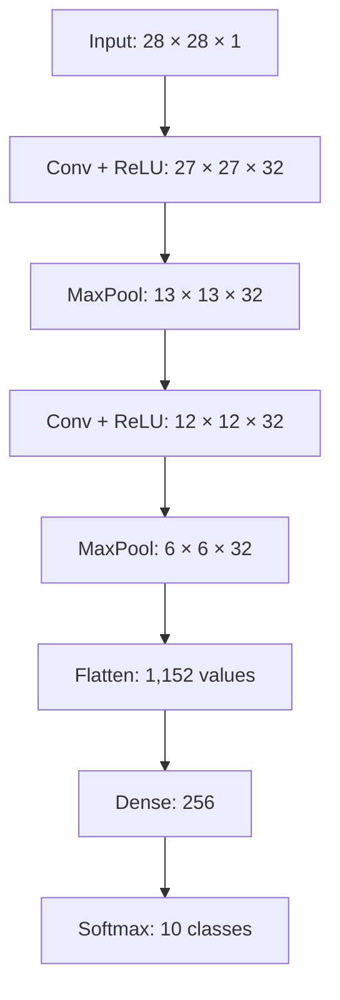
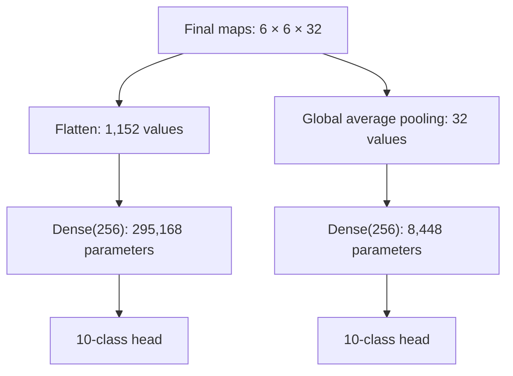
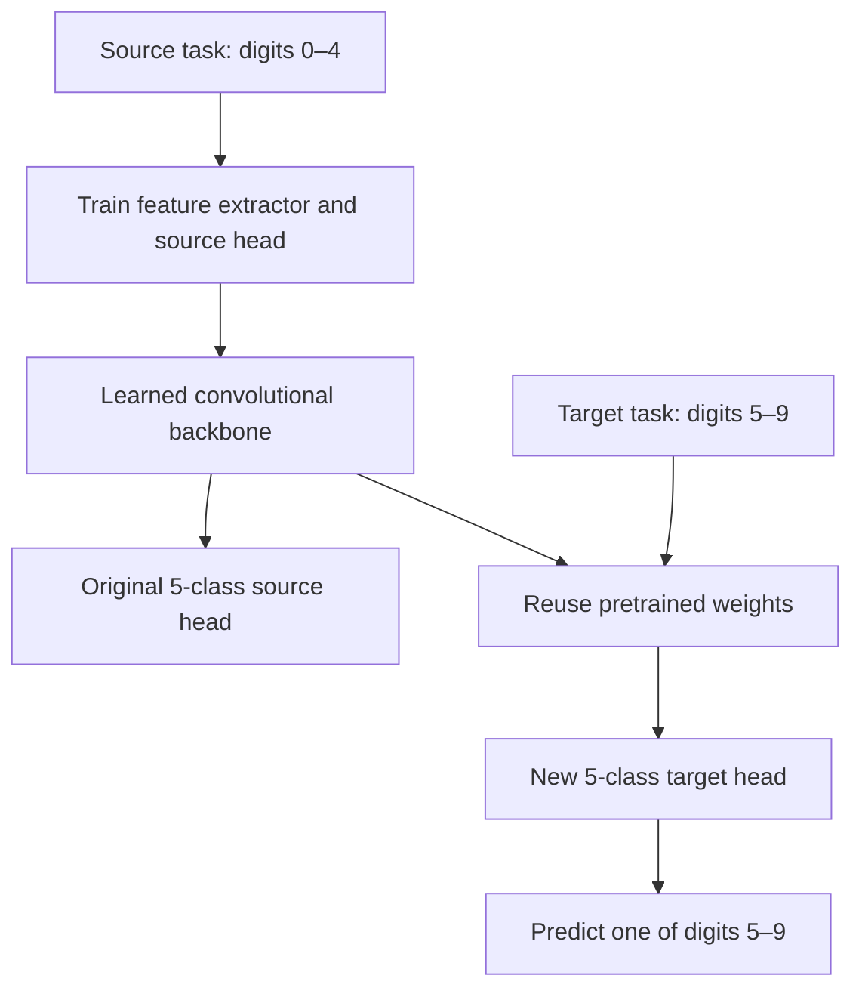

# Activity 2 — Controlling CNN Spatial Information and Reusing Features (MNIST)


## How to use this guided activity

Read each question before opening its **Hint** or **Show worked answer** section. Run the Python cells in order in one Google Colab notebook or a compatible Jupyter notebook. Later sections reuse data and variables defined earlier. For figures, run the **supplied visualization code** and interpret the result; writing plotting code from scratch is not assessed.

**Start with a clean runtime.** Use a separate notebook for this activity. Before beginning, connect to a fresh Colab runtime or restart the session used for [Activity 1](../../part1/activity/activity1.md); for local Jupyter, restart the kernel. Then run this activity from its setup cell. This avoids reusing old variables or retaining earlier models and datasets in memory. A new notebook file alone does not clear a reused kernel. If a restart is needed midway through the activity, rerun the earlier cells, including source-model training, before continuing with feature reuse or fine-tuning.

For environment preparation, use the separate [Python setup for CNN activities](1-python_setup.md). A CPU can run the examples; a GPU is optional. Training results and execution times vary by environment. No uploaded CNN model file or external image assets are needed.

**Dataset:** This activity continues with MNIST handwritten digits (0–9). The transfer-learning experiment defines separate source and target tasks within that dataset. Hand calculations are optional practice.

## Learning objectives

1. Distinguish a spatial reduction caused by valid convolution from one caused by valid stride-2 pooling.
2. Predict and verify output shapes for `VALID` and `SAME` padding, including asymmetric padding with even-sized kernels.
3. Explain how stride changes which filter positions are evaluated, without changing filter weights.
4. Compare max pooling and average pooling, and test the limits of local translation tolerance.
5. Explain why a `Flatten` classifier depends on spatial dimensions and how Global Average Pooling (GAP) changes the design.
6. Distinguish training from scratch, a frozen pretrained feature extractor, and fine-tuning.
7. Interpret validation results without assuming that pretrained models always outperform newly initialized networks.

---

## Python setup and MNIST data

```python
import numpy as np
import matplotlib.pyplot as plt
import tensorflow as tf
from tensorflow import keras
from tensorflow.keras import layers

keras.utils.set_random_seed(42)

(x_train_raw, y_train_raw), (x_test_raw, y_test) = keras.datasets.mnist.load_data()

# Keep training, validation, and test data separate.
x_train = x_train_raw[:48000].astype("float32")[..., np.newaxis] / 255.0
y_train = y_train_raw[:48000]
x_val = x_train_raw[48000:].astype("float32")[..., np.newaxis] / 255.0
y_val = y_train_raw[48000:]
x_test = x_test_raw.astype("float32")[..., np.newaxis] / 255.0

image_index = 0
image_batch = x_test[image_index:image_index + 1]

print("Training:", x_train.shape, y_train.shape)
print("Validation:", x_val.shape, y_val.shape)
print("Test:", x_test.shape, y_test.shape)
print("Selected digit:", int(y_test[image_index]))
print("Selected image batch:", image_batch.shape)
```

**Question 1.** Why is the selected batch shape `(1, 28, 28, 1)` rather than `(28, 28)`? What do the first and last dimensions represent?

<details>
<summary>Hint — Question 1</summary>

A Keras convolution receives a batch of images. MNIST uses one grayscale intensity channel per pixel.

</details>

<details>
<summary>Show worked answer — Question 1</summary>

The first dimension is the **batch size** (one image). The next two are the 28 image rows and 28 columns. The last dimension is **one grayscale channel**. A two-dimensional 28 × 28 array omits both the batch axis and the channel axis needed by the convolution operation.

</details>

<details>
<summary>Show supplied Python code — View the selected MNIST digit</summary>

```python
plt.figure(figsize=(3.5, 3.5))
plt.imshow(image_batch[0, :, :, 0], cmap="gray", vmin=0, vmax=1)
plt.title(f"MNIST test digit: {int(y_test[image_index])}")
plt.axis("off")
plt.show()
```

</details>

---

## 1. Revisit the dimensions of the CNN

Demo 1 used a 28 × 28 grayscale image, two 2 × 2 convolutional layers, and two 2 × 2 max-pooling layers. The convolutions had stride 1 and valid padding; pooling had stride 2 and valid padding.



**Question 2.** Why does the first convolution change 28 to 27? Why does the first pooling layer then change 27 to 13? Are those reductions caused by the same rule?

<details>
<summary>Hint — Question 2</summary>

A valid convolution must fit its entire filter inside the input. Valid max pooling with stride 2 selects non-overlapping complete windows.

</details>

<details>
<summary>Show worked answer — Question 2</summary>

The 2 × 2 valid convolution can begin at positions 0 through 26, producing **27** positions along either axis. The 2 × 2 pooling operation with stride 2 can begin at 0, 2, ..., 24, producing **13** complete windows per axis and omitting index 26. Convolution reduces size because its filter cannot extend beyond the original border; this pooling step reduces size by summarizing separate windows and omitting an incomplete final border.

</details>

### Count the pooling windows by hand

A small 5 × 5 feature map illustrates the omitted border. It is a feature map, not a sample digit.

```python
border_grid = np.arange(1, 26, dtype=np.float32).reshape(5, 5)
border_batch = border_grid[np.newaxis, :, :, np.newaxis]

border_pooled = tf.nn.max_pool2d(
    border_batch, ksize=2, strides=2, padding="VALID"
).numpy()[0, :, :, 0]

print("Input:\n", border_grid)
print("Pooled output:\n", border_pooled)
```

**Question 3.** Identify all four complete 2 × 2 pooling windows and their maxima. Is the value 25 used? Which other input positions are omitted?

<details>
<summary>Hint — Question 3</summary>

The window starting rows are 0 and 2; the starting columns are 0 and 2. A valid window must be entirely inside the grid.

</details>

<details>
<summary>Show worked answer — Question 3</summary>

The top-left window contains 1, 2, 6, 7 and outputs **7**. The top-right outputs **9** from 3, 4, 8, 9. The bottom-left outputs **17** from 11, 12, 16, 17. The bottom-right outputs **19** from 13, 14, 18, 19. The pooled result is `[[7, 9], [17, 19]]`. The entire final row (21–25) and final column (5, 10, 15, 20, 25) are outside complete windows. In particular, 25 is omitted.

</details>

<details>
<summary>Show supplied Python code — Plot the omitted border</summary>

```python
fig, axes = plt.subplots(1, 2, figsize=(8, 4))
axes[0].imshow(border_grid, cmap="Blues", vmin=0, vmax=25)
axes[0].axhline(3.5, linewidth=2, color="red")
axes[0].axvline(3.5, linewidth=2, color="red")
axes[0].set_title("Valid windows exclude last row/column")
axes[1].imshow(border_pooled, cmap="Blues", vmin=0, vmax=25)
axes[1].set_title("2 × 2 max-pooled result")
for ax, values in zip(axes, (border_grid, border_pooled)):
    for r in range(values.shape[0]):
        for c in range(values.shape[1]):
            ax.text(c, r, f"{values[r, c]:.0f}", ha="center", va="center")
    ax.set_xticks([])
    ax.set_yticks([])
plt.tight_layout()
plt.show()
```

</details>

This raises the first design question: **could the convolution be allowed to reach the image border without reducing the output dimensions?**

---

## 2. Padding: allowing responses at image borders

A **padding** operation extends the spatial input. With zero padding, the additional positions contain zeros; they are not observed image pixels. `VALID` convolution uses no padding, while TensorFlow's `SAME` mode chooses padding according to the desired output geometry.

Reuse the vertical-contrast filter from Activity 1. It compares left and right intensities, and the responses are signed because no ReLU is applied.

```python
vertical_kernel = np.array([
    [-1.0, 1.0],
    [-1.0, 1.0]
], dtype=np.float32).reshape(2, 2, 1, 1)

valid_s1 = tf.nn.conv2d(
    image_batch, vertical_kernel, strides=1, padding="VALID"
).numpy()[0, :, :, 0]

same_s1 = tf.nn.conv2d(
    image_batch, vertical_kernel, strides=1, padding="SAME"
).numpy()[0, :, :, 0]

print("Original image:", image_batch.shape[1:3])
print("VALID, stride 1:", valid_s1.shape)
print("SAME, stride 1:", same_s1.shape)
```

**Question 4.** Predict the shapes of both response maps. Does `SAME` change the four filter weights? Does preserving the spatial size mean that output pixels are copies of the input pixels?

<details>
<summary>Hint — Question 4</summary>

The same 2 × 2 kernel is used in both calls. Padding changes which complete windows are available, not the kernel's values.

</details>

<details>
<summary>Show worked answer — Question 4</summary>

`VALID` produces **27 × 27**, and `SAME` produces **28 × 28** for stride 1. The kernel weights remain exactly the same. The output consists of weighted sums; it does not copy input pixels. Some boundary responses depend on padding values as well as observed pixels.

</details>

<details>
<summary>Show supplied Python code — Compare valid and same padding on one digit</summary>

```python
limit = max(float(np.abs(valid_s1).max()),
            float(np.abs(same_s1).max()), 1e-6)
fig, axes = plt.subplots(1, 3, figsize=(12, 3.8))
axes[0].imshow(image_batch[0, :, :, 0], cmap="gray")
axes[0].set_title("Input: 28 × 28")
axes[1].imshow(valid_s1, cmap="coolwarm", vmin=-limit, vmax=limit)
axes[1].set_title("VALID: 27 × 27")
im = axes[2].imshow(same_s1, cmap="coolwarm", vmin=-limit, vmax=limit)
axes[2].set_title("SAME: 28 × 28")
for ax in axes:
    ax.axis("off")
fig.colorbar(im, ax=axes[1:], shrink=0.7)
plt.show()
```

</details>

### Why is padding sometimes asymmetric?

For a **2 × 2** kernel with stride 1, preserving length 28 requires *one additional position in total* along each dimension. That single position cannot be split equally between the top and bottom (or left and right). TensorFlow's `SAME` convention places the extra row at the **bottom** and extra column at the **right** for this example.

**Question 5.** How many zero rows and columns need to be added to preserve 28 × 28? Is one row added to every side? Predict the explicitly padded input shape.

<details>
<summary>Hint — Question 5</summary>

To produce 28 outputs from a 2-pixel-wide window at stride 1, the padded input must have width 29, not 30.

</details>

<details>
<summary>Show worked answer — Question 5</summary>

The padded input must be **29 × 29**: one extra row and one extra column in total. TensorFlow's choice is zero rows at the top, one at the bottom, zero columns at the left, and one at the right. The batch/channel shape becomes `(1, 29, 29, 1)`.

</details>

Check this prediction directly rather than relying on the name `SAME`.

```python
explicit_pad = tf.pad(
    image_batch,
    paddings=[[0, 0], [0, 1], [0, 1], [0, 0]]
)
explicit_result = tf.nn.conv2d(
    explicit_pad, vertical_kernel, strides=1, padding="VALID"
).numpy()[0, :, :, 0]

print("Explicitly padded shape:", explicit_pad.shape)
np.testing.assert_allclose(explicit_result, same_s1, atol=1e-6, rtol=1e-6)
print("Explicit zero padding reproduces SAME: True")
```

**Question 6.** What does the numerical assertion establish? Does it establish that all `SAME` convolutions use bottom-right padding?

<details>
<summary>Hint — Question 6</summary>

The test compares the same input, weights, stride, and a particular placement of zeros. Try to distinguish this configuration from a universal rule.

</details>

<details>
<summary>Show worked answer — Question 6</summary>

The assertion establishes that **for this 28 × 28 input, 2 × 2 kernel, and stride 1**, explicit bottom-and-right zero padding reproduces the `SAME` result. It does not imply that all `SAME` convolutions use that placement or any padding at all. The required amount depends on input size, kernel size, and stride.

</details>

### Odd-sized kernels: a different alignment

With a **3 × 3 kernel** and stride 1, preserving 28 × 28 requires two extra positions per axis: one on each side. Odd kernel sizes are often convenient because this arrangement is symmetric. This is one reason 3 × 3 convolutions are common, alongside computational and architectural considerations; even kernels remain valid choices.

```python
kernel_3 = np.ones((3, 3, 1, 1), dtype=np.float32)
three_same = tf.nn.conv2d(
    image_batch, kernel_3, strides=1, padding="SAME"
).numpy()
three_manual = tf.nn.conv2d(
    tf.pad(image_batch, [[0, 0], [1, 1], [1, 1], [0, 0]]),
    kernel_3, strides=1, padding="VALID"
).numpy()

np.testing.assert_allclose(three_same, three_manual, atol=1e-6, rtol=1e-6)
print("3 × 3 SAME output:", three_same.shape)
print("Symmetric explicit padding gives same result.")
```

**Question 7.** Why can a 3 × 3 kernel use symmetric padding when a 2 × 2 kernel cannot, at stride 1? Does this mean that a 2 × 2 kernel is inherently incorrect?

<details>
<summary>Hint — Question 7</summary>

A centered 3 × 3 window extends one location to each side of its center. Compare the number of extra positions required for size preservation.

</details>

<details>
<summary>Show worked answer — Question 7</summary>

Preserving size with a 3 × 3 kernel at stride 1 needs **two extra positions per axis**, which can be divided as one on each side. A 2 × 2 kernel needs only **one extra position per axis**, so its padding is necessarily asymmetric in integer-pixel coordinates. Even-sized kernels are not wrong; they simply involve different spatial alignment choices.

</details>

Padding changes the available boundary positions. **How can the number of sampled positions be changed even when the filter itself is unchanged?**

---

## 3. Stride: controlling the movement of the filter

The **stride** specifies the distance between successive filter positions. Stride 1 examines adjacent starting positions; stride 2 jumps two positions at a time. The weighted sum and filter parameters do not change.

### Count positions using a 5 × 5 input

```python
stride_grid = np.arange(1, 26, dtype=np.float32).reshape(5, 5)

def window_sums(grid, stride, kernel_size=2):
    starts_r = range(0, grid.shape[0] - kernel_size + 1, stride)
    starts_c = range(0, grid.shape[1] - kernel_size + 1, stride)
    return np.array([
        [grid[r:r + kernel_size, c:c + kernel_size].sum() for c in starts_c]
        for r in starts_r
    ], dtype=np.float32)

sum_s1 = window_sums(stride_grid, stride=1)
sum_s2 = window_sums(stride_grid, stride=2)
print("Stride 1 output:\n", sum_s1)
print("Stride 2 output:\n", sum_s2)
```

**Question 8.** How many valid window starts are possible per axis at strides 1 and 2? What are their output shapes? Which starts does stride 2 skip?

<details>
<summary>Hint — Question 8</summary>

For a 5-pixel input and a 2-pixel kernel, valid starting indices are 0–3. The stride selects a subset of these indices.

</details>

<details>
<summary>Show worked answer — Question 8</summary>

With stride 1, the window can start at indices **0, 1, 2, 3**, giving a **4 × 4** map. With stride 2, valid starts are **0 and 2**, giving a **2 × 2** map. The starts at 1 and 3 are skipped along each dimension. Stride 2 computes fewer local sums; it does not average together the positions that it skips.

</details>

Apply the same fixed vertical-contrast kernel to the selected MNIST digit with stride 2.

```python
valid_s2 = tf.nn.conv2d(
    image_batch, vertical_kernel, strides=2, padding="VALID"
).numpy()[0, :, :, 0]
same_s2 = tf.nn.conv2d(
    image_batch, vertical_kernel, strides=2, padding="SAME"
).numpy()[0, :, :, 0]

print("VALID, stride 1:", valid_s1.shape)
print("VALID, stride 2:", valid_s2.shape)
print("SAME, stride 2:", same_s2.shape)
```

**Question 9.** Predict both stride-2 output shapes on the 28 × 28 image. Why does using stride 2 not double the number of kernel parameters?

<details>
<summary>Hint — Question 9</summary>

A convolutional layer reuses its filter weights. Stride changes the coordinates where the weights are used, not how many independent weights exist.

</details>

<details>
<summary>Show worked answer — Question 9</summary>

Both stride-2 operations produce **14 × 14** maps for this exact input and 2 × 2 kernel. The kernel still has its original four weights. Stride 2 reduces the number of spatial positions evaluated; it does not introduce new learnable weights.

</details>

<details>
<summary>Show supplied Python code — Compare stride 1 and 2 responses</summary>

```python
limit = max(float(np.abs(valid_s1).max()),
            float(np.abs(valid_s2).max()), 1e-6)
fig, axes = plt.subplots(1, 3, figsize=(12, 3.8))
axes[0].imshow(image_batch[0, :, :, 0], cmap="gray")
axes[0].set_title("Original 28 × 28 digit")
axes[1].imshow(valid_s1, cmap="coolwarm", vmin=-limit, vmax=limit)
axes[1].set_title("Stride 1: 27 × 27")
im = axes[2].imshow(valid_s2, cmap="coolwarm", vmin=-limit, vmax=limit)
axes[2].set_title("Stride 2: 14 × 14")
for ax in axes:
    ax.axis("off")
fig.colorbar(im, ax=axes[1:], shrink=0.7)
plt.show()
```

</details>

### Calculate output dimensions

For a one-dimensional input side length $n$, kernel length $k$, stride $s$, dilation 1, and **valid** padding:

$$
n_{\mathrm{out}}=\left\lfloor\frac{n-k}{s}\right\rfloor+1
$$

With a total of $P_{\mathrm{total}}$ padded positions added along that axis:

$$
n_{\mathrm{out}}=\left\lfloor\frac{n+P_{\mathrm{total}}-k}{s}\right\rfloor+1
$$

For TensorFlow `SAME` padding:

$$
n_{\mathrm{out}}=\left\lceil\frac{n}{s}\right\rceil
$$

The required total `SAME` padding along the axis is:

$$
P_{\mathrm{total}}=\max\left(0,(n_{\mathrm{out}}-1)s+k-n\right)
$$

**Question 10.** Use the formulas to calculate the output for (a) `n=28, k=2, s=1, VALID`, (b) `n=28, k=2, s=2, VALID`, and (c) `n=28, k=2, s=2, SAME`. How much total padding is needed in case (c)?

<details>
<summary>Hint — Question 10</summary>

For `VALID`, subtract the kernel size before dividing by stride. For `SAME`, take the ceiling of input size divided by stride, then determine the required padding.

</details>

<details>
<summary>Show worked answer — Question 10</summary>

(a) `floor((28 - 2)/1) + 1 = 27`. (b) `floor((28 - 2)/2) + 1 = 14`. (c) `ceil(28/2) = 14`. The required total padding in (c) is `max(0, (14 - 1)×2 + 2 - 28) = 0`. Therefore `SAME` and `VALID` have the same output shape and require no extra positions in this particular stride-2 case.

</details>

```python
np.testing.assert_allclose(valid_s2, same_s2, rtol=1e-6, atol=1e-6)
print("Stride 2: SAME and VALID are numerically identical here.")

# A counterexample: with an odd input length, SAME may need extra padding.
odd_input = np.ones((1, 5, 5, 1), dtype=np.float32)
odd_filter = np.ones((2, 2, 1, 1), dtype=np.float32)
for mode in ("VALID", "SAME"):
    out = tf.nn.conv2d(odd_input, odd_filter, strides=2, padding=mode)
    print(f"5 × 5, stride 2, {mode}:", out.shape[1:3])
```

**Question 11.** If two configurations give the same output dimensions, must they give the same values? Why do `VALID` and `SAME` coincide above, but not necessarily on a 5 × 5 input?

<details>
<summary>Hint — Question 11</summary>

Matching shapes and matching padding placement are different claims. Check whether the filter exactly tiles the input at the chosen stride.

</details>

<details>
<summary>Show worked answer — Question 11</summary>

Equal output dimensions **do not generally guarantee equal values**. For 28 × 28 with a 2 × 2 kernel and stride 2, both modes require zero padding and visit the same starting positions, so their values coincide. For a 5 × 5 input, `VALID` produces 2 × 2 and `SAME` produces 3 × 3; `SAME` requires padded values for some boundary windows.

</details>

The size of a convolutional map can now be controlled. A different operation used in Demo 1 was **pooling**, which summarizes a map *after* the weighted sums have been calculated.

---

## 4. Pooling: selecting and averaging responses

A strided convolution still evaluates a filter's weighted sum. Pooling instead summarizes a window of already computed activations. Standard max pooling and average pooling contain no learned filter weights.

Consider this 4 × 4 feature map:

| 1 | 2 | 0 | 0 |
|---:|---:|---:|---:|
| 3 | **9** | 1 | 0 |
| 0 | 0 | 2 | 3 |
| 0 | 0 | 4 | 5 |

**Question 12.** Calculate the result of 2 × 2 **max pooling** with stride 2 and valid padding. What happens to the strong response 9? Does the pooled output record its original coordinates?

<details>
<summary>Hint — Question 12</summary>

Divide the grid into four non-overlapping 2 × 2 regions. Choose one maximum from each region.

</details>

<details>
<summary>Show worked answer — Question 12</summary>

The pooled output is `[[9, 1], [0, 5]]`. The strong response **9** survives as the maximum of its window, but the output does not record which of the four original positions contained 9. The pooled representation is smaller and has lost some spatial detail.

</details>

**Question 13.** Calculate **average pooling** for the same four windows. Why do maximum and average pooling give different values even though the output shape is identical?

<details>
<summary>Hint — Question 13</summary>

For the top-left window, calculate `(1 + 2 + 3 + 9) / 4` rather than selecting the largest value.

</details>

<details>
<summary>Show worked answer — Question 13</summary>

The average-pooled output is `[[3.75, 0.25], [0, 3.5]]`. Both pooling methods use the same 2 × 2 windows, stride, and padding, so both give a 2 × 2 output. Max pooling keeps the strongest response per window; average pooling keeps the mean. Neither recovers all four original values.

</details>

```python
pool_grid = np.array([
    [1, 2, 0, 0],
    [3, 9, 1, 0],
    [0, 0, 2, 3],
    [0, 0, 4, 5]
], dtype=np.float32)
pool_batch = pool_grid[np.newaxis, :, :, np.newaxis]

max_pooled = tf.nn.max_pool2d(
    pool_batch, ksize=2, strides=2, padding="VALID"
).numpy()[0, :, :, 0]
avg_pooled = tf.nn.avg_pool2d(
    pool_batch, ksize=2, strides=2, padding="VALID"
).numpy()[0, :, :, 0]

np.testing.assert_allclose(max_pooled, [[9, 1], [0, 5]])
np.testing.assert_allclose(avg_pooled, [[3.75, 0.25], [0, 3.5]])
print("Max pooling:\n", max_pooled)
print("Average pooling:\n", avg_pooled)
```

<details>
<summary>Show supplied Python code — Compare a map with its two pooled versions</summary>

```python
fig, axes = plt.subplots(1, 3, figsize=(10, 3.5))
for ax, values, title in zip(
    axes,
    (pool_grid, max_pooled, avg_pooled),
    ("Input: 4 × 4", "Max: 2 × 2", "Average: 2 × 2")
):
    ax.imshow(values, cmap="YlOrRd", vmin=0, vmax=9)
    ax.set_title(title)
    for r in range(values.shape[0]):
        for c in range(values.shape[1]):
            ax.text(c, r, f"{values[r, c]:g}", ha="center", va="center")
    ax.set_xticks([])
    ax.set_yticks([])
plt.tight_layout()
plt.show()
```

</details>

### Pool a response map from the selected digit

The manually designed vertical filter produces signed responses. Apply ReLU before pooling here, matching the ordering of convolution, ReLU, and pooling in the CNN from Demo 1.

```python
digit_activations = np.maximum(valid_s1, 0)
activation_batch = digit_activations[np.newaxis, :, :, np.newaxis]

digit_max = tf.nn.max_pool2d(
    activation_batch, ksize=2, strides=2, padding="VALID"
).numpy()[0, :, :, 0]
digit_avg = tf.nn.avg_pool2d(
    activation_batch, ksize=2, strides=2, padding="VALID"
).numpy()[0, :, :, 0]

print("Before pooling:", digit_activations.shape)
print("After max pooling:", digit_max.shape)
print("After average pooling:", digit_avg.shape)
```

<details>
<summary>Show supplied Python code — Plot real digit responses before and after pooling</summary>

```python
upper = max(float(digit_activations.max()), 1e-6)
fig, axes = plt.subplots(1, 3, figsize=(12, 3.8))
for ax, values, title in zip(
    axes,
    (digit_activations, digit_max, digit_avg),
    ("ReLU responses: 27 × 27", "Max: 13 × 13", "Average: 13 × 13")
):
    im = ax.imshow(values, cmap="viridis", vmin=0, vmax=upper)
    ax.set_title(title)
    ax.axis("off")
fig.colorbar(im, ax=axes, shrink=0.7)
plt.show()
```

</details>

**Question 14.** Which information is retained by max pooling and average pooling? Does pooling combine different channels or independently summarize windows within each channel?

<details>
<summary>Hint — Question 14</summary>

Think about how the same spatial window is processed and what happens when an input has 32 feature maps rather than one.

</details>

<details>
<summary>Show worked answer — Question 14</summary>

Max pooling keeps a window's largest value; average pooling keeps its mean. Both discard information about the individual values and their detailed positions. Ordinary `MaxPooling2D` and `AveragePooling2D` apply the summary **separately to each incoming channel**; they do not combine 32 channels into a new channel. In this experiment the spatial size changes 27 × 27 to 13 × 13, while the number of channels stays unchanged.

</details>

### Does max pooling make a feature invariant to movement?

Place a single strong response of value 9 in columns 0, 1, and 2 of a 4 × 4 map. Pooling windows cover columns 0–1 and 2–3.

```python
def one_strong_response(column):
    x = np.zeros((4, 4), dtype=np.float32)
    x[0, column] = 9
    return x

shift_inputs = [one_strong_response(col) for col in (0, 1, 2)]
shift_outputs = []
for col, inp in zip((0, 1, 2), shift_inputs):
    out = tf.nn.max_pool2d(
        inp[np.newaxis, :, :, np.newaxis],
        ksize=2, strides=2, padding="VALID"
    ).numpy()[0, :, :, 0]
    shift_outputs.append(out)
    print(f"Response at input column {col}:\n{out}\n")
```

**Question 15.** Does shifting from column 0 to 1 change the pooled result? Does shifting from column 1 to 2 change it? Both shifts are one pixel: why are the results different?

<details>
<summary>Hint — Question 15</summary>

Track whether the strong response remains within its original 2 × 2 pooling window or crosses into a neighboring window.

</details>

<details>
<summary>Show worked answer — Question 15</summary>

Columns 0 and 1 are in the same pooling window, so the pooled outputs are **identical**. Column 2 belongs to the next window, so the strong response moves to another output location and the pooled map **changes**. Max pooling can offer limited tolerance to movements *within* a pooling window, but not universal translation invariance.

</details>

<details>
<summary>Show supplied Python code — Visualize shifts within and across windows</summary>

```python
fig, axes = plt.subplots(3, 2, figsize=(7, 9))
for i, (before, after) in enumerate(zip(shift_inputs, shift_outputs)):
    axes[i, 0].imshow(before, cmap="YlOrRd", vmin=0, vmax=9)
    axes[i, 0].set_title(f"Feature at column {i}")
    axes[i, 1].imshow(after, cmap="YlOrRd", vmin=0, vmax=9)
    axes[i, 1].set_title("After max pooling")
    for ax in axes[i]:
        ax.set_xticks([])
        ax.set_yticks([])
plt.tight_layout()
plt.show()
```

</details>

**Question 16.** Is a complete CNN guaranteed to ignore all shifts, rotations, or distortions just because it contains max pooling? Explain why the previous experiment does not establish such a guarantee.

<details>
<summary>Hint — Question 16</summary>

The previous experiment altered only the position of one isolated feature relative to fixed pooling-window boundaries.

</details>

<details>
<summary>Show worked answer — Question 16</summary>

No. Window boundaries matter, and a feature can move from one window to another with a one-pixel displacement. Other filters, pooling stages, and later layers can also respond differently after a transformation. The experiment shows **limited local shift tolerance** under one defined condition, not general invariance to arbitrary transformations.

</details>

Padding, stride, and pooling have now been investigated separately. The next step is to combine them and see how their shape changes affect the rest of the classifier.

---
## 5. Combine the spatial operations

Return to the same 28 × 28 digit and the same vertical-contrast filter. Change **only** convolutional padding and stride. After the convolution, use an identical 2 × 2 max-pooling operation with stride 2 and valid padding.

```python
configurations = [
    ("VALID", 1),
    ("SAME", 1),
    ("VALID", 2),
    ("SAME", 2),
]

spatial_results = []
for pad, stride in configurations:
    conv_result = tf.nn.conv2d(
        image_batch, vertical_kernel, strides=stride, padding=pad
    ).numpy()
    pooled_result = tf.nn.max_pool2d(
        conv_result, ksize=2, strides=2, padding="VALID"
    ).numpy()
    spatial_results.append((pad, stride, conv_result, pooled_result))
    print(f"{pad:5s}, stride {stride}: "
          f"convolution {conv_result.shape[1:3]}, "
          f"pooling {pooled_result.shape[1:3]}")
```

**Question 17.** Complete the two output-shape columns without looking at the printed results.

| Convolution padding | Convolution stride | Shape after convolution | Shape after 2 × 2 valid max pool, stride 2 |
|---|---:|---|---|
| `VALID` | 1 | ? | ? |
| `SAME` | 1 | ? | ? |
| `VALID` | 2 | ? | ? |
| `SAME` | 2 | ? | ? |

<details>
<summary>Hint — Question 17</summary>

Use the output-size formulas from Question 10 for each convolution. For the pooling result, count complete pairs along the convolutional output side.

</details>

<details>
<summary>Show worked answer — Question 17</summary>

`VALID`, stride 1: **27 × 27** after convolution, **13 × 13** after pooling. `SAME`, stride 1: **28 × 28**, then **14 × 14**. `VALID`, stride 2: **14 × 14**, then **7 × 7**. `SAME`, stride 2: **14 × 14**, then **7 × 7**. The last two are also numerically identical for this particular input, filter, and stride because `SAME` adds no padding here.

</details>

<details>
<summary>Show supplied Python code — Four filter configurations on the same digit</summary>

```python
scale = max(*(float(np.abs(item[2]).max()) for item in spatial_results), 1e-6)
fig, axes = plt.subplots(2, 2, figsize=(9, 8))
for ax, (pad, stride, conv_result, pooled_result) in zip(
    axes.flat, spatial_results
):
    ax.imshow(conv_result[0, :, :, 0], cmap="coolwarm",
              vmin=-scale, vmax=scale)
    ax.set_title(
        f"{pad}, stride {stride}\n"
        f"Conv: {conv_result.shape[1]} × {conv_result.shape[2]}"
        f" → Pool: {pooled_result.shape[1]} × {pooled_result.shape[2]}"
    )
    ax.axis("off")
plt.tight_layout()
plt.show()
```

</details>

### Why downstream tensor shapes matter

The original CNN in Demo 1 ended its spatial processing with **6 × 6 × 32** feature values. Flattening produces **1,152 values**. The following `Dense(256)` expects that input length, because each of its 256 neurons has a weight for each flattened value.

**Question 18.** How many weights and biases does this dense layer contain? If a redesigned convolutional pipeline produced 7 × 7 × 32 features instead, what would the new flattened length be? Could the original dense weight matrix be used unchanged?

<details>
<summary>Hint — Question 18</summary>

Multiply input length by number of dense neurons, then add one bias per neuron. Compare `6 × 6 × 32` with `7 × 7 × 32`.

</details>

<details>
<summary>Show worked answer — Question 18</summary>

The original dense layer has `1152 × 256 + 256 = 295,168` parameters. A 7 × 7 × 32 tensor would flatten into **1,568** values. The original dense weight matrix has 1,152 input rows, so it cannot directly accept a 1,568-element input. The classifier would require architectural modification and appropriate training. Even if reshaping preserved a compatible length, changed activations could still change predictions.

</details>

This dependence on spatial grid size motivates a different classification head. **Could each feature map be summarized without flattening every spatial position into the classifier?**

---

## 6. Global Average Pooling: one value per feature map

**Global Average Pooling (GAP)** calculates one average over the entire spatial grid of **each input channel**. A height × width × channels tensor becomes a vector containing one value per channel. GAP has no trainable weights.

Consider two small feature maps (two channels at the same spatial size):

| Channel A | Channel B |
|---|---|
| `[[1, 2], [3, 4]]` | `[[0, 0], [0, 4]]` |

**Question 19.** Calculate the mean of each channel. How many numbers will remain after GAP? Does the result identify the location of the value 4 in either channel?

<details>
<summary>Hint — Question 19</summary>

Each channel has four values. Add those four values and divide by four; do this separately for the two channels.

</details>

<details>
<summary>Show worked answer — Question 19</summary>

Channel A has mean `(1 + 2 + 3 + 4)/4 = 2.5`. Channel B has mean `(0 + 0 + 0 + 4)/4 = 1.0`. GAP returns the two-element vector **[2.5, 1.0]**. The vector no longer records where particular values occurred, and it cannot reconstruct the original grids.

</details>

```python
small_volume = np.array(
    [
        [[1.0, 0.0], [2.0, 0.0]],
        [[3.0, 0.0], [4.0, 4.0]],
    ], dtype=np.float32
)[np.newaxis, ...]  # (batch=1, height=2, width=2, channels=2)

gap_layer = layers.GlobalAveragePooling2D()
small_gap = gap_layer(small_volume).numpy()

print("Input volume:", small_volume.shape)
print("GAP output:", small_gap.shape, small_gap)
np.testing.assert_allclose(small_gap, [[2.5, 1.0]])
```

### Flatten versus GAP in a CNN classifier



The diagram compares **two alternative classifier designs**, not two branches used simultaneously by one trained model. It also does not imply that their accuracy is equivalent.

**Question 20.** Calculate the number of trainable parameters in `Dense(256)` after (a) Flatten on 6 × 6 × 32 and (b) GAP on the same 32 channels. Which layer has fewer parameters? Which representation retains more spatial detail?

<details>
<summary>Hint — Question 20</summary>

The parameter rule for a dense layer with `m` inputs and `n` neurons is `m × n + n`. GAP returns 32 values from 32 input feature maps.

</details>

<details>
<summary>Show worked answer — Question 20</summary>

Flatten gives `1152 × 256 + 256 = 295,168` parameters. GAP gives `32 × 256 + 256 = 8,448` parameters. **GAP greatly reduces the classifier's parameter count**, but discards the spatial arrangement of activations within each channel. The lower parameter count does not guarantee better accuracy or sufficient representation for every task.

</details>

### Build both architectures and inspect their parameter counts

The two models below use the same convolutional feature-processing structure as the complete CNN from Demo 1. Only the operation **between the last pooling layer and Dense(256)** differs. Both models have newly initialized weights; this code compares architecture, not trained accuracy.

```python
def build_comparison_cnn(head_type):
    inp = keras.Input(shape=(28, 28, 1))
    h = layers.Conv2D(32, (2, 2), activation="relu")(inp)
    h = layers.MaxPooling2D((2, 2))(h)
    h = layers.Conv2D(32, (2, 2), activation="relu")(h)
    h = layers.MaxPooling2D((2, 2))(h)
    if head_type == "flatten":
        h = layers.Flatten()(h)
    elif head_type == "gap":
        h = layers.GlobalAveragePooling2D()(h)
    else:
        raise ValueError("Choose 'flatten' or 'gap'.")
    h = layers.Dense(256, activation="relu")(h)
    out = layers.Dense(10, activation="softmax")(h)
    return keras.Model(inp, out, name=f"mnist_{head_type}_cnn")

flatten_model = build_comparison_cnn("flatten")
gap_model = build_comparison_cnn("gap")

print("Flatten CNN parameters:", flatten_model.count_params())
print("GAP CNN parameters:", gap_model.count_params())
print("Flatten CNN final layer shapes:")
flatten_model.summary()
print("GAP CNN final layer shapes:")
gap_model.summary()
```

**Question 21.** Verify the full model parameter counts. What remains identical between the two architectures? Does this comparison demonstrate that the GAP model is more accurate?

<details>
<summary>Hint — Question 21</summary>

The convolutional layers and ten-class output head are unchanged. Sum 160, 4,128, the appropriate Dense(256) count, and 2,570.

</details>

<details>
<summary>Show worked answer — Question 21</summary>

The Flatten CNN has **302,026** trainable parameters: `160 + 4,128 + 295,168 + 2,570`. The GAP CNN has **15,306**: `160 + 4,128 + 8,448 + 2,570`. Convolution and final ten-class head dimensions are unchanged. The difference comes from the input length to Dense(256). The code does **not** train either model, so it cannot establish which would generalize better.

</details>

**Question 22.** Why can GAP make the classifier less dependent on spatial size? Does replacing Flatten with GAP mean that *every* CNN automatically accepts arbitrary input dimensions or becomes translation invariant?

<details>
<summary>Hint — Question 22</summary>

GAP averages each available spatial grid to one value per channel. But input layers, convolutions, pooling, and preprocessing can still impose constraints.

</details>

<details>
<summary>Show worked answer — Question 22</summary>

For a feature tensor of height H and width W with 32 channels, GAP returns **32 values**, as long as the preceding model can produce the feature maps. This removes the dense head's requirement for a fixed H × W × 32 flattened input. It does not remove all architecture or preprocessing constraints, guarantee translation invariance, or preserve all spatial detail. Models must be designed and evaluated for the intended input sizes.

</details>

GAP also provides a convenient way to turn a collection of feature maps into a compact **learned representation**. This prepares the next question: **can that representation be reused for a different classification task?**

---

## 7. Transfer learning with two MNIST digit groups

**Transfer learning** reuses parameters learned from a *source task* when learning a *different target task*. Here both tasks use MNIST images so that the example requires no new dataset or external pretrained file.

- **Source task:** recognize digits **0–4**, using five output classes.
- **Target task:** recognize digits **5–9**, also using five output classes.
- The original test set stays separate and is used only at the end.

This is a deliberately small within-domain transfer experiment. It demonstrates the *mechanism* of learned-feature reuse, not the claim that the pretrained features must be better than newly initialized features.



**Question 23.** Are the source task and target task identical? Why can a filter learned for digits 0–4 nevertheless be useful for digits 5–9? Is improved target accuracy guaranteed?

<details>
<summary>Hint — Question 23</summary>

The labels are disjoint, but both sets of images contain strokes, edges, curves, and local grayscale patterns.

</details>

<details>
<summary>Show worked answer — Question 23</summary>

They are **different five-class classification tasks**. Some learned representations of local strokes, curves, and contrast could also help recognize different digits. However, a representation trained for digits 0–4 may be incomplete or overly specialized for digits 5–9. Transfer learning is not guaranteed to outperform a randomly initialized model, and its usefulness must be checked using held-out data.

</details>

### Prepare the source and target subsets

The source and target tasks use **different labels** and non-overlapping digit categories. Class IDs for the target task must be remapped from 5–9 to 0–4 because its new head produces five probability outputs indexed 0–4.

```python
source_train_idx = np.flatnonzero(y_train <= 4)[:8000]
source_val_idx = np.flatnonzero(y_val <= 4)[:1000]
target_train_idx = np.flatnonzero(y_train >= 5)[:2000]
target_val_idx = np.flatnonzero(y_val >= 5)[:500]
target_test_idx = np.flatnonzero(y_test >= 5)

x_source_train = x_train[source_train_idx]
y_source_train = y_train[source_train_idx]  # original IDs 0–4
x_source_val = x_val[source_val_idx]
y_source_val = y_val[source_val_idx]

x_target_train = x_train[target_train_idx]
y_target_train = y_train[target_train_idx] - 5  # remap 5–9 to 0–4
x_target_val = x_val[target_val_idx]
y_target_val = y_val[target_val_idx] - 5
x_target_test = x_test[target_test_idx]
y_target_test = y_test[target_test_idx] - 5

print("Source training:", x_source_train.shape, np.unique(y_source_train))
print("Target training:", x_target_train.shape, np.unique(y_target_train))
print("Target validation:", x_target_val.shape, np.unique(y_target_val))
print("Target test:", x_target_test.shape, np.unique(y_target_test))
```

**Question 24.** For the target task, what output index represents the original digit **7**? Why is subtracting 5 from target labels necessary? When presenting a target prediction to a reader, what must be added back?

<details>
<summary>Hint — Question 24</summary>

The target head outputs five probabilities at indices 0, 1, 2, 3, and 4. These represent original digits 5, 6, 7, 8, and 9 in order.

</details>

<details>
<summary>Show worked answer — Question 24</summary>

Original digit **7** corresponds to target output index **2** (`7 - 5`). Sparse categorical cross-entropy requires labels that index the head's five output positions; leaving labels 5–9 would be incompatible with a five-output head. To report a prediction as an original digit, add **5** to the predicted target index.

</details>

### Build and train a source feature extractor

The example uses two 3 × 3 convolutions, each followed by ReLU and 2 × 2 max pooling, then GAP. The source head predicts digits 0–4. The feature-extraction layers will later be reused for digits 5–9.

```python
def make_digit_backbone(name="digit_backbone"):
    inputs = keras.Input(shape=(28, 28, 1))
    h = layers.Conv2D(16, 3, padding="same", activation="relu",
                      name="feature_conv1")(inputs)
    h = layers.MaxPooling2D(2, name="feature_pool1")(h)
    h = layers.Conv2D(32, 3, padding="same", activation="relu",
                      name="feature_conv2")(h)
    h = layers.MaxPooling2D(2, name="feature_pool2")(h)
    features = layers.GlobalAveragePooling2D(name="feature_gap")(h)
    return keras.Model(inputs, features, name=name)

keras.utils.set_random_seed(42)
backbone = make_digit_backbone()
source_inputs = keras.Input(shape=(28, 28, 1))
source_features = backbone(source_inputs)
source_outputs = layers.Dense(5, activation="softmax",
                              name="source_head")(source_features)
source_model = keras.Model(source_inputs, source_outputs,
                           name="mnist_source_0_to_4")

source_model.compile(
    optimizer=keras.optimizers.Adam(learning_rate=0.001),
    loss="sparse_categorical_crossentropy",
    metrics=["accuracy"],
)
source_model.summary()
source_history = source_model.fit(
    x_source_train, y_source_train,
    validation_data=(x_source_val, y_source_val),
    epochs=3, batch_size=128, verbose=2,
)
```

**Question 25.** What has been learned at the end of source training? Which part of the network should be kept when the target classes change? Why should the original source head not simply be relabeled as digits 5–9?

<details>
<summary>Hint — Question 25</summary>

Consider the different purposes of the feature extractor and the final classifier head. The source head learned how to map representations to *source* class identities.

</details>

<details>
<summary>Show worked answer — Question 25</summary>

The convolutions in `backbone` have learned trainable weights for the source task, while the source Dense head has learned to distinguish digits 0–4. The **backbone** is the reusable component. Relabeling the five source outputs would not teach the existing head to recognize digits 5–9; a new target head must learn that mapping. The source model was actually trained, so its backbone contains learned source-task parameters rather than only an architectural illustration.

</details>

<details>
<summary>Show supplied Python code — Plot source training and validation accuracy</summary>

```python
fig, ax = plt.subplots(figsize=(7, 4))
epochs = np.arange(1, len(source_history.history["accuracy"]) + 1)
ax.plot(epochs, source_history.history["accuracy"], marker="o",
        label="Source training")
ax.plot(epochs, source_history.history["val_accuracy"], marker="o",
        label="Source validation")
ax.set_xlabel("Epoch")
ax.set_ylabel("Accuracy")
ax.set_ylim(0, 1)
ax.legend()
ax.grid(alpha=0.2)
plt.show()
```

</details>

**Question 26.** Does a high source-task validation accuracy prove that the backbone will be equally effective for the target digits? What does the source validation curve measure, and what does it not measure?

<details>
<summary>Hint — Question 26</summary>

The source validation labels contain only digits 0–4. No target-task classifier has yet been trained.

</details>

<details>
<summary>Show worked answer — Question 26</summary>

No. The source validation curve measures performance on held-out **digits 0–4**. It says nothing directly about how well a new classifier will recognize digits 5–9. The target task needs its own training and validation. Learned source features may transfer well, poorly, or not at all.

</details>

The next decision is whether to keep the pretrained feature extractor fixed or allow its parameters to change during target training.

---
## 8. Freeze the backbone and train a new head

**Freezing** makes the pretrained feature-extractor weights non-trainable for the target task. The backbone still computes its forward pass. A new classifier head learns to associate those features with the five target labels.

**Two separate controls:** `backbone.trainable = False` selects which weights may be updated, while `training=False` requests inference-mode behavior during the forward call. This backbone contains neither BatchNormalization nor Dropout, so the mode argument does not change its convolutional calculations. In other architectures, mode-dependent layers can behave differently during training and inference. Question 28 examines this distinction; Question 31 revisits it after selected weights become trainable.


```python
# Freeze all layers in the already-trained source backbone.
backbone.trainable = False

target_inputs = keras.Input(shape=(28, 28, 1))
# Request inference-mode behavior for any mode-dependent layers.
# This backbone has no BatchNormalization or Dropout; the distinction matters
# when reusing feature extractors that contain such layers.
target_features = backbone(target_inputs, training=False)
target_hidden = layers.Dense(64, activation="relu",
                             name="target_hidden")(target_features)
target_outputs = layers.Dense(5, activation="softmax",
                              name="target_head")(target_hidden)
target_model = keras.Model(target_inputs, target_outputs,
                           name="mnist_target_5_to_9")

def parameter_count(variables):
    return int(sum(np.prod(tuple(v.shape)) for v in variables))

print("Frozen backbone parameters:", backbone.count_params())
print("Target total parameters:", target_model.count_params())
print("Target trainable parameters:",
      parameter_count(target_model.trainable_weights))
print("Target non-trainable parameters:",
      parameter_count(target_model.non_trainable_weights))
target_model.summary()
```

**Question 27.** Why are some model parameters now non-trainable? Calculate the backbone's parameter count and the new head's parameter count. Which parameters can the optimizer update?

<details>
<summary>Hint — Question 27</summary>

The backbone has Conv2D layers with 16 filters (3 × 3 × 1) and 32 filters (3 × 3 × 16). The target head receives 32 GAP features, then has Dense(64) and Dense(5). Include one bias per output unit.

</details>

<details>
<summary>Show worked answer — Question 27</summary>

The backbone contains **4,800** pretrained parameters: `(3×3×1+1)×16 = 160` and `(3×3×16+1)×32 = 4,640`. Pooling and GAP have no trainable parameters. The new target head contains **2,437** trainable parameters: `32×64+64 = 2,112` and `64×5+5 = 325`. The full target model therefore contains **7,237** parameters: 4,800 frozen and 2,437 trainable. Its optimizer updates only the new head while the backbone is frozen.

</details>

**Question 28.** If `backbone.trainable = False`, does the backbone stop processing target images? What is the difference between selecting trainable weights and running a layer in inference mode?

<details>
<summary>Hint — Question 28</summary>

The backbone must still produce input features for the new classifier. Some layers, such as BatchNormalization and Dropout, have behavior that depends on whether a call is made in training or inference mode.

</details>

<details>
<summary>Show worked answer — Question 28</summary>

The frozen backbone **still computes features** for each target image. Setting `trainable=False` prevents its trainable weights from being updated by the target optimizer. Calling it with `training=False` specifies inference-time behavior for layers whose computations or internal state depend on that mode. These are related but distinct controls. The present simple backbone has no BatchNormalization or Dropout layers. When using pretrained architectures with BatchNormalization, inference mode is particularly important for handling moving statistics consistently.

</details>

### Train only the new target head

```python
target_model.compile(
    optimizer=keras.optimizers.Adam(learning_rate=0.001),
    loss="sparse_categorical_crossentropy",
    metrics=["accuracy"],
)

frozen_history = target_model.fit(
    x_target_train, y_target_train,
    validation_data=(x_target_val, y_target_val),
    epochs=3, batch_size=128, verbose=2,
)

frozen_val_loss, frozen_val_acc = target_model.evaluate(
    x_target_val, y_target_val, verbose=0
)
# Save the complete state of the model's weights before fine-tuning.
frozen_weights = [weight.copy() for weight in target_model.get_weights()]

print("Frozen-backbone validation accuracy:", round(float(frozen_val_acc), 4))
```

**Question 29.** During the three target-training epochs, which layers learn new task-specific parameters? What does the reported validation accuracy measure? Does it establish a transfer-learning advantage over training from scratch?

<details>
<summary>Hint — Question 29</summary>

Look at `target_model.trainable_weights`. Recall that a performance advantage requires a comparison with another model evaluated on the same target-task data.

</details>

<details>
<summary>Show worked answer — Question 29</summary>

Only the two new dense target-head layers update their parameters. Validation accuracy measures how often the target model correctly classifies held-out **digits 5–9**. This result shows whether the frozen learned representation can support a new classifier, but it does **not** by itself establish an advantage over learning a CNN from scratch. A separately initialized target model provides the needed comparison.

</details>

<details>
<summary>Show supplied Python code — Plot target training with the frozen backbone</summary>

```python
fig, axes = plt.subplots(1, 2, figsize=(11, 4))
epochs = np.arange(1, len(frozen_history.history["loss"]) + 1)
for ax, key, title in zip(axes, ("loss", "accuracy"),
                          ("Cross-entropy loss", "Classification accuracy")):
    ax.plot(epochs, frozen_history.history[key], marker="o", label="Training")
    ax.plot(epochs, frozen_history.history["val_" + key], marker="o",
            label="Validation")
    ax.set_title(title)
    ax.set_xlabel("Epoch")
    ax.legend()
    ax.grid(alpha=0.2)
plt.tight_layout()
plt.show()
```

</details>

A frozen feature extractor can be useful, but it may not represent the target task as well as it represents the source. **What if the later convolutional filters were allowed to adapt?**

---

## 9. Fine-tune selected pretrained layers

**Fine-tuning** starts from already trained weights and permits selected backbone layers to change during target training. It is common to leave earlier layers frozen and update later ones with a smaller learning rate.


The diagram names the *trainability settings during fine-tuning*, not a new architecture. It uses the very same pretrained convolutional weights as the frozen-head experiment.

**Question 30.** Why might updating the second convolution help with digits 5–9? Why might it also make the model worse? Why use a smaller learning rate than during head training?

<details>
<summary>Hint — Question 30</summary>

The second convolution can represent combinations of earlier strokes and edges. Think about useful pretrained information, target-specific adjustment, and the danger of changing learned parameters too much.

</details>

<details>
<summary>Show worked answer — Question 30</summary>

The second convolution may have learned combinations specialized for digits 0–4. Allowing its weights to update can adapt those combinations to digits 5–9. However, fine-tuning may overfit a small target dataset or damage useful pretrained features. A small learning rate makes each gradient update less abrupt. Fine-tuning is a strategy to test, not a guarantee of higher validation accuracy.

</details>

First make the backbone trainable as a container, then freeze its individual layers and re-enable only the **last Conv2D layer**. Recompile the model **after changing trainability**, because its optimizer must use the new set of trainable variables.

```python
backbone.trainable = True
for layer in backbone.layers:
    layer.trainable = False

conv_layers = [
    layer for layer in backbone.layers
    if isinstance(layer, layers.Conv2D)
]
conv_layers[-1].trainable = True

print("Backbone layers and trainability:")
for layer in backbone.layers:
    print(f"  {layer.name:18s} trainable={layer.trainable}")
print("Fine-tuning trainable parameters:",
      parameter_count(target_model.trainable_weights))

target_model.compile(
    optimizer=keras.optimizers.Adam(learning_rate=1e-5),
    loss="sparse_categorical_crossentropy",
    metrics=["accuracy"],
)

fine_tune_history = target_model.fit(
    x_target_train, y_target_train,
    validation_data=(x_target_val, y_target_val),
    epochs=2, batch_size=128, verbose=2,
)

fine_val_loss, fine_val_acc = target_model.evaluate(
    x_target_val, y_target_val, verbose=0
)
print("Validation accuracy before fine-tuning:",
      round(float(frozen_val_acc), 4))
print("Validation accuracy after fine-tuning:",
      round(float(fine_val_acc), 4))
```

**Question 31.** Which convolutional layer is trainable now? How many parameters are trainable? Does the call `backbone(inputs, training=False)` in the earlier model definition prevent Conv2D weights from receiving gradients?

<details>
<summary>Hint — Question 31</summary>

The second convolution has 4,640 weights and biases. Add those to the 2,437 trainable target-head parameters. Distinguish `trainable` flags from the forward-call `training` argument.

</details>

<details>
<summary>Show worked answer — Question 31</summary>

The **second Conv2D** is now trainable, while the first Conv2D remains frozen. The total trainable count is **7,077**: 4,640 from the last convolution plus 2,437 from the target head. Calling `backbone(..., training=False)` does not prevent gradients from reaching a Conv2D whose `trainable` flag is true; it controls training/inference behavior for mode-dependent operations. This example contains no BatchNormalization or Dropout layers.

</details>

**Question 32.** Compare the validation accuracy before and after fine-tuning. If accuracy decreases, should the lesson conclude that pretrained filters are never useful? If accuracy increases, has transfer learning already been shown to beat training from scratch?

<details>
<summary>Hint — Question 32</summary>

The two validation results compare a frozen-backbone strategy with a partly fine-tuned strategy. Neither is yet a randomly initialized target baseline.

</details>

<details>
<summary>Show worked answer — Question 32</summary>

The direction and size of the change depend on the actual run. Worse fine-tuning accuracy could reflect overfitting, a poor learning rate, limited data, or random variation; it does not disprove transfer learning generally. Better accuracy supports adapting this representation in this experiment, but does **not** prove an advantage over training from scratch. That requires an independently initialized baseline using the target dataset.

</details>

---

## 10. Compare with a newly initialized target model

To judge whether reused source-task weights actually helped, build another target classifier with **the same feature-extractor and head architecture**, but freshly initialized parameters. Train this model only on digits 5–9.

The number of epochs and the number of trainable parameters need not be identical across strategies. The comparison is therefore **illustrative**, not a controlled benchmark isolating all possible causes of performance differences. Use the validation results to compare methods; reserve the test subset for the final assessment.

```python
keras.utils.set_random_seed(123)
fresh_backbone = make_digit_backbone(name="fresh_target_backbone")
fresh_inputs = keras.Input(shape=(28, 28, 1))
fresh_features = fresh_backbone(fresh_inputs)
fresh_hidden = layers.Dense(64, activation="relu")(fresh_features)
fresh_outputs = layers.Dense(5, activation="softmax")(fresh_hidden)
fresh_model = keras.Model(fresh_inputs, fresh_outputs,
                          name="mnist_target_from_scratch")

fresh_model.compile(
    optimizer=keras.optimizers.Adam(learning_rate=0.001),
    loss="sparse_categorical_crossentropy",
    metrics=["accuracy"],
)
fresh_history = fresh_model.fit(
    x_target_train, y_target_train,
    validation_data=(x_target_val, y_target_val),
    epochs=3, batch_size=128, verbose=2,
)

fresh_val_loss, fresh_val_acc = fresh_model.evaluate(
    x_target_val, y_target_val, verbose=0
)

validation_accuracy = {
    "frozen": float(frozen_val_acc),
    "fine-tuned": float(fine_val_acc),
    "from scratch": float(fresh_val_acc),
}
print("Target-task validation accuracies:")
for name, score in validation_accuracy.items():
    print(f"  {name:12s}: {score:.4f}")
```

**Question 33.** Which approach gives the highest target validation accuracy in the observed run? Can three short training runs establish that one approach always wins? What would need to be controlled in a more rigorous comparison?

<details>
<summary>Hint — Question 33</summary>

Consider initialization, training duration, optimizer settings, number of trainable weights, data selection, and variability across random seeds.

</details>

<details>
<summary>Show worked answer — Question 33</summary>

The best approach depends on the **printed validation results**. A single short experiment cannot establish a universal ranking. A more rigorous comparison would use a consistent target-data split, clearly defined compute or training budgets, comparable model capacity where possible, repeated random seeds, and the same selection metric. Pretrained features can help, be neutral, or hurt. The value of transfer depends on the source and target tasks and the training protocol.

</details>

### Final evaluation on held-out target digits

Select the strategy with the highest **target validation accuracy**, not the highest test score. The frozen-head weights were saved before fine-tuning so that strategy can still be evaluated if selected.

```python
selected_strategy = max(validation_accuracy, key=validation_accuracy.get)

if selected_strategy == "from scratch":
    final_model = fresh_model
else:
    final_model = target_model
    if selected_strategy == "frozen":
        # Restore parameters from before fine-tuning.
        final_model.set_weights(frozen_weights)

final_test_loss, final_test_acc = final_model.evaluate(
    x_target_test, y_target_test, verbose=0
)
final_probabilities = final_model.predict(x_target_test, verbose=0)
final_target_ids = np.argmax(final_probabilities, axis=1)
final_original_digits = final_target_ids + 5
true_original_digits = y_target_test + 5

print("Selected by validation:", selected_strategy)
print("Held-out target test loss:", round(float(final_test_loss), 4))
print("Held-out target test accuracy:", round(float(final_test_acc), 4))
print("First 10 predicted original digits:", final_original_digits[:10])
print("First 10 true original digits:", true_original_digits[:10])
```

**Question 34.** Why was the target validation subset used to select the strategy? Why should the test subset be evaluated only after selection? Why add 5 when displaying the predicted digit?

<details>
<summary>Hint — Question 34</summary>

The validation subset is for comparing and selecting models; the test subset is a separate final check. The target head's five outputs use indices 0–4 for original digits 5–9.

</details>

<details>
<summary>Show worked answer — Question 34</summary>

Validation results are appropriate for comparing candidate training strategies. Using test scores to choose the strategy would make the test data part of model selection and weaken the independence of the final evaluation. Adding **5** converts a target output index (0–4) back into the original digit class (5–9) for interpretation.

</details>

<details>
<summary>Show supplied Python code — Target-task confusion matrix</summary>

```python
cm = tf.math.confusion_matrix(
    true_original_digits, final_original_digits,
    num_classes=10
).numpy()[5:10, 5:10]

fig, ax = plt.subplots(figsize=(6, 5))
im = ax.imshow(cm, cmap="Blues")
ax.set_xticks(range(5), [str(i) for i in range(5, 10)])
ax.set_yticks(range(5), [str(i) for i in range(5, 10)])
ax.set_xlabel("Predicted original digit")
ax.set_ylabel("True original digit")
ax.set_title(f"MNIST target task: {selected_strategy}")
for i in range(5):
    for j in range(5):
        ax.text(j, i, int(cm[i, j]), ha="center", va="center",
                color="white" if cm[i, j] > cm.max() * 0.5 else "black")
fig.colorbar(im, ax=ax, shrink=0.8)
plt.tight_layout()
plt.show()
```

</details>

**Question 35.** Which pair of target digits was most frequently confused in the observed confusion matrix? Why does overall test accuracy not provide the same information?

<details>
<summary>Hint — Question 35</summary>

Inspect the off-diagonal counts. Accuracy combines all correct predictions into one proportion.

</details>

<details>
<summary>Show worked answer — Question 35</summary>

The exact pair depends on the observed matrix. The largest **off-diagonal** cell identifies the most frequent *directed* confusion between a true digit and a predicted digit. Overall accuracy reports the fraction of all correctly classified examples but does not reveal which digit pairs the model mistakes most often. For very small error counts, interpretation should remain cautious.

</details>

---

## 11. Final concept checks

**Question 36.** Which operation changes the available boundary positions: padding, stride, or pooling? Which changes the spatial distance between filter evaluations? Which summarizes feature-map values already computed?

<details>
<summary>Hint — Question 36</summary>

Match each operation to its main purpose: add border positions, move the filter farther at each step, or summarize a window.

</details>

<details>
<summary>Show worked answer — Question 36</summary>

**Padding** extends the boundary positions available to a convolution. **Stride** changes the spatial step between filter evaluations. **Pooling** summarizes feature-map values within windows. These operations can interact, but they do not mean the same thing.

</details>

**Question 37.** Is Global Average Pooling a substitute for every kind of max pooling? Is freezing a network the same as eliminating its forward computation? Does a pretrained network always generalize to a different task?

<details>
<summary>Hint — Question 37</summary>

GAP aggregates each entire spatial channel; local max pooling summarizes smaller windows. Frozen layers still produce outputs. Transfer performance must be measured.

</details>

<details>
<summary>Show worked answer — Question 37</summary>

No. GAP returns one mean per complete feature map, while local max pooling returns a smaller *spatial grid* of local maxima. Freezing prevents certain parameter updates but preserves forward computation. Pretrained networks may transfer useful features, yet transfer performance depends on the domains, labels, preprocessing, training schedule, and target data.

</details>

## Final summary

- A valid convolution can reduce spatial dimensions because the complete kernel must fit in the input. Valid stride-2 pooling can omit trailing rows or columns that are not part of any complete window.
- `SAME` padding chooses output geometry; with even kernels and stride 1 it may require asymmetric boundary padding. Odd kernels such as 3 × 3 can use symmetric size-preserving padding at stride 1.
- Stride controls the distance between successive filter positions. Larger strides evaluate fewer positions and can discard spatial detail.
- Max pooling preserves a window's strongest response; average pooling preserves its mean. Local shift tolerance does **not** imply general translation invariance.
- Flatten retains every spatial activation as a separate input to the classifier. GAP reduces each channel to one mean and can drastically reduce dense-head parameters, but it discards spatial arrangement.
- Transfer learning reuses parameters learned for a source task. A frozen backbone still computes features; fine-tuning updates selected pretrained layers at a chosen learning rate.
- Compare training strategies on **validation** data, and use a separate test subset for the final evaluation. The actual result—not a claim about pretrained models in general—determines what can be concluded from the experiment.

**Connection to further image-classification tasks:** The same spatial reasoning, learned-feature reuse, architecture trade-offs, and validation/test separation can be applied to other image datasets. Color images introduce multiple input channels; representations and preprocessing still need to match the chosen model and task.
