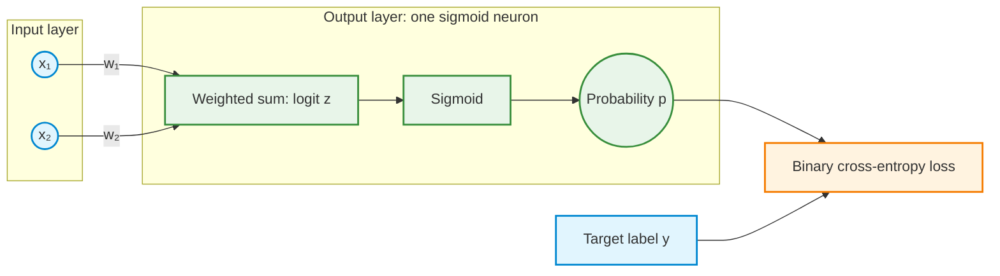
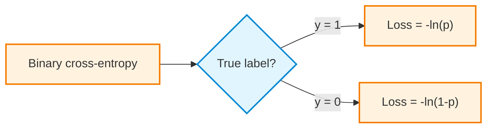
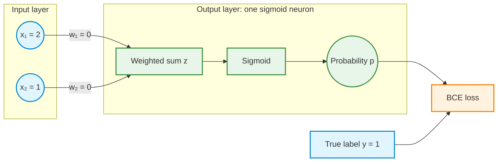
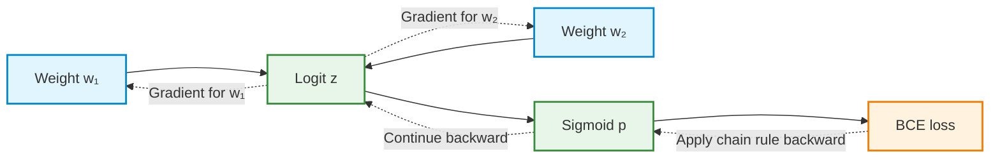
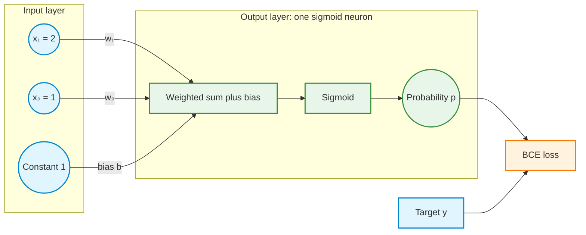
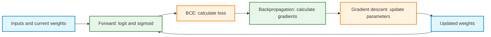

# Activity 2 — Binary Classification: From Logit and Sigmoid to Backpropagation and Gradient Descent

**Guided reinforcement | One logistic neuron, two inputs, two weights, and no bias in the core activity**

## How to use this guided activity

This activity follows the same conceptual path as the binary-classification demonstration. The first sections establish the difference between **probability, odds, logit, sigmoid, and binary cross-entropy (BCE)**. The later sections apply those ideas to a forward pass, the chain rule, partial derivatives, and a gradient-descent update.

Hand calculations are optional practice. Read each numbered question, consider the reasoning, then open its worked answer and explain what the result means. Repetition of important ideas is intentional: the same forward → loss → backpropagation → update cycle appears in regression and classification.

**Visualization instructions:** Run the supplied Python code, observe the resulting plots, and interpret them. **Writing plotting code from scratch is not assessed.** The core activity is the two-weight, no-bias calculation. The bias and learning-rate dataset exercises are extensions.

NumPy and Matplotlib are used for the visualizations. The worked hand calculations do not require Python.

**Python setup:** [Install and check the Week 2 libraries](1-python_setup.md).

## Learning objectives

After completing the core activity, the following ideas should be clear:

1. **Probability**, **odds**, and **log-odds (logit)** are related but different quantities.
2. The **sigmoid** converts an unrestricted real-valued logit into a probability between 0 and 1.
3. **BCE** measures how well a predicted probability agrees with a binary target, and it penalizes confident wrong predictions strongly.
4. A **forward pass** computes a logit, probability, and loss; it does not change the weights.
5. **Backpropagation** uses the chain rule to calculate one partial derivative per trainable parameter.
6. **Gradient descent** uses those gradients and a learning rate to update the parameters.
7. Changing the label from 1 to 0 changes the signs of the gradients and the direction of the updates.

> **Core distinction:** Backpropagation **calculates gradients**. Gradient descent **updates parameters**. In the hill metaphor, the gradient points locally uphill and the negative gradient points locally downhill.

---

## 1. Sigmoid: converting a score into a probability

A binary classifier may first compute an unrestricted real-valued **score** $z$. A sigmoid activation maps this score to a value $p$ strictly between 0 and 1:

$$
 p=\sigma(z)=\frac{1}{1+e^{-z}}
$$

In logistic regression, $p$ is interpreted as the model's estimated probability of class 1. The probability of class 0 is $1-p$.

| Score $z$ | Sigmoid $p$ | Interpretation |
|---:|---:|---|
| $-2$ | $0.1192$ | Class 1 is less likely |
| $0$ | $0.5000$ | Both classes are equally likely |
| $2$ | $0.8808$ | Class 1 is more likely |

**Question 1.** What probability does sigmoid return at $z=0$? Can a finite $z$ produce a sigmoid probability of exactly 0 or 1?

<details>
<summary>Show worked answer</summary>

At `z = 0`, `exp(-z) = 1`, so `p = 1/(1+1) = 0.5`. For every finite real score, sigmoid returns a value strictly between 0 and 1. It approaches 0 and 1 as the score tends to negative or positive infinity.

</details>

### Visualization 1 — Sigmoid

Run the following code. Observe where the curve crosses $p=0.5$ and how it behaves for large negative and positive scores.

<details>
<summary>Python code — Run and observe the sigmoid curve</summary>

```python
import numpy as np
import matplotlib.pyplot as plt

z = np.linspace(-8, 8, 401)
p = 1 / (1 + np.exp(-z))

plt.figure(figsize=(8, 4.5))
plt.plot(z, p, label="Sigmoid: p = 1/(1+exp(-z))")
plt.axhline(0.5, linestyle="--", label="p = 0.5")
plt.axvline(0, linestyle=":", label="z = 0")
plt.xlabel("Logit / score z")
plt.ylabel("Predicted probability of class 1")
plt.title("Sigmoid transforms a score into a probability")
plt.ylim(-0.03, 1.03)
plt.grid(alpha=0.25)
plt.legend()
plt.tight_layout()
plt.show()
```

</details>

---

## 2. Probability, odds, and logit (log-odds)

**Probability** $p$ is the likelihood that an event occurs. **Odds** compare its probability with the probability that it does not occur:

$\mathrm{odds}=\frac{p}{1-p}$

The **logit** is the natural logarithm of the odds:

$\mathrm{logit}(p)=\ln\left(\frac{p}{1-p}\right)$

The logit is **not** $\ln(p)$. The denominator $1-p$ converts probability into odds before the logarithm is applied.

### Two examples: probability that it rains tomorrow

These probabilities are illustrative, not actual weather forecasts.

**Example A — 20% chance of rain**

- Probability: $p=0.20$.
- Odds for rain: $\frac{0.20}{0.80}=0.25$, or 1 to 4.
- Logit: $\ln(0.25)\approx-1.3863$.

**Example B — 80% chance of rain**

- Probability: $p=0.80$.
- Odds for rain: $\frac{0.80}{0.20}=4$, or 4 to 1.
- Logit: $\ln(4)\approx+1.3863$.

| Probability | Odds for the event | Logit |
|---:|---:|---:|
| $0.20$ | $0.25$ | $-1.3863$ |
| $0.50$ | $1$ | $0$ |
| $0.80$ | $4$ | $+1.3863$ |

### Why use log-odds rather than odds alone?

Odds range from 0 to positive infinity and have a neutral value of **1**. Log-odds range from negative infinity to positive infinity and have a neutral value of **0**. At $p=0.5$, the odds are 1, so the logit is $\ln(1)=0$.

Importantly, logits are **zero-centered**: probabilities of $0.20$ and $0.80$ correspond to logits of equal magnitude and opposite sign. An unrestricted weighted sum can therefore represent the log-odds directly.

For the no-bias classifier used later:

$z=w_1x_1+w_2x_2=\ln\left(\frac{p}{1-p}\right)$

Applying sigmoid reverses the logit transformation to recover the probability:

$p=\sigma(z)=\frac{1}{1+e^{-z}}$

**Question 2.** Explain why a logit of zero represents a probability of 0.5. Why not use the raw odds directly as the output of an unrestricted weighted sum?

<details>
<summary>Show worked answer</summary>

At probability 0.5, the event and its complement have equal odds: `0.5/0.5 = 1`. The natural logarithm of 1 is zero. Raw odds cannot be negative, but a weighted sum can take any real value. Log-odds have the unrestricted real-valued scale required by this linear score.

</details>

**Logit in Python:**

```python
import math

def logit(p):
    if not 0 < p < 1:
        raise ValueError("p must be strictly between 0 and 1")
    return math.log(p / (1 - p))

print(logit(0.2))  # approximately -1.3863
print(logit(0.5))  # 0.0
print(logit(0.8))  # approximately +1.3863
```

### Visualization 2 — Odds and log-odds

Run the code and compare their neutral values: **odds = 1**, but **log-odds = 0**.

<details>
<summary>Python code — Run and compare odds with log-odds</summary>

```python
import numpy as np
import matplotlib.pyplot as plt

p = np.linspace(0.01, 0.99, 500)
odds = p / (1 - p)
log_odds = np.log(odds)

fig, axes = plt.subplots(1, 2, figsize=(10, 4))
axes[0].plot(p, odds)
axes[0].axhline(1, linestyle="--", label="Equal odds = 1")
axes[0].axvline(0.5, linestyle=":")
axes[0].set_ylim(0, 12)
axes[0].set_title("Odds")
axes[0].set_xlabel("Probability p")
axes[0].set_ylabel("Odds")
axes[0].grid(alpha=0.25)
axes[0].legend()

axes[1].plot(p, log_odds)
axes[1].axhline(0, linestyle="--", label="Neutral logit = 0")
axes[1].axvline(0.5, linestyle=":")
axes[1].set_title("Log-odds (logit)")
axes[1].set_xlabel("Probability p")
axes[1].set_ylabel("Logit")
axes[1].grid(alpha=0.25)
axes[1].legend()

plt.tight_layout()
plt.show()
```

</details>

---

## 3. Logit, sigmoid, and binary cross-entropy do different jobs

| Concept | Role | Output |
|---|---|---|
| **Logit / score** $z$ | Weighted sum of inputs | Any real number |
| **Sigmoid** $\sigma(z)$ | Converts logit into predicted probability $p$ | Between 0 and 1 |
| **BCE loss** $L(p,y)$ | Measures the penalty for the predicted probability given target $y$ | Nonnegative loss |



**Question 3.** Which operation creates the probability? Which operation judges whether that probability matches the correct label? Does either operation automatically update a weight?

<details>
<summary>Show worked answer</summary>

Sigmoid creates the probability from the logit. BCE calculates the loss using the probability and true label. Neither operation updates weights. Parameter updates happen later, during gradient descent.

</details>

---

## 4. Binary cross-entropy when the true label is 1

For the true label $y=1$, the loss is:

$$
L=-\ln(p)
$$

A correct, confident prediction ($p$ near 1) has low loss. A confident wrong prediction ($p$ near 0) has very high loss.

| Predicted probability $p$ | Loss when $y=1$ |
|---:|---:|
| $0.9$ | $0.1054$ |
| $0.5$ | $0.6931$ |
| $0.1$ | $2.3026$ |

**Question 4.** The true label is 1. Which prediction has smaller loss: $p=0.9$ or $p=0.1$? Why?

<details>
<summary>Show worked answer</summary>

`p = 0.9` has the smaller loss (approximately `0.1054`), because it assigns a high probability to the correct class. `p = 0.1` has loss approximately `2.3026`, penalizing a confident wrong prediction.

</details>

### Visualization 3 — BCE when $y=1$

Run the code and observe the increase in loss as the probability approaches zero.

<details>
<summary>Python code — Run and observe BCE for label 1</summary>

```python
import numpy as np
import matplotlib.pyplot as plt

p = np.linspace(0.001, 0.999, 500)
loss = -np.log(p)

plt.figure(figsize=(8, 4.5))
plt.plot(p, loss, label="True label y = 1")
plt.xlabel("Predicted probability p of class 1")
plt.ylabel("BCE loss: -ln(p)")
plt.title("BCE when the true label is 1")
plt.ylim(0, 7)
plt.grid(alpha=0.25)
plt.legend()
plt.tight_layout()
plt.show()
```

</details>

---

## 5. Binary cross-entropy when the true label is 0

For the true label $y=0$, the loss is:

$$
L=-\ln(1-p)
$$

Now the prediction should be close to zero. Predicting a high probability of class 1 receives a large penalty.

| Predicted probability $p$ | Loss when $y=0$ |
|---:|---:|
| $0.1$ | $0.1054$ |
| $0.5$ | $0.6931$ |
| $0.9$ | $2.3026$ |

**Question 5.** The true label is 0. Which prediction has smaller loss: $p=0.1$ or $p=0.9$? Why?

<details>
<summary>Show worked answer</summary>

`p = 0.1` has the smaller loss (approximately `0.1054`), because it correctly assigns a low probability to class 1. `p = 0.9` confidently predicts the wrong class and has loss approximately `2.3026`.

</details>

### Visualization 4 — BCE when $y=0$

Run the code and observe the increase in loss as the probability approaches one.

<details>
<summary>Python code — Run and observe BCE for label 0</summary>

```python
import numpy as np
import matplotlib.pyplot as plt

p = np.linspace(0.001, 0.999, 500)
loss = -np.log1p(-p)

plt.figure(figsize=(8, 4.5))
plt.plot(p, loss, label="True label y = 0")
plt.xlabel("Predicted probability p of class 1")
plt.ylabel("BCE loss: -ln(1-p)")
plt.title("BCE when the true label is 0")
plt.ylim(0, 7)
plt.grid(alpha=0.25)
plt.legend()
plt.tight_layout()
plt.show()
```

</details>

---

## 6. One BCE formula for both classes

A single expression combines the two cases:

$$
L=-\left[y\ln(p)+(1-y)\ln(1-p)\right]
$$

The binary target acts as a switch: when $y=1$, the second term disappears; when $y=0$, the first term disappears. Here $\ln$ is the natural logarithm.



**Question 6.** Substitute first $y=1$ and then $y=0$ into the combined formula. Which term disappears in each case?

<details>
<summary>Show worked answer</summary>

When `y = 1`, the factor `1-y` becomes zero and the loss reduces to `-ln(p)`. When `y = 0`, the factor `y` becomes zero and the loss reduces to `-ln(1-p)`.

</details>

### Visualization 5 — Both BCE curves

Run the code. Compare the mirror-image loss curves and identify the common loss at $p=0.5$.

<details>
<summary>Python code — Run and compare BCE for both labels</summary>

```python
import numpy as np
import matplotlib.pyplot as plt

p = np.linspace(0.001, 0.999, 500)
loss_y1 = -np.log(p)
loss_y0 = -np.log1p(-p)

plt.figure(figsize=(8, 4.8))
plt.plot(p, loss_y1, label="True label y = 1")
plt.plot(p, loss_y0, label="True label y = 0")
plt.axvline(0.5, linestyle="--", label="p = 0.5")
plt.xlabel("Predicted probability p of class 1")
plt.ylabel("BCE loss")
plt.title("Binary cross-entropy for both true labels")
plt.ylim(0, 7)
plt.grid(alpha=0.25)
plt.legend()
plt.tight_layout()
plt.show()
```

</details>

> **Numerical note:** The logarithm of zero is undefined. Plots avoid exactly 0 and 1. Practical training code can calculate BCE directly from logits using `np.logaddexp(0.0, z) - y*z`, which is numerically more stable than taking logarithms of probabilities close to the boundaries.

---

## 7. Guided calculation: two weights, no bias

The main worked activity uses **one output neuron, two input features, two independently trainable weights, and no bias**. It is binary logistic regression, not a multilayer perceptron.

$$
 z=w_1x_1+w_2x_2
$$

$$
 p=\sigma(z)=\frac{1}{1+e^{-z}}
$$

| Quantity | Value |
|---|---:|
| First input $x_1$ | 2 |
| Second input $x_2$ | 1 |
| True label $y$ | 1 |
| Initial weight $w_1$ | 0 |
| Initial weight $w_2$ | 0 |
| Bias | None |
| Learning rate $\eta$ | 0.1 |
| Loss | Binary cross-entropy |



**Connection to Demo 2:** This activity restarts at weights $(0,0)$, whereas [Demo 2](demo2.md#why-the-activity-uses-different-starting-weights) starts at $(1,-2)$. For the shared input $(2,1)$, both weighted sums equal zero: `0*2 + 0*1 = 1*2 + (-2)*1 = 0`. Both therefore predict probability 0.5 and, for label 1, BCE approximately 0.693147. The gradients and parameter changes are identical for this observation, but the weights remain different and can give different predictions on other inputs.

### Step 1 — Forward pass: logit, probability, loss

**Question 7.** Calculate (a) the logit $z$, (b) the sigmoid probability $p$, and (c) the BCE loss. Identify which calculations depend on the target label. Does a forward pass update the weights?

<details>
<summary>Show worked answer</summary>

**A. Logit:** `z = (0)(2) + (0)(1) = 0`.

**B. Probability:** `p = 1/(1+exp(0)) = 0.5`.

**C. Loss:** Since `y = 1`, `L = -ln(0.5)`, approximately `0.693147`.

The logit and probability depend on the current inputs and weights. BCE also depends on the target. A forward pass computes these quantities without changing any weight.

</details>

The calculation in mathematical notation is:

$$
 z=(0)(2)+(0)(1)=0
$$

$$
 p=\sigma(0)=0.5
$$

$$
 L=-\ln(0.5)\approx0.693147
$$

### Step 2 — Backpropagation: the chain rule and partial derivatives

Backpropagation calculates how the loss changes when each weight changes. This is a two-parameter model, so the result has **two partial derivatives**.



The chain of dependencies is **weight → logit → probability → loss**. The derivatives are calculated in the reverse direction.

**Question 8.** Starting from $p=0.5$ and $y=1$, calculate the derivative of BCE with respect to $p$ and the derivative of sigmoid with respect to $z$. Multiply them to obtain the derivative of loss with respect to the logit.

The required component formulas are:

$$
\frac{\partial L}{\partial p}=-\frac{y}{p}+\frac{1-y}{1-p}
$$

$$
\frac{\partial p}{\partial z}=p(1-p)
$$

<details>
<summary>Show worked answer</summary>

**BCE sensitivity:** Substitute `y = 1` and `p = 0.5`: `dL/dp = -1/0.5 + 0 = -2`.

**Sigmoid sensitivity:** `dp/dz = 0.5(1-0.5) = 0.25`.

**Chain rule:** `dL/dz = (dL/dp)(dp/dz) = (-2)(0.25) = -0.5`.

This value is the sensitivity shared by both weight gradients. The weights have not yet been updated.

</details>

The chain-rule product is:

$$
\frac{\partial L}{\partial z}=\frac{\partial L}{\partial p}\frac{\partial p}{\partial z}=(-2)(0.25)=-0.5
$$

The expression simplifies for either binary label. Substitute the BCE and sigmoid derivatives:

$$
\frac{\partial L}{\partial z}=\left(-\frac{y}{p}+\frac{1-y}{1-p}\right)p(1-p)=p-y
$$

This useful cancellation applies to **sigmoid combined with natural-log BCE**. It does **not** mean backpropagation can be skipped; it makes one part of the chain rule simpler.

**Question 9.** Find the partial derivative of loss with respect to each weight. Which quantities are held constant when differentiating with respect to $w_1$? Why do the two gradients have different magnitudes?

Since $z=w_1x_1+w_2x_2$:

$$
\frac{\partial z}{\partial w_1}=x_1=2,\qquad\frac{\partial z}{\partial w_2}=x_2=1
$$

<details>
<summary>Show worked answer</summary>

The shared logit gradient is `dL/dz = -0.5`.

For the first weight, the other weight and both inputs are held fixed: `dL/dw1 = (dL/dz)(dz/dw1) = (-0.5)(2) = -1`.

For the second weight: `dL/dw2 = (-0.5)(1) = -0.5`.

The first gradient has twice the magnitude because the first input (`x1 = 2`) is twice the second input (`x2 = 1`) in this example.

</details>

The gradients are:

$$
\frac{\partial L}{\partial w_1}=(p-y)x_1=(-0.5)(2)=-1
$$

$$
\frac{\partial L}{\partial w_2}=(p-y)x_2=(-0.5)(1)=-0.5
$$

Together, they form a gradient vector, written here as an ordered pair to keep the notation simple:

$$
\nabla_{\mathbf{w}}L=\left(\frac{\partial L}{\partial w_1},\frac{\partial L}{\partial w_2}\right)=(-1,-0.5)
$$

**Interpretation:** Both gradient components are negative, so a small increase in either weight locally reduces the loss for this positive example. Backpropagation has provided the gradients; the parameters have not changed.

### Step 3 — Gradient descent: update the weights

Gradient descent subtracts the learning rate multiplied by each gradient:

$$
 w_{j,\mathrm{new}}=w_{j,\mathrm{old}}-\eta\frac{\partial L}{\partial w_j}
$$

**Question 10.** With learning rate $\eta=0.1$, update both weights **using gradients calculated at the original parameter values**. Then perform a new forward pass. Did the loss decrease?

<details>
<summary>Show worked answer</summary>

**Updated weights:** `w1 = 0 - 0.1(-1) = 0.1` and `w2 = 0 - 0.1(-0.5) = 0.05`.

**New logit:** `z = 0.1(2) + 0.05(1) = 0.25`.

**New probability:** `p = 1/(1+exp(-0.25))`, approximately `0.562177`.

**New loss:** `L = -ln(p)`, approximately `0.575939`.

The loss decreased from about `0.693147` to `0.575939`. Both gradients were calculated before either weight was updated.

</details>

The updated parameters and new prediction are:

$$
 w_{1,\mathrm{new}}=0-0.1(-1)=0.1
$$

$$
 w_{2,\mathrm{new}}=0-0.1(-0.5)=0.05
$$

$$
 z_{\mathrm{new}}=(0.1)(2)+(0.05)(1)=0.25
$$

$$
 p_{\mathrm{new}}=\sigma(0.25)\approx0.562177
$$

$$
 L_{\mathrm{new}}=-\ln(p_{\mathrm{new}})\approx0.575939
$$

| Measurement | Before update | After update |
|---|---:|---:|
| Weight $w_1$ | 0 | 0.1 |
| Weight $w_2$ | 0 | 0.05 |
| Logit $z$ | 0 | 0.25 |
| Probability $p$ | 0.5 | 0.562177 |
| BCE loss | 0.693147 | 0.575939 |

> **Metaphor:** Backpropagation provides the local slope information (an uphill gradient); gradient descent makes the step in the opposite direction, scaled by the learning rate. A very large step can overshoot, even if the local direction is correct.

---

## 8. Change the label: what if $y=0$?

The initial inputs and weights are unchanged, but the true label becomes 0. **Restart at $w_1=w_2=0$** rather than using the updated weights from Section 7.

**Question 11.** Calculate the initial probability and loss, both gradients, one update with $\eta=0.1$, and the new probability and loss. What reverses compared with the $y=1$ case?

<details>
<summary>Show worked answer</summary>

The initial score is `z = 0` and the predicted probability is `p = 0.5`. For `y = 0`, the loss is `-ln(1-0.5) = 0.693147`.

The shared logit gradient is `p-y = 0.5`. Therefore `dL/dw1 = +1` and `dL/dw2 = +0.5`.

The updated weights are `w1 = -0.1` and `w2 = -0.05`, giving `z = -0.25`, `p = 0.437823`, and new loss approximately `0.575939`.

The initial loss is unchanged, but the gradients reverse sign. The update now decreases the predicted probability of class 1, correctly favoring class 0.

</details>

| Measurement | True label 1 after one update | True label 0 after one update |
|---|---:|---:|
| New $w_1$ | $+0.10$ | $-0.10$ |
| New $w_2$ | $+0.05$ | $-0.05$ |
| New logit | $+0.25$ | $-0.25$ |
| New probability $p$ | $0.562177$ | $0.437823$ |
| New BCE loss | $0.575939$ | $0.575939$ |

**Key observation:** The update rule does not change between the two labels. The value of $p-y$ determines the direction of the gradient and the parameter update.

---

## 9. Repeating the learning cycle in Python

The following program runs the full training loop for the positive example. The program computes the forward pass, BCE, both gradients, and both parameter updates at each iteration.

```python
import numpy as np

x1, x2 = 2.0, 1.0
y = 1.0
w1, w2 = 0.0, 0.0
eta = 0.1

print("step |   w1    |   w2    | probability |    loss")
for step in range(10):
    # 1. Forward pass
    z = w1 * x1 + w2 * x2
    p = 1.0 / (1.0 + np.exp(-z))
    loss = np.logaddexp(0.0, z) - y*z

    print(f"{step:4d} | {w1:7.4f} | {w2:7.4f} | {p:11.6f} | {loss:7.5f}")

    # 2. Backpropagation: calculate both gradients first
    dz = p - y
    dw1 = dz * x1
    dw2 = dz * x2

    # 3. Gradient descent: change both weights
    w1 -= eta * dw1
    w2 -= eta * dw2
```

The expression `np.logaddexp(0.0, z) - y*z` computes sigmoid BCE stably from the logit, without explicitly taking $\ln(0)$ near extreme predictions.

### Visualization 6 — Probability and loss during training

Run the supplied code. Observe how the probability approaches the positive label while the loss decreases.

<details>
<summary>Python code — Run and observe the training curves</summary>

```python
import numpy as np
import matplotlib.pyplot as plt

x1, x2, y = 2.0, 1.0, 1.0
w1 = w2 = 0.0
eta = 0.1
updates = 25
probabilities, losses = [], []

for step in range(updates + 1):
    z = w1*x1 + w2*x2
    p = 1.0 / (1.0 + np.exp(-z))
    probabilities.append(p)
    losses.append(np.logaddexp(0.0, z) - y*z)
    if step < updates:
        dz = p - y
        dw1, dw2 = dz*x1, dz*x2
        w1 -= eta*dw1
        w2 -= eta*dw2

plt.figure(figsize=(8, 4.5))
plt.plot(range(updates + 1), probabilities, marker="o", label="Probability p")
plt.axhline(1.0, linestyle="--", label="Target y = 1")
plt.xlabel("Completed weight updates")
plt.ylabel("Predicted probability")
plt.title("Probability approaches the correct label")
plt.ylim(0.45, 1.05)
plt.grid(alpha=0.25)
plt.legend()
plt.tight_layout()
plt.show()

plt.figure(figsize=(8, 4.5))
plt.plot(range(updates + 1), losses, marker="o")
plt.xlabel("Completed weight updates")
plt.ylabel("BCE loss")
plt.title("BCE decreases during training")
plt.grid(alpha=0.25)
plt.tight_layout()
plt.show()
```

</details>

**Question 12.** Do the two plotted quantities move in the same direction? Does a single positive example have a finite pair of weights that produces exactly zero BCE?

<details>
<summary>Show worked answer</summary>

The probability of the correct class rises while the BCE loss falls. With a sigmoid output, any finite weights produce a probability strictly below 1. Thus the loss approaches zero for this single positive example but does not become exactly zero at finite weights. Multiple training examples provide a more meaningful test of model learning.

</details>

---

## 10. Extension A — Add a bias

The core activity used two weights and no bias. A bias adds one more independently trainable parameter:

$$
 z=w_1x_1+w_2x_2+b
$$

A bias acts like a weight on an always-on input equal to 1. The output is still a **single sigmoid neuron without a hidden layer**.



**Question 13.** Restart with $w_1=w_2=b=0$, $x_1=2$, $x_2=1$, $y=1$, and $\eta=0.1$. What is the gradient with respect to $b$? What are all three parameters after one update? Does this change the underlying training algorithm?

<details>
<summary>Show worked answer</summary>

The initial logit is zero, so `p = 0.5`, `p-y = -0.5`, and `dL/db = (p-y)(1) = -0.5`.

The two weight gradients remain `-1` and `-0.5`. After one update, `w1 = 0.1`, `w2 = 0.05`, and `b = 0.05`.

The new logit is `0.1(2) + 0.05(1) + 0.05 = 0.30`, giving `p = 0.574443` and BCE approximately `0.554355`.

The forward pass, chain rule, and parameter-update procedure are unchanged. Adding a bias simply adds another partial derivative and update.

</details>

For any label $y$, the sigmoid/BCE gradients with a bias are:

$$
\frac{\partial L}{\partial w_1}=(p-y)x_1,\qquad
\frac{\partial L}{\partial w_2}=(p-y)x_2,\qquad
\frac{\partial L}{\partial b}=p-y
$$

---

## 11. Extension B — Learning rates and a dataset with both labels

A learning rate scales the parameter update. A very small value may make progress slow; an excessively large value may cause oscillation or temporary increases in loss.

To compare learning rates fairly, use the same dataset and initial parameters for each run. The following dataset includes both positive and negative labels and uses **two weights and a bias** (from Extension A):

| Example | $x_1$ | $x_2$ | True label $y$ |
|---:|---:|---:|---:|
| 1 | 0 | 0 | 0 |
| 2 | 1 | 0 | 0 |
| 3 | 0 | 1 | 0 |
| 4 | 1 | 1 | 0 |
| 5 | 2 | 0 | 1 |
| 6 | 0 | 2 | 1 |

All six observations contribute to each gradient in the supplied program. It is therefore **full-batch gradient descent**, not one-example SGD.

**Dataset limitation:** This dataset cannot be perfectly separated by a linear classifier, even with a bias. The negative example $(1,1)$ is the midpoint of the positive examples $(2,0)$ and $(0,2)$. A linear score with a bias at the midpoint is the average of the two endpoint scores. If both positive examples have scores above the classification threshold, the midpoint must also lie above it, so all three labels cannot be classified correctly together.

The experiment studies learning-rate stability rather than perfect fitting. More updates or a different learning rate cannot remove this model limitation: do not expect perfect classification or mean BCE to approach zero on this dataset.

For a dataset of $n$ examples, the mean BCE is:

$$
 L_{\mathrm{mean}}=-\frac{1}{n}\sum_{i=1}^{n}\left[y^{(i)}\ln(p^{(i)})+(1-y^{(i)})\ln(1-p^{(i)})\right]
$$

For example, the gradient for the first weight is:

$$
\frac{\partial L_{\mathrm{mean}}}{\partial w_1}=\frac{1}{n}\sum_{i=1}^{n}(p^{(i)}-y^{(i)})x_1^{(i)}
$$

**Question 14.** Run the supplied program with four different learning rates. Which values make progress slowly, and which produce visible oscillations? What distinguishes the program from pure SGD?

### Visualization 7 — Compare learning rates

<details>
<summary>Python code — Run and interpret the learning-rate experiment</summary>

```python
import numpy as np
import matplotlib.pyplot as plt

X = np.array([
    [0., 0.], [1., 0.], [0., 1.],
    [1., 1.], [2., 0.], [0., 2.],
])
y = np.array([0., 0., 0., 0., 1., 1.])

learning_rates = [0.05, 0.5, 2.0, 20.0]
updates = 80

plt.figure(figsize=(9, 5))
for eta in learning_rates:
    w = np.zeros(2)
    b = 0.0
    history = []
    for step in range(updates + 1):
        z = X @ w + b
        p = 1 / (1 + np.exp(-np.clip(z, -700, 700)))
        loss = np.mean(np.logaddexp(0.0, z) - y*z)
        history.append(loss)
        if step < updates:
            error = p - y
            dw = X.T @ error / len(y)
            db = np.mean(error)
            w -= eta * dw
            b -= eta * db

    print(f"eta={eta:>5}: initial={history[0]:.4f}, final={history[-1]:.4f}")
    plt.plot(range(updates + 1), history, label=f"eta = {eta}")

plt.xlabel("Full-batch parameter updates")
plt.ylabel("Mean BCE loss")
plt.title("Learning rate and optimization stability")
plt.grid(alpha=0.25)
plt.legend()
plt.tight_layout()
plt.show()
```

</details>

<details>
<summary>Show interpretation</summary>

In this fixed example, the smallest learning rate generally improves gradually. Moderate rates tend to progress more rapidly. The very large learning rate can cause conspicuous temporary increases and oscillations, so the entire curve matters more than the final point alone.

Each update averages gradients over all six examples: this is **full-batch gradient descent**. Pure SGD would update from one selected observation at a time; mini-batch SGD would use a small subset. The chain-rule formulas remain the same.

These observations concern this dataset and training setup, not a universal ranking of learning rates.

</details>

---

## 12. Check understanding

**Q1. Does the sigmoid function calculate the training loss?**

<details>
<summary>Show answer</summary>

No. Sigmoid converts a score into a probability. BCE evaluates how well that probability matches a true binary label.

</details>

**Q2. What is the difference between a logit and a probability?**

<details>
<summary>Show answer</summary>

A logit is an unrestricted real-valued score interpreted as log-odds in logistic regression. Sigmoid transforms it into a probability between 0 and 1.

</details>

**Q3. Why are two partial derivatives needed in the core example?**

<details>
<summary>Show answer</summary>

There are two independently trainable weights. Each partial derivative measures the loss sensitivity to one weight while the other is held fixed.

</details>

**Q4. Which step actually changes the parameters?**

<details>
<summary>Show answer</summary>

Gradient descent changes parameters using the gradients and learning rate. Backpropagation computes the gradients but does not update the weights.

</details>

**Q5. Why is the negative gradient used?**

<details>
<summary>Show answer</summary>

The gradient points in the direction of steepest local increase in loss. Subtracting it points locally downhill, although a step that is too large can still increase the loss.

</details>

**Q6. Why does sigmoid plus natural-log BCE produce a simple logit gradient?**

<details>
<summary>Show answer</summary>

The derivative of BCE with respect to probability contains probability denominators, while the sigmoid derivative contains matching probability factors. Multiplication by the chain rule cancels these factors, leaving the prediction minus target: `p-y`.

</details>

**Q7. Is the model in the core activity an MLP?**

<details>
<summary>Show answer</summary>

No. It contains one sigmoid output neuron and no hidden layer. This model is binary logistic regression. An MLP contains hidden processing layers.

</details>

**Q8. Is the learning-rate visualization an SGD experiment?**

<details>
<summary>Show answer</summary>

No. Its gradient includes every training example before each update, making it full-batch gradient descent. Pure SGD uses one example per update, while mini-batch SGD uses a subset.

</details>

---

## 13. Summary: the complete learning cycle



| Stage | Purpose | First example ($y=1$, no bias) |
|---|---|---|
| **Forward pass** | Calculate logit and probability | $z=0$, $p=0.5$ |
| **Loss** | Measure incorrect probability | $L\approx0.693147$ |
| **Backpropagation** | Calculate partial derivatives | $(-1,-0.5)$ |
| **Gradient descent** | Update weights using learning rate | $(w_1,w_2)=(0.1,0.05)$ |
| **Next forward pass** | Check improvement | $p\approx0.562177$, $L\approx0.575939$ |

**Final idea:** Classification adds a probability transformation (sigmoid) and an appropriate loss (BCE). The learning algorithm remains the same: **forward pass → loss → backpropagation → gradient descent → repeat**.
