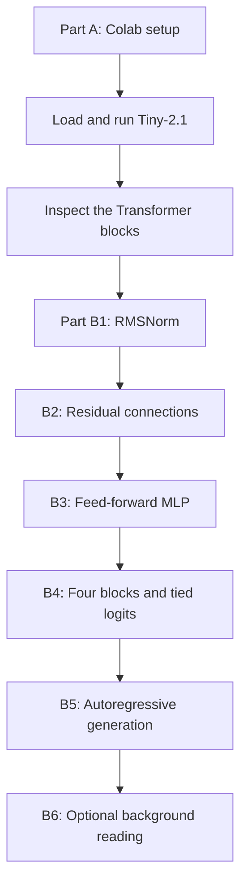
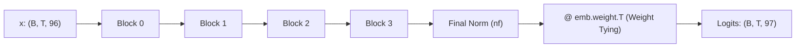

# Activity 2 — Run Tiny-2.1, Then Complete the Transformer and Generate Text

This activity has **two parts**, just like Activity 1. Work through **Part A** to load and try the pretrained model, then complete **Part B in the same Google Colab session**. All the calculations and exercises reuse the model loaded in Part A.

- **Part A — Run and explore Tiny-2.1:** Set up Colab, load the model with the repository's built-in function, test answers, and inspect its four Transformer blocks.
- **Part B — Investigate the remaining components:** RMSNorm, residual connections, the MLP, stacked blocks, output logits, and autoregressive generation. The last section, B6, is optional background reading only.

Visualizations 6–9b support the hands-on work.



---

# Part A — Run Tiny-2.1 and Explore the Model

## A0 — Set up Google Colab

Start a fresh Colab session, then run the cells below **in order**. If you are continuing directly from Activity 1 in the same Colab session, you can skip A1–A2 because the repository and model should already be available.

**Cell A1 — Get the repository**

```python
!git clone https://github.com/WollyMonjac/Tiny-2.1.git
%cd /content/Tiny-2.1/training
```

**Cell A2 — Load the pretrained model**

```python
import torch
import train2

model = train2.load_model("tiny2.pt")
model.eval()

print("Tiny-2.1 loaded successfully")
print("PyTorch version:", torch.__version__)
```

`train2.load_model()` is the standard loader provided by the repository. `model.eval()` switches the model to evaluation mode. **Keep this `model` variable for the rest of Activity 2.**

## A1 — Ask the model questions

**Cell A3 — Try a few prompts**

```python
questions = [
    "what is 2+2?",
    "what is the capital of france?",
    "what is the largest planet?",
]

for question, answer in train2.answer_many(model, questions).items():
    print(f"Q: {question}\nA: {answer}\n")
```

**Observe:** What does the model answer correctly? Do the responses look like complete sentences, single words, or short phrases? The exact responses depend on the checkpoint; do not assume every question will be answered correctly.

## A2 — Find the components we will investigate

**Cell A4 — Inspect the model and its dimensions**

```python
print("Total parameters:", f"{sum(p.numel() for p in model.parameters()):,}")
print("Transformer blocks:", len(model.blocks))
print("Input token embeddings:", tuple(model.emb.weight.shape))
print("Position embeddings:", tuple(model.pos.weight.shape))
print("First block RMSNorm gains:", tuple(model.blocks[0].n1.g.shape))
print("First block MLP layer f1:", tuple(model.blocks[0].f1.weight.shape))
print("First block MLP layer f2:", tuple(model.blocks[0].f2.weight.shape))
```

The model has **four sequential blocks**, each combining attention and an MLP with normalization and residual connections. The following exercises show how these pieces fit together.

**Questions to discuss:** Why does the MLP temporarily expand from 96 features to 256? Why are there two normalization layers in each block? We will investigate these questions in Part B; no detailed answer is expected yet.

---

# Part B — Investigate the Complete Transformer and Generation

> [!NOTE]
> **Stay in the same Colab runtime.** `train2` and `model` are already available from Part A. Work through the numbered sections in order because later cells reuse earlier variables (`T`, `blk`, `x_in`, `h1` and `x_mid`). In B1–B4, complete the small calculation before inspecting the real model. Open the expandable Hint and Answer sections only after discussing the questions.

**Cell B0 — Import mathematical and plotting tools**

```python
import math
import numpy as np
import torch
import torch.nn.functional as F
import matplotlib.pyplot as plt
```

## B1 — Normalizing Activations (`RMSNorm`)

### Step B1a — Small Calculation First (Four-Number Vector)
Use the same four-dimensional example as Visualization 6. Compare the original vector with an input that is ten times larger.

```python
x_small = torch.tensor([1.0, 7.0, 1.0, 7.0])
g_small = torch.tensor([1.0, 2.0, 1.0, 0.5])  # illustrative gain per feature

# 1. Root mean square (RMS)
eps = 1e-5
rms_small = torch.sqrt(torch.mean(x_small ** 2) + eps)

# 2. Normalize, then apply the gain
normed_small = x_small / rms_small
out_small = normed_small * g_small

# 3. Repeat after multiplying the input by 10
x_loud = 10.0 * x_small
rms_loud = torch.sqrt(torch.mean(x_loud ** 2) + eps)
normed_loud = x_loud / rms_loud

print("Original RMS:", round(rms_small.item(), 4))
print("Original normalized:", np.round(normed_small.numpy(), 4))
print("10x normalized:", np.round(normed_loud.numpy(), 4))
print("Max normalized difference:", (normed_small - normed_loud).abs().max().item())
print("After learned-style gain:", np.round(out_small.numpy(), 4))
```

**Expected:** The pre-gain normalized vector is approximately `[0.20, 1.40, 0.20, 1.40]`. The final vector after applying our illustrative gains is approximately `[0.20, 2.80, 0.20, 0.70]`. The ten-times-larger input yields nearly the same normalized vector (up to the stabilizing $\epsilon$ and floating-point rounding).

### Step B1b — Scale Up to `Tiny-2.1` (`Block 0`, `D = 96`)
Inspect `blk.n1` inside `Tiny-2.1` on the 5-token prompt `"2+2?\n"`. To robustly verify that normalization sets the pre-gain RMS to $\approx 1.0$ without dividing by `blk.n1.g` (which could fail if any gain were near zero), compute the normalized vector directly:

```python
ids = torch.tensor([train2.encode("2+2?\n")], dtype=torch.long)  # shape: (1, 5)
T = ids.shape[1]

with torch.no_grad():
    x_in = model.emb(ids) + model.pos(torch.arange(T))           # shape: (1, 5, 96)
    blk = model.blocks[0]
    h1 = blk.n1(x_in)                                            # shape: (1, 5, 96)

    # Direct calculation of normalized vector before multiplying by gain g
    x_in_normed_direct = x_in * torch.rsqrt(x_in.pow(2).mean(dim=-1, keepdim=True) + 1e-5)
    rms_before = x_in.pow(2).mean(dim=-1).sqrt()
    rms_normed = x_in_normed_direct.pow(2).mean(dim=-1).sqrt()
    rms_final  = h1.pow(2).mean(dim=-1).sqrt()

print("RMS of each token BEFORE n1        :", np.round(rms_before[0].numpy(), 4))
print("RMS of direct normalized vector    :", np.round(rms_normed[0].numpy(), 4))
print("RMS of final output h1 (after gain):", np.round(rms_final[0].numpy(), 4))
print("First 6 learned gains blk.n1.g     :", np.round(blk.n1.g[:6].detach().numpy(), 3))
```

### Code Explanation
* `torch.rsqrt(...)`: Computes $1 / \sqrt{\dots}$ in a single efficient operation.
* `x_in_normed_direct`: Directly evaluates the unit-RMS representation before multiplying by learned vector $g$.
* `rms_final`: Demonstrates that the final token vectors do not necessarily have an RMS of exactly $1.0$; the learned gain $g$ customizes the effective scale of each feature.

### "Why?" Questions

**Q B1.1:** Does scaling an input vector by $10\times$ produce *mathematically identical* or *approximately identical* normalized vectors?

<details>
<summary>Hint</summary>

Check the difference printed in Step B1a and look at the role of $\epsilon = 10^{-5}$ in the denominator.

</details>

<details>
<summary>Answer</summary>

It produces **approximately identical** normalized vectors. Because of the numerical stabilizer $\epsilon = 10^{-5}$ inside $\sqrt{\text{mean}(x^2) + \epsilon}$, scaling $x$ by $10$ scales the mean-square term by $100$ while $\epsilon$ stays fixed. The resulting difference is very small for this vector, providing approximate scale invariance without strict mathematical equality.

</details>

---

**Q B1.2:** If normalization rescales activations to a standard magnitude, why does `RMSNorm` still need the learned parameter vector `self.g`?

<details>
<summary>Hint</summary>

What if certain feature dimensions carry critical predictive signals while others are mostly noise?

</details>

<details>
<summary>Answer</summary>

Normalization rescales the vector by a shared RMS; it does not make all feature values identical. Multiplying by learned gains `self.g` lets the model selectively amplify important features and suppress irrelevant ones while keeping overall vector magnitudes controlled.

</details>

---

### Hands-On Task B1: Test Scale Invariance on `Tiny-2.1`
Test `blk.n1` on `50.0 * x_in` and measure the maximum absolute difference between `blk.n1(x_in)` and `blk.n1(50.0 * x_in)`:

<details>
<summary>Hint</summary>

Evaluate `(blk.n1(x_in) - blk.n1(50.0 * x_in)).abs().max().item()` within `torch.no_grad()`.

</details>

<details>
<summary>Answer / Sample Code</summary>

```python
with torch.no_grad():
    out_normal = blk.n1(x_in)
    out_scaled = blk.n1(50.0 * x_in)
    diff = (out_normal - out_scaled).abs().max().item()

print("Max absolute difference after 50x scaling:", diff)
```
**Observation:** The difference should be small for these inputs, but its exact value depends on the stabilizing $\epsilon$ and the original activation scale. This illustrates approximate insensitivity to a positive rescaling of the input.

</details>

---

## B2 — Shortcut (Residual) Connections

### Step B2a — Small Calculation First (4-Layer Signal Propagation)
Trace a signal of `1.0` through 4 successive layers under pure multiplication vs. residual addition:

```python
signal_plain = 1.0
signal_resid = 1.0
deltas = [0.05, -0.02, 0.08, 0.04]

print("Signal value across 4 layers:")
for layer_idx, d in enumerate(deltas):
    signal_plain = signal_plain * 0.5          # without shortcut (multiplicative decay)
    signal_resid = signal_resid + d            # with residual shortcut (additive refinement)
    print(f"  After Layer {layer_idx}: plain = {signal_plain:.4f} | residual = {signal_resid:.4f}")
```

### Step B2b — Scale Up to `Tiny-2.1` (`Block 0` Attention Residual)
Trace the first residual shortcut inside `Tiny-2.1`: $x_{\text{mid}} = x_{\text{in}} + \text{attn\_out}$.

```python
with torch.no_grad():
    sp = lambda t: t.view(1, T, 4, 24).transpose(1, 2)
    a = F.scaled_dot_product_attention(sp(blk.q(h1)), sp(blk.k(h1)), sp(blk.v(h1)), is_causal=True)
    attn_out = blk.o(a.transpose(1, 2).reshape(1, T, 96))

    # Additive residual connection
    x_mid = x_in + attn_out

print("x_in shape    :", tuple(x_in.shape))
print("attn_out shape:", tuple(attn_out.shape))
print("x_mid shape   :", tuple(x_mid.shape))
print("Mean vector norm — x_in:", round(x_in.norm(dim=-1).mean().item(), 3),
      "| attn_out:", round(attn_out.norm(dim=-1).mean().item(), 3),
      "| x_mid:", round(x_mid.norm(dim=-1).mean().item(), 3))
```

### Code Explanation
* `x_mid = x_in + attn_out`: Performs element-wise addition between the input embedding highway and the attention sublayer's output. Both tensors must match in shape: `(1, T, 96)`.

### "Why?" Questions

**Q B2.1:** How does the residual connection $x + \text{sublayer}(x)$ provide a direct path for gradients during training?

<details>
<summary>Hint</summary>

Compute $\frac{\partial}{\partial x}(x + f(x))$. What happens to the gradient when $f(x)$ is small?

</details>

<details>
<summary>Answer</summary>

Differentiating $x + f(x)$ with respect to $x$ yields $1 + f'(x)$. The constant $1$ acts as an unobstructed gradient conduit, allowing error signals to flow back directly to earlier layers even when sublayer weights produce small derivatives.

</details>

---

### Hands-On Task B2: Verify Identity Behavior Under Zero Sublayer Output
Suppose an attention sublayer outputs all zeros (`attn_out = 0`). Verify what reaches the next stage when `attn_out` is replaced with `torch.zeros_like(x_in)`:

<details>
<summary>Hint</summary>

Evaluate `(x_in - (x_in + torch.zeros_like(x_in))).abs().max().item()`.

</details>

<details>
<summary>Answer / Sample Code</summary>

```python
x_mid_zero_attn = x_in + torch.zeros_like(x_in)
diff_identity = (x_in - x_mid_zero_attn).abs().max().item()
print("Max difference from x_in when attn_out is zero:", diff_identity)
```
**Observation:** The difference is exactly `0.0`. A layer whose weights produce near-zero outputs acts as an identity pass-through rather than destroying the input representation.

</details>

---

## B3 — Feed-Forward Network / MLP (`f1 → ReLU → f2`)

### Step B3a — Small Calculation First (`2 → 4 → 2` ReLU MLP)
Verify the forward pass of a compact MLP with 2 inputs, 4 hidden units, and 2 outputs:

```python
h_tiny = torch.tensor([1.0, -1.0])

W1_tiny = torch.tensor([
    [ 1.5, -0.5],  # neuron 0 -> 1.0*(1.5)  + (-1.0)*(-0.5) =  2.0
    [-1.0,  2.0],  # neuron 1 -> 1.0*(-1.0) + (-1.0)*(2.0)  = -3.0
    [ 0.5,  0.0],  # neuron 2 -> 1.0*(0.5)  + (-1.0)*(0.0)  =  0.5
    [-0.5,  0.5],  # neuron 3 -> 1.0*(-0.5) + (-1.0)*(0.5)  = -1.0
])

W2_tiny = torch.tensor([
    [ 0.3, 0.5, 0.4, -0.2],
    [-0.2, 0.1, 0.0,  0.6],
])

pre_relu = h_tiny @ W1_tiny.T
post_relu = F.relu(pre_relu)
mlp_out_tiny = post_relu @ W2_tiny.T

print("1. Pre-ReLU (4 neurons)  :", pre_relu.numpy())
print("2. Post-ReLU (negatives=0):", post_relu.numpy())
print("3. Final 2D MLP output    :", np.round(mlp_out_tiny.numpy(), 3))
```

### Step B3b — Scale Up to `Tiny-2.1` (`96 → 256 → 96`)
Run the second half of `Block 0` (`n2 → f1 → ReLU → f2 + residual`) and compare with calling `blk(x_in)` directly. This cell reuses `x_mid`, `x_in` and `blk` from B1–B2:

```python
with torch.no_grad():
    h2 = blk.n2(x_mid)
    mlp_hidden = F.relu(blk.f1(h2))     # shape: (1, 5, 256)
    mlp_out = blk.f2(mlp_hidden)        # shape: (1, 5, 96)
    x_out_manual = x_mid + mlp_out      # second residual connection

    x_out_block = blk(x_in)             # direct Block forward call

print("mlp_hidden shape:", tuple(mlp_hidden.shape))
print("x_out_manual shape:", tuple(x_out_manual.shape))
print("Max absolute difference vs blk(x_in):", (x_out_manual - x_out_block).abs().max().item())

active_pct = 100.0 * (mlp_hidden[0, -1] > 0).float().mean().item()
print(f"Active ReLU units at position -1: {active_pct:.1f}% ({int((mlp_hidden[0, -1] > 0).sum())}/256)")
```

### Code Explanation
* `blk.f1(h2)`: Projects the 96-dim normalized representation to 256 dimensions.
* `F.relu(...)`: Clamps negative activations to zero.
* `blk.f2(...)`: Projects the 256 activations back to 96 dimensions to match the residual dimension.

### "Why?" Questions

**Q B3.1:** What is the fundamental functional difference between **Attention (`q, k, v, o`)** and the **MLP (`f1 → ReLU → f2`)**?

<details>
<summary>Hint</summary>

Check whether the MLP ever performs matrix operations across sequence positions $t$, or whether it operates on each token independently.

</details>

<details>
<summary>Answer</summary>

Attention mixes information **across positions** in the sequence (token-to-token communication). The MLP operates on each token **independently** (position-wise computation), transforming and non-linearly combining the features gathered by attention.

</details>

---

### Hands-On Task B3 [Optional]: Parameter Breakdown Analysis
Calculate and plot the parameter distribution across all 4 blocks of `Tiny-2.1`:
1. Embeddings + Positions (`emb` + `pos`)
2. All Attention layers (`q, k, v, o`)
3. All MLP layers (`f1, f2`)
4. Normalization parameters (`n1, n2, nf`)

<details>
<summary>Hint</summary>

Iterate over `model.blocks` and sum parameter element counts (`.numel()`).

</details>

<details>
<summary>Answer / Sample Code</summary>

```python
emb_p  = model.emb.weight.numel() + model.pos.weight.numel()
attn_p = sum(getattr(b, n).weight.numel() for b in model.blocks for n in ("q", "k", "v", "o"))
mlp_p  = sum(getattr(b, n).weight.numel() for b in model.blocks for n in ("f1", "f2"))
norm_p = sum(p.numel() for p in model.parameters() if p.dim() == 1)

names  = ["Emb + Pos", "Attention (4L)", "MLP (4L)", "RMSNorm (g)"]
counts = [emb_p, attn_p, mlp_p, norm_p]
for name, cnt in zip(names, counts):
    print(f"{name:15s}: {cnt:7,} ({100*cnt/sum(counts):.1f}%)")

plt.figure(figsize=(6, 3.5))
plt.bar(names, counts, color=["#9ecae1", "#4292c6", "#08519c", "#31a354"])
plt.ylabel("Parameters")
plt.title("Parameter Breakdown in Tiny-2.1")
plt.show()
```
**Observation:** The MLP layers account for over $53\%$ of the model's total capacity ($196,608$ parameters), exceeding the attention mechanism ($40.2\%$).

</details>

---

## B4 — Stacking Four Blocks, Final `RMSNorm`, and Weight-Tied Logits



### Step B4a — Small Calculation First (3D Weight-Tied Character Scores)
Reuse the illustrative 3D example from Visualization 9a. The final normalized vector is `h_final_small`, and each row of `emb_toy` stands for a character's learned embedding. The scores are dot products, **not** a reverse embedding lookup.

```python
# Illustrative embeddings for a five-character toy vocabulary.
emb_toy = torch.tensor([
    [ 1.0,  0.0, 0.2],  # '2'
    [ 0.0,  1.0, 0.1],  # '+'
    [ 0.3,  0.4, 0.9],  # '?'
    [ 2.0,  1.0, 0.2],  # '4'
    [-0.4, -0.3, 0.2],  # newline
])
chars_toy = ["2", "+", "?", "4", "\n"]
h_final_small = torch.tensor([0.8, 0.6, 0.2])

logits_toy = h_final_small @ emb_toy.T  # (3,) @ (3, 5) = (5,)
probs_toy = F.softmax(logits_toy, dim=-1)

for ch, score, probability in zip(chars_toy, logits_toy.tolist(), probs_toy.tolist()):
    print(f"  {repr(ch):>4}: logit = {score:+.3f} -> probability = {probability:.3f}")

winner_idx = int(torch.argmax(logits_toy))
print("Highest-scoring toy character:", repr(chars_toy[winner_idx]))
```

**Expected:** The toy logits are approximately `[0.84, 0.62, 0.66, 2.24, -0.46]`, so the highest-scoring candidate is `'4'`. These are teaching values, not measured outputs of the trained model. Tiny-2.1 computes a logit for each of **97** token IDs.

### Step B4b — Scale Up to `Tiny-2.1` (4 Blocks + `nf` + `emb.weight.t()`)
Pass `"what is 2+2?\n"` through all 4 blocks and compute vocabulary logits:

```python
q_prompt = "what is 2+2?\n"
p_ids = torch.tensor([train2.encode(q_prompt)], dtype=torch.long)

with torch.no_grad():
    x = model.emb(p_ids) + model.pos(torch.arange(p_ids.shape[1]))
    for blk_idx, blk in enumerate(model.blocks):
        x = blk(x)
        print(f"After Block {blk_idx}: shape={tuple(x.shape)}, mean norm={x.norm(dim=-1).mean():.3f}")

    x_final = model.nf(x)                               # (1, T, 96)
    logits_manual = x_final @ model.emb.weight.t()      # (1, T, 97)
    logits_direct = model(p_ids)                        # Model.forward()

    print("Max diff vs model(p_ids):", (logits_manual - logits_direct).abs().max().item())

    # Check top-5 predicted characters for the last token position
    probs_next = F.softmax(logits_manual[0, -1], dim=-1)
    top5_p, top5_id = torch.topk(probs_next, 5)

print(f"\nTop-5 next characters after {repr(q_prompt)}:")
for p_val, tok_id in zip(top5_p.tolist(), top5_id.tolist()):
    ch_str = repr(train2.decode([tok_id]))[1:-1] if tok_id > 0 else "<pad>"
    print(f"  {ch_str:>4} (ID {tok_id:2d}): prob = {p_val:.4f}")
```

### Code Explanation
* `x_final @ model.emb.weight.t()`: Evaluates logits by calculating dot products between final hidden vectors and input embedding vectors.
* `logits_manual[0, -1]`: Selects the final position to predict the immediate continuation.

### "Why?" Questions

**Q B4.1:** What is **weight tying**, and what advantage does it provide in `Tiny-2.1`?

<details>
<summary>Hint</summary>

Compare the dimensions of `model.emb.weight` (`97, 96`) with the desired output projection (`96, 97`).

</details>

<details>
<summary>Answer</summary>

Weight tying reuses the input embedding matrix transposed as the final output classification layer. In `Tiny-2.1`, this saves $97 \times 96 = 9,312$ parameters and ensures that the output layer directly compares hidden vectors against the learned token representations in embedding space.

</details>

---

### Hands-On Task B4: Investigate Prediction Uncertainty Across Contexts
Test how the model's next-character probability distribution behaves under two different prompt contexts:
1. An open prompt: `"what is the capital of "` (before the country is identified)
2. A constrained prompt: `"what is the capital of france?\n"` (after the country and question mark are provided)

Compare the top-5 probabilities. Does the model demonstrate greater confidence (sharper distribution) when the country has been specified?

<details>
<summary>Hint</summary>

Write a helper function `top5_next(prompt_str)` using `F.softmax(model(ids)[0, -1], dim=-1)` and `torch.topk(..., 5)`.

</details>

<details>
<summary>Answer / Sample Code</summary>

```python
@torch.no_grad()
def top5_next(prompt_str):
    ids = torch.tensor([train2.encode(prompt_str)], dtype=torch.long)
    probs = F.softmax(model(ids)[0, -1], dim=-1)
    vals, idxs = torch.topk(probs, 5)
    print(f"\nPrompt: {repr(prompt_str)}")
    for v, i in zip(vals.tolist(), idxs.tolist()):
        ch = repr(train2.decode([i]))[1:-1] if i > 0 else "<pad>"
        print(f"  {ch:>4} (ID {i:2d}): {v:.4f}")

top5_next("what is the capital of ")
top5_next("what is the capital of france?\n")
```
**What to check:** Compare the actual top-five probabilities. The more complete question may produce a more concentrated distribution, but this is a hypothesis to test, not a guaranteed outcome. The open prompt is predicting the next character of a question, while the completed prompt is predicting the first character of an answer, so the two contexts also have different roles.

</details>

---

## B5 — Autoregressive Text Generation

Run greedy autoregressive decoding on `"what is the capital of france?\n"`:

```python
prompt = "what is the capital of france?\n"
x = torch.tensor([train2.encode(prompt)], dtype=torch.long)
generated_ids = []

print(f"Starting prompt: {repr(prompt)}")
with torch.no_grad():
    for step in range(35):
        logits = model(x)[:, -1, :]              # (1, 97) at the last token
        probs = F.softmax(logits, dim=-1)
        nxt = int(logits.argmax(dim=-1).item())  # greedy decoding
        conf = float(probs[0, nxt].item())
        ch_str = repr(train2.decode([nxt]))[1:-1]
        print(f"  step {step+1:2d}: char={ch_str:>4} (ID={nxt:2d}, prob={conf:.3f})")

        if nxt <= 1:  # stop on newline (ID 1) or pad (ID 0)
            break
        generated_ids.append(nxt)
        x = torch.cat([x, torch.tensor([[nxt]], dtype=torch.long)], dim=1)

print("Final generated answer:", train2.decode(generated_ids))
```

### "Why?" Questions

**Q B5.1:** Why does autoregressive generation generate one token at a time rather than predicting the entire response in a single forward pass?

<details>
<summary>Hint</summary>

Does the choice of the third character in a word depend on what the first character was?

</details>

<details>
<summary>Answer</summary>

Tokens in language are conditionally dependent on prior choices ($P(w_t \mid w_{<t})$). Because there are multiple valid continuations (e.g., answering `"Paris"` vs. `"The capital is Paris"`), predicting all tokens at once would fail to coordinate dependencies across characters. Generating autoregressively conditions every new token on the exact sequence produced so far.

</details>

---

### Hands-On Task B5: Test Prefix Conditioning
Write a helper function `generate_from(prompt_str)` and test the model on:
1. `"is paris in germany?\n"`
2. `"is paris in germany?\nYes, "` (forcing a counterfactual prefix)

Observe how conditioning on a forced initial prefix steers subsequent generated text:

<details>
<summary>Hint</summary>

Wrap the generation loop in a function that returns `train2.decode(generated_ids)`.

</details>

<details>
<summary>Answer / Sample Code</summary>

```python
@torch.no_grad()
def generate_from(prompt_str, max_steps=40):
    x = torch.tensor([train2.encode(prompt_str)], dtype=torch.long)
    out = []
    for _ in range(max_steps):
        nxt = int(model(x)[:, -1, :].argmax(dim=-1).item())
        if nxt <= 1:
            break
        out.append(nxt)
        x = torch.cat([x, torch.tensor([[nxt]], dtype=torch.long)], dim=1)
    return train2.decode(out)

print("Standard prompt continuation :", generate_from("is paris in germany?\n"))
print("Forced 'Yes, ' continuation  :", "Yes, " + generate_from("is paris in germany?\nYes, "))
```
**Observation:** A forced prefix becomes part of the model input. See whether the continuation follows that prefix, becomes inconsistent, or stops early; the result depends on the learned model and is not guaranteed.

</details>

---

## B6 — Optional Background: Training Loss and Model Compression

> [!NOTE]
> **Optional reading only. There is no coding exercise, calculation task, or homework for B6.** Everything needed for Activity 2 has already been completed in B1–B5.

### How was the model trained?

During training, the model learns to predict the next character. The correct next-character target is known from the training text. **Cross-entropy loss** measures how much probability the model assigns to that correct target: a higher probability means a smaller loss. Training gradually adjusts the learned weights to reduce this loss over many examples.

For a vocabulary of 97 characters, a completely uniform next-character prediction assigns probability $1/97$ to each choice. Its loss for one target is $-\ln(1/97)=\ln(97)\approx4.575$. A trained model aims to give better probabilities for the characters that actually occur in context. You do not need to run a training loop in this activity.

### How is the model packaged for a very small computer?

So far, we have worked with the usual **PyTorch checkpoint, `tiny2.pt`**. For its DOS version, Tiny-2.1 also provides a smaller file called **`TINY.BIN`**. To reduce file size, many learned matrix weights are stored as compact 8-bit integers together with scaling information. This is called **quantization**. It saves space but introduces small numerical approximations; the neural-network architecture remains the same.

The main idea is simply:


**No action is required.** The `load_model("tiny2.pt")` used in Part A is still the recommended way to run every exercise in this worksheet.

<details>
<summary>Optional technical reference — `load_v2_bin()` for the DOS model file (not used in this activity)</summary>

The code below is provided for reference only. It reads the special `TNY2` file format, restores approximate floating-point matrices and builds the same PyTorch architecture. **Do not replace the Part A loader with this function** for the exercises above.

```python
import struct
import numpy as np
import torch
import train2

def load_v2_bin(path):
    """Read a Tiny-2.1 TNY2 weight file into a PyTorch model."""
    with open(path, "rb") as f:
        b = f.read()
    assert b[:4] == b"TNY2", "Expected a TNY2 weight file"
    D, L, H, HID = struct.unpack_from("<4h", b, 4)
    off = [12]

    def table(r, c):
        w = np.empty((r, c), dtype=np.float32)
        for i in range(r):
            scale = struct.unpack_from("<f", b, off[0])[0]
            w[i] = np.frombuffer(b, np.int8, c, off[0] + 4).astype(np.float32) * scale
            off[0] += 4 + c
        return torch.tensor(w)

    def gains():
        g = np.frombuffer(b, "<f4", D, off[0]).copy()
        off[0] += 4 * D
        return torch.tensor(g)

    m = train2.Model(train2.Cfg(D, L, H, HID))
    with torch.no_grad():
        m.emb.weight.copy_(table(train2.VOCAB, D))
        m.pos.weight.copy_(table(train2.CTX, D))
        for blk in m.blocks:
            blk.n1.g.copy_(gains())
            for linear in (blk.q, blk.k, blk.v, blk.o):
                linear.weight.copy_(table(D, D))
            blk.n2.g.copy_(gains())
            blk.f1.weight.copy_(table(HID, D))
            blk.f2.weight.copy_(table(D, HID))
        m.nf.g.copy_(gains())
    assert off[0] == len(b), "Binary data length did not match model dimensions"
    m.eval()
    return m
```

The code is optional documentation; it is not a required notebook cell.

</details>
