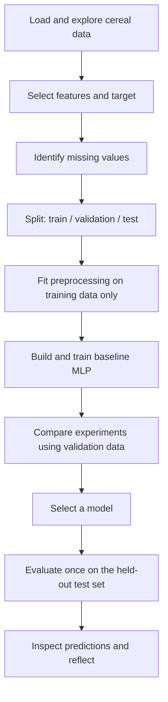

# Activity 3: An MLP for Real-World Regression — Cereal Ratings

In **Activity 2**, you built a multi-layer perceptron (MLP) to solve XOR, a binary classification problem with just four examples. Now you will use the same Keras workflow for a different task: **predicting a numerical value**.

In this guided activity, our dataset contains nutritional information about breakfast cereals. We will predict the dataset's numerical **`rating`** using nine nutritional features. **We use only the cereal dataset here.** In Activity 4, you will apply the complete workflow independently to a *new* dataset about concrete strength.

**Learning objectives**

By the end, you should be able to:

1. Distinguish regression from classification and choose an appropriate output layer.
2. Explore a small tabular dataset and identify inputs and the target.
3. Identify and handle missing-value markers without data leakage.
4. Create training, validation, and test sets and standardize inputs correctly.
5. Build, train, and interpret an MLP for regression in Keras.
6. Compare models using **validation** results, then evaluate a selected model on the **test** set.
7. Inspect individual prediction errors and discuss the limitations of a small dataset.

**How to work:** Run the sections in order in one notebook or script. Complete each task before expanding **Solution / explanation**. The full runnable solution is in a collapsible section at the end. Actual error values depend on the run; your numerical results do not have to match anybody else's.

**Software:** Python with NumPy, pandas, matplotlib, scikit-learn, **Keras 3**, and a Keras backend (we use TensorFlow in this course). If necessary:

```bash
python -m pip install numpy pandas matplotlib scikit-learn keras tensorflow
```

The dataset is loaded from a public CSV URL, so the first run requires an internet connection. For offline teaching, download the CSV beforehand and replace the URL with a local filename.

---

## 1. From classification to regression

| | Activity 2: XOR | Activity 3: cereal ratings |
|---|---|---|
| Prediction | Class 0 or 1 | Numerical rating |
| Problem type | Binary classification | Regression |
| Output layer | One neuron, **sigmoid** | One neuron, **linear** (the default) |
| Loss | Binary cross-entropy | Mean squared error (MSE) |
| Reporting metric | Accuracy | Mean absolute error (MAE) |

We follow this workflow:



> **Important:** The validation set helps us choose a model. The test set is reserved until **after** we have made that choice. We will not use test results to select an architecture.

### Keras and its backend

Keras is a high-level API for building and training networks. Keras 3 supports TensorFlow, JAX, and PyTorch backends. We will use the **TensorFlow** backend, but backend internals are not a learning objective today.

```python
import numpy as np
import pandas as pd
import matplotlib.pyplot as plt
import keras
from keras import Sequential, Input
from keras.layers import Dense
from sklearn.model_selection import train_test_split
from sklearn.impute import SimpleImputer
from sklearn.preprocessing import StandardScaler

keras.utils.set_random_seed(32)
print("Keras version:", keras.__version__)
print("Keras backend:", keras.config.backend())
```

**Question:** What does Keras simplify for us, and which backend is your environment using?

<details>
<summary><strong>Solution / explanation</strong></summary>

Keras lets us define network layers and use familiar training functions such as `compile()`, `fit()`, and `predict()`. The backend performs underlying tensor computations. The printed backend depends on your environment; with the course's standard installation it should be `tensorflow`.

</details>

---

## 2. Load and explore the cereal dataset

The [cereal dataset](https://raw.githubusercontent.com/AI-Learning-Repo/resources/refs/heads/main/datasets/cereal.csv) contains nutritional measurements and a numerical `rating` for each cereal. We treat **rating as the target supplied by this dataset**, not as an independently verified measure of health.

We will use these **nine** inputs:

| Feature | Description |
|---|---|
| `calories` | Calories per serving |
| `protein` | Protein, grams |
| `fat` | Fat, grams |
| `sodium` | Sodium, milligrams |
| `fiber` | Dietary fiber, grams |
| `carbo` | Complex carbohydrates, grams (dataset field name) |
| `sugars` | Sugars, grams |
| `potass` | Potassium, milligrams (dataset field name) |
| `vitamins` | Vitamin/mineral fortification, as encoded in the dataset |

```python
cereal_data = pd.read_csv(
    "https://raw.githubusercontent.com/AI-Learning-Repo/resources/refs/heads/main/datasets/cereal.csv"
)
```

**Your tasks**

1. Display the first five rows.
2. Print the number of rows and columns.
3. Identify the target and count the input features we will use.
4. Explain why this is **regression**, not classification.

```python
# YOUR CODE HERE
```

<details>
<summary><strong>Solution / explanation</strong></summary>

```python
print(cereal_data.head())
print("Dataset shape:", cereal_data.shape)
print("Columns:", cereal_data.columns.tolist())
```

For the linked version, the dataset has **77 rows and 16 columns**. We predict the continuous numeric column `rating` using **nine selected nutritional columns**. We do **not** include `rating` among the input features.

</details>

---

## 3. Separate features and target; inspect missing markers

A dataset has **features** (`X`, the inputs) and a **target** (`y`, what we want to predict). Some nutritional entries in this CSV use **`-1` as a missing-value marker**; for example, some values in `carbo`, `sugars`, and `potass` are not recorded. These are not meaningful negative quantities.

```python
feature_columns = [
    "calories", "protein", "fat", "sodium", "fiber",
    "carbo", "sugars", "potass", "vitamins"
]

cereal_features = cereal_data[feature_columns].copy()
cereal_target = cereal_data["rating"].copy()

missing_marker_columns = ["carbo", "sugars", "potass"]
cereal_features[missing_marker_columns] = (
    cereal_features[missing_marker_columns].replace(-1, np.nan)
)

print("Features:", cereal_features.shape)
print("Target:", cereal_target.shape)
print("Missing values by feature:")
print(cereal_features.isna().sum())
```

**Questions**

1. Why do we exclude `rating` from the features?
2. Why did we convert selected `-1` entries into `np.nan`?
3. Why should we **not** replace every `0` with a missing value?

<details>
<summary><strong>Solution / explanation</strong></summary>

1. Including `rating` among the inputs would reveal the answer to the model (**target leakage**).
2. `np.nan` marks a missing value that can be handled by an imputer. A value of `-1` incorrectly treated as a real negative nutrient amount would distort the input data.
3. Zero can be meaningful: a cereal can contain zero grams of fat or sugar. Only values known to be special missing markers should be replaced.

</details>

---

## 4. Split the dataset **before fitting preprocessing**

We create three sets:

- **Training:** learns model parameters and preprocessing statistics.
- **Validation:** compares configurations and monitors training.
- **Test:** provides the final assessment of the selected model.

```python
X_train_val, X_test, y_train_val, y_test = train_test_split(
    cereal_features, cereal_target, test_size=0.20, random_state=32
)

X_train, X_val, y_train, y_val = train_test_split(
    X_train_val, y_train_val, test_size=0.20, random_state=32
)

print("Training:", X_train.shape)
print("Validation:", X_val.shape)
print("Test:", X_test.shape)
```

**Your tasks**

1. Explain why the test set is not used for architecture comparisons.
2. Why does taking 20% of the *remaining* 80% for validation result in approximately a **64% / 16% / 20%** split?

<details>
<summary><strong>Solution / explanation</strong></summary>

The second split takes `0.20 × 0.80 = 0.16`, or 16% of the original data, for validation; approximately 64% remains for training. With 77 rows and these settings, the sets contain **48 training**, **13 validation**, and **16 test** rows. Using the test set to repeatedly select a model would bias the final assessment toward that test set.

</details>

---

## 5. Impute missing values and scale the features

We will use **median imputation** and **standardization**. Importantly, both the imputer and the scaler must learn their statistics using the **training** data only.

```python
imputer = SimpleImputer(strategy="median")

X_train_imputed = imputer.fit_transform(X_train)
X_val_imputed = imputer.transform(X_val)
X_test_imputed = imputer.transform(X_test)

scaler = StandardScaler()
X_train_scaled = scaler.fit_transform(X_train_imputed)
X_val_scaled = scaler.transform(X_val_imputed)
X_test_scaled = scaler.transform(X_test_imputed)

print("Training input shape:", X_train_scaled.shape)
print("Missing values after imputation:", np.isnan(X_train_scaled).sum())
```

**Questions**

1. What does median imputation do?
2. Why use `fit_transform()` on training inputs but only `transform()` on validation and test inputs?
3. What does standardization do, and why might it help neural networks?

<details>
<summary><strong>Solution / explanation</strong></summary>

Median imputation replaces missing entries in each feature with that feature's median calculated from the **training** set. `StandardScaler` then subtracts each training feature's mean and divides by its standard deviation. These preprocessing values must be reused for validation and test samples to avoid **data leakage** and inconsistent scales. Standardization often makes optimization more stable when input features have very different numeric ranges.

</details>

---

## 6. Build an MLP for regression

Our baseline architecture is **9 inputs → 64 ReLU neurons → 32 ReLU neurons → 1 linear output**.

```python
model = Sequential(name="Cereal_MLP")
model.add(Input(shape=(X_train_scaled.shape[1],)))
model.add(Dense(64, activation="relu"))
model.add(Dense(32, activation="relu"))
model.add(Dense(1))  # Default: linear activation for regression

model.summary()
```

**Your tasks**

1. Identify input, hidden, and output layers.
2. Why does the final neuron use a **linear** output rather than sigmoid?
3. Calculate the trainable parameters in each Dense layer and the total.

<details>
<summary><strong>Solution / explanation</strong></summary>

There are nine input values, two hidden layers (64 and 32 neurons), and one output neuron predicting a numerical rating. The default linear output does not restrict predictions to the interval 0–1, unlike sigmoid in XOR.

| Dense layer | Calculation | Parameters |
|---|---|---:|
| 9 → 64 | `(9 × 64) + 64` | 640 |
| 64 → 32 | `(64 × 32) + 32` | 2,080 |
| 32 → 1 | `(32 × 1) + 1` | 33 |
| **Total** | | **2,753** |

The formula for a Dense layer is **(inputs × neurons) + biases**, with one bias per neuron.

</details>

---

## 7. Compile and train the baseline

We use **Adam** to update weights, **MSE** as the training loss, and **MAE** as an interpretable metric.

```python
model.compile(
    optimizer="adam",
    loss="mean_squared_error",
    metrics=["mae"]
)

history = model.fit(
    X_train_scaled, y_train,
    epochs=50,
    batch_size=16,
    validation_data=(X_val_scaled, y_val),
    verbose=0
)

print("Final training MAE:", round(history.history["mae"][-1], 2))
print("Final validation MAE:", round(history.history["val_mae"][-1], 2))
```

**Questions**

1. What is the difference between **MSE** and **MAE**?
2. What do `epochs`, `batch_size`, and `validation_data` control?
3. Does a lower training error guarantee a lower validation error?

<details>
<summary><strong>Solution / explanation</strong></summary>

- **MSE** averages squared errors; its units here are **rating points squared**. Larger errors count especially heavily.
- **MAE** averages absolute errors; its units are **rating points**, so it is easier to interpret.
- An epoch is one pass through the training set. Batch size controls how many examples are used per training step. Validation data measures performance after each epoch without updating weights from those examples.
- **No.** A model can improve on the training examples without improving on unseen examples; this is one reason to monitor validation performance.

We use Keras training tools today; the internal gradient and backpropagation mathematics is covered later.

</details>

---

## 8. Visualize training and validation performance

```python
plt.figure(figsize=(7, 4))
plt.plot(history.history["loss"], label="Training MSE")
plt.plot(history.history["val_loss"], label="Validation MSE")
plt.xlabel("Epoch")
plt.ylabel("Mean squared error (rating points squared)")
plt.title("Cereal MLP: Training and Validation Loss")
plt.legend()
plt.tight_layout()
plt.show()

plt.figure(figsize=(7, 4))
plt.plot(history.history["mae"], label="Training MAE")
plt.plot(history.history["val_mae"], label="Validation MAE")
plt.xlabel("Epoch")
plt.ylabel("Mean absolute error (rating points)")
plt.title("Cereal MLP: Training and Validation MAE")
plt.legend()
plt.tight_layout()
plt.show()
```

**Questions**

1. Does the training loss generally decrease?
2. Does the validation curve follow the same pattern?
3. What might it mean if the training loss decreases while validation loss rises?

<details>
<summary><strong>Solution / explanation</strong></summary>

The shapes of the curves depend on the run. Training loss often decreases, but it need not do so monotonically. Validation loss can fluctuate, particularly with just **13 validation examples**. A persistent rise in validation loss while training loss falls can suggest **overfitting**, although a single fluctuation is not proof.

</details>

---

## 9. Experiment using the validation set — **before testing**

**Choose one change**, predict its effect, then run it:

- Reduce the first hidden layer from 64 to 16 neurons.
- Remove the second hidden layer.
- Replace hidden-layer ReLU with `tanh`.
- Increase training from 50 to 100 epochs.

**Always build, compile, and train a fresh model.** Do not continue training the baseline accidentally. To make the example runnable, the code below demonstrates **16 instead of 64 units in the first hidden layer**. Change only one setting if you want to try a different experiment.

```python
keras.utils.set_random_seed(32)

candidate_model = Sequential(name="Cereal_Candidate")
candidate_model.add(Input(shape=(X_train_scaled.shape[1],)))
candidate_model.add(Dense(16, activation="relu"))  # Changed: 64 -> 16
candidate_model.add(Dense(32, activation="relu"))
candidate_model.add(Dense(1))

candidate_model.compile(
    optimizer="adam",
    loss="mean_squared_error",
    metrics=["mae"]
)

candidate_history = candidate_model.fit(
    X_train_scaled, y_train,
    epochs=50,
    batch_size=16,
    validation_data=(X_val_scaled, y_val),
    verbose=0
)

baseline_val_mae = history.history["val_mae"][-1]
candidate_val_mae = candidate_history.history["val_mae"][-1]

print(f"Baseline final validation MAE: {baseline_val_mae:.2f}")
print(f"Candidate final validation MAE: {candidate_val_mae:.2f}")
```

Record what **you** observed; results are not fixed:

| Model | Change | Final validation MAE (rating points) | Observation |
|---|---|---|---|
| Baseline | 64 → 32, ReLU, 50 epochs | | |
| Candidate | Your chosen change | | |

**Discussion**

1. Which model had the lower **final validation MAE** in your run?
2. Why might changing capacity or training duration affect the result?
3. Can one split and one training run prove an architecture is universally better?

<details>
<summary><strong>Solution / explanation</strong></summary>

There is **no single correct numerical answer**: initialization, optimization, and the very small validation set affect outcomes. A wider model has more parameters, but more parameters do not guarantee better performance. More epochs can help or hurt validation results. One experiment is not sufficient to establish that an architecture is always superior; repeated seeds or cross-validation are more rigorous methods, studied later.

For this introductory lab, use the **final validation MAE** as a simple, consistent selection rule. Do not check test performance to make the choice.

</details>

### Select the model using validation results

```python
if candidate_val_mae < baseline_val_mae:
    final_model = candidate_model
    print("Selected candidate model using validation MAE.")
else:
    final_model = model
    print("Selected baseline model using validation MAE.")
```

---

## 10. Evaluate the selected model on the test set

Only **now** use the held-out test set. Test MSE and test MAE measure performance on these examples. Do not revise the architecture based on the result.

```python
test_mse, test_mae = final_model.evaluate(
    X_test_scaled, y_test, verbose=0
)
print(f"Test MSE: {test_mse:.2f} rating-points²")
print(f"Test MAE: {test_mae:.2f} rating points")
```

**Question:** If test MAE is 6, what does that mean? Does it guarantee that every prediction is within 6 points?

<details>
<summary><strong>Solution / explanation</strong></summary>

An MAE of 6 would mean that the absolute errors average **6 rating points** across the test set. It does **not** mean every individual prediction has an error of at most 6. The actual MAE must come from your run.

</details>

---

## 11. Inspect predictions and their errors

```python
predictions = final_model.predict(X_test_scaled, verbose=0).flatten()

results = pd.DataFrame({
    "Actual rating": y_test.to_numpy(),
    "Predicted rating": predictions
})
results["Absolute error"] = (
    results["Actual rating"] - results["Predicted rating"]
).abs()

print(results.head(10).round(2))
```

**Your tasks**

1. For the **first ten displayed predictions**, identify the smallest and largest absolute errors.
2. Does the model perform equally well on every cereal?
3. Why shouldn't you interpret an accurate predicted rating as proof that the cereal is healthy?

<details>
<summary><strong>Solution / explanation</strong></summary>

The minimum and maximum depend on the trained model. For the **displayed ten rows**:

```python
shown = results.head(10)
print("Smallest displayed error:")
print(shown.loc[shown["Absolute error"].idxmin()])
print("Largest displayed error:")
print(shown.loc[shown["Absolute error"].idxmax()])
```

Prediction errors generally differ by example. The model tries to predict a rating provided by the dataset, not to independently establish nutritional or medical claims. With **48 training rows**, results can be unstable; the exercise illustrates an ML workflow rather than a production-ready rating tool.

</details>

---

## Conclusion and reflection

You moved from XOR classification to real-world regression. Both tasks use `Sequential`, `Dense`, `compile()`, `fit()`, and `predict()`, but the **target**, **output activation**, **loss**, and **metric** are different. You also learned that correct preprocessing and evaluation are part of building an MLP, not optional extras.

**Exit question:** Why is it important to select the model using validation data **before** inspecting its test error?

<details>
<summary><strong>Sample answer</strong></summary>

If we repeatedly inspect test results while making modeling decisions, we indirectly adapt to the test examples and the final score may become misleadingly optimistic. Validation data supports model selection; the held-out test data provides a final check.

</details>

**Next: Activity 4.** You will repeat this workflow more independently using a **concrete compressive-strength dataset**, introduced and loaded there for the first time.

---

<details>
<summary><strong>Complete runnable solution (expand only after attempting the activity)</strong></summary>

The script below follows the same sequence as the activity. Its output values will vary with the environment and training run.

```python
import numpy as np
import pandas as pd
import matplotlib.pyplot as plt
import keras
from keras import Sequential, Input
from keras.layers import Dense
from sklearn.model_selection import train_test_split
from sklearn.impute import SimpleImputer
from sklearn.preprocessing import StandardScaler

keras.utils.set_random_seed(32)

# 1. Read and explore the cereal data.
cereal_data = pd.read_csv(
    "https://raw.githubusercontent.com/AI-Learning-Repo/resources/refs/heads/main/datasets/cereal.csv"
)
print("Dataset:", cereal_data.shape)
print(cereal_data.head())

# 2. Select features and target. Convert documented -1 markers to NaN.
feature_columns = [
    "calories", "protein", "fat", "sodium", "fiber",
    "carbo", "sugars", "potass", "vitamins"
]
cereal_features = cereal_data[feature_columns].copy()
cereal_target = cereal_data["rating"].copy()
missing_marker_columns = ["carbo", "sugars", "potass"]
cereal_features[missing_marker_columns] = (
    cereal_features[missing_marker_columns].replace(-1, np.nan)
)
print("Missing values:\n", cereal_features.isna().sum())

# 3. Split train / validation / test.
X_train_val, X_test, y_train_val, y_test = train_test_split(
    cereal_features, cereal_target, test_size=0.20, random_state=32
)
X_train, X_val, y_train, y_val = train_test_split(
    X_train_val, y_train_val, test_size=0.20, random_state=32
)
print("Split sizes:", len(X_train), len(X_val), len(X_test))

# 4. Fit imputer and scaler on training inputs ONLY.
imputer = SimpleImputer(strategy="median")
X_train_imputed = imputer.fit_transform(X_train)
X_val_imputed = imputer.transform(X_val)
X_test_imputed = imputer.transform(X_test)

scaler = StandardScaler()
X_train_scaled = scaler.fit_transform(X_train_imputed)
X_val_scaled = scaler.transform(X_val_imputed)
X_test_scaled = scaler.transform(X_test_imputed)

# 5. Baseline MLP.
model = Sequential(name="Cereal_MLP")
model.add(Input(shape=(X_train_scaled.shape[1],)))
model.add(Dense(64, activation="relu"))
model.add(Dense(32, activation="relu"))
model.add(Dense(1))
model.summary()
model.compile(optimizer="adam", loss="mean_squared_error", metrics=["mae"])
history = model.fit(
    X_train_scaled, y_train, epochs=50, batch_size=16,
    validation_data=(X_val_scaled, y_val), verbose=0
)

# 6. Visualize training/validation performance.
plt.figure(figsize=(7, 4))
plt.plot(history.history["loss"], label="Training MSE")
plt.plot(history.history["val_loss"], label="Validation MSE")
plt.xlabel("Epoch")
plt.ylabel("MSE (rating points squared)")
plt.title("Cereal MLP: Loss")
plt.legend()
plt.tight_layout()
plt.show()

plt.figure(figsize=(7, 4))
plt.plot(history.history["mae"], label="Training MAE")
plt.plot(history.history["val_mae"], label="Validation MAE")
plt.xlabel("Epoch")
plt.ylabel("MAE (rating points)")
plt.title("Cereal MLP: MAE")
plt.legend()
plt.tight_layout()
plt.show()

# 7. One controlled experiment: reduce first hidden layer from 64 to 16.
keras.utils.set_random_seed(32)
candidate_model = Sequential(name="Cereal_Candidate")
candidate_model.add(Input(shape=(X_train_scaled.shape[1],)))
candidate_model.add(Dense(16, activation="relu"))
candidate_model.add(Dense(32, activation="relu"))
candidate_model.add(Dense(1))
candidate_model.compile(
    optimizer="adam", loss="mean_squared_error", metrics=["mae"]
)
candidate_history = candidate_model.fit(
    X_train_scaled, y_train, epochs=50, batch_size=16,
    validation_data=(X_val_scaled, y_val), verbose=0
)

baseline_val_mae = history.history["val_mae"][-1]
candidate_val_mae = candidate_history.history["val_mae"][-1]
print(f"Baseline validation MAE: {baseline_val_mae:.2f}")
print(f"Candidate validation MAE: {candidate_val_mae:.2f}")
final_model = candidate_model if candidate_val_mae < baseline_val_mae else model

# 8. Test evaluation happens only AFTER model selection.
test_mse, test_mae = final_model.evaluate(X_test_scaled, y_test, verbose=0)
print(f"Test MSE: {test_mse:.2f} rating-points²")
print(f"Test MAE: {test_mae:.2f} rating points")

# 9. Inspect test predictions.
predictions = final_model.predict(X_test_scaled, verbose=0).flatten()
results = pd.DataFrame({
    "Actual rating": y_test.to_numpy(),
    "Predicted rating": predictions
})
results["Absolute error"] = (
    results["Actual rating"] - results["Predicted rating"]
).abs()
print("First ten test predictions:\n", results.head(10).round(2))
shown = results.head(10)
print("Smallest displayed absolute error:\n", shown.loc[shown["Absolute error"].idxmin()])
print("Largest displayed absolute error:\n", shown.loc[shown["Absolute error"].idxmax()])
```

</details>
