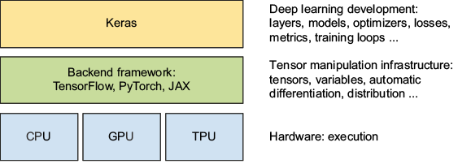

# Activity 3: Building an MLP for Real-World Data

In Activity 2, we built an MLP to solve XOR, a small classification problem with only four examples.

Now we will use Keras to build an MLP for a more realistic task: **predicting numerical values from data**.

In this activity, we will use a cereal dataset to predict cereal ratings based on nutritional information. We will also load a concrete dataset that we will use in Activity 4.

**Learning objectives**

By the end of this activity, you will be able to:

1. Understand the relationship between Keras and its backend frameworks.
2. Follow the standard machine learning workflow.
3. Prepare data for neural network training.
4. Build an MLP for a regression problem.
5. Train, evaluate, and make predictions using Keras.
6. Visualize and interpret model performance.

---

<details>
<summary><strong>Refresher: The Machine Learning Pipeline</strong></summary>

Most supervised machine learning projects follow a similar workflow:

1. **Load data:** Read the dataset into Python.
2. **Explore and preprocess:** Understand and prepare the data.
3. **Split data:** Separate examples for training, validation, and testing.
4. **Build a model:** Select and configure a suitable architecture.
5. **Train:** Allow the model to learn patterns from training data.
6. **Predict:** Use the trained model to make predictions.
7. **Evaluate:** Measure performance on unseen data.

We will follow these steps using Keras.

</details>

## Part 1: Introduction to Keras

### 1. Keras and Backend Frameworks

Keras is a high-level API that makes building and training neural networks easier.

Instead of implementing complex mathematical operations ourselves, we can use Keras to define neural network architectures and train models with just a few lines of code.

**Keras 3 supports multiple backend frameworks:**

- TensorFlow
- PyTorch
- JAX

These frameworks perform the underlying computations and can use different hardware, such as CPUs, GPUs, and TPUs.



### Why is this useful?

Keras allows us to focus on **building, training, and experimenting with neural networks** rather than implementing the underlying mathematical operations.

Keras 3 also allows standard Keras models written with backend-compatible operations to work across supported backend frameworks.

In this course, we will primarily use **Keras with the TensorFlow backend**.

We will explore the internal workings of neural network training as the course progresses.

### 2. Import the Required Libraries

```python
import numpy as np
import pandas as pd
import matplotlib.pyplot as plt

import keras
from keras import Sequential, Input
from keras.layers import Dense

from sklearn.model_selection import train_test_split
from sklearn.preprocessing import StandardScaler
from sklearn.metrics import mean_absolute_error
```

**Check the Keras backend:**

```python
print("Keras version:", keras.__version__)
print("Backend:", keras.config.backend())
```

**Question:** Which backend is Keras currently using?

<details>
<summary><strong>Code Explanation</strong></summary>

- `numpy`: Numerical arrays and computations.
- `pandas`: Loading and manipulating tabular data.
- `matplotlib`: Visualizing data and results.
- `keras`: Building, training, and evaluating neural networks.
- `train_test_split`: Dividing data into separate sets.
- `StandardScaler`: Scaling numerical features.
- `mean_absolute_error`: Measuring prediction errors.

</details>

---

## Part 2: Building an MLP for Regression

### 1. About the Cereal Dataset

The **80 Cereals** dataset (collected from manufacturer data and *Consumer Reports*) contains nutritional metrics for popular commercial breakfast cereals. 

Instead of classifying cereals into categories (like "healthy" vs. "unhealthy"), our goal is **regression**: predicting a continuous numerical score (`rating`) from nutritional facts.

Features Overview:
* **Target (`rating`):** An overall consumer/health rating calculated by *Consumer Reports* (ranges roughly from 18 to 94; higher indicates a healthier, better-rated cereal).
* **Nutritional Inputs (per serving):**
  * `calories`: Calories per serving (kcal)
  * `protein`: Protein content (grams)
  * `fat`: Total fat (grams)
  * `sodium`: Sodium content (milligrams)
  * `fiber`: Dietary fiber (grams)
  * `carbo`: Complex carbohydrates (grams)
  * `sugars`: Simple sugars (grams)
  * `potass`: Potassium (milligrams)
  * `vitamins`: Vitamins and minerals (typically 0%, 25%, or 100% of FDA recommended daily allowance)


**Why is this a great real-world dataset?**

1. **Different measurement scales:** Fat is measured in single-digit grams ($0\text{--}5\text{ g}$), while sodium and potassium are in hundreds of milligrams ($0\text{--}320\text{ mg}$). This demonstrates why **feature scaling (standardization)** is essential for neural networks.
2. **Intuitive relationships:** We naturally expect higher sugar and calories to lower the rating, while higher fiber and protein raise it. The neural network must learn these combined non-linear interactions on its own.

### 2. Load the Datasets

We will use two datasets:

- **Cereal:** Nutritional information and cereal ratings.
<!-- - **Concrete:** Ingredients and compressive strength of concrete. -->

```python
cereal_data = pd.read_csv(
    "https://raw.githubusercontent.com/AI-Learning-Repo/resources/refs/heads/main/datasets/cereal.csv"
)
```

**Your tasks:**

1. Display the first five rows of each dataset.
2. Find the number of rows and columns.
3. Identify what we are trying to predict in each dataset.

```python
# YOUR CODE HERE

```

<details>
<summary><strong>Sample Solution</strong></summary>

```python
print(cereal_data.head())
print(cereal_data.shape)
```

The targets are:

- Cereal rating
- Concrete compressive strength

Both are numerical prediction tasks, also called **regression**.

</details>

### 3. Separate Features and Target

A supervised learning dataset contains:

- **Features (X):** Information used to make predictions.
- **Target (y):** The value we want to predict.

```python
cereal_features = cereal_data[
    ['calories', 'protein', 'fat', 'sodium',
     'fiber', 'carbo', 'sugars', 'potass', 'vitamins']
]

cereal_target = cereal_data['rating']

concrete_features = concrete_data.drop(
    columns=['CompressiveStrength']
)

concrete_target = concrete_data['CompressiveStrength']
```

**Questions:**

1. How many input features does the cereal dataset have?
2. Why is `rating` excluded from the inputs?
3. Why do we use `drop()` for the concrete dataset?

<details>
<summary><strong>Explanation</strong></summary>

We must separate the inputs from the values we want to predict.

The cereal dataset uses nine selected nutritional features.

For the concrete dataset, we remove the target column and retain the remaining columns as features.

We must not include the target itself among the inputs because the model would then be given the answer it is supposed to predict.

</details>

### 4. Split the Data

We divide our cereal data into three sets:

- **Training:** Used to train the model.
- **Validation:** Used to monitor performance during development.
- **Testing:** Used for final evaluation on unseen examples.

```python
# First separate 20% for testing
X_train_val, X_test, y_train_val, y_test = train_test_split(
    cereal_features,
    cereal_target,
    test_size=0.2,
    random_state=32
)

# Then separate 20% of the remaining data for validation
X_train, X_val, y_train, y_val = train_test_split(
    X_train_val,
    y_train_val,
    test_size=0.2,
    random_state=32
)

print("Training:", X_train.shape)
print("Validation:", X_val.shape)
print("Testing:", X_test.shape)
```

**Question:** Why should we evaluate the model on examples that were not used for training?

<details>
<summary><strong>Explanation</strong></summary>

We want the model to learn patterns that generalize to new data, not simply reproduce the examples it encountered during training.

A separate test set helps us estimate how well the model performs on unseen examples.

The test set should not be used to train the model or repeatedly choose model settings.

</details>

### 5. Scale the Input Features

Neural networks often work better when input features have comparable numerical scales.

For example, cereal calories and fat content may have very different ranges.

We will use `StandardScaler` to standardize the features.

```python
scaler = StandardScaler()

X_train_scaled = scaler.fit_transform(X_train)
X_val_scaled = scaler.transform(X_val)
X_test_scaled = scaler.transform(X_test)
```

**Question:** Why do we use `fit_transform()` on the training data but only `transform()` on the validation and test data?

<details>
<summary><strong>Explanation</strong></summary>

The scaler learns the mean and standard deviation from the training data.

We then apply that same transformation to the validation and test data.

This prevents information from the validation or test sets from influencing preprocessing.

</details>

### 6. Build the Neural Network

We will create an MLP with:

- 9 input features
- 64 neurons in the first hidden layer
- 32 neurons in the second hidden layer
- 1 output neuron

```python
model = Sequential()

model.add(Input(shape=(X_train_scaled.shape[1],)))

model.add(Dense(64, activation='relu'))
model.add(Dense(32, activation='relu'))

model.add(Dense(1))

model.summary()
```

**Your tasks:**

1. Identify the input, hidden, and output layers.
2. Explain why the output layer contains only one neuron.
3. Calculate the total number of trainable parameters.

<details>
<summary><strong>Explanation and Sample Solution</strong></summary>

The hidden layers use ReLU activation functions, allowing the network to represent nonlinear relationships.

The output layer contains one neuron because we are predicting one numerical value.

The output layer uses a linear activation by default, which is suitable for regression.

**Parameter calculation:**

- First hidden layer: `(9 × 64) + 64 = 640`
- Second hidden layer: `(64 × 32) + 32 = 2,080`
- Output layer: `(32 × 1) + 1 = 33`

**Total: 2,753 trainable parameters.**

</details>

### 7. Compile the Model

Before training, we configure the model.

```python
model.compile(
    optimizer='adam',
    loss='mean_squared_error',
    metrics=['mae']
)
```

At this stage, we only need to understand the purpose of these settings:

- **Optimizer:** Determines how the model updates its parameters.
- **Loss:** Measures the error the model tries to reduce during training.
- **Metric:** Helps us monitor performance.

We will study the underlying mathematics later in the course.

**Question:** Why are we using regression metrics instead of classification accuracy?

<details>
<summary><strong>Explanation</strong></summary>

Cereal ratings are continuous numerical values, not categories.

Mean Squared Error (MSE) measures squared prediction errors.

Mean Absolute Error (MAE) measures the average absolute difference between predicted and actual values.

For this regression problem, MAE is usually more informative than classification accuracy.

</details>

### 8. Train the Model

We will now use `fit()` to train the MLP.

```python
history = model.fit(
    X_train_scaled,
    y_train,
    epochs=50,
    batch_size=16,
    validation_data=(X_val_scaled, y_val),
    verbose=0
)

print("Training complete.")
```

**What do these parameters mean?**

- `epochs=50`: The model processes the training dataset 50 times.
- `batch_size=16`: Training examples are processed in groups of up to 16.
- `validation_data`: Evaluates performance on a separate dataset after each epoch.
- `verbose=0`: Hides the training progress display.

**Your tasks:**

1. Change `verbose=0` to `verbose=1` and observe the output.
2. Identify the training and validation metrics.
3. What happens to the loss values during training?

> [!NOTE]
> We will study how neural networks learn and how to control the training process in future sessions.

### 9. Visualize Training Results

Keras stores training results in the `history` object.

Let's visualize how training and validation loss change.

```python
plt.plot(history.history['loss'], label='Training Loss')
plt.plot(history.history['val_loss'], label='Validation Loss')

plt.title('MLP Training: Cereal Rating Prediction')
plt.xlabel('Epoch')
plt.ylabel('Mean Squared Error')
plt.legend()
plt.show()
```

**Questions:**

1. Does training loss decrease?
2. Does validation loss follow the same pattern?
3. Does a lower training loss always mean better performance on unseen data?

<details>
<summary><strong>Discussion</strong></summary>

We generally expect training loss to decrease as the model learns patterns in the training data.

Validation loss tells us how the model performs on data not used to update its parameters.

If training loss decreases while validation loss increases, the model may be overfitting.

We will explore overfitting and techniques for improving training in more detail next week.

</details>

### 10. Evaluate the Model

Now we evaluate the trained model on our reserved test set.

```python
test_loss, test_mae = model.evaluate(
    X_test_scaled,
    y_test,
    verbose=0
)

print(f"Test MSE: {test_loss:.2f}")
print(f"Test MAE: {test_mae:.2f}")
```

**Question:** What does MAE tell us about the model's predictions?

<details>
<summary><strong>Explanation</strong></summary>

MAE represents the average absolute prediction error.

For example, an MAE of 5 would mean that the predicted cereal ratings differ from the actual ratings by approximately 5 rating points on average.

</details>

### 11. Make Predictions

Let's compare the model's predictions with actual cereal ratings.

```python
predictions = model.predict(
    X_test_scaled,
    verbose=0
).flatten()

results = pd.DataFrame({
    'Actual': y_test.to_numpy(),
    'Predicted': predictions
})

results['Absolute Error'] = abs(
    results['Actual'] - results['Predicted']
)

print(results.head(10))
```

**Your tasks:**

1. Find the prediction with the smallest absolute error.
2. Find the prediction with the largest absolute error.
3. Are the model's predictions always close to the actual ratings?


<details>
<summary><strong>Explanation</strong></summary>

Sample table generated from one test run:

```text
      Actual  Predicted  Absolute Error
0  46.895644  33.048038       13.847606
1  49.120253  19.952089       29.168164
2  37.038562  11.178373       25.860189
3  31.435973  23.027231        8.408742
4  33.983679  39.301735        5.318056
5  49.787445  19.997799       29.789646
6  23.804043  19.906916        3.897127
7  44.330856  27.319593       17.011263
8  34.139765  18.065828       16.073937
9  19.823573  19.517570        0.306003
```

* **1. Prediction with the smallest absolute error:**
  * **Row 9:** Actual $= 19.82$, Predicted $= 19.52$, **Absolute Error $= 0.31$** (almost identical!).
* **2. Prediction with the largest absolute error:**
  * **Row 5:** Actual $= 49.79$, Predicted $= 20.00$, **Absolute Error $= 29.79$**.
* **3. Are the predictions always close?**
  * **Answer:** No. While some cereals are predicted with high precision (error $<1.0$), others are off by nearly 30 points. With only ~49 training examples (80% of 80% of 77 rows), the dataset is very small, meaning rare nutritional profiles or outliers are hard for the network to predict reliably.


</details>

---

## Part 3: Experiment with the Model

Now that you have a working MLP, let's investigate how changing the architecture affects the results.

**Choose one experiment:**

1. Change the number of neurons in the first hidden layer from 64 to 16.
2. Remove the second hidden layer.
3. Change the activation function from `relu` to `tanh`.
4. Change the number of training epochs from 50 to 100.

**Before running your experiment, predict what might happen.**

Rebuild, compile, and train a new model after making your change so you can compare it with the original model.

| Experiment | Prediction | Observed validation loss | Observation |
|---|---|---|---|
| Original model | | | |
| Modified model | | | |

**Discussion questions:**

- Did your modification improve or worsen the validation results?
- What could explain the difference?
- Would one experiment be enough to conclude which architecture is better?

> [!IMPORTANT]
> Changing the number of layers, neurons, or activation functions can affect model performance. There is no single architecture that is best for every problem.


<details>
<summary><strong>Explanation</strong></summary>

| Experiment | Prediction | Observed validation loss | Observation |
|---|---|---|---|
| **Original model** (64-32, relu, 50 epochs) | Baseline regression model. | ~25.4 | Smooth reduction in loss; test MAE ~4.5 to ~6.0. |
| **Exp 1: Reduce Layer 1 from 64 to 16** | Fewer parameters; might underfit or generalize slightly better by preventing memorization. | ~28.1 | Reached a similar loss; fewer parameters (561 vs 2,753), trains faster, slightly higher error. |
| **Exp 2: Remove Layer 2** (only 1 hidden layer) | Simpler function; may struggle with non-linear feature interactions. | ~32.6 | Validation loss was higher; 1 layer struggled to capture the combination of 9 features. |
| **Exp 3: Replace `relu` with `tanh`** | Smooth zero-centered curves might fit continuous ratings well. | ~18.7 | Often converges to lower loss on continuous tabular data than ReLU. |
| **Exp 4: Increase epochs to 100** | Model has more time to optimize parameters. | ~16.2 | Validation loss continued to fall until epoch 70, then plateaued without significant overfitting. |

### Discussion Answers:
* **Did your modification improve or worsen the validation results?**
  * Training for 100 epochs and switching to `tanh` both noticeably lowered validation loss. Removing the second hidden layer worsened performance because the model lost representational capacity.
* **What could explain the difference?**
  * 50 epochs was slightly too early for Adam to fully converge on this dataset. Additionally, because ratings are smooth continuous values, `tanh` produces smoother gradients than piecewise-linear ReLUs.
* **Would one experiment be enough to conclude which architecture is better?**
  * **No.** The cereal dataset is tiny (only 77 rows total, with only ~13 rows in validation and ~16 rows in test). A single random train/test split or a lucky initial seed can skew results significantly. To determine the truly superior architecture, cross-validation or multiple randomized runs are required.

</details>


---

## Conclusion

In this activity, we followed the machine learning workflow to build a neural network for predicting numerical values.

We learned how to:

- Prepare and split data.
- Scale input features.
- Build an MLP using Keras.
- Compile and train a regression model.
- Visualize training results.
- Evaluate predictions on unseen data.
- Experiment with network architectures.

**Next: Activity 4**

You will apply this workflow more independently to the concrete dataset and experiment with your own MLP architecture.