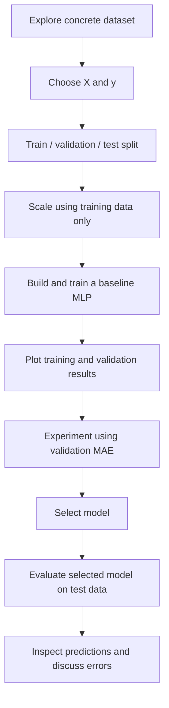

# Activity 4: The Concrete Strength MLP Challenge

In **Activity 3**, you followed a guided workflow for predicting cereal ratings. In this activity, you will apply the **same regression workflow more independently**, using a **new dataset introduced here**: concrete compressive strength.

**Challenge:** Build a multi-layer perceptron (MLP) that predicts a concrete mixture's compressive strength from its ingredients and curing age. Complete each task before opening its collapsible solution. A **complete runnable script** is also included at the end—there is **no separate answer key**.

## Learning objectives

By the end of this activity, you should be able to:

1. Load, explore, and describe a new numerical dataset.
2. Separate input features from a continuous target.
3. Split data into training, validation, and test sets without leakage.
4. Standardize inputs using statistics from the training set only.
5. Build, compile, and train a Keras MLP for regression.
6. Interpret training and validation curves and compare model architectures.
7. Select a model using **validation MAE**, then assess it using the **test set**.
8. Inspect individual prediction errors and explain limitations of the result.

**How to work:** Follow the sections in order. Use your Activity 3 code as a reference, but try the task yourself before opening each **Solution / explanation**. Run the code in one Python notebook or script. The numerical training outcomes may vary.

**Software:** Python with NumPy, pandas, matplotlib, scikit-learn, **Keras 3**, and the TensorFlow backend. If necessary:

```bash
python -m pip install numpy pandas matplotlib scikit-learn keras tensorflow
```

---

## 1. Meet the concrete dataset

The [Concrete Compressive Strength dataset](https://raw.githubusercontent.com/AI-Learning-Repo/resources/refs/heads/main/datasets/concrete.csv) records ingredient amounts, curing age, and measured compressive strength for **1,030 concrete samples**. The goal is to predict **`CompressiveStrength`**, a continuous numerical quantity measured in **megapascals (MPa)**.

| Input feature | Meaning | Unit |
|---|---|---|
| `Cement` | Cement content | kg/m³ |
| `BlastFurnaceSlag` | Blast-furnace slag content | kg/m³ |
| `FlyAsh` | Fly ash content | kg/m³ |
| `Water` | Water content | kg/m³ |
| `Superplasticizer` | Superplasticizer content | kg/m³ |
| `CoarseAggregate` | Coarse aggregate content | kg/m³ |
| `FineAggregate` | Fine aggregate content | kg/m³ |
| `Age` | Curing time before measurement | days |
| **Target: `CompressiveStrength`** | Measured compressive strength | **MPa** |

The relationships among mixture proportions, curing age, and strength can be nonlinear. An MLP is one way to model them. **This educational model is not a substitute for engineering tests or safety decisions.**

Our workflow follows this order:



> **Rule:** The test set stays untouched until **after** architecture selection. Do not choose a model based on its test score.

### Load the data

```python
import numpy as np
import pandas as pd
import matplotlib.pyplot as plt
import keras
from keras import Sequential, Input
from keras.layers import Dense
from sklearn.model_selection import train_test_split
from sklearn.preprocessing import StandardScaler

keras.utils.set_random_seed(32)

concrete_data = pd.read_csv(
    "https://raw.githubusercontent.com/AI-Learning-Repo/resources/refs/heads/main/datasets/concrete.csv"
)
```

**Your tasks**

1. Display the first five rows and the column names.
2. Find the number of rows and columns.
3. Check for missing values with `.isna().sum()`.
4. Identify the target and the number of input features.
5. Is this a **regression** or **classification** task? Explain.

```python
# YOUR CODE HERE
```

<details>
<summary><strong>Solution / explanation</strong></summary>

```python
print(concrete_data.head())
print("Shape:", concrete_data.shape)
print("Columns:", concrete_data.columns.tolist())
print("Missing values:\n", concrete_data.isna().sum())
```

For the linked CSV, the expected shape is **(1030, 9)**: eight inputs and one target. It has no missing entries reported by `.isna()` (zero ingredient values are valid and should not be interpreted automatically as missing). We predict a **continuous measured value**, so this is **regression**.

</details>

---

## 2. Separate input features and target

**Your task:** Create two variables:

- `concrete_features`: all input columns except `CompressiveStrength`
- `concrete_target`: the column to be predicted

**Hint:** Use `.drop(columns=[...])`.

```python
# YOUR CODE HERE
```

**Question:** What would go wrong if `CompressiveStrength` were also included among the features?

<details>
<summary><strong>Solution / explanation</strong></summary>

```python
concrete_features = concrete_data.drop(columns=["CompressiveStrength"])
concrete_target = concrete_data["CompressiveStrength"]

print("Feature shape:", concrete_features.shape)
print("Target shape:", concrete_target.shape)
```

Expected shapes: **(1030, 8)** and **(1030,)**. If the target were included as an input, we would give the model the answer it is supposed to predict. This is **target leakage** and would make its evaluation misleading.

</details>

---

## 3. Split into training, validation, and test sets

**Your task:** Apply the same two-stage procedure as in Activity 3:

1. Reserve **20%** for final testing.
2. Reserve **20% of the remainder** for validation.
3. Use `random_state=32` in both calls.
4. Print all three split sizes.

```python
# YOUR CODE HERE
```

**Questions**

1. Why do we keep a separate validation set?
2. Why should we not repeatedly evaluate architectures on the test set?

<details>
<summary><strong>Solution / explanation</strong></summary>

```python
X_train_val, X_test, y_train_val, y_test = train_test_split(
    concrete_features, concrete_target,
    test_size=0.20, random_state=32
)
X_train, X_val, y_train, y_val = train_test_split(
    X_train_val, y_train_val,
    test_size=0.20, random_state=32
)

print("Training:", X_train.shape)
print("Validation:", X_val.shape)
print("Test:", X_test.shape)
```

With the linked dataset, the splits contain **659 training**, **165 validation**, and **206 test** samples (approximately 64% / 16% / 20%). Training data updates weights; validation data helps compare choices; test data provides a final assessment. Repeated architecture choices based on test errors would make the final test estimate too optimistic.

</details>

---

## 4. Standardize the input features

Concrete ingredients have quite different numeric ranges. Standardization often helps an MLP learn efficiently.

**Your task:** Create a `StandardScaler` and obtain:

- `X_train_scaled`
- `X_val_scaled`
- `X_test_scaled`

**Hint:** Fit the scaler using **training features only**, then apply the same transform to validation and test features.

```python
# YOUR CODE HERE
```

**Questions**

1. Why is `fit_transform()` applied only to training data?
2. What is the approximate mean of each **scaled training feature**?
3. Why should we not scale validation and test data by fitting a new scaler on each set?

<details>
<summary><strong>Solution / explanation</strong></summary>

```python
scaler = StandardScaler()
X_train_scaled = scaler.fit_transform(X_train)
X_val_scaled = scaler.transform(X_val)
X_test_scaled = scaler.transform(X_test)

print("Scaled training shape:", X_train_scaled.shape)
print("Training feature means:", np.round(X_train_scaled.mean(axis=0), 6))
```

The scaled training features should have means **close to zero**. `StandardScaler` calculates training-set means and standard deviations. Using those same values for validation and test samples keeps the representation consistent and prevents leakage from the held-out sets.

</details>

---

## 5. Build the baseline MLP

Construct a `Sequential` network with:

- An input matching the number of numerical features.
- **128** ReLU neurons in the first hidden layer.
- **64** ReLU neurons in the second hidden layer.
- **One linear output** predicting strength in MPa.

```python
# YOUR CODE HERE
```

**Questions**

1. Why is there one output neuron?
2. Why is the output **linear**, unlike the sigmoid output used for XOR?
3. Calculate the total number of trainable weights and biases.

<details>
<summary><strong>Solution / explanation</strong></summary>

```python
concrete_model = Sequential(name="Concrete_MLP")
concrete_model.add(Input(shape=(X_train_scaled.shape[1],)))
concrete_model.add(Dense(128, activation="relu"))
concrete_model.add(Dense(64, activation="relu"))
concrete_model.add(Dense(1))  # Linear output (default)

concrete_model.summary()
```

One output neuron predicts one numerical value. The default linear activation allows outputs beyond 0–1, appropriate for a regression target; XOR used sigmoid because its output represented a binary class score.

| Dense layer | Calculation | Parameters |
|---|---|---:|
| 8 → 128 | `(8 × 128) + 128` | 1,152 |
| 128 → 64 | `(128 × 64) + 64` | 8,256 |
| 64 → 1 | `(64 × 1) + 1` | 65 |
| **Total** | | **9,473** |

</details>

---

## 6. Compile the MLP

**Your task:** Set the optimizer, loss, and metric to:

- Optimizer: `adam`
- Loss: `mean_squared_error`
- Metric: `mae`

```python
# YOUR CODE HERE
```

**Question:** Why is classification accuracy inappropriate here? What are the units of MSE and MAE?

<details>
<summary><strong>Solution / explanation</strong></summary>

```python
concrete_model.compile(
    optimizer="adam",
    loss="mean_squared_error",
    metrics=["mae"]
)
```

Strength is continuous, so exact class matching does not make sense. **MAE** is the mean absolute prediction error in **MPa**, while **MSE** is the mean squared prediction error in **MPa²**. Adam is the method Keras uses to adjust model parameters. We will study its mathematics later.

</details>

---

## 7. Train the baseline model

**Your task:** Train on the **scaled training features** using:

- `epochs=100`
- `batch_size=32`
- `validation_data=(X_val_scaled, y_val)`
- `verbose=0`

Save the returned history as `history_concrete`.

```python
# YOUR CODE HERE
```

**Questions**

1. What does an epoch mean?
2. What do training MAE and validation MAE measure?
3. Does a lower training loss guarantee a lower validation loss?

<details>
<summary><strong>Solution / explanation</strong></summary>

```python
history_concrete = concrete_model.fit(
    X_train_scaled, y_train,
    epochs=100,
    batch_size=32,
    validation_data=(X_val_scaled, y_val),
    verbose=0
)
print("Final training MAE:", round(history_concrete.history["mae"][-1], 2))
print("Final validation MAE:", round(history_concrete.history["val_mae"][-1], 2))
```

An epoch is one pass through the training dataset. Training MAE summarizes errors on the training samples; validation MAE summarizes errors on held-out validation samples. Training loss can improve while validation loss stays flat or becomes worse. The actual values depend on the run and are **not guaranteed**.

</details>

---

## 8. Visualize training and validation results

**Your task:** Plot training and validation **MSE** using `history_concrete.history`. Label the plot clearly. For an extra comparison, also plot training and validation **MAE**.

```python
# YOUR CODE HERE
```

**Discussion**

1. Does validation loss follow the same pattern as training loss?
2. What might it mean if training loss decreases while validation loss increases?
3. Why does an MAE plot have more intuitive units than an MSE plot?

<details>
<summary><strong>Solution / explanation</strong></summary>

```python
plt.figure(figsize=(7, 4))
plt.plot(history_concrete.history["loss"], label="Training MSE")
plt.plot(history_concrete.history["val_loss"], label="Validation MSE")
plt.xlabel("Epoch")
plt.ylabel("MSE (MPa²)")
plt.title("Concrete MLP: Training and Validation Loss")
plt.legend()
plt.tight_layout()
plt.show()

plt.figure(figsize=(7, 4))
plt.plot(history_concrete.history["mae"], label="Training MAE")
plt.plot(history_concrete.history["val_mae"], label="Validation MAE")
plt.xlabel("Epoch")
plt.ylabel("MAE (MPa)")
plt.title("Concrete MLP: Training and Validation MAE")
plt.legend()
plt.tight_layout()
plt.show()
```

Validation curves may fluctuate. A sustained increase in validation loss while training loss decreases **may** indicate overfitting; one noisy epoch is not conclusive. MAE is directly expressed in MPa, while MSE is expressed in squared MPa. No particular curve shape or epoch number is guaranteed.

</details>

---

## 9. Challenge: Experiment and select a model **before testing**

Choose **one or two** modifications to the baseline:

1. Use just one hidden layer (128 neurons).
2. Use two smaller hidden layers: **64 → 32** neurons.
3. Increase the hidden-layer sizes.
4. Replace ReLU with `tanh`.
5. Train for **50 or 150 epochs**, instead of 100.

**Important:** Build and train a **fresh** network for each experiment. Use **validation MAE** to compare models and do not inspect the test set yet.

**Your tasks**

1. Predict whether your change might improve or worsen validation MAE, and explain your reasoning.
2. Train the candidate model with the same data split and preprocessing.
3. Record final validation MAE and select the model with the lower value.

```python
# YOUR CODE HERE
```

| Model | Architecture and epochs | Final validation MAE (MPa) | Observation |
|---|---|---|---|
| Baseline | 128 → 64 → 1; 100 epochs | | |
| Candidate 1 | Your choice | | |
| Candidate 2 (optional) | Your choice | | |

**Discussion:** Does a larger model always win? Does more training always improve validation results? Can one run demonstrate that one architecture is universally better?

<details>
<summary><strong>Example solution: a smaller candidate</strong></summary>

This is **one** valid experiment: keep training settings the same and change only the architecture to **64 → 32 → 1**.

```python
keras.utils.set_random_seed(32)

candidate_model = Sequential(name="Concrete_Candidate")
candidate_model.add(Input(shape=(X_train_scaled.shape[1],)))
candidate_model.add(Dense(64, activation="relu"))
candidate_model.add(Dense(32, activation="relu"))
candidate_model.add(Dense(1))

candidate_model.compile(
    optimizer="adam",
    loss="mean_squared_error",
    metrics=["mae"]
)
candidate_history = candidate_model.fit(
    X_train_scaled, y_train,
    epochs=100,
    batch_size=32,
    validation_data=(X_val_scaled, y_val),
    verbose=0
)

baseline_val_mae = history_concrete.history["val_mae"][-1]
candidate_val_mae = candidate_history.history["val_mae"][-1]
print(f"Baseline final validation MAE: {baseline_val_mae:.2f} MPa")
print(f"Candidate final validation MAE: {candidate_val_mae:.2f} MPa")

if candidate_val_mae < baseline_val_mae:
    final_model = candidate_model
    print("Selected candidate using validation MAE.")
else:
    final_model = concrete_model
    print("Selected baseline using validation MAE.")
```

There is **no fixed correct numerical result**. A smaller model has fewer parameters, but it might perform better or worse on a given validation split. A single run is informative for classroom experimentation, **not** definitive evidence of one architecture's superiority. We compare the **final epoch's validation MAE** consistently here; more sophisticated model selection comes later.

**If you run two candidates**, extend this comparison to all three trained models and assign `final_model` to the model with the smallest validation MAE. Do not rerun test evaluation for each candidate.

</details>

### Select the model

After your experiment, assign your chosen model to a variable called **`final_model`**. The following sections require it. If your own model is chosen, use `final_model = concrete_model`; if the example candidate is chosen, use `final_model = candidate_model`.

---

## 10. Final evaluation on the held-out test set

Only after model selection, evaluate the chosen model on the test features.

**Your task:** Obtain **test MSE** and **test MAE**, and print them with correct units.

```python
# YOUR CODE HERE
```

**Question:** If test MAE is 5 MPa, does that mean every individual prediction is within 5 MPa of its target?

<details>
<summary><strong>Solution / explanation</strong></summary>

```python
test_mse, test_mae = final_model.evaluate(
    X_test_scaled, y_test, verbose=0
)
print(f"Final test MSE: {test_mse:.2f} MPa²")
print(f"Final test MAE: {test_mae:.2f} MPa")
```

No. An MAE of 5 MPa means the absolute errors **average** 5 MPa across the test examples; some may be higher and others lower. The number 5 here is just an illustration, **not** an expected score. The test set should not be used to revise your architecture.

</details>

---

## 11. Inspect predictions and individual errors

**Your tasks**

1. Obtain predictions using `final_model.predict(X_test_scaled, verbose=0)`.
2. Create a pandas DataFrame with actual strength, predicted strength, and **absolute error**, in MPa.
3. Display the first ten test predictions.
4. Among those **ten displayed rows**, find the smallest and largest absolute error.

```python
# YOUR CODE HERE
```

**Questions**

1. Does the model predict all mixtures equally well?
2. What measured or unmeasured factors might contribute to errors?
3. Why should this small educational model not replace laboratory strength testing?

<details>
<summary><strong>Solution / explanation</strong></summary>

```python
predictions = final_model.predict(X_test_scaled, verbose=0).flatten()

results = pd.DataFrame({
    "Actual (MPa)": y_test.to_numpy(),
    "Predicted (MPa)": predictions
})
results["Absolute error (MPa)"] = (
    results["Actual (MPa)"] - results["Predicted (MPa)"]
).abs()

print(results.head(10).round(2))
shown = results.head(10)
print("Smallest of displayed errors:\n",
      shown.loc[shown["Absolute error (MPa)"].idxmin()])
print("Largest of displayed errors:\n",
      shown.loc[shown["Absolute error (MPa)"].idxmax()])
```

The minimum and maximum depend on your trained model. Possible influences include the mixture proportions, curing age, measurement variation, and factors not represented among the eight inputs. To claim a **systematic bias** (for instance underprediction at high strength), we would need to examine actual results across the test set; do not assume such a pattern in advance. Predictions cannot replace safety-critical engineering measurements.

</details>

### Optional visualization: Actual vs. predicted

Plotting test predictions against actual strengths helps spot large errors.

<details>
<summary><strong>Optional plotting solution</strong></summary>

```python
plt.figure(figsize=(6, 5))
plt.scatter(results["Actual (MPa)"], results["Predicted (MPa)"], alpha=0.7)
limits = [
    min(results["Actual (MPa)"].min(), results["Predicted (MPa)"].min()),
    max(results["Actual (MPa)"].max(), results["Predicted (MPa)"].max())
]
plt.plot(limits, limits, "k--", label="Perfect prediction")
plt.xlabel("Actual strength (MPa)")
plt.ylabel("Predicted strength (MPa)")
plt.title("Concrete: Actual vs. Predicted")
plt.legend()
plt.tight_layout()
plt.show()
```

Points near the dashed line have smaller prediction errors. A visible pattern away from the line might deserve further investigation.

</details>

---

## Conclusion and reflection

You applied the same Keras workflow as Activity 3 to a new dataset, but with fewer step-by-step instructions. You built a regression MLP, monitored validation results, compared configurations, selected a model without consulting test performance, and finally examined test errors.

**Exit question:** What are the key differences among the **XOR**, **cereal**, and **concrete** models in their targets, output layers, and evaluation metrics?

<details>
<summary><strong>Sample reflection</strong></summary>

- **XOR:** binary classification; sigmoid output; binary cross-entropy and accuracy.
- **Cereal:** numerical rating regression; linear output; MSE and MAE in rating points.
- **Concrete:** continuous strength regression; linear output; MSE and MAE in MPa.

All three use input features, hidden neurons, and Keras's `compile()` / `fit()` / `predict()` workflow. Only the real-data tasks use explicit training/validation/test splits here.

</details>

---

<details>
<summary><strong>Complete runnable solution (expand only after attempting the challenge)</strong></summary>

This script demonstrates **one** valid architecture experiment (smaller hidden layers) and selects a model using **final validation MAE** before evaluating on the test set. Exact numerical results vary.

```python
import numpy as np
import pandas as pd
import matplotlib.pyplot as plt
import keras
from keras import Sequential, Input
from keras.layers import Dense
from sklearn.model_selection import train_test_split
from sklearn.preprocessing import StandardScaler

keras.utils.set_random_seed(32)

# 1. Load and explore a new dataset.
concrete_data = pd.read_csv(
    "https://raw.githubusercontent.com/AI-Learning-Repo/resources/refs/heads/main/datasets/concrete.csv"
)
print("Dataset shape:", concrete_data.shape)
print("Missing values:\n", concrete_data.isna().sum())
print(concrete_data.head())

# 2. Features and target.
concrete_features = concrete_data.drop(columns=["CompressiveStrength"])
concrete_target = concrete_data["CompressiveStrength"]
print("Features:", concrete_features.shape)
print("Target:", concrete_target.shape)

# 3. Train / validation / test split.
X_train_val, X_test, y_train_val, y_test = train_test_split(
    concrete_features, concrete_target,
    test_size=0.20, random_state=32
)
X_train, X_val, y_train, y_val = train_test_split(
    X_train_val, y_train_val,
    test_size=0.20, random_state=32
)
print("Split sizes:", len(X_train), len(X_val), len(X_test))

# 4. Scale training data; reuse same transform for validation and test.
scaler = StandardScaler()
X_train_scaled = scaler.fit_transform(X_train)
X_val_scaled = scaler.transform(X_val)
X_test_scaled = scaler.transform(X_test)
print("Scaled train means:", np.round(X_train_scaled.mean(axis=0), 6))

# 5. Build and train a baseline network.
concrete_model = Sequential(name="Concrete_MLP")
concrete_model.add(Input(shape=(X_train_scaled.shape[1],)))
concrete_model.add(Dense(128, activation="relu"))
concrete_model.add(Dense(64, activation="relu"))
concrete_model.add(Dense(1))
concrete_model.summary()
concrete_model.compile(optimizer="adam", loss="mean_squared_error", metrics=["mae"])
history_concrete = concrete_model.fit(
    X_train_scaled, y_train,
    epochs=100, batch_size=32,
    validation_data=(X_val_scaled, y_val), verbose=0
)

# 6. Visualize training/validation MSE and MAE.
plt.figure(figsize=(7, 4))
plt.plot(history_concrete.history["loss"], label="Training MSE")
plt.plot(history_concrete.history["val_loss"], label="Validation MSE")
plt.xlabel("Epoch")
plt.ylabel("MSE (MPa²)")
plt.title("Concrete MLP: Loss")
plt.legend()
plt.tight_layout()
plt.show()

plt.figure(figsize=(7, 4))
plt.plot(history_concrete.history["mae"], label="Training MAE")
plt.plot(history_concrete.history["val_mae"], label="Validation MAE")
plt.xlabel("Epoch")
plt.ylabel("MAE (MPa)")
plt.title("Concrete MLP: MAE")
plt.legend()
plt.tight_layout()
plt.show()

# 7. One architecture experiment: 64 -> 32 hidden neurons.
keras.utils.set_random_seed(32)
candidate_model = Sequential(name="Concrete_Candidate")
candidate_model.add(Input(shape=(X_train_scaled.shape[1],)))
candidate_model.add(Dense(64, activation="relu"))
candidate_model.add(Dense(32, activation="relu"))
candidate_model.add(Dense(1))
candidate_model.compile(optimizer="adam", loss="mean_squared_error", metrics=["mae"])
candidate_history = candidate_model.fit(
    X_train_scaled, y_train,
    epochs=100, batch_size=32,
    validation_data=(X_val_scaled, y_val), verbose=0
)

baseline_val_mae = history_concrete.history["val_mae"][-1]
candidate_val_mae = candidate_history.history["val_mae"][-1]
print(f"Baseline final validation MAE: {baseline_val_mae:.2f} MPa")
print(f"Candidate final validation MAE: {candidate_val_mae:.2f} MPa")
final_model = candidate_model if candidate_val_mae < baseline_val_mae else concrete_model

# 8. Final test evaluation, only after choosing the model.
test_mse, test_mae = final_model.evaluate(X_test_scaled, y_test, verbose=0)
print(f"Final test MSE: {test_mse:.2f} MPa²")
print(f"Final test MAE: {test_mae:.2f} MPa")

# 9. Inspect predictions and absolute errors.
predictions = final_model.predict(X_test_scaled, verbose=0).flatten()
results = pd.DataFrame({
    "Actual (MPa)": y_test.to_numpy(),
    "Predicted (MPa)": predictions
})
results["Absolute error (MPa)"] = (
    results["Actual (MPa)"] - results["Predicted (MPa)"]
).abs()

print("First ten test predictions:\n", results.head(10).round(2))
shown = results.head(10)
print("Smallest displayed error:\n",
      shown.loc[shown["Absolute error (MPa)"].idxmin()])
print("Largest displayed error:\n",
      shown.loc[shown["Absolute error (MPa)"].idxmax()])

# 10. Optional actual-vs-predicted plot.
plt.figure(figsize=(6, 5))
plt.scatter(results["Actual (MPa)"], results["Predicted (MPa)"], alpha=0.7)
limits = [
    min(results["Actual (MPa)"].min(), results["Predicted (MPa)"].min()),
    max(results["Actual (MPa)"].max(), results["Predicted (MPa)"].max())
]
plt.plot(limits, limits, "k--", label="Perfect prediction")
plt.xlabel("Actual strength (MPa)")
plt.ylabel("Predicted strength (MPa)")
plt.title("Concrete: Actual vs. Predicted")
plt.legend()
plt.tight_layout()
plt.show()
```

</details>
