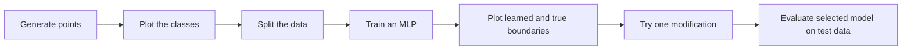
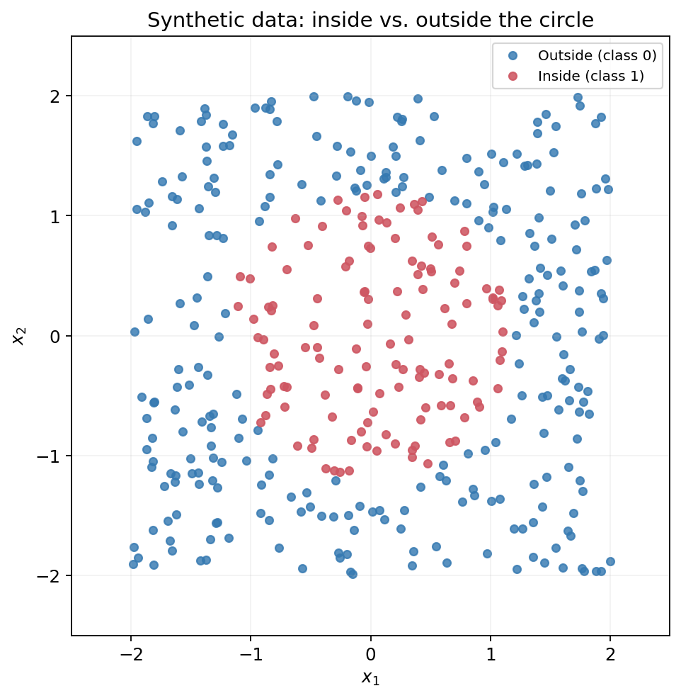
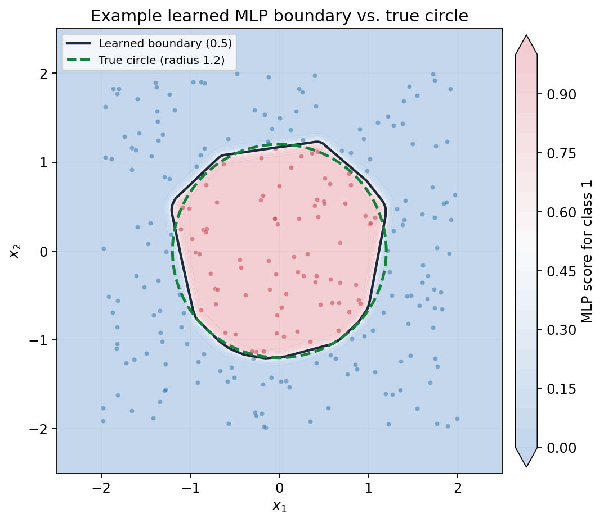

# Activity 5 (Optional): Visualizing Nonlinear Decision Boundaries

In **Activity 1**, we learned that a single perceptron can draw only a straight decision boundary. In **Activity 2**, an MLP with a nonlinear hidden layer represented XOR. In **Activities 3 and 4**, we used MLPs for regression.

Now we return to classification for a visual question:

> **Can an MLP learn a boundary that separates points inside a circle from points outside it?**

This is an **optional visual exploration**, not a lesson on the mathematics of backpropagation. You will generate data, build and train a small Keras MLP, compare its learned decision boundary with the *true* circle, and try one architecture change.

## Learning objectives

By the end, you should be able to:

1. Generate and visualize a two-feature synthetic classification dataset.
2. Explain why a single straight boundary cannot solve the circle problem.
3. Build, train, and inspect a Keras MLP for binary classification.
4. Compare training accuracy with a simple majority-class baseline and accuracy on held-out data.
5. Draw the MLP's decision boundary and compare it with the known true boundary.
6. Explain how model architecture can change the boundary learned.

### Overview



**How to work:** Predict first, write your solution, run it, then open the relevant **Solution / explanation** block. All solutions and one complete runnable script are included in this file.

**Environment:** Python with NumPy, Matplotlib, scikit-learn, **Keras 3**, and a working Keras backend (in this course, normally TensorFlow). The code uses the Keras 3 imports from Activities 3 and 4.


---

## 1. Generate the circular dataset

We will generate **400** random points. Every example has two numerical features, $x_1$ and $x_2$.

- **Class 1 (inside):** $x_1^2+x_2^2\leq 1.2^2$
- **Class 0 (outside):** $x_1^2+x_2^2>1.2^2$

The radius of the true circle is **1.2**, centered at $(0,0)$.

### Why do tutorials often use seed 42? Why do we use 32?

You may have seen code such as `random_state=42` or `np.random.seed(42)`. The number **42** is a popular programmer's joke: in Douglas Adams's *The Hitchhiker's Guide to the Galaxy*, it is the **Answer to the Ultimate Question of Life, the Universe, and Everything**. The number has no special machine-learning power.

A **random seed** chooses the starting state of a pseudorandom number generator. Reusing the same integer helps reproduce the same random data and initializations under comparable software conditions. **The specific value is not important**: `0`, `32`, `42`, or another valid integer can work.

We deliberately use **32**, as in the earlier activities, to show that **42 is a convention, not a requirement**. Setting a seed also does *not* guarantee identical training results across all machines, hardware, and backends.

For more information, see [Keras's `set_random_seed()` documentation](https://keras.io/api/utils/python_utils/), [scikit-learn's explanation of `random_state`](https://scikit-learn.org/stable/glossary.html#term-random_state), and [MIT's discussion of the cultural reference to 42](https://news.mit.edu/2019/answer-life-universe-and-everything-sum-three-cubes-mathematics-0910).

### Run the starter code

```python
import numpy as np
import matplotlib.pyplot as plt
import keras
from keras import Sequential, Input
from keras.layers import Dense
from sklearn.model_selection import train_test_split

# Controls Python, NumPy, and Keras/backend random generators.
keras.utils.set_random_seed(32)

# 400 examples, each with 2 features.
X_circle = np.random.uniform(-2, 2, (400, 2)).astype("float32")

y_circle = (
    X_circle[:, 0]**2 + X_circle[:, 1]**2 <= 1.2**2
).astype("int32")

print("X shape:", X_circle.shape)
print("y shape:", y_circle.shape)
```

### Your tasks

1. How many examples and features does the input matrix contain?
2. What do `-2`, `2`, and `(400, 2)` mean in `np.random.uniform()`?
3. Why is this **classification**, not regression?
4. Predict whether the two classes contain the same number of points. Then count them and calculate the accuracy of a model that **always predicts the more common class**.

```python
# YOUR CODE HERE: class counts and majority-class baseline
```

<details>
<summary><strong>Solution / explanation: data and class balance</strong></summary>

```python
class_counts = np.bincount(y_circle, minlength=2)
majority_accuracy = class_counts.max() / len(y_circle)

print("Outside (class 0):", class_counts[0])
print("Inside  (class 1):", class_counts[1])
print(f"Majority-class baseline accuracy: {majority_accuracy:.2%}")
```

- `X_circle.shape` is `(400, 2)` — 400 examples with two coordinates each.
- `y_circle.shape` is `(400,)` — one class label per example.
- The coordinates are sampled from `[-2, 2)` on each axis.
- The target is a **class** (inside or outside), not a continuous number.
- With the specified NumPy generation and seed **32**, there are **275 outside points and 125 inside points**. Always predicting outside would score **68.75%**, even though it has not learned the circle.

**Important:** A seemingly high accuracy does not automatically mean a classifier has learned the intended boundary.

</details>

---

## 2. Visualize the data

Before training the MLP, inspect the points in two dimensions.

### Your task

Create a scatter plot using `plt.scatter()`:

- Points in **class 0 (outside)** should be **blue**.
- Points in **class 1 (inside)** should be **red**.
- Label both axes and use `plt.axis("equal")` so the circle is not distorted.

```python
# YOUR CODE HERE: scatter plot
```

<details>
<summary><strong>Solution / explanation: scatter plot</strong></summary>

```python
plt.figure(figsize=(6, 6))
plt.scatter(
    X_circle[:, 0],
    X_circle[:, 1],
    c=y_circle,
    cmap="bwr",      # 0 is blue; 1 is red
    vmin=0, vmax=1,
    edgecolors="black",
    linewidths=0.25,
    s=28
)
plt.title("Circular classification dataset")
plt.xlabel("Feature 1 ($x_1$)")
plt.ylabel("Feature 2 ($x_2$)")
plt.axis("equal")
plt.show()
```

</details>

**Example figure (seed 32):**



### Questions

1. Can a **single straight line** separate every red point from every blue point?
2. Can one perceptron represent this circular decision rule exactly?
3. In what way is this problem similar to XOR in Activity 1?

<details>
<summary><strong>Solution / explanation: linear separability</strong></summary>

No single straight line can separate an inner circular region from all the points surrounding it. A single perceptron forms a linear decision boundary, so it cannot represent this circular rule. Like XOR, the circle problem is **not linearly separable**. A multilayer network with nonlinear activations can form a more complex boundary.

</details>

---

## 3. Reserve validation and test data

As in Activities 3 and 4, we should not judge a model only on the data used to update its weights.

- **Training data:** used to adjust the MLP's weights.
- **Validation data:** used to compare model settings.
- **Test data:** kept aside until the final selected model is evaluated.

We first reserve **20% for testing**, then take **20% of the remaining data for validation**. We also use `stratify` to keep approximately the same class proportions in each split.

### Your task

Fill in the code to create `X_train`, `X_val`, and `X_test` (and the matching `y` arrays). Use `random_state=32`.

```python
# YOUR CODE HERE: two-stage train / validation / test split
```

<details>
<summary><strong>Solution / explanation: data split</strong></summary>

```python
X_train_val, X_test, y_train_val, y_test = train_test_split(
    X_circle, y_circle,
    test_size=0.20,
    random_state=32,
    stratify=y_circle
)

X_train, X_val, y_train, y_val = train_test_split(
    X_train_val, y_train_val,
    test_size=0.20,
    random_state=32,
    stratify=y_train_val
)

print("Train:", X_train.shape)
print("Validation:", X_val.shape)
print("Test:", X_test.shape)
```

There should be **256 training**, **64 validation**, and **80 test** examples. No feature scaling is necessary here: the two coordinates are already generated on the same numerical scale. We do **not** use the test set during the architecture experiment.

</details>

---

## 4. Build and train the MLP

Use the familiar Keras workflow. The network has:

- 2 input features
- 16 neurons in the first hidden layer, with ReLU
- 16 neurons in the second hidden layer, with ReLU
- 1 sigmoid output neuron for binary classification

### Task A: Build the network

```python
# YOUR CODE HERE: Sequential model, Input, two hidden Dense layers,
# one sigmoid output Dense layer, and model.summary()
```

<details>
<summary><strong>Solution / explanation: model and parameter count</strong></summary>

```python
circle_model = Sequential([
    Input(shape=(2,)),
    Dense(16, activation="relu"),
    Dense(16, activation="relu"),
    Dense(1, activation="sigmoid")
], name="Circle_MLP")

circle_model.summary()
```

The number of trainable parameters is:

| Layer | Calculation | Parameters |
|---|---:|---:|
| Hidden 1 | $(2\times16)+16$ | 48 |
| Hidden 2 | $(16\times16)+16$ | 272 |
| Output | $(16\times1)+1$ | 17 |
| **Total** | | **337** |

ReLU introduces nonlinearity into the hidden layers. Sigmoid produces a score between 0 and 1 for the positive class (inside the circle). A score **greater than 0.5** is classified as class 1.

</details>

### Task B: Compile and train

Use Adam, binary cross-entropy, accuracy, **300 epochs**, and a batch size of **16**. Supply your validation set and save the returned training history.

```python
# YOUR CODE HERE: compile and fit
```

<details>
<summary><strong>Solution / explanation: training</strong></summary>

```python
circle_model.compile(
    optimizer="adam",
    loss="binary_crossentropy",
    metrics=["accuracy"]
)

history_circle = circle_model.fit(
    X_train, y_train,
    epochs=300,
    batch_size=16,
    validation_data=(X_val, y_val),
    verbose=0
)

print(f"Final training accuracy: {history_circle.history['accuracy'][-1]:.2%}")
print(f"Final validation accuracy: {history_circle.history['val_accuracy'][-1]:.2%}")
print(f"Final validation loss: {history_circle.history['val_loss'][-1]:.4f}")
```

A training run is **not guaranteed** to achieve any particular accuracy. Results can vary with backend, environment, initialization, and other factors. If the result is disappointing, first inspect the class baseline and plots rather than assuming either perfect code or a broken model.

</details>

### Questions

1. Is the training accuracy higher than the **majority-class baseline** from Section 1?
2. Is validation accuracy close to training accuracy?
3. Why is validation accuracy a better guide to model changes than training accuracy alone?

<details>
<summary><strong>Discussion guidance</strong></summary>

Training accuracy measures the examples used for weight updates. Validation accuracy measures separate points not used to update the weights. We want a boundary that captures the underlying circle rather than merely fitting the training points. **Also compare validation loss:** two models can have the same classification accuracy but different prediction scores.

</details>

---

## 5. Visualize the learned decision boundary

This is the central part of the activity. Instead of predicting only the original examples, ask the MLP to predict across a **grid of positions** covering the plane.

### Task A: Create and predict on a grid

```python
xx, yy = np.meshgrid(
    np.linspace(-2.5, 2.5, 100),
    np.linspace(-2.5, 2.5, 100)
)

grid_coordinates = np.c_[xx.ravel(), yy.ravel()].astype("float32")
print("Grid shape:", grid_coordinates.shape)

# YOUR CODE HERE: obtain model scores and reshape them to xx.shape
```

**Question:** Why are there **10,000** coordinate pairs?

<details>
<summary><strong>Solution / explanation: grid scores</strong></summary>

```python
grid_scores = circle_model.predict(grid_coordinates, verbose=0)
zz = grid_scores.reshape(xx.shape)
```

There are 100 positions on each axis, producing $100\times100=10{,}000$ coordinate pairs. `zz` is a 100-by-100 matrix of scores. The grid goes from **−2.5 to 2.5**, while the training examples only range from **−2 to 2**. Predictions outside the sampled region are **extrapolations** and may be less reliable.

</details>

### Task B: Draw the learned boundary **and** the true circle

Plot the scores using `contourf()`. Draw:

- A **solid black** contour where the learned score is **0.5**.
- A **dashed green** circle of radius **1.2** (the true boundary).
- Training points colored by their actual class.

```python
# YOUR CODE HERE: two boundaries and training points
```

<details>
<summary><strong>Solution / explanation: boundary comparison</strong></summary>

```python
plt.figure(figsize=(7, 7))

plt.contourf(
    xx, yy, zz,
    levels=np.linspace(0, 1, 21),
    cmap="bwr", vmin=0, vmax=1,
    alpha=0.35
)

# The contour exists only if scores cross 0.5 in the grid.
if zz.min() <= 0.5 <= zz.max():
    plt.contour(
        xx, yy, zz,
        levels=[0.5], colors="black", linewidths=2
    )
else:
    print("No 0.5 contour found: inspect model scores and training.")

# Exact mathematical boundary x1^2 + x2^2 = 1.2^2.
theta = np.linspace(0, 2 * np.pi, 400)
plt.plot(
    1.2 * np.cos(theta), 1.2 * np.sin(theta),
    "g--", linewidth=2, label="True circle (radius 1.2)"
)

plt.scatter(
    X_train[:, 0], X_train[:, 1],
    c=y_train, cmap="bwr", vmin=0, vmax=1,
    edgecolors="black", linewidths=0.25,
    s=22, alpha=0.8
)

plt.title("Learned MLP boundary vs. true circle")
plt.xlabel("Feature 1 ($x_1$)")
plt.ylabel("Feature 2 ($x_2$)")
plt.axis("equal")
plt.legend()
plt.show()
```

The black contour shows where the model changes its predicted class; the green dashed line shows the *correct* mathematical boundary. Their difference is visible approximation error. With ReLU, the learned boundary can have **piecewise-linear or polygon-like portions**.

</details>

**Example visualization:** This reference image was produced by training a 16–16 Keras MLP on the generated seed-32 data (Keras with the JAX backend). Your shape may differ slightly, especially with another backend.



### Questions

1. Does the learned black boundary resemble the true green circle?
2. Where do the boundaries disagree, and what kinds of classification mistakes might occur there?
3. Why isn't the learned boundary perfectly circular or necessarily perfectly smooth?
4. Why can an MLP represent this kind of boundary when a single perceptron cannot?

<details>
<summary><strong>Discussion guidance</strong></summary>

An MLP combines the results of multiple hidden neurons. With nonlinear activations, it can form **nonlinear** decision boundaries. ReLU networks are piecewise-linear in their computations, so the boundary can appear made of short linear segments. The model is trained from a limited sample, not given the circle equation itself, so an approximate rather than exact match is expected.

</details>

---

## 6. Experiment with the architecture (choose **one**)

Choose **one** modification; do not try every option unless you have extra time:

1. Change both hidden layers from **16 to 4** neurons.
2. Change both hidden layers from **16 to 32** neurons.
3. Keep the layer sizes but replace `relu` with `tanh`.
4. Remove one hidden layer.
5. Reduce training from 300 to 100 epochs.

**Important:** Rebuild and recompile a **fresh model** for each configuration. Do not continue training the original model and call it a new architecture. Keep the same train/validation/test split, and compare **validation** accuracy and loss; do not inspect test results while choosing a model.

| Configuration | Prediction before running | Validation accuracy | Validation loss | What changed in the plot? |
|---|---|---|---|---|
| Original: 16 → 16 → 1, ReLU, 300 epochs | | | | |
| Your modified model | | | | |

### Discussion

- Does the smaller or larger model give a boundary closer to the true circle?
- Is the most complex model automatically best?
- Can one training run prove that a particular architecture is always better?

<details>
<summary><strong>Example solution: train a smaller network</strong></summary>

This is **one example**; other modifications are equally valid.

```python
# Start a new model rather than reusing circle_model.
keras.utils.set_random_seed(32)

small_model = Sequential([
    Input(shape=(2,)),
    Dense(4, activation="relu"),
    Dense(4, activation="relu"),
    Dense(1, activation="sigmoid")
])
small_model.compile(
    optimizer="adam", loss="binary_crossentropy", metrics=["accuracy"]
)
small_history = small_model.fit(
    X_train, y_train,
    epochs=300, batch_size=16,
    validation_data=(X_val, y_val), verbose=0
)

print("Baseline validation loss:", history_circle.history['val_loss'][-1])
print("Smaller model validation loss:", small_history.history['val_loss'][-1])

# To compare its boundary, repeat Section 5 with:
# grid_scores = small_model.predict(grid_coordinates, verbose=0)
# zz = grid_scores.reshape(xx.shape)
```

A smaller model **may** produce a simpler or less accurate approximation, but this is not guaranteed for every run. A larger model is not automatically better, and one run cannot establish a universal ranking.

</details>

### Select your final model

Select the model you want to evaluate using **validation results** and your boundary comparison. If you did not perform the optional experiment, your final model is simply `circle_model`.

```python
# Default: use the original baseline model.
selected_model = circle_model

# If you prefer the modified model based on validation results,
# change the assignment appropriately, e.g.:
# selected_model = small_model
```

---

## 7. Final evaluation on the held-out test set

**Only now** evaluate the selected model on the untouched `X_test` and `y_test` examples.

### Your tasks

1. Report test loss and test accuracy.
2. Count test examples classified incorrectly, using a **strict** `> 0.5` threshold for class 1.
3. Compare test accuracy with the majority-class baseline from Section 1.
4. Explain why the boundary plot and test accuracy are both useful.

```python
# YOUR CODE HERE: final test evaluation and error count
```

<details>
<summary><strong>Solution / explanation: final test evaluation</strong></summary>

```python
test_loss, test_accuracy = selected_model.evaluate(
    X_test, y_test, verbose=0
)

test_scores = selected_model.predict(X_test, verbose=0).flatten()
test_classes = (test_scores > 0.5).astype("int32")
incorrect = np.sum(test_classes != y_test)

print(f"Test loss: {test_loss:.4f}")
print(f"Test accuracy: {test_accuracy:.2%}")
print(f"Incorrect test predictions: {incorrect} / {len(y_test)}")
```

The test set is held out so it can provide a more independent measure of performance. The **visualization** reveals where and how the model approximates the circle; **accuracy** summarizes how often it labels a particular sample correctly. Both have limitations, so use them together.

</details>

---

## Conclusion and final reflection

You have now returned to the idea that motivated MLPs in the first place: **not all classes can be separated by a single straight line**.

In this activity, you:

- Generated a dataset whose true boundary is known.
- Compared a naive majority-class predictor with a trained MLP.
- Used separate data for training, comparison, and final evaluation.
- Visualized the network's learned boundary against the actual circle.
- Explored why hidden layers and nonlinear activations matter.

**Exit question:** What does the learned circle tell you about the difference between a single perceptron and an MLP?

<details>
<summary><strong>Sample reflection</strong></summary>

A single perceptron produces one straight boundary. An MLP combines hidden neurons and nonlinear activations, so it can build a more complicated boundary that approximates a circle. The learned shape depends on the examples, the architecture, and the training process. We should judge it using both the plot and held-out evaluation, rather than expecting a perfect score or a perfectly circular shape.

</details>

---

## Complete runnable solution (baseline model)

<details>
<summary><strong>Open the complete Python script</strong></summary>

This script runs the **baseline architecture** from start to finish, including test evaluation. The optional architecture experiment in Section 6 is intentionally separate, so you can choose whether to perform it before final testing.

```python
import numpy as np
import matplotlib.pyplot as plt
import keras
from keras import Sequential, Input
from keras.layers import Dense
from sklearn.model_selection import train_test_split

# 1. Generate reproducible data (seed 32, not 42).
keras.utils.set_random_seed(32)
X_circle = np.random.uniform(-2, 2, (400, 2)).astype("float32")
y_circle = (
    X_circle[:, 0]**2 + X_circle[:, 1]**2 <= 1.2**2
).astype("int32")

class_counts = np.bincount(y_circle, minlength=2)
baseline = class_counts.max() / len(y_circle)
print("Dataset:", X_circle.shape, y_circle.shape)
print("Class counts [outside, inside]:", class_counts)
print(f"Majority-class baseline: {baseline:.2%}")

# 2. Plot the data.
plt.figure(figsize=(6, 6))
plt.scatter(
    X_circle[:, 0], X_circle[:, 1],
    c=y_circle, cmap="bwr", vmin=0, vmax=1,
    edgecolors="black", linewidths=0.25, s=28
)
plt.title("Circular classification dataset")
plt.xlabel("Feature 1 ($x_1$)")
plt.ylabel("Feature 2 ($x_2$)")
plt.axis("equal")
plt.show()

# 3. Split the data (64% train, 16% validation, 20% test).
X_train_val, X_test, y_train_val, y_test = train_test_split(
    X_circle, y_circle, test_size=0.20,
    random_state=32, stratify=y_circle
)
X_train, X_val, y_train, y_val = train_test_split(
    X_train_val, y_train_val, test_size=0.20,
    random_state=32, stratify=y_train_val
)
print("Sizes:", len(X_train), len(X_val), len(X_test))

# 4. Build, compile, and train.
circle_model = Sequential([
    Input(shape=(2,)),
    Dense(16, activation="relu"),
    Dense(16, activation="relu"),
    Dense(1, activation="sigmoid")
], name="Circle_MLP")
circle_model.summary()

circle_model.compile(
    optimizer="adam", loss="binary_crossentropy", metrics=["accuracy"]
)
history_circle = circle_model.fit(
    X_train, y_train, epochs=300, batch_size=16,
    validation_data=(X_val, y_val), verbose=0
)
print(f"Training accuracy: {history_circle.history['accuracy'][-1]:.2%}")
print(f"Validation accuracy: {history_circle.history['val_accuracy'][-1]:.2%}")
print(f"Validation loss: {history_circle.history['val_loss'][-1]:.4f}")

# 5. Predict across a grid and plot learned vs. exact boundary.
xx, yy = np.meshgrid(
    np.linspace(-2.5, 2.5, 100),
    np.linspace(-2.5, 2.5, 100)
)
grid_coordinates = np.c_[xx.ravel(), yy.ravel()].astype("float32")
zz = circle_model.predict(grid_coordinates, verbose=0).reshape(xx.shape)

plt.figure(figsize=(7, 7))
plt.contourf(
    xx, yy, zz, levels=np.linspace(0, 1, 21),
    cmap="bwr", vmin=0, vmax=1, alpha=0.35
)
if zz.min() <= 0.5 <= zz.max():
    plt.contour(xx, yy, zz, levels=[0.5], colors="black", linewidths=2)
else:
    print("No 0.5 decision contour found on this grid.")

theta = np.linspace(0, 2 * np.pi, 400)
plt.plot(
    1.2 * np.cos(theta), 1.2 * np.sin(theta),
    "g--", linewidth=2, label="True circle (radius 1.2)"
)
plt.scatter(
    X_train[:, 0], X_train[:, 1],
    c=y_train, cmap="bwr", vmin=0, vmax=1,
    edgecolors="black", linewidths=0.25, s=22, alpha=0.8
)
plt.title("Learned MLP boundary vs. true circle")
plt.xlabel("Feature 1 ($x_1$)")
plt.ylabel("Feature 2 ($x_2$)")
plt.axis("equal")
plt.legend()
plt.show()

# 6. Optional: compare a fresh modified model using validation only.
# See the smaller-model solution in Section 6 above.
# If you select another model, assign it to selected_model below.
selected_model = circle_model

# 7. Final test evaluation (do this only after model selection).
test_loss, test_accuracy = selected_model.evaluate(
    X_test, y_test, verbose=0
)
test_scores = selected_model.predict(X_test, verbose=0).flatten()
test_classes = (test_scores > 0.5).astype("int32")
incorrect = np.sum(test_classes != y_test)
print(f"Test loss: {test_loss:.4f}")
print(f"Test accuracy: {test_accuracy:.2%}")
print(f"Incorrect test predictions: {incorrect} / {len(y_test)}")
```

</details>

---

## References and further exploration

- [Keras 3: `set_random_seed()`](https://keras.io/api/utils/python_utils/) — reproducibility utility.
- [scikit-learn: `train_test_split`](https://scikit-learn.org/stable/modules/generated/sklearn.model_selection.train_test_split.html) — splitting, `random_state`, and stratification.
- [scikit-learn glossary: `random_state`](https://scikit-learn.org/stable/glossary.html#term-random_state) — why an integer seed is useful and why no particular integer is required.
- [MIT News: the number 42 in *The Hitchhiker's Guide to the Galaxy*](https://news.mit.edu/2019/answer-life-universe-and-everything-sum-three-cubes-mathematics-0910) — the cultural reference.
