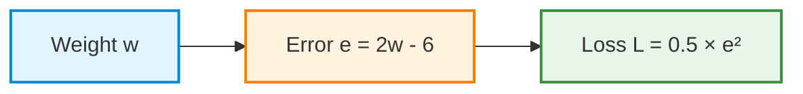
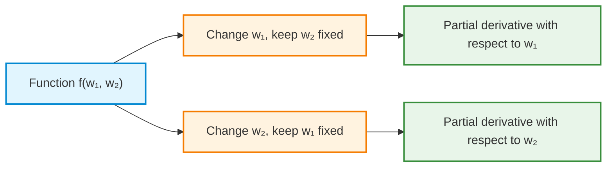
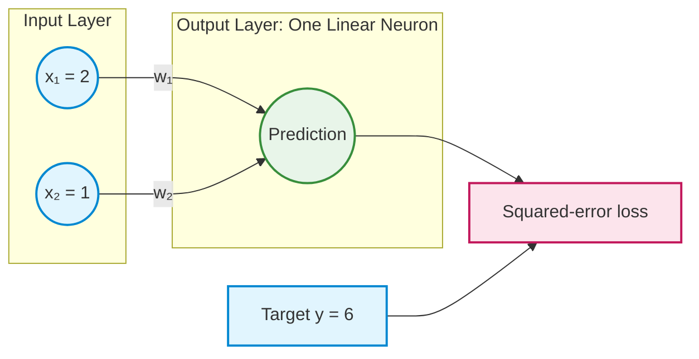
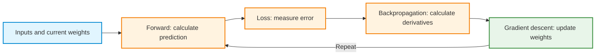

# Calculus Review for Neural Networks: Ordinary and Partial Derivatives

**Preparatory review | Four step-by-step examples with Python calculations and visualizations**

## Learning objectives

By the end of this review, the following ideas should be clear:

1. An **ordinary derivative** measures how a function changes as one independent variable changes.
2. A **partial derivative** measures how a function changes with respect to one variable while the other independent variables remain fixed.
3. A derivative evaluated at a point is a **slope**. A derivative function provides a slope at every point where it exists.
4. The **chain rule** connects derivatives when one calculation feeds into another.
5. The partial derivatives of a function can be collected into a **gradient**, which provides local slope information for gradient descent.
6. Python can calculate derivatives symbolically and display the functions and derivatives visually.

## How to use this review

Each example has the same sequence: **function → intuition → calculation → value at a point → Python verification → visualization → interpretation**. Read the derivation before opening the corresponding code block. Run the supplied Python code, observe the figures, and explain how their shapes relate to the derivative values. **Creating plotting code is not an assessed objective.**

**Python setup:** [Install and check the Week 2 libraries](1-python_setup.md). This review uses SymPy for symbolic derivatives and NumPy and Matplotlib for visualizations. Hand calculations are optional practice; the supplied code verifies the worked examples.

The symbol $w$ denotes one variable. The symbols $w_1$ and $w_2$ denote two independently adjustable variables, as in a neural network with two weights.

---

## 1. What does a derivative measure?

A function associates an input with an output. A derivative answers a different question: **how rapidly does the output change when the input changes slightly?**

For a function $f(w)$, its ordinary derivative is written $f'(w)$ or $df/dw$. At a particular value such as $w=2$, the number $f'(2)$ is the **slope of the tangent line** to the graph of $f$ at that point.

- **Positive derivative:** the function rises as the input increases slightly.
- **Negative derivative:** the function falls as the input increases slightly.
- **Zero derivative:** the graph is locally flat at that point; this does not always imply a minimum.

A tangent line touches the function at the chosen point and follows its local direction. The derivative graph is different: it records the tangent slope as the input varies.


---

# Part A: Ordinary derivatives: one independent variable

## 2. Ordinary derivative, Example 1: A simple square function

### 2.1 Start with the function

$$
f(w)=w^2
$$

As $w$ grows in magnitude, the squared value grows. The graph is a U-shaped parabola. For example, $f(2)=4$ and $f(3)=9$.

**Question:** At $w=2$, does a small increase in $w$ make $f(w)$ larger or smaller? The graph and derivative should agree.

### 2.2 Calculate the derivative by hand

The **power rule** states that the derivative of $w^n$ is $nw^{n-1}$. For $n=2$:

$$
\frac{df}{dw}=\frac{d}{dw}(w^2)=2w
$$

A derivative can also be understood from a tiny input change $h$:

$$
\frac{f(w+h)-f(w)}{h}
=\frac{(w+h)^2-w^2}{h}
=2w+h
$$

As $h$ approaches zero, the slope estimate approaches $2w$. This agrees with the power rule.

### 2.3 Evaluate the derivative at a point

At $w=2$:

$$
f(2)=2^2=4
$$

$$
f'(2)=2(2)=\boxed{4}
$$

**Meaning:** Near $w=2$, a small increase of $0.01$ in $w$ changes the function by approximately $4(0.01)=0.04$. This is a local approximation, not an exact statement for every step size.

The tangent line at $(2,4)$ has slope $4$:

$$
T(w)=4+4(w-2)
$$

### 2.4 Calculate the same derivative in Python

SymPy treats $w$ as a mathematical symbol and differentiates the expression rather than estimating the result by trial and error.

<details>
<summary>Run the supplied Python code: Symbolic derivative and numerical value</summary>

```python
import sympy as sp

w = sp.symbols("w")
f = w**2

# Differentiate with respect to w.
df_dw = sp.diff(f, w)

# Evaluate the function and its derivative at w = 2.
print("Function:", f)
print("Derivative:", df_dw)
print("f(2) =", f.subs(w, 2))
print("f'(2) =", df_dw.subs(w, 2))
```

</details>

Expected results: function value **4**, derivative **2w**, and slope at $w=2$ equal to **4**.

### 2.5 Visualize the function and its derivative

The first plot shows the function, the point $(2,4)$, and the tangent line with slope $4$. The second plot shows the derivative function $f'(w)=2w$; its height at $w=2$ is $4$.

<details>
<summary>Run the supplied Python code: Plot A: function and tangent; Plot B: derivative</summary>

```python
import numpy as np
import matplotlib.pyplot as plt

w = np.linspace(-3.0, 4.0, 400)
function = w**2
derivative = 2*w

point = 2.0
point_value = point**2
point_slope = 2*point

tangent = point_value + point_slope*(w - point)

# Plot A: original function and tangent line.
plt.figure(figsize=(8, 4.5))
plt.plot(w, function, label="f(w) = w squared")
plt.plot(w, tangent, "--", label="Tangent at w = 2 (slope 4)")
plt.scatter([point], [point_value], zorder=3)
plt.xlabel("w")
plt.ylabel("Function value")
plt.title("Example 1: function and tangent")
plt.grid(alpha=0.25)
plt.legend()
plt.tight_layout()
plt.show()

# Plot B: derivative as a function of w.
plt.figure(figsize=(8, 4.5))
plt.plot(w, derivative, label="f'(w) = 2w")
plt.axhline(0, linestyle=":", linewidth=1)
plt.scatter([point], [point_slope], zorder=3, label="At w = 2: slope = 4")
plt.xlabel("w")
plt.ylabel("Derivative (slope)")
plt.title("Example 1: derivative function")
plt.grid(alpha=0.25)
plt.legend()
plt.tight_layout()
plt.show()
```

</details>

**Observe:** The original curve has a horizontal tangent at $w=0$. The derivative crosses zero at exactly that point. To the right of zero the derivative is positive; to the left it is negative.

---

## 3. Ordinary derivative, Example 2: Squared-error loss and the chain rule

This example connects ordinary differentiation directly to the single-weight neural-network demonstration.

### 3.1 Define the model and loss

A linear model has one weight $w$, a fixed input $x=2$, and a true target $y=6$:

$$
\hat y=wx=2w
$$

The **prediction error** is $e=\hat y-y=2w-6$. The **half squared-error loss** is:

$$
L(w)=\frac12(\hat y-y)^2=\frac12(2w-6)^2
$$

The factor $1/2$ simplifies differentiation because it cancels the factor of $2$ that comes from differentiating a square.

### 3.2 Differentiate in small steps

The calculation has two stages:



**First stage: derivative of the loss with respect to error.**

$$
\frac{dL}{de}=\frac{d}{de}\left(\frac12e^2\right)=e
$$

**Second stage: derivative of error with respect to weight.**

$$
\frac{de}{dw}=\frac{d}{dw}(2w-6)=2
$$

**Combine the stages using the chain rule.**

$$
\frac{dL}{dw}=\frac{dL}{de}\frac{de}{dw}
=(2w-6)(2)=4w-12
$$

The chain rule is useful because it reuses derivatives of simple operations instead of requiring each long expression to be differentiated in one jump.

### 3.3 Evaluate the derivative and interpret its sign

At the initial weight $w=8$:

$$
\hat y=2(8)=16
$$

$$
L(8)=\frac12(16-6)^2=\boxed{50}
$$

$$
L'(8)=4(8)-12=\boxed{20}
$$

The slope is positive: increasing the weight slightly would increase the loss. To reduce the loss, a gradient-descent update moves in the negative-gradient direction.

With learning rate $\eta=0.1$:

$$
w_{\mathrm{new}}=8-0.1(20)=\boxed{6}
$$

The updated prediction is $12$, and the updated loss is $18$. The exact minimum is at $w=3$, where the prediction equals $6$ and the derivative is zero.

### 3.4 Calculate the same derivative in Python

<details>
<summary>Run the supplied Python code: Chain-rule loss derivative</summary>

```python
import sympy as sp

w = sp.symbols("w")
x = 2
y = 6

prediction = w*x
error = prediction - y
loss = sp.Rational(1, 2)*error**2

dloss_dw = sp.diff(loss, w)
print("Prediction:", prediction)
print("Loss:", loss)
print("Derivative:", sp.expand(dloss_dw))
print("Loss at w=8:", loss.subs(w, 8))
print("Gradient at w=8:", dloss_dw.subs(w, 8))

eta = 0.1
updated_w = 8 - eta*float(dloss_dw.subs(w, 8))
print("Updated weight:", updated_w)
print("Updated loss:", float(loss.subs(w, updated_w)))
```

</details>

Expected results: initial loss **50**, derivative **4w − 12**, gradient **20**, updated weight **6**, and updated loss **18**.

### 3.5 Visualize the loss and gradient

The loss is a bowl-shaped curve with its lowest point at $w=3$. The derivative plot crosses zero at that same weight. The slope at $w=8$ is positive; the first gradient-descent step moves left toward the minimum.

<details>
<summary>Run the supplied Python code: Plot A: loss and tangent; Plot B: derivative</summary>

```python
import numpy as np
import matplotlib.pyplot as plt

w = np.linspace(1.0, 9.0, 500)
loss = 0.5*(2*w - 6)**2
gradient = 2*(2*w - 6)

initial_w = 8.0
initial_loss = 0.5*(2*initial_w - 6)**2
initial_gradient = 2*(2*initial_w - 6)
new_w = initial_w - 0.1*initial_gradient
new_loss = 0.5*(2*new_w - 6)**2

tangent = initial_loss + initial_gradient*(w - initial_w)

# Plot A: loss curve, tangent at w=8, and first update.
plt.figure(figsize=(8, 4.5))
plt.plot(w, loss, label="Half squared-error loss")
plt.plot(w, tangent, "--", label="Tangent at w = 8")
plt.scatter([initial_w, new_w, 3], [initial_loss, new_loss, 0], zorder=3)
plt.annotate("Start (8, 50)", (initial_w, initial_loss), xytext=(-95, 9), textcoords="offset points")
plt.annotate("After update (6, 18)", (new_w, new_loss), xytext=(-100, 12), textcoords="offset points")
plt.xlabel("Weight w")
plt.ylabel("Loss")
plt.title("Example 2: loss and first gradient-descent step")
plt.ylim(-3, 85)
plt.grid(alpha=0.25)
plt.legend()
plt.tight_layout()
plt.show()

# Plot B: gradient value at every weight.
plt.figure(figsize=(8, 4.5))
plt.plot(w, gradient, label="dL/dw = 4w - 12")
plt.axhline(0, linestyle=":", linewidth=1)
plt.scatter([initial_w, 3], [initial_gradient, 0], zorder=3,
            label="Initial slope and zero-gradient minimum")
plt.xlabel("Weight w")
plt.ylabel("Gradient dL/dw")
plt.title("Example 2: derivative of the loss")
plt.grid(alpha=0.25)
plt.legend()
plt.tight_layout()
plt.show()
```

</details>

**Observe:** The loss curve is lowest where the derivative equals zero. A derivative indicates local direction and slope; the learning rate controls the length of the parameter update.

---

# Part B: Partial derivatives: two independent variables

## 4. What changes when a function has two variables?

A function of two variables, such as $f(w_1,w_2)$, can change when either weight changes. A single slope is no longer enough to describe both directions.

A **partial derivative** answers a controlled question: *what happens when one weight changes slightly and the other stays fixed?*

- $\frac{\partial f}{\partial w_1}$ changes $w_1$ while holding $w_2$ fixed.
- $\frac{\partial f}{\partial w_2}$ changes $w_2$ while holding $w_1$ fixed.

The symbol $\partial$ indicates a partial derivative. **It does not mean that a partial differential equation is being solved.**



When the two partial derivatives are known, they can be collected into the gradient:

$$
\nabla f=\left(\frac{\partial f}{\partial w_1},\frac{\partial f}{\partial w_2}\right)
$$

The gradient is a pair of numbers at a chosen point. With the usual Euclidean notion of distance, it points in the direction of steepest **local increase**; its negative points toward steepest **local decrease**. An appropriate step size is still needed for the loss to decrease.

---

## 5. Partial derivatives, Example 1: Two independent squared terms

### 5.1 Start with the function

$$
f(w_1,w_2)=w_1^2+2w_2^2
$$

The function has two inputs, $w_1$ and $w_2$. Its graph is a bowl-like **surface** rather than a flat curve. Each location $(w_1,w_2)$ has a function value (a height).

Use the point $w_1=1$, $w_2=2$:

$$
f(1,2)=1^2+2(2^2)=\boxed{9}
$$

### 5.2 Differentiate with respect to the first variable

To calculate the partial derivative with respect to $w_1$, **treat $w_2$ as a constant**.

- The derivative of $w_1^2$ is $2w_1$.
- The derivative of $2w_2^2$ is zero because $w_2$ does not change in this calculation.

Therefore:

$$
\frac{\partial f}{\partial w_1}=2w_1
$$

At $(1,2)$:

$$
\frac{\partial f}{\partial w_1}(1,2)=2(1)=\boxed{2}
$$

With $w_2=2$ held fixed, the one-variable **slice** is $f(w_1,2)=w_1^2+8$. Its slope at $w_1=1$ is $2$.

### 5.3 Differentiate with respect to the second variable

To calculate the partial derivative with respect to $w_2$, **treat $w_1$ as a constant**.

- The derivative of $w_1^2$ is zero.
- The derivative of $2w_2^2$ is $4w_2$.

Therefore:

$$
\frac{\partial f}{\partial w_2}=4w_2
$$

At $(1,2)$:

$$
\frac{\partial f}{\partial w_2}(1,2)=4(2)=\boxed{8}
$$

With $w_1=1$ fixed, the one-variable slice is $f(1,w_2)=1+2w_2^2$. Its slope at $w_2=2$ is $8$.

### 5.4 Combine both partial derivatives

$$
\nabla f(w_1,w_2)=(2w_1,4w_2)
$$

$$
\nabla f(1,2)=\boxed{(2,8)}
$$

This means that the function is locally more sensitive to a small change in $w_2$ than to an equally small change in $w_1$ at this particular point.

For example, one gradient-descent step with $\eta=0.1$ gives:

$$
(w_1,w_2)_{\mathrm{new}}=(1,2)-0.1(2,8)=(0.8,1.2)
$$

The function falls from $9$ to $f(0.8,1.2)=0.8^2+2(1.2)^2=\boxed{3.52}$. The two derivatives were calculated at the same original point before updating either variable.

### 5.5 Calculate both partial derivatives in Python

<details>
<summary>Run the supplied Python code: Two symbolic partial derivatives</summary>

```python
import sympy as sp

w1, w2 = sp.symbols("w1 w2")
f = w1**2 + 2*w2**2

# Differentiate with respect to one variable at a time.
df_dw1 = sp.diff(f, w1)
df_dw2 = sp.diff(f, w2)

point = {w1: 1, w2: 2}
print("Function:", f)
print("df/dw1:", df_dw1)
print("df/dw2:", df_dw2)
print("f(1,2):", f.subs(point))
print("Gradient at (1,2):", (df_dw1.subs(point), df_dw2.subs(point)))

eta = 0.1
new_w1 = 1 - eta*float(df_dw1.subs(point))
new_w2 = 2 - eta*float(df_dw2.subs(point))
print("After one update:", (new_w1, new_w2))
print("New function value:", float(f.subs({w1: new_w1, w2: new_w2})))
```

</details>

Expected gradient: **(2, 8)**. Updated point: **(0.8, 1.2)**. Updated function value: **3.52**.

### 5.6 Visualize the function and both partial derivatives

A function of two variables can be drawn as a 3D surface. Its partial derivatives are also functions of two variables, so each derivative can be visualized as a separate surface. The marker indicates the example point.

<details>
<summary>Run the supplied Python code: Three surfaces: f, partial with respect to w1, partial with respect to w2</summary>

```python
import numpy as np
import matplotlib.pyplot as plt

axis = np.linspace(-2.5, 2.5, 90)
W1, W2 = np.meshgrid(axis, axis)

F = W1**2 + 2*W2**2
D1 = 2*W1
D2 = 4*W2

# Each figure is a separate 3D surface.
for title, Z, point_z in [
    ("Function: f = w1 squared + 2 w2 squared", F, 9),
    ("Partial derivative with respect to w1", D1, 2),
    ("Partial derivative with respect to w2", D2, 8),
]:
    fig = plt.figure(figsize=(8, 5.5))
    ax = fig.add_subplot(111, projection="3d")
    ax.plot_surface(W1, W2, Z, alpha=0.83, cmap="viridis")
    ax.scatter([1], [2], [point_z], s=65, color="black")
    ax.set_xlabel("w1")
    ax.set_ylabel("w2")
    ax.set_zlabel("Function or derivative value")
    ax.set_title(title)
    plt.tight_layout()
    plt.show()
```

</details>

The **function surface** has a minimum at $(0,0)$. The derivative with respect to $w_1$ changes only with $w_1$, and the derivative with respect to $w_2$ changes only with $w_2$.

### 5.7 Visualize what “holding the other variable fixed” means

Each slice is now an ordinary one-variable curve, because the other variable is fixed. The tangent slope of the first slice is $2$; the tangent slope of the second slice is $8$.

<details>
<summary>Run the supplied Python code: Two slices and their tangent lines</summary>

```python
import numpy as np
import matplotlib.pyplot as plt

# Slice A: hold w2 = 2 fixed and change w1.
w1 = np.linspace(-0.5, 2.5, 250)
first_slice = w1**2 + 8
first_tangent = 9 + 2*(w1 - 1)

plt.figure(figsize=(8, 4.5))
plt.plot(w1, first_slice, label="f(w1, 2) = w1 squared + 8")
plt.plot(w1, first_tangent, "--", label="Tangent at w1 = 1: slope 2")
plt.scatter([1], [9])
plt.xlabel("w1 (w2 remains 2)")
plt.ylabel("f(w1, 2)")
plt.title("Partial derivative with respect to w1: fixed-w2 slice")
plt.grid(alpha=0.25)
plt.legend()
plt.tight_layout()
plt.show()

# Slice B: hold w1 = 1 fixed and change w2.
w2 = np.linspace(0.0, 3.0, 250)
second_slice = 1 + 2*w2**2
second_tangent = 9 + 8*(w2 - 2)

plt.figure(figsize=(8, 4.5))
plt.plot(w2, second_slice, label="f(1, w2) = 1 + 2 w2 squared")
plt.plot(w2, second_tangent, "--", label="Tangent at w2 = 2: slope 8")
plt.scatter([2], [9])
plt.xlabel("w2 (w1 remains 1)")
plt.ylabel("f(1, w2)")
plt.title("Partial derivative with respect to w2: fixed-w1 slice")
plt.grid(alpha=0.25)
plt.legend()
plt.tight_layout()
plt.show()
```

</details>

**Observe:** The slopes $2$ and $8$ describe changes in **different coordinate directions** at the same point on the original surface. Neither one alone describes every possible direction of movement.

---

## 6. Partial derivatives, Example 2: Two weights in a regression loss

This example reuses the same squared-error idea as Ordinary Example 2, but the prediction now depends on **two trainable weights**.

### 6.1 Define the model

A linear neuron has two fixed inputs, $x_1=2$ and $x_2=1$, and one target, $y=6$. The weights $w_1$ and $w_2$ are trainable. There is no bias.



The prediction and loss are:

$$
\hat y=w_1x_1+w_2x_2=2w_1+w_2
$$

$$
L(w_1,w_2)=\frac12(2w_1+w_2-6)^2
$$

At the initial weights $(w_1,w_2)=(3,1)$:

$$
\hat y=(3)(2)+(1)(1)=7
$$

$$
e=\hat y-y=7-6=1
$$

$$
L(3,1)=\frac12(1)^2=\boxed{0.5}
$$

### 6.2 Differentiate with respect to the first weight

The loss is a chain of operations: weights determine the prediction, the prediction determines the error, and the error determines the loss.

- Loss with respect to error: $\partial L/\partial e=e$.
- Error with respect to prediction: $\partial e/\partial\hat y=1$.
- Prediction with respect to $w_1$: $\partial\hat y/\partial w_1=x_1=2$, holding $w_2$ fixed.

Multiply the three factors using the chain rule:

$$
\frac{\partial L}{\partial w_1}
=\frac{\partial L}{\partial e}
\frac{\partial e}{\partial\hat y}
\frac{\partial\hat y}{\partial w_1}
=e(1)x_1
$$

For this model:

$$
\frac{\partial L}{\partial w_1}=2(2w_1+w_2-6)
$$

At $(3,1)$:

$$
\frac{\partial L}{\partial w_1}(3,1)=(1)(2)=\boxed{2}
$$

### 6.3 Differentiate with respect to the second weight

The first two chain-rule factors do not change. Only the effect of the weight on the prediction changes:

$$
\frac{\partial\hat y}{\partial w_2}=x_2=1
$$

Therefore:

$$
\frac{\partial L}{\partial w_2}=2w_1+w_2-6
$$

At $(3,1)$:

$$
\frac{\partial L}{\partial w_2}(3,1)=(1)(1)=\boxed{1}
$$

### 6.4 Combine the derivatives and update both weights

$$
\nabla L(w_1,w_2)=\left(2(2w_1+w_2-6),\ 2w_1+w_2-6\right)
$$

At $(3,1)$:

$$
\nabla L(3,1)=\boxed{(2,1)}
$$

Backpropagation computes this gradient. Gradient descent uses it to adjust **both weights from the same original point**. For learning rate $\eta=0.1$:

$$
w_{1,\mathrm{new}}=3-0.1(2)=\boxed{2.8}
$$

$$
w_{2,\mathrm{new}}=1-0.1(1)=\boxed{0.9}
$$

The updated prediction and loss are:

$$
\hat y_{\mathrm{new}}=(2.8)(2)+(0.9)(1)=6.5
$$

$$
L_{\mathrm{new}}=\frac12(6.5-6)^2=\boxed{0.125}
$$

The loss decreases from **0.5** to **0.125**. The mathematical operation is the same chain rule used in the one-weight example; only the number of independently adjustable parameters has changed.

### 6.5 Calculate both partial derivatives in Python

<details>
<summary>Run the supplied Python code: Symbolic partial derivatives and a weight update</summary>

```python
import sympy as sp

w1, w2 = sp.symbols("w1 w2")
x1, x2, y = 2, 1, 6

prediction = w1*x1 + w2*x2
loss = sp.Rational(1, 2)*(prediction - y)**2

dloss_dw1 = sp.diff(loss, w1)
dloss_dw2 = sp.diff(loss, w2)
point = {w1: 3, w2: 1}

print("Loss:", loss)
print("Partial w1:", sp.expand(dloss_dw1))
print("Partial w2:", sp.expand(dloss_dw2))
print("Initial loss:", loss.subs(point))
print("Initial gradient:", (dloss_dw1.subs(point), dloss_dw2.subs(point)))

eta = 0.1
new_w1 = 3 - eta*float(dloss_dw1.subs(point))
new_w2 = 1 - eta*float(dloss_dw2.subs(point))
print("New weights:", (new_w1, new_w2))
print("New loss:", float(loss.subs({w1: new_w1, w2: new_w2})))
```

</details>

Expected partial derivatives: **4w1 + 2w2 − 12** and **2w1 + w2 − 6**, with gradient **(2, 1)** at $(3,1)$.

### 6.6 Visualize the loss and the two partial derivatives

A contour plot views the loss surface from above. Lines of equal loss surround a **valley**: any weight pair satisfying $2w_1+w_2=6$ gives zero loss for this one training example.

The next Python example draws the 3D loss surface, the two derivative surfaces, and a separate contour view showing a gradient-descent step.

<details>
<summary>Run the supplied Python code: Loss surface, partial-derivative surfaces, and contour step</summary>

```python
import numpy as np
import matplotlib.pyplot as plt

w1_axis = np.linspace(1.6, 3.6, 90)
w2_axis = np.linspace(-0.8, 2.6, 90)
W1, W2 = np.meshgrid(w1_axis, w2_axis)

error = 2*W1 + W2 - 6
loss = 0.5*error**2
dL_dw1 = 2*error
dL_dw2 = error

# Three separate 3D surfaces: loss, partial w1, and partial w2.
for title, Z, marked_z in [
    ("Loss as a function of two weights", loss, 0.5),
    ("Partial derivative with respect to w1", dL_dw1, 2.0),
    ("Partial derivative with respect to w2", dL_dw2, 1.0),
]:
    fig = plt.figure(figsize=(8, 5.5))
    ax = fig.add_subplot(111, projection="3d")
    ax.plot_surface(W1, W2, Z, alpha=0.83, cmap="viridis")
    ax.scatter([3], [1], [marked_z], s=65, color="black")
    ax.set_xlabel("w1")
    ax.set_ylabel("w2")
    ax.set_zlabel("Loss or derivative")
    ax.set_title(title)
    plt.tight_layout()
    plt.show()

# Contour view: same loss, viewed from above.
plt.figure(figsize=(8, 5))
levels = [0.01, 0.05, 0.125, 0.5, 1, 2, 4, 8]
contours = plt.contour(W1, W2, loss, levels=levels)
plt.clabel(contours, inline=True, fontsize=8)
plt.plot(w1_axis, 6 - 2*w1_axis, "--", label="Zero-loss weight pairs")
plt.scatter([3, 2.8], [1, 0.9], label="Before and after update", zorder=3)
plt.annotate("", xy=(2.8, 0.9), xytext=(3, 1),
             arrowprops={"arrowstyle": "->", "lw": 2})
plt.xlabel("w1")
plt.ylabel("w2")
plt.title("Gradient-descent update on a two-weight loss contour")
plt.grid(alpha=0.2)
plt.legend()
plt.tight_layout()
plt.show()
```

</details>

### 6.7 Visualize fixed-variable slices

The two slices show the precise meaning of each partial derivative. In the first, $w_2$ remains $1$ and $w_1$ changes. In the second, $w_1$ remains $3$ and $w_2$ changes. Both slices pass through the same starting point $(3,1)$ on the original surface.

<details>
<summary>Run the supplied Python code: Fixed-w2 and fixed-w1 slices</summary>

```python
import numpy as np
import matplotlib.pyplot as plt

# Slice A: hold w2 = 1 fixed.
w1 = np.linspace(2.2, 3.7, 300)
loss_slice_w1 = 0.5*(2*w1 + 1 - 6)**2
tangent_w1 = 0.5 + 2*(w1 - 3)

plt.figure(figsize=(8, 4.5))
plt.plot(w1, loss_slice_w1, label="L(w1, 1)")
plt.plot(w1, tangent_w1, "--", label="Tangent at w1=3: slope 2")
plt.scatter([3], [0.5])
plt.xlabel("w1 (w2 fixed at 1)")
plt.ylabel("Loss")
plt.title("Partial derivative with respect to w1")
plt.grid(alpha=0.25)
plt.legend()
plt.tight_layout()
plt.show()

# Slice B: hold w1 = 3 fixed.
w2 = np.linspace(-0.2, 2.2, 300)
loss_slice_w2 = 0.5*(2*3 + w2 - 6)**2
tangent_w2 = 0.5 + 1*(w2 - 1)

plt.figure(figsize=(8, 4.5))
plt.plot(w2, loss_slice_w2, label="L(3, w2)")
plt.plot(w2, tangent_w2, "--", label="Tangent at w2=1: slope 1")
plt.scatter([1], [0.5])
plt.xlabel("w2 (w1 fixed at 3)")
plt.ylabel("Loss")
plt.title("Partial derivative with respect to w2")
plt.grid(alpha=0.25)
plt.legend()
plt.tight_layout()
plt.show()
```

</details>

**Observe:** The first slice has tangent slope $2$ and the second has tangent slope $1$. The loss can reach zero at many combinations of weights for one observation; a single example does not uniquely determine both weights.

---

## 7. Comparing the four examples

| Example | Function | Derivative(s) | Point | Derivative value(s) |
|---|---|---|---|---|
| Ordinary 1 | $f(w)=w^2$ | $f'(w)=2w$ | $w=2$ | $4$ |
| Ordinary 2 | $L(w)=\frac12(2w-6)^2$ | $L'(w)=4w-12$ | $w=8$ | $20$ |
| Partial 1 | $f(w_1,w_2)=w_1^2+2w_2^2$ | $\frac{\partial f}{\partial w_1}=2w_1$; $\frac{\partial f}{\partial w_2}=4w_2$ | $(1,2)$ | $(2,8)$ |
| Partial 2 | $L(w_1,w_2)=\frac12(2w_1+w_2-6)^2$ | $\frac{\partial L}{\partial w_1}=2(2w_1+w_2-6)$; $\frac{\partial L}{\partial w_2}=2w_1+w_2-6$ | $(3,1)$ | $(2,1)$ |

### The connection to neural-network training

For one weight, an ordinary derivative gives one slope. For two weights, partial derivatives give two slopes. **Backpropagation** uses the chain rule to calculate the required gradients efficiently. **Gradient descent** uses those gradients and a learning rate to change the parameters.



---

## 8. Concept checks

**Q1. How does the derivative of a function differ from the graph of the function itself?**

<details>
<summary>Show answer</summary>

The function graph gives the output value at each input. The derivative graph gives the **local slope** at each input. For the square function, the graph is a parabola, while the derivative graph is a straight line.

</details>

**Q2. Why is the second term treated as zero when differentiating `w1 squared + 2 times w2 squared` with respect to w1?**

<details>
<summary>Show answer</summary>

A partial derivative with respect to w1 holds w2 constant. A term containing only w2 therefore does not change when w1 changes, so its contribution to that partial derivative is zero.

</details>

**Q3. Why are two partial derivatives needed for the two-weight regression loss?**

<details>
<summary>Show answer</summary>

The loss depends on two independently adjustable weights. One derivative measures sensitivity when the first weight changes and the second stays fixed. The other measures sensitivity when the second weight changes and the first stays fixed.

</details>

**Q4. Does a positive gradient mean that gradient descent should increase the corresponding weight?**

<details>
<summary>Show answer</summary>

No. A positive gradient means a small increase in that weight would increase the loss locally. Standard gradient descent subtracts the learning rate times the gradient, so a positive gradient produces a negative update for that weight.

</details>

**Q5. Does calculating a gradient update the network weights?**

<details>
<summary>Show answer</summary>

No. Backpropagation calculates gradients. A separate optimization step, such as gradient descent, uses those gradients and a learning rate to update weights.

</details>

## Final takeaway

The mathematics changes gradually across the four examples:

1. **One variable:** calculate an ordinary derivative and interpret its tangent slope.
2. **One variable with a composed loss:** use the chain rule to connect error and weight.
3. **Two variables:** calculate a separate partial derivative for each variable, holding the other fixed.
4. **Two variables in a neural-network loss:** use the chain rule to calculate both gradients, then apply the same gradient-descent update idea.

The key distinction is not that partial derivatives are a different kind of learning algorithm. **They are the individual slope calculations required when a function depends on more than one independently adjustable parameter.**
