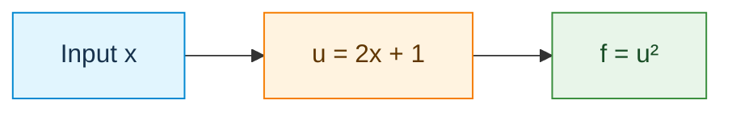
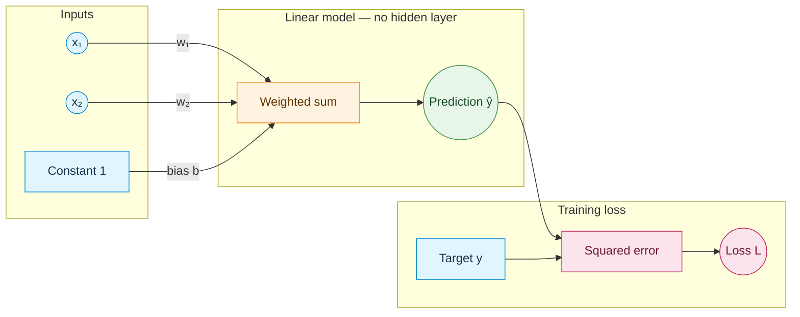
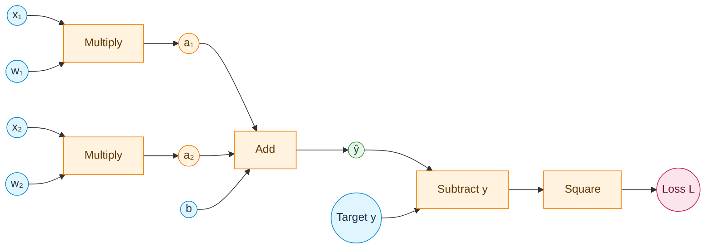
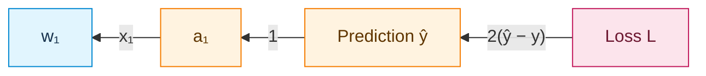
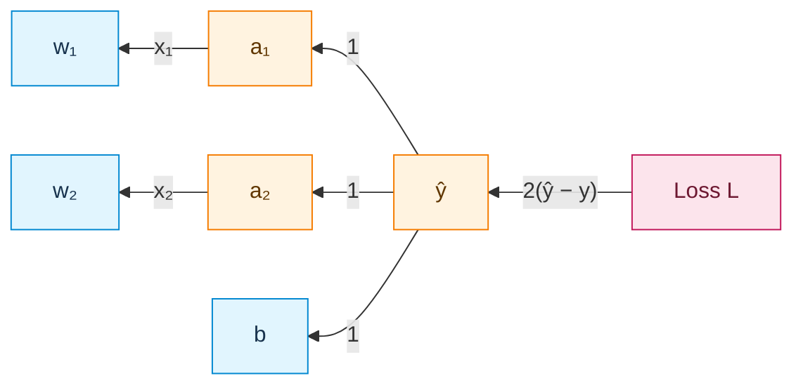

# Lab: From Derivatives to Backpropagation

- **Main reference:** [backprop_example.pdf](./slides/backprop_example.pdf)
- **Focus:** Understanding the derivatives and backward paths in the reference PDF

## Learning outcomes

After completing this lab, the following tasks should be possible:

1. Explain a derivative as the local slope of a one-variable function.
2. Read and write mathematical notation in a Colab text cell.
3. Distinguish an ordinary derivative from a partial derivative and state which variables are fixed.
4. Explain why training a model requires derivatives with respect to weights and bias.
5. Apply the chain rule first to a function of $x$, then to a loss function of $w$.
6. Derive the gradients in the reference PDF directly and by following a computational graph backward.
7. Check gradients using SymPy and numerical finite differences.

## How to work through the lab

- Create a new notebook at [Google Colab](https://colab.research.google.com/).
- Read each short explanation and **answer the prediction question before running the code**.
- Copy mathematical explanations into **text cells** as needed. Copy each `python` block into a separate **code cell**. All Python examples are self-contained.
- When a plot is supplied inside a collapsed section, expand **Show plotting code**, copy the code, run it, and interpret the result.
- Mermaid diagrams in this Markdown file render in supported GitHub Markdown viewers. **Colab text cells do not natively render Mermaid code fences**; read these diagrams in a GitHub Markdown preview or use a separately rendered version.
- The worked answers are placed in independent **Show answer** sections. Record an answer before opening them.

> **Notation used throughout:** $x$ is an input variable, $w$ is a trainable weight, $b$ is a trainable bias, $y$ is a target value, $\hat y$ is a prediction, and $L$ is a loss. The meaning of “held fixed” depends on the calculation being performed.

---

## Activity 0: Write mathematics in Colab

**Goal:** Enter and display basic mathematical notation.

In Colab, a **text cell** uses Markdown. Short mathematical expressions use single dollar signs, and displayed equations use double dollar signs on separate lines.

Enter this source into a **text cell** (not a Python cell):

```text
The function is $f(x)=x^2$.

$$
\frac{df}{dx}=2x
$$
```

The rendered result should contain the function and the derivative:

$$
f(x)=x^2
$$

$$
\frac{df}{dx}=2x
$$

Useful symbols for later activities:

| Meaning | Source to type in a text cell |
|---|---|
| A power | `$x^2$` |
| A fraction | `$\frac{a}{b}$` |
| An ordinary derivative | `$\frac{df}{dx}$` |
| A partial derivative | `$\frac{\partial f}{\partial x_1}$` |
| A prediction | `$\hat y$` |
| A loss | `$L$` |

**Check:** Write the expression “partial derivative of loss with respect to the first weight” in a text cell.

<details>
<summary>Show answer: Activity 0</summary>

Use ` $\frac{\partial L}{\partial w_1}$ ` as an inline mathematical expression.

</details>

---

## Activity 1: What does an ordinary derivative measure?

**Goal:** Connect a derivative to the slope of a curve.

Consider a function of one variable:

$$
f(x)=x^2
$$

The derivative is:

$$
\frac{df}{dx}=2x
$$

At a particular $x$, the derivative gives the slope of the tangent to the curve at that point. A positive derivative means the curve rises as $x$ increases locally; a negative derivative means it falls; a zero derivative means the tangent is horizontal.

### Predict

Complete the table before running the code.

| Position | Predicted slope $df/dx$ | Increasing, decreasing, or horizontal? |
|---|---:|---|
| $x=-2$ | ? | ? |
| $x=0$ | ? | ? |
| $x=2$ | ? | ? |

### Explore with Python

The supplied code displays the function with a tangent and, separately, the derivative function. The two plots share the same horizontal axis but have different vertical meanings.

<details>
<summary>Show plotting code: function, tangent, and derivative</summary>

```python
import numpy as np
import matplotlib.pyplot as plt

x = np.linspace(-3, 3, 400)
f = x**2
df = 2*x

point_x = 2.0                 # Change to -2.0 or 0.0
point_y = point_x**2
slope = 2*point_x
tangent = point_y + slope*(x - point_x)

fig, (ax1, ax2) = plt.subplots(2, 1, figsize=(8, 7), sharex=True)
ax1.plot(x, f, label='f(x) = x²')
ax1.plot(x, tangent, '--', label=f'Tangent at x = {point_x:g}')
ax1.scatter([point_x], [point_y], zorder=3)
ax1.set_ylabel('f(x)')
ax1.set_title('Function and tangent')
ax1.grid(alpha=0.3)
ax1.legend()

ax2.plot(x, df, label="f'(x) = 2x", color='tab:orange')
ax2.scatter([point_x], [slope], color='tab:orange', zorder=3)
ax2.axhline(0, color='black', linewidth=0.7)
ax2.set_xlabel('x')
ax2.set_ylabel("f'(x)")
ax2.set_title('Derivative: the slope at each x')
ax2.grid(alpha=0.3)
ax2.legend()

plt.tight_layout()
plt.show()
print(f'Slope at x = {point_x:g}: {slope:g}')
```

</details>

**Observe:** Change `point_x` to $-2$, $0$, and $2$. Describe what changes in the tangent and in the point marked on the derivative plot.

### Verify with symbolic Python

SymPy computes an exact symbolic derivative. Unlike a numerical slope estimate, the result is a formula.

```python
import sympy as sp

x = sp.symbols('x')
f = x**2

df = sp.diff(f, x)
print('f(x) =', f)
print('df/dx =', df)
for value in [-2, 0, 2]:
    print(f'x = {value}: slope = {df.subs(x, value)}')
```

**Explain:** How is the graph of $f(x)$ different from the graph of $df/dx$?

<details>
<summary>Show answer: Activity 1</summary>

The slopes are -4, 0, and 4, respectively. The graph of the function shows its height at each position. The graph of the derivative shows its slope at each position. At x = 0, the original curve has a horizontal tangent, so its derivative is zero.

</details>

---

## Activity 2: Why is a second derivative symbol needed?

**Goal:** Discover why a function of two independent variables needs an explicit differentiation instruction.

Consider:

$$
f(x_1,x_2)=x_1^2+x_1x_2
$$

A question such as “find $df/dx_1$” is **incomplete unless the behavior of $x_2$ is specified**. The other variable might be held fixed, or it might change together with $x_1$. These lead to different calculations.

### Case A: Hold $x_2$ fixed

Set $x_2=2$. The result is an ordinary one-variable function:

$$
f(x_1,2)=x_1^2+2x_1
$$

Its derivative is:

$$
\frac{d}{dx_1}f(x_1,2)=2x_1+2
$$

For a general fixed value of $x_2$, the relevant operation is a **partial derivative**:

$$
\boxed{\frac{\partial f}{\partial x_1}=2x_1+x_2}
$$

Read the symbol $\partial$ as “partial.” It indicates that the other independent variable is held fixed while differentiation is performed. Similarly:

$$
\frac{\partial f}{\partial x_2}=x_1
$$

### Predict

At the point $x_1=1$, $x_2=2$, calculate the partial derivative with respect to $x_1$. Then calculate the partial derivative with respect to $x_2$.

### Case B: Both variables change together

For comparison, suppose that $x_2=2x_1$ **along a particular path**. Substitution gives:

$$
f(x_1,2x_1)=x_1^2+2x_1^2=3x_1^2
$$

The ordinary derivative **along this path** is:

$$
\frac{d}{dx_1}f(x_1,2x_1)=6x_1
$$

At $x_1=1$, this path derivative is $6$, whereas the partial derivative holding $x_2=2$ fixed is $4$. The expressions answer different questions. A total derivative is not “wrong”; it requires a specified dependence or path. **For the next activities, other independent variables will be held fixed, so partial derivative notation is used.**

### Historical note: notation changes over time

Historical notation was not completely standardized. In Maxwell's 1865 treatment of electromagnetism, some derivatives of quantities depending on several variables were written using ordinary $d$ notation; modern presentations commonly use $\partial$ when taking a partial derivative. The symbol $\partial$ was used for partial differentiation by Legendre in 1786 and was later adopted more widely. The distinction today communicates what is held fixed; it does not mean that multivariable differentiation was unknown in Maxwell's time.

Sources: [Maxwell's 1865 equations (transcription)](https://en.wikisource.org/wiki/A_Dynamical_Theory_of_the_Electromagnetic_Field/Part_III); [Mathematical Association of America: history of calculus notation](https://old.maa.org/press/periodicals/convergence/math-origins-the-language-of-change).

<details>
<summary>Show answer: Activity 2</summary>

Holding x₂ fixed, the partial derivative with respect to x₁ is 2x₁ + x₂, which equals 4 at (1, 2). The partial derivative with respect to x₂ is x₁, which equals 1. Along the path x₂ = 2x₁, the ordinary derivative at x₁ = 1 is 6.

</details>

---

## Activity 3: Visualize partial derivatives as slices of a surface

**Goal:** Interpret a partial derivative geometrically.

The same function now defines a surface in three dimensions:

$$
f(x_1,x_2)=x_1^2+x_1x_2
$$

Fixing $x_2$ produces a curve cut through that surface. The slope of that curve at a chosen $x_1$ is $\partial f/\partial x_1$.

### Predict

If the fixed value of $x_2$ changes from $2$ to $-2$, does the derivative with respect to $x_1$ remain unchanged? Use the formula before displaying the plots.

<details>
<summary>Show plotting code: 3D surface and fixed-variable slice</summary>

```python
import numpy as np
import matplotlib.pyplot as plt

x1 = np.linspace(-3, 3, 100)
x2 = np.linspace(-3, 3, 100)
X1, X2 = np.meshgrid(x1, x2)
Z = X1**2 + X1*X2

fixed_x2 = 2.0                  # Change to -2.0 or 0.0
slice_y = x1**2 + fixed_x2*x1
slice_slope = 2*x1 + fixed_x2

fig = plt.figure(figsize=(12, 4.5))
ax3d = fig.add_subplot(1, 2, 1, projection='3d')
ax3d.plot_surface(X1, X2, Z, alpha=0.55, cmap='viridis')
ax3d.plot(x1, np.full_like(x1, fixed_x2), slice_y,
          color='crimson', linewidth=3, label='Fixed x₂ slice')
ax3d.set_xlabel('x₁')
ax3d.set_ylabel('x₂')
ax3d.set_zlabel('f(x₁, x₂)')
ax3d.set_title('Surface and highlighted slice')
ax3d.legend(loc='upper left')

ax2d = fig.add_subplot(1, 2, 2)
ax2d.plot(x1, slice_y, label=f'f(x₁, {fixed_x2:g})')
ax2d.plot(x1, slice_slope, '--', label='Slope along the slice')
ax2d.set_xlabel('x₁')
ax2d.set_ylabel('Value (height or slope)')
ax2d.set_title('Curve and derivative for fixed x₂')
ax2d.grid(alpha=0.3)
ax2d.legend()

plt.tight_layout()
plt.show()
```

</details>

**Observe:** Change `fixed_x2`. Locate the resulting cross-section on the surface. Explain why the slope curve changes even though the rule for differentiation does not.

### Verify with SymPy

```python
import sympy as sp

x1, x2 = sp.symbols('x1 x2')
f = x1**2 + x1*x2

print('Partial with respect to x1:', sp.diff(f, x1))
print('Partial with respect to x2:', sp.diff(f, x2))
print('At (x1, x2) = (1, 2):')
print('df/dx1 (holding x2 fixed) =', sp.diff(f, x1).subs({x1: 1, x2: 2}))
print('df/dx2 (holding x1 fixed) =', sp.diff(f, x2).subs({x1: 1, x2: 2}))
```

**Explain:** What stays constant when $\partial f/\partial x_1$ is calculated?

<details>
<summary>Show answer: Activity 3</summary>

The second independent variable, x₂, stays constant. The partial derivative is 2x₁ + x₂. Choosing a different fixed x₂ changes the numerical slope at the same x₁.

</details>

---

## Activity 4: From input variables to trainable weights

**Goal:** Explain which quantities change during model training.

For a fixed observation, the reference PDF uses a linear model with two inputs and a bias:

$$
\hat y=b+w_1x_1+w_2x_2
$$

Its loss for **one observation** is the squared error:

$$
L=(\hat y-y)^2=(b+w_1x_1+w_2x_2-y)^2
$$

During prediction, the learned weights are fixed and the inputs may vary. **During training on one observation**, $x_1$, $x_2$, and $y$ are fixed numbers; $w_1$, $w_2$, and $b$ are the trainable quantities. This is the change in perspective from ordinary input-output calculus to loss minimization.

### Numerical example for the remainder of the lab

Use the same numbers throughout the remaining activities:

| Fixed observation | Current model parameters |
|---|---|
| $x_1=2$ | $w_1=1$ |
| $x_2=-1$ | $w_2=0$ |
| $y=3$ | $b=0$ |

At these values:

$$
\hat y=0+(1)(2)+(0)(-1)=2
$$

$$
L=(2-3)^2=1
$$

### Predict

Holding $b=0$ and the training observation fixed, does changing $w_1$ affect the loss? Does changing $w_2$ affect it? Which two quantities should label the horizontal axes of a loss surface?

<details>
<summary>Show plotting code: loss as a function of two weights</summary>

```python
import numpy as np
import matplotlib.pyplot as plt

x1, x2, y, b = 2.0, -1.0, 3.0, 0.0
w1_values = np.linspace(-0.5, 2.5, 140)
w2_values = np.linspace(-2, 2, 140)
W1, W2 = np.meshgrid(w1_values, w2_values)
L = (b + W1*x1 + W2*x2 - y)**2

fig = plt.figure(figsize=(12, 4.5))
ax1 = fig.add_subplot(1, 2, 1, projection='3d')
ax1.plot_surface(W1, W2, L, cmap='viridis', alpha=0.8)
ax1.scatter([1], [0], [1], color='crimson', s=45)
ax1.set_xlabel('w₁')
ax1.set_ylabel('w₂')
ax1.set_zlabel('Loss')
ax1.set_title('Squared-error loss surface (b fixed)')

ax2 = fig.add_subplot(1, 2, 2)
contours = ax2.contour(W1, W2, L, levels=[0.1, 0.5, 1, 2, 4, 9])
ax2.clabel(contours, inline=True, fontsize=8)
ax2.scatter([1], [0], color='crimson', label='Current weights')
ax2.set_xlabel('w₁')
ax2.set_ylabel('w₂')
ax2.set_title('Loss contours: weights, not input features')
ax2.grid(alpha=0.2)
ax2.legend()

plt.tight_layout()
plt.show()
```

</details>

**Observe:** The axes are weights, not input features. The bias is fixed only for this visualization; it is also a trainable parameter in the reference PDF.

**Important:** With one training observation and multiple parameters, several parameter combinations can give zero loss. The diagram must not be interpreted as evidence of a unique best pair of weights.

<details>
<summary>Show answer: Activity 4</summary>

Changing either weight generally changes the prediction and therefore the loss. For this exercise, the horizontal axes of the loss surface are w₁ and w₂, while x₁ = 2, x₂ = -1, y = 3, and b = 0 are fixed.

</details>

---

## Activity 5: Chain rule with the familiar variable $x$

**Goal:** Calculate a derivative by breaking a function into two simpler functions.

Consider:

$$
f(x)=(2x+1)^2
$$

Define an intermediate quantity:

$$
u=2x+1,\qquad f=u^2
$$

The **chain rule** multiplies the local derivatives:

$$
\frac{df}{dx}=\frac{df}{du}\frac{du}{dx}
$$

Calculate the two factors:

$$
\frac{df}{du}=2u,\qquad \frac{du}{dx}=2
$$

Therefore:

$$
\boxed{\frac{df}{dx}=2u\cdot2=4(2x+1)}
$$

### Predict

At $x=1$, calculate the value of $u$ and the slope $df/dx$. Explain why differentiating only the outer square would give an incomplete result.



The diagram runs from input to output. For a derivative with respect to $x$, the chain rule combines information from the operations that connect $x$ to $f$.

### Verify with SymPy

```python
import sympy as sp

x = sp.symbols('x')
u = 2*x + 1
f = u**2

manual_chain = 2*u * 2
symbolic = sp.diff(f, x)
print('Chain-rule expression:', manual_chain)
print('SymPy derivative:', symbolic)
print('Equivalent:', sp.simplify(manual_chain - symbolic) == 0)
print('Slope at x=1:', symbolic.subs(x, 1))
```

<details>
<summary>Show answer: Activity 5</summary>

At x = 1, u = 3 and df/dx = 12. The derivative of the inner expression, 2x + 1, must also be included; it contributes the factor 2.

</details>

---

## Activity 6: Apply the same chain rule to a weight $w$

**Goal:** Transfer the chain rule from a function of $x$ to a one-weight loss.

Consider a simpler model with one trainable weight. Use the fixed input $x_0=2$ and target $y_0=3$:

$$
\hat y=wx_0=2w
$$

$$
L(w)=(\hat y-y_0)^2=(2w-3)^2
$$

As there is only one trainable variable, an ordinary derivative $dL/dw$ is appropriate. Treat $x_0$ and $y_0$ as constants.

The chain rule gives:

$$
\frac{dL}{dw}=\frac{dL}{d\hat y}\frac{d\hat y}{dw}
$$

$$
\frac{dL}{d\hat y}=2(\hat y-y_0),\qquad
\frac{d\hat y}{dw}=x_0
$$

$$
\boxed{\frac{dL}{dw}=2(wx_0-y_0)x_0}
$$

At $w=1$, the derivative is $-4$. This means a small increase in $w$ from its current value initially decreases the loss.

### Predict

Does the loss decrease or increase if $w$ moves slightly above $1$? Does a negative derivative mean the loss itself is negative?

<details>
<summary>Show plotting code: loss and slope as functions of a weight</summary>

```python
import numpy as np
import matplotlib.pyplot as plt

x0, y0 = 2.0, 3.0
w_values = np.linspace(0, 3, 300)
loss_values = (w_values*x0 - y0)**2
gradient_values = 2*(w_values*x0 - y0)*x0
current_w = 1.0

fig, (ax1, ax2) = plt.subplots(2, 1, figsize=(8, 7), sharex=True)
ax1.plot(w_values, loss_values, label='L(w) = (2w - 3)²')
ax1.scatter([current_w], [(current_w*x0-y0)**2], color='crimson')
ax1.set_ylabel('Loss')
ax1.set_title('The loss varies with a trainable weight')
ax1.grid(alpha=0.3)
ax1.legend()

ax2.plot(w_values, gradient_values, color='tab:orange', label='dL/dw')
ax2.scatter([current_w], [2*(current_w*x0-y0)*x0], color='crimson')
ax2.axhline(0, color='black', linewidth=0.7)
ax2.set_xlabel('w')
ax2.set_ylabel('dL/dw')
ax2.grid(alpha=0.3)
ax2.legend()

plt.tight_layout()
plt.show()
```

</details>

### Verify with SymPy

```python
import sympy as sp

w = sp.symbols('w')
x0, y0 = 2, 3
prediction = w*x0
loss = (prediction-y0)**2

gradient = sp.diff(loss, w)
print('Loss:', loss)
print('dL/dw:', gradient)
print('At w=1:', gradient.subs(w, 1))
```

**Explain:** What changed between the chain rule in Activity 5 and this chain rule? What stayed mathematically the same?

<details>
<summary>Show answer: Activity 6</summary>

At w = 1 the gradient is -4, so increasing w by a sufficiently small amount decreases loss locally. The loss remains nonnegative because it is squared error. The variable of differentiation changed from x to w; the chain rule itself did not change.

</details>

---

## Activity 7: Reproduce the mathematics of the reference PDF

**Goal:** Derive all parameter gradients first directly and then using intermediate quantities.

### Part A: The model and squared-error loss (PDF pages 1–2)

The reference PDF describes a two-input linear model **without hidden layers**. Its trainable parameters are $w_1$, $w_2$, and $b$.

$$
\hat y=b+w_1x_1+w_2x_2
$$

$$
L=(\hat y-y)^2
$$

The next diagram represents the **model and loss calculation**. It is not a hidden-layer neural network. The target and the loss are used for training; they are not extra prediction layers.



### Part B: Direct differentiation (PDF page 3)

Substitute the model into the loss:

$$
L=(b+w_1x_1+w_2x_2-y)^2
$$

When differentiating with respect to $w_1$, hold $w_2$, $b$, and the observation fixed. The result is:

$$
\frac{\partial L}{\partial w_1}
=2(b+w_1x_1+w_2x_2-y)x_1
$$

**Calculate:** Derive the corresponding expressions for $\partial L/\partial w_2$ and $\partial L/\partial b$ before opening the answers.

### Part C: Break the expression into local operations (PDF pages 4–7)

Introduce the PDF's intermediate quantities:

$$
\begin{aligned}
a_1 &= w_1x_1 \\
a_2 &= w_2x_2 \\
\hat y &= b+a_1+a_2 \\
L &= (\hat y-y)^2
\end{aligned}
$$

This changes how the calculation is **organized**, not the mathematical function being evaluated.

The chain rule for the first weight is:

$$
\frac{\partial L}{\partial w_1}
=\frac{\partial L}{\partial\hat y}
\frac{\partial\hat y}{\partial a_1}
\frac{\partial a_1}{\partial w_1}
$$

Calculate each local derivative:

$$
\frac{\partial L}{\partial\hat y}=2(\hat y-y)
$$

$$
\frac{\partial\hat y}{\partial a_1}=1
$$

$$
\frac{\partial a_1}{\partial w_1}=x_1
$$

Multiplication gives:

$$
\boxed{\frac{\partial L}{\partial w_1}=2(\hat y-y)x_1}
$$

Likewise:

$$
\boxed{\frac{\partial L}{\partial w_2}=2(\hat y-y)x_2}
$$

$$
\boxed{\frac{\partial L}{\partial b}=2(\hat y-y)}
$$

The directly calculated gradients and the chain-rule gradients are identical.

### Part D: Computational graph (PDF pages 8–10)

The following diagram represents **individual arithmetic operations** rather than just the model architecture. A weight is an input to a multiplication operation because the graph must show how the loss depends on that weight.



### Part E: Follow the backward path (PDF pages 11–12)

In the forward direction the graph computes $a_1$, $a_2$, $\hat y$, and $L$. In the **backward direction**, the chain rule combines the local derivatives needed to calculate the effect of a parameter on the loss.

The backward path for $w_1$ is:



The edge labels are **local derivatives**. Multiplying the values along this path gives $2(\hat y-y)\cdot1\cdot x_1$.

The other parameter paths share the derivative from $L$ to $\hat y$:



**Questions:**

1. Why does the path to $w_2$ contain $x_2$ instead of $x_1$?
2. Why does the path to $b$ have fewer factors?
3. Which local derivative is reused by all three parameter gradients?
4. Does the backward pass update the parameters?

<details>
<summary>Show answer: Activity 7</summary>

The derivative of a₂ = w₂x₂ with respect to w₂ is x₂. The bias enters the prediction directly, so the derivative of the prediction with respect to b is 1 and no multiplication node is traversed. The factor 2(ŷ − y) is reused for all three gradients. Backpropagation computes gradients; it does not change the parameter values. Parameter updates require a separate optimization step.

The direct expressions are:

- With respect to w₂: 2(b + w₁x₁ + w₂x₂ − y)x₂.
- With respect to b: 2(b + w₁x₁ + w₂x₂ − y).

</details>

---

## Activity 8: Check the PDF's gradients with numbers and SymPy

**Goal:** Confirm that direct differentiation, backpropagation, and numerical estimates agree.

Return to the values from Activity 4:

$$
\begin{aligned}
x_1&=2, & x_2&=-1, & y&=3,\\
w_1&=1, & w_2&=0, & b&=0.
\end{aligned}
$$

### Predict and calculate manually

First compute the forward pass:

$$
\hat y=2,\qquad \hat y-y=-1,\qquad L=1
$$

Then calculate the gradients:

$$
\begin{aligned}
\frac{\partial L}{\partial w_1}&=2(\hat y-y)x_1=2(-1)(2)=-4,\\
\frac{\partial L}{\partial w_2}&=2(\hat y-y)x_2=2(-1)(-1)=2,\\
\frac{\partial L}{\partial b}&=2(\hat y-y)=2(-1)=-2.
\end{aligned}
$$

A negative gradient indicates that **a small increase in that parameter alone** tends to decrease the loss locally; a positive gradient indicates the opposite. The gradient itself is not the loss.

### SymPy: symbolic derivatives and numerical substitution

```python
import sympy as sp

w1, w2, b = sp.symbols('w1 w2 b')
x1, x2, y = sp.symbols('x1 x2 y')
yhat = b + w1*x1 + w2*x2
loss = (yhat-y)**2

params = {x1: 2, x2: -1, y: 3, w1: 1, w2: 0, b: 0}
for parameter in [w1, w2, b]:
    symbolic_gradient = sp.diff(loss, parameter)
    evaluated_gradient = symbolic_gradient.subs(params)
    print(f'dL/d{parameter} = {symbolic_gradient}')
    print(f'  value = {evaluated_gradient}')

print('Prediction =', yhat.subs(params))
print('Loss =', loss.subs(params))
```

### Finite differences: estimate the slopes without symbolic rules

A central finite-difference estimate is:

$$
\frac{\partial L}{\partial w_1}
\approx
\frac{L(w_1+h,w_2,b)-L(w_1-h,w_2,b)}{2h}
$$

This is an approximation for a small, nonzero $h$, while the symbolic result is exact.

```python
x1, x2, y = 2.0, -1.0, 3.0
w1, w2, b = 1.0, 0.0, 0.0
h = 1e-6

def loss_fn(w1, w2, b):
    prediction = b + w1*x1 + w2*x2
    return (prediction-y)**2

slope_w1 = (loss_fn(w1+h, w2, b) - loss_fn(w1-h, w2, b))/(2*h)
slope_w2 = (loss_fn(w1, w2+h, b) - loss_fn(w1, w2-h, b))/(2*h)
slope_b = (loss_fn(w1, w2, b+h) - loss_fn(w1, w2, b-h))/(2*h)

print('Finite-difference slope for w1:', slope_w1)
print('Finite-difference slope for w2:', slope_w2)
print('Finite-difference slope for b: ', slope_b)
```

### Compare

| Parameter | Direct differentiation | Backward graph | SymPy | Finite difference |
|---|---:|---:|---:|---:|
| $w_1$ | $-4$ | ? | ? | approximately ? |
| $w_2$ | $2$ | ? | ? | approximately ? |
| $b$ | $-2$ | ? | ? | approximately ? |

**Explain:** Why should the four columns agree? Why might the finite-difference results differ in their last decimal places?

<details>
<summary>Show answer: Activity 8</summary>

All four methods are evaluating the change in the same loss function with respect to the same parameters, with the remaining parameters fixed. The expected gradients are -4, 2, and -2. Finite differences are approximate and can show small floating-point or truncation errors.

</details>

---

## Activity 9: Final understanding check

**Goal:** Explain the entire argument of the reference PDF without relying on a code output.

Complete the following statements or short answers.

1. The derivative of a one-variable function describes ____________________.
2. For $f(x_1,x_2)$, the partial derivative with respect to $x_1$ holds ____________________ fixed.
3. During training on one observation, the inputs and target are __________ while the weights and bias are __________.
4. In the reference PDF, the prediction is $\hat y=$ __________ and the loss is $L=$ __________.
5. The factor $2(\hat y-y)$ comes from differentiating ____________________.
6. The factor $x_1$ in $\partial L/\partial w_1$ comes from differentiating ____________________.
7. Direct differentiation and backpropagation give the same gradients because ____________________.
8. The forward pass computes __________. The backward pass computes __________.
9. The reference PDF contains a hidden layer: **true or false?**
10. Why can a common derivative be reused when calculating gradients for several parameters?

<details>
<summary>Show answer: Final understanding check</summary>

1. The local slope or local rate of change.
2. The other independent input, x₂.
3. Fixed; adjustable/trainable.
4. b + w₁x₁ + w₂x₂; (ŷ − y)².
5. The squared-error loss with respect to the prediction.
6. a₁ = w₁x₁ with respect to w₁.
7. Both apply the same calculus rules to the same function; backpropagation organizes the chain rule into local steps.
8. The prediction and loss; gradients of loss with respect to parameters.
9. False. There are two inputs, one linear output, and no hidden layers.
10. The same output-error derivative feeds several branches of the computational graph, avoiding redundant calculation.

</details>

---

## Optional extension: What happens after backpropagation?

**This extension is not required to understand the reference PDF.** Backpropagation calculates gradients; an optimizer uses those gradients to update parameters. A basic gradient-descent update has the form:

$$
\theta_{\mathrm{new}}=\theta_{\mathrm{old}}-\eta\frac{\partial L}{\partial\theta}
$$

Here $\eta$ is the learning rate, and $\theta$ represents an individual trainable parameter. For the numerical example, using $\eta=0.05$ and **the gradients all evaluated at the original parameters** gives:

$$
\begin{aligned}
w_{1,\mathrm{new}} &=1-0.05(-4)=1.2,\\
w_{2,\mathrm{new}} &=0-0.05(2)=-0.1,\\
b_{\mathrm{new}} &=0-0.05(-2)=0.1.
\end{aligned}
$$

The updated prediction is $2.6$, and the new loss is $0.16$.

```python
x1, x2, y = 2.0, -1.0, 3.0
w1, w2, b = 1.0, 0.0, 0.0
learning_rate = 0.05

prediction_before = b + w1*x1 + w2*x2
loss_before = (prediction_before-y)**2
error = prediction_before-y

grad_w1 = 2*error*x1
grad_w2 = 2*error*x2
grad_b = 2*error

# Simultaneous updates using gradients from the same original state
w1_new = w1 - learning_rate*grad_w1
w2_new = w2 - learning_rate*grad_w2
b_new = b - learning_rate*grad_b

prediction_after = b_new + w1_new*x1 + w2_new*x2
loss_after = (prediction_after-y)**2

print('Before: prediction =', prediction_before, ', loss =', loss_before)
print('After:  prediction =', prediction_after, ', loss =', loss_after)
print('New parameters:', w1_new, w2_new, b_new)
```

A reduction in loss is observed for **this particular step**; it is not guaranteed for every learning rate or model.

---

## Summary: link back to the 13-page reference PDF

| PDF pages | Main idea | Lab preparation |
|---|---|---|
| 1–2 | Two-input model, trainable parameters, squared-error loss | Activity 4 and Activity 7A |
| 3 | Direct differentiation | Activity 7B |
| 4–7 | Intermediate quantities and the chain rule | Activities 5–6 and Activity 7C |
| 8–10 | Computational graph and local derivatives | Activity 7D |
| 11–12 | Backward paths and multiplication of local derivatives | Activity 7E |
| 13 | Agreement with direct differentiation; reusable gradients and scalability | Activity 8 and final understanding check |

**Main conclusion:** Backpropagation is an organized application of the chain rule. It computes derivatives of the loss with respect to trainable parameters by reusing local derivatives along a computational graph. It does not, by itself, update those parameters.

### Reference materials

- Course reference: [backprop_example.pdf](./slides/backprop_example.pdf)
- [Original notation in Maxwell's *A Dynamical Theory of the Electromagnetic Field* (1865), Part III](https://en.wikisource.org/wiki/A_Dynamical_Theory_of_the_Electromagnetic_Field/Part_III).
- [Mathematical Association of America: *Math Origins: The Language of Change*](https://old.maa.org/press/periodicals/convergence/math-origins-the-language-of-change).
