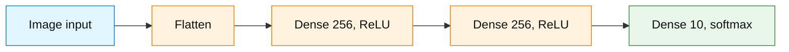
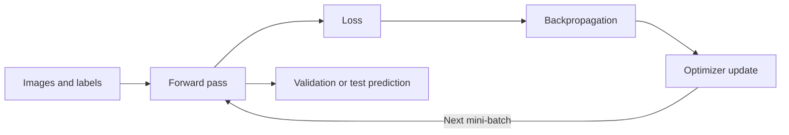

# Classroom Demonstrations: Images, Tensors, and Neural-Network Training

## How to use these demonstrations

These demonstrations explain how images become numerical arrays, how classifiers turn arrays into predictions, and how training changes network parameters. Each demonstration includes a short explanation, observations to make, and complete Python code in a separate expandable section. **Run the supplied code, inspect the figure or printed output, and explain what it shows. Writing plotting code from scratch is not required.**

The figures are either computed from the named dataset or explicitly identified as *schematic* or *illustrative*. Training results depend on the environment, random initialization, and data. Run the setup cell first. Demonstrations 1–8 and 10 can then be run as separate examples. Demonstration 9 uses the trained model and test arrays created by Demonstration 8; run Demonstration 8 before it.

**Python setup:** [Python setup for Week 3](../material/1-python_setup.md). Google Colab is the primary environment; a local Jupyter notebook with the listed libraries is an alternative. Use NumPy, Matplotlib, and TensorFlow/Keras; the architecture-plot example additionally needs `pydot` and the Graphviz executable. If necessary in Colab, run `%pip install pydot` and `!apt-get -qq install graphviz` in separate cells. Install TensorFlow only if its import fails. Dataset downloads require internet access on first use. Restart the runtime after a package installation if requested.

For reproducible examples, run this setup cell first:

```python
import numpy as np
import matplotlib.pyplot as plt
import tensorflow as tf
from tensorflow import keras
from tensorflow.keras import layers

keras.utils.set_random_seed(42)
print("TensorFlow version:", tf.__version__)
print("TensorFlow executing eagerly:", tf.executing_eagerly())
```

## Learning objectives

After running the demonstrations, the following distinctions should be clear:

1. Computer-vision tasks differ in their required **outputs**, not only in the images they accept.
2. A grayscale image is a 2D pixel-intensity array; a color image can be represented by three RGB channel arrays.
3. An array's **rank** counts axes; its **shape** gives the size of each axis. Batching adds an axis.
4. Class IDs are **categories**, not numerical measurements; one-hot and sparse targets encode the same single-label classification task.
5. Softmax couples class probabilities; independent sigmoids do not force probabilities to sum to one.
6. A forward pass, a loss calculation, backpropagation, and an optimizer update are distinct training operations.
7. Epochs describe passes over data, while steps describe parameter updates; batch size affects the number of updates.
8. Validation curves and early stopping support generalization decisions; the test set remains held out.
9. Sequential, Functional, and subclassed Keras models are different ways to define a network, not different loss functions or optimization algorithms.

---

## Demonstration 1: Computer vision tasks require different outputs

**Goal:** Distinguish image classification, classification with localization, object detection, semantic segmentation, and instance segmentation.

A classification model outputs a label for the entire image. Localization adds a bounding box for a target object. Detection identifies multiple objects with individual boxes. Semantic segmentation labels pixels by category, while instance segmentation also distinguishes separate objects belonging to the same category.

The figure below uses a **synthetic drawing**, not actual model predictions. It depicts the output formats rather than the behavior of a trained network.

<details>
<summary>Python visualization: Schematic computer-vision task outputs</summary>

```python
import numpy as np
import matplotlib.pyplot as plt
from matplotlib.patches import Rectangle

h, w = 60, 90
scene = np.ones((h, w, 3), dtype=float) * 0.96
scene[15:43, 10:34] = [0.35, 0.57, 0.80]
scene[23:52, 55:81] = [0.35, 0.57, 0.80]
mask_semantic = np.zeros((h, w), dtype=int)
mask_semantic[15:43, 10:34] = 1
mask_semantic[23:52, 55:81] = 1
mask_instance = np.zeros((h, w), dtype=int)
mask_instance[15:43, 10:34] = 1
mask_instance[23:52, 55:81] = 2

fig, axes = plt.subplots(1, 5, figsize=(16, 3.2))
for ax in axes:
    ax.set_xticks([])
    ax.set_yticks([])
axes[0].imshow(scene)
axes[0].set_title("Classification\nTwo objects")
axes[1].imshow(scene)
axes[1].add_patch(Rectangle((10, 15), 24, 28, fill=False,
                            edgecolor="red", linewidth=2))
axes[1].set_title("Localization\nOne box")
axes[2].imshow(scene)
for x, y, bw, bh in [(10, 15, 24, 28), (55, 23, 26, 29)]:
    axes[2].add_patch(Rectangle((x, y), bw, bh, fill=False,
                                edgecolor="red", linewidth=2))
axes[2].set_title("Detection\nTwo boxes")
axes[3].imshow(mask_semantic, cmap="Blues", vmin=0, vmax=1)
axes[3].set_title("Semantic segmentation\nOne object class")
axes[4].imshow(mask_instance, cmap="viridis", vmin=0, vmax=2)
axes[4].set_title("Instance segmentation\nSeparate objects")
fig.suptitle("Schematic outputs: not predictions from a trained model")
plt.tight_layout()
plt.show()
```

</details>

**Observe:** Identify which outputs require one label, which require coordinates, and which require an output value for each pixel. Image classification is the task implemented by the dense networks in the following demonstrations.

---

## Demonstration 2: A grayscale image is a matrix of numbers

**Goal:** Connect a handwritten digit to the underlying pixel values and their normalized counterparts.

An original MNIST digit has shape `(28, 28)` and contains 8-bit grayscale intensities between 0 and 255. Scaling intensities by 255 produces values between 0 and 1. Scaling changes the numerical range without changing the correct digit label or the shape of the image.

<details>
<summary>Python visualization: MNIST digit, enlarged pixel patch, and normalized intensities</summary>

```python
import numpy as np
import matplotlib.pyplot as plt
from tensorflow import keras

(x_digits, y_digits), _ = keras.datasets.mnist.load_data()
index = 0
img = x_digits[index]
patch = img[10:18, 10:18]
normalized = patch.astype("float32") / 255.0

fig, axes = plt.subplots(1, 3, figsize=(13, 4))
axes[0].imshow(img, cmap="gray", vmin=0, vmax=255)
axes[0].set_title(f"MNIST digit {int(y_digits[index])}: 28 × 28")
axes[0].axis("off")

for ax, values, title, formatter in [
    (axes[1], patch, "Raw pixel intensities (0–255)", lambda v: str(int(v))),
    (axes[2], normalized, "Normalized intensities (0–1)",
     lambda v: f"{float(v):.2f}"),
]:
    ax.imshow(values, cmap="gray", vmin=0,
              vmax=255 if ax is axes[1] else 1)
    ax.set_title(title)
    ax.set_xticks(range(8))
    ax.set_yticks(range(8))
    for r in range(8):
        for c in range(8):
            v = float(values[r, c])
            threshold = 130 if ax is axes[1] else 0.51
            ax.text(c, r, formatter(v), ha="center", va="center",
                    fontsize=7, color="black" if v > threshold else "white")
plt.tight_layout()
plt.show()

print("Image shape:", img.shape)
print("Raw pixel type:", img.dtype)
print("Example pixel before/after scaling:", int(patch[0, 0]),
      float(normalized[0, 0]))
```

</details>

**Observe:** Identify dark and light pixels, the correspondence between matrix cells and parts of the digit, and what changes after normalization. A dataset that is already grayscale is not created by converting this image from RGB.

---

## Demonstration 3: An RGB color image consists of three channels

**Goal:** Decompose a CIFAR-10 image, reconstruct it, and show how grayscale conversion differs from an original grayscale image.

A CIFAR-10 image has shape `(32, 32, 3)`. Each pixel contains red, green, and blue intensities. These three intensity matrices have shape `(32, 32)` and can be recombined to recover the original image. A common *approximate* brightness conversion weights red, green, and blue differently; it is not the same operation as displaying the original RGB image.

<details>
<summary>Python visualization: CIFAR-10 RGB channels, reconstruction, and grayscale</summary>

```python
import numpy as np
import matplotlib.pyplot as plt
from tensorflow import keras

(x_color, y_color), _ = keras.datasets.cifar10.load_data()
img = x_color[0].astype("float32") / 255.0
names = ["airplane", "automobile", "bird", "cat", "deer",
         "dog", "frog", "horse", "ship", "truck"]

isolated = []
for channel in range(3):
    layer = np.zeros_like(img)
    layer[:, :, channel] = img[:, :, channel]
    isolated.append(layer)

reconstructed = isolated[0] + isolated[1] + isolated[2]
# Approximate grayscale brightness using standard luminance-like weights.
gray = 0.299 * img[:, :, 0] + 0.587 * img[:, :, 1] + 0.114 * img[:, :, 2]

fig, axes = plt.subplots(1, 6, figsize=(17, 3.1))
images = [img, *isolated, reconstructed, gray]
labels = ["Original RGB", "Red only", "Green only", "Blue only",
          "Reconstructed", "Approx. grayscale"]
for ax, arr, label in zip(axes, images, labels):
    if arr.ndim == 2:
        ax.imshow(arr, cmap="gray", vmin=0, vmax=1)
    else:
        ax.imshow(arr)
    ax.set_title(label)
    ax.axis("off")
plt.tight_layout()
plt.show()

print("Class:", names[int(y_color[0, 0])])
print("Original image shape:", img.shape)
print("Red channel shape:", img[:, :, 0].shape)
print("All RGB values reconstructed:", np.allclose(img, reconstructed))
```

</details>

**Observe:** Identify what each channel contributes to the final color, why the isolated channels do not resemble three different objects, and which information is absent in the grayscale conversion. The reconstructed image should match the original within numerical precision.

---

## Demonstration 4: Tensor rank, shape, and batch dimensions

**Goal:** Connect ordinary numbers and arrays to the tensors handled by TensorFlow and Keras.

A tensor's **rank** is its number of axes; **shape** lists the size along each axis. Rank is not the same as the count of stored values. The channel-last convention uses `(batch, height, width, channels)` for batches of RGB images.

| Example | Shape | Rank |
|---|---|---|
| Single scalar | `()` | 0 |
| Vector | `(3,)` | 1 |
| Grayscale image | `(28, 28)` | 2 |
| RGB image | `(32, 32, 3)` | 3 |
| Batch of eight RGB images | `(8, 32, 32, 3)` | 4 |

<details>
<summary>Python demonstration: Print tensor ranks and shapes, then visualize a batch</summary>

```python
import numpy as np
import matplotlib.pyplot as plt
import tensorflow as tf
from tensorflow import keras

(x_color, y_color), _ = keras.datasets.cifar10.load_data()
tensors = {
    "scalar": tf.constant(4.0),
    "vector": tf.constant([1.0, 2.0, 3.0]),
    "matrix": tf.zeros((2, 3)),
    "RGB image": tf.convert_to_tensor(x_color[0]),
    "eight RGB images": tf.convert_to_tensor(x_color[:8]),
}
for name, tensor in tensors.items():
    print(f"{name:>18}: shape={tuple(tensor.shape)}, rank={tensor.ndim}")

fig, axes = plt.subplots(2, 4, figsize=(9, 5))
for i, ax in enumerate(axes.flat):
    ax.imshow(x_color[i])
    ax.set_title(f"Batch item {i}")
    ax.axis("off")
plt.suptitle("A rank-4 tensor: eight RGB images")
plt.tight_layout()
plt.show()
```

</details>

**Observe:** The batch axis indexes images; it does not create an extra color channel. The printed rank is the number of axes, not the number of individual numbers in the tensor.

---

## Demonstration 5: Class IDs, softmax, sigmoid, and cross-entropy

**Goal:** Distinguish a category label from a numerical quantity and compare multiclass versus independent class probabilities.

For one mutually exclusive class among $K$ categories, softmax turns logits $z_1,\ldots,z_K$ into probabilities that sum to one:

$$
p_k=\frac{e^{z_k}}{\sum_{j=1}^{K}e^{z_j}}.
$$

For a sparse integer target $y$, categorical cross-entropy for one example is

$$
L=-\ln(p_y).
$$

The same target can be represented by a one-hot vector. This changes the *label format* and the compatible Keras loss function, not the meaning of the classes. An ID of `7` does not give that class more importance than an ID of `1`. Independent sigmoid outputs describe a different, potentially multilabel prediction problem.

<details>
<summary>Python visualization: Softmax probabilities versus independent sigmoids</summary>

```python
import numpy as np
import matplotlib.pyplot as plt
from tensorflow import keras

logits = np.array([2.0, 1.0, 0.0], dtype="float32")
softmax = keras.activations.softmax(logits).numpy()
sigmoid = keras.activations.sigmoid(logits).numpy()

fig, ax = plt.subplots(figsize=(8, 4))
x = np.arange(3)
ax.bar(x - 0.18, softmax, width=0.36, label="Softmax")
ax.bar(x + 0.18, sigmoid, width=0.36, label="Independent sigmoids")
ax.set_xticks(x, ["Class A", "Class B", "Class C"])
ax.set_ylim(0, 1)
ax.set_ylabel("Output value")
ax.set_title("The same logits processed by different activations")
ax.legend()
ax.grid(axis="y", alpha=0.2)
plt.tight_layout()
plt.show()

correct_class = 0
one_hot = np.eye(len(logits), dtype="float32")[correct_class]
loss_sparse = -np.log(softmax[correct_class])
loss_one_hot = -np.sum(one_hot * np.log(softmax))
print("Sparse label:", correct_class)
print("One-hot label:", one_hot)
print("Softmax sum:", softmax.sum())
print("Sigmoid sum:", sigmoid.sum())
print("Sparse and one-hot losses:", loss_sparse, loss_one_hot)
```

</details>

**Observe:** Softmax probabilities compete and sum to one. Independent sigmoid outputs need not sum to one. The sparse and one-hot calculations describe the same correct-class cross-entropy for this example.

---

## Demonstration 6: Mini-batches change when parameters are updated

**Goal:** Distinguish one **epoch** (one pass through the training set) from one optimizer **step** (one update).

For $N$ training examples and batch size $B$, an epoch normally has $\lceil N/B\rceil$ mini-batches when the final partial batch is retained. Full-batch gradient descent uses all training examples for one update. Strict single-example SGD updates after each example. Mini-batch training updates after each group of examples. Adam is a different optimizer from plain SGD, even when Adam processes mini-batches.

The following **illustrative one-parameter regression example** uses one common loss function and the same fixed data order. It isolates update frequency; it is not a neural-network or image-classification benchmark and does not establish which method is generally best.

<details>
<summary>Python visualization: Full-batch, mini-batch, and single-example updates over one epoch</summary>

```python
import numpy as np
import matplotlib.pyplot as plt

# Toy model: prediction = w*x. Loss = mean(0.5*(w*x - y)**2).
x = np.array([0.5, 1.0, 0.8, 1.2, 0.6, 1.1, 0.9, 1.3], dtype=float)
y = 2.0 * x + np.array([0.1, -0.1, 0.05, 0.1, -0.05, 0.0, -0.1, 0.0])
learning_rate = 0.1

def run_one_epoch(batch_size):
    w = 0.0
    processed = [0]
    weights = [w]
    for start in range(0, len(x), batch_size):
        xb = x[start:start + batch_size]
        yb = y[start:start + batch_size]
        # Forward, loss derivative, and negative-gradient parameter update.
        predictions = w * xb
        gradient = np.mean((predictions - yb) * xb)
        w = w - learning_rate * gradient
        processed.append(start + len(xb))
        weights.append(w)
    return processed, weights

fig, ax = plt.subplots(figsize=(8, 4.5))
for size, label in [(8, "Full batch: 1 update"),
                    (4, "Mini-batch: 2 updates"),
                    (1, "Single-example SGD: 8 updates")]:
    seen, weights = run_one_epoch(size)
    ax.step(seen, weights, where="post", marker="o", label=label)
ax.set(xlabel="Training examples processed", ylabel="Parameter w",
       title="One epoch, same data order and starting parameter")
ax.set_xlim(0, 8)
ax.grid(alpha=0.25)
ax.legend()
plt.tight_layout()
plt.show()
```

</details>

**Observe:** Every method processes the same eight training examples exactly once. Only the number and timing of parameter updates differ. A different final parameter after one epoch does not by itself demonstrate better generalization.

---

## Demonstration 7: Model shapes and parameter counts

**Goal:** Compare a two-hidden-layer dense classifier receiving grayscale versus RGB inputs.

In a dense network, `Flatten` changes the data shape but has no trainable weights. A dense layer with $m$ inputs and $n$ neurons has $mn+n$ trainable parameters (weights plus biases). The diagram produced by `plot_model()` displays **layers and tensor shapes**, not every individual neuron-to-neuron weight.



The diagram is a layer-level abstraction. The actual input dimensions are supplied by each model definition in the code below.

<details>
<summary>Python visualization: Keras architecture plots for MNIST and CIFAR-10</summary>

```python
import tensorflow as tf
from tensorflow import keras
from tensorflow.keras import layers
from IPython.display import Image, display

# Requires pydot and Graphviz for plot_model().
def make_dense_classifier(image_shape, name):
    inputs = keras.Input(shape=image_shape, name="Image")
    x = layers.Flatten(name="Flatten")(inputs)
    x = layers.Dense(256, activation="relu", name="Hidden_1")(x)
    x = layers.Dense(256, activation="relu", name="Hidden_2")(x)
    outputs = layers.Dense(10, activation="softmax", name="Probabilities")(x)
    return keras.Model(inputs, outputs, name=name)

for shape, name, path in [
    ((28, 28), "MNIST_Grayscale", "demo_mnist_architecture.png"),
    ((32, 32, 3), "CIFAR10_RGB", "demo_cifar_architecture.png"),
]:
    model = make_dense_classifier(shape, name)
    model.summary()
    print(name, "trainable parameters:", model.count_params())
    keras.utils.plot_model(model, to_file=path,
                           show_shapes=True, show_layer_names=True)
    display(Image(filename=path))
```

</details>

**Observe:** Compare the number of flattened input values and the first dense layer's parameter count. Both networks retain the same number of output classes; neither plot provides model accuracy or reveals the learned weight values.

---

## Demonstration 8: Early stopping uses validation loss

**Goal:** Connect actual learning curves, generalization, and the restoration of the best validation epoch.

The model is trained on a **subset** of Fashion-MNIST to keep this demonstration manageable. A separate validation subset monitors performance without contributing gradients. Early stopping monitors validation loss and can restore the parameters from the best observed validation epoch. It does not guarantee that overfitting will appear or that the model will always stop before the maximum epoch count.

The test set is **not** used to pick the stopping epoch.

<details>
<summary>Python visualization: Train a model and display its actual learning curves</summary>

```python
import numpy as np
import matplotlib.pyplot as plt
import tensorflow as tf
from tensorflow import keras
from tensorflow.keras import layers

keras.utils.set_random_seed(42)
(x_full, y_full), (x_test_raw, y_test) = keras.datasets.fashion_mnist.load_data()

# Classroom-sized training/validation subsets, kept separate from the test set.
x_train = x_full[:10000].astype("float32") / 255.0
y_train = y_full[:10000]
x_val = x_full[10000:12000].astype("float32") / 255.0
y_val = y_full[10000:12000]
x_test = x_test_raw.astype("float32") / 255.0

inputs = keras.Input(shape=(28, 28))
x = layers.Flatten()(inputs)
x = layers.Dense(256, activation="relu")(x)
x = layers.Dense(256, activation="relu")(x)
outputs = layers.Dense(10, activation="softmax")(x)
demo_model = keras.Model(inputs, outputs, name="Demo_Fashion_Classifier")
demo_model.compile(optimizer=keras.optimizers.Adam(learning_rate=0.001),
                   loss="sparse_categorical_crossentropy",
                   metrics=["accuracy"])

callback = keras.callbacks.EarlyStopping(
    monitor="val_loss", patience=3, restore_best_weights=True
)
demo_history = demo_model.fit(
    x_train, y_train,
    validation_data=(x_val, y_val),
    epochs=20, batch_size=64, callbacks=[callback], verbose=2
)

h = demo_history.history
epochs = np.arange(1, len(h["loss"]) + 1)
best_epoch = int(np.argmin(h["val_loss"])) + 1
fig, axes = plt.subplots(1, 2, figsize=(12, 4))
axes[0].plot(epochs, h["loss"], marker="o", label="Train")
axes[0].plot(epochs, h["val_loss"], marker="o", label="Validation")
axes[0].axvline(best_epoch, linestyle="--", color="black",
                label=f"Best validation epoch {best_epoch}")
axes[0].set(xlabel="Epoch", ylabel="Cross-entropy loss", title="Loss")
axes[0].legend()
axes[0].grid(alpha=0.25)
axes[1].plot(epochs, h["accuracy"], marker="o", label="Train")
axes[1].plot(epochs, h["val_accuracy"], marker="o", label="Validation")
axes[1].set(xlabel="Epoch", ylabel="Accuracy", title="Accuracy")
axes[1].legend()
axes[1].grid(alpha=0.25)
plt.tight_layout()
plt.show()

print("Completed epochs:", len(epochs))
print("Best observed validation epoch:", best_epoch)
print("Test result (not used for early stopping):",
      demo_model.evaluate(x_test, y_test, verbose=0))
```

</details>

**Observe:** Compare the trend in training loss with validation loss. If validation loss eventually increases while training loss decreases, this is evidence consistent with overfitting in the observed run. If that pattern does not appear, it must not be claimed to have occurred. `restore_best_weights=True` affects final weights, not the historical list of losses recorded during training.

**High-level regularization reminder:** Dropout randomly disables selected activations during training to reduce reliance on individual neurons. It is not implemented here; early stopping is the regularization technique demonstrated directly.

---

## Demonstration 9: A prediction is a probability distribution, not only a label

**Goal:** Inspect an actual prediction, incorrect cases, and a confusion matrix using the trained Fashion-MNIST model from Demonstration 8.

This code depends on `demo_model` and `x_test` from Demonstration 8. It uses the **held-out test set** only for final inspection, not to choose architecture or early-stopping settings.

<details>
<summary>Python visualization: Image, class probabilities, and test-set confusion matrix</summary>

```python
import numpy as np
import matplotlib.pyplot as plt

names = ["T-shirt/top", "Trouser", "Pullover", "Dress", "Coat",
         "Sandal", "Shirt", "Sneaker", "Bag", "Ankle boot"]
probabilities = demo_model.predict(x_test, verbose=0)
predicted = np.argmax(probabilities, axis=1)
incorrect = np.flatnonzero(predicted != y_test)
chosen = int(incorrect[0]) if len(incorrect) else 0

fig, axes = plt.subplots(1, 2, figsize=(12, 4))
axes[0].imshow(x_test[chosen], cmap="gray", vmin=0, vmax=1)
axes[0].set_title(f"True: {names[int(y_test[chosen])]}\n"
                  f"Predicted: {names[int(predicted[chosen])]}")
axes[0].axis("off")
axes[1].barh(np.arange(10), probabilities[chosen])
axes[1].set_yticks(np.arange(10), names)
axes[1].invert_yaxis()
axes[1].set(xlim=(0, 1), xlabel="Softmax probability",
            title="Class probabilities for the same image")
plt.tight_layout()
plt.show()

confusion = np.zeros((10, 10), dtype=int)
np.add.at(confusion, (y_test.astype(int), predicted.astype(int)), 1)
fig, ax = plt.subplots(figsize=(7, 6))
im = ax.imshow(confusion, cmap="Blues")
ax.set_xticks(range(10), names, rotation=60, ha="right")
ax.set_yticks(range(10), names)
ax.set_xlabel("Predicted class")
ax.set_ylabel("True class")
ax.set_title("Fashion-MNIST: final test confusion matrix")
fig.colorbar(im, ax=ax, label="Count")
plt.tight_layout()
plt.show()
```

</details>

**Observe:** Find the correct-class probability, the most likely predicted class, and the off-diagonal confusion-matrix cells. A softmax output can be confident and still be wrong. The matrix displays the actual model's mistakes; it does not identify their causes by itself.

---

## Demonstration 10: Three Keras APIs, one architecture

**Goal:** Separate how a neural network is **defined** from what mathematical computation it performs.

`Sequential` expresses a straightforward layer stack. The Functional API connects tensors explicitly and supports branching, shared layers, and multiple inputs or outputs. Model subclassing defines layers inside a Python class and provides a custom `call()` method. These are three model-construction interfaces; they can use the same optimizer and loss.

The examples below all represent **Flatten → Dense(256, ReLU) → Dense(256, ReLU) → Dense(10, softmax)** for a `(28, 28)` image.

<details>
<summary>Python demonstration: Sequential, Functional, and subclassing side by side</summary>

```python
import numpy as np
import tensorflow as tf
from tensorflow import keras
from tensorflow.keras import layers

sequential = keras.Sequential([
    keras.Input(shape=(28, 28)),
    layers.Flatten(),
    layers.Dense(256, activation="relu"),
    layers.Dense(256, activation="relu"),
    layers.Dense(10, activation="softmax"),
], name="Fashion_Sequential")

inputs = keras.Input(shape=(28, 28))
x = layers.Flatten()(inputs)
x = layers.Dense(256, activation="relu")(x)
x = layers.Dense(256, activation="relu")(x)
outputs = layers.Dense(10, activation="softmax")(x)
functional = keras.Model(inputs, outputs, name="Fashion_Functional")

class FashionSubclass(keras.Model):
    def __init__(self):
        super().__init__(name="Fashion_Subclass")
        self.flatten_layer = layers.Flatten()
        self.hidden1 = layers.Dense(256, activation="relu")
        self.hidden2 = layers.Dense(256, activation="relu")
        self.output_layer = layers.Dense(10, activation="softmax")

    def call(self, inputs, training=False):
        x = self.flatten_layer(inputs)
        x = self.hidden1(x)
        x = self.hidden2(x)
        return self.output_layer(x)

subclassed = FashionSubclass()
_ = subclassed(tf.zeros((1, 28, 28)))  # Create subclassed weights.

for m in (sequential, functional, subclassed):
    print(m.name, "parameters:", m.count_params())

# Compare identical parameters rather than independently random initializations.
functional.set_weights(sequential.get_weights())
subclassed.set_weights(sequential.get_weights())
sample = tf.zeros((2, 28, 28), dtype=tf.float32)
p0 = sequential(sample, training=False).numpy()
p1 = functional(sample, training=False).numpy()
p2 = subclassed(sample, training=False).numpy()
print("Sequential and Functional agree:", np.allclose(p0, p1))
print("Sequential and subclassed agree:", np.allclose(p0, p2))
```

</details>

**Observe:** The code organization differs, but the parameter counts and predictions can agree when the architectures, inputs, and weights match. `plot_model()` generally provides more informative layer graphs for Sequential and Functional models than for arbitrary subclassed models.

---

## Final synthesis

The same central training sequence applies to grayscale and RGB classification:



- **Forward pass:** computes logits and class probabilities using the current weights.
- **Loss:** scores the prediction against the target category.
- **Backpropagation:** calculates parameter gradients.
- **Optimizer:** uses gradients to update weights and biases.
- **Validation:** helps monitor generalization and select a stopping point.
- **Test:** measures final performance after model-selection decisions.

Dense neural networks can process both kinds of images, but flattening does not explicitly encode spatial neighborhoods. Detailed convolutional networks, pooling, image augmentation, and deeper dropout techniques are separate future topics.
