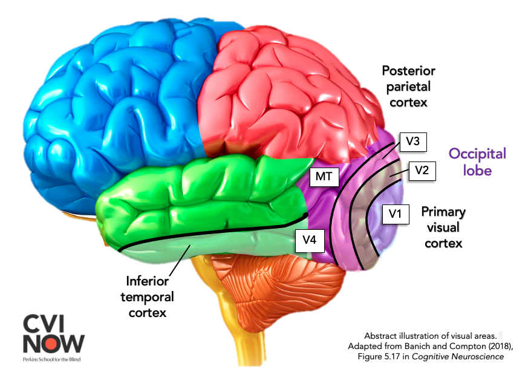
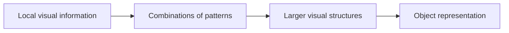
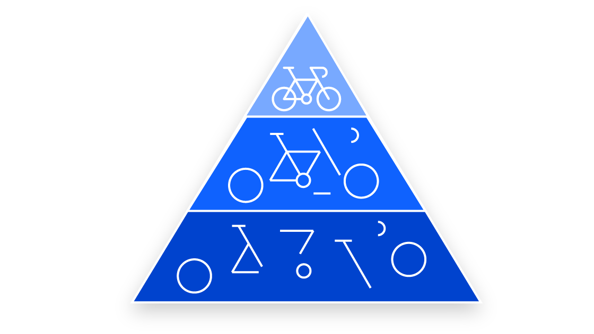
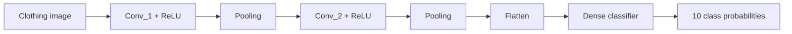
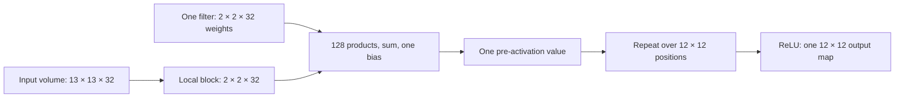
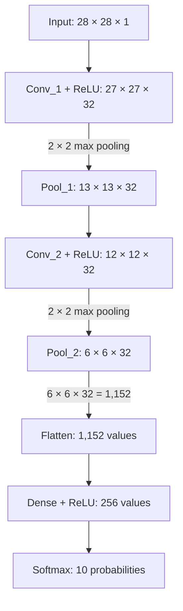
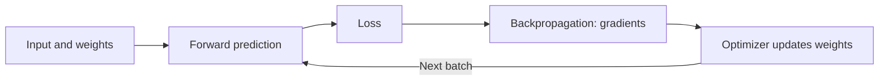

# Demo 1: How can a network learn to see?

*From a fully connected image classifier to a convolutional neural network · Fashion-MNIST*

Last week, a dense neural network classified images by transforming each image into a long vector. It worked, but this raises a question: **does it make sense to ignore the two-dimensional organization of an image when designing the connections in a network?**

## Setup and execution order

Use Google Colab and run the Python blocks in order, including the expandable plotting blocks when a figure is needed. Later blocks reuse variables created earlier. Hand calculations are optional practice; run the supplied plotting code and interpret its output.

This demo imports NumPy, Matplotlib, and TensorFlow/Keras.

Follow the [shared Python setup](1-python_setup.md) for general environment guidance. If an import is unavailable in Colab, run this **notebook cell**:

```python
%pip install numpy matplotlib tensorflow
```

<!-- After installation, restart the Colab session/runtime and rerun the demo from the first import cell. In a local notebook, select the course environment's kernel instead. The `%pip` command is notebook syntax, not a terminal command. 

Download the supplied [trained CNN](assets/fashion_mnist_cnn.keras) and upload it to the Colab working directory before Section 5. When running locally from this demo directory, the code also finds the model in `assets`. The first data-loading call downloads Fashion-MNIST if it is not already cached. The dataset has ten clothing classes; the [dataset's label table](https://github.com/zalandoresearch/fashion-mnist#labels) defines their meanings. 
-->

## 1. What is missing from a fully connected network?

A Fashion-MNIST image has 28 rows and 28 columns. A dense network typically starts by **flattening** those pixels into 784 values. The information remains available, but neighboring pixels are no longer represented as a neighborhood by the network's input structure. Each dense neuron can learn from all the values; it does not automatically apply the same small pattern detector across different image locations.

**Question.** Does flattening destroy pixel values, or does it remove the explicit row-and-column organization? Why might that distinction matter for recognizing clothing?

<details>
<summary>Answer</summary>

Flattening does not discard pixels. It changes a 28 × 28 array into a vector of 784 values. A dense network can still learn image features, but unlike a CNN it has no built-in local, weight-sharing operation. Images contain useful relationships between neighboring pixels, regardless of where an edge occurs.

</details>

### How many trainable parameters are needed?

Compare one dense layer with one standard convolutional layer on the same 28 × 28 grayscale input. Both have 32 output units or filters, but their outputs have different spatial sizes.

| Layer | Weights | Biases | Total trainable parameters | Output per image |
| --- | ---: | ---: | ---: | --- |
| Dense, 32 neurons after flattening | 784 × 32 = 25,088 | 32 | **25,120** | 32 values |
| Conv2D, 32 filters of 2 × 2, stride 1, no padding | 2 × 2 × 1 × 32 = 128 | 32 | **160** | 27 × 27 × 32 values |

In the convolutional count, the factor **1 is the number of input channels**: a grayscale image has one channel. Each of the 32 filters contains four weights and one bias:

$$
\underbrace{2\times2}_{\text{kernel height and width}}
\times\underbrace{1}_{\text{input channels}}
\times\underbrace{32}_{\text{output filters}}
+\underbrace{32}_{\text{one bias per filter}}=160
$$

**Question.** Does moving a convolutional filter to another location require a new set of weights?

<details>
<summary>Answer</summary>

No. Local connections reduce the number of inputs in each weighted sum, and **weight sharing** reuses the same filter weights and bias at every spatial position. There are 729 positions per filter, but only four weights and one bias per filter. The parameter totals include biases; they are not counts of weights alone.

</details>

This is a layer-level comparison, not two equivalent complete classifiers: the convolution produces a spatial map for each filter, whereas the dense layer produces one value per neuron. Fewer parameters can reduce capacity and storage, but do not guarantee better generalization or prevent overfitting. Later dense layers can still contain most of a CNN's parameters.

The distinction becomes visible with an actual image. This ankle boot will remain the **same image throughout the initial experiments**, so changes in the visualizations come from the operations rather than different inputs.

```python
import numpy as np
import matplotlib.pyplot as plt
import tensorflow as tf
from tensorflow import keras
from tensorflow.keras import layers

keras.utils.set_random_seed(42)

(x_train_raw, y_train), (x_test_raw, y_test) = keras.datasets.fashion_mnist.load_data()

class_names = [
    "T-shirt/top", "Trouser", "Pullover", "Dress", "Coat",
    "Sandal", "Shirt", "Sneaker", "Bag", "Ankle boot"
]

x_train = x_train_raw.astype("float32") / 255.0
x_test = x_test_raw.astype("float32") / 255.0
x_train = x_train[..., np.newaxis]  # grayscale channel
x_test = x_test[..., np.newaxis]

image_index = 0
image_batch = x_test[image_index:image_index + 1]  # keep the batch axis
flat_image = image_batch.reshape(1, -1)

print("Image:", image_batch.shape)
print("Flattened:", flat_image.shape)
print("Clothing category:", class_names[int(y_test[image_index])])
```

<details>
<summary>Plot: image beside its flattened pixel sequence</summary>

```python
fig, axes = plt.subplots(1, 2, figsize=(11, 3.5))
axes[0].imshow(image_batch[0, :, :, 0], cmap="gray")
axes[0].set_title("Image: 28 × 28")
axes[0].axis("off")
axes[1].plot(flat_image[0], linewidth=1)
axes[1].set_title("The same 784 pixels in a vector")
axes[1].set_xlabel("Position in vector")
axes[1].set_ylabel("Pixel intensity")
plt.tight_layout()
plt.show()
```

</details>

This suggests a different question: **instead of beginning with all pixels at once, what if the network first examined small neighboring regions?**

## 2. Does biological vision suggest another way to process images?

<!--  -->


Consider the visual hierarchy in biological vision: local contrasts and boundaries contribute to increasingly complex representations. An object is not ordinarily described by treating all pixel positions as unrelated numbers.



This schematic illustrates combining simple patterns into larger structures; it is not a literal model of biological visual processing.

<!--  -->


**Question.** What two ideas might be useful for a new image-classification architecture?

<details>
<summary>Answer</summary>

**Local processing:** examine nearby values together. **Hierarchy:** combine earlier responses into progressively richer representations. This is an inspiration from biological vision, not a claim that a CNN reproduces the eye or visual cortex.

</details>

A way to implement the first idea is surprisingly simple: a tiny collection of numbers that examines one small region at a time. This is a **filter**, also called a **kernel**.


## 3. What could a filter notice?


```python
# Setup - Load and Prepare an Image
import numpy as np
import matplotlib.pyplot as plt
from PIL import Image
import requests
from io import BytesIO
from scipy.signal import convolve2d

# --- Image Loading ---
try:
    # Example image URL (Wikimedia Commons - Bicycle) - Check license if using elsewhere!
    image_url = "https://raw.githubusercontent.com/AI-Learning-Repo/Neural-Networks/refs/heads/week4/material/img/Left_side_of_Flying_Pigeon.jpg" # Option 1

    response = requests.get(image_url)
    response.raise_for_status() # Raise an exception for bad status codes
    img_pil = Image.open(BytesIO(response.content)).convert('RGB')

    # Resize for faster processing (optional, maintains aspect ratio)
    img_pil.thumbnail((256, 256)) # Max size 256x256

    # Convert to NumPy arrays
    img_rgb = np.array(img_pil).astype(np.float32) / 255.0 # Normalize to 0.0-1.0
    img_gray = np.array(img_pil.convert('L')).astype(np.float32) / 255.0 # Grayscale version, normalized

    print(f"Image loaded successfully.")
    print(f"Original Color Image Shape (H, W, C): {img_rgb.shape}")
    print(f"Grayscale Image Shape (H, W): {img_gray.shape}")

    # Display loaded images
    plt.figure(figsize=(8, 4))
    plt.subplot(1, 2, 1)
    plt.imshow(img_rgb)
    plt.title("Original Color Image")
    plt.axis('off')
    plt.subplot(1, 2, 2)
    plt.imshow(img_gray, cmap='gray')
    plt.title("Grayscale Version")
    plt.axis('off')
    plt.tight_layout()
    plt.show()

except requests.exceptions.RequestException as e:
    print(f"Error loading image from URL: {e}")
    # Use placeholder arrays if image loading fails
    img_rgb = np.random.rand(100, 100, 3)
    img_gray = np.random.rand(100, 100)
    print("Using random noise array as fallback.")
except Exception as e:
     print(f"An error occurred: {e}")
     img_rgb = np.random.rand(100, 100, 3)
     img_gray = np.random.rand(100, 100)
     print("Using random noise array as fallback.")


# --- Define Filters (We'll reuse these) ---
# Vertical Edge Detection
filter_vertical = np.array([
    [ 1, 0, -1],
    [ 2, 0, -2],
    [ 1, 0, -1]
], dtype=np.float32)

# Horizontal Edge Detection
filter_horizontal = np.array([
    [ 1,  2,  1],
    [ 0,  0,  0],
    [-1, -2, -1]
], dtype=np.float32)

# Sharpen Filter
filter_sharpen = np.array([
    [ 0, -1,  0],
    [-1,  5, -1],
    [ 0, -1,  0]
], dtype=np.float32)
```

## 4. How Features are Detected (Convolution with one filter on Real Image)

> https://setosa.io/ev/image-kernels/

```python
# Check if image loading was successful
if 'img_gray' not in globals():
    print("Grayscale image not loaded. Please run the setup cell first.")
else:
    # Use the grayscale image and the vertical edge filter
    input_image = img_gray
    filter_kernel = filter_vertical

    print("Input Image Shape:", input_image.shape)
    print("Filter Kernel Shape:", filter_kernel.shape)

    # Apply convolution (mode='valid' means no padding)
    # Flip kernel for strict convolution definition
    feature_map = convolve2d(input_image, np.flipud(np.fliplr(filter_kernel)), mode='valid')
    output_shape = feature_map.shape
    print(f"Feature Map Shape: {output_shape}")

    # Display
    plt.figure(figsize=(12, 4))
    plt.subplot(1, 3, 1)
    plt.imshow(input_image, cmap='gray')
    plt.title(f'Input Grayscale ({input_image.shape[0]}x{input_image.shape[1]})')
    plt.axis('off')

    plt.subplot(1, 3, 2)
    plt.imshow(filter_kernel, cmap='coolwarm')
    plt.title(f'Filter Kernel ({filter_kernel.shape[0]}x{filter_kernel.shape[1]})')
    plt.axis('off')

    plt.subplot(1, 3, 3)
    # Display absolute value or clip for better visualization of edges
    plt.imshow(np.abs(feature_map), cmap='gray')
    plt.title(f'Feature Map ({output_shape[0]}x{output_shape[1]})\n(Vertical Edges Enhanced)')
    plt.axis('off')

    plt.tight_layout()
    plt.show()
```


<!-- 
## 3. What could a tiny filter notice?

Imagine a 2 × 2 window moving over the image. Inside the window, the filter gives different importance to different pixels. It multiplies pixel values by its weights and adds the results. **The same filter is reused at every location.**

A filter with negative weights on the left and positive weights on the right responds to changes in brightness from left to right:

| −1 | +1 |
|---:|---:|
| −1 | +1 |

**Question.** If the pixels on the right are brighter than those on the left, would this filter's weighted sum tend to be positive or negative? What if the contrast is reversed?

Rather than starting with an equation, test two tiny examples.

```python
vertical_kernel = np.array([
    [-1.0,  1.0],
    [-1.0,  1.0]
], dtype=np.float32)

bright_right = np.array([
    [0.0, 0.9],
    [0.1, 0.8]
], dtype=np.float32)

bright_left = bright_right[:, ::-1]

for label, patch in [("Brighter right", bright_right),
                     ("Brighter left", bright_left)]:
    print(label)
    print(patch)
    print("Weighted sum:", round(float(np.sum(patch * vertical_kernel)), 3))
    print()
```

<details>
<summary>Answer</summary>

The right-brighter patch gives **+1.6**. Reversing its columns gives **−1.6**. The same weights respond in opposite directions because the pixel arrangement changed. This is a local contrast response, not object recognition.

</details>

### Does a filter resemble a neuron from the previous lessons?

There is an important connection: **both a dense neuron and a filter use weighted sums.** A convolution is not an entirely new kind of arithmetic; it is a new way of organizing and **sharing** that arithmetic.

**Question.** What is similar about a filter and a neuron? What is different?

<details>
<summary>Answer</summary>

**In common:** both use learnable weights (and often a bias), combine inputs using a weighted sum, and may be followed by an activation such as ReLU.

**Different:** a typical dense neuron combines values from its full input vector to produce one scalar per example. One convolutional filter combines values from a **small spatial neighborhood across all incoming channels**; the same filter weights are reused at many positions, producing an **entire feature map**. Every position in that feature map acts like a neuron-like calculation with shared parameters. A filter is therefore not simply one dense neuron with a different name.

</details>

### Trace all four positions before using TensorFlow

For a 3 × 3 input and a 2 × 2 filter, stride 1 moves the window one column at a time. With no padding, there are two possible starting rows and two starting columns: four patches and four output values. The filter is reused without flipping its weights; this is the cross-correlation convention used by CNN software.

**Question.** Which output position receives the result from the patch starting at input row 1, column 0? Predict its sign before running the code.

```python
toy_image = np.array([
    [10, 20, 10],
    [10, 20, 10],
    [10, 20, 10]
], dtype=np.float32)

toy_output = np.zeros((2, 2), dtype=np.float32)
for r in range(2):
    for c in range(2):
        patch = toy_image[r:r + 2, c:c + 2]
        products = patch * vertical_kernel
        toy_output[r, c] = products.sum()
        print(f"Input patch starting at ({r}, {c}):\n{patch}")
        print(f"Matching products:\n{products}")
        print(f"Output[{r}, {c}] = {toy_output[r, c]:.0f}\n")
print("Complete 2 × 2 output:\n", toy_output)
```

| Step | Input rows and columns (zero-based) | Weighted sum | Output position |
| --- | --- | --- | --- |
| 1 | Rows 0–1, columns 0–1 | −10 + 20 − 10 + 20 = 20 | (0, 0) |
| 2 | Rows 0–1, columns 1–2 | −20 + 10 − 20 + 10 = −20 | (0, 1) |
| 3 | Rows 1–2, columns 0–1 | −10 + 20 − 10 + 20 = 20 | (1, 0) |
| 4 | Rows 1–2, columns 1–2 | −20 + 10 − 20 + 10 = −20 | (1, 1) |

<details>
<summary>Answer</summary>

The patch starting at (1, 0) produces output (1, 0), with value **20**. The complete output has rows `[20, -20]` and `[20, -20]`. Repeated rows in this toy image give repeated responses. The loop visits each valid patch once; TensorFlow computes the same local weighted sums efficiently.

</details>

The toy values illustrate arithmetic and are not normalized Fashion-MNIST pixels. Now apply the same idea to **every valid local patch in the actual shoe image**. A 28 × 28 input has 27 possible starting rows and 27 starting columns, producing 729 values for each 2 × 2 filter.

## 4. What happens when the same filter moves over an image?

Use two deliberately chosen filters. The **vertical-contrast filter** compares left and right pixels; the **horizontal-contrast filter** compares top and bottom pixels.

| Vertical contrast | Horizontal contrast |
|---|---|
| `[-1, +1]` | `[-1, -1]` |
| `[-1, +1]` | `[+1, +1]` |

**Question.** Where might these filters respond along an ankle boot? Would a horizontal-contrast filter respond to every bright pixel, or especially where the image changes from one row to the next?

```python
horizontal_kernel = np.array([
    [-1.0, -1.0],
    [ 1.0,  1.0]
], dtype=np.float32)

vertical_filter = vertical_kernel.reshape(2, 2, 1, 1)
horizontal_filter = horizontal_kernel.reshape(2, 2, 1, 1)

vertical_map = tf.nn.conv2d(
    image_batch, vertical_filter, strides=1, padding="VALID"
).numpy()[0, :, :, 0]

horizontal_map = tf.nn.conv2d(
    image_batch, horizontal_filter, strides=1, padding="VALID"
).numpy()[0, :, :, 0]

print("Input:", image_batch.shape)
print("Vertical map:", vertical_map.shape)
print("Horizontal map:", horizontal_map.shape)
```

<details>
<summary>Plot: input, vertical contrast, horizontal contrast</summary>

```python
limit = max(float(np.abs(vertical_map).max()),
            float(np.abs(horizontal_map).max()), 1e-6)
fig, axes = plt.subplots(1, 3, figsize=(13, 4))
axes[0].imshow(image_batch[0, :, :, 0], cmap="gray")
axes[0].set_title("Ankle boot")
axes[1].imshow(vertical_map, cmap="coolwarm", vmin=-limit, vmax=limit)
axes[1].set_title("Vertical contrast")
im = axes[2].imshow(horizontal_map, cmap="coolwarm",
                    vmin=-limit, vmax=limit)
axes[2].set_title("Horizontal contrast")
for ax in axes:
    ax.axis("off")
fig.colorbar(im, ax=axes[1:], shrink=0.75)
plt.show()
```

</details>

**Question.** Why can one fixed filter produce red (positive) responses in some places and blue (negative) responses elsewhere?

<details>
<summary>Answer</summary>

The filter weights stay the same, but the local image patches change across positions. Opposite contrast directions produce opposite signed responses. These are **feature maps**: maps of where and how strongly a filter responds. No ReLU was used here; that is why both signs remain visible.

</details>

Notice another result: the 28 × 28 image produced 27 × 27 responses. **Why did the border shrink? Could padding prevent that?** Keep this question; padding and stride will be examined in Demo 2.

So far the filters were designed by hand. This creates a new problem: **must a human design every useful filter?** 

-->

## 5. Can a CNN discover its own filters?

A CNN has already been trained on Fashion-MNIST. Treat it as a **black box** for the moment: put in a shoe image and look at its predicted class. The original trained model is used unchanged, with convolution and ReLU combined in its `Conv2D` layers.

**Question.** The two filters above were chosen manually. Where could the weights inside a trained CNN come from?


```sh
!wget -O fashion_mnist_cnn.keras "https://YOUR_RAW_URL_HERE/fashion_mnist_cnn.keras"
```

```python
from pathlib import Path

# Colab upload location, or assets when run from this demo directory.
model_path = Path("fashion_mnist_cnn.keras")
if not model_path.exists():
    model_path = Path("assets/fashion_mnist_cnn.keras")
if not model_path.exists():
    raise FileNotFoundError("Upload fashion_mnist_cnn.keras to Colab first.")

trained_model = keras.models.load_model(model_path, compile=False)
probabilities = trained_model.predict(image_batch, verbose=0)[0]

predicted = int(np.argmax(probabilities))
print("Actual class:", class_names[int(y_test[image_index])])
print("Predicted class:", class_names[predicted])
print("Top probability:", round(float(probabilities[predicted]), 4))

# See the structure of the black box.
trained_model.summary()
```

<details>
<summary>Answer</summary>

The filters start with trainable weights and are adjusted during training using the familiar cycle: predictions, loss, backpropagated gradients, and optimizer updates. They are **not** hand-selected horizontal or vertical kernels. Training can produce filters with responses that are harder to describe in ordinary visual terms.

</details>



The model predicts an **ankle boot** for the selected test image. The prediction is the end of the calculation. But **what happened inside it?**

## 6. What did the first learned convolution produce?

`Conv_1` contains **32 learned filters**, not just the two manual filters used earlier. For a grayscale input, each of its kernels is 2 × 2 × 1. Each filter generates one map, giving 32 maps altogether.

**Question.** If every filter sees the same ankle boot, will all 32 response maps look alike? Why not?

```python
conv1 = trained_model.get_layer("Conv_1")
W1, b1 = conv1.get_weights()
print("First-layer kernel bank:", W1.shape)

# Compute responses BEFORE ReLU using the trained weights.
pre_relu_1 = tf.nn.bias_add(
    tf.nn.conv2d(image_batch, W1, strides=1, padding="VALID"), b1
).numpy()[0]

# Apply ReLU separately for analysis; the saved model is unchanged.
post_relu_1 = np.maximum(pre_relu_1, 0)

conv1_probe = keras.Model(trained_model.inputs, conv1.output)
actual_conv1 = conv1_probe.predict(image_batch, verbose=0)[0]
np.testing.assert_allclose(post_relu_1, actual_conv1,
                           rtol=1e-4, atol=1e-5)
print("Feature-map shape:", post_relu_1.shape)
print("Reconstruction matches the trained CNN.")
```

<details>
<summary>Plot: six feature maps from Conv_1</summary>

```python
variation = post_relu_1.std(axis=(0, 1))
channels = np.argsort(variation)[-6:][::-1]
fig, axes = plt.subplots(1, 6, figsize=(15, 3))
for ax, ch in zip(axes, channels):
    ax.imshow(post_relu_1[:, :, ch], cmap="viridis")
    ax.set_title(f"Filter {ch}")
    ax.axis("off")
plt.tight_layout()
plt.show()
```

</details>

<details>
<summary>Answer</summary>

The filters have **different trained weights and biases**. They therefore respond differently to the same local pixels. A map might trace parts of the boot, its boundary, or the surrounding region. A map's appearance alone does not prove that its filter has learned a precise concept such as "heel" or "sole".

</details>

There is one difference between these real feature maps and the earlier hand-filter maps: the CNN's first convolution is followed by **ReLU**. What does that change?

## 7. What does ReLU preserve—and what does it hide?

Recall that the manual filters gave red and blue responses because positive and negative values were both retained. ReLU keeps positive values but turns negative values into zero.

The supplied model has two particularly revealing learned filters on the same ankle boot: **filter 2** had no positive response, whereas **filter 12** had both positive and negative responses.

**Question.** What will the map look like after ReLU if *every* response is negative or zero? What if some are positive?

```python
for channel in (2, 12):
    before = pre_relu_1[:, :, channel]
    after = post_relu_1[:, :, channel]
    print(f"Filter {channel}")
    print("  Before ReLU — min/max:",
          round(float(before.min()), 4), round(float(before.max()), 4))
    print("  Negative fraction:", round(float(np.mean(before < 0)), 4))
    print("  Positive fraction:", round(float(np.mean(before > 0)), 4))
    print("  Zero fraction after:", round(float(np.mean(after == 0)), 4))
```

<details>
<summary>Plot: the same learned filters before and after ReLU</summary>

```python
fig, axes = plt.subplots(2, 3, figsize=(12, 7))
for row, channel in enumerate((2, 12)):
    before = pre_relu_1[:, :, channel]
    after = post_relu_1[:, :, channel]
    limit = max(float(np.abs(before).max()), 1e-6)

    axes[row, 0].imshow(image_batch[0, :, :, 0], cmap="gray")
    axes[row, 0].set_title("Original ankle boot")
    axes[row, 1].imshow(before, cmap="coolwarm", vmin=-limit, vmax=limit)
    axes[row, 1].set_title(f"Filter {channel}: before ReLU")
    im = axes[row, 2].imshow(after, cmap="coolwarm",
                             vmin=-limit, vmax=limit)
    axes[row, 2].set_title(f"Filter {channel}: after ReLU")
    for ax in axes[row]:
        ax.axis("off")
plt.tight_layout()
plt.show()
```

</details>

<details>
<summary>Answer</summary>

For this image and saved model, filter 2 is completely suppressed after ReLU; its output is zero everywhere. Filter 12 retains positive responses while the negative part is removed. ReLU **does discard negative information** in that channel. The network can still make a correct prediction using many other channels. Nonlinear activation also allows stacked layers to represent functions that cannot be expressed by stacking only affine transformations.

</details>

A single local filter responds to small patches. But recognizing a complete shoe seems to require combinations of patterns. **How can the network combine the responses of many filters?**

## 8. Can a deeper layer combine simpler responses?

The first convolution makes 32 maps. Pooling reduces their spatial size, and the next convolution receives **all 32 pooled maps** as its input channels. Detailed pooling behavior will be investigated in Demo 2; here its role is simply to reduce the spatial grid between these convolutional layers.

**Question.** If `Conv_1` and `Conv_2` both produce 32 maps, must they represent the same kinds of patterns?

```python
conv2 = trained_model.get_layer("Conv_2")
W2, b2 = conv2.get_weights()
print("Conv_1 kernels:", W1.shape)
print("Conv_2 kernels:", W2.shape)

layer_probe = keras.Model(
    trained_model.inputs, [conv1.output, conv2.output]
)
first_maps, second_maps = layer_probe.predict(image_batch, verbose=0)
first_maps = first_maps[0]
second_maps = second_maps[0]
print("Conv_1 maps:", first_maps.shape)
print("Conv_2 maps:", second_maps.shape)
```

<details>
<summary>Plot: first-layer and second-layer learned responses</summary>

```python
fig, axes = plt.subplots(2, 6, figsize=(15, 6))
for row, maps in enumerate((first_maps, second_maps)):
    selected = np.argsort(maps.std(axis=(0, 1)))[-6:][::-1]
    for col, channel in enumerate(selected):
        axes[row, col].imshow(maps[:, :, channel], cmap="viridis")
        axes[row, col].set_title(f"Conv_{row + 1}: {channel}")
        axes[row, col].axis("off")
plt.tight_layout()
plt.show()
```

</details>

<details>
<summary>Answer</summary>

No. The number 32 counts **output channels**, not the abstraction level. A `Conv_1` filter uses a 2 × 2 patch of the one-channel image; a `Conv_2` filter uses a 2 × 2 region **across all 32 incoming channels**. Its receptive field covers a larger part of the original image, so it can combine earlier local responses. The plots suggest different representations, but do not prove that a particular map recognizes a named object part. The different map sizes also reflect pooling, not simply increasing abstraction.

</details>

What does “combining 32 channels” actually mean? Inspect **one output filter** rather than another grid of 32 outputs.

## 9. How does one deeper filter combine 32 incoming maps?

In a standard convolution with `groups=1`, each filter spans **all input channels**. The first layer's filter is 2 × 2 × 1 because the image is grayscale. A second-layer filter is a **2 × 2 × 32 block of weights**, matching the 32 incoming feature maps. It slides over height and width, not independently along the channel axis. Grouped and depthwise convolution use different connectivity and are outside this example.



At one position, multiply the 128 input values by matching weights and add them, then add **one bias for that output filter**. Repeating this calculation over all positions produces one feature map. The layer's 32 different filters produce 32 output maps.

The same parameter-count rule now includes 32 input channels: each output filter has 2 × 2 × 32 = 128 weights and one bias. Across 32 output filters, `Conv_2` therefore has **128 × 32 + 32 = 4,128 trainable parameters**.

**About the diagnostic array below:** standard convolution sums all input-channel contributions to produce **one scalar per position per output filter**. The temporary `contributions` array has shape (12, 12, 32) only to keep those contributions separate for visualization; it is **not** the output of one filter. Summing its last axis and adding the bias produces the (12, 12) pre-activation map; ReLU produces the final (12, 12) map for that filter. Only four of the 32 contributions are pictured, but all 32 are included in the sum.

**Question.** Could positive and negative channel contributions cancel each other? What happens if their combined value is negative just before ReLU?

```python
# Input to Conv_2 is the output of the preceding pooling layer.
probe2 = keras.Model(
    trained_model.inputs, [conv2.input, conv2.output]
)
pooled_batch, actual_conv2 = probe2.predict(image_batch, verbose=0)

# Choose one output filter that activates for the selected shoe.
out_channel = int(np.argmax(actual_conv2[0].mean(axis=(0, 1))))

# One spatial position: a 3D patch meets one complete 3D filter.
patch_3d = pooled_batch[0, 0:2, 0:2, :]
filter_3d = W2[:, :, :, out_channel]
single_pixel_value = np.sum(patch_3d * filter_3d) + b2[out_channel]
print("Patch and filter shapes:", patch_3d.shape, filter_3d.shape)
print("Pre-activation at (0, 0):", round(float(single_pixel_value), 4))
print("After ReLU:", round(float(max(0, single_pixel_value)), 4))
np.testing.assert_allclose(
    max(0, single_pixel_value), actual_conv2[0, 0, 0, out_channel],
    rtol=1e-4, atol=1e-5
)

# Repeat the same arithmetic at every position, keeping the channel sums
# separate only so their contributions can be visualized below.
height, width = actual_conv2.shape[1:3]
contributions = np.zeros((height, width, pooled_batch.shape[-1]),
                         dtype=np.float32)
for r in range(height):
    for c in range(width):
        patch_3d = pooled_batch[0, r:r + 2, c:c + 2, :]
        contributions[r, c, :] = np.sum(patch_3d * filter_3d, axis=(0, 1))

combined = contributions.sum(axis=-1) + b2[out_channel]
activated = np.maximum(combined, 0)

np.testing.assert_allclose(activated, actual_conv2[0, :, :, out_channel],
                           rtol=1e-4, atol=1e-5)
print("Chosen Conv_2 output filter:", out_channel)
print("Individual channel contributions:", contributions.shape)
print("Reconstruction matches the trained CNN.")
```

<details>
<summary>Plot: four channel contributions, complete sum, and ReLU</summary>

```python
strength = np.abs(contributions).mean(axis=(0, 1))
selected = np.argsort(strength)[-4:][::-1]
scale = max(float(np.abs(contributions[:, :, selected]).max()),
            float(np.abs(combined).max()), 1e-6)

fig, axes = plt.subplots(2, 3, figsize=(12, 7))
for ax, ch in zip(axes.flat[:4], selected):
    ax.imshow(contributions[:, :, ch], cmap="coolwarm",
              vmin=-scale, vmax=scale)
    ax.set_title(f"Input channel {ch}")
    ax.axis("off")
axes.flat[4].imshow(combined, cmap="coolwarm",
                    vmin=-scale, vmax=scale)
axes.flat[4].set_title("All 32 channels + bias")
axes.flat[5].imshow(activated, cmap="coolwarm",
                    vmin=-scale, vmax=scale)
axes.flat[5].set_title("After ReLU")
for ax in axes.flat[4:]:
    ax.axis("off")
plt.tight_layout()
plt.show()
```

</details>

<details>
<summary>Answer</summary>

**Yes.** A positive contribution from one channel can be offset by a negative contribution from another channel. The sum includes **all 32 channels**, not only the four pictured. A negative combined value becomes zero after ReLU. The reconstructed output agrees with the actual learned CNN. This reveals how deeper convolution uses combinations of earlier features rather than merely selecting one incoming channel.

</details>

The CNN has now been examined **from the inside out**: local filters, learned responses, activation, and combinations of feature maps. The original shoe was classified by a network that put these operations together. **How can these operations be assembled into a complete network?**

## 10. From small experiments to a complete CNN

The complete Fashion-MNIST model follows the familiar workflow from the earlier dense-network activities: prepare data, define the model, compile, train, and evaluate. The learning cycle is unchanged; the architecture is different.

Convolution and ReLU are **separate layers** in the new model so their roles are visible. This is functionally equivalent to the original `Conv2D(..., activation="relu")` for the same parameters.

The following shapes describe **one image**, omitting the batch axis. Both convolutions use 2 × 2 kernels, stride 1, and valid (no) padding. Both pooling layers use 2 × 2 windows, stride 2, and valid padding. ReLU preserves shape.



For example, the first convolution gives 28 − 2 + 1 = 27 positions on each side. For pooling with a 2 × 2 window, stride 2, and valid padding, the odd length 27 contains **13 complete pairs**, covering indices **0–25** along each spatial axis. The final window covers indices 24–25; the leftover row and column at index **26** are omitted, with no padding added (`27 // 2 = 13`). Flatten rearranges the 6 × 6 × 32 activations into a vector without learning weights or discarding values. Detailed pooling behavior is reserved for Demo 2.

**Question.** In this architecture, which layers learn weights, and which layers change the representation without learning weights?

<details>
<summary>Answer</summary>

The two convolutions and two dense layers learn weights and biases. ReLU, max pooling, and flattening have no trainable weights. Pooling is included because it is part of the complete model; its detailed mechanics will be investigated in Demo 2.

</details>

### Define the CNN

```python
keras.utils.set_random_seed(42)

inputs = keras.Input(shape=(28, 28, 1))
x = layers.Conv2D(32, (2, 2), name="demo_conv1")(inputs)
x = layers.ReLU(name="demo_relu1")(x)
x = layers.MaxPooling2D((2, 2), name="demo_pool1")(x)
x = layers.Conv2D(32, (2, 2), name="demo_conv2")(x)
x = layers.ReLU(name="demo_relu2")(x)
x = layers.MaxPooling2D((2, 2), name="demo_pool2")(x)
x = layers.Flatten()(x)
x = layers.Dense(256, activation="relu")(x)
outputs = layers.Dense(10, activation="softmax")(x)

demo_model = keras.Model(inputs, outputs, name="fashion_cnn_demo")
demo_model.summary()
```

**Question.** Why does the model end with ten softmax outputs rather than one output? What do the values represent?

<details>
<summary>Answer</summary>

Fashion-MNIST has ten mutually exclusive classes. Softmax converts the final class scores into ten probabilities that sum to one. The class with the highest probability is the model's predicted class.

</details>

### Train the model

```python
demo_model.compile(
    optimizer=keras.optimizers.Adam(),
    loss="sparse_categorical_crossentropy",
    metrics=["accuracy"]
)

history = demo_model.fit(
    x_train, y_train,
    batch_size=64,
    epochs=10,
    validation_split=0.2,
    verbose=2
)
```

**Question.** Is training a CNN fundamentally different from training the dense network from the previous activity?

<details>
<summary>Answer</summary>

The same learning cycle applies: forward pass, loss, backpropagation to calculate gradients, and optimizer updates to trainable parameters. What has changed is the spatial structure of the computations and the sharing of convolutional weights. A validation curve may reveal overfitting even when training accuracy continues improving.

</details>

### What do the results say?

<details>
<summary>Plot: training and validation loss and accuracy</summary>

```python
epochs = np.arange(1, len(history.history["loss"]) + 1)
fig, axes = plt.subplots(1, 2, figsize=(12, 4))
axes[0].plot(epochs, history.history["loss"], marker="o", label="Train")
axes[0].plot(epochs, history.history["val_loss"], marker="o", label="Validation")
axes[0].set_title("Loss")
axes[1].plot(epochs, history.history["accuracy"], marker="o", label="Train")
axes[1].plot(epochs, history.history["val_accuracy"], marker="o", label="Validation")
axes[1].set_title("Accuracy")
for ax in axes:
    ax.set_xlabel("Epoch")
    ax.grid(alpha=0.2)
    ax.legend()
plt.tight_layout()
plt.show()
```

</details>

**Question.** If training loss keeps decreasing but validation loss rises, what might be happening? Does a single upward movement prove overfitting?

<details>
<summary>Answer</summary>

A sustained gap between improving training loss and worsening validation loss suggests overfitting. One noisy upward movement is not conclusive. The curves are from the actual run; they should be interpreted rather than compared to a fixed expected epoch or accuracy.

</details>

### Inspect the mistakes, not only the accuracy

```python
test_loss, test_accuracy = demo_model.evaluate(x_test, y_test, verbose=0)
all_probs = demo_model.predict(x_test, verbose=0)
predictions = np.argmax(all_probs, axis=1)
wrong_indices = np.flatnonzero(predictions != y_test)

print("Test accuracy:", round(float(test_accuracy), 4))
print("Test loss:", round(float(test_loss), 4))
print("Misclassified images:", len(wrong_indices))
```

<details>
<summary>Plot: examples the CNN classified incorrectly</summary>

```python
n = min(12, len(wrong_indices))
fig, axes = plt.subplots(3, 4, figsize=(12, 9))
for ax in axes.flat:
    ax.axis("off")
if n:
    chosen = np.random.default_rng(42).choice(wrong_indices, n, replace=False)
    for ax, idx in zip(axes.flat, chosen):
        ax.imshow(x_test[idx, :, :, 0], cmap="gray")
        ax.set_title(
            f"True: {class_names[int(y_test[idx])]}\n"
            f"Pred: {class_names[int(predictions[idx])]}"
        )
plt.tight_layout()
plt.show()
```

</details>

<details>
<summary>Plot: confusion matrix across all ten categories</summary>

```python
counts = tf.math.confusion_matrix(
    y_test, predictions, num_classes=10
).numpy()
fig, ax = plt.subplots(figsize=(9, 7))
im = ax.imshow(counts, cmap="Blues")
ax.set_xticks(range(10), class_names, rotation=55, ha="right")
ax.set_yticks(range(10), class_names)
ax.set_xlabel("Predicted class")
ax.set_ylabel("True class")
for i in range(10):
    for j in range(10):
        ax.text(j, i, counts[i, j], ha="center", va="center",
                fontsize=7, color="white" if counts[i, j] > counts.max() * 0.5 else "black")
fig.colorbar(im, ax=ax, shrink=0.8)
plt.tight_layout()
plt.show()
```

</details>

**Question.** If the model predicts most test images correctly, what can still be learned by examining misclassified examples and the confusion matrix?

<details>
<summary>Answer</summary>

Overall accuracy does not reveal which categories are commonly confused. The off-diagonal cells of the confusion matrix show specific class confusions. Visually similar garments may be difficult to separate, even when the overall score is high. No single test run guarantees equally good results on every future dataset.

</details>

The final question returns to where the demonstration began: **what is gained by replacing a purely dense image classifier with local, shared filters?**

<details>
<summary>Answer</summary>

The CNN introduces local connections, reuses the same learned filter at many image positions, retains spatial maps through several layers, and combines those maps into richer representations before classification. The network still learns using the familiar backpropagation and optimizer cycle.

</details>

**Next:** Demo 2 revisits the questions left open here: how pooling selects responses, how padding changes borders, how stride changes spatial resolution, and how pretrained representations can be reused through transfer learning.

---

## Mathematics and shape checks: collected at the end

The experiments above used the same weighted-sum idea already familiar from dense neurons. Here is the formal version, after the visual behavior is established.

### Step A: arithmetic for one input channel

The calculation is a familiar neuron weighted sum, applied to one local patch. Consider this separate arithmetic example, with a bias of 0.5:

$$
X=
\begin{bmatrix}
2 & 3 \\
1 & 4
\end{bmatrix},
\qquad
W=
\begin{bmatrix}
-1 & 1 \\
-1 & 1
\end{bmatrix},
\qquad b=0.5
$$

Multiply matching entries and add the bias once:

$$
z=(2)(-1)+(3)(1)+(1)(-1)+(4)(1)+0.5=4.5
$$

The four products sum to 4.0; the bias increases the result to 4.5. ReLU retains 4.5 because it is positive. Now express the same calculation for any valid patch starting at row $r$ and column $c$:

$$
z_{r,c}=\sum_{i=0}^{k_h-1}\sum_{j=0}^{k_w-1}
W_{i,j}\,x_{r+i,c+j}+b
$$

The indices $i$ and $j$ enumerate positions inside a filter of height $k_h$ and width $k_w$. Each sum simply adds the matching products already shown above. The formula assumes stride 1 and no padding.

### Step B: arithmetic for two input channels

Use the same first-channel patch and weights, then add a second channel. These are illustrative channel values, not the grayscale Fashion-MNIST input:

$$
X^{(0)}=
\begin{bmatrix}
2 & 3 \\
1 & 4
\end{bmatrix},
\qquad
W^{(0)}=
\begin{bmatrix}
-1 & 1 \\
-1 & 1
\end{bmatrix}
$$

$$
X^{(1)}=
\begin{bmatrix}
1 & 0 \\
0 & 2
\end{bmatrix},
\qquad
W^{(1)}=
\begin{bmatrix}
0.5 & 0 \\
0 & 1
\end{bmatrix}
$$

The superscripts identify channel slices of **one filter**, not separate output filters. Calculate each slice's contribution without a bias:

$$
s_0=(2)(-1)+(3)(1)+(1)(-1)+(4)(1)=4.0
$$

$$
s_1=(1)(0.5)+(0)(0)+(0)(0)+(2)(1)=2.5
$$

Sum both channel contributions, add one bias, and apply ReLU:

$$
z=s_0+s_1+b=4.0+2.5+0.5=7.0,
\qquad a=\max(0,7.0)=7.0
$$

**Question.** Would adding the bias separately to each channel produce the same result?

<details>
<summary>Answer</summary>

No. One output filter has one bias, added after all channel contributions are summed. Adding 0.5 twice would incorrectly give 7.5 instead of 7.0.

</details>

Now generalize the same operation to any number of input channels and output filters:

$$
z_{r,c,o}=\sum_{q=0}^{C_{\mathrm{in}}-1}
\left(\sum_{i=0}^{k_h-1}\sum_{j=0}^{k_w-1}
W_{i,j,q,o}\,x_{r+i,c+j,q}\right)+b_o
$$

Here $q$ selects an input channel, $C_{\mathrm{in}}$ counts input channels, and $o$ selects one output filter. The inner sums calculate one channel's contribution; the outer sum combines all channels. The single bias belongs to filter $o$. ReLU then acts on the complete sum:

$$
a_{r,c,o}=\max(0,z_{r,c,o})
$$

The earlier hand-filter experiment used normalized patches and no bias, giving +1.6 and −1.6 before activation. The arithmetic examples above use different stated values to make the general formula concrete.

### Neuron versus convolutional filter

A dense neuron produces one pre-activation scalar by combining its input features:

$$
z=\sum_{j=1}^{n}w_jx_j+b
$$

A convolutional filter performs a similar weighted sum **repeatedly at different spatial positions using the same weights**. The filter creates a feature map, not merely one scalar for the whole image. Convolution in common CNN software is implemented using cross-correlation, so the displayed kernel orientation is not flipped.

### Why the feature maps shrink

With input width $n$, kernel width $k$, no padding, and stride 1:

$$
n_{\mathrm{out}}=n-k+1
$$

So a 28-pixel side with a 2-pixel kernel becomes $28-2+1=27$. Padding and other strides change that result; their general formula and visual effect are reserved for Demo 2.

### The trained model's shapes

| Operation | Output shape (height × width × channels) |
|---|---|
| Input | 28 × 28 × 1 |
| Conv_1, 32 kernels of 2 × 2 | 27 × 27 × 32 |
| MaxPooling | 13 × 13 × 32 |
| Conv_2, 32 kernels of 2 × 2 × 32 | 12 × 12 × 32 |
| MaxPooling | 6 × 6 × 32 |
| Flatten | 1,152 values |
| Dense | 256 values |
| Softmax | 10 probabilities |

The second convolution has 32 kernels, each spanning **all 32 input channels**. That is why it can combine earlier feature responses while producing 32 *new* maps.

### Connection to training



This cycle is unchanged from the dense-network lesson. Convolution changes the way predictions are computed, not the distinction between computing gradients and updating parameters.
