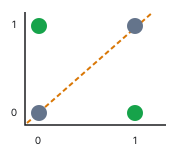
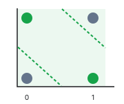
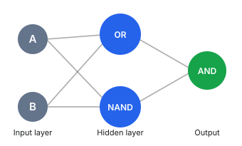

# Understanding XOR with Python: From Perceptrons to Hidden Layers

The main idea is that a single perceptron cannot solve XOR, but multiple perceptrons working together can.

We can demonstrate this using Python, starting with simple logic gates and then connecting them into a small neural network.

## 1. What is XOR?

XOR (Exclusive OR) returns `1` when its two inputs are different, and `0` when they are the same.

| Input A | Input B | XOR output |
| ------- | ------- | ---------- |
| 0       | 0       | 0          |
| 0       | 1       | 1          |
| 1       | 0       | 1          |
| 1       | 1       | 0          |

The problem is that a single perceptron creates a linear decision boundary (a straight line in two dimensions), but XOR cannot be separated by a single straight line.





## 2. Build the logic gates using perceptrons

A perceptron computes a weighted sum of its inputs, adds a bias, then applies an activation function:

$$
\boxed{\text{XOR}(A, B) = \text{AND}(\text{OR}(A, B), \text{NAND}(A, B))}
$$

Here, `step` outputs `1` if the sum is greater than or equal to zero, otherwise `0`.

```python
import numpy as np

def perceptron(x, weights, bias):
    total = np.dot(x, weights) + bias
    return int(total >= 0)

def OR(a, b):
    return perceptron([a, b], [1, 1], -0.5)

def NAND(a, b):
    return perceptron([a, b], [-1, -1], 1.5)

def AND(a, b):
    return perceptron([a, b], [1, 1], -1.5)

for a in [0, 1]:
    for b in [0, 1]:
        print(a, b, OR(a, b), NAND(a, b), AND(a, b))
```

These gates use different weights and biases, but they all have the same perceptron structure.

## 3. Combine the gates to make XOR

The mathematical trick is:

$$
\boxed{\text{XOR}(A, B) = \text{AND}(\text{OR}(A, B), \text{NAND}(A, B))}
$$

This means:

1. Send `A` and `B` to an OR perceptron.
2. Send `A` and `B` to a NAND perceptron.
3. Send both results to an AND perceptron.
4. The final output is XOR.

The XOR neural network



Notice that the OR and NAND perceptrons form the hidden layer. They process the original inputs before passing their results to the final perceptron.

Let's implement this:

```python
def XOR(a, b):
    # Hidden layer
    hidden_1 = OR(a, b)
    hidden_2 = NAND(a, b)

    # Output layer
    output = AND(hidden_1, hidden_2)

    return output

for a in [0, 1]:
    for b in [0, 1]:
        print(f"XOR({a}, {b}) = {XOR(a, b)}")
```

I verified this calculation using Python. The outputs are:

```text
XOR(0, 0) = 0
XOR(0, 1) = 1
XOR(1, 0) = 1
XOR(1, 1) = 0
```

All four are correct.

## 4. Why this is a Multi-Layer Perceptron (MLP)

A Multi-Layer Perceptron is a neural network that uses multiple layers of neurons.

Our XOR network has:

| Layer  | Neurons  | Purpose                       |
| ------ | -------- | ----------------------------- |
| Input  | A, B     | Receive data                  |
| Hidden | OR, NAND | Extract intermediate patterns |
| Output | AND      | Combine patterns into XOR     |

The hidden layer is important because it transforms the inputs into a representation that the final perceptron can classify.

In a modern MLP, we typically don't manually choose OR or NAND operations. Instead, the network learns its weights and biases from training data, often using backpropagation and gradient descent.

The takeaway: A single perceptron can only make a linear decision. By combining perceptrons into hidden layers with nonlinear activation functions, a neural network can solve problems like XOR that a single perceptron cannot.