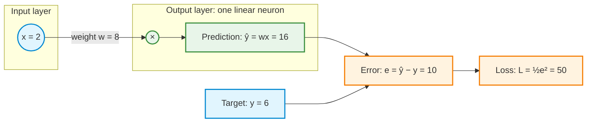
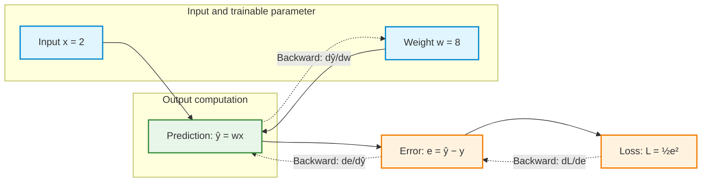
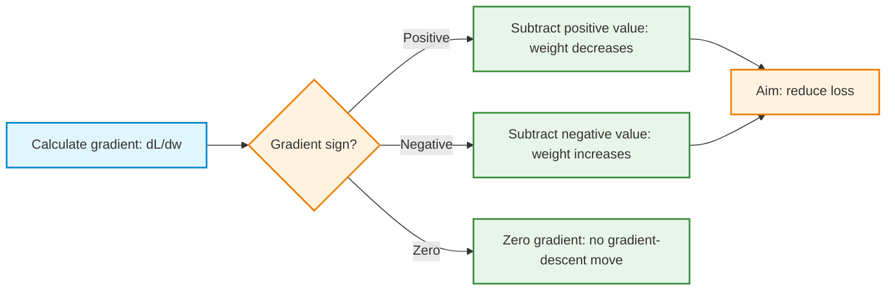
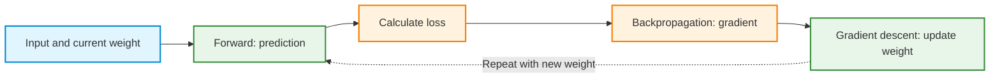

# Demo 1 — One Weight: Backpropagation and Gradient Descent

**Worked demonstration | One linear neuron, one input, one trainable weight, and no bias**

## How to use this demonstration

This demonstration explains the full training cycle through a worked numerical example. Follow the worked calculations in order. Repeating the hand calculations is optional practice. The emphasis is on interpreting predictions, losses, gradients, and parameter updates.

<!-- The arithmetic simulation uses basic Python. The optional visualizations use NumPy and Matplotlib where indicated. **Run the supplied plotting code to view each figure, then describe the pattern it shows. Writing plotting code from scratch is not an assessed task.** Printed step $k$ represents the state after $k$ completed updates. -->

**Python setup:** [Install and check the Week 2 libraries](1-python_setup.md). The plots use NumPy and Matplotlib; the arithmetic simulation needs no additional libraries.

## Calculus refresher before the demonstration

A derivative measures the local slope of a function. For a square function, the derivative is:

$$
f(w)=w^2,\qquad f'(w)=2w
$$

At $w=2$, the slope is 4: a small increase in the weight increases the function value. A negative slope means a small increase decreases the function value.


<details>
<summary>Visualization: Local Slope (Derivative)</summary>

```python
import matplotlib.pyplot as plt
import numpy as np

# Setup
w_vals = np.linspace(-0.5, 3.5, 200)
f_vals = w_vals**2

w0 = 2.0
f0 = w0**2
slope = 2 * w0  # f'(w) = 2w -> 4

# Tangent line: y - f0 = slope * (w - w0)
tangent_w = np.linspace(0.8, 3.2, 50)
tangent_f = slope * (tangent_w - w0) + f0

plt.figure(figsize=(7, 5))
plt.plot(
    w_vals, f_vals, label=r"$f(w) = w^2$", color="#1f77b4", linewidth=2.5
)
plt.plot(
    tangent_w,
    tangent_f,
    "--",
    color="#d62728",
    linewidth=2,
    label=rf"Tangent line (Slope $= f'(2) = {int(slope)}$)",
)
plt.scatter([w0], [f0], color="#d62728", s=80, zorder=5)

# Visualise "Rise over Run" triangle
delta_w = 0.5
delta_f = slope * delta_w
plt.plot([w0, w0 + delta_w], [f0, f0], "k:", linewidth=1.5)
plt.plot([w0 + delta_w, w0 + delta_w], [f0, f0 + delta_f], "k:", linewidth=1.5)

plt.text(
    w0 + delta_w / 2,
    f0 - 0.7,
    rf"$\Delta w = {delta_w}$",
    ha="center",
    fontsize=11,
)
plt.text(
    w0 + delta_w + 0.08,
    f0 + delta_f / 2,
    rf"$\Delta f = {delta_f}$",
    va="center",
    fontsize=11,
)

# Title using standard text and compatible math syntax
plt.title(
    r"Local Slope: $f'(w) = 2w \rightarrow$ Slope at $w=2$ is 4"
    + "\n"
    + r"Slope = $\frac{\Delta f}{\Delta w} = \frac{2.0}{0.5} = 4$",
    fontsize=12,
    weight="bold",
)
plt.xlabel("Weight ($w$)", fontsize=11)
plt.ylabel("$f(w)$", fontsize=11)
plt.ylim(-1, 13)
plt.grid(True, linestyle="--", alpha=0.6)
plt.legend(loc="upper left")
plt.tight_layout()
plt.show()
```
</details>


The chain rule connects successive calculations. If a weight changes a prediction, and the prediction changes a loss, multiply the two local sensitivities:

$$
\frac{dL}{dw}=\frac{dL}{d\hat y}\frac{d\hat y}{dw}
$$


<details>
<summary>Visualization: The Chain Rule (Step-by-Step Pipeline)</summary>

```python
import matplotlib.pyplot as plt
import numpy as np

fig, (ax1, ax2, ax3) = plt.subplots(1, 3, figsize=(16, 5))

# ----------------------------------------------------
# 1. Step 1: Weight (w) -> Prediction (y_hat)
# y_hat = 1.5 * w  => dy_hat / dw = 1.5
# ----------------------------------------------------
w = np.linspace(0.5, 3.5, 100)
y_hat = 1.5 * w

w0 = 2.0
y0 = 1.5 * w0  # 3.0
dw = 0.3
dy = 1.5 * dw  # 0.45

ax1.plot(w, y_hat, color="#2ca02c", linewidth=2.5, label=r"$\hat{y} = 1.5w$")
ax1.scatter([w0], [y0], color="#2ca02c", s=80, zorder=5)

# Nudge triangle
ax1.plot([w0, w0 + dw], [y0, y0], color="#1f77b4", linestyle=":", linewidth=2)
ax1.plot(
    [w0 + dw, w0 + dw], [y0, y0 + dy], color="#ff7f0e", linestyle=":", linewidth=2
)
ax1.text(
    w0 + dw / 2,
    y0 - 0.25,
    rf"$\Delta w = {dw}$",
    ha="center",
    color="#1f77b4",
    fontsize=11,
    weight="bold",
)
ax1.text(
    w0 + dw + 0.05,
    y0 + dy / 2,
    rf"$\Delta \hat{{y}} = {dy:.2f}$",
    va="center",
    color="#ff7f0e",
    fontsize=11,
    weight="bold",
)

ax1.set_title(
    r"Step 1: Weight $\to$ Prediction"
    + "\n"
    + r"Local Slope $\frac{d\hat{y}}{dw} = 1.5$",
    fontsize=12,
    weight="bold",
)
ax1.set_xlabel("Weight ($w$)", fontsize=11)
ax1.set_ylabel(r"Prediction ($\hat{y}$)", fontsize=11)
ax1.grid(True, linestyle="--", alpha=0.5)
ax1.legend(loc="upper left")

# ----------------------------------------------------
# 2. Step 2: Prediction (y_hat) -> Loss (L)
# L = (y_hat - 1)^2  => dL / dy_hat = 2 * (y_hat - 1) = 4.0 at y_hat = 3
# ----------------------------------------------------
y_vals = np.linspace(1.5, 4.5, 100)
L_vals = (y_vals - 1) ** 2

L0 = (y0 - 1) ** 2  # 4.0
slope2 = 2 * (y0 - 1)  # 4.0
dL = slope2 * dy  # 4.0 * 0.45 = 1.80

ax2.plot(
    y_vals,
    L_vals,
    color="#9467bd",
    linewidth=2.5,
    label=r"$L = (\hat{y} - 1)^2$",
)
ax2.scatter([y0], [L0], color="#9467bd", s=80, zorder=5)

# Tangent
tan_y = np.linspace(2.2, 3.8, 50)
tan_L = slope2 * (tan_y - y0) + L0
ax2.plot(tan_y, tan_L, "--", color="#d62728", alpha=0.7, label="Tangent line")

# Nudge triangle
ax2.plot([y0, y0 + dy], [L0, L0], color="#ff7f0e", linestyle=":", linewidth=2)
ax2.plot(
    [y0 + dy, y0 + dy], [L0, L0 + dL], color="#d62728", linestyle=":", linewidth=2
)
ax2.text(
    y0 + dy / 2,
    L0 - 0.7,
    rf"$\Delta \hat{{y}} = {dy:.2f}$",
    ha="center",
    color="#ff7f0e",
    fontsize=11,
    weight="bold",
)
ax2.text(
    y0 + dy + 0.05,
    L0 + dL / 2,
    rf"$\Delta L = {dL:.2f}$",
    va="center",
    color="#d62728",
    fontsize=11,
    weight="bold",
)

ax2.set_title(
    r"Step 2: Prediction $\to$ Loss"
    + "\n"
    + r"Local Slope $\frac{dL}{d\hat{y}} = 4.0$",
    fontsize=12,
    weight="bold",
)
ax2.set_xlabel(r"Prediction ($\hat{y}$)", fontsize=11)
ax2.set_ylabel("Loss ($L$)", fontsize=11)
ax2.grid(True, linestyle="--", alpha=0.5)
ax2.legend(loc="upper left")

# ----------------------------------------------------
# 3. Overall: Weight (w) -> Loss (L) [Chain Rule]
# L(w) = (1.5*w - 1)^2  => dL / dw = 1.5 * 4.0 = 6.0
# ----------------------------------------------------
L_direct = (1.5 * w - 1) ** 2
slope_total = slope2 * 1.5  # 4.0 * 1.5 = 6.0

ax3.plot(
    w,
    L_direct,
    color="#34495e",
    linewidth=2.5,
    label=r"$L(w) = (1.5w - 1)^2$",
)
ax3.scatter([w0], [L0], color="#e74c3c", s=80, zorder=5)

# Tangent
tan_w_total = np.linspace(1.4, 2.6, 50)
tan_L_total = slope_total * (tan_w_total - w0) + L0
ax3.plot(
    tan_w_total,
    tan_L_total,
    "--",
    color="#d62728",
    linewidth=2,
    label=rf"Combined Slope $= {slope_total:.1f}$",
)

# Nudge triangle
ax3.plot([w0, w0 + dw], [L0, L0], color="#1f77b4", linestyle=":", linewidth=2)
ax3.plot(
    [w0 + dw, w0 + dw], [L0, L0 + dL], color="#d62728", linestyle=":", linewidth=2
)
ax3.text(
    w0 + dw / 2,
    L0 - 0.7,
    rf"$\Delta w = {dw}$",
    ha="center",
    color="#1f77b4",
    fontsize=11,
    weight="bold",
)
ax3.text(
    w0 + dw + 0.05,
    L0 + dL / 2,
    rf"$\Delta L = {dL:.2f}$",
    va="center",
    color="#d62728",
    fontsize=11,
    weight="bold",
)

ax3.set_title(
    r"Chain Rule: $\frac{dL}{dw} = \frac{dL}{d\hat{y}} \times \frac{d\hat{y}}{dw}$"
    + "\n"
    + rf"Overall Slope $= 4.0 \times 1.5 = \mathbf{{{slope_total:.1f}}}$",
    fontsize=12,
    weight="bold",
)
ax3.set_xlabel("Weight ($w$)", fontsize=11)
ax3.set_ylabel("Loss ($L$)", fontsize=11)
ax3.grid(True, linestyle="--", alpha=0.5)
ax3.legend(loc="upper left")

plt.tight_layout()
plt.show()
```
</details>


The demonstration applies this rule one factor at a time. With several weights, a partial derivative measures the effect of changing one weight while holding the others fixed. 


<!-- For more examples, see the [calculus review](calculus_review.md). No hand calculation is required to use this refresher. -->

## Learning objectives

By the end of this demonstration, the following ideas should be clear:

1. A **forward pass** calculates a prediction and its loss without changing the weight.
2. **Backpropagation** applies the chain rule to compute the derivative of loss with respect to the weight.
3. **Gradient descent** uses the derivative and a learning rate to update the weight.
4. A positive or negative gradient determines the local uphill direction; the **negative gradient** is the downhill direction.
5. Repeated updates can reduce loss, while an excessively large learning rate can prevent convergence.

> **Key distinction:** Backpropagation calculates gradients; gradient descent uses them to change model parameters. Calculating the gradient is not the update itself.

## 1. Model and initial values

The model contains one input, one trainable weight, and no bias:

$$
\hat y = wx
$$

| Quantity | Symbol | Value |
|---|---|---:|
| Input | $x$ | 2 |
| Target output | $y$ | 6 |
| Initial weight | $w$ | 8 |
| Learning rate | $\eta$ | 0.1 |
| Loss | $L$ | $\tfrac12(\hat y-y)^2$ |



**Training goal:** Find a weight that makes the prediction equal to the target. For this example, the exact solution is $w^*=6/2=3$, but gradient descent will approach it through repeated updates rather than being given the answer.

## 2. Step 1 — Forward pass

**Prediction**

$$
\hat y = wx = 8\times 2 = \boxed{16}
$$

**Prediction error**

$$
e = \hat y-y = 16-6 = \boxed{10}
$$

**Loss**

$$
L=\frac12(\hat y-y)^2=\frac12(10)^2=\boxed{50}
$$

The forward pass computes **how large the error is**. It does not, by itself, determine how the weight should change.

**Prediction checkpoint:** The prediction is too high and the input is positive. Determine whether the weight should increase or decrease before examining the gradient.

## 3. Step 2 — Backward pass (backpropagation)

The question is how sensitive the loss is to a change in the weight:

$$
\frac{dL}{dw} =\; ?
$$

Although this example has just one trainable weight, the same chain-rule principle extends to networks with many parameters.



Introduce intermediate quantities $e=\hat y-y$ and $\hat y=wx$. Apply the chain rule:

$$
\frac{dL}{dw}
=\frac{dL}{de}\cdot\frac{de}{d\hat y}\cdot\frac{d\hat y}{dw}.
$$

Calculate each factor separately.

**A. Loss with respect to error**

$$
L=\tfrac12e^2
\qquad\Longrightarrow\qquad
\frac{dL}{de}=e=10
$$

**B. Error with respect to prediction**

$$
e=\hat y-y
\qquad\Longrightarrow\qquad
\frac{de}{d\hat y}=1
$$

The target $y$ is fixed during this calculation.

**C. Prediction with respect to weight**

$$
\hat y=wx
\qquad\Longrightarrow\qquad
\frac{d\hat y}{dw}=x=2
$$

The input $x$ is fixed during this calculation.

**D. Multiply the three factors**

$$
\boxed{\frac{dL}{dw}=10\times1\times2=20}
$$

The gradient at $w=8$ is **positive**. A small increase in $w$ would increase the loss; a small decrease would reduce it. The number 20 is a *local slope*, not a guarantee that a large step will change the loss by exactly 20 units.

**Terminology note:** With one trainable variable, $dL/dw$ is an ordinary derivative. In a model with several trainable parameters, each derivative is a *partial derivative*, and the collection of partial derivatives forms the gradient vector.


## 4. Step 3 — Gradient descent update

Now that we know the gradient ($\frac{dL}{dw} = 20$), how do we actually update the weight?

The derivative measures the slope. A positive slope ($\frac{dL}{dw} 0$) means increasing the weight increases the loss. Because our goal is to **minimize** loss, we must move in the opposite direction: we need to **decrease** the weight. Therefore, we always **subtract** the gradient.

The gradient only tells us the *direction* and the *local slope* at this exact point—it does not tell us how far to go. If we subtracted the raw gradient directly ($8 - 20 = -12$), we would take a massive leap, drastically overshoot the minimum, and likely make the loss much worse.

To take a cautious step, we scale the gradient by a small fraction called the **learning rate** ($\eta$, Greek letter *eta*, often something like $0.1$ or $0.01$):

$$\text{Step size} = \eta \times \frac{dL}{dw}$$


Combining direction and step size gives the standard gradient descent update:

$$
w_{\mathrm{new}}=w_{\mathrm{old}}-\eta\frac{dL}{dw}.
$$

With $w=8$, $\eta=0.1$, and $dL/dw=20$:

$$
\boxed{w_{\mathrm{new}}=8-0.1(20)=6}.
$$

The updated prediction and loss are:

$$
\hat y_{\mathrm{new}}=6\times2=12
$$

$$
L_{\mathrm{new}}=\tfrac12(12-6)^2=\boxed{18}.
$$

**Result of one update:** Loss decreases from **50** to **18**. The prediction moves from **16** toward the target **6**.

```mermaid
flowchart LR
    classDef input fill:#e1f5fe,stroke:#0288d1,stroke-width:2px;
    classDef output fill:#e8f5e9,stroke:#388e3c,stroke-width:2px;
    classDef loss fill:#fff3e0,stroke:#f57c00,stroke-width:2px;

    A["Initial weight: w = 8"]:::input --> B["Gradient: dL/dw = +20"]:::loss
    B --> C["Update: w ← 8 − 0.1 × 20"]:::output
    C --> D["New weight: w = 6"]:::output
    D --> E["New prediction: ŷ = 12"]:::output
    E --> F["New loss: L = 18"]:::loss
```



## 5. Repeating the training cycle

For the fixed values $x=2$ and $y=6$, the loss can be expressed entirely in terms of the weight:

$$
L(w)=\frac12(2w-6)^2=2(w-3)^2.
$$

Its derivative is:

$$
\frac{dL}{dw}=4(w-3).
$$

| Update completed | Weight $w$ | Prediction $\hat y$ | Loss $L$ | Gradient $dL/dw$ |
|---:|---:|---:|---:|---:|
| 0 (initial) | 8.0000 | 16.0000 | 50.0000 | 20.0000 |
| 1 | 6.0000 | 12.0000 | 18.0000 | 12.0000 |
| 2 | 4.8000 | 9.6000 | 6.4800 | 7.2000 |
| 3 | 4.0800 | 8.1600 | 2.3328 | 4.3200 |
| 4 | 3.6480 | 7.2960 | 0.8398 | 2.5920 |
| 5 | 3.3888 | 6.7776 | 0.3023 | 1.5552 |
| 6 | 3.2333 | 6.4666 | 0.1088 | 0.9331 |
| Minimum | **3.0000** | **6.0000** | **0** | **0** |

Every row corresponds to another **forward pass → loss → backward pass → update**. The table shows that the gradient shrinks as the weight approaches 3.

## 6. Why the *negative* gradient? The hill analogy

The loss can be pictured as the height of a landscape. The current weight identifies a position along the horizontal axis, and the loss is the height. Training aims to move toward the lowest point.

<details>
<summary>Visualization: The Hill Analogy</summary>

```python
import matplotlib.pyplot as plt
import numpy as np

# -------------------------------------------------------------------
# Setup the Loss Landscape: L(w) = 2*(w - 3)^2
# -------------------------------------------------------------------
w_vals = np.linspace(0.2, 5.8, 300)
L_vals = 2 * (w_vals - 3) ** 2

fig, ax = plt.subplots(figsize=(13, 7))

# Plot the "Hill / Valley"
ax.plot(
    w_vals,
    L_vals,
    color="#2c3e50",
    linewidth=3,
    label=r"Loss Landscape $L(w) = 2(w-3)^2$",
)
ax.fill_between(w_vals, L_vals, color="#3498db", alpha=0.08)

# -------------------------------------------------------------------
# Point 1: Right Side (Positive Gradient: w = 4.8)
# -------------------------------------------------------------------
w_pos = 4.8
L_pos = 2 * (w_pos - 3) ** 2
grad_pos = 4 * (w_pos - 3)  # +7.2 (> 0)

ax.scatter([w_pos], [L_pos], color="#e74c3c", s=100, zorder=5)

# Gradient arrow (Uphill)
ax.annotate(
    "",
    xy=(w_pos + 0.45, L_pos + 0.45 * grad_pos),
    xytext=(w_pos, L_pos),
    arrowprops=dict(arrowstyle="->", color="#e74c3c", lw=2.5),
)
ax.text(
    w_pos + 0.1,
    L_pos + 2.5,
    "Gradient dL/dw > 0\n(Points UPHILL)",
    color="#e74c3c",
    weight="bold",
    fontsize=10,
)

# Negative Gradient Step (Downhill)
ax.annotate(
    "",
    xy=(w_pos - 0.7, L_pos - 0.7 * grad_pos * 0.4),
    xytext=(w_pos, L_pos),
    arrowprops=dict(arrowstyle="->", color="#27ae60", lw=3),
)
ax.text(
    w_pos - 0.95,
    L_pos - 3.5,
    "Step: -η(dL/dw)\n(Moves LEFT ←)",
    color="#27ae60",
    weight="bold",
    fontsize=10,
)

# -------------------------------------------------------------------
# Point 2: Left Side (Negative Gradient: w = 1.2)
# -------------------------------------------------------------------
w_neg = 1.2
L_neg = 2 * (w_neg - 3) ** 2
grad_neg = 4 * (w_neg - 3)  # -7.2 (< 0)

ax.scatter([w_neg], [L_neg], color="#e74c3c", s=100, zorder=5)

# Gradient arrow (Uphill)
ax.annotate(
    "",
    xy=(w_neg - 0.45, L_neg - 0.45 * grad_neg),
    xytext=(w_neg, L_neg),
    arrowprops=dict(arrowstyle="->", color="#e74c3c", lw=2.5),
)
ax.text(
    w_neg - 0.95,
    L_neg + 2.5,
    "Gradient dL/dw < 0\n(Points UPHILL)",
    color="#e74c3c",
    weight="bold",
    fontsize=10,
)

# Negative Gradient Step (Downhill)
ax.annotate(
    "",
    xy=(w_neg + 0.7, L_neg + 0.7 * grad_neg * 0.4),
    xytext=(w_neg, L_neg),
    arrowprops=dict(arrowstyle="->", color="#27ae60", lw=3),
)
ax.text(
    w_neg + 0.15,
    L_neg - 3.5,
    "Step: -η(dL/dw)\n(Moves RIGHT →)",
    color="#27ae60",
    weight="bold",
    fontsize=10,
)

# -------------------------------------------------------------------
# Point 3: The Minimum (Zero Gradient: w = 3.0)
# -------------------------------------------------------------------
w_min = 3.0
L_min = 0.0

ax.scatter([w_min], [L_min], color="#f39c12", s=140, marker="*", zorder=6)
ax.plot(
    [2.3, 3.7],
    [0, 0],
    linestyle="--",
    color="#f39c12",
    linewidth=2,
    label="Flat Tangent (Slope = 0)",
)

ax.text(
    w_min,
    1.2,
    "Minimum at w = 3\ndL/dw = 0 → Step = 0",
    ha="center",
    color="#d35400",
    weight="bold",
    fontsize=11,
    bbox=dict(boxstyle="round,pad=0.3", facecolor="#fef9e7", edgecolor="#f39c12"),
)

# -------------------------------------------------------------------
# Layout & Styling
# -------------------------------------------------------------------
ax.set_title(
    "Why the NEGATIVE Gradient? The Hill Analogy\n"
    "The Gradient points Uphill (Red) | The Negative Gradient points Downhill toward the Valley (Green)",
    fontsize=13,
    weight="bold",
    pad=15,
)
ax.set_xlabel("Weight (w)", fontsize=12)
ax.set_ylabel("Loss (L)", fontsize=12)
ax.set_ylim(-1, 15)
ax.set_xlim(0, 6)
ax.grid(True, linestyle="--", alpha=0.5)
ax.legend(loc="upper center", framealpha=0.9)

plt.tight_layout()
plt.show()
```

</details>


The gradient gives the direction of **steepest local increase (uphill)**. Its negative gives the direction of **steepest local decrease (downhill)**. With just one parameter, this means:

- **Positive gradient:** The loss increases when the weight moves right; subtracting the gradient moves the weight left.
- **Negative gradient:** The loss increases when the weight moves left; subtracting the negative gradient moves the weight right.
- **Zero gradient at this example's minimum:** The loss is locally flat; the weight no longer changes.



The gradient is **not** the downhill direction. The **negative gradient** is downhill. In higher-dimensional parameter spaces, this is the direction of steepest *local* descent under the usual Euclidean notion of distance. A learning rate that is too large can nevertheless overshoot the minimum and increase the loss.

### Visualization 1 — Loss landscape and weight updates

The curve is $L(w)=2(w-3)^2$. Markers show the actual gradient-descent updates from $w=8$ toward $w=3$. **Run the supplied Python code to see the plot; identify the starting point, the minimum, and the sequence of updates. Plot construction is not an assessed task.**

<details>
<summary>Show supplied Python code — Loss landscape and descent path</summary>

```python
import numpy as np
import matplotlib.pyplot as plt

x, y = 2.0, 6.0
w = 8.0
lr = 0.1
n_updates = 8

weights = [w]
losses = [0.5 * (w*x - y)**2]

for _ in range(n_updates):
    prediction = w * x
    gradient = (prediction - y) * x
    w = w - lr * gradient
    weights.append(w)
    losses.append(0.5 * (w*x - y)**2)

weight_grid = np.linspace(2, 8.5, 400)
loss_grid = 0.5 * (weight_grid*x - y)**2

plt.figure(figsize=(9, 5))
plt.plot(weight_grid, loss_grid, label="Loss landscape")
plt.plot(weights, losses, "o--", label="Gradient descent")
plt.scatter([3], [0], s=150, marker="*", label="Minimum: w = 3")

for i in range(5):
    plt.annotate(f"{i}", (weights[i], losses[i]),
                 xytext=(7, 7), textcoords="offset points")
    plt.annotate("", xy=(weights[i+1], losses[i+1]),
                 xytext=(weights[i], losses[i]),
                 arrowprops={"arrowstyle": "->", "lw": 1.5})

plt.title("Gradient descent on the loss landscape")
plt.xlabel("Weight w")
plt.ylabel("Loss L(w)")
plt.grid(alpha=0.25)
plt.legend()
plt.tight_layout()
plt.show()
```

</details>

### Visualization 2 — Loss over training iterations

As updates continue, the loss approaches zero. The horizontal axis is the number of completed weight updates. **Run the supplied Python code and explain why the curve becomes flatter. Writing plotting code is not assessed.**

<details>
<summary>Show supplied Python code — Loss versus completed updates</summary>

```python
import matplotlib.pyplot as plt

x, y = 2.0, 6.0
w = 8.0
lr = 0.1
n_updates = 12

losses = [0.5 * (w*x - y)**2]

for _ in range(n_updates):
    prediction = w * x
    gradient = (prediction - y) * x
    w -= lr * gradient
    losses.append(0.5 * (w*x - y)**2)

plt.figure(figsize=(9, 4))
plt.plot(range(n_updates + 1), losses, "o-")
plt.axhline(0, linestyle="--", linewidth=1)
plt.title("Loss decreases during training")
plt.xlabel("Completed weight updates")
plt.ylabel("Loss")
plt.xticks(range(n_updates + 1))
plt.grid(alpha=0.25)
plt.tight_layout()
plt.show()
```

</details>

## 7. Try the Python simulation: all four training operations

The supplied program requires only basic Python. Each iteration performs a forward pass, calculates loss and its gradient, and applies one weight update. Run the code and compare its first rows with the hand-calculated values.

```python
x = 2.0
true_y = 6.0
w = 8.0
learning_rate = 0.1

print("step | weight | prediction | loss | gradient")
for step in range(10):
    # 1. Forward pass
    y_hat = w * x

    # 2. Loss calculation
    error = y_hat - true_y
    loss = 0.5 * error**2

    # 3. Backpropagation: dL/dw = (y_hat - y) * x
    gradient = error * x

    print(f"{step:4d} | {w:6.3f} | {y_hat:10.3f} | "
          f"{loss:6.3f} | {gradient:8.3f}")

    # 4. Gradient descent update
    w = w - learning_rate * gradient
```

**Observation to check:** The prediction approaches 6, the weight approaches 3, and the loss approaches 0.

## 8. Learning rate: choosing a step size

The learning rate $\eta$ determines how far the weight moves in response to its gradient:

$$
\Delta w = -\eta\frac{dL}{dw}.
$$

For the initial gradient of 20:

| Learning rate $\eta$ | First update | New weight |
|---:|---|---:|
| 0.01 | $8 - 0.01(20)$ | 7.8 |
| 0.1 | $8 - 0.1(20)$ | 6.0 |
| 0.4 | $8 - 0.4(20)$ | 0.0 |
| 0.6 | $8 - 0.6(20)$ | −4.0 |

For this specific quadratic loss, $0<\eta<0.5$ gives convergence from any initial weight. At $\eta=0.5$, the loss oscillates without decreasing; at $\eta=0.6$, the steps grow in size and diverge. The stability interval is specific to this loss, not a general learning-rate recommendation.

## 9. Why use half squared error?

### Why square the error?

The squared error $(\hat y-y)^2$ is nonnegative, penalizes large mistakes more than small ones, and is smooth and easy to differentiate.

- Error 2 gives squared error 4.
- Error 10 gives squared error 100.

### Why multiply by 0.5?

The factor $\tfrac12$ is a mathematical convenience:

$$
\frac{d}{de}(e^2)=2e,
\qquad
\frac{d}{de}\left(\tfrac12e^2\right)=e.
$$

The $2$ from differentiation cancels the $\tfrac12$. The minimum does not change because multiplication by a positive constant rescales the loss without moving its minimum. **However, the numerical gradient changes**, so using the same learning rate with and without $\tfrac12$ produces different weight updates.

### Can a different loss be used?

Yes, provided the loss represents the task appropriately and supports a useful optimization method. Loss functions are selected deliberately rather than arbitrarily.

| Loss | Expression | Typical use |
|---|---|---|
| Half squared error | $\tfrac12(\hat y-y)^2$ | Simple regression examples |
| Squared error | $(\hat y-y)^2$ | Regression |
| Absolute error | $\lvert\hat y-y\rvert$ | Regression with less sensitivity to large errors |
| Binary cross-entropy | $-[y\log p+(1-y)\log(1-p)]$ | Binary classification, where $p$ is a predicted probability |

Absolute error is not differentiable at zero error, but can be optimized using subgradients or related methods. Binary cross-entropy is more suitable for the subsequent binary-classification example.

## 10. Concept questions: reveal the answers

**Q1. What changes during the forward pass?**

<details>
<summary>Show answer</summary>

The forward pass calculates the prediction, error, and loss using the current weight. It does **not** update the weight.

</details>

**Q2. How is the derivative of the loss with respect to the weight calculated?**

<details>
<summary>Show answer</summary>

For $\hat y=wx$ and $L=\tfrac12(\hat y-y)^2$, the chain rule gives:

$\displaystyle \frac{dL}{dw}=\frac{dL}{de}\frac{de}{d\hat y}\frac{d\hat y}{dw}=(\hat y-y)(1)x.$

At the initial values, $\hat y=16$, $y=6$, and $x=2$. Therefore $\displaystyle \frac{dL}{dw}=(16-6)(2)=\boxed{20}$.

</details>

**Q3. Does backpropagation change the weight?**

<details>
<summary>Show answer</summary>

**No.** Backpropagation computes the gradient of the loss. Gradient descent changes the weight using that gradient and the learning rate.

</details>

**Q4. Why is the gradient subtracted in gradient descent?**

<details>
<summary>Show answer</summary>

The gradient points toward the steepest local **increase** of the loss. Subtracting it moves in the **negative-gradient** direction, toward local decrease. A very large learning rate can still overshoot the minimum.

</details>

**Q5. What does the learning rate control?**

<details>
<summary>Show answer</summary>

The learning rate $\eta$ scales the size of the update: $\displaystyle w_{\mathrm{new}}=w_{\mathrm{old}}-\eta\frac{dL}{dw}$. A small value causes smaller steps; an excessively large value may cause oscillation or divergence.

</details>

**Q6. Why include a factor of $\tfrac12$ in the squared-error loss?**

<details>
<summary>Show answer</summary>

The factor simplifies differentiation because $\displaystyle \frac{d}{de}\left(\tfrac12 e^2\right)=e$. Removing the factor does not change the minimizing weight, although it changes gradient magnitudes and therefore the updates for a fixed learning rate.

</details>

## 11. Main takeaway



**In this example:**

$$
\boxed{w:8\rightarrow6\rightarrow4.8\rightarrow\cdots\rightarrow3}
$$

$$
\boxed{L:50\rightarrow18\rightarrow6.48\rightarrow\cdots\rightarrow0}
$$

The essential training process remains the same when the model contains more weights: evaluate a prediction, measure the loss, calculate the influence of each parameter through the chain rule, and update the parameters in directions that aim to reduce the loss. A sufficiently small step is needed for a local downhill direction to reduce loss.
