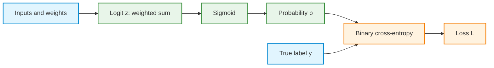
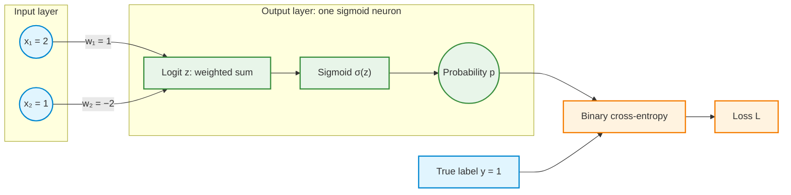
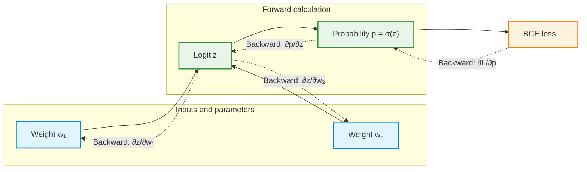
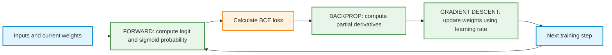

# Demonstration — Binary Classification with Two Weights: Sigmoid, Logit, BCE, and Gradient Descent


## How to use this demonstration

This demonstration builds on the one-weight regression example. The same learning cycle is retained: **forward pass → loss → backpropagation → gradient descent**. The main differences are that the output is now a probability and the loss is **binary cross-entropy (BCE)**.

Follow the explanations and worked calculations in order. Repeating the hand calculations is optional practice. **Open the plotting code sections, run the supplied code to view the plots, then explain the patterns. Writing plotting code from scratch is not an assessed task.** The plotting examples use NumPy and Matplotlib; the short training simulation uses basic Python.

**Python setup:** [Install and check the Week 2 libraries](1-python_setup.md).

## Learning objectives

By the end of the demonstration, the following distinctions should be clear:

1. **Sigmoid** transforms an unrestricted numerical score into a probability between 0 and 1.
2. **Odds** and **log-odds (logit)** represent probability differently; logit means the logarithm of *odds*, not the logarithm of probability.
3. **Binary cross-entropy** measures the discrepancy between a predicted probability and a binary target.
4. **Forward propagation** calculates the logit, predicted probability, and loss.
5. **Backpropagation** uses the chain rule to calculate a partial derivative for each weight.
6. **Gradient descent** uses the gradients and learning rate to change the weights.

> **Key distinction:** The **logit** is the score before sigmoid, **sigmoid** converts that score into a probability, and **BCE** measures how well that probability agrees with the target. Backpropagation calculates gradients; gradient descent uses them to update the parameters.

---

## 1. Sigmoid: converting a score into a probability

A weighted sum can take any real value. In binary classification, the model often needs to estimate the probability of class 1. The **sigmoid function** converts an unrestricted score $z$ to a number $p$ between 0 and 1:

$$
\boxed{p=\sigma(z)=\frac{1}{1+e^{-z}}}
$$

The output is strictly between 0 and 1 for any finite score.

| Score $z$ | Probability $p=\sigma(z)$ | Interpretation |
|---:|---:|---|
| $-2$ | 0.1192 | Lower estimated probability of class 1 |
| $-1$ | 0.2689 | Lower than 0.5 |
| $0$ | 0.5000 | Equal estimated probabilities |
| $1$ | 0.7311 | Higher than 0.5 |
| $2$ | 0.8808 | Higher estimated probability of class 1 |

**Sigmoid in Python:**

```python
import math

def sigmoid(z):
    return 1 / (1 + math.exp(-z))

print(sigmoid(0))   # 0.5
print(sigmoid(1))   # approximately 0.7311
```

### Plot 1 — The sigmoid curve

Run the supplied code and observe the curve near $z=0$, at large negative scores, and at large positive scores.

<details>
<summary>Show Python code — Plot 1: sigmoid and the probability threshold</summary>

```python
import numpy as np
import matplotlib.pyplot as plt

z = np.linspace(-8, 8, 500)
p = 1 / (1 + np.exp(-z))

plt.figure(figsize=(8, 4.5))
plt.plot(z, p, label="Sigmoid probability")
plt.axhline(0.5, linestyle="--", label="p = 0.5")
plt.axvline(0, linestyle=":", label="z = 0")
plt.scatter([0], [0.5], zorder=3)
plt.xlabel("Score / logit z")
plt.ylabel("Estimated probability p")
plt.title("Sigmoid maps any real score into (0, 1)")
plt.ylim(-0.02, 1.02)
plt.grid(alpha=0.25)
plt.legend()
plt.tight_layout()
plt.show()
```

</details>

**Observation checkpoint:** Why does a zero score correspond to a predicted probability of 0.5?

---

## 2. Probability, odds, and logit (log-odds)

Probability describes how likely an event is. **Odds** compare the probability that the event happens with the probability that it does not happen:

$\mathrm{odds}=\frac{p}{1-p}$

**Logit** means the *natural logarithm of the odds*:

$\mathrm{logit}(p)=\ln\left(\frac{p}{1-p}\right)$

It is **not** $\ln(p)$. The denominator $1-p$ is essential: it converts probability into odds *before* taking the logarithm.

### Two examples: probability that it rains tomorrow

These are illustrative forecasts, not real weather predictions.

**Example A — 20% probability of rain**

$p=0.20$

$\mathrm{odds}=\frac{0.20}{0.80}=0.25$

$\mathrm{logit}(0.20)=\ln(0.25)\approx -1.3863$

The odds are **1 to 4 in favor of rain**, or equivalently 4 to 1 against rain. The negative logit indicates that rain is less likely than no rain.

**Example B — 80% probability of rain**

$p=0.80$

$\mathrm{odds}=\frac{0.80}{0.20}=4$

$\mathrm{logit}(0.80)=\ln(4)\approx +1.3863$

The odds are **4 to 1 in favor of rain**. The positive logit indicates that rain is more likely than no rain.

| Probability of rain | Odds for rain | Logit | Interpretation |
|---:|---:|---:|---|
| 0.20 | 0.25 | $-1.3863$ | Rain less likely than no rain |
| 0.50 | 1.00 | $0$ | Both outcomes equally likely |
| 0.80 | 4.00 | $+1.3863$ | Rain more likely than no rain |

### Why use log-odds rather than odds alone?

Odds are useful, but their scale ranges from **0 to positive infinity**, and the neutral value is **1**. Values above and below 1 are not symmetric: probabilities of 0.20 and 0.80 correspond to odds of 0.25 and 4.

Taking the logarithm solves two practical problems for a linear classifier:

- The logit can be **any real number**: negative, zero, or positive. Therefore an unrestricted weighted sum can directly represent it.
- **Zero is the neutral point.** At $p=0.5$, odds equal 1, and $\ln(1)=0$. Probabilities 0.20 and 0.80 have equally large logits with opposite signs.

A logistic regression model makes the **log-odds** a linear function of the inputs:

$z=w_1x_1+w_2x_2=\ln\left(\frac{p}{1-p}\right)$

It then applies sigmoid to recover the probability:

$p=\sigma(z)=\frac{1}{1+e^{-z}}$

Another way to express this relationship is that **odds equal $e^z$**. The use of log-odds is convenient for this model, not a requirement that every binary classifier use a logit.

**Logit in Python:**

```python
import math

def logit(p):
    if not 0 < p < 1:
        raise ValueError("Probability must be strictly between 0 and 1")
    return math.log(p / (1 - p))

print(logit(0.2))  # approximately -1.3863
print(logit(0.5))  # 0.0
print(logit(0.8))  # approximately +1.3863
```

### Plot 2 — Why log-odds are zero-centered

Run the code and compare the neutral points: odds equal 1 at 50%, but log-odds equal 0.

<details>
<summary>Show Python code — Plot 2: odds and log-odds versus probability</summary>

```python
import numpy as np
import matplotlib.pyplot as plt

p = np.linspace(0.01, 0.99, 500)
odds = p / (1 - p)
log_odds = np.log(odds)

fig, axes = plt.subplots(1, 2, figsize=(10, 4))
axes[0].plot(p, odds)
axes[0].axhline(1, linestyle="--", label="Equal odds = 1")
axes[0].axvline(0.5, linestyle=":")
axes[0].set_ylim(0, 12)
axes[0].set_title("Odds: p / (1 - p)")
axes[0].set_xlabel("Probability p")
axes[0].set_ylabel("Odds")
axes[0].grid(alpha=0.25)
axes[0].legend()

axes[1].plot(p, log_odds)
axes[1].axhline(0, linestyle="--", label="Neutral logit = 0")
axes[1].axvline(0.5, linestyle=":")
axes[1].set_title("Log-odds (logit)")
axes[1].set_xlabel("Probability p")
axes[1].set_ylabel("Logit")
axes[1].grid(alpha=0.25)
axes[1].legend()

plt.tight_layout()
plt.show()
```

</details>

---

## 3. Logit, sigmoid, and binary cross-entropy: three different roles

These three terms describe **different operations**, rather than competing names for the same function.

| Concept | Purpose | Input | Output |
|---|---|---|---|
| **Logit** $z$ | Represent the model's score as log-odds | Features and weights | Any real number |
| **Sigmoid** $p=\sigma(z)$ | Convert the score into a probability | Logit $z$ | Probability between 0 and 1 |
| **Binary cross-entropy** $L(y,p)$ | Measure how well the probability matches the target | Target $y$ and probability $p$ | Nonnegative loss |



For a binary target, $y$ is either 0 or 1. The loss penalizes predictions that assign low probability to the true outcome. A class threshold (for example 0.5) may be used *after* obtaining the probability, but training uses the probability directly rather than the thresholded label.

---

## 4. Binary cross-entropy when the true label is 1

Suppose the true class is $y=1$. A probability close to 1 should produce a small loss; a probability close to 0 should produce a very large loss.

$$
\boxed{L=-\ln(p)\qquad\text{when }y=1}
$$

| Predicted probability $p$ | Loss $-\ln(p)$ |
|---:|---:|
| 0.001 | 6.9078 |
| 0.100 | 2.3026 |
| 0.500 | 0.6931 |
| 0.900 | 0.1054 |
| 0.999 | 0.0010 |

### Plot 3 — Loss for $y=1$

Run the code. Observe how strongly the loss penalizes a prediction close to 0 when the actual class is 1.

<details>
<summary>Show Python code — Plot 3: BCE loss for true class 1</summary>

```python
import numpy as np
import matplotlib.pyplot as plt

p = np.linspace(0.001, 0.999, 600)
loss_y1 = -np.log(p)

plt.figure(figsize=(8, 4.5))
plt.plot(p, loss_y1, label="True label y = 1")
plt.axvline(0.5, linestyle=":", label="Probability 0.5")
plt.xlabel("Predicted probability of class 1 (p)")
plt.ylabel("Binary cross-entropy loss")
plt.title("When y = 1, assigning low probability to class 1 is costly")
plt.grid(alpha=0.25)
plt.legend()
plt.tight_layout()
plt.show()
```

</details>

---

## 5. Binary cross-entropy when the true label is 0

Suppose the true class is $y=0$. A probability of class 1 close to 0 should produce a small loss; a probability close to 1 should produce a very large loss.

$$
\boxed{L=-\ln(1-p)\qquad\text{when }y=0}
$$

| Predicted probability $p$ | Loss $-\ln(1-p)$ |
|---:|---:|
| 0.001 | 0.0010 |
| 0.100 | 0.1054 |
| 0.500 | 0.6931 |
| 0.900 | 2.3026 |
| 0.999 | 6.9078 |

### Plot 4 — Loss for $y=0$

Run the code. Observe how strongly the loss penalizes a prediction close to 1 when the actual class is 0.

<details>
<summary>Show Python code — Plot 4: BCE loss for true class 0</summary>

```python
import numpy as np
import matplotlib.pyplot as plt

p = np.linspace(0.001, 0.999, 600)
loss_y0 = -np.log(1 - p)

plt.figure(figsize=(8, 4.5))
plt.plot(p, loss_y0, label="True label y = 0")
plt.axvline(0.5, linestyle=":", label="Probability 0.5")
plt.xlabel("Predicted probability of class 1 (p)")
plt.ylabel("Binary cross-entropy loss")
plt.title("When y = 0, assigning high probability to class 1 is costly")
plt.grid(alpha=0.25)
plt.legend()
plt.tight_layout()
plt.show()
```

</details>

---

## 6. One BCE formula for both classes

The two cases combine into a single formula because the binary target switches one term off:

$$
\boxed{L(y,p)=-\left[y\ln(p)+(1-y)\ln(1-p)\right]}
$$

- For $y=1$, the second term vanishes, leaving $-\ln(p)$.
- For $y=0$, the first term vanishes, leaving $-\ln(1-p)$.

Here $\ln$ denotes the **natural logarithm**. The BCE formula uses the logarithm of a *probability* or of its *complement*. The earlier logit formula uses the logarithm of the *odds*. These are related but different expressions.

### Plot 5 — Compare both BCE curves

Run the code and identify where the two loss curves cross. Explain why both labels have the same loss when the predicted probability is 0.5.

<details>
<summary>Show Python code — Plot 5: BCE for both true classes</summary>

```python
import numpy as np
import matplotlib.pyplot as plt

p = np.linspace(0.001, 0.999, 600)
loss_y1 = -np.log(p)
loss_y0 = -np.log(1 - p)

plt.figure(figsize=(8, 4.5))
plt.plot(p, loss_y1, label="True label y = 1")
plt.plot(p, loss_y0, label="True label y = 0")
plt.axvline(0.5, linestyle=":", label="p = 0.5")
plt.scatter([0.5], [np.log(2)], zorder=3)
plt.xlabel("Predicted probability of class 1 (p)")
plt.ylabel("Binary cross-entropy loss")
plt.title("BCE: the two binary target cases")
plt.grid(alpha=0.25)
plt.legend()
plt.tight_layout()
plt.show()
```

</details>

**Technical note:** The mathematical loss tends to infinity at a confidently wrong endpoint. Since logarithms of zero are undefined, plotting code evaluates probabilities strictly between 0 and 1. Production libraries normally calculate BCE from logits using numerically stable implementations.

---

## 7. Worked example: a classifier with two weights and no bias

The model is a **single sigmoid output neuron with no hidden layer**. It is an example of logistic regression. It uses the same two-feature structure as the earlier linear regression activity, but now predicts a class-1 probability.

$$
\boxed{z=w_1x_1+w_2x_2}
$$

$$
\boxed{p=\sigma(z)=\frac{1}{1+e^{-z}}}
$$

$$
\boxed{L=-\left[y\ln(p)+(1-y)\ln(1-p)\right]}
$$

### Initial values

| Quantity | Value |
|---|---:|
| First input $x_1$ | 2 |
| Second input $x_2$ | 1 |
| Initial weight $w_1$ | 1 |
| Initial weight $w_2$ | −2 |
| True label $y$ | 1 |
| Learning rate $\eta$ | 0.1 |
| Bias | None |



### Why the activity uses different starting weights

This demonstration starts with weights $(1,-2)$; [Activity 2](activity2.md#7-guided-calculation-two-weights-no-bias) starts with $(0,0)$. Both use inputs $(2,1)$, no bias, and label 1. Different weights can produce the same weighted sum for a particular input:

$$
z_{\mathrm{demo}}=1(2)+(-2)(1)=0,\qquad z_{\mathrm{activity}}=0(2)+0(1)=0
$$

Both therefore start at probability 0.5 and BCE approximately 0.693147. Their gradients are also identical for this observation. With the same learning rate, the parameter changes and updated predictions match, although the weights remain different. This agreement concerns the shared input; predictions for other inputs can differ.

### Step 1 — Forward pass: logit, probability, and loss

**Calculate the logit:**

$$
\begin{aligned}
z &= w_1x_1+w_2x_2\\
  &= (1)(2)+(-2)(1)\\
  &= \boxed{0}
\end{aligned}
$$

**Apply sigmoid:**

$$
p=\sigma(0)=\frac{1}{1+e^0}=\boxed{0.5}
$$

**Calculate BCE for $y=1$:**

$$
\begin{aligned}
L &= -\left[1\ln(0.5)+(1-1)\ln(1-0.5)\right]\\
  &= -\ln(0.5)\\
  &\approx \boxed{0.6931}
\end{aligned}
$$

**Interpretation:** The model assigns probability 0.5 to class 1. The loss is approximately 0.6931. So far, no weights have changed: this was the **forward pass**.

### Step 2 — Backpropagation: calculate two partial derivatives

The loss depends on **both** weights. The question is how a small change in each weight affects the loss while the other independent weight is held fixed.

The computation flows forward from weights to loss. The derivatives are calculated in reverse order:



**A. Differentiate the BCE loss with respect to the probability.**

$$
\frac{\partial L}{\partial p}=-\frac{y}{p}+\frac{1-y}{1-p}
$$

**B. Differentiate sigmoid with respect to the logit.**

$$
\frac{\partial p}{\partial z}=p(1-p)
$$

**C. Combine the derivatives using the chain rule.**

$$
\begin{aligned}
\frac{\partial L}{\partial z}
&=\frac{\partial L}{\partial p}\frac{\partial p}{\partial z}\\
&=\left(-\frac{y}{p}+\frac{1-y}{1-p}\right)p(1-p)\\
&=-y(1-p)+(1-y)p\\
&=\boxed{p-y}
\end{aligned}
$$

This important simplification is specific to the combination **sigmoid output + BCE with natural logarithms**:

$$
\boxed{\frac{\partial L}{\partial z}=p-y}
$$

For the current example, $p=0.5$ and $y=1$, so:

$$
\frac{\partial L}{\partial z}=0.5-1=-0.5
$$

**D. Calculate the contribution of each weight.**

Because $z=w_1x_1+w_2x_2$:

$$
\frac{\partial z}{\partial w_1}=x_1=2
\qquad\text{and}\qquad
\frac{\partial z}{\partial w_2}=x_2=1
$$

Therefore:

$$
\begin{aligned}
\frac{\partial L}{\partial w_1}
&=\frac{\partial L}{\partial z}\frac{\partial z}{\partial w_1}\\
&=(p-y)x_1\\
&=(-0.5)(2)=\boxed{-1}
\end{aligned}
$$

$$
\begin{aligned}
\frac{\partial L}{\partial w_2}
&=\frac{\partial L}{\partial z}\frac{\partial z}{\partial w_2}\\
&=(p-y)x_2\\
&=(-0.5)(1)=\boxed{-0.5}
\end{aligned}
$$

The two gradients form a vector:

```math
\nabla_{\boldsymbol{w}}L=
\begin{bmatrix}
\frac{\partial L}{\partial w_1}\\
\frac{\partial L}{\partial w_2}
\end{bmatrix}
=
\begin{bmatrix}
-1\\
-0.5
\end{bmatrix}
```

A negative partial derivative means that **increasing that weight slightly would decrease the loss**, holding the other weight fixed. Backpropagation has computed the gradients; it has **not** changed the weights.

### Step 3 — Gradient descent: update the weights

Gradient descent subtracts the gradient scaled by the learning rate:

$$
\boxed{w_{i,\mathrm{new}}=w_{i,\mathrm{old}}-\eta\frac{\partial L}{\partial w_i}}
$$

With $\eta=0.1$, update both weights using the gradients computed at the **same original parameter values**:

$$
\begin{aligned}
w_{1,\mathrm{new}} &= 1-0.1(-1)=\boxed{1.1}\\
w_{2,\mathrm{new}} &= -2-0.1(-0.5)=\boxed{-1.95}
\end{aligned}
$$

**Check the updated model with another forward pass:**

$$
\begin{aligned}
z_{\mathrm{new}} &= (1.1)(2)+(-1.95)(1)=0.25\\
p_{\mathrm{new}} &= \sigma(0.25)\approx 0.5622\\
L_{\mathrm{new}} &= -\ln(0.5622)\approx \boxed{0.5759}
\end{aligned}
$$

| Quantity | Before update | After update |
|---|---:|---:|
| Weight $w_1$ | 1.0000 | 1.1000 |
| Weight $w_2$ | −2.0000 | −1.9500 |
| Logit $z$ | 0.0000 | 0.2500 |
| Probability $p$ | 0.5000 | 0.5622 |
| BCE loss $L$ | 0.6931 | 0.5759 |

**Result:** The probability assigned to the true class increased, and the BCE loss decreased. This is **one training update**, not the entire training process.

### What if the true label were 0 instead?

Restart with exactly the same inputs and initial weights, but set $y=0$. The initial logit and probability are unchanged: $z=0$ and $p=0.5$. What changes is the error signal $p-y$.

$$
\frac{\partial L}{\partial z}=p-y=0.5-0=+0.5
$$

Consequently, the gradients are $+1$ for $w_1$ and $+0.5$ for $w_2$. With learning rate 0.1, the weights change to $w_1=0.9$ and $w_2=-2.05$. The new logit is $-0.25$, and the predicted class-1 probability decreases to approximately 0.4378, giving BCE loss approximately 0.5759.

**Interpretation:** When the true label is 0, a lower class-1 probability is desirable. The same update rule moves the probability in the appropriate direction without changing the basic learning algorithm.

---

## 8. Python simulation: repeat the training cycle

This basic Python program performs a forward pass, calculates gradients, and updates both weights repeatedly for the single training example with true label 1.

```python
import math

x1, x2 = 2.0, 1.0
y = 1.0
w1, w2 = 1.0, -2.0
learning_rate = 0.1

print("step |     w1 |     w2 | logit | probability | BCE loss")
for step in range(12):
    # 1. Forward pass
    z = w1*x1 + w2*x2
    p = 1 / (1 + math.exp(-z))
    # Numerically stable BCE calculation directly from the logit
    loss = max(z, 0) - y*z + math.log1p(math.exp(-abs(z)))

    print(f"{step:4d} | {w1:6.3f} | {w2:6.3f} | {z:5.2f} | "
          f"{p:11.4f} | {loss:8.4f}")

    # 2. Backpropagation
    dL_dz = p - y
    dL_dw1 = dL_dz * x1
    dL_dw2 = dL_dz * x2

    # 3. Gradient descent (gradients came from the same old weights)
    w1 -= learning_rate * dL_dw1
    w2 -= learning_rate * dL_dw2
```

The expression used for `loss` is algebraically equivalent to BCE for a sigmoid output, but avoids taking the logarithm of a probability that may round to 0 or 1.

### Plot 6 — Probability and loss over repeated updates

Run the supplied code. Observe whether the probability assigned to the true class increases and whether the loss decreases. The plotting code is provided; the task is to **interpret the results**, not to create plotting code.

<details>
<summary>Show Python code — Plot 6: probability and BCE loss during training</summary>

```python
import math
import matplotlib.pyplot as plt

x1, x2 = 2.0, 1.0
y = 1.0
w1, w2 = 1.0, -2.0
eta = 0.1
updates = 25
probabilities, losses = [], []

for step in range(updates + 1):
    z = w1*x1 + w2*x2
    p = 1 / (1 + math.exp(-z))
    loss = max(z, 0) - y*z + math.log1p(math.exp(-abs(z)))
    probabilities.append(p)
    losses.append(loss)
    if step < updates:
        # Calculate both gradients before either update.
        g1 = (p - y) * x1
        g2 = (p - y) * x2
        w1 -= eta * g1
        w2 -= eta * g2

fig, axes = plt.subplots(1, 2, figsize=(10, 4))
axes[0].plot(range(updates + 1), probabilities, marker="o", markersize=3)
axes[0].axhline(1, linestyle="--", label="Target probability = 1")
axes[0].set_ylim(0, 1.05)
axes[0].set_title("Predicted class-1 probability")
axes[0].set_xlabel("Completed weight updates")
axes[0].set_ylabel("Probability")
axes[0].grid(alpha=0.25)
axes[0].legend()

axes[1].plot(range(updates + 1), losses, marker="o", markersize=3)
axes[1].set_title("Binary cross-entropy loss")
axes[1].set_xlabel("Completed weight updates")
axes[1].set_ylabel("Loss")
axes[1].grid(alpha=0.25)

plt.tight_layout()
plt.show()
```

</details>

**Important limitation:** This simulation trains on only one positive example. Its probability can approach 1 as the logit grows, but the loss reaches zero only in the limit; no finite pair of weights makes sigmoid output exactly 1. The example does not uniquely determine the individual weights or demonstrate generalization to unseen data. Real classification training uses multiple labeled observations, usually including examples of both classes.

---

## 9. Questions for understanding

Each question checks a conceptual distinction. The worked demonstration above contains the mathematical derivations; answers below are kept in plain text for reliable GitHub rendering inside collapsible sections.

**Q1. Is a logit the logarithm of the probability?**

<details>
<summary>Show answer</summary>

No. A logit is the natural logarithm of the *odds*. Odds compare the probability that an event occurs with the probability that it does not occur.

</details>

**Q2. Why is the logit zero when the predicted probability is 0.5?**

<details>
<summary>Show answer</summary>

When an event and its complement are equally likely, the odds equal 1. The natural logarithm of 1 is zero. This makes zero the neutral logit value.

</details>

**Q3. Why not use odds directly as the weighted sum?**

<details>
<summary>Show answer</summary>

Odds must be positive, whereas a weighted sum may be negative, zero, or positive. Log-odds can take any real value and allow logistic regression to use an unrestricted linear score before applying sigmoid.

</details>

**Q4. What is the difference between sigmoid and binary cross-entropy?**

<details>
<summary>Show answer</summary>

Sigmoid converts the model's numerical score to a probability. Binary cross-entropy compares that probability with the true binary label and returns a penalty. Sigmoid is an output transformation; BCE is a loss function.

</details>

**Q5. What does backpropagation calculate in this two-weight example?**

<details>
<summary>Show answer</summary>

Backpropagation uses the chain rule to calculate two partial derivatives: one describing the sensitivity of the loss to the first weight and one for the second weight. It does not change the weights.

</details>

**Q6. Why does gradient descent subtract the gradients?**

<details>
<summary>Show answer</summary>

The gradient points locally toward increasing loss. Its negative points toward decreasing loss. Gradient descent applies a step in that negative direction, scaled by the learning rate. A very large step can still overshoot.

</details>

**Q7. Is an output probability of 0.5 a correct prediction when the true label is 1?**

<details>
<summary>Show answer</summary>

The answer depends on the classification threshold used to turn probabilities into labels. However, a probability of 0.5 expresses uncertainty, and BCE still assigns a positive loss to it. Training minimizes probability-based loss rather than relying only on thresholded correctness.

</details>

---

## 10. Final summary



- **Logit:** represents the log-odds of class 1 and is the weighted score before sigmoid.
- **Sigmoid:** turns the logit into the estimated probability of class 1.
- **Binary cross-entropy:** measures whether this probability agrees with the binary label.
- **Forward pass:** calculates logit, probability, and loss.
- **Backpropagation:** calculates the partial derivative of loss with respect to each weight.
- **Gradient descent:** updates the weights using those gradients and the learning rate.

**One-sentence mental model:** The forward pass determines the predicted probability and loss; backpropagation measures how each weight affects that loss; gradient descent adjusts the weights to seek a lower loss.
