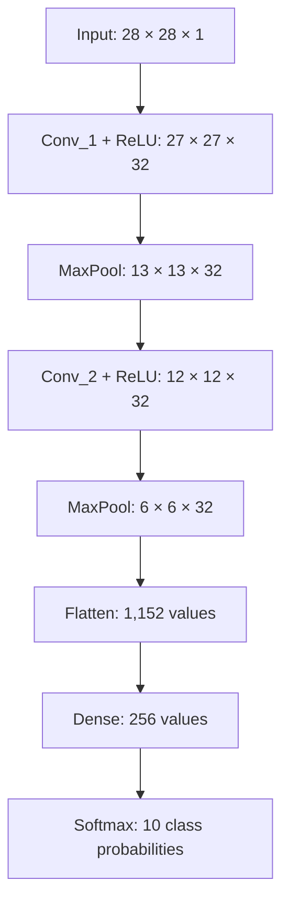
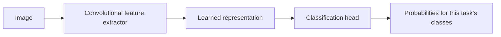
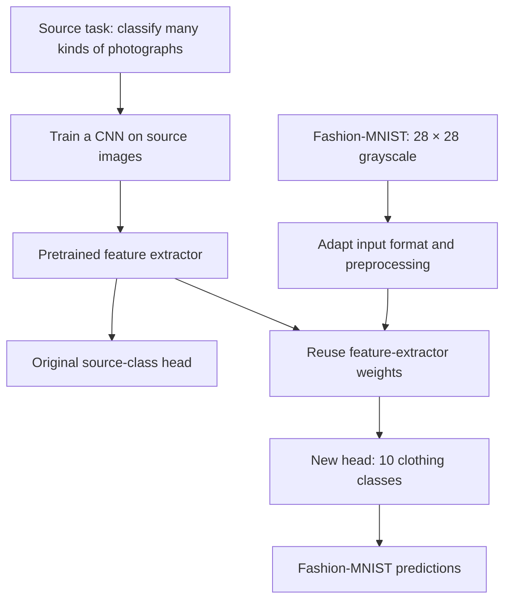
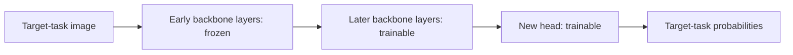

# Demo 2: What can a CNN preserve, discard, and reuse?

*From convolutional feature maps to padding, stride, pooling, and transfer learning · Fashion-MNIST*

Demo 1 followed an ankle boot through a convolutional network. Small filters produced spatial responses; learned filters responded differently; ReLU suppressed negative responses; deeper filters combined earlier feature maps. At the end, the complete CNN classified the image.

Several questions remained open. **Why did some spatial dimensions shrink? Could they have stayed the same? What was lost during pooling? And if filters have already been learned, could those filters help with a different task?**

### Setup and execution order

Use the [shared Python setup guide](../activity/1-python_setup.md) to verify NumPy, Matplotlib, and TensorFlow before starting. It includes notebook `%pip` commands for missing packages and runtime restart guidance. Google Colab is the primary environment. Run this demo's code blocks in order: later blocks reuse earlier arrays, filters, and models. After a runtime or kernel restart, rerun the prerequisite blocks.

Download the [saved Fashion-MNIST CNN](../../assets/fashion_mnist_cnn.keras). In Colab, upload it to the working directory before loading the model. For a local notebook, set the working directory to `week4/material/part2/demo`; the loading cell also supports running from the repository root. Fashion-MNIST downloads on first use if it is not already cached.

## 1. What did the first CNN actually do?

The model from Demo 1 transformed one grayscale image through a sequence of operations. The spatial sizes are worth revisiting before changing them.



**Question.** The first convolution reduced the width from 28 to 27. The next operation reduced it from 27 to 13. Did these two operations shrink the image for the same reason?

<details>
<summary>Answer</summary>

No. With a 2 × 2 filter, stride 1, and no padding, convolution calculates a response only where the entire filter fits: 27 starting positions along each dimension. Max pooling then examines non-overlapping 2 × 2 regions with stride 2. It forms 13 complete windows along a 27-pixel dimension, leaving the final row and column outside those windows. Both operations change spatial size, but they do so in different ways.

</details>

### Revisit the trained CNN

The same ankle-boot image and [trained CNN](../../assets/fashion_mnist_cnn.keras) from Demo 1 will be used in the first experiments. Follow the setup and saved-model instructions above before running this cell.

```python
import numpy as np
import matplotlib.pyplot as plt
import tensorflow as tf
from tensorflow import keras
from pathlib import Path

keras.utils.set_random_seed(42)

(_, _), (x_test_raw, y_test) = keras.datasets.fashion_mnist.load_data()
x_test = x_test_raw.astype("float32")[..., np.newaxis] / 255.0

class_names = [
    "T-shirt/top", "Trouser", "Pullover", "Dress", "Coat",
    "Sandal", "Shirt", "Sneaker", "Bag", "Ankle boot"
]

image_index = 0
image_batch = x_test[image_index:image_index + 1]

# Check Colab upload, the documented local demo directory, then repository root.
model_candidates = [
    Path("fashion_mnist_cnn.keras"),
    Path("../../assets/fashion_mnist_cnn.keras"),
    Path("week4/material/assets/fashion_mnist_cnn.keras"),
]
model_path = next((path for path in model_candidates if path.is_file()), None)
if model_path is None:
    raise FileNotFoundError(
        "Download fashion_mnist_cnn.keras using the setup link. Upload it in "
        "Colab, or run locally from week4/material/part2/demo or repository root."
    )

trained_model = keras.models.load_model(model_path, compile=False)
conv1 = trained_model.get_layer("Conv_1")
conv2 = trained_model.get_layer("Conv_2")

# The second convolution receives the result of the first pooling layer.
probe = keras.Model(
    trained_model.inputs,
    outputs=[conv1.output, conv2.input, conv2.output]
)
first_maps, pooled_input, second_maps = probe.predict(image_batch, verbose=0)

probabilities = trained_model.predict(image_batch, verbose=0)[0]
predicted = int(np.argmax(probabilities))
print("Image:", image_batch.shape)
print("After Conv_1 + ReLU:", first_maps.shape)
print("After first MaxPool:", pooled_input.shape)
print("After Conv_2 + ReLU:", second_maps.shape)
print("Actual:", class_names[int(y_test[image_index])])
print("Predicted:", class_names[predicted])
```

<details>
<summary>Plot: the ankle boot and representative feature maps</summary>

```python
first_channel = int(np.argmax(first_maps[0].std(axis=(0, 1))))
second_channel = int(np.argmax(second_maps[0].std(axis=(0, 1))))

fig, axes = plt.subplots(1, 3, figsize=(12, 4))
axes[0].imshow(image_batch[0, :, :, 0], cmap="gray")
axes[0].set_title("Input: 28 × 28")
axes[1].imshow(first_maps[0, :, :, first_channel], cmap="viridis")
axes[1].set_title(f"Conv_1: 27 × 27 (channel {first_channel})")
axes[2].imshow(second_maps[0, :, :, second_channel], cmap="viridis")
axes[2].set_title(f"Conv_2: 12 × 12 (channel {second_channel})")
for ax in axes:
    ax.axis("off")
plt.tight_layout()
plt.show()
```

</details>

The two feature-map plots use independently selected channels and colormap scales. Their colors therefore should not be compared as if they represented identical numerical ranges. They show spatial responses, not guaranteed human-readable object parts.

The first unresolved puzzle is particularly concrete: **what happened to the spatial positions at the edges?**

## 2. Why does the CNN lose spatial positions?

A 2 × 2 convolution filter with no padding must fit entirely inside its input. At the bottom and right edges, there are fewer possible places to start such a window. This is why the 28 × 28 input becomes 27 × 27 after the first convolution.

Pooling introduces a different issue. With a 2 × 2 pooling window and a stride of 2, only complete non-overlapping windows are included when padding is `VALID`.

### A tiny pooling experiment

Consider a 5 × 5 grid. A 2 × 2 window can begin at rows 0 and 2, and columns 0 and 2. The final row and column do not belong to any complete pooling window.

**Question.** Which four numbers will survive after 2 × 2 max pooling with stride 2 and no padding? Is the value 25 included?

```python
toy_grid = np.arange(1, 26, dtype=np.float32).reshape(5, 5)
toy_batch = toy_grid[np.newaxis, :, :, np.newaxis]

toy_pooled = tf.nn.max_pool2d(
    toy_batch, ksize=2, strides=2, padding="VALID"
).numpy()[0, :, :, 0]

print("Original 5 × 5 grid:\n", toy_grid)
print("Max-pooled 2 × 2 grid:\n", toy_pooled)
```

<details>
<summary>Answer</summary>

The four pooling windows have maxima 7, 9, 17, and 19, giving a 2 × 2 output. The value 25 is not included: it lies in the last row and last column, which do not form complete 2 × 2 windows under this configuration. This is not the same reason that a valid convolution with stride 1 produces a smaller feature map.

</details>

<details>
<summary>Plot: pooling windows and the omitted border</summary>

```python
fig, axes = plt.subplots(1, 2, figsize=(8, 4))
axes[0].imshow(toy_grid, cmap="Blues", vmin=0, vmax=25)
axes[0].set_title("5 × 5 input; last row/column outside windows")
for r in range(5):
    for c in range(5):
        axes[0].text(c, r, int(toy_grid[r, c]), ha="center", va="center")
axes[0].axhline(3.5, color="red", linewidth=2)
axes[0].axvline(3.5, color="red", linewidth=2)
axes[1].imshow(toy_pooled, cmap="Blues", vmin=0, vmax=25)
axes[1].set_title("2 × 2 pooled output")
for r in range(2):
    for c in range(2):
        axes[1].text(c, r, int(toy_pooled[r, c]), ha="center", va="center")
for ax in axes:
    ax.set_xticks([])
    ax.set_yticks([])
plt.tight_layout()
plt.show()
```

</details>

In Demo 1, the 27 × 27 feature maps behave similarly under valid max pooling: complete windows cover indices 0 through 25, and row and column 26 are omitted.

**Question.** If losing boundary positions is sometimes undesirable, could the convolution be allowed to examine the border without shrinking the output?

<details>
<summary>Answer</summary>

Yes. Padding extends the input around its border before the filter is applied. This can preserve or control output size. Padding does not create additional observed image information; it introduces chosen values, usually zeros, outside the original grid.

</details>

## 3. Can padding preserve the image dimensions?

**Padding** adds values around an input before convolution. `VALID` means no padding in the experiments here. `SAME` chooses padding so the output's spatial size is the input size when stride is 1.

The filter itself does not change. Only the set of positions where it can be applied changes.

### First, compare the two choices on the same image

Use the vertical-contrast filter from Demo 1. Its negative weights are on the left; its positive weights are on the right. It produces signed responses, and there is no ReLU in this manual experiment.

**Question.** Will `SAME` change the number of responses, the filter's weights, or both? What output sizes should appear for a 28 × 28 image and a 2 × 2 filter at stride 1?

```python
vertical_kernel = np.array([
    [-1.0,  1.0],
    [-1.0,  1.0]
], dtype=np.float32)
vertical_filter = vertical_kernel.reshape(2, 2, 1, 1)

valid_s1 = tf.nn.conv2d(
    image_batch, vertical_filter, strides=1, padding="VALID"
).numpy()[0, :, :, 0]

same_s1 = tf.nn.conv2d(
    image_batch, vertical_filter, strides=1, padding="SAME"
).numpy()[0, :, :, 0]

print("Original image:", image_batch.shape[1:3])
print("VALID, stride 1:", valid_s1.shape)
print("SAME, stride 1:", same_s1.shape)
```

<details>
<summary>Answer</summary>

`VALID` produces 27 × 27 responses. `SAME` produces 28 × 28 responses. The four filter weights are unchanged and are shared at every output position. Some responses now involve padded positions outside the original image. The output contains filtered responses, not restored or copied original pixels.

</details>

<details>
<summary>Plot: the same image and filter, with and without padding</summary>

```python
limit = max(float(np.abs(valid_s1).max()),
            float(np.abs(same_s1).max()), 1e-6)
fig, axes = plt.subplots(1, 3, figsize=(13, 4))
axes[0].imshow(image_batch[0, :, :, 0], cmap="gray")
axes[0].set_title("Input: 28 × 28")
axes[1].imshow(valid_s1, cmap="coolwarm", vmin=-limit, vmax=limit)
axes[1].set_title("VALID: 27 × 27")
im = axes[2].imshow(same_s1, cmap="coolwarm", vmin=-limit, vmax=limit)
axes[2].set_title("SAME: 28 × 28")
for ax in axes:
    ax.axis("off")
fig.colorbar(im, ax=axes[1:], shrink=0.75)
plt.show()
```

</details>

### Where are the padding values placed?

There is a subtlety in this example. With a 2 × 2 kernel and stride 1, maintaining the size requires **one total extra position** along each spatial dimension. That extra position cannot be divided equally between the two sides. For TensorFlow's `SAME` convention in this case, the extra row is at the bottom and the extra column is on the right.

For comparison, a 3 × 3 kernel at stride 1 requires two extra positions per dimension, allowing one padded row or column on each side. An odd-sized kernel has a central element, which makes this symmetric alignment straightforward. This explains one useful property of odd kernels; it does not make 2 × 2 kernels incorrect or guarantee that one kernel size performs better.

**Question.** Does `SAME` always mean one row of zeros on *every* side? How could the boundary result be checked directly?

```python
# Reproduce TensorFlow SAME explicitly for this particular configuration:
# 2 × 2 kernel, stride 1, input 28 × 28.
explicitly_padded = tf.pad(
    image_batch, [[0, 0], [0, 1], [0, 1], [0, 0]]
)
checked_same = tf.nn.conv2d(
    explicitly_padded, vertical_filter, strides=1, padding="VALID"
).numpy()[0, :, :, 0]

np.testing.assert_allclose(checked_same, same_s1, rtol=1e-6, atol=1e-6)
print("Padded input:", explicitly_padded.shape)
print("Padding reproduces SAME:", np.allclose(checked_same, same_s1))
```

<details>
<summary>Answer</summary>

No. `SAME` determines how much padding is needed for a target output size. It does not promise that every side receives equal padding. With this even-sized kernel and stride 1, padding is asymmetric: one added row at the bottom and one added column on the right. The explicit zero-padding experiment reproduces TensorFlow's result.

</details>

Padding changes the available positions. But the filter still moves **one position at a time**. **What if it moved by two positions instead?**

## 4. What changes when the filter moves by a larger stride?

A **stride** determines how far the filter moves between adjacent output positions. Demo 1 used stride 1: one step horizontally, then one row down. Stride 2 skips intermediate starting positions.

The weighted-sum calculation is unchanged. The filter does not acquire new weights; it is evaluated at fewer spatial positions.

### Trace the starting positions without TensorFlow

A 5 × 5 grid and a 2 × 2 all-ones filter make it easy to compare stride 1 with stride 2. Each output is the sum of the four values inside one window.

**Question.** For stride 1, how many possible window positions are there along one dimension? What about stride 2?

```python
stride_grid = np.arange(1, 26, dtype=np.float32).reshape(5, 5)

def window_sums(grid, kernel_size=2, stride=1):
    rows = range(0, grid.shape[0] - kernel_size + 1, stride)
    cols = range(0, grid.shape[1] - kernel_size + 1, stride)
    return np.array([
        [grid[r:r + kernel_size, c:c + kernel_size].sum() for c in cols]
        for r in rows
    ], dtype=np.float32)

print("Input:\n", stride_grid)
print("Stride 1, shape 4 × 4:\n", window_sums(stride_grid, stride=1))
print("Stride 2, shape 2 × 2:\n", window_sums(stride_grid, stride=2))
```

<details>
<summary>Answer</summary>

A 2 × 2 filter can start at rows 0, 1, 2, or 3 with stride 1, so the output is 4 × 4. With stride 2, valid starting rows are 0 and 2, giving a 2 × 2 output. The same applies to columns. Stride 2 skips some possible local weighted sums, even though each calculated sum uses the same 2 × 2 kernel.

</details>

### Apply the two strides to the ankle boot

**Question.** If the kernel remains fixed, will the two maps respond to the same image patterns but at different sampling resolutions?

```python
valid_s2 = tf.nn.conv2d(
    image_batch, vertical_filter, strides=2, padding="VALID"
).numpy()[0, :, :, 0]

print("Stride 1:", valid_s1.shape)
print("Stride 2:", valid_s2.shape)
```

<details>
<summary>Plot: vertical-contrast responses at strides 1 and 2</summary>

```python
limit = max(float(np.abs(valid_s1).max()),
            float(np.abs(valid_s2).max()), 1e-6)
fig, axes = plt.subplots(1, 3, figsize=(13, 4))
axes[0].imshow(image_batch[0, :, :, 0], cmap="gray")
axes[0].set_title("Input: 28 × 28")
axes[1].imshow(valid_s1, cmap="coolwarm", vmin=-limit, vmax=limit)
axes[1].set_title("2 × 2 filter, stride 1: 27 × 27")
im = axes[2].imshow(valid_s2, cmap="coolwarm", vmin=-limit, vmax=limit)
axes[2].set_title("Same filter, stride 2: 14 × 14")
for ax in axes:
    ax.axis("off")
fig.colorbar(im, ax=axes[1:], shrink=0.75)
plt.show()
```

</details>

<details>
<summary>Answer</summary>

Yes, both maps measure left-to-right local contrast using the same filter. Stride 2 evaluates that calculation at fewer positions. This produces a smaller map, but some responses present in the stride-1 map are never computed. A smaller representation does not automatically mean a better or more abstract representation.

</details>

A strided convolution can reduce the spatial grid during filtering. Demo 1 used another operation to reduce the grid *after* feature extraction: **max pooling**. How are these two approaches different?

## 5. What does pooling keep—and what does it discard?

A strided convolution still performs a **weighted sum with learned or fixed kernel weights**. Pooling instead summarizes values that have already been produced. Standard max pooling and average pooling have no trainable weights.

- **Max pooling:** keep the largest value in each window.
- **Average pooling:** keep the mean of the values in each window.

Both reduce spatial resolution when used with a stride greater than 1. Neither operation is simply a way to make an image smaller without losing information.

### Four pooling windows, four decisions

The following 4 × 4 example is already a feature map, not an original photograph. The unusually strong value 9 represents a large positive feature response.

| 1 | 2 | 0 | 0 |
|---:|---:|---:|---:|
| 3 | **9** | 1 | 0 |
| 0 | 0 | 2 | 3 |
| 0 | 0 | 4 | 5 |

**Question.** In the top-left 2 × 2 window, will max pooling and average pooling produce the same value? What information does each retain?

```python
pool_example = np.array([
    [1, 2, 0, 0],
    [3, 9, 1, 0],
    [0, 0, 2, 3],
    [0, 0, 4, 5]
], dtype=np.float32)
pool_example_batch = pool_example[np.newaxis, :, :, np.newaxis]

example_max = tf.nn.max_pool2d(
    pool_example_batch, ksize=2, strides=2, padding="VALID"
).numpy()[0, :, :, 0]
example_avg = tf.nn.avg_pool2d(
    pool_example_batch, ksize=2, strides=2, padding="VALID"
).numpy()[0, :, :, 0]

print("Original:\n", pool_example)
print("Max pooling:\n", example_max)
print("Average pooling:\n", example_avg)
```

<details>
<summary>Answer</summary>

The top-left window contains 1, 2, 3, and 9. Max pooling outputs **9**, while average pooling outputs **3.75**. The full max-pooled output is `[[9, 1], [0, 5]]`. The average-pooled output is `[[3.75, 0.25], [0, 3.5]]`. Max pooling retains each window's strongest response; average pooling retains the mean response. Neither output tells which exact input position contained the 9, or preserves all four original values.

</details>

<details>
<summary>Plot: one feature map, two different summaries</summary>

```python
fig, axes = plt.subplots(1, 3, figsize=(11, 3.5))
for ax, values, title in zip(
    axes,
    [pool_example, example_max, example_avg],
    ["Input: 4 × 4", "MaxPool: 2 × 2", "AveragePool: 2 × 2"]
):
    ax.imshow(values, cmap="YlOrRd", vmin=0, vmax=9)
    ax.set_title(title)
    for r in range(values.shape[0]):
        for c in range(values.shape[1]):
            ax.text(c, r, f"{values[r, c]:g}",
                    ha="center", va="center", color="black")
    ax.set_xticks([])
    ax.set_yticks([])
plt.tight_layout()
plt.show()
```

</details>

### Apply both operations to an actual learned feature map

In the saved CNN, the first convolution has already applied ReLU. Its 27 × 27 × 32 output contains 32 nonnegative feature maps. The model's first pooling operation selects maxima from each 2 × 2 spatial neighborhood of **each channel independently**. It does not combine the 32 channels or learn 32 new filters.

**Question.** If the model used average pooling at this point instead, would the output shape necessarily change? Would the values change?

```python
max_maps = tf.nn.max_pool2d(
    first_maps, ksize=2, strides=2, padding="VALID"
).numpy()
avg_maps = tf.nn.avg_pool2d(
    first_maps, ksize=2, strides=2, padding="VALID"
).numpy()

# Check against the actual first pooling output of the trained CNN.
np.testing.assert_allclose(max_maps, pooled_input, rtol=1e-5, atol=1e-6)

channel = int(np.argmax(first_maps[0].std(axis=(0, 1))))
print("Conv_1 output:", first_maps.shape)
print("Max-pooled output:", max_maps.shape)
print("Average-pooled output:", avg_maps.shape)
print("Channel inspected:", channel)
print("Max pooling reproduces the saved model's first pooling layer.")
```

<details>
<summary>Plot: one trained response map before and after two pooling methods</summary>

```python
before_pool = first_maps[0, :, :, channel]
after_max = max_maps[0, :, :, channel]
after_avg = avg_maps[0, :, :, channel]

upper = max(float(before_pool.max()),
            float(after_max.max()),
            float(after_avg.max()), 1e-6)
fig, axes = plt.subplots(1, 3, figsize=(12, 4))
for ax, values, title in zip(
    axes,
    [before_pool, after_max, after_avg],
    ["Before pooling: 27 × 27", "Max pooling: 13 × 13",
     "Average pooling: 13 × 13"]
):
    im = ax.imshow(values, cmap="viridis", vmin=0, vmax=upper)
    ax.set_title(title)
    ax.axis("off")
fig.colorbar(im, ax=axes, shrink=0.75)
plt.show()
```

</details>

<details>
<summary>Answer</summary>

Both methods produce 13 × 13 × 32 outputs for these settings, because the window size, stride, and padding are identical. The numerical values differ because the reduction rule is different. The saved model was trained using max pooling; replacing its pooling layer with average pooling would change its internal signals. Any effect on classification accuracy must be tested rather than assumed.

</details>

Max pooling retains prominent local responses, but it discards their exact positions within each window. This suggests a possible benefit: **could a feature move slightly without changing the pooled output?**

## 6. Does pooling make a CNN insensitive to movement?

Consider a single strong feature response with value 9 in a 4 × 4 map. Pooling uses 2 × 2 windows with stride 2.

A small displacement can move the feature **within the same pooling window** or push it **across a window boundary**. These are not equivalent cases.

**Question.** Will moving the response one pixel to the right always leave the max-pooled output unchanged?

```python
def single_response(column):
    grid = np.zeros((4, 4), dtype=np.float32)
    grid[0, column] = 9.0
    return grid

shifted_inputs = [single_response(c) for c in (0, 1, 2)]
shifted_outputs = []

for column, grid in zip((0, 1, 2), shifted_inputs):
    batched = grid[np.newaxis, :, :, np.newaxis]
    result = tf.nn.max_pool2d(
        batched, ksize=2, strides=2, padding="VALID"
    ).numpy()[0, :, :, 0]
    shifted_outputs.append(result)
    print(f"Feature at column {column}:\n{result}\n")

print("Same output for columns 0 and 1:",
      np.array_equal(shifted_outputs[0], shifted_outputs[1]))
print("Same output for columns 1 and 2:",
      np.array_equal(shifted_outputs[1], shifted_outputs[2]))
```

<details>
<summary>Plot: one-pixel shifts within and across pooling windows</summary>

```python
fig, axes = plt.subplots(3, 2, figsize=(7, 10))
for row, (inp, out) in enumerate(zip(shifted_inputs, shifted_outputs)):
    axes[row, 0].imshow(inp, cmap="YlOrRd", vmin=0, vmax=9)
    axes[row, 0].set_title(f"Feature at column {row}")
    axes[row, 1].imshow(out, cmap="YlOrRd", vmin=0, vmax=9)
    axes[row, 1].set_title("After 2 × 2 max pooling")
    for ax, values in ((axes[row, 0], inp), (axes[row, 1], out)):
        for r in range(values.shape[0]):
            for c in range(values.shape[1]):
                ax.text(c, r, f"{values[r, c]:g}",
                        ha="center", va="center")
        ax.set_xticks([])
        ax.set_yticks([])
plt.tight_layout()
plt.show()
```

</details>

<details>
<summary>Answer</summary>

No. Shifting the response from column 0 to column 1 keeps it inside the same 2 × 2 window; the pooled map remains unchanged. Shifting it from column 1 to column 2 crosses into the neighboring pooling window; the pooled response moves to a different output location. Both displacements are only one pixel. Max pooling therefore offers **limited local tolerance** to some translations, not guaranteed invariance to every translation.

</details>

**Question.** Could a classifier become insensitive to certain small changes without becoming insensitive to all shifts, rotations, and distortions?

<details>
<summary>Answer</summary>

Yes. Local summarization can reduce sensitivity to the exact position of a strong response within a window. But the result still depends on window boundaries, what the preceding filters detect, and the rest of the architecture. Neither a single pooling layer nor a complete CNN is automatically invariant to arbitrary transformations.

</details>

Padding, stride, and pooling are now distinct operations: **padding changes which boundary locations are available, stride changes which filter positions are evaluated, and pooling summarizes responses already computed**. How do these choices interact in one spatial pipeline?

## 7. How do padding, stride, and pooling work together?

Return to the same 28 × 28 ankle boot and the same fixed vertical-contrast filter. Change only the convolution's padding and stride. After each convolution, apply the same 2 × 2 max-pooling operation with stride 2 and `VALID` padding.

No filters are learned in this comparison. This isolates spatial geometry without introducing differences caused by training.

**Question.** Which configuration preserves the largest convolutional feature map? Which produces the smallest pooled map? For this particular input, what happens when stride 2 is combined with `SAME` instead of `VALID`?

```python
settings = [
    ("VALID", 1),
    ("SAME", 1),
    ("VALID", 2),
    ("SAME", 2)
]

comparison = []
for padding, stride in settings:
    response = tf.nn.conv2d(
        image_batch, vertical_filter, strides=stride, padding=padding
    ).numpy()
    pooled = tf.nn.max_pool2d(
        response, ksize=2, strides=2, padding="VALID"
    ).numpy()
    comparison.append((padding, stride, response, pooled))
    print(
        f"Conv padding={padding:5s}, stride={stride}: "
        f"conv={response.shape[1:3]}, pooled={pooled.shape[1:3]}"
    )

# With this input size, kernel size, and stride, SAME requires no padding.
np.testing.assert_allclose(comparison[2][2], comparison[3][2])
print("VALID and SAME with stride 2 are identical in this example.")
```

| Convolution choice | After convolution | After valid 2 × 2 max pool, stride 2 |
|---|---|---|
| `VALID`, stride 1 | 27 × 27 | 13 × 13 |
| `SAME`, stride 1 | 28 × 28 | 14 × 14 |
| `VALID`, stride 2 | 14 × 14 | 7 × 7 |
| `SAME`, stride 2 | 14 × 14 | 7 × 7 |

<details>
<summary>Plot: four settings, same image, same filter</summary>

```python
limits = [float(np.abs(item[2]).max()) for item in comparison]
scale = max(*limits, 1e-6)
fig, axes = plt.subplots(2, 2, figsize=(9, 8))
for ax, (padding, stride, response, pooled) in zip(axes.flat, comparison):
    ax.imshow(response[0, :, :, 0], cmap="coolwarm",
              vmin=-scale, vmax=scale)
    ax.set_title(
        f"Conv {padding}, stride {stride}\n"
        f"{response.shape[1]} × {response.shape[2]} → "
        f"pool {pooled.shape[1]} × {pooled.shape[2]}"
    )
    ax.axis("off")
plt.tight_layout()
plt.show()
```

</details>

<details>
<summary>Answer</summary>

`SAME` with stride 1 preserves the convolutional output at 28 × 28 and gives a 14 × 14 pooled grid. Both stride-2 settings produce 14 × 14 convolutional maps and 7 × 7 pooled maps. **In this specific case, stride 2 with `SAME` and `VALID` also gives identical values:** a 2 × 2 kernel fits perfectly into 14 steps across the 28-pixel input, so no padding is necessary. In other input sizes or filter configurations, equal output shapes need not imply equal values. The numerical assertion checks the actual result.

</details>

### What would changing these settings mean for the trained model?

The saved CNN was trained with **valid 2 × 2 convolutions at stride 1** and **valid 2 × 2 max pooling at stride 2**. Its dense classifier expects a specific flattened feature size: 1,152 values.

**Question.** Can a different padding or stride simply be inserted into the saved network while assuming its existing classifier and predictions will remain valid?

<details>
<summary>Answer</summary>

Not necessarily. Changing spatial dimensions can alter the size of the flattened representation and make a dense classifier's weight matrix incompatible. Even when shapes still match, the feature values and their positions can change. The fixed-filter experiments above isolate geometric effects; they do not establish that a modified CNN would classify better. A model redesign may require rebuilding and training the affected layers.

</details>

### An alternative to Flatten: Global Average Pooling

Flatten retains every spatial value in a single vector. **Global Average Pooling (GAP)** instead takes one mean per channel: a 6 × 6 × 32 tensor becomes a vector of 32 values, rather than 1,152. It has no learned parameters and does not mix channels. It discards spatial arrangement, so it is an architectural tradeoff rather than an automatic improvement.

For a 256-unit dense layer with biases, Flatten requires 1,152 × 256 + 256 = **295,168** parameters; GAP requires 32 × 256 + 256 = **8,448**. The following supplied code checks the representations and these counts without training either head.

```python
spatial_features = keras.layers.MaxPooling2D(pool_size=2, strides=2)(second_maps)
flat_vector = keras.layers.Flatten()(spatial_features)
gap_vector = keras.layers.GlobalAveragePooling2D()(spatial_features)
np.testing.assert_allclose(
    gap_vector.numpy(), spatial_features.numpy().mean(axis=(1, 2)),
    rtol=1e-5, atol=1e-6,
)
assert tuple(spatial_features.shape[1:]) == (6, 6, 32)
assert int(flat_vector.shape[-1]) == 1152
assert int(gap_vector.shape[-1]) == 32
print("Flatten:", flat_vector.shape, "GAP:", gap_vector.shape)
print("Flatten → Dense(256):", int(flat_vector.shape[-1]) * 256 + 256)
print("GAP → Dense(256):", int(gap_vector.shape[-1]) * 256 + 256)
```

GAP can accept different spatial dimensions when the preceding layers permit them, but it does not make every model accept arbitrary image sizes or guarantee translation invariance. Replacing Flatten changes the head's input size: the saved dense weights cannot simply be retained unchanged. A redesigned head must be trained.

The model now has several architectural choices: **which neighborhoods to examine, how many positions to evaluate, and how much spatial detail to retain**. Yet the filters themselves were still learned through the same training process.

This leads to a different question: **if useful filters already exist, must every new image classifier learn them again from random initial weights?**

## 8. Can a model reuse filters learned for another task?

In Demo 1, the filters in `Conv_1` were learned from clothing images, not typed in by hand. Some of those learned responses resembled local contrast or edge patterns; deeper layers combined earlier feature maps.

An edge or texture can be relevant to many visual tasks. That suggests a possibility: **reuse the feature-processing part of a model trained for one task when learning a different task**. This is the central idea of *transfer learning*.

### The model has two conceptually different jobs

A CNN used for classification contains a **feature extractor** and a **task-specific classifier**.



The feature extractor contains layers that transform images into useful representations. The head maps those representations to the categories of one task. This distinction is conceptual; in an end-to-end network both parts may have learned their weights together.

**Question.** Suppose a CNN was trained to recognize a set of everyday photographs. Could some of its learned patterns be useful for distinguishing clothing images—even though the output classes are different?

<details>
<summary>Answer</summary>

Possibly. Local patterns such as edges, colors, corners, and textures may be relevant to multiple tasks. However, features are **not universal guarantees**. Their usefulness depends on the source and target datasets, the network, preprocessing, and the level of the representation. A model trained on photographs may transfer imperfectly to 28 × 28 grayscale Fashion-MNIST images.

</details>

### A concrete transfer-learning example

Imagine a CNN pretrained on a large collection of color photographs. Its original head predicts the source dataset's categories. A new task requires predictions for Fashion-MNIST's ten clothing categories.

The original source head is replaced by a new ten-class head. The useful feature-extraction weights can serve as the new task's starting point.



This is a diagram of **which learned components are reused**. Pretraining and adaptation do not occur simultaneously at inference time: the original training has already produced the backbone weights before the new task begins.

**Question.** Why is replacing the original classification head important? Would changing the output labels alone be sufficient?

<details>
<summary>Answer</summary>

The source head was trained to map source-task representations to source-task categories. The Fashion-MNIST task has a different set of ten categories, so a new classifier must learn how to map the reused representation to those categories. Merely renaming the original outputs does not teach the model the new task.

</details>

### Two examples with different levels of similarity

| Source training task | New target task | Possible transferable information | Main caution |
|---|---|---|---|
| Fashion-MNIST clothing categories | MNIST handwritten digits | Local strokes, contrasts, boundaries | Some garment-specific features may not be useful for digits; the classifier must change |
| Broad color-photograph classification | Fashion-MNIST clothing categories | Early visual patterns such as edges and textures | Grayscale, low resolution, and photographic-domain differences require careful preprocessing and evaluation |

**Question.** Which example is guaranteed to give better accuracy than learning from scratch?

<details>
<summary>Answer</summary>

Neither. Transfer can help when the reused representation is relevant, especially when target training data are limited. It can also fail or hurt when the source and target tasks differ substantially. The benefit is an empirical question, not a property guaranteed by the word *pretrained*.

</details>

For practical ImageNet-pretrained architectures, the Fashion-MNIST image may need to be resized, converted from one to three channels, and passed through the backbone's required preprocessing. Such changes adapt the input **format**; they do not introduce new high-resolution details that were absent from the original image.

**Transfer learning raises a further question:** should the previously learned filters be kept fixed, or should some of them change while learning the new task?

## 9. Freeze the backbone, or fine-tune it?

Two common transfer-learning strategies use the same starting point—a pretrained feature extractor—but handle its existing weights differently.

### Strategy A: freeze the feature extractor

To **freeze** a layer means to keep its learned weights fixed during the new task's training. Its forward computation still runs and produces features; its weights simply are not updated by the target-task optimizer.


**Question.** If the backbone is frozen, does the entire model stop learning?

<details>
<summary>Answer</summary>

No. The frozen backbone continues to compute representations. The newly attached classifier learns how to interpret those representations for the target task. Freezing restricts **which parameters may be updated**, not whether the model can perform a forward pass or whether its new head can be trained.

</details>

This approach is called **feature extraction** when the pretrained backbone remains fixed and the task-specific head is trained. It can require fewer trainable parameters and less optimization work than updating the whole backbone, although the backbone still needs to perform its forward calculations.

### Strategy B: fine-tune part of the pretrained feature extractor

After the new head has learned a reasonable mapping, some later backbone layers can be made trainable. A **small learning rate** is commonly used so that the new task adjusts existing representations gradually rather than changing them too abruptly.



**Question.** Why might later layers be adjusted while early layers remain frozen?

<details>
<summary>Answer</summary>

Earlier layers often learn relatively local patterns that may be useful across tasks, while later layers can be more specialized to the source classification objective. Updating later layers may help adapt those specialized representations to the target. This is a useful starting strategy, not a rule that all early layers are universal or that fine-tuning always helps.

</details>

### Three possible approaches to the new task

| Approach | Starting representation | Which weights change for the new task? | Main tradeoff |
|---|---|---|---|
| Train from scratch | Randomly initialized network | All trainable layers | Learns specifically for the target; may require more data or training |
| Frozen feature extractor | Pretrained backbone | Only the newly trained head | Preserves existing features; may not adapt to differences between tasks |
| Fine-tuning | Pretrained backbone | New head plus selected backbone layers | Can adapt representations; requires careful optimization and can overfit or damage useful pretrained features |

The diagrams and table describe **strategies**, not results of an experiment already run. No accuracy improvement is being assumed or reported.

**Question.** If the source and target images differ considerably, is freezing all pretrained layers automatically the safest and most accurate choice?

<details>
<summary>Answer</summary>

Not automatically. Freezing can be helpful for limited target data or an appropriate pretrained representation, but it may constrain adaptation when the domains differ. Fine-tuning can improve the match, yet it introduces more trainable parameters and additional risk of overfitting. The correct choice depends on target data, resources, preprocessing, validation results, and the task.

</details>

### Run a structural freezing and fine-tuning example

The following code reuses the saved CNN's learned feature extractor and attaches a new five-output head. It demonstrates **which parameters are eligible for updates**, without defining a target dataset or training a classifier. The five outputs are illustrative; they do not establish a successful five-class transfer experiment. [Activity 2](../activity/activity2.md) supplies the actual source-digit 0–4 and target-digit 5–9 experiment using MNIST, with the target labels encoded as 0–4.

A separate model copy preserves the original demo model's weights and trainability settings. Locate pooling layers by type rather than assuming a layer name from a different model.

```python
transfer_source = keras.models.clone_model(trained_model)
transfer_source.set_weights(trained_model.get_weights())
pooling_layers = [
    layer for layer in transfer_source.layers
    if isinstance(layer, keras.layers.MaxPooling2D)
]
if len(pooling_layers) != 2:
    raise ValueError("Expected the supplied CNN with two max-pooling layers.")

backbone = keras.Model(
    transfer_source.inputs, pooling_layers[-1].output,
    name="demo_transfer_backbone",
)
backbone.trainable = False
target_inputs = keras.Input(shape=(28, 28, 1))
# Use inference-mode behavior in the backbone; this CNN has no BatchNorm/Dropout.
target_features = backbone(target_inputs, training=False)
target_vector = keras.layers.GlobalAveragePooling2D()(target_features)
target_outputs = keras.layers.Dense(5, activation="softmax")(target_vector)
transfer_model = keras.Model(target_inputs, target_outputs)

def scalar_parameter_count(weights):
    return sum(int(np.prod(weight.shape)) for weight in weights)

transfer_model.compile(
    optimizer=keras.optimizers.Adam(learning_rate=1e-3),
    loss="sparse_categorical_crossentropy", metrics=["accuracy"],
)
print("Frozen backbone — trainable scalars:",
      scalar_parameter_count(transfer_model.trainable_weights))
print("Frozen backbone — non-trainable scalars:",
      scalar_parameter_count(transfer_model.non_trainable_weights))
assert scalar_parameter_count(transfer_model.trainable_weights) == 165
assert scalar_parameter_count(transfer_model.non_trainable_weights) == 4288
print("Configured for head-only training; no training has run.")
```

The new head has 32 × 5 + 5 = **165** trainable scalar parameters. The two convolutions contain **4,288** frozen scalars. Counting `len(trainable_weights)` would count tensors rather than scalar parameters.

In a real target-task workflow, train the new head before fine-tuning the backbone. The next cell only configures the second stage and reports its parameter counts; it does not perform either training stage.

```python
backbone.trainable = True
for layer in backbone.layers:
    layer.trainable = False
convolution_layers = [
    layer for layer in backbone.layers
    if isinstance(layer, keras.layers.Conv2D)
]
convolution_layers[-1].trainable = True

# Recompile after changing trainability, with a fresh, smaller-rate optimizer.
transfer_model.compile(
    optimizer=keras.optimizers.Adam(learning_rate=1e-5),
    loss="sparse_categorical_crossentropy", metrics=["accuracy"],
)
print("Trainable convolution:", convolution_layers[-1].name)
print("Fine-tuning — trainable scalars:",
      scalar_parameter_count(transfer_model.trainable_weights))
print("Fine-tuning — non-trainable scalars:",
      scalar_parameter_count(transfer_model.non_trainable_weights))
assert scalar_parameter_count(transfer_model.trainable_weights) == 4293
assert scalar_parameter_count(transfer_model.non_trainable_weights) == 160
print("Configured for selective fine-tuning; no training has run.")
```

The second convolution contributes 4,128 trainable scalars, in addition to the head's 165. The first convolution's 160 scalars remain frozen. `training=False` selects inference-mode behavior; it does not prevent gradients from updating the selected convolution during a later training call. For backbones containing Batch Normalization or Dropout, training mode needs separate attention; this saved CNN contains neither.

The architecture determines *how information is processed*. Transfer learning determines *which learned weights serve as the starting point for a new task*. How can a fair evaluation distinguish a genuine improvement from an appealing diagram?

## 10. What would count as evidence that these choices helped?

Demo 1 evaluated a trained CNN using held-out data and a confusion matrix. The same principle applies when comparing architectural variations or transfer-learning strategies: **the results must be measured on data not used to train the parameters being evaluated**.

A useful comparison for a new image task has three candidate approaches: a model trained from scratch, a pretrained frozen backbone with a new head, and a pretrained backbone with selected layers fine-tuned. Their results should not be assumed in advance.

**Question.** If the fine-tuned model has higher training accuracy but lower validation accuracy than the frozen-backbone model, does it follow that fine-tuning improved generalization?

<details>
<summary>Answer</summary>

No. Higher training accuracy only shows improved fit to the training examples. Lower validation accuracy suggests the model may generalize less well to held-out examples under the particular experiment. Compare validation performance, consider variance across runs, and evaluate the final selected approach on a test set reserved from model selection.

</details>

### What should be kept comparable?

| Element | Why it matters |
|---|---|
| Target dataset and train/validation/test split | Prevents evaluating models on easier or overlapping examples |
| Input preprocessing | Ensures each backbone receives the input format it expects, while the comparison remains understandable |
| Metric and evaluation procedure | Allows meaningful comparisons of accuracy and class-specific mistakes |
| Training budget | Distinguishes representational benefits from simply spending more computation |
| Starting conditions and repeated runs | Helps interpret variation caused by initialization, shuffling, and optimization |
| Trainable layers | Clarifies what *frozen*, *head-only*, and *fine-tuned* mean in each experiment |

The target problem matters. A model pretrained on natural color photographs may be better suited to another collection of color photographs than to tiny grayscale sketches, even when both tasks require image classification. [Activity 2](../activity/activity2.md) keeps the image format consistent by using MNIST for both tasks: source digits 0–4 and target digits 5–9. Even with that shared format, useful transfer must be established through held-out results.

### Return to the four open questions

| Question left by Demo 1 | What Demo 2 established |
|---|---|
| Can convolution preserve spatial dimensions? | Padding can control which border positions are evaluated; `SAME` with stride 1 preserves height and width. |
| Can the filter move differently? | Stride changes the interval between evaluated positions and therefore changes spatial resolution. |
| Why pool feature maps? | Pooling summarizes local responses, reduces resolution, discards information, and can add limited local translation tolerance. |
| Can learned filters be reused? | Transfer learning reuses representations from another task; a new head and optional fine-tuning adapt them to new categories. |

One final conceptual check connects the two demonstrations.

**Question.** Which of these changes are mainly about **spatial computation**, and which are mainly about **reusing learned parameters**: padding, stride, max pooling, freezing a backbone, fine-tuning later layers?

<details>
<summary>Answer</summary>

Padding, stride, and max pooling determine how spatial signals are processed or summarized. Freezing and fine-tuning determine which previously learned parameters are held fixed and which may be updated for a new task. They address different design questions and can be used together in the same CNN.

</details>

**Next:** [Activity 2](../activity/activity2.md) revisits convolutional shapes, padding, stride, pooling, and GAP, then compares training from scratch, a frozen backbone, and selective fine-tuning on a within-MNIST transfer task. [Theory 2](../theory/theory2.md) develops the corresponding definitions and equations in more detail.

---

## Mathematics and shape checks: collected at the end

The live experiments above used small windows, visible numerical outputs, and the same Fashion-MNIST image. The following formulas summarize those observations for one spatial dimension. Height and width follow the same rules independently.

### A. Valid convolution with an arbitrary stride

Let $n$ be the input length, $k$ the kernel length, and $s$ the stride, with no dilation. For `VALID` padding, a filter can start only where all its elements fit in the input. When $n \ge k$:

$$
n_{\mathrm{out}}=\left\lfloor\frac{n-k}{s}\right\rfloor+1
$$

For Demo 1's first convolution, $n=28$, $k=2$, and $s=1$:

$$
n_{\mathrm{out}}=\left\lfloor\frac{28-2}{1}\right\rfloor+1=27
$$

For the same filter at stride 2:

$$
n_{\mathrm{out}}=\left\lfloor\frac{28-2}{2}\right\rfloor+1=14
$$

### B. Explicit padding and the general output-size formula

If the input has $p_{\mathrm{before}}$ added positions at the beginning and $p_{\mathrm{after}}$ at the end, the total effective input length is $n+p_{\mathrm{before}}+p_{\mathrm{after}}$:

$$
n_{\mathrm{out}}=\left\lfloor
\frac{n+p_{\mathrm{before}}+p_{\mathrm{after}}-k}{s}
\right\rfloor+1
$$

When padding is symmetric, with $p$ positions on **each** side, this becomes:

$$
n_{\mathrm{out}}=\left\lfloor\frac{n+2p-k}{s}\right\rfloor+1
$$

These formulas assume the ordinary undilated operation and a valid window placement. They apply to each dimension separately. They do not mean every framework's named `SAME` padding must be symmetric.

For TensorFlow `SAME` with ordinary convolution, the spatial size is:

$$
n_{\mathrm{out}}=\left\lceil\frac{n}{s}\right\rceil
$$

With stride 1, a 28-pixel input remains 28 pixels long. For a kernel of size 2, the total padding required is one position per dimension, placed asymmetrically in the specific example above.

### C. Pooling size versus pooling values

A pooling operation also uses windows and strides, but substitutes a reduction such as maximum or average for the learned weighted sum. With a valid pooling window of length $k$ and stride $s$:

$$
n_{\mathrm{pool}}=\left\lfloor\frac{n-k}{s}\right\rfloor+1
$$

The first pooling layer in the saved CNN receives a 27-pixel side and uses $k=2$, $s=2$:

$$
n_{\mathrm{pool}}=\left\lfloor\frac{27-2}{2}\right\rfloor+1=13
$$

Valid pooling therefore uses the complete windows ending at input index 25; index 26 is not included in any 2-pixel pooling window.

For four values $a$, $b$, $c$, and $d$ in one pooling window:

$$
\text{MaxPool}(a,b,c,d)=\max(a,b,c,d)
$$

$$
\text{AveragePool}(a,b,c,d)=\frac{a+b+c+d}{4}
$$

For the top-left numerical window in Section 5, containing 1, 2, 3, and 9, these give 9 and 3.75 respectively.

### D. One-dimensional shape checks for the comparison

| Input length | Kernel | Padding | Stride | Output length |
|---:|---:|---|---:|---:|
| 28 | 2 | `VALID` | 1 | 27 |
| 28 | 2 | `SAME` | 1 | 28 |
| 28 | 2 | `VALID` | 2 | 14 |
| 28 | 2 | `SAME` | 2 | 14 |
| 27 | 2-pixel max pool | `VALID` | 2 | 13 |
| 28 | 2-pixel max pool | `VALID` | 2 | 14 |

The two input dimensions are calculated independently; the channel count is determined by the convolution's number of filters or preserved by ordinary spatial pooling.

### E. What stays the same when a model is fine-tuned?

Transfer learning does not introduce a new kind of forward arithmetic. The pretrained model still computes feature maps with convolution and activation functions. If some layers are frozen, their weights remain fixed during target-task training; trainable layers continue to receive optimizer updates based on gradients. Fine-tuning allows selected pretrained parameters to change. The distinction concerns **parameter updates**, not the definition of convolution.
