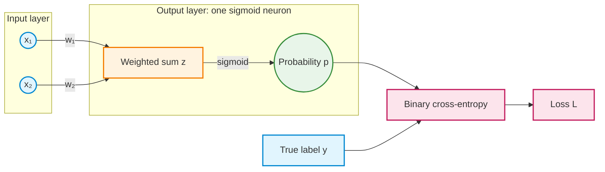

## From weights to probability to loss

The binary classifier in this demonstration uses **two inputs, two weights, and one sigmoid output neuron**. It has no bias and no hidden layer. The model first produces a numerical score, then converts that score into a probability. During training, binary cross-entropy (BCE) measures how well the predicted probability agrees with the true label.

### Step 1 — Calculate the weighted sum

Each input is multiplied by its corresponding weight. The model adds these products to produce one score, $z$. This score may be negative, zero, or positive.

$$
\boxed{z=w_1x_1+w_2x_2}
$$

Using the demonstration's initial values $x_1=2$, $x_2=1$, $w_1=1$, and $w_2=-2$:

$$
\begin{aligned}
z&=(1)(2)+(-2)(1)\\
 &=\boxed{0}
\end{aligned}
$$

### Step 2 — Apply sigmoid to obtain a probability

Sigmoid converts the score into the predicted probability $p$ of class 1. For a finite score, the probability is strictly between 0 and 1.

$$
\boxed{p=\sigma(z)=\frac{1}{1+e^{-z}}}
$$

For the current score $z=0$:

$$
p=\sigma(0)=\frac{1}{1+e^0}=\boxed{0.5}
$$

The model assigns a probability of 0.5 to class 1. So far, no weights have changed.

### Step 3 — Calculate binary cross-entropy

BCE uses the predicted probability $p$ and the actual binary label $y$ to measure the penalty for the prediction.

$$
\boxed{L(y,p)=-\left[y\ln(p)+(1-y)\ln(1-p)\right]}
$$

In this example, the true label is $y=1$. The formula therefore simplifies to $L=-\ln(p)$:

$$
L=-\ln(0.5)\approx\boxed{0.6931}
$$

The complete forward calculation is **weighted sum $z=0$ → sigmoid probability $p=0.5$ → BCE loss $L\approx0.6931$**. The prediction and loss have been calculated, but the weights have not yet been updated. Backpropagation calculates the gradients; gradient descent then uses those gradients to update the weights.

### A note on the word “logit”

The weighted sum $z$ is also called the **logit** in this model. **“Weighted sum” and “logit” do not refer to two successive calculations.** They refer to the same score, before sigmoid is applied.

The name comes from the fact that, for this sigmoid model, the score equals the *log-odds* associated with the predicted probability:

$$
z=\ln\left(\frac{p}{1-p}\right)
$$

This expression describes what the score represents; it is **not another operation inserted between the weighted sum and sigmoid**. It is also different from BCE, which uses the logarithms $\ln(p)$ and $\ln(1-p)$ to calculate a loss.

**Checkpoint:** In the diagram, which step converts a score into a probability, and which step compares that probability with the true label?
