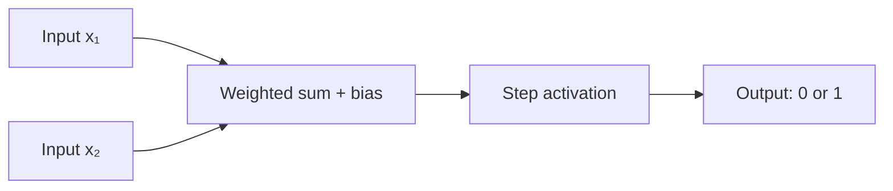
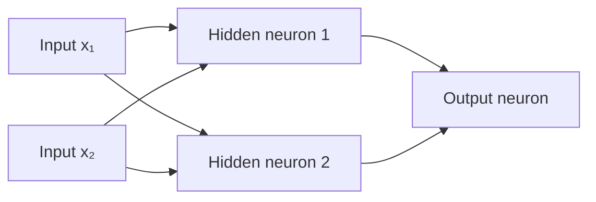
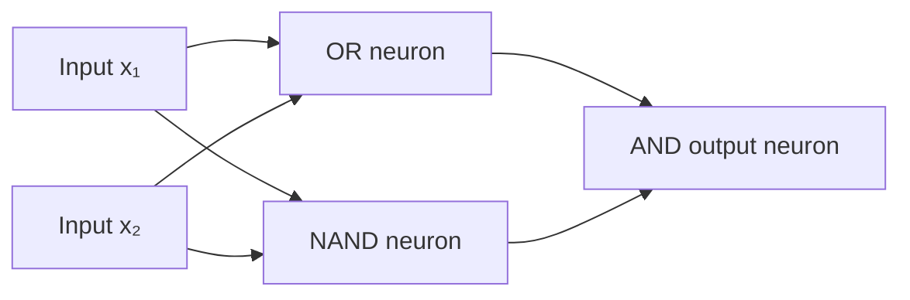

# Introduction to Neural Networks: From Perceptrons to MLPs

**Learning objectives.** By the end of this introduction, you should be able to:

1. Identify the inputs, weights, bias, and activation function of an artificial neuron.
2. Explain how a perceptron can implement a simple logic gate.
3. Recognize why one perceptron cannot solve XOR.
4. Describe the input, hidden, and output layers of a Multi-Layer Perceptron (MLP).
5. Trace a **forward pass** through a small network, using given weights and biases.

**Contents**

1. Inspiration: The Biological Neuron
2. The Basic Unit: The Artificial Neuron (Perceptron)
3. Simple Computations: AND, OR, and NOT
4. The Limitation: Linear Separability and XOR
5. Overcoming the Limitation: Multi-Layer Perceptrons (MLPs)
6. How an MLP Produces an Output: The Forward Pass
7. Key Terminology Recap
8. Further Exploration

> [!NOTE]
> **Today:** Understand what neurons and MLPs compute, why hidden layers matter, and how a forward pass works. **In a later session:** Learn how neural networks adjust their weights through training, loss functions, backpropagation, and optimization. In Activity 2, we will use Keras training commands before examining those algorithms internally.

---

## 1. Inspiration: The Biological Neuron

Artificial neural networks (ANNs) were inspired in part by networks of neurons in the brain. Biological neurons receive signals, integrate them, and may transmit signals to other neurons.

- **Dendrites** receive signals from other cells.
- The **cell body** integrates many incoming signals.
- The **axon** carries an electrical signal away from the cell body.
- **Synapses** are connections through which neurons communicate.


*Figure 1. Simplified signal flow in a biological neuron.*


*(Figure 1b. Diagram of a biological neuron detailing the dendrites, nucleus, and axon)*

> [!IMPORTANT]
> Artificial neurons are **mathematical abstractions**, not faithful simulations of the brain. The biological analogy provides intuition, but artificial neural networks are designed for computation.

<details>
<summary><strong>Optional deeper dive: Biological learning versus artificial neural-network training</strong></summary>

**Neuroplasticity** refers to changes in the connections and functioning of the nervous system. **Hebbian learning** is often summarized by the phrase “neurons that fire together, wire together.” This provides a *conceptual similarity* to changing connection strengths in artificial networks; it is **not** the same learning rule as the backpropagation and gradient-based optimization used by many modern MLPs.

</details>

---

## 2. The Basic Unit: The Artificial Neuron (Perceptron)

A **perceptron** is an early model of an artificial neuron, associated with Frank Rosenblatt's work in the 1950s. In this lesson, *perceptron* means a neuron that computes a weighted sum and then applies a **step activation function**, returning either 0 or 1.



*Figure 2. An artificial neuron calculates a weighted sum and applies an activation function.*

For two inputs, the calculation is:

$$
z = w_1x_1 + w_2x_2 + b
$$

$$
\operatorname{step}(z)=
\begin{cases}
1, & z\ge 0\\
0, & z<0
\end{cases}
$$

Here:

- **Inputs** $x_1,x_2$ are feature values given to the neuron.
- **Weights** $w_1,w_2$ determine how strongly each input contributes to the sum.
- **Bias** $b$ is an added number that shifts the threshold.
- **Activation function** converts the weighted sum into the neuron's output.

**Work one example by hand.** Suppose $x=[1,0]$, $w=[0.5,0.5]$, and $b=-0.7$.

$$
z=(1)(0.5)+(0)(0.5)-0.7=-0.2
$$

Because $z<0$, the perceptron outputs **0**. If we keep the inputs and weights but change the bias to $-0.3$, then $z=0.2$ and the output becomes **1**.

**Why the bias matters.** For two features, a perceptron's decision boundary is defined by

$$w_1x_1+w_2x_2+b=0.$$

For fixed, nonzero weights, changing $b$ **moves** this line without changing its orientation. If $b=0$, the boundary goes through the origin. The direction of the line depends on the weights.

<details>
<summary><strong>Optional mathematics: The dot product</strong></summary>

The expression $w_1x_1+w_2x_2$ is a **dot product**. With any number of inputs, we can write

$$z=\mathbf{w}\cdot\mathbf{x}+b.$$

Python's `numpy.dot()` computes this efficiently. It is the same weighted-sum operation we will use throughout the lesson.

</details>

**Check your understanding:** If $z=0$ exactly, is the perceptron's output 0 or 1 under the step-function definition above?

<details>
<summary><strong>Answer</strong></summary>

The output is **1**, because the rule uses $z\ge 0$.

</details>

---

## 3. Simple Computations: Modeling Logic Gates (AND, OR, NOT)

A logic gate maps binary inputs (0 or 1) to a binary output. We can reproduce several gates by choosing suitable perceptron weights and biases. **Today, we set these values manually; we are not training the model.**

| $x_1$ | $x_2$ | AND | OR | XOR |
|:---:|:---:|:---:|:---:|:---:|
| 0 | 0 | 0 | 0 | 0 |
| 0 | 1 | 0 | 1 | 1 |
| 1 | 0 | 0 | 1 | 1 |
| 1 | 1 | 1 | 1 | 0 |

### One fully worked gate: OR

OR outputs 1 when **at least one** input is 1. Let

$$w_1=1,\qquad w_2=1,\qquad b=-0.5.$$

Then $z=x_1+x_2-0.5$.

| Inputs $(x_1,x_2)$ | Weighted sum $z$ | Step output |
|:---:|---:|:---:|
| (0,0) | $-0.5$ | 0 |
| (0,1) | $0.5$ | 1 |
| (1,0) | $0.5$ | 1 |
| (1,1) | $1.5$ | 1 |

Here is the calculation as Python code:

```python
import numpy as np


def perceptron(inputs, weights, bias):
    """Return 0 or 1 using a weighted sum and step activation."""
    assert len(inputs) == len(weights), "Inputs and weights must match."
    z = np.dot(inputs, weights) + bias
    return 1 if z >= 0 else 0


gate_inputs = [[0, 0], [0, 1], [1, 0], [1, 1]]

for pair in gate_inputs:
    print(pair, "->", perceptron(pair, [1.0, 1.0], -0.5))
```

**Expected outputs:** `0, 1, 1, 1` in the order shown.

### What about AND and NOT?

- **AND** outputs 1 only if **both** inputs are 1. The same weights as OR can work with a different bias.
- **NOT** has **one input** and returns the opposite value. It can be implemented using a negative weight.

In **Activity 1**, you will find suitable parameters for AND and NOT yourself, then find *another* correct parameter set for at least one gate. This is more useful than memorizing particular numbers: many choices of weights and bias can implement the same truth table.

**Think about it:** With the OR weights fixed at $[1,1]$, should the bias become **more negative** or **less negative** to make the gate behave like AND?

<details>
<summary><strong>Answer</strong></summary>

**More negative.** The threshold becomes harder to reach: one input equal to 1 is no longer enough, but two inputs equal to 1 still are. Activity 1 asks you to determine a suitable value.

</details>

---

## 4. The Limitation: Linear Separability and XOR

A single perceptron is a **linear classifier**: the rule $\mathbf{w}\cdot\mathbf{x}+b=0$ describes one straight decision boundary in a two-dimensional input space. A step function is itself nonlinear, but it does **not** change the fact that a *single perceptron's decision boundary* is linear.

**Linearly separable data:** The two classes can be separated using one line (or, in higher dimensions, one hyperplane). AND and OR are linearly separable.

For example, the AND configuration $w=[1,1]$ and $b=-1.5$ has this boundary:

$$x_1+x_2=1.5.$$

The point $(1,1)$ lies on the class-1 side, while $(0,0)$, $(0,1)$, and $(1,0)$ lie on the class-0 side.

**The XOR challenge:** XOR gives 1 when exactly one of its two inputs is 1 and gives 0 when the inputs match. Its class-1 points, $(0,1)$ and $(1,0)$, occupy opposite corners of the square. Its class-0 points occupy the other two corners. **No single straight line can separate these two classes perfectly.**

In Activity 1, you will plot AND and XOR, try to draw a separator, and investigate what happens when you change a perceptron's weights and bias.

> [!NOTE]
> **Historical context.** Research on perceptrons, including Marvin Minsky and Seymour Papert's 1969 book *Perceptrons*, highlighted limitations of certain early neural-network models. These limitations influenced attitudes toward neural networks, but the decline in AI research funding often called an “AI winter” had several causes; it should not be attributed to XOR alone.

**Question:** If one line is insufficient for XOR, what could we gain by combining the results of *several* neurons?

---

## 5. Overcoming the Limitation: Multi-Layer Perceptrons (MLPs)

A **Multi-Layer Perceptron (MLP)** connects neurons into layers. Typically, each neuron in a **dense** layer receives the outputs of every neuron in the preceding layer.



*Figure 3. A simple network with two input features, two hidden neurons, and one output neuron.*

An MLP contains:

1. **Input layer:** Receives the input features. These inputs are passed to the first trainable layer.
2. **Hidden layer(s):** Each neuron calculates a weighted sum, adds a bias, and applies an activation function. The outputs become new features for the next layer.
3. **Output layer:** Combines the preceding layer's outputs to produce a prediction.

### Why nonlinear activations matter

Modern MLPs commonly use nonlinear activation functions, such as:

- **ReLU:** $f(z)=\max(0,z)$. It returns 0 for negative values and $z$ for positive values; often used in hidden layers.
- **Sigmoid:** $f(z)=\frac{1}{1+e^{-z}}$. It produces a value strictly between 0 and 1; commonly used for the output of a binary classifier.
- **Tanh:** Outputs values between $-1$ and $1$; another nonlinear option for hidden layers.

These are not the only activation functions. The central idea is that **stacking layers with only linear transformations still produces one overall linear transformation**. Nonlinear activations allow multilayer networks to represent more complicated relationships.

> [!IMPORTANT]
> **One perceptron:** One straight decision boundary. **An MLP with nonlinear hidden activations:** Can combine multiple computations to form nonlinear decision boundaries, including a solution to XOR.

**Check your understanding:** If every layer simply calculated weighted sums and biases, without applying a nonlinear activation, could a deeper network represent XOR perfectly?

<details>
<summary><strong>Answer</strong></summary>

No. Composing only affine (linear-plus-bias) transformations produces another affine transformation and therefore still gives a linear decision boundary.

</details>

---

## 6. How an MLP Produces an Output: The Forward Pass

A **forward pass** calculates a network's output from its inputs, using weights and biases that are already assigned. A forward pass **does not update** these parameters.

1. Present the input values.
2. Each hidden neuron computes a weighted sum plus bias, then an activation.
3. The resulting hidden-layer outputs become the next layer's inputs.
4. The output neuron produces the network's final result.

### Worked example: Build XOR from three perceptrons

We can use the traditional **step activation** to show the logic explicitly. This is a hand-designed demonstration, **not a training procedure**. The hidden layer has two neurons: one computes OR and one computes NAND (NOT-AND). The output neuron computes AND of those two results.



Choose these weights and biases:

| Neuron | Inputs it receives | Weights | Bias | Activation |
|---|---|---|---|---|
| Hidden OR | $x_1,x_2$ | $[1,1]$ | $-0.5$ | Step |
| Hidden NAND | $x_1,x_2$ | $[-1,-1]$ | $1.5$ | Step |
| Output AND | OR output, NAND output | $[1,1]$ | $-1.5$ | Step |

**Trace the input $[x_1,x_2]=[0,1]$.**

**Hidden neuron 1 (OR):**

$$z_{\mathrm{OR}}=(0)(1)+(1)(1)-0.5=0.5 \quad\Rightarrow\quad h_1=1$$

**Hidden neuron 2 (NAND):**

$$z_{\mathrm{NAND}}=(0)(-1)+(1)(-1)+1.5=0.5 \quad\Rightarrow\quad h_2=1$$

**Output neuron (AND):**

$$z_{\mathrm{out}}=(1)(1)+(1)(1)-1.5=0.5\quad\Rightarrow\quad\hat y=1$$

This matches the XOR answer for $[0,1]$.

Now check all four inputs:

| Input | Hidden OR | Hidden NAND | Output AND | Expected XOR |
|:---:|:---:|:---:|:---:|:---:|
| (0,0) | 0 | 1 | 0 | 0 |
| (0,1) | 1 | 1 | 1 | 1 |
| (1,0) | 1 | 1 | 1 | 1 |
| (1,1) | 1 | 0 | 0 | 0 |

**Why this matters:** The same weighted-sum-plus-activation computation used in one perceptron appears **inside every neuron**. By connecting neurons, the network represents XOR even though one perceptron cannot.

> [!NOTE]
> We used step activations here because Boolean logic gates are easy to follow by hand. In **Activity 2**, we will instead build an MLP in Keras using a **ReLU hidden layer** and a **sigmoid output**, then allow Keras to learn parameters from examples. We will explore the details of learning in a later session.

**Quick practice:** Without looking at the table, trace $[1,1]$ through the three neurons. What are the two hidden outputs and the final output?

<details>
<summary><strong>Answer</strong></summary>

OR outputs 1; NAND outputs 0; AND of $[1,0]$ outputs 0. Thus XOR$(1,1)=0$.

</details>

---

## 7. Key Terminology Recap

| Term | Meaning |
|---|---|
| **Artificial neuron** | Combines inputs using weights and bias, then applies an activation function. |
| **Perceptron** | In this lesson, a step-activation artificial neuron producing 0 or 1. |
| **Weight** | Controls an input's contribution to a neuron's weighted sum. |
| **Bias** | Added value that shifts the neuron's activation threshold. |
| **Activation function** | Transforms the weighted sum into the neuron's output. |
| **Decision boundary** | Where a classifier changes its predicted class. |
| **Linear separability** | Whether one straight line (or hyperplane) can separate the classes. |
| **XOR** | Outputs 1 if exactly one of the two binary inputs is 1. |
| **Hidden layer** | A layer of neurons between the input and output. |
| **MLP** | An artificial neural network with one or more hidden layers. |
| **Forward pass** | Computing a network's output without changing weights or biases. |

### End-of-theory self-check

1. What are the roles of a weight, a bias, and an activation function?
2. Why is a single step-activation perceptron still called a *linear classifier*?
3. What makes XOR different from AND in a two-dimensional plot?
4. In the worked XOR network, what do the two hidden neurons compute?
5. Why are nonlinear activations important when stacking multiple layers?

**Next:** Complete **Activity 1: Perceptrons, Logic Gates, and the XOR Limitation**, where you will implement the perceptron, set weights and biases manually, and investigate the plots. After that, **Activity 2** introduces an MLP built with Keras.

---

## 8. Further Exploration

Optional resources for reviewing the concepts or experimenting with networks:

- [TensorFlow Playground](https://playground.tensorflow.org/) — Experiment with hidden layers and decision boundaries in a browser.
- [Notes on Single-Layer Neural Networks](https://humphryscomputing.com/Notes/Neural/single.neural.html) — Additional mathematical context.
- [University of Wisconsin: Neural Networks Overview](https://uw-madison-datascience.github.io/2022-10-26-machine-learning-novice-sklearn/06-neural-networks/index.html) — Further course material.
- [Kaggle: Intro to Deep Learning](https://www.kaggle.com/learn/intro-to-deep-learning) — Applied introduction.
- [Google Machine Learning Crash Course: Activation Functions](https://developers.google.com/machine-learning/crash-course/neural-networks/activation-functions) — Activation-function review.


