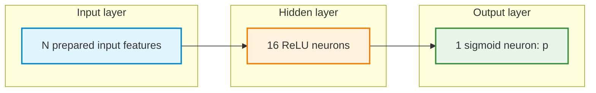

# Pair Programming 2: Titanic Survival Classification with an MLP

**Focus:** Apply the neural-network workflow studied in Week 1 to binary classification with numerical and categorical inputs, missing values, and a constructed feature.

The Titanic dataset is familiar from earlier classical machine-learning work. This activity reuses that data context while changing the estimator to an MLP, allowing the comparison to focus on the output layer, loss function, and neural-network training workflow.

The [Titanic CSV](https://raw.githubusercontent.com/mwaskom/seaborn-data/master/titanic.csv) contains **891 passenger records**. The target is `survived`: **0 = did not survive; 1 = survived**. This is a historical dataset used to practise machine-learning methods; predictions should not be interpreted as causes of survival or as a reliable model for present-day safety decisions.

**Python setup:** Use the [shared Colab installation and import checks](1-python_setup.md#google-colab-setup). These pair-programming exercises require NumPy, pandas, Matplotlib, scikit-learn, Keras, and TensorFlow. Install a package only if its import is missing, then restart the runtime/session if requested and rerun setup.

## Learning objectives

By the end of the session, each pair should be able to:

1. Distinguish binary classification from the regression tasks studied in Week 1.
2. Explore class frequencies and interpret a majority-class baseline.
3. Create training, validation, and test sets without data leakage.
4. Construct a feature, handle missing values, encode categories, and standardize numerical inputs using training-fitted preparation.
5. Build, compile, and train a Keras MLP with one sigmoid output.
6. Interpret training and validation loss/accuracy and select a model **before** final testing.
7. Interpret predicted probabilities and reuse exactly the same preprocessing for a new passenger record.

## How pair programming works

- **Driver:** Types and runs code, and explains the choice of each operation.
- **Navigator:** Reads the task, checks names and shapes, looks for data leakage, and asks questions before execution.
- **Switch roles** after Sections 2, 4, 6, 8, and 10. Both partners should contribute code and explanations.
- Complete the sections in order. Open a **Hint** after discussing an approach. Hints do not provide complete solutions.
- Keep **test labels and test scores out of model selection**. Test inputs may be processed with training-fitted transformations, but test performance is assessed only in Section 11.
- Record the results observed during execution; neural-network outcomes may vary between runs.

**Work format:** Create a Google Colab notebook with separate Markdown and Python cells. Complete the `TODO` cells. Supplied code is limited to setup, unfamiliar categorical encoding, classification-specific compilation, and visualizations intended for interpretation. There is **no complete model-building solution**.

## Workflow


---

## 1. Recall: Regression versus binary classification

| Choice | Regression |  Classification |
|---|---|---|
| Target | Numerical rating or strength | `survived`: 0 or 1 |
| Output layer | One linear neuron | One sigmoid neuron |
| Training loss | Mean squared error (MSE) | Binary cross-entropy (BCE) |
| Reported metric | Mean absolute error (MAE) | Classification accuracy |

For binary classification, a sigmoid converts a model score $z$ into an output $p$ between 0 and 1:

$$
p=\sigma(z)=\frac{1}{1+e^{-z}}
$$

The output $p$ is treated as the model-estimated probability of **class 1**, meaning survival in this dataset. A threshold of 0.5 converts this output to a class: predict 1 when $p\geq 0.5$, and 0 otherwise. A model score is **not** a statement of certainty about an individual historical passenger.

**Discuss before coding**

1. Why is a linear output less appropriate for this task than a sigmoid output?
2. What does a model output of `0.8` mean? Does it confirm an individual outcome?
3. Why is regression MAE in rating points or megapascals unsuitable as the main metric here?

<details>
<summary><strong>Hint — classification objective</strong></summary>

Consider the two possible target labels, the range of a probability, and the distinction between a predicted probability and an observed outcome.

</details>

---

## 2. Load and inspect the Titanic data

Use only the following fields for this activity. The downloaded CSV has additional columns; some, such as `alive`, reveal the target directly and must **not** become predictors.

| Field | Meaning | Role |
|---|---|---|
| `survived` | 0 = did not survive; 1 = survived | Target |
| `pclass` | Ticket class: 1, 2, or 3 | Ordinal numerical input |
| `sex` | Recorded sex category | Categorical input |
| `age` | Age in years | Numerical input |
| `sibsp` | Siblings/spouses aboard, excluding the passenger | Used to construct a feature |
| `parch` | Parents/children aboard, excluding the passenger | Used to construct a feature |
| `fare` | Recorded ticket fare in pounds | Numerical input |
| `embarked` | Boarding port: C, Q, or S | Categorical input |

For consistency with the specified feature choices, `pclass` is treated as an **ordinal numerical input**, not one-hot encoded. This is a modeling choice; an alternative exercise could test categorical encoding of ticket class.

**Supplied setup** — run this code at the beginning of the notebook:

```python
# Uncomment only if installation is needed in the runtime.
# %pip install numpy pandas matplotlib scikit-learn keras tensorflow

import numpy as np
import pandas as pd
import matplotlib.pyplot as plt
import keras
from keras import Sequential, Input
from keras.layers import Dense
from sklearn.model_selection import train_test_split
from sklearn.impute import SimpleImputer
from sklearn.preprocessing import StandardScaler

keras.utils.set_random_seed(42)

DATA_URL = "https://raw.githubusercontent.com/mwaskom/seaborn-data/master/titanic.csv"
print("Keras backend:", keras.config.backend())
```

**Pair tasks**

1. Load `DATA_URL` into a DataFrame named `titanic_data`.
2. Display the first five rows, the shape, and the column names.
3. Inspect data types and missing-value counts for the eight listed fields.
4. Identify the observed target values and the positive class.
5. Explain why this is **binary classification**.

```python
# TODO: Read the CSV into titanic_data.
# TODO: Display rows, shape, and column names.
# TODO: Inspect types, missing values, and unique target values.
```

<details>
<summary><strong>Hint — inspecting tabular data</strong></summary>

Recall the Week 1 pandas operations `pd.read_csv(...)`, `.head()`, `.shape`, `.dtypes`, `.isna().sum()`, and `.value_counts()`.

</details>

**Checkpoint:** Record the dataset dimensions, the meaning of one row, the target labels, and the fields permitted as predictors.

---

## 3. Select features and reserve held-out data

The input table `X` must contain **only** the seven raw predictor columns listed above. The target `y` must contain `survived`. Excluding other CSV columns prevents accidental use of a field that leaks the answer or falls outside this exercise.

**Pair tasks**

1. Create `X` from `pclass`, `sex`, `age`, `sibsp`, `parch`, `fare`, and `embarked`; create `y` from `survived`.
2. Check for missing labels. If any exist, exclude the affected rows from **both** `X` and `y` before splitting; report the number excluded.
3. Reserve **20%** for `X_test`, `y_test`, using `random_state=42` and stratification by `y`.
4. From the other **80%**, reserve **20% of that remainder** for `X_val`, `y_val`, stratified using `y_train_val`.
5. Name the remaining data `X_train`, `y_train`, and print the shapes. Confirm that original row indices do not overlap across splits.

```python
# TODO: Select the seven raw predictors by their column names.
# TODO: Select the target and handle any missing target labels.

# TODO: Split train+validation / test (stratify by the labels).

# TODO: Split training / validation (stratify again).

# TODO: Print shapes and confirm that row indices do not overlap.
```

<details>
<summary><strong>Hint — two-stage split</strong></summary>

The first `train_test_split(...)` call returns train-plus-validation and test partitions. The second call divides the first partition. In classification, `stratify=y` in the first call and `stratify=y_train_val` in the second help maintain similar class proportions. The resulting split is approximately **64% training / 16% validation / 20% test**.

</details>

**Discuss:** Why must the final test labels remain outside model selection? Why should preprocessing statistics be learned from training rows only?

---

## 4. Explore training data and establish a majority-class baseline

Exploration and baseline decisions use **training rows only**. The baseline always predicts the most common training label. This gives a reference point for interpreting later accuracy.

**Pair tasks**

1. Count class 0 and class 1 in `y_train`, and calculate their proportions.
2. Identify the **majority training class**, store it as `majority_class`, and record its training proportion.
3. Inspect the training `age` distribution, including missing values and a possible extreme value.
4. Run the three supplied plots, then write one observation supported by each plot.
5. Explain why an accuracy of 70% would not automatically mean the MLP is better than the baseline.

```python
# TODO: Count training labels and compute their percentages.
# TODO: Store the most frequent training label as majority_class.
# TODO: Inspect ages and note missingness or unusually large/small values.
```

### Run and interpret the class-count plot

<details>
<summary><strong>Show supplied Python plotting code — survival classes</strong></summary>

```python
class_counts = y_train.value_counts().reindex([0, 1], fill_value=0)

plt.figure(figsize=(6, 4))
plt.bar(["Did not survive (0)", "Survived (1)"], class_counts.values)
plt.ylabel("Number of training passengers")
plt.xlabel("Recorded survival class")
plt.title("Training class counts")
plt.tight_layout()
plt.show()
```

</details>

### Run and interpret the age histogram

<details>
<summary><strong>Show supplied Python plotting code — age distribution</strong></summary>

```python
plt.figure(figsize=(7, 4))
plt.hist(X_train["age"].dropna(), bins=20)
plt.xlabel("Age (years)")
plt.ylabel("Number of training passengers")
plt.title("Recorded ages in the training data")
plt.tight_layout()
plt.show()
```

</details>

### Run and interpret survival proportions by ticket class

<details>
<summary><strong>Show supplied Python plotting code — passenger class</strong></summary>

```python
train_plot_data = pd.DataFrame({
    "pclass": X_train["pclass"],
    "survived": y_train
})
survival_by_class = (
    train_plot_data.groupby("pclass")["survived"].mean().sort_index()
)

plt.figure(figsize=(6, 4))
plt.bar(survival_by_class.index.astype(str), survival_by_class.values)
plt.xlabel("Passenger class")
plt.ylabel("Observed training survival proportion")
plt.ylim(0, 1)
plt.title("Training survival proportion by passenger class")
plt.tight_layout()
plt.show()
```

</details>

<details>
<summary><strong>Hint — majority-class baseline</strong></summary>

Use `.value_counts()` on `y_train`, not on the test labels. The training majority-class proportion is a first indication of the accuracy obtained by predicting one label for every training observation. The test score of this baseline is computed later, in Section 11.

</details>

**Checkpoint:** Record the majority class, its training proportion, two data-quality observations, and one pattern in the plots. Observed associations do not prove causation.

---

## 5. Construct `family_size` and handle missing inputs

This task includes a small feature-engineering step. Define the size of the passenger's traveling family group as:

$$
\text{family\\_size} = 1 + \text{sibsp} + \text{parch}
$$

The added 1 counts the passenger. For modeling, `family_size` **replaces** `sibsp` and `parch` rather than being added alongside them. The final six input fields, before encoding, are:

| Numerical inputs | Categorical inputs |
|---|---|
| `pclass`, `age`, `fare`, `family_size` | `sex`, `embarked` |

Missing numerical values are replaced using **training medians**. Missing categorical values are replaced using the **most frequent training category (mode)**. In particular, check `age` and `embarked` for missing entries before carrying out this operation.

**Supplied column groups:**

```python
numerics = ["pclass", "age", "fare", "family_size"]
categorical_variables = ["sex", "embarked"]
```

**Pair tasks**

1. Create independent copies named `X_train_fe`, `X_val_fe`, and `X_test_fe`.
2. Construct `family_size` in each partition using the same row-wise formula; remove `sibsp` and `parch` and retain the six final feature columns in a fixed order.
3. Make copies named `X_train_filled`, `X_val_filled`, and `X_test_filled`.
4. Create a `SimpleImputer(strategy="median")` named `numeric_imputer`. Fit it on the **training numerical columns only** and apply it to all three partitions.
5. Determine the training mode for **each** categorical column; retain these values as `category_modes`. Fill missing categorical entries in all three partitions with the corresponding **training** mode.
6. Verify that no missing values remain in any of the six model inputs.

```python
# TODO: Copy X_train, X_val, X_test and construct family_size in each.
# TODO: Keep only the six modeling columns, with consistent order.

# TODO: Make X_train_filled, X_val_filled, X_test_filled.

# TODO: Fit numeric_imputer on X_train_filled[numerics] only.
# TODO: Transform the same numerical columns in all three partitions.

# TODO: Determine category_modes from training categorical columns only.
# TODO: Fill missing categorical values in all partitions with training modes.

# TODO: Inspect prepared shapes and missing-value counts.
```

<details>
<summary><strong>Hint — feature engineering and missing values</strong></summary>

A row-wise construction uses `1 + frame["sibsp"] + frame["parch"]`. Use `.drop(columns=[...])` or explicit column selection so the original count columns are not also passed to the MLP. `SimpleImputer` uses `fit_transform()` for training data and `transform()` for validation/test data. For one categorical column, `.mode(dropna=True).iloc[0]` gives the most frequent observed training category; use the saved value with `.fillna(...)` on each partition.

</details>

**Discuss:** Why can a median or mode calculated using validation or test data introduce leakage? Why is an unknown age not equivalent to age zero?

---

## 6. Encode categorical inputs and standardize numerical inputs

The categorical fields `sex` and `embarked` are text labels, not continuous numerical measurements. **One-hot encoding** creates indicator columns for their categories. Separate encoding of each partition could produce different columns, so validation and test features must be aligned with the training columns.

The following **categorical encoding code is supplied** because it introduces a preprocessing detail beyond the familiar numerical workflow:

```python
X_train_encoded = pd.get_dummies(
    X_train_filled, columns=categorical_variables, dtype=np.float32
)

def encode_like_training(frame):
    encoded = pd.get_dummies(
        frame, columns=categorical_variables, dtype=np.float32
    )
    return encoded.reindex(columns=X_train_encoded.columns, fill_value=0)

X_val_encoded = encode_like_training(X_val_filled)
X_test_encoded = encode_like_training(X_test_filled)
```

If a category has not appeared in the training data, it receives zeros across the known indicator columns for that categorical field. This is the rule used for this activity; it is not a learned representation of the unseen category.

The numerical inputs must also be standardized. Standardization uses the training feature mean and standard deviation:

$$
z=\frac{x-\mu_{\mathrm{train}}}{\sigma_{\mathrm{train}}}
$$

Here, $x$ is the original numerical value; $\mu_{\mathrm{train}}$ and $\sigma_{\mathrm{train}}$ are calculated from the training split. Leave the 0/1 indicator columns unchanged.

**Pair tasks**

1. Run the supplied encoding code and inspect the resulting column names and shapes.
2. Check that all three encoded DataFrames have **identical column order**.
3. Create a `StandardScaler` named `scaler`. Fit it on `X_train_encoded[numerics]` only.
4. Make `X_train_scaled`, `X_val_scaled`, and `X_test_scaled`. Scale only the four numerical columns with the **same** scaler.
5. Convert the scaled input tables to `float32` NumPy arrays named `train_X`, `val_X`, and `test_X`. Convert the corresponding target labels to arrays named `train_y`, `val_y`, and `test_y`.
6. Print all input and label shapes. Check for missing or non-finite values and confirm that the target is not an input.

```python
# TODO: Inspect encoded shapes and confirm identical column order.

# TODO: Create scaler and copies of the encoded DataFrames.
# TODO: Fit on training numerics only; transform numerics in all splits.

# TODO: Create train_X, val_X, test_X as float32 arrays.
# TODO: Create train_y, val_y, test_y arrays.
# TODO: Print shapes and check for missing / non-finite values.
```

<details>
<summary><strong>Hint — training-only scaling</strong></summary>

Recall Week 1: `fit_transform()` learns training statistics and transforms the training values. For validation and test values, use `transform()` without fitting again. A selected-column assignment may use `frame[numerics] = ...`. Convert a DataFrame with `.to_numpy(dtype="float32")`.

</details>

**Checkpoint:** The input arrays have the same number and order of columns. The row counts may differ. `survived` must not appear among the prepared input columns.

---

## 7. Build the MLP: 16 hidden neurons and one sigmoid output

The baseline network contains **one hidden Dense layer with 16 ReLU neurons** and **one sigmoid output neuron**. The input width depends on the categories represented in the encoded training data.



The diagram groups neurons by layer rather than drawing every connection. Each Dense neuron includes one trainable bias. If $N$ is the number of columns in `train_X`, the number of trainable parameters is:

$$
\begin{aligned}
\text{Hidden layer} &= 16N+16 \\
\text{Output layer} &= 16+1 \\
\text{Total} &= 16N+33
\end{aligned}
$$

**Pair tasks**

1. Set the random seed to 42 immediately before constructing the baseline model.
2. Use `Sequential`, `Input`, and `Dense` to create a model named `model`.
3. Use an input shape based on `train_X.shape[1]`.
4. Add a 16-neuron ReLU hidden layer followed by one sigmoid output neuron.
5. Display `model.summary()` and verify its total trainable parameters against the expression above.

```python
# TODO: Set the random seed and create model.
# TODO: Add an input, a 16-ReLU hidden layer, and one sigmoid output.
# TODO: Print model.summary() and verify the parameter count.
```

<details>
<summary><strong>Hint — model architecture</strong></summary>

Recall the Week 1 `Sequential` pattern. An input layer can use `Input(shape=(train_X.shape[1],))`; hidden and output layers use `Dense(...)`. The hidden activation is `"relu"`; the final activation is `"sigmoid"`.

</details>

**Discuss:** Why is there one sigmoid output rather than one output neuron per passenger category? What changes from the linear output of the Week 1 regression models?

---

## 8. Compile the MLP for binary classification

Model construction defines the network's calculations. Compilation specifies the optimizer, loss function, and reported metric:

- **`optimizer="adam"`** updates trainable parameters using gradients and adaptive step sizes. Backpropagation calculates gradients; Adam applies parameter updates.
- **`loss="binary_crossentropy"`** measures how well predicted probabilities agree with 0/1 labels. The training loss is **BCE**, not regression MSE.
- **`metrics=["accuracy"]`** reports the fraction classified correctly; for one sigmoid output, Keras uses a default probability threshold of 0.5 for binary accuracy.

For one example with true label $y\in\{0,1\}$ and sigmoid output $p$, binary cross-entropy is:

$$
L=-\left[y\ln(p)+(1-y)\ln(1-p)\right]
$$

For a class-1 example, the loss is $-\ln(p)$; for class 0, it is $-\ln(1-p)$. Keras implements this loss with numerical safeguards during training.

**Supplied code — classification training settings:**

```python
model.compile(
    optimizer="adam",
    loss="binary_crossentropy",
    metrics=["accuracy"]
)
```

**Pair discussion**

1. What is the purpose of each `compile()` argument?
2. For a passenger whose label is 1, which predicted probability gives lower BCE: 0.9 or 0.1? Why?
3. What is the difference between backpropagation and the Adam optimizer?
4. Why should accuracy be compared with the majority-class baseline?

---

## 9. Train the baseline and interpret learning curves

As in Week 1, `fit()` trains the MLP and returns a `History` object. An **epoch** is one complete pass through the training data. A **mini-batch** is a smaller collection of training examples used for one optimization step.

**Pair tasks**

1. Train `model` on `train_X`, `train_y` for **150 epochs** with `batch_size=32`.
2. Set `validation_data=(val_X, val_y)` and choose an appropriate `verbose` value.
3. Save the returned object as `history`.
4. Inspect `history.history` and record final training/validation **BCE** and **accuracy**.
5. Run the supplied plots, observe the curves, and explain the patterns.

```python
# TODO: Call model.fit(...) using the training and validation arrays.
# TODO: Save its history and inspect final loss and accuracy values.
```

<details>
<summary><strong>Hint — fitting the model</strong></summary>

`fit(...)` takes the training features and labels first. The named arguments include `epochs`, `batch_size`, `validation_data`, and `verbose`. The history keys include `loss`, `val_loss`, `accuracy`, and `val_accuracy`.

</details>

### Run and interpret the BCE plot

<details>
<summary><strong>Show supplied Python plotting code — training and validation BCE</strong></summary>

```python
train_loss = history.history["loss"]
validation_loss = history.history["val_loss"]
epoch_numbers = range(1, len(train_loss) + 1)

plt.figure(figsize=(7, 4))
plt.plot(epoch_numbers, train_loss, label="Training BCE")
plt.plot(epoch_numbers, validation_loss, label="Validation BCE")
plt.xlabel("Epoch")
plt.ylabel("Binary cross-entropy")
plt.title("Titanic MLP: training and validation loss")
plt.legend()
plt.tight_layout()
plt.show()
```

</details>

### Run and interpret the accuracy plot

<details>
<summary><strong>Show supplied Python plotting code — training and validation accuracy</strong></summary>

```python
train_accuracy = history.history["accuracy"]
validation_accuracy = history.history["val_accuracy"]
epoch_numbers = range(1, len(train_accuracy) + 1)

plt.figure(figsize=(7, 4))
plt.plot(epoch_numbers, train_accuracy, label="Training accuracy")
plt.plot(epoch_numbers, validation_accuracy, label="Validation accuracy")
plt.xlabel("Epoch")
plt.ylabel("Accuracy")
plt.ylim(0, 1)
plt.title("Titanic MLP: training and validation accuracy")
plt.legend()
plt.tight_layout()
plt.show()
```

</details>

**Pair discussion**

1. Does validation BCE follow the training BCE trend throughout training?
2. What might a sustained decrease in training loss accompanied by an increase in validation loss suggest?
3. Why is a single noisy validation epoch not enough to establish overfitting?
4. Can two models have similar classification accuracy but different BCE values? Explain.

---

## 10. Pair challenge: Change one thing, then select a model

Model comparisons must use **validation results**, not test results. A new candidate model must start with **newly initialized weights**; calling `fit()` again on the baseline continues its existing training rather than creating a separate candidate.

**Pair tasks**

1. Choose **one** modification: use 8 hidden neurons rather than 16; use two hidden layers of 16 and 8 neurons; or train for 80 epochs instead of 150.
2. Predict whether the change could improve or worsen validation BCE, with a brief reason.
3. Build, compile, and train a **fresh** candidate with the same split, imputation, encoding, scaler, loss, optimizer, and batch size. Use a consistent random seed before building each model; rerun the baseline with the same initial seed if necessary for a more controlled comparison.
4. Compare **final-epoch validation BCE** for both models. Record validation accuracy as additional information.
5. Select the model with the lower final validation BCE; save the selected **trained** model as `final_model`. Do **not** inspect test performance yet.

```python
# TODO: Create and compile a fresh candidate model.
# TODO: Train it using the same preprocessed training and validation sets.
# TODO: Compare final validation BCE and record validation accuracy.
# TODO: Assign the selected trained model to final_model.
```

| Model | Architecture / epochs | Final validation BCE | Final validation accuracy | Observation |
|---|---|---|---|---|
| Baseline | 16 ReLU → 1 sigmoid; 150 epochs | | | |
| Candidate | One chosen change | | | |

<details>
<summary><strong>Hint — a valid model comparison</strong></summary>

Use the final entry in each model's `val_loss` history to compare the weights actually retained after `fit()`. A minimum validation loss from an earlier epoch does **not** automatically restore those earlier weights. Compare the same metric and keep the test set out of the choice.

</details>

**Discuss:** Is a larger model guaranteed to generalize better? Can an accuracy increase accompany a worse BCE? What can one random split establish, and what remains uncertain?

---

## 11. Final evaluation: Held-out test data and the baseline

Once `final_model` is fixed, the test set can be used for a **held-out final assessment after validation-based model selection**. No further architecture choice should be made based on the test results.

**Pair tasks**

1. Use `final_model.evaluate(test_X, test_y, ...)` to record **test BCE** and **test accuracy**.
2. Calculate test accuracy for a baseline predicting the **majority class identified from `y_train`** for every test row.
3. Compare MLP and baseline test accuracies. State whether the MLP improves on this particular reference.
4. Explain one limitation of accuracy for a binary-classification task and one limitation of results from a single split.

```python
# TODO: Evaluate final_model on the held-out test arrays.
# TODO: Calculate test accuracy of the training-majority-class baseline.
# TODO: Record and interpret both sets of results.
```

<details>
<summary><strong>Hint — evaluate once, without new model selection</strong></summary>

`evaluate()` returns the compiled loss and metric values. The majority-class reference compares each test label with the single class chosen from the **training** labels. The final test result is a report, not a new criterion for selecting or changing the model.

</details>

### Optional extension: Inspect classification errors

A **confusion matrix** distinguishes correct and incorrect predictions for each class. For this task, a *false negative* is a passenger who **survived** (`1`) but was predicted **not to survive** (`0`). The following supplied plot uses the selected model and is for interpretation, not further model selection.

<details>
<summary><strong>Show supplied Python plotting code — final-model confusion matrix</strong></summary>

```python
from sklearn.metrics import confusion_matrix, ConfusionMatrixDisplay

test_probabilities = final_model.predict(test_X, verbose=0).ravel()
test_predictions = (test_probabilities >= 0.5).astype(int)
cm = confusion_matrix(test_y, test_predictions, labels=[0, 1])

ConfusionMatrixDisplay(
    confusion_matrix=cm,
    display_labels=["Did not survive (0)", "Survived (1)"]
).plot(values_format="d")
plt.title("Selected MLP: test confusion matrix")
plt.tight_layout()
plt.show()
```

</details>

**Optional discussion:** Identify false-positive and false-negative counts. Which kind of mistake would not be visible from accuracy alone? No further training decision follows this inspection.

**Checkpoint:** Record the selected model, its test BCE and accuracy, the baseline test accuracy, and one qualification of the result.

---

## 12. Predict a hypothetical passenger and reflect

The selected MLP can produce a sigmoid output for a new record, but the input must pass through **the same feature construction, training-derived imputation values, one-hot columns, and scaler** used for the training data. No component is refitted on the new record.

Use the following hypothetical passenger (there is no known survival label for this example):

| `pclass` | `sex` | `age` | `sibsp` | `parch` | `fare` | `embarked` |
|---:|---|---:|---:|---:|---:|---|
| 3 | female | 28 | 1 | 0 | 15.0 | S |

**Supplied input record:**

```python
new_passenger_raw = pd.DataFrame([{
    "pclass": 3,
    "sex": "female",
    "age": 28,
    "sibsp": 1,
    "parch": 0,
    "fare": 15.0,
    "embarked": "S"
}])
```

**Pair tasks**

1. Compute `family_size` and keep the same six input fields, in the same order as for the training data.
2. Apply the **already-fitted** `numeric_imputer` and the saved `category_modes`; do not use the new row to calculate new medians or modes.
3. Apply `pd.get_dummies(...)`, then align the result to **`X_train_encoded.columns`** using the same rule as Section 6.
4. Apply the **already-fitted** `scaler` to the four numerical columns only. Convert the final row to a `float32` array with the same column count and order as `train_X`.
5. Run `final_model.predict(...)` and report the estimated probability of survival and the predicted 0/1 class using the 0.5 threshold.
6. Explain why the result is a **model estimate**, not a verified historical outcome.

```python
# TODO: Build the family_size feature and select the six model columns.
# TODO: Apply saved numerical and categorical missing-value replacements.
# TODO: Encode and align columns exactly as during training.
# TODO: Apply the fitted scaler to numerical columns only.
# TODO: Convert to float32 and make a sigmoid prediction.
# TODO: Convert to a class with threshold 0.5 and interpret the result.
```

<details>
<summary><strong>Hint — predicting with the same preprocessing</strong></summary>

The steps from Sections 5 and 6 must be reused in the same sequence. The saved training category columns are `X_train_encoded.columns`. A predicted sigmoid value can be flattened with `.ravel()`, compared with `0.5`, and converted to a 0/1 class. The target is not present in the hypothetical passenger input.

</details>

### Exit discussion

1. Which parts of the Week 1 MLP regression workflow remained unchanged, and which parts changed for binary classification?
2. What problem does `family_size` address, and why are its original component columns omitted from the model inputs?
3. Which preprocessing statistics must come from training data only? What does one-hot alignment preserve?
4. What do **binary cross-entropy**, **backpropagation**, and **Adam** each do?
5. Why is the test set used only after validation-based model selection?
6. What must be stored alongside model weights before predicting on future records?

## Submission checklist

- [ ] Both partners contributed code and switched Driver/Navigator roles.
- [ ] Dataset exploration and training-only survival patterns were recorded.
- [ ] Only specified features were used; no target leakage occurred.
- [ ] Stratified training/validation/test splits were created without overlapping rows.
- [ ] `family_size` replaced `sibsp` and `parch` in the six model input fields.
- [ ] Numerical medians, category modes, encoding alignment, and scaling were learned from training data only.
- [ ] Model-input arrays had matching feature order and contained no missing values.
- [ ] The 16-ReLU / one-sigmoid baseline was built and its parameters checked.
- [ ] Adam, BCE, and accuracy were interpreted; learning curves were inspected.
- [ ] A fresh candidate was selected using final validation BCE before test evaluation.
- [ ] Test results were compared with the training-majority-class baseline.
- [ ] The hypothetical passenger was processed without refitting and a prediction was interpreted.
- [ ] A short reflection identified limitations of this historical, observational dataset.

---

**Key connection to Week 1:** The train/validation/test discipline, preprocessing rules, Keras workflow, and validation-first model selection remain the same. The new focus is **classification**: sigmoid output, binary cross-entropy, class accuracy, and a majority-class baseline. The Titanic dataset also provides practice with **feature construction, missing-value imputation, and categorical encoding**.
