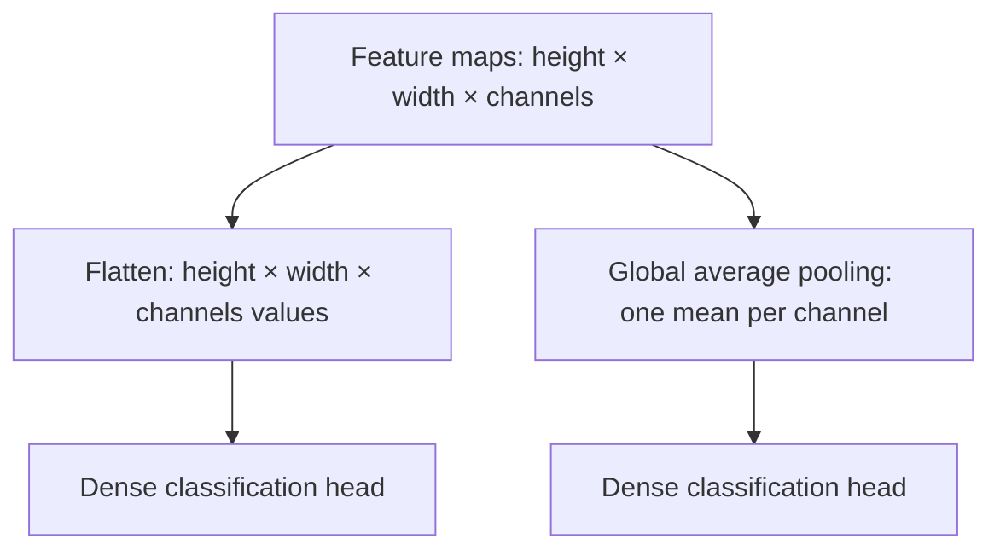
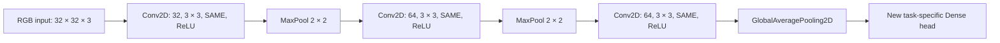
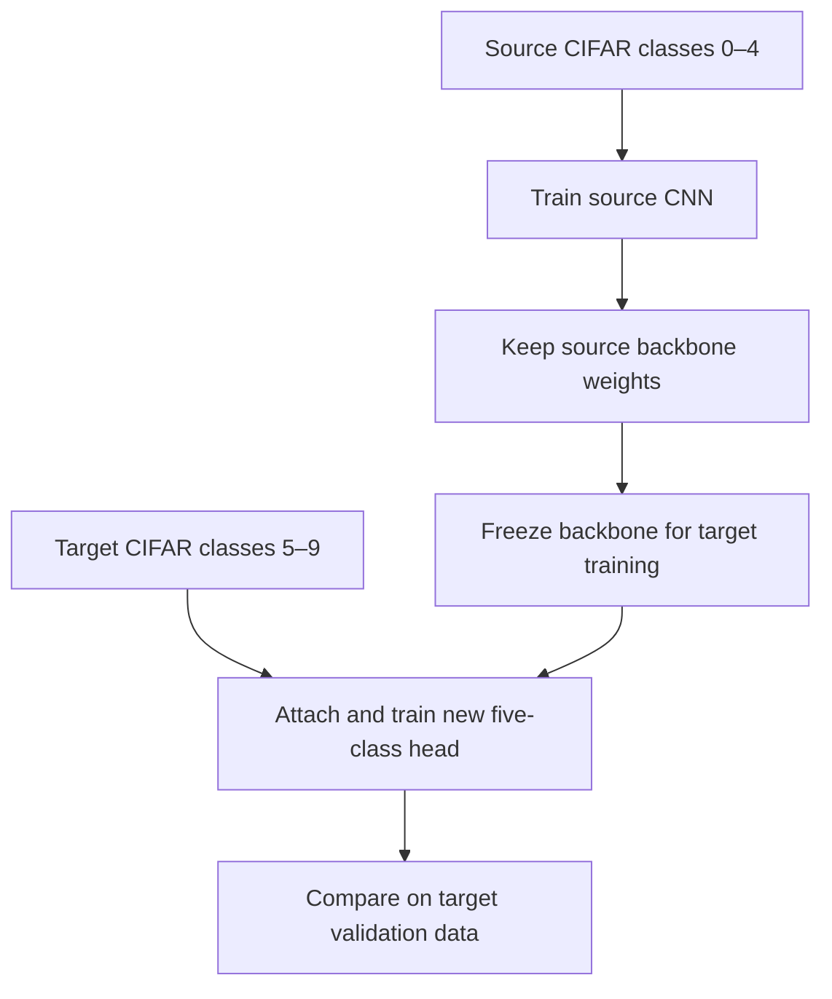

# Pair Programming: Convolutional Neural Networks on CIFAR-10


## How to use this pair-programming activity

This activity applies the ideas developed in **Demo 1, Theory 1, Activity 1, Demo 2, Theory 2, and Activity 2** to the CIFAR-10 color-image dataset. It uses **questions, incomplete starter code, and optional hints—without worked answers or an answer key**. Complete the missing code in a shared Google Colab notebook, record observations, and support conclusions with the calculations and figures from the actual run.

> Note: Sections 8 through 11 are optional extensions for extra exploration and will not be graded.

### Working as a pair

- **Driver:** implements and executes each code cell, explaining what the next operation is expected to do.
- **Navigator:** checks assumptions, label mappings, shapes, parameter counts, train/validation/test separation, and interpretations.
- **Exchange roles after Sections 3, 6, and 9.** Both partners should be able to explain the submitted models and results.

The visualization sections contain **complete supplied Python code** in independent expandable sections. Run them after preparing the named variables, then interpret the plots. Writing Matplotlib plotting code from scratch is **not assessed**. Model-training results can vary by run and machine; no particular score is guaranteed.

**Python setup:** [Python setup for CNN activities](../material/1-python_setup_cnn.md). Google Colab is recommended; use a fresh notebook to avoid variable collisions with Activity 1 and Activity 2. A GPU is optional. Install only missing dependencies. The dataset is downloaded on first use; **no saved model file is required**. Keras architecture plots are optional and require `pydot` and the Graphviz executable, as explained in the separate setup guide.

```python
import numpy as np
import matplotlib.pyplot as plt
import tensorflow as tf
from tensorflow import keras
from tensorflow.keras import layers

keras.utils.set_random_seed(42)
print("TensorFlow:", tf.__version__)
```

## Learning objectives

The completed notebook should demonstrate the ability to:

1. Interpret an RGB image tensor and distinguish pixel values, spatial dimensions, channels, batch size, and class labels.
2. Apply local filters to color images and explain weight sharing, signed responses, input-channel depth, and learned feature maps.
3. Calculate and verify the effects of `VALID`/`SAME` padding, stride, max pooling, and average pooling on spatial dimensions and values.
4. Distinguish local shift tolerance from guaranteed translation invariance.
5. Compare `Flatten` and `GlobalAveragePooling2D` as interfaces between convolutional features and a classifier.
6. Build and train a CNN, track validation behavior, and evaluate only after model-selection decisions are complete.
7. Demonstrate genuine transfer between **different CIFAR-10 class groups**, distinguish a frozen backbone from fine-tuning, and compare results with a from-scratch baseline.
8. Interpret training curves, probability outputs, misclassifications, and a confusion matrix without assuming that one method must win.

---

## 1. Identify the task and the dataset

CIFAR-10 contains **32 × 32 RGB images** in ten mutually exclusive classes. Each image has one categorical target, and the objective is image classification rather than localization or segmentation.

| Class ID | Class name | Class ID | Class name |
|---:|---|---:|---|
| 0 | Airplane | 5 | Dog |
| 1 | Automobile | 6 | Frog |
| 2 | Bird | 7 | Horse |
| 3 | Cat | 8 | Ship |
| 4 | Deer | 9 | Truck |

**Question 1.** Describe the outputs required for image classification, object detection, and semantic segmentation. Which one does the supplied CIFAR-10 label format directly support?

**Question 2.** Why do ten class IDs not represent a numerical scale? What is the difference between one ten-class softmax classifier and ten independent sigmoid outputs?

<details>
<summary>Hint — Task and labels</summary>

Focus on the structure of the target: one class, several possibly true classes, bounding boxes, or pixel-level labels. A numeric class ID is an identifier, not a measured quantity.

</details>

---

## 2. Inspect RGB images and tensor shapes

Load the official CIFAR-10 training and test arrays. The initial inspection does not fit a model or use the test set to select one.

```python
(x_full_raw, y_full_raw), (x_test_raw, y_test_raw) = (
    keras.datasets.cifar10.load_data()
)
class_names = [
    "Airplane", "Automobile", "Bird", "Cat", "Deer",
    "Dog", "Frog", "Horse", "Ship", "Truck"
]
y_full = y_full_raw.reshape(-1).astype("int64")
y_test_all = y_test_raw.reshape(-1).astype("int64")

print("Training images:", x_full_raw.shape)
print("Training labels:", y_full_raw.shape)
print("Test images:", x_test_raw.shape)
print("Pixel dtype:", x_full_raw.dtype)
print("Class labels:", np.unique(y_full))
```

**Question 3.** Explain every axis of `(N, 32, 32, 3)` and of a single image with shape `(32, 32, 3)`. What changes when the image is placed in a batch of eight examples?

**Question 4.** How does a standard 3 × 3 filter applied to RGB input differ from the first 3 × 3 filter applied to the grayscale MNIST images in Activity 1? How many input weights does **one** RGB filter contain before adding its bias?

<details>
<summary>Supplied Python visualization — RGB image and its channels</summary>

```python
rgb = x_full_raw[0]
fig, axes = plt.subplots(1, 4, figsize=(13, 3.5))
axes[0].imshow(rgb)
axes[0].set_title(f"RGB: {class_names[int(y_full[0])]}")
axes[0].axis("off")
for channel, name in enumerate(("Red", "Green", "Blue")):
    axes[channel + 1].imshow(rgb[:, :, channel], cmap="gray", vmin=0, vmax=255)
    axes[channel + 1].set_title(f"{name} intensity")
    axes[channel + 1].axis("off")
plt.tight_layout()
plt.show()
print("Pixel at row 0, column 0:", rgb[0, 0])
```

</details>

**Question 5.** After inspecting the plot, explain what could be lost if the image were reduced to a single grayscale channel. Is viewing one color channel the same as converting the whole RGB image to grayscale?

<details>
<summary>Hint — RGB representation</summary>

A single pixel has three channel values. A standard convolutional filter covers the spatial patch **and the full input-channel depth**; each output filter combines its channel contributions into one response at each location.

</details>

---

## 3. Prepare separate source and target tasks without leakage

The original CIFAR-10 **training split** will supply training and validation examples for both tasks. The official **test split** is reserved for the final evaluation. Two separate five-class tasks will be used:

- **Source task:** original CIFAR-10 classes **0–4** (airplane, automobile, bird, cat, deer).
- **Target task:** original classes **5–9** (dog, frog, horse, ship, truck).

Within each task, the labels must be mapped to local IDs **0–4** so that a five-unit softmax head matches them. For example, the original target class ID `5` maps to target-task ID `0`.

The following utility samples a reproducible subset **independently for each class**, then keeps the source and target training and validation examples separate. It supplies data splitting; the preprocessing assignments are left for the pair.

```python
SOURCE_CLASSES = (0, 1, 2, 3, 4)
TARGET_CLASSES = (5, 6, 7, 8, 9)
TRAIN_PER_CLASS = 1500
VAL_PER_CLASS = 300
rng = np.random.default_rng(42)

def make_task_split(images, labels, class_ids, rng):
    train_indices = []
    val_indices = []
    for original_id in class_ids:
        indices = np.flatnonzero(labels == original_id)
        indices = rng.permutation(indices)
        needed = TRAIN_PER_CLASS + VAL_PER_CLASS
        if len(indices) < needed:
            raise ValueError("Not enough examples for the selected subset size.")
        train_indices.extend(indices[:TRAIN_PER_CLASS])
        val_indices.extend(indices[TRAIN_PER_CLASS:needed])

    train_indices = rng.permutation(np.asarray(train_indices, dtype=int))
    val_indices = rng.permutation(np.asarray(val_indices, dtype=int))
    label_map = {original_id: new_id for new_id, original_id in enumerate(class_ids)}

    train_labels = np.array([label_map[int(v)] for v in labels[train_indices]])
    val_labels = np.array([label_map[int(v)] for v in labels[val_indices]])
    return (images[train_indices], train_labels,
            images[val_indices], val_labels)

(source_raw_train, source_y_train,
 source_raw_val, source_y_val) = make_task_split(
    x_full_raw, y_full, SOURCE_CLASSES, rng
)
(target_raw_train, target_y_train,
 target_raw_val, target_y_val) = make_task_split(
    x_full_raw, y_full, TARGET_CLASSES, rng
)

# Hold back the official target-task test images until final evaluation.
target_test_mask = np.isin(y_test_all, TARGET_CLASSES)
target_raw_test = x_test_raw[target_test_mask]
target_y_test = y_test_all[target_test_mask] - TARGET_CLASSES[0]

print("Source raw training:", source_raw_train.shape, source_y_train.shape)
print("Target raw training:", target_raw_train.shape, target_y_train.shape)
print("Source labels:", np.unique(source_y_train))
print("Target labels:", np.unique(target_y_train))
```

Complete the normalization function and use it consistently for all three data roles.

```python
def normalize_rgb(images):
    # TODO: Convert images to float32 and scale raw intensities to [0, 1].
    raise NotImplementedError("Complete the normalization function")

source_x_train = normalize_rgb(source_raw_train)
source_x_val = normalize_rgb(source_raw_val)
target_x_train = normalize_rgb(target_raw_train)
target_x_val = normalize_rgb(target_raw_val)
target_x_test = normalize_rgb(target_raw_test)

print("Source training:", source_x_train.shape, source_y_train.shape)
print("Target training:", target_x_train.shape, target_y_train.shape)
print("Target final test:", target_x_test.shape, target_y_test.shape)
```

**Question 6.** Why are the source and target class sets disjoint? What would make the experiment a poor test of transferring features to a **new task**?

**Question 7.** Calculate the number of selected training and validation images in each task. Why is the validation set distinct from the test set even though both are held out from weight updates?

**Question 8.** Explain the target-label conversion from original IDs 5–9 to local IDs 0–4. What would go wrong if the target head had five outputs but its labels were still integers 5–9?

<details>
<summary>Hint — Data roles and label mapping</summary>

Each five-class classifier must index its output positions from 0 through 4. Use training examples to calculate gradients, validation examples to compare approaches, and test examples only after a final model is chosen. The split helper uses the official training data only.

</details>

**Exchange driver and navigator roles now.**

---

## 4. Revisit convolution: fixed filters, learned filters, and RGB depth

Before training a CNN, apply the same manually designed vertical-contrast filter from Demo 1 to each channel of one CIFAR-10 image. This experiment deliberately retains positive and negative responses; it does not apply ReLU.

```python
vertical_kernel = np.array([
    [-1.0,  1.0],
    [-1.0,  1.0]
], dtype=np.float32)
vertical_filter_1ch = vertical_kernel.reshape(2, 2, 1, 1)
image_batch = source_x_train[:1]

channel_responses = []
for channel in range(3):
    one_channel = image_batch[:, :, :, channel:channel + 1]
    response = tf.nn.conv2d(
        one_channel, vertical_filter_1ch, strides=1, padding="VALID"
    ).numpy()[0, :, :, 0]
    channel_responses.append(response)

print("RGB image:", image_batch.shape)
print("One signed response:", channel_responses[0].shape)
```

<details>
<summary>Supplied Python visualization — Signed edge responses from RGB channels</summary>

```python
scale = max(max(float(np.abs(m).max()) for m in channel_responses), 1e-6)
fig, axes = plt.subplots(1, 4, figsize=(13, 3.4))
axes[0].imshow(image_batch[0])
axes[0].set_title("Original RGB image")
axes[0].axis("off")
for channel, name in enumerate(("Red", "Green", "Blue")):
    im = axes[channel + 1].imshow(
        channel_responses[channel], cmap="coolwarm", vmin=-scale, vmax=scale
    )
    axes[channel + 1].set_title(f"{name} contrast")
    axes[channel + 1].axis("off")
fig.colorbar(im, ax=axes[1:], shrink=0.7)
plt.show()
```

</details>

**Question 9.** Why can the same spatial filter produce different maps from the red, green, and blue channels? Explain what the sign of a response means and why a visual edge need not have the same contrast in every color channel.

**Question 10.** A **standard** convolutional filter for RGB images has weights spanning all three channels. Describe how the three contributions combine at one output position. Does a single output filter ordinarily produce one output map or three independent output maps?

**Question 11.** Compare a dense neuron and a convolutional filter. What arithmetic do they share? What changes in connectivity, parameter sharing, and the spatial organization of the output?

### A small multichannel calculation

The following example specifies a 2 × 2 × 3 input patch and a matching 2 × 2 × 3 filter. Compute the contributions on paper first. Complete the missing calculation using NumPy.

```python
patch_rgb = np.array([
    [[1, 0, 2], [3, 1, 0]],
    [[0, 2, 1], [2, 1, 3]]
], dtype=np.float32)
weights_rgb = np.array([
    [[1, -1, 0], [0, 2, -1]],
    [[-1, 0, 1], [2, -1, 0]]
], dtype=np.float32)
bias = 0.5

# TODO: Calculate one contribution per channel.
# TODO: Sum the channel contributions and add the bias once.
# TODO: Apply ReLU to the resulting pre-activation scalar.
```

**Question 12.** Record all three channel contributions, the final pre-activation, and the value after ReLU. What would be incorrect about adding the bias separately to each channel?

<details>
<summary>Hint — Multichannel weighted sum</summary>

For each channel, multiply the four matching entries in the input patch and filter and add those four products. Combine the three channel totals, add **one bias for the output filter**, and apply ReLU only after the complete sum.

</details>

---

## 5. Investigate padding, stride, pooling, and local shift tolerance

The following experiment holds the image and 2 × 2 filter fixed. Only convolutional padding and stride change.

```python
settings = [("VALID", 1), ("SAME", 1), ("VALID", 2), ("SAME", 2)]
spatial_results = {}
for padding, stride in settings:
    output = tf.nn.conv2d(
        image_batch[:, :, :, :1], vertical_filter_1ch,
        strides=stride, padding=padding
    ).numpy()[0, :, :, 0]
    spatial_results[(padding, stride)] = output
    print(f"{padding}, stride {stride}: {output.shape}")
```

**Question 13.** Before checking the printed shapes, calculate the output width for a 32-pixel input, a 2-pixel kernel, strides 1 and 2, and `VALID` padding. Then calculate the corresponding `SAME` output widths. Which of these cases needs padding?

For a one-dimensional side of length $n$, kernel width $k$, and stride $s$, the valid-convolution output width is:

$$
n_{\mathrm{out}}=\left\lfloor\frac{n-k}{s}\right\rfloor+1.
$$

For TensorFlow/Keras `SAME` padding, with a standard dilation-1 convolution:

$$
n_{\mathrm{out}}=\left\lceil\frac{n}{s}\right\rceil.
$$

**Question 14.** What changes when the filter moves two pixels rather than one? How is a larger stride different from applying max pooling to an already computed feature map?

<details>
<summary>Supplied Python visualization — Compare padding and stride on the same channel</summary>

```python
scale = max(max(float(np.abs(v).max()) for v in spatial_results.values()), 1e-6)
fig, axes = plt.subplots(2, 2, figsize=(8, 7))
for ax, ((padding, stride), response) in zip(axes.flat, spatial_results.items()):
    ax.imshow(response, cmap="coolwarm", vmin=-scale, vmax=scale)
    ax.set_title(f"{padding}, stride {stride}\n{response.shape}")
    ax.axis("off")
plt.tight_layout()
plt.show()
```

</details>

### Pooling is a different operation

```python
pool_grid = np.array([
    [1, 2, 0, 0],
    [3, 9, 1, 0],
    [0, 0, 2, 3],
    [0, 0, 4, 5]
], dtype=np.float32)

pool_batch = pool_grid[None, :, :, None]
max_result = tf.nn.max_pool2d(
    pool_batch, ksize=2, strides=2, padding="VALID"
).numpy()[0, :, :, 0]
avg_result = tf.nn.avg_pool2d(
    pool_batch, ksize=2, strides=2, padding="VALID"
).numpy()[0, :, :, 0]
print("Max pooling:\n", max_result)
print("Average pooling:\n", avg_result)
```

**Question 15.** Calculate the max-pooled and average-pooled outputs by hand. Which values can be recovered from each result, and which information has been discarded?

**Question 16.** If a strong feature moves by one pixel, is its max-pooled value guaranteed to stay in the same output location? Explain the difference between movement *within* and *across* pooling-window boundaries.

<details>
<summary>Supplied Python visualization — One feature moving across pooling windows</summary>

```python
def one_peak(column):
    values = np.zeros((4, 4), dtype=np.float32)
    values[0, column] = 9
    return values

inputs = [one_peak(c) for c in (0, 1, 2)]
outputs = [
    tf.nn.max_pool2d(x[None, :, :, None], ksize=2, strides=2,
                     padding="VALID").numpy()[0, :, :, 0]
    for x in inputs
]
fig, axes = plt.subplots(3, 2, figsize=(6.5, 8.5))
for row, (before, after) in enumerate(zip(inputs, outputs)):
    for ax, values, title in (
        (axes[row, 0], before, f"Peak at column {row}"),
        (axes[row, 1], after, "After max pooling")
    ):
        ax.imshow(values, cmap="YlOrRd", vmin=0, vmax=9)
        ax.set_title(title)
        for r in range(values.shape[0]):
            for c in range(values.shape[1]):
                ax.text(c, r, f"{values[r, c]:g}", ha="center", va="center")
        ax.set_xticks([])
        ax.set_yticks([])
plt.tight_layout()
plt.show()
```

</details>

<details>
<summary>Hint — Padding, stride, and pooling</summary>

Padding changes which border positions can be evaluated; stride changes the starting positions sampled by a filter; pooling summarizes responses that already exist. Local tolerance does not mean invariance to every possible translation.

</details>

---

## 6. Choose a spatial representation before classification

A CNN must eventually convert feature maps into class scores. Two possibilities are `Flatten()` and `GlobalAveragePooling2D()` (GAP). Flatten preserves all entries as a longer vector; GAP takes the **spatial mean of each channel**, producing one value per channel. Neither operation learns filter weights.



**Question 17.** A 4 × 4 × 64 feature tensor is supplied to a `Dense(128)` layer after Flatten. How many parameters are in that Dense layer, including biases? How many if GAP supplies only 64 values to the same Dense layer? Show the calculations.

**Question 18.** Which information is explicitly lost when each feature map is reduced to one mean? Why might a model with GAP be easier to connect to a classifier when the spatial grid size changes?

<details>
<summary>Hint — Dense parameter count</summary>

For a dense layer with `m` input values and `n` neurons, the parameter count is `m × n + n`. GAP changes the number of values presented to the dense layer; it does not change the underlying convolution filters.

</details>

The source-task model will use the following compact CNN **feature extractor**. A five-class classification head will be attached separately so the same backbone can later be reused for the target task.



Implement the feature extractor using the **Functional API**. Keep this exact architecture for the source and target tasks so comparisons are interpretable.

```python
def build_backbone():
    inputs = keras.Input(shape=(32, 32, 3), name="RGB_input")
    # TODO: Conv2D(32, 3x3, SAME, ReLU)
    # TODO: MaxPooling2D(2x2)
    # TODO: Conv2D(64, 3x3, SAME, ReLU)
    # TODO: MaxPooling2D(2x2)
    # TODO: Conv2D(64, 3x3, SAME, ReLU)
    # TODO: GlobalAveragePooling2D()
    # TODO: Return a keras.Model from inputs to the GAP feature vector.
    raise NotImplementedError("Build the convolutional backbone")

backbone = build_backbone()
backbone.summary()
```

**Question 19.** Compute the output tensor shape after each backbone layer, omitting the batch axis. Explain how the second convolution combines **all incoming channels**, rather than treating each channel as an independent classifier.

<details>
<summary>Hint — Backbone construction</summary>

Use `layers.Conv2D`, `layers.MaxPooling2D`, and `layers.GlobalAveragePooling2D`. With `padding="same"` and stride 1, a convolution preserves the current spatial dimensions. Standard 2 × 2 max pooling halves the even spatial dimensions when its stride is 2.

</details>

**Exchange driver and navigator roles now.**

---

## 7. Train the source-task CNN

Attach a **five-class** softmax head to the feature extractor. The source task uses classes 0–4 only. This first training run creates the **pretrained backbone** that the later target-task model will reuse.

```python
keras.utils.set_random_seed(42)
source_inputs = keras.Input(shape=(32, 32, 3), name="source_image")
source_features = backbone(source_inputs)

# TODO: Add a Dense output with 5 softmax units.
# TODO: Create source_model = keras.Model(...).
# TODO: Inspect source_model.summary() and its trainable parameter count.
```

**Question 20.** Which parameters belong to the reusable feature extractor and which belong to the five-class source classification head? Why must the source head have exactly five outputs?

**Question 21.** Calculate trainable parameters in the first convolution. Then calculate the parameter count of the final five-unit Dense head from the backbone's output width. Check these with `source_model.summary()`.

Compile and train the source model on its **training split**, monitor its **validation split**, and save the resulting history. Keep all comparisons on consistent target preprocessing.

```python
BATCH_SIZE = 128
SOURCE_EPOCHS = 7
TARGET_EPOCHS = 7

# TODO: source_model.compile(...)
#       Use Adam, sparse categorical cross-entropy, and accuracy.
# TODO: Use EarlyStopping monitoring val_loss, with patience 2
#       and restore_best_weights=True.
# TODO: source_history = source_model.fit(...)
#       Use source_x_train/source_y_train and
#       validation_data=(source_x_val, source_y_val).
```

**Question 22.** Why do sparse integer labels require sparse categorical cross-entropy here? Which code operation calculates gradients, and which operation updates the weights during training?

**Question 23.** Use the source training history to identify the best observed validation-loss epoch. Do the curves establish underfitting, overfitting, or neither clear conclusion? Then compare the actual learned feature maps below. Does a deeper map necessarily represent a named object part?

<details>
<summary>Supplied Python visualization — Source training and validation curves</summary>

```python
h = source_history.history
epochs = np.arange(1, len(h["loss"]) + 1)
fig, axes = plt.subplots(1, 2, figsize=(11, 4))
axes[0].plot(epochs, h["loss"], marker="o", label="Training")
axes[0].plot(epochs, h["val_loss"], marker="o", label="Validation")
axes[0].set_title("Source: loss")
axes[1].plot(epochs, h["accuracy"], marker="o", label="Training")
axes[1].plot(epochs, h["val_accuracy"], marker="o", label="Validation")
axes[1].set_title("Source: accuracy")
for ax in axes:
    ax.set_xlabel("Epoch")
    ax.legend()
    ax.grid(alpha=0.25)
plt.tight_layout()
plt.show()
```

</details>

### Inspect the learned representations

The two convolutional layers selected below come from the **trained source backbone**, not from the manually designed contrast filter. The channel maps are selected by spatial variation for the same validation image. Individual plots use their own display scales and should not be interpreted as comparable absolute activations.

<details>
<summary>Supplied Python visualization — Learned feature maps in the source backbone</summary>

```python
conv_layers = [layer for layer in backbone.layers
               if isinstance(layer, layers.Conv2D)]
feature_probe = keras.Model(
    backbone.inputs,
    [conv_layers[0].output, conv_layers[-1].output]
)
early_maps, later_maps = feature_probe.predict(source_x_val[:1], verbose=0)
fig, axes = plt.subplots(2, 4, figsize=(11, 6))
for row, maps in enumerate((early_maps[0], later_maps[0])):
    channels = np.argsort(maps.std(axis=(0, 1)))[-4:][::-1]
    for col, channel in enumerate(channels):
        axes[row, col].imshow(maps[:, :, channel], cmap="viridis")
        axes[row, col].set_title(f"Layer {row + 1}, map {channel}")
        axes[row, col].axis("off")
plt.tight_layout()
plt.show()
```

</details>

<details>
<summary>Hint — Interpreting learned maps</summary>

The filters were updated during source-task training. Their maps show responses to this particular image, not guaranteed semantic labels. Differences in grid size may reflect pooling, while different filter weights can produce different spatial patterns.

</details>

<details>
<summary>Hint — Training workflow</summary>

The model must be compiled before `fit()`. Labels 0–4 are mutually exclusive, so the loss must be compatible with five softmax outputs. Validation data monitor training but do not provide gradients for source weight updates.

</details>

---

## 8. Optional extension: Transfer the learned backbone to the new task

The target task contains **different classes**: dog, frog, horse, ship, and truck. Its five-class output labels are local IDs 0–4. Reusing the source model's classification head unchanged would give predictions for the **wrong categories**. Instead, keep the learned feature extractor and train a new head.



**Question 24.** Explain why this is transfer learning rather than continuing to train a ten-class classifier on the same labels. Which weights are reused and which weights must be newly learned?

Create a new head on the **existing trained backbone**. The main code is deliberately incomplete; the central task is to implement freezing correctly.

```python
backbone.trainable = False

target_inputs = keras.Input(shape=(32, 32, 3), name="target_image")
# TODO: Obtain target features by calling the existing backbone.
#       Use training=False when calling the frozen backbone.
# TODO: Attach a new Dense(5, activation="softmax") head.
# TODO: Create target_model as a keras.Model.
# TODO: Inspect target_model.trainable_weights and
#       target_model.non_trainable_weights.
```

**Question 25.** Does setting `backbone.trainable = False` prevent the backbone from calculating features? Which layers are allowed to change during target-task training?

**Question 26.** What is the difference between `trainable=False` and calling the backbone with `training=False`? Explain why the distinction becomes important in architectures with BatchNormalization or Dropout. The assigned backbone has neither of these layers.

Train the new head on target **training data** and monitor the target **validation data**. Do not inspect target test accuracy yet.

```python
# TODO: Compile target_model (Adam, sparse categorical cross-entropy, accuracy).
# TODO: Fit on target_x_train/target_y_train, validate using
#       (target_x_val, target_y_val), and save the History as target_history.
# Use TARGET_EPOCHS and BATCH_SIZE for the target experiment.
# TODO: Record the best target validation loss and accuracy.
```

**Question 27.** Record the frozen-backbone model's trainable and non-trainable parameter totals. What is the computational difference between **freezing parameters** and **not running the backbone** at all?

<details>
<summary>Hint — Freezing</summary>

The backbone is still called during the forward pass; only its eligibility for optimizer updates changes. A new target head must start with its own trainable weights. Recompile after any change in which layers are trainable.

</details>

---

## 9. Optional extension: Compare transfer learning with training from scratch

The transfer-learning model should not be considered successful merely because it trains without errors. A comparison needs a baseline on the **same target task**.

Create a **fresh, randomly initialized backbone with the same architecture** and attach a new five-class head. Do **not** copy pretrained backbone weights into this baseline. Use the same target train/validation split, preprocessing, batch size, and planned epoch budget.

```python
keras.utils.set_random_seed(42)
scratch_backbone = build_backbone()

# TODO: Attach a new Dense(5, softmax) head to scratch_backbone.
# TODO: Build scratch_model with the same source/target architecture.
# TODO: Compile using the same target-task loss and optimizer settings.
# TODO: Train on the SAME target training and validation data.
#       Save the History as scratch_history.
# TODO: Record target validation loss and accuracy.
```

**Question 28.** Explain what has been held constant and what has changed between the frozen-transfer and from-scratch experiments. Why does comparing the models' **training accuracy** alone fail to establish which one generalizes better?

**Question 29.** Which model performs better on the target **validation** split in the actual run? Does this prove that pretrained weights are always superior or always inferior?

<details>
<summary>Supplied Python visualization — Frozen transfer versus scratch</summary>

```python
fig, axes = plt.subplots(1, 2, figsize=(11, 4))
for history, label in ((target_history, "Frozen transfer"),
                       (scratch_history, "From scratch")):
    epoch_numbers = np.arange(1, len(history.history["val_loss"]) + 1)
    axes[0].plot(epoch_numbers, history.history["val_loss"],
                 marker="o", label=label)
    axes[1].plot(epoch_numbers, history.history["val_accuracy"],
                 marker="o", label=label)
axes[0].set(xlabel="Epoch", ylabel="Validation loss",
            title="Same target task: validation loss")
axes[1].set(xlabel="Epoch", ylabel="Validation accuracy",
            title="Same target task: validation accuracy")
for ax in axes:
    ax.legend()
    ax.grid(alpha=0.25)
plt.tight_layout()
plt.show()
```

</details>

**Question 30.** Compare trainable parameter counts and optimization workloads. Does a frozen backbone necessarily mean that the **total** computation used to obtain the model is lower, once source pretraining is included?

<details>
<summary>Hint — Fair comparison</summary>

The scratch model learns feature-extractor weights from the target data; the frozen model reuses weights learned on the source data and learns only a new head. Record completed epochs and total trainable parameters, not just the final score.

</details>

**Exchange driver and navigator roles now.**

---

## 10. Optional extension: fine-tune selected convolutional layers

A frozen backbone cannot adapt its filter weights to the new target task. Fine-tuning permits **some pretrained parameters** to change. This extension is optional; it requires a carefully controlled experiment rather than assuming that unfreezing always helps.

Before changing trainability, **save the frozen model's current weights** or a checkpoint so the frozen state can be restored for comparison and final selection.

```python
# Optional extension; run only after the frozen-head model is trained.
# TODO: Save target_model weights to a distinct checkpoint file.
# TODO: Make the backbone trainable at the model level.
# TODO: Freeze earlier backbone layers, leaving selected later Conv2D
#       layer(s) trainable.
# TODO: Recompile the target model with a smaller learning rate,
#       e.g. 1e-5, before further training.
# TODO: Fine-tune against TARGET TRAINING examples while monitoring
#       TARGET VALIDATION examples; retain the history.
```

**Question 31.** Why is recompilation necessary after changing the trainability of the backbone? Why might a smaller learning rate be appropriate when modifying previously learned filters?

**Question 32.** Did the optional fine-tuning improve **target validation** results in the actual run? What evidence would justify preferring the frozen model or the scratch model instead? How would overfitting appear?

<details>
<summary>Hint — Fine-tuning</summary>

Releasing a frozen layer changes which weights the optimizer may update. A pretrained feature extractor can adapt, but more trainable parameters also create additional overfitting risk. Compare results on the validation set before making a final selection.

</details>

---

## 11. Optional extension: Final evaluation

Choose the final approach using **target validation results**, not test results. Record the choice and its justification. If the frozen model was later fine-tuned, restore its frozen checkpoint before evaluating it as the frozen candidate.

Only **after the selection is fixed**, evaluate the chosen model on the untouched target-task test images.

```python
# TODO: Select final_model based only on target validation evidence.
# TODO: Evaluate final_model on target_x_test and target_y_test.
# TODO: Obtain target_probabilities = final_model.predict(...).
# TODO: Obtain target_pred as the highest-probability class index.
# TODO: Print the held-out target-task test loss and accuracy.

# The five target-task names correspond to local IDs 0, 1, 2, 3, 4.
target_class_names = [class_names[i] for i in TARGET_CLASSES]
```

**Question 33.** Why should the final test set not be used to decide whether frozen transfer, training from scratch, or fine-tuning is best? What would change if the test results were repeatedly used to revise the model?

**Question 34.** Interpret the actual final test loss and accuracy. What does accuracy not reveal about which target classes the model confuses?

<details>
<summary>Supplied Python visualization — Target examples and predicted probabilities</summary>

```python
example_indices = np.arange(min(4, len(target_y_test)))
fig, axes = plt.subplots(len(example_indices), 2,
                         figsize=(11, 2.8 * len(example_indices)), squeeze=False)
for row, idx in enumerate(example_indices):
    axes[row, 0].imshow(target_x_test[idx])
    axes[row, 0].set_title(
        f"True: {target_class_names[int(target_y_test[idx])]} | "
        f"Pred: {target_class_names[int(target_pred[idx])]}"
    )
    axes[row, 0].axis("off")
    axes[row, 1].bar(range(5), target_probabilities[idx])
    axes[row, 1].set_xticks(range(5), target_class_names, rotation=30)
    axes[row, 1].set_ylim(0, 1)
    axes[row, 1].set_ylabel("Probability")
plt.tight_layout()
plt.show()
```

</details>

<details>
<summary>Supplied Python visualization — Target confusion matrix and mistakes</summary>

```python
cm = tf.math.confusion_matrix(
    target_y_test, target_pred, num_classes=5
).numpy()
fig, ax = plt.subplots(figsize=(7, 6))
im = ax.imshow(cm, cmap="Blues")
ax.set_xticks(range(5), target_class_names, rotation=40, ha="right")
ax.set_yticks(range(5), target_class_names)
ax.set_xlabel("Predicted target class")
ax.set_ylabel("True target class")
ax.set_title("Held-out target test: confusion matrix")
fig.colorbar(im, ax=ax)
plt.tight_layout()
plt.show()

mistakes = np.flatnonzero(target_pred != target_y_test)[:12]
if len(mistakes):
    fig, axes = plt.subplots(3, 4, figsize=(11, 8))
    for ax in axes.flat:
        ax.axis("off")
    for ax, idx in zip(axes.flat, mistakes):
        ax.imshow(target_x_test[idx])
        ax.set_title(
            f"True: {target_class_names[int(target_y_test[idx])]}\n"
            f"Pred: {target_class_names[int(target_pred[idx])]}"
        )
        ax.axis("off")
    plt.tight_layout()
    plt.show()
else:
    print("No incorrect examples in the evaluated target test set.")
```

</details>

**Question 35.** Identify the most frequent off-diagonal class confusions in the actual matrix. For one misclassified image, describe a plausible visual ambiguity **without claiming that the image proves the internal cause of the error**.

<details>
<summary>Hint — Evaluation</summary>

Confusion-matrix rows identify true classes and columns identify predicted classes. The class names here refer to **target-task local IDs**, not the original CIFAR-10 IDs. Test images are used for the final reported assessment, not for hyperparameter selection.

</details>

---

## 12. Integrative discussion and reflection

**Question 36.** Compare the meaning of a 3 × 3 × 3 filter in the first RGB convolution with a 3 × 3 × 32 filter in a deeper layer. Does either filter create three or 32 separate output maps by itself?

**Question 37.** Explain, with one concrete example, how padding, stride, pooling, and GAP each affect a tensor differently. Which of these operations have trainable weights in the supplied architecture?

**Question 38.** Explain how source pretraining, freezing, a new classification head, optional fine-tuning, validation-based selection, and final test evaluation fit into one consistent workflow. What limitations of this small CIFAR-10 experiment should be recorded before making broader claims about transfer learning?

<details>
<summary>Hint — Final synthesis</summary>

Separate spatial computation from optimization, pretrained weights from newly initialized head weights, and validation decisions from test reporting. A successful experiment includes both code that runs and an explanation of **why each result supports or limits a conclusion**.

</details>


## Submission checklist

- [ ] One shared Colab notebook with all required code cells executed and no unresolved errors.
- [ ] Written responses to **all required questions (Questions 1–23; Questions 24–38 are optional)**, including calculations, shape predictions, and interpretations based on actual output.
- [ ] Correct RGB normalization and a documented source/target class mapping with separate training, validation, and final test data.
- [ ] Convolution, stride/padding, pooling, and local-shift experiments with observed figures.
- [ ] Parameter calculations, backbone `summary()`, and a comparison of Flatten with GAP.
- [ ] A trained source-task CNN, a frozen-backbone target-task model, and an independently initialized from-scratch target baseline.
- [ ] Source and target validation curves, recorded hyperparameters, and a justified comparison of methods.
- [ ] Optional fine-tuning clearly identified as an extension, with the frozen checkpoint retained if attempted.
- [ ] One selected model evaluated on the previously untouched target test set, with probabilities, mistakes, and a confusion matrix.
- [ ] A brief final discussion of what the experiments demonstrate, what they do not guarantee, and how the observed results connect to both CNN units.
- [ ] Both partners can explain the architecture, label mapping, learning cycle, transfer strategy, and final model-selection decision.

## Final reminder

A convolutional filter uses **local weighted sums with shared parameters**; padding, stride, and pooling control the spatial representation; GAP summarizes each channel; and the final classifier converts features into class probabilities. The training cycle remains **forward pass → loss → backpropagation → optimizer update**. Transfer learning reuses learned source-task representations for a different target task, but its value must be established with appropriate validation and final evaluation rather than assumed in advance.

