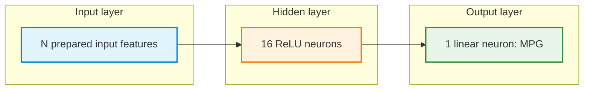

# Pair Programming 1: Auto MPG Regression with an MLP

**Focus:** Apply the neural-network workflow studied in Week 1 to a real-world regression dataset, including missing numerical values and a categorical input.

In Week 1, the cereal-rating and concrete-strength activities introduced regression with a multi-layer perceptron (MLP). This Week 2 exercise applies the same principles to **predicting vehicle fuel efficiency**. The task is to load an unfamiliar dataset, prepare its inputs, build and train an MLP, compare configurations using validation results, and evaluate a selected model on held-out test data.

The [Auto MPG dataset](https://raw.githubusercontent.com/mwaskom/seaborn-data/master/mpg.csv) records information about older cars. The supplied CSV has **398 rows**. Its target, `mpg`, represents **miles per US gallon**; a larger value means that a vehicle can travel farther on one US gallon of fuel. Each row is a vehicle record. The model is a learning exercise, not a reliable estimator for present-day vehicles or engineering decisions.

**Python setup:** Use the [shared Colab installation and import checks](1-python_setup.md#google-colab-setup). These pair-programming exercises require NumPy, pandas, Matplotlib, scikit-learn, Keras, and TensorFlow. Install a package only if its import is missing, then restart the runtime/session if requested and rerun setup.

## Learning objectives

By the end of the session, each pair should be able to:

1. Identify a continuous target, explore its distribution, and explain a mean-prediction baseline.
2. Create training, validation, and test sets without using held-out observations to fit preprocessing.
3. Handle missing numerical inputs, encode a categorical input, and standardize numerical features.
4. Construct, compile, and train a Keras MLP with a **linear** output for regression.
5. Interpret training and validation **MSE** and **MAE**, and compare model configurations using validation results.
6. Select a model **before** final testing and compare its test MAE with the baseline.
7. Interpret numerical predictions in MPG and apply the original preprocessing to a new vehicle record.

## How pair programming works

- **Driver:** Types and runs the code, explaining decisions while coding.
- **Navigator:** Reads the task, checks variable names and shapes, watches for data leakage, and asks questions before execution.
- **Switch roles** after Sections 2, 4, 6, 8, and 10. Both partners should contribute code and explanations.
- Complete sections in order. Expand a **Hint** only after discussing an approach. Hints are not full solutions.
- Keep **test targets and test performance out of model selection**. Test features may be processed using transformations fitted on the training set; the final test assessment belongs in Section 11.
- Record actual outputs. Neural-network training results can vary between runs.

**Work format:** Create a Google Colab notebook with Markdown and Python cells. Complete the `TODO` blocks. Familiar operations remain for the pair to implement. Supplied code is reserved for the initial environment, the less familiar categorical encoding, and plots intended for interpretation rather than plotting-code assessment.

## Workflow


---

## 1. Recall: What changes in a regression task?

| Choice | Binary classification | Auto MPG regression |
|---|---|---|
| Target | Class `0` or `1` | Continuous `mpg` |
| Output layer | One sigmoid neuron | One **linear** neuron |
| Training loss | Binary cross-entropy | Mean squared error (MSE) |
| Reported metric | Accuracy | Mean absolute error (MAE) |
| Interpretation | Estimated class-1 probability | Predicted miles per US gallon |

A linear output does not restrict predictions to the range 0–1. For a regression MLP, the last Dense layer normally uses **one neuron with the default linear activation**. This output can represent a numerical value such as 25.4 MPG. The network is not guaranteed to produce only physically realistic values, so predictions still require interpretation.

**Discuss before coding**

1. Why is this prediction problem regression rather than classification?
2. Why would a sigmoid output be an unsuitable default for predicting MPG?
3. What would a prediction of 25 MPG mean, and what would it *not* establish?

<details>
<summary><strong>Hint — regression output</strong></summary>

Consider whether the target is a class label or a numerical measurement. Recall the linear output used for cereal ratings and concrete strength in Week 1.

</details>

---

## 2. Get the data and inspect its structure

The exercise uses **four numerical inputs** and the categorical field `origin`.

| Field | Role | Meaning |
|---|---|---|
| `mpg` | Target | Fuel efficiency, miles per US gallon |
| `weight` | Numerical input | Vehicle weight, pounds |
| `horsepower` | Numerical input | Engine power, horsepower |
| `displacement` | Numerical input | Engine displacement, cubic inches |
| `model_year` | Numerical input | Two-digit model year, such as `76` for 1976 |
| `origin` | Categorical input | Recorded region of origin (`usa`, `europe`, or `japan`) |

The extra fields `cylinders`, `acceleration`, and `name` are **not model inputs** in this exercise. In particular, `name` is free text and is not directly passed into the MLP. The addition of `origin` provides practice in encoding categorical features.

**Supplied setup** — run this cell at the beginning of the notebook:

```python
# Install packages first if the Colab environment needs them.
# %pip install numpy pandas matplotlib scikit-learn keras tensorflow

import numpy as np
import pandas as pd
import matplotlib.pyplot as plt
import keras
from keras import Sequential, Input
from keras.layers import Dense
from sklearn.model_selection import train_test_split
from sklearn.impute import SimpleImputer
from sklearn.preprocessing import StandardScaler

keras.utils.set_random_seed(42)

DATA_URL = "https://raw.githubusercontent.com/mwaskom/seaborn-data/master/mpg.csv"
print("Keras backend:", keras.config.backend())
```

**Pair tasks**

1. Read `DATA_URL` into a DataFrame called `mpg_data`.
2. Display the first five rows, the shape, the column names, and column data types.
3. Check missing values for all columns. In particular, inspect `mpg` and `horsepower`.
4. Identify the five selected inputs and the one target. Explain why `name` is excluded.
5. Keep `mpg_data` unchanged and use a copy for modeling. If any target (`mpg`) values are missing, remove **only those rows**, and report how many were excluded.

```python
# TODO: Load the CSV into mpg_data.
# TODO: Display rows, dimensions, types, and missing-value counts.
# TODO: Create a working copy and remove rows with missing mpg, if any.
# TODO: Report the number of removed rows.
```

<details>
<summary><strong>Hint — loading and inspecting data</strong></summary>

Recall `pd.read_csv(...)`, `.head()`, `.shape`, `.dtypes`, `.isna().sum()`, and `.dropna(subset=[...])` from Week 1. A missing target cannot be replaced with a guessed value for supervised training. Missing **input** values will be handled later.

</details>

**Checkpoint:** Record the original row count, working row count, target units, selected feature names, and any missing-input concern.

---

## 3. Select features and reserve held-out data

Let `X` contain the input columns and `y` contain the `mpg` target. The target must not appear among the model inputs, because that would reveal the answer during training.

**Pair tasks**

1. Select **only** `weight`, `horsepower`, `displacement`, `model_year`, and `origin` as `X`. Select `mpg` as `y`.
2. First reserve **20%** of the observations for `X_test`, `y_test`.
3. From the remaining observations, reserve **20%** for `X_val`, `y_val`.
4. Call the remaining data `X_train`, `y_train`. Use `random_state=42` for both splits and **do not stratify** this regression task.
5. Print all input and target shapes. Confirm that the resulting proportions are approximately **64% training / 16% validation / 20% test**, with no overlap in row indices.

```python
# TODO: Select X and y by column names from the working copy.
# TODO: Create train+validation / test split.
# TODO: Split train+validation into training / validation.
# TODO: Inspect shapes and confirm disjoint row indices.
```

<details>
<summary><strong>Hint — split before fitting preprocessing</strong></summary>

Recall the two calls to `train_test_split(...)` used in Week 1. The second call works on the training-plus-validation portion, not the original full DataFrame. The test set is reserved before imputation, scaling, and model selection.

</details>

**Discuss:** Why should missing-value replacement and numerical scaling be fitted only after this split? What makes validation different from test data?

---

## 4. Explore training data and establish a mean baseline

Exploratory analysis can reveal missing measurements, unusual ranges, and patterns that the MLP may need to learn. To avoid inspecting the held-out target distribution during model development, perform this analysis using **training observations only**.

A simple regression **baseline** predicts the **mean training MPG** for every vehicle, regardless of its features. It provides a reference for interpreting the eventual neural-network error. This mean baseline is a simple reference; a training-median baseline minimizes training absolute error among constant predictions and can be compared as an optional extension.

**Pair tasks**

1. Display summary statistics for `y_train` and the four numerical columns in `X_train`.
2. Count missing `horsepower` measurements **within training data**. Investigate one unusually large or small training value without removing the row automatically.
3. Count repeated combinations of selected feature and target values in training data (excluding the row index); explain why repeated measurements do not necessarily represent the same vehicle.
4. Calculate the mean of `y_train` and save it as `baseline_mpg`.
5. Explain why a model should aim for a lower MAE than this baseline.
6. Calculate the correlation between training `weight` and training `mpg`. Describe its sign and one limitation of Pearson correlation.

```python
# TODO: Inspect training-only numerical summaries and missing values.
# TODO: Calculate baseline_mpg from y_train only.
# TODO: Calculate training weight/MPG correlation.
# TODO: Record one modeling implication from the data inspection.
```

<details>
<summary><strong>Hint — baseline and correlation</strong></summary>

Use `.describe()` for numerical summaries, `.mean()` for the training-target mean, and `.corr(...)` to examine a numerical relationship. The baseline uses no learned input-to-output relationship; it is a constant prediction.

</details>

### Run and interpret two training-data plots

Run the supplied code, observe the plots, and explain the result. Plotting syntax is **not** the assessed skill here.

<details>
<summary><strong>Show supplied Python plotting code — MPG distribution and weight relationship</strong></summary>

```python
plt.figure(figsize=(7, 4))
plt.hist(y_train, bins=18, edgecolor="black")
plt.xlabel("MPG (miles per US gallon)")
plt.ylabel("Number of training vehicles")
plt.title("Training target distribution")
plt.tight_layout()
plt.show()

plt.figure(figsize=(7, 4))
plt.scatter(X_train["weight"], y_train, alpha=0.7)
plt.xlabel("Weight (pounds)")
plt.ylabel("MPG (miles per US gallon)")
plt.title("Training vehicle weight versus MPG")
plt.tight_layout()
plt.show()
```

</details>

**Pair discussion:** Is MPG spread evenly across the training vehicles? Does greater vehicle weight appear associated with higher or lower MPG? Why does a scatter plot not prove causation?

**Checkpoint:** Record `baseline_mpg`, one relationship seen in the plots, and one reason preprocessing will be needed.

---

## 5. Encode the categorical input `origin`

The `origin` column contains text categories. Dense neural-network layers require numerical inputs. **One-hot encoding** represents each known category with a separate 0/1 indicator column.

Encoding the data partitions independently may produce different feature columns. To keep input meaning and order consistent, the **training** encoded columns define the feature layout for validation, test, and later inference.

**Supplied reference code — categorical encoding:**

```python
numeric_columns = ["weight", "horsepower", "displacement", "model_year"]
categorical_columns = ["origin"]

X_train_encoded = pd.get_dummies(
    X_train, columns=categorical_columns, dtype=np.float32
)

# Use the columns learned from training for held-out observations.
def encode_like_training(frame):
    encoded = pd.get_dummies(
        frame, columns=categorical_columns, dtype=np.float32
    )
    return encoded.reindex(columns=X_train_encoded.columns, fill_value=0)

X_val_encoded = encode_like_training(X_val)
X_test_encoded = encode_like_training(X_test)
```

**Pair tasks**

1. Run the supplied code. Print the encoded feature names and the shapes of the three DataFrames.
2. Check that training, validation, and test columns have **identical names and order**.
3. Explain why there can be more model-input columns than the five original feature columns.
4. Explain why `weight` should not be one-hot encoded and why `origin` should not be standardized as a continuous measurement.

```python
# TODO: Display encoded column names and shapes.
# TODO: Check matching columns and order across splits.
```

**Discussion:** A category unseen during training becomes all zeros across that category's training-known indicators with this simple encoder. Why must the encoding rule be retained when a model is used later? In a deployed application, unseen categories would require an explicit policy.

---

## 6. Impute missing inputs, then standardize numerical features

Missing `horsepower` values cannot be sent directly into the MLP as `NaN`. In Week 1, **median imputation** replaced missing entries using a median learned from training observations. The same rule applies here.

Numerical features are then **standardized**, helping optimization when measurements have different scales. For a numerical value $x$, the standardized value $z$ is:

$$
z=\frac{x-\mu_{\mathrm{train}}}{\sigma_{\mathrm{train}}}
$$

Here, $\mu_{\mathrm{train}}$ and $\sigma_{\mathrm{train}}$ denote the **training-feature** mean and standard deviation. Values for validation and test observations are transformed using these same statistics. Imputation happens **before** standardization.

**Pair tasks**

1. Create copies named `X_train_prepared`, `X_val_prepared`, and `X_test_prepared` from the three encoded DataFrames.
2. Create an imputer named `imputer` using `SimpleImputer(strategy="median")` and fit it **only on training** `numeric_columns`. Transform the same columns in validation and test, without refitting.
3. Create a scaler named `scaler` using `StandardScaler()` and fit it **only on the imputed training** `numeric_columns`. Transform the imputed validation and test columns with the same scaler.
4. Leave the 0/1 `origin` indicator columns unchanged.
5. Convert the three prepared DataFrames into NumPy arrays named `train_X`, `val_X`, and `test_X`, using `dtype="float32"`. Create target arrays `train_y`, `val_y`, and `test_y` from their matching target Series.
6. Check shapes, matching feature order, and the absence of missing/non-finite model inputs.

```python
# TODO: Copy the encoded DataFrames.
# TODO: Fit median imputer on training numerical columns only.
# TODO: Transform validation/test numerical columns with the fitted imputer.
# TODO: Fit scaler on imputed training numerical columns only.
# TODO: Transform validation/test with the same fitted scaler.
# TODO: Convert prepared inputs and targets to float32 NumPy arrays.
# TODO: Print shapes and check for NaN/infinite values.
```

<details>
<summary><strong>Hint — order of transformations</strong></summary>

For the imputer, use `fit_transform()` on the **training numerical columns**, then `transform()` for validation and test. Repeat the same training-only fitting pattern with the scaler, *after* imputation. A selection such as `frame[numeric_columns] = ...` can assign transformed values back to a DataFrame copy. Use `.to_numpy(dtype="float32")` to prepare Keras inputs.

</details>

**Checkpoint:** Confirm that there are no `NaN` values in the model arrays and that every partition has the same number and order of input columns. Explain why fitting separate imputers or scalers on each partition would be incorrect.

---

## 7. Build the regression MLP

The baseline MLP has **one hidden layer with 16 ReLU neurons** and **one linear output neuron**. The model produces one numerical MPG prediction for each input row.



The input box represents **N separate feature values**, not a single input neuron; `N` equals `train_X.shape[1]` after one-hot encoding. A Dense layer connects every incoming value to each neuron and includes **one bias per neuron**.

For a Dense layer, the number of trainable parameters is:

$$
\text{parameters}=(\text{input values}\times\text{neurons})+\text{biases}
$$

**Pair tasks**

1. Create a `Sequential` model named `model`, with an input matching `train_X`.
2. Add **16 ReLU** neurons in one hidden layer.
3. Add **one linear output** for MPG.
4. Run `model.summary()` and calculate the number of trainable parameters manually.

```python
# TODO: Initialize a Sequential regression model.
# TODO: Add Input, 16-neuron ReLU hidden layer, and linear output.
# TODO: Inspect model.summary() and calculate the parameter count.
```

<details>
<summary><strong>Hint — reuse the Week 1 architecture pattern</strong></summary>

Use `Input(shape=(train_X.shape[1],))` to match the number of prepared inputs. A Dense layer without an explicit activation uses a linear output by default. For reproducible initialization, call `keras.utils.set_random_seed(42)` immediately before constructing the baseline model.

</details>

**Discuss:** Why is only one output neuron needed? Why would 16 output neurons not match the target? Is the linear output guaranteed to be positive?

---

## 8. Compile the MLP for regression

Construction defines the network's computation. Compilation selects the training objective, optimizer, and reported metric. These regression settings were introduced in Week 1:

- **Adam (`"adam"`)** uses gradient information to update weights. Backpropagation computes gradients; the optimizer applies updates.
- **Mean squared error (`"mean_squared_error"`)** is the training loss. Squaring emphasizes larger errors.
- **Mean absolute error (`"mae"`)** measures the average absolute difference between predicted and actual MPG, expressed directly in **MPG**.

For $n$ examples, where $y_i$ is actual MPG and $\hat y_i$ is predicted MPG:

$$
\mathrm{MSE}=\frac{1}{n}\sum_{i=1}^{n}(y_i-\hat y_i)^2
$$

$$
\mathrm{MAE}=\frac{1}{n}\sum_{i=1}^{n}|y_i-\hat y_i|
$$

MSE has units of **MPG squared**, while MAE has units of **MPG**. Both are better suited to this continuous target than classification accuracy.

**Pair tasks**

1. Compile `model` with Adam, MSE as the loss, and MAE as the reported metric.
2. Explain what each `compile()` argument controls.
3. Explain why MAE is easier to interpret in the original target units than MSE.

```python
# TODO: Compile model using the regression optimizer, loss, and metric.
```

<details>
<summary><strong>Hint — familiar Week 1 settings</strong></summary>

Recall the `compile(optimizer=..., loss=..., metrics=...)` call from the Week 1 cereal and concrete regression work. Use `"adam"`, `"mean_squared_error"`, and `["mae"]` for this exercise. The optimizer is not the loss function.

</details>

**Discussion:** If a prediction differs from the actual MPG by 5, how does that error contribute to MAE and MSE? Why should the signed errors not simply be averaged?

---

## 9. Train the baseline and interpret learning curves

An **epoch** is one pass through the training observations. A mini-batch is the subset of observations used for one training step. `fit()` returns a `History` object that records training and validation values at each epoch.

**Pair tasks**

1. Train `model` on `train_X`, `train_y` with `epochs=300` and `batch_size=32`.
2. Set `validation_data=(val_X, val_y)` and an appropriate `verbose` value.
3. Save the returned object as `history`.
4. Inspect `history.history` and record the final training and validation **MSE** and **MAE**.

```python
# TODO: Train model and save the returned History object as history.
# TODO: Inspect final training/validation MSE and MAE values.
```

<details>
<summary><strong>Hint — familiar fit workflow</strong></summary>

The training arrays are the first two arguments to `fit()`. The named arguments include `epochs`, `batch_size`, and `validation_data`. With the compile settings from Section 8, the history keys include `loss`, `val_loss`, `mae`, and `val_mae`.

</details>

### Run and interpret the MSE plot

Run the supplied plotting code. Observe the pattern; plotting syntax is not the assessed objective.

<details>
<summary><strong>Show supplied Python plotting code — training and validation MSE</strong></summary>

```python
train_mse = history.history["loss"]
val_mse = history.history["val_loss"]
epochs = range(1, len(train_mse) + 1)

plt.figure(figsize=(7, 4))
plt.plot(epochs, train_mse, label="Training MSE")
plt.plot(epochs, val_mse, label="Validation MSE")
plt.xlabel("Epoch")
plt.ylabel("MSE (MPG squared)")
plt.title("Auto MPG MLP: training and validation loss")
plt.legend()
plt.tight_layout()
plt.show()
```

</details>

### Run and interpret the MAE plot

<details>
<summary><strong>Show supplied Python plotting code — training and validation MAE</strong></summary>

```python
train_mae = history.history["mae"]
val_mae = history.history["val_mae"]
epochs = range(1, len(train_mae) + 1)

plt.figure(figsize=(7, 4))
plt.plot(epochs, train_mae, label="Training MAE")
plt.plot(epochs, val_mae, label="Validation MAE")
plt.xlabel("Epoch")
plt.ylabel("MAE (MPG)")
plt.title("Auto MPG MLP: training and validation MAE")
plt.legend()
plt.tight_layout()
plt.show()
```

</details>

**Pair discussion**

1. Do the training and validation errors follow the same trend?
2. What might a sustained increase in validation error while training error decreases suggest?
3. Why is one noisy epoch not enough to prove overfitting?
4. If validation MAE is 3 MPG, what does that mean in practical terms?

---

## 10. Pair challenge: Change one thing, then select a model

The baseline architecture and training settings are now fixed. Test results are not used to select a configuration. As in Week 1, **validation MAE** is the main comparison measure for this regression task.

**Pair tasks**

1. Choose **one** modification: train for **150** instead of 300 epochs, use **8** hidden ReLU neurons instead of 16, or use **two hidden layers with 16 and 8 ReLU neurons**.
2. Predict how the change might affect validation MAE, and explain the prediction.
3. Build a **fresh** candidate network with newly initialized weights and train it using the same prepared training and validation arrays.
4. Keep the optimizer, loss, metric, batch size, and data split unchanged, except for the single selected modification.
5. Compare the **final epoch's validation MAE** for the baseline and candidate. Record final validation MSE as additional evidence.
6. Assign the trained model with **lower final validation MAE** to `final_model`. Do not inspect test error yet.

```python
# TODO: Create and train a fresh candidate model with ONE change.
# TODO: Read final validation MAE from both History objects.
# TODO: Compare the models and assign the selected model to final_model.
```

| Model | Hidden layers / epochs | Final validation MAE (MPG) | Final validation MSE (MPG squared) | Observation |
|---|---|---|---|---|
| Baseline | 16 ReLU neurons; 300 epochs | | | |
| Candidate | One change | | | |

<details>
<summary><strong>Hint — fair model comparison</strong></summary>

Do not continue training the original baseline as the candidate. Call `keras.utils.set_random_seed(42)` immediately before constructing the fresh candidate. Build a new `Sequential` model, compile it, and call `fit()` on the same train/validation arrays. Compare the **last** `val_mae` entry from each `History` object; those values describe the model weights stored at the end of training. The minimum at an earlier epoch does not automatically restore earlier weights.

</details>

**Discuss:** Does adding neurons always improve validation error? Can training longer make validation performance worse? Does one split establish which model would be best for every dataset?

---

## 11. Final evaluation: Held-out test set and mean baseline

The model choice is now fixed. Evaluate **only the selected model** on test observations to obtain an estimate of performance on unseen data. Also compute the error of the training-mean baseline on the **same** test observations.

**Pair tasks**

1. Call `final_model.evaluate(test_X, test_y, ...)` to obtain test MSE and test MAE.
2. Construct a constant prediction for each test row using the `baseline_mpg` calculated from **training** targets in Section 4.
3. Calculate the **test MAE** of this baseline, without fitting a new baseline to test targets.
4. Compare the MLP and the mean baseline using test MAE. State the difference in MPG.
5. Explain why a lower test MAE does not establish suitability for modern vehicles, and why the test result should not trigger another round of model selection.

```python
# TODO: Evaluate final_model on the held-out test arrays.
# TODO: Generate a constant baseline using baseline_mpg.
# TODO: Calculate the baseline test MAE.
# TODO: Compare and interpret both test MAE values.
```

<details>
<summary><strong>Hint — evaluating regression fairly</strong></summary>

`evaluate()` returns the metrics selected in `compile()`, including loss and MAE. A mean baseline can be represented by an array filled with `baseline_mpg`, with the same length as `test_y`. Compare absolute errors and calculate their average. Preserve the selected MLP even if its test result is disappointing; report that limitation.

</details>

**Checkpoint:** Record selected architecture, test MSE, test MAE, mean-baseline test MAE, and one reason the comparison has limitations.

---

## 12. Numerical predictions and final reflection

A regression MLP produces a numerical estimate, not a class label. Every input used for inference must undergo the **same encoding, imputation, scaling, and column ordering** used during training. Neither the imputer nor the scaler should be refitted on a new vehicle record.

### A. Inspect held-out predictions

**Pair tasks**

1. Use `final_model.predict(test_X[:5])` to obtain predicted MPG for five held-out vehicles.
2. Compare the predictions with `test_y[:5]` and calculate signed errors (`prediction - actual`) and absolute errors.
3. Present the comparison in a small table with units and explain which of those five predictions had the largest absolute error.

```python
# TODO: Predict five held-out MPG values.
# TODO: Compare predicted MPG, actual MPG, and errors in a table.
```

<details>
<summary><strong>Hint — numerical outputs</strong></summary>

For one output neuron, `predict()` returns a two-dimensional array with one column. `.ravel()` converts it to a one-dimensional sequence. Subtract actual MPG to get the signed error and use `np.abs(...)` for the absolute error.

</details>

### B. Predict MPG for a hypothetical vehicle

The hypothetical vehicle below provides all five inputs expected by this MLP, including the categorical field `origin`.

| `weight` (lb) | `horsepower` | `displacement` (cu in) | `model_year` | `origin` |
|---:|---:|---:|---:|---|
| 3000 | 100 | 200 | 76 | `usa` |

**Pair tasks**

1. Put this single vehicle into a one-row DataFrame using the five feature names.
2. Encode its `origin` and align its columns to `X_train_encoded.columns`.
3. Use the **fitted** imputer and scaler to transform its four numerical columns; do not call either `fit()` or `fit_transform()`.
4. Convert the prepared row to a float32 array and predict MPG using `final_model`.
5. Report the estimate with units and explain why it is not a verified fuel-efficiency measurement.

```python
# TODO: Build a one-row DataFrame for the hypothetical vehicle.
# TODO: Apply the saved training-column encoding rule.
# TODO: Use existing imputer and scaler with transform(), not fit().
# TODO: Predict and report MPG.
```

<details>
<summary><strong>Hint — reuse the full preprocessing sequence</strong></summary>

`pd.DataFrame([ {...} ])` can represent one observation. Apply `pd.get_dummies(...)`, then `reindex(columns=X_train_encoded.columns, fill_value=0)` exactly as for validation and test inputs. Use `imputer.transform(...)` before `scaler.transform(...)` on the four numeric columns. Input order must match training.

</details>

### Exit discussion

1. Which parts of the workflow remained the same as the Week 1 regression activities?
2. Why must imputation, encoding, and scaling learned during training be kept for inference?
3. What do **backpropagation**, **Adam**, **MSE**, and **MAE** each contribute to this MLP exercise?
4. Why was **validation MAE** used for model selection rather than test MAE?
5. What is one limitation of the Auto MPG data, and what additional evidence would be needed before broader use?

## Submission checklist

- [ ] Both partners contributed code and switched Driver/Navigator roles.
- [ ] The CSV was loaded, inspected, and restricted to the selected inputs and target.
- [ ] Training, validation, and test sets were formed before fitted preprocessing.
- [ ] A mean training-MPG baseline and training-only EDA findings were recorded.
- [ ] `origin` was one-hot encoded with consistent columns across splits.
- [ ] Missing numerical inputs were imputed and scaled using **training statistics only**.
- [ ] A regression MLP was constructed with 16 ReLU neurons and one linear output; parameter counts were checked.
- [ ] Adam, MSE, and MAE were used appropriately; training and validation plots were interpreted.
- [ ] A fresh candidate was compared using **validation MAE**, before the test assessment.
- [ ] Selected-model test MAE was compared with the mean-baseline test MAE.
- [ ] Five predictions and one hypothetical new-vehicle prediction were explained, with preprocessing reused correctly.
- [ ] The notebook runs from top to bottom and includes a reflection on leakage, generalization, and limits of the results.

---

**Key connection to Week 1:** The training/validation/test workflow, MLP construction, loss and metric interpretation, and validation-based model selection remain the same. This dataset adds practical experience with **missing inputs**, **categorical encoding**, and **reusing the complete fitted preprocessing process** for new numerical predictions.
