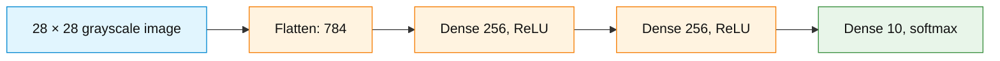
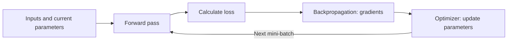

# Pair Programming: Image Classification from Pixels to Evaluation


## How to use this pair-programming activity

This activity applies grayscale and color image representation, categorical classification, neural-network architecture, training, and evaluation. **Fashion-MNIST** is the main dataset, with a short representation check using **CIFAR-10** (only one model is trained).

Hints are provided in expandable blocks, and you will write your own code, observations, and explanations in the shared notebook. Support every written answer with the actual numbers and figures produced by your cells.

**Pacing guide (120–150 minute session):** Focus in class on all `# TODO` coding cells and the **[Core]** questions below (19 questions total). Complete the **[Extension]** questions afterward as post-lab reflection. They are explicitly marked so you can pace your session and still reach model training (Section 8) and error analysis (Section 9) on time.

- **[Core] in-class questions:** Q1, Q3, Q5, Q6, Q7, Q8, Q11, Q12, Q14, Q15, Q16, Q18, Q20, Q21, Q24, Q26, Q28, Q30, Q32.
- **[Extension] post-lab questions:** Q2, Q4, Q9, Q10, Q13, Q17, Q19, Q22, Q23, Q25, Q27, Q29, Q31, Q33, Q34.

### Working as a pair

- **Driver:** enters and runs the code, states what each cell is expected to do.
- **Navigator:** checks the assumptions, tensor shapes, mathematical choices, and interpretation of results.
- Exchange roles after Sections 3, 6, and 9. Both members should be able to explain the submitted model.

Plotting cells are **already supplied** inside expandable `<details>` blocks. You are not assessed on writing Matplotlib code from scratch. Run each plotting block after completing the code above it, and remember that exact accuracies and loss curves can vary slightly from run to run.

**Python setup:** [Python setup for Week 3](https://github.com/AI-Learning-Repo/Neural-Networks/blob/week3/material/1-python_setup.md). Google Colab is recommended. A compatible local TensorFlow/Jupyter environment is also suitable. Run the notebook cells in order. If imports fail, install only missing packages using the setup document. Dataset downloads require internet access on first use. `keras.utils.plot_model()` additionally needs **pydot** and **Graphviz**; in Colab, use `%pip install pydot` and, if the system executable is missing, `!apt-get -qq install graphviz` in separate cells.

```python
import numpy as np
import matplotlib.pyplot as plt
import tensorflow as tf
from tensorflow import keras
from tensorflow.keras import layers

keras.utils.set_random_seed(42)
print("TensorFlow version:", tf.__version__)
print("TensorFlow executing eagerly:", tf.executing_eagerly())
```

## Learning objectives

By the end of this activity, the following should be demonstrated through code and written explanation:

1. Identify **classification, localization, detection, semantic segmentation, and instance segmentation** from their output requirements.
2. Inspect **grayscale** intensities, **RGB** channels, normalized pixels, and tensor ranks and shapes.
3. Distinguish **class IDs** from measured quantities; compare **sparse** and **one-hot** targets.
4. Explain **logits**, **softmax versus sigmoid**, and a compatible **cross-entropy** loss.
5. Build one two-hidden-layer dense classifier in both **Sequential** and **Functional** Keras styles.
6. Explain when **model subclassing** would be useful, without needing to implement a third network for training.
7. Compute layer parameter counts; use `summary()` and `plot_model()` to inspect the model.
8. Distinguish the **forward pass**, **loss**, **backpropagation**, and **optimizer update**; explain TensorFlow automatic differentiation.
9. Calculate update counts for **full-batch gradient descent, strict SGD, and mini-batch training**; distinguish them from the **Adam** optimizer.
10. Use **validation**, **early stopping**, and final **test evaluation** appropriately; explain dropout at a high level.
11. Interpret learning curves, softmax predictions, errors, and a confusion matrix.
12. Explain why a dense classifier trained on flattened inputs has limitations for spatial image structure.

---

## 1. Identify the computer-vision problem

Fashion-MNIST contains grayscale images of clothing. Each image has **one label** among ten classes. The task is to predict a category for the image as a whole.

**Question 1.** Which computer-vision task is implemented by predicting one class per image? For each of the following tasks, describe what the model must output: classification with localization, object detection, semantic segmentation, and instance segmentation.

<details>
<summary>Hint: Compare outputs, not model names</summary>

A label, a bounding box, and a pixel mask contain different amounts of information. Consider whether the task must distinguish two objects of the same class.

</details>

**Question 2.** If an image includes both a shirt and a bag, does a dataset with only one class target per image automatically become a multilabel task? What additional annotation would a true multilabel dataset need?

<details>
<summary>Hint: Separate real scenes from dataset targets</summary>

The visual content of an image and the format of its target label are not necessarily identical descriptions.

</details>

---

## 2. Load and inspect Fashion-MNIST

Fashion-MNIST contains 60,000 training images and 10,000 test images. The classes are:

| ID | Category | ID | Category |
|---:|---|---:|---|
| 0 | T-shirt/top | 5 | Sandal |
| 1 | Trouser | 6 | Shirt |
| 2 | Pullover | 7 | Sneaker |
| 3 | Dress | 8 | Bag |
| 4 | Coat | 9 | Ankle boot |

Load the dataset:

```python
class_names = [
    "T-shirt/top", "Trouser", "Pullover", "Dress", "Coat",
    "Sandal", "Shirt", "Sneaker", "Bag", "Ankle boot"
]

(x_train_full, y_train_full), (x_test_raw, y_test) = (
    keras.datasets.fashion_mnist.load_data()
)

print("Training images:", x_train_full.shape)
print("Training labels:", y_train_full.shape)
print("Test images:", x_test_raw.shape)
print("Test labels:", y_test.shape)
print("Image dtype:", x_train_full.dtype)
print("First class IDs:", y_train_full[:12])
```

**Question 3.** Record the image and label shapes. Explain the meaning of every dimension. Is one image a matrix or a rank-3 RGB tensor? How could an explicit grayscale channel axis be introduced?

**Question 4.** What is the difference between an image's *pixel dimensions* and its number of *training examples*? Why must the image label remain paired with its image if the dataset is shuffled?

<details>
<summary>Hint: Inspect rank and axis meaning</summary>

Use `.shape`, `.ndim`, and `.dtype`. The first dimension of a batched array usually counts examples. A channel axis can have length one or three.

</details>

<details>
<summary>Supplied Python visualization: Fashion-MNIST sample grid</summary>

```python
import matplotlib.pyplot as plt

fig, axes = plt.subplots(3, 5, figsize=(11, 6))
for i, ax in enumerate(axes.flat):
    ax.imshow(x_train_full[i], cmap="gray", vmin=0, vmax=255)
    ax.set_title(class_names[int(y_train_full[i])], fontsize=9)
    ax.axis("off")
plt.suptitle("Fashion-MNIST: raw grayscale images and categories")
plt.tight_layout()
plt.show()
```

</details>

**Question 5.** After viewing the gallery, identify two pairs of categories that may be visually difficult to distinguish. What evidence would be needed to establish that a trained model actually confuses those categories?

---

## 3. Explore pixels, normalization, and tensor shapes

A grayscale intensity typically lies between 0 (black) and 255 (white) in the raw images. Dividing by 255 scales values into the range 0–1. The same scaling must be applied to training, validation, and test inputs.

Prepare **48,000 training**, **12,000 validation**, and **10,000 held-out test** images. Because `fashion_mnist.load_data()` returns pre-shuffled training data, you can slice `x_train_full` and `y_train_full` cleanly at index `48000` (keeping image-label pairs aligned). Keep each image as a 2D array of shape `(28, 28)`—do **not** add a trailing channel axis of `1`, because Section 6 builds models with `Input(shape=(28, 28))`.

```python
# Complete the five preprocessing assignments below:
# - Convert image arrays to float32 and scale pixels to [0.0, 1.0].
# - Keep image shapes as (N, 28, 28) without adding a channel axis.
# - Partition x_train_full / y_train_full into 48,000 train and 12,000 validation examples.
# - Keep label arrays as integer category IDs.

# x_train = ...
# y_train = ...
# x_val = ...
# y_val = ...
# x_test = ...

# Inspect and verify shapes and scaling after completing the five assignments:
print("Training:", x_train.shape, y_train.shape, x_train.dtype)
print("Validation:", x_val.shape, y_val.shape, x_val.dtype)
print("Test:", x_test.shape, y_test.shape, x_test.dtype)
print("Normalized training range:", float(x_train.min()), float(x_train.max()))

assert x_train.shape == (48000, 28, 28) and y_train.shape == (48000,)
assert x_val.shape == (12000, 28, 28) and y_val.shape == (12000,)
assert x_test.shape == (10000, 28, 28) and y_test.shape == (10000,)
assert 0.0 <= float(x_train.min()) and float(x_train.max()) <= 1.0
assert 0.0 <= float(x_val.min()) and float(x_val.max()) <= 1.0
assert 0.0 <= float(x_test.min()) and float(x_test.max()) <= 1.0
```

**Question 6.** Why is normalization useful, what does it change, and what does it leave unchanged? For an example raw pixel intensity of 204, calculate the normalized value.

**Question 7.** Explain why the validation set must not contribute gradients to training and why the test set should not be used to choose an architecture or an early-stopping epoch.

<details>
<summary>Hint: One split has one purpose</summary>

Distinguish fitting weights, monitoring or selecting a model, and estimating final performance. Perform the same input scaling for all three sets.

</details>

<details>
<summary>Supplied Python visualization: Grayscale image and numeric pixel grid</summary>

```python
import matplotlib.pyplot as plt

image = x_train_full[0]
patch = image[10:18, 10:18]
fig, axes = plt.subplots(1, 2, figsize=(10, 4))
axes[0].imshow(image, cmap="gray", vmin=0, vmax=255)
axes[0].set_title("Raw Fashion-MNIST image")
axes[0].axis("off")
axes[1].imshow(patch, cmap="gray", vmin=0, vmax=255)
axes[1].set_title("Eight-by-eight patch with raw intensities")
axes[1].set_xticks(range(8))
axes[1].set_yticks(range(8))
for r in range(8):
    for c in range(8):
        value = int(patch[r, c])
        axes[1].text(c, r, str(value), ha="center", va="center",
                     fontsize=7, color="black" if value > 130 else "white")
plt.tight_layout()
plt.show()
```

</details>

**Question 8.** State the rank and shape of a single grayscale image, a batch of 64 grayscale images, and a batch of 64 CIFAR-10 color images. What does each axis represent?

<details>
<summary>Hint: Rank counts axes</summary>

The number of images in a batch adds an axis; RGB images also have a channel axis. Rank is not the total number of pixels.

</details>

---

## 4. Extending image representations to color (CIFAR-10)

CIFAR-10 images have shape `(32, 32, 3)` and use red, green, and blue channels. Run the supplied comparison to inspect a color image and its individual channels. This section examines **representation only**, without training a second model.

<details>
<summary>Supplied Python visualization: RGB image and its three intensity channels</summary>

```python
import matplotlib.pyplot as plt
from tensorflow import keras

(cifar_images, cifar_labels), _ = keras.datasets.cifar10.load_data()
rgb = cifar_images[0]
fig, axes = plt.subplots(1, 4, figsize=(12, 3.4))
axes[0].imshow(rgb)
axes[0].set_title("Original RGB image")
axes[0].axis("off")
for i, name in enumerate(["Red", "Green", "Blue"]):
    axes[i + 1].imshow(rgb[:, :, i], cmap="gray", vmin=0, vmax=255)
    axes[i + 1].set_title(f"{name} channel intensity")
    axes[i + 1].axis("off")
plt.tight_layout()
plt.show()

print("Full RGB shape:", rgb.shape)
print("One channel shape:", rgb[:, :, 0].shape)
print("RGB pixel at [0, 0]:", rgb[0, 0])
```

</details>

**Question 9.** Why is an RGB image rank 3 but a batch of RGB images rank 4? How does the RGB channel representation differ from the normalized Fashion-MNIST grayscale representation?

**Question 10.** Describe how three color-channel arrays reconstruct an RGB image. Why is converting RGB to grayscale not equivalent to deleting two channels arbitrarily?

<details>
<summary>Hint: Think about information in each channel</summary>

A pixel has three intensities in an RGB image. Converting to a single intensity requires a specified combination rule and generally loses color information.

</details>

---

## 5. Categorical labels, output probabilities, and cross-entropy

The Fashion-MNIST labels are **sparse integer identifiers**, not quantitative outcomes. The network must provide ten class probabilities. For logits $z_0,\ldots,z_9$, softmax produces

$$
p_k=\frac{e^{z_k}}{\sum_{j=0}^{9}e^{z_j}}.
$$

For a sparse target class $y$, the single-example cross-entropy loss is

$$
L=-\ln(p_y).
$$

**Question 11.** Construct a one-hot representation for class ID `6`. Explain how sparse integers and one-hot targets differ in array shape. Does the label `6` mean that the loss treats the class as more important than class `2`? Why or why not?

**Question 12.** For a ten-class, single-label Fashion-MNIST classifier, choose the output activation and compatible loss for (a) sparse labels and (b) one-hot labels. Explain why ten independent sigmoid outputs would represent a different task.

<details>
<summary>Hint: Encoding is separate from activation</summary>

The same mutually exclusive target can be stored in two forms. Keras provides two categorical cross-entropy variants that match these forms. Sigmoid outputs are independent unless a separate constraint is introduced.

</details>

Use the following **numerical check** to examine equivalent target encodings; it is not a model-training cell:

```python
label_id = 6
sparse_target = label_id
one_hot_target = keras.utils.to_categorical(label_id, num_classes=10)

# This probability vector is illustrative, not a trained model output.
probs_example = np.array([0.02, 0.03, 0.04, 0.05, 0.06,
                          0.08, 0.60, 0.04, 0.03, 0.05], dtype="float64")

print("Sparse target:", sparse_target)
print("One-hot target:", one_hot_target)
print("Sum of probabilities:", probs_example.sum())
# TODO: Compute the negative natural logarithm of the correct-class probability.
# TODO: Compute the one-hot-weighted cross-entropy and compare both results.
```

**Question 13.** Why should both loss calculations agree for the same probabilities and correct class? What goes wrong if integer clothing IDs are treated as numerical regression targets with a squared-error loss?

**Question 14.** For illustrative logits `[2, 1, 0]` with true class index `1`, calculate the three softmax probabilities (approximately), check their sum, and compute the cross-entropy for the correct class. Then explain how independent sigmoid outputs would differ.

<details>
<summary>Hint: Work in the right order</summary>

Compute exponentials, divide by their sum, select the probability at the correct index, and apply the negative natural logarithm. A calculator or NumPy can verify the arithmetic after the hand estimate.

</details>

<details>
<summary>Supplied Python visualization: Softmax versus sigmoid for the same three logits</summary>

```python
import numpy as np
import matplotlib.pyplot as plt
from tensorflow import keras

logits = np.array([2.0, 1.0, 0.0], dtype="float32")
softmax_values = keras.activations.softmax(logits).numpy()
sigmoid_values = keras.activations.sigmoid(logits).numpy()

fig, ax = plt.subplots(figsize=(7.5, 4))
xpos = np.arange(3)
ax.bar(xpos - 0.18, softmax_values, width=0.36, label="Softmax")
ax.bar(xpos + 0.18, sigmoid_values, width=0.36, label="Sigmoid")
ax.set_xticks(xpos, ["Index 0", "Index 1", "Index 2"])
ax.set_ylim(0, 1)
ax.set_ylabel("Output value")
ax.set_title("Softmax and independent sigmoids")
ax.legend()
ax.grid(axis="y", alpha=0.25)
plt.tight_layout()
plt.show()
print("Softmax sum:", softmax_values.sum())
print("Sigmoid sum:", sigmoid_values.sum())
```

</details>

---

## 6. Build the same network with two Keras APIs

The classifier uses the **same architecture** as the Fashion-MNIST example:

1. Input image `(28, 28)`.
2. `Flatten` to 784 features.
3. Hidden `Dense` layer with 256 ReLU units.
4. Second hidden `Dense` layer with 256 ReLU units.
5. Output `Dense` layer with 10 softmax units.



The diagram summarizes layers. Each dense layer contains trainable weights and biases; flattening has no trainable parameters.

For a dense layer with $m$ inputs and $n$ units, the parameter count is

$$
\text{parameters}=mn+n.
$$

**Question 15.** Calculate the trainable parameters in each dense layer and the total before calling `summary()`. Which layers contain biases? Which layer introduces no trainable parameters?

<details>
<summary>Hint: Count connections and biases separately</summary>

Each of the `n` neurons receives `m` weights plus one bias. For later dense layers, the input dimension is the number of units in the preceding layer.

</details>

### Version A: Sequential API

`Sequential` represents a single ordered path through layers. **Complete** the function below; do not change the required network architecture.

<details>
<summary>Starter Python code: Complete the Sequential model</summary>

```python
def build_sequential_model():
    # TODO: Return a keras.Sequential model.
    # Include an Input, Flatten, two Dense ReLU hidden layers,
    # and a ten-way softmax output layer in that order.
    raise NotImplementedError("Complete the Sequential architecture")
```

</details>

### Version B: Functional API

The Functional API starts from an explicit symbolic input and connects layers by applying them to intermediate tensors.

<details>
<summary>Starter Python code: Complete the Functional model</summary>

```python
def build_functional_model():
    inputs = keras.Input(shape=(28, 28), name="Image")
    # TODO: Call Flatten on inputs.
    # TODO: Connect the two Dense hidden layers.
    # TODO: Connect the ten-way softmax output.
    # TODO: Return keras.Model with inputs=inputs and the output tensor.
    raise NotImplementedError("Complete the Functional architecture")
```

</details>

After completing **both** builders, run:

```python
keras.utils.set_random_seed(42)
sequential_model = build_sequential_model()
functional_model = build_functional_model()

print("Sequential architecture:")
sequential_model.summary()
print("Functional architecture:")
functional_model.summary()
print("Parameter counts:",
      sequential_model.count_params(), functional_model.count_params())
```

**Question 16.** Compare the layer order, input/output shapes, and parameter counts. Why should the API choice not change the count for identical architectures?

**Question 17.** Which API is naturally suited to a simple single path? Which supports multiple inputs, outputs, branches, or shared layers? Explain the third Keras option, **model subclassing**, and identify one case where it could be useful.

<details>
<summary>Hint: Think about how computation is described</summary>

Sequential uses a layer list, Functional connects tensors, and subclassing defines a Python class with a `call()` method. More flexibility also introduces additional implementation responsibility.

</details>

### A fair comparison requires equal weights

Newly constructed models may have different random weights, even if the architectures are identical. Copy the weights before checking the predictions so that the API is the only structural difference under inspection.

```python
functional_model.set_weights(sequential_model.get_weights())

# The normalized validation array must already exist.
probe = x_val[:8]
p_seq = sequential_model.predict(probe, verbose=0)
p_func = functional_model.predict(probe, verbose=0)
print("Output shapes:", p_seq.shape, p_func.shape)
print("Largest probability difference:", np.max(np.abs(p_seq - p_func)))
print("Nearly equal:", np.allclose(p_seq, p_func, atol=1e-6))
```

**Question 18.** Why is weight copying required for this particular comparison? Does identical architecture automatically imply identical predictions from separately initialized, untrained models?

<details>
<summary>Supplied Python visualization: Sequential and Functional architecture plots</summary>

```python
from tensorflow import keras
from IPython.display import Image, display

# Requires pydot and the Graphviz executable.
for model_to_plot, filepath in [
    (sequential_model, "pair_sequential.png"),
    (functional_model, "pair_functional.png"),
]:
    keras.utils.plot_model(model_to_plot, to_file=filepath,
                           show_shapes=True, show_layer_names=True, dpi=110)
    print(model_to_plot.name)
    display(Image(filename=filepath))
```

</details>

**Question 19.** Which aspects of a neural network are visible in `plot_model()`? What cannot be concluded about accuracy, individual weight values, or the training result from this architecture diagram?

---

## 7. Training cycle, gradient computation, and epochs

The conceptual learning cycle remains:



**Question 20.** State what each stage calculates or changes. Which stage produces class probabilities, which provides gradients, and which changes trainable parameters? How does TensorFlow's automatic differentiation relate to these stages?

<details>
<summary>Hint: Separate information from action</summary>

Loss evaluates an error signal; gradients describe local sensitivity; the optimizer applies an update. Backpropagation and an optimizer step are not synonyms.

</details>

An **epoch** processes the full training set once. An **iteration/step** applies one optimizer update, usually after one mini-batch. Distinguish full-batch gradient descent (one update per epoch), strict single-example SGD (one update per example), and mini-batch optimization (one update per mini-batch). Adam is a different optimizer from plain SGD, even though both may use mini-batches.

**Question 21.** For the selected training partition and `batch_size=64`, calculate the number of updates in one complete epoch and in 25 completed epochs. Repeat the one-epoch calculation for full-batch gradient descent and strict single-example SGD. Explain what changes if the final batch contains fewer than 64 examples.

**Question 22.** For a weight $w$, learning rate $\eta$, and loss gradient $\frac{\partial L}{\partial w}$, describe the direction of the update and explain what a learning rate changes. Why can an excessively large learning rate make training unstable?

The basic gradient-descent update is

$$
w_{\mathrm{new}}=w_{\mathrm{old}}-\eta\frac{\partial L}{\partial w}.
$$

<details>
<summary>Hint: Count data used in each gradient</summary>

Compute updates from the number of mini-batches. One completed epoch always processes the selected training set once, but update frequency changes with the batch size. An optimizer such as Adam changes the update rule, not the meaning of an epoch.

</details>

### Optional compact automatic-differentiation check

The following example uses a scalar TensorFlow variable. It isolates differentiation from updating; it is not the training of the image classifier.

```python
w = tf.Variable(3.0)
with tf.GradientTape() as tape:
    loss_value = 0.5 * tf.square(w - 1.0)
gradient = tape.gradient(loss_value, w)
print("Current loss:", float(loss_value))
print("Gradient from TensorFlow:", float(gradient))
# TODO (optional): Apply one gradient-descent update with a chosen learning rate.
# Then compute the loss again and explain the observed change.
```

**Question 23.** What did `GradientTape` compute? Did evaluating `tape.gradient(...)` by itself update `w`? Explain the difference.

---

## 8. Train the Fashion-MNIST classifier

Train **one** model for the main activity: the Sequential version. The Functional version remains available for comparison. Use Adam on mini-batches, sparse categorical cross-entropy, and accuracy. Use validation data and an early-stopping callback with `patience=3` and `restore_best_weights=True`.

Complete the training configuration:

```python
model = sequential_model

# TODO: Compile model with Adam (learning rate 0.001),
#       sparse categorical cross-entropy, and accuracy.

# TODO: Create an EarlyStopping callback monitoring validation loss,
#       with patience=3 and restore_best_weights=True.

# TODO: Fit model using x_train, y_train, validation_data=(x_val, y_val),
#       epochs=25, batch_size=64, the callback, and verbose=2.
# Save the returned History object as history.

# After training, inspect:
# print("Completed epochs:", len(history.history["loss"]))
# print("Best observed epoch:",
#       int(np.argmin(history.history["val_loss"])) + 1)
```

**Question 24.** Explain what `compile()` configures and what `fit()` does. Which operations are handled internally by TensorFlow/Keras? Why is the test dataset not passed as validation data?

**Question 25.** Explain the meaning of `patience=3` and `restore_best_weights=True`. Does early stopping always stop the model before the maximum number of epochs? Does restoring weights delete training updates from the recorded history?

<details>
<summary>Hint: Inspect which metric is monitored</summary>

Training loss measures fit to data used to update parameters. The validation metric is computed without using those examples for gradient updates. Monitoring an unchanged or worsening metric requires a defined patience rule.

</details>

<details>
<summary>Supplied Python visualization: Training and validation loss and accuracy</summary>

```python
import numpy as np
import matplotlib.pyplot as plt

h = history.history
epochs = np.arange(1, len(h["loss"]) + 1)
best_idx = int(np.argmin(h["val_loss"]))
fig, axes = plt.subplots(1, 2, figsize=(12, 4))
axes[0].plot(epochs, h["loss"], marker="o", label="Training")
axes[0].plot(epochs, h["val_loss"], marker="o", label="Validation")
axes[0].axvline(best_idx + 1, color="black", linestyle="--",
                label="Best observed validation epoch")
axes[0].set(xlabel="Epoch", ylabel="Loss", title="Cross-entropy loss")
axes[0].legend()
axes[0].grid(alpha=0.25)
axes[1].plot(epochs, h["accuracy"], marker="o", label="Training")
axes[1].plot(epochs, h["val_accuracy"], marker="o", label="Validation")
axes[1].set(xlabel="Epoch", ylabel="Accuracy", title="Accuracy")
axes[1].legend()
axes[1].grid(alpha=0.25)
plt.tight_layout()
plt.show()
```

</details>

**Question 26.** Use the actual curves to identify the best observed validation-loss epoch, describe any visible training/validation gap, and discuss whether the evidence supports underfitting, overfitting, or neither clear conclusion. Explain why lower training loss alone does not guarantee better performance on new images.

**Question 27.** Define *regularization* in the context of generalization. How does early stopping help? At a high level, what does dropout do during training, and why is it not implemented as part of this exercise?

<details>
<summary>Hint: Avoid treating curves as guarantees</summary>

Overfitting is an interpretation supported by a sustained divergence in training and validation behavior, not a necessary event after a fixed number of epochs. Dropout changes training behavior; early stopping changes how long training continues and which observed weights are retained.

</details>

---

## 9. Evaluate on held-out data and examine errors

Evaluate on the test set only after all model and early-stopping choices are finalized, and report the exact metrics produced by your run.

Complete the final evaluation and prediction steps using the exact variable names shown below (`test_loss`, `test_accuracy`, `probabilities`, and `predicted_labels`), which are reused by the plotting cells that follow:

```python
# TODO: Evaluate the trained model on x_test, y_test:
# test_loss, test_accuracy = ...

# TODO: Compute class probabilities of shape (10000, 10) on x_test:
# probabilities = ...

# TODO: Convert each 10-element probability vector to its predicted class ID (shape (10000,)):
# predicted_labels = ...

print(f"Test loss: {test_loss:.4f} | Test accuracy: {test_accuracy:.4f}")
assert probabilities.shape == (len(x_test), 10)
assert predicted_labels.shape == (len(x_test),)
```

**Question 28.** Record test loss and accuracy. What do these metrics summarize, and what do they fail to show about individual mistakes? Why should test performance be treated differently from validation performance?

<details>
<summary>Hint: Save probabilities and class IDs</summary>

`evaluate()` returns `[loss, accuracy]`. `predict()` returns a `(N, 10)` probability array. Use `np.argmax(..., axis=1)` to select the class index with the largest probability for each image.

</details>

The following supplied visualization uses `probabilities` and `predicted_labels` from the completed cell above.


<details>
<summary>Supplied Python visualization: One image and its softmax probabilities</summary>

```python
import numpy as np
import matplotlib.pyplot as plt

index = 0
fig, axes = plt.subplots(1, 2, figsize=(12, 4))
axes[0].imshow(x_test[index], cmap="gray", vmin=0, vmax=1)
axes[0].set_title(f"True: {class_names[int(y_test[index])]}\n"
                  f"Predicted: {class_names[int(predicted_labels[index])]}")
axes[0].axis("off")
axes[1].barh(np.arange(10), probabilities[index])
axes[1].set_yticks(np.arange(10), class_names)
axes[1].invert_yaxis()
axes[1].set(xlim=(0, 1), xlabel="Softmax probability",
            title="One prediction: all ten classes")
plt.tight_layout()
plt.show()
```

</details>

**Question 29.** For the displayed image, identify the true category, predicted category, and probability assigned to the true category. Can the highest probability correspond to an incorrect category? Explain.

<details>
<summary>Supplied Python visualization: Incorrect examples and confusion matrix</summary>

```python
import numpy as np
import matplotlib.pyplot as plt

mistake_indices = np.flatnonzero(predicted_labels != y_test)[:12]
if len(mistake_indices):
    cols = 4
    rows = int(np.ceil(len(mistake_indices) / cols))
    fig, axes = plt.subplots(rows, cols, figsize=(12, rows * 2.6), squeeze=False)
    for ax in axes.flat:
        ax.axis("off")
    for ax, idx in zip(axes.flat, mistake_indices):
        ax.imshow(x_test[idx], cmap="gray", vmin=0, vmax=1)
        ax.set_title(f"True: {class_names[int(y_test[idx])]}\n"
                     f"Pred: {class_names[int(predicted_labels[idx])]}"
                     , fontsize=9)
    plt.suptitle("Incorrect Fashion-MNIST test predictions")
    plt.tight_layout()
    plt.show()
else:
    print("No incorrect examples found in the inspected test set.")

cm = np.zeros((10, 10), dtype=int)
np.add.at(cm, (y_test.astype(int), predicted_labels.astype(int)), 1)
fig, ax = plt.subplots(figsize=(8.5, 7))
im = ax.imshow(cm, cmap="Blues")
ax.set_xticks(range(10), class_names, rotation=55, ha="right")
ax.set_yticks(range(10), class_names)
ax.set(xlabel="Predicted class", ylabel="True class",
       title="Held-out test confusion matrix")
threshold = cm.max() * 0.5
for i in range(10):
    for j in range(10):
        ax.text(j, i, str(cm[i, j]), ha="center", va="center",
                fontsize=8, color="white" if cm[i, j] > threshold else "black")
fig.colorbar(im, ax=ax, label="Number of examples", shrink=0.85)
plt.tight_layout()
plt.show()
```

</details>

**Question 30.** Identify which class pairs the model actually confuses most often, using the confusion matrix. Do these observations agree with the visual guesses made in Question 5? Explain why an incorrect prediction does not by itself reveal the internal cause of the error.

---

## 10. Integrative comparison and reflection

**Question 31.** Compare the input representation and flattened feature count for (a) original MNIST, (b) Fashion-MNIST, and (c) CIFAR-10. If the same 256-unit first dense layer is used, how does changing the input size affect its parameter count?

**Question 32.** Give one reason a flattened dense network may have difficulty with color-image classification even when it has many parameters. What is meant by preserving or exploiting *spatial neighborhoods*? Name the next architectural topic that could address this limitation, without implementing it.

**Question 33.** Based on your checks in Questions 16 and 18, list two experimental controls (besides identical architecture and weights) that must stay constant when comparing two Keras model definitions fairly.

**Question 34.** Write a short summary of the full workflow using the following terms accurately: **tensor, normalize, flatten, logit, softmax, loss, backpropagation, optimizer, mini-batch, epoch, validation, early stopping, test**.

<details>
<summary>Hint: Link each term to a stage of the workflow</summary>

A complete explanation describes inputs and target representation first, then architecture and forward computation, loss and parameter updates, validation-based stopping, and finally the held-out test.

</details>

## Submission checklist

- [ ] A shared notebook with all required cells executed in order and without unresolved errors.
- [ ] Written responses to all **[Core]** questions (and **[Extension]** questions if assigned), including calculations and interpretations.
- [ ] Completed preprocessing and both Keras model-building functions.
- [ ] Architecture summaries and equivalent-weight prediction check.
- [ ] One trained Fashion-MNIST model with documented hyperparameters and early stopping.
- [ ] Learning curves, final test metrics, one probability plot, error examples, and a confusion matrix.
- [ ] A brief conclusion identifying at least one model limitation and one sensible next topic.
- [ ] Both partners can explain the network, selected loss, data split, and the difference between a gradient and a parameter update.

## Final reminder

The classification workflow is **input → forward pass → loss → backpropagation → optimizer update → evaluation**. Class encoding determines the appropriate categorical loss representation; the optimizer performs training updates; validation supports model selection; the test set is held back for final evaluation. Model definitions can use Sequential, Functional, or subclassing APIs without changing those underlying principles.
