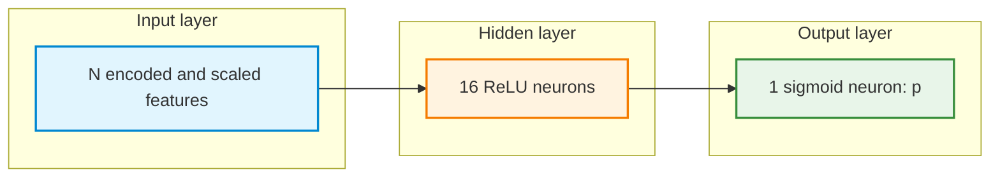

# Pair Programming: Heart Disease Classification with an MLP

**Focus:** Build, compare, and interpret a binary classifier using numerical and categorical input features.

This pair-programming activity develops a **binary classifier** for a small heart-disease dataset. Each record contains patient-related input features and a binary label, **0 or 1**. The task is to explore the data, prepare numerical and categorical inputs, train a multilayer perceptron (MLP), compare models using validation results, and report one final test evaluation.

A sigmoid output estimates the probability of class 1; binary cross-entropy measures prediction error. Backpropagation calculates gradients, and the optimizer uses them to update model parameters. 

The [UCI Heart Disease dataset](https://archive.ics.uci.edu/dataset/45/heart+disease) is available as a [CSV file used in TensorFlow tutorials](https://storage.googleapis.com/download.tensorflow.org/data/heart.csv). This version contains 303 rows, 13 input features, and a binary `target` column. Each row represents one patient record; in this CSV, `target=1` denotes the positive heart-disease class and `target=0` denotes the negative class. These labels are used for a classroom classification exercise, **not for medical diagnosis or clinical decisions**.

**Notebook setup:** Create a new [Google Colab](https://colab.research.google.com/) notebook with Markdown and Python cells. Run the supplied setup cell in Section 2. The task uses Python, NumPy, pandas, Matplotlib, scikit-learn, Keras, and TensorFlow. If Colab reports a missing package, install it in a separate cell with `%pip install package-name`, restart the runtime if prompted, and rerun the setup. An internet connection is needed to load the CSV.

## Learning objectives

By the end of the session, each pair should be able to:

1. Explain how binary classification differs from predicting a continuous numerical value.
2. Explore target-class frequencies and explain a majority-class baseline.
3. Split data into training, validation, and test sets without fitting preprocessing on held-out data.
4. Encode categorical inputs and standardize numerical inputs.
5. Construct, compile, and train a Keras MLP with a sigmoid output.
6. Interpret training and validation loss/accuracy, then select a model **before** final testing.
7. Interpret predicted probabilities and describe why preprocessing must be preserved for inference.

## How pair programming works

- **Driver:** Types and runs code while explaining each decision.
- **Navigator:** Reads the task, checks names and shapes, watches for data leakage, and discusses proposed changes before code runs.
- **Switch roles** after Sections 2, 4, 6, 8, and 10. Both partners should contribute code and explanations.
- Complete the tasks in sequence. Expand a **Hint** only after discussing an approach. Hints are not complete solutions.
- Keep **test labels and test performance out of model selection**. Test features may be transformed using training-fitted preprocessing; assess test performance only in Section 11, after selecting a model using validation results.
- Record observed results; values from training can differ between runs.

**Visualizations:** Run and interpret the provided plotting code. Writing plotting code from scratch is not assessed.

**Work format:** Create a Google Colab notebook with separate Markdown and Python cells. Include the task sections and complete the `TODO` code cells. Full code is supplied only for new operations or for plots that are meant to be interpreted rather than programmed. No complete model-building solution is provided.

## Workflow


---

## 1. Understand the classification task

| Choice | Numerical prediction (regression) | Heart disease classification |
|---|---|---|
| Target | A continuous numeric target | `target`, either 0 or 1 |
| Output layer | One linear neuron | One sigmoid neuron |
| Training loss | Mean squared error | Binary cross-entropy |
| Reported metric | Example metric: mean absolute error | Classification accuracy |

A **sigmoid** converts an unrestricted model score $z$ into an output $p$ between 0 and 1:

$$
p=\sigma(z)=\frac{1}{1+e^{-z}}
$$

The output $p$ is interpreted as the model-estimated probability of class 1; it is **not** a validated clinical probability. A threshold of 0.5 converts this value to a class prediction: predict class 1 when $p\geq 0.5$, and class 0 otherwise.

**Discuss before coding**

1. Why would a linear output be less suitable than sigmoid for this target?
2. Why is an error measured in continuous-value units not the natural evaluation metric for this 0/1 target?
3. Does a predicted probability of 0.8 guarantee that the patient has heart disease?

<details>
<summary><strong>Hint: classification versus regression</strong></summary>

Focus on the possible values of the target, the range of the output, and the difference between a probability and a confirmed diagnosis.

</details>

---

## 2. Load and explore the dataset

The CSV has 13 input columns and one target. The input groups used in this exercise are:

| Numerical inputs | Categorical inputs |
|---|---|
| `age`, `trestbps`, `chol`, `thalach`, `oldpeak`, `slope` | `sex`, `cp`, `fbs`, `restecg`, `exang`, `ca`, `thal` |

For this exercise, `slope` is treated as numerical for consistency with the supplied feature grouping, although it is a coded category and could also be one-hot encoded in a different model. Several other categorical fields are stored as integer codes; the codes do not automatically represent meaningful numerical distances.

**Supplied setup**: run this code at the beginning of the notebook:

```python
# If the required packages are not installed, install them first.
# In a separate Colab cell, only if imports are missing:
# %pip install numpy pandas matplotlib scikit-learn keras tensorflow

import os
os.environ["KERAS_BACKEND"] = "tensorflow"

import numpy as np
import pandas as pd
import matplotlib.pyplot as plt
import keras
from keras import Sequential, Input
from keras.layers import Dense
from sklearn.model_selection import train_test_split
from sklearn.preprocessing import StandardScaler

keras.utils.set_random_seed(42)

DATA_URL = "https://storage.googleapis.com/download.tensorflow.org/data/heart.csv"
print("Keras backend:", keras.config.backend())
```

**Pair tasks**

1. Load `DATA_URL` into a DataFrame named `heart_data`.
2. Display the first five rows, the shape, the column names, and missing-value counts.
3. Check that the label column is named `target` and identify its observed values.
4. Explain why the task is binary classification.

```python
# TODO: Load the CSV into heart_data.
# TODO: Display the first five rows.
# TODO: Print the shape and column names.
# TODO: Inspect missing values and target values.
```

<details>
<summary><strong>Hint: inspecting a DataFrame</strong></summary>

Useful pandas data-inspection commands include: `pd.read_csv(...)`, `.head()`, `.shape`, `.columns`, `.isna().sum()`, and `.value_counts()`.

</details>

**Checkpoint:** Record the number of rows, columns, numerical inputs, categorical inputs, and distinct target labels.

---

## 3. Separate features from the target; reserve held-out data

The **features** are the inputs `X`. The **target** is the label `y`. Predicting a label using that same label as an input would be **target leakage**.

**Pair tasks**

1. Create `X` containing all columns except `target`, and `y` containing only `target`. Keep feature and target names separate throughout the workflow.
2. First reserve **20%** of the rows as `X_test`, `y_test`.
3. From the remaining rows, reserve **20%** as `X_val`, `y_val`.
4. Name the remaining data `X_train`, `y_train`; use `random_state=42` in both splits, with `stratify=y` in the first and `stratify=y_train_val` in the second.
5. Print the shapes. Explain why the approximate proportions are **64% training / 16% validation / 20% test**.

```python
# TODO: Define X and y by COLUMN NAME, not by a hard-coded column position.

# TODO: Make the train+validation / test split.

# TODO: Split train+validation into train / validation.

# TODO: Print X_train, X_val, X_test and corresponding y shapes.
```

<details>
<summary><strong>Hint: splitting without leakage</strong></summary>

The function `train_test_split(...)` returns four objects: training features, reserved features, training labels, and reserved labels. A second call can split the training-and-validation portion. Use `stratify=y` in the first split and `stratify=y_train_val` in the second to help preserve the proportions of 0 and 1 labels.

</details>

**Discuss:** Why must the scaler learn nothing from validation or test rows? Why should the final model not be selected using test accuracy?

---

## 4. Establish a majority-class baseline

A **baseline** gives a simple reference for model performance. When class frequencies are unequal, predicting the most frequent class in the **training data** for every observation can already achieve noticeable accuracy. Its training proportion is a reference value; its test accuracy is calculated only after the final model has been selected.

**Pair tasks**

1. Count the `0` and `1` labels in **`y_train`** and calculate their proportions.
2. Identify the majority training class, without inspecting test accuracy.
3. Predict whether a model achieving 70% accuracy would necessarily be better than the baseline. Explain.

```python
# TODO: Count the class frequencies in y_train.
# TODO: Find the majority training class and its training proportion.
# TODO: Record it for the final test comparison in Section 11.
```

<details>
<summary><strong>Hint: majority-class baseline</strong></summary>

Use `.value_counts()` or `.value_counts(normalize=True)` on the **training labels**. The majority class is the one with the largest count. A baseline may be different across data splits.

</details>

**Checkpoint:** Record the majority class and its approximate **training** proportion. Do not report a test score yet.

---

## 5. Encode categorical inputs

Some inputs are **categorical variables stored as codes**. A neural network should not automatically treat, for example, category 3 as three times category 1.

**One-hot encoding** makes a separate 0/1 indicator column for each observed category. The pandas function `pd.get_dummies()` performs this conversion. Because independent encoding can produce different columns in different data splits, validation and test columns must be aligned to the **training** columns.

The following encoding code is supplied. Run it, inspect its outputs, and explain the decisions:

```python
categorical_variables = ["sex", "cp", "fbs", "restecg", "exang", "ca", "thal"]
numerics = ["age", "trestbps", "chol", "thalach", "oldpeak", "slope"]

X_train_encoded = pd.get_dummies(
    X_train, columns=categorical_variables, dtype=np.float32
)

# Apply the same training-derived set of columns to held-out data.
def encode_like_training(frame):
    encoded = pd.get_dummies(
        frame, columns=categorical_variables, dtype=np.float32
    )
    return encoded.reindex(columns=X_train_encoded.columns, fill_value=0)

X_val_encoded = encode_like_training(X_val)
X_test_encoded = encode_like_training(X_test)
```

**Pair tasks**

1. Run the supplied encoder and inspect the three encoded shapes.
2. Check that `X_train_encoded`, `X_val_encoded`, and `X_test_encoded` have exactly the same columns and order.
3. Explain why the number of model inputs may exceed the 13 raw features.
4. Explain why a numerical feature such as `age` is not one-hot encoded.

```python
# TODO: Inspect encoded shapes and columns.
# TODO: Verify that validation/test column order matches training.
```

**Discussion:** A category not observed in training receives zeros in all of the training-known indicator columns for that variable. This is a simple encoding rule for the exercise; in a deployed system, unknown categories require an explicit handling policy. Why must the rule be kept with the model for later predictions?

---

## 6. Standardize numerical features and prepare model inputs

The one-hot columns are already 0/1 indicators. The six numerical columns have different ranges, so standardize **only** the columns listed in `numerics`.

Standardization uses the training mean and standard deviation:

$$
z = \frac{x - \mu_{\mathrm{train}}}{\sigma_{\mathrm{train}}}
$$

Here, $x$ is an original numerical value, and the mean $\mu_{\mathrm{train}}$ and standard deviation $\sigma_{\mathrm{train}}$ are computed **only from the training data**.

**Pair tasks**

1. Create a `StandardScaler` named `scaler`.
2. Make three copies of the encoded DataFrames, named `X_train_scaled`, `X_val_scaled`, and `X_test_scaled`.
3. Fit the scaler to the **training numerical columns only** and transform those columns in all three splits.
4. Convert each scaled DataFrame to a NumPy array (`dtype="float32"`) named `train_X`, `val_X`, and `test_X`.
5. Create corresponding target arrays `train_y`, `val_y`, and `test_y`. Print shapes and check for `NaN` values.

```python
# TODO: Create scaler and copies of encoded features.

# TODO: Fit on training numerical columns; transform all three splits.

# TODO: Convert scaled features and targets to NumPy arrays.

# TODO: Print input/target shapes and check for missing values.
```

<details>
<summary><strong>Hint: training-only scaling</strong></summary>

Use `fit_transform()` to learn scaling statistics from the training numerical columns. Use only `transform()` for validation and test data. Assignment into selected DataFrame columns can use `frame[numerics] = ...`; conversion to arrays can use `.to_numpy(dtype="float32")`.

</details>

**Checkpoint:** Confirm that all three model-input arrays have the same number of columns, but different numbers of rows. The target must not be among those input columns.

---

## 7. Build the MLP: one hidden layer, one sigmoid output

The baseline MLP has **one hidden layer with 16 ReLU neurons** and **one sigmoid output neuron**.



In this diagram, the first box represents **N separate input features**, not a single input neuron. Here, **N** equals `train_X.shape[1]` after one-hot encoding. Every neuron in a Dense layer is connected to every output of the previous layer, and each Dense neuron has one bias.

**Pair tasks**

1. Use the supplied Keras `Sequential`, `Input`, and `Dense` imports to create a model named `model`.
2. Add an input with shape matching `train_X`.
3. Add **16 ReLU** neurons, then **1 sigmoid** output neuron.
4. Display `model.summary()`.
5. Calculate the parameters manually and compare with the summary.

The parameter count for a Dense layer is:

$$
\text{parameters}=(\text{number of inputs}\times\text{number of neurons})+\text{number of biases}
$$

```python
# TODO: Build model using Sequential, Input, and Dense.
# TODO: Print model.summary().
# TODO: Calculate the total parameter count by hand.
```

<details>
<summary><strong>Hint: architecture</strong></summary>

A `Sequential` model lists its layers in order. Obtain the input width with `train_X.shape[1]`. The hidden activation is `"relu"` and the output activation is `"sigmoid"`. Count one bias per neuron in each Dense layer. For reproducible initialization, call `keras.utils.set_random_seed(42)` just before constructing the model.

</details>

**Discuss:** Why does the output have one neuron instead of two? What would change if the model predicted a continuous value instead of a 0/1 class?

---

## 8. Compile the classification model

Model construction describes **what the network computes**. Compilation specifies **how the network is trained and evaluated**.

- **`optimizer="adam"`**: Adam updates the weights using gradients and adaptive step sizes. Backpropagation computes gradients; the optimizer applies parameter updates. A manual implementation of Adam is not required for this exercise.
- **`loss="binary_crossentropy"`**: Binary cross-entropy (BCE) penalizes predicted probabilities that disagree with binary labels. It is designed for binary labels instead of ordinary continuous-value regression errors.
- **`metrics=["accuracy"]`**: Accuracy is the proportion of correctly classified observations, using the default 0.5 threshold for this sigmoid-output model. Accuracy should always be interpreted alongside the majority-class baseline.

If $y\in\{0,1\}$ is the actual class and $p$ is the model's predicted probability of class 1, **binary cross-entropy for one example** is:

$$
L=-\left[y\ln(p)+(1-y)\ln(1-p)\right]
$$

For a class-1 example, BCE is $-\ln(p)$; for a class-0 example, it is $-\ln(1-p)$. Keras handles the numerical implementation during training.

**Supplied code: classification settings:**

```python
model.compile(
    optimizer="adam",
    loss="binary_crossentropy",
    metrics=["accuracy"]
)
```

**Pair discussion**

1. What does each of the three `compile()` arguments control?
2. If the true class is 1, should the loss be lower for a prediction of 0.9 or 0.1? Explain without calculating logarithms.
3. Does an optimizer calculate the gradients, apply the updates, or both?

---

## 9. Train the baseline and observe learning curves

The Keras `fit()` method trains a model and returns a `History` object. An **epoch** is one pass through the training examples; a **mini-batch** contains a subset used for one training step.

Validation data is passed explicitly so that its preprocessing remains separate from the training set and is never used to fit the scaler.

**Pair tasks**

1. Train `model` on `train_X`, `train_y` for `epochs=300` and `batch_size=32`.
2. Supply `validation_data=(val_X, val_y)` and choose an appropriate `verbose` value.
3. Save the returned object as `history`.
4. Inspect the keys in `history.history` and record the final training and validation BCE and accuracy.

```python
# TODO: Use model.fit(...) and save the result as history.
# TODO: Inspect history.history and its final training/validation values.
```

<details>
<summary><strong>Hint: model training</strong></summary>

The `fit()` method takes training features and labels as its first two arguments; named arguments include `epochs`, `batch_size`, `validation_data`, and `verbose`. For this classification model, the history dictionary includes `loss`, `val_loss`, `accuracy`, and `val_accuracy`.

</details>

### Run and interpret the loss plot

The plotting code is supplied because the learning objective is to **run and interpret the curves**, not to write Matplotlib plotting code.

<details>
<summary><strong>Show supplied Python plotting code: training and validation BCE</strong></summary>

```python
loss_values = history.history["loss"]
val_loss_values = history.history["val_loss"]
epoch_numbers = range(1, len(loss_values) + 1)

plt.figure(figsize=(7, 4))
plt.plot(epoch_numbers, loss_values, label="Training BCE")
plt.plot(epoch_numbers, val_loss_values, label="Validation BCE")
plt.xlabel("Epoch")
plt.ylabel("Binary cross-entropy")
plt.title("Training and validation loss")
plt.legend()
plt.tight_layout()
plt.show()
```

</details>

### Run and interpret the accuracy plot

<details>
<summary><strong>Show supplied Python plotting code: training and validation accuracy</strong></summary>

```python
train_accuracy = history.history["accuracy"]
val_accuracy = history.history["val_accuracy"]
epoch_numbers = range(1, len(train_accuracy) + 1)

plt.figure(figsize=(7, 4))
plt.plot(epoch_numbers, train_accuracy, label="Training accuracy")
plt.plot(epoch_numbers, val_accuracy, label="Validation accuracy")
plt.xlabel("Epoch")
plt.ylabel("Accuracy")
plt.title("Training and validation accuracy")
plt.legend()
plt.tight_layout()
plt.show()
```

</details>

**Pair discussion**

1. Do training and validation loss follow the same trend?
2. Is there an interval where training loss decreases while validation loss increases? What might this suggest?
3. Why is one noisy validation epoch not enough to prove overfitting?
4. Can validation accuracy be high while validation BCE is worsening? What is each metric measuring?

---

## 10. Pair challenge: Change one thing, then choose a model

Compare model configurations using **validation** results rather than the held-out test set. Reserve the test set for the final evaluation of the selected model.

**Pair tasks**

1. Choose **one** change from the baseline: reduce training to 100 epochs, use 8 hidden neurons instead of 16, or use two hidden layers of 16 and 8 neurons.
2. State a prediction about how this change might affect validation loss.
3. Build and train a **fresh** candidate model from newly initialized weights. Keep the data split, encodings, scaler, loss, and optimizer unchanged.
4. Compare models using the **final epoch's validation BCE** (`val_loss`). Record validation accuracy as supporting evidence.
5. Select the model with lower final validation BCE, and assign it to `final_model`. **Do not evaluate either model on the test set yet.**

```python
# TODO: Define and train a fresh candidate model.
# TODO: Compare baseline and candidate final validation BCE.
# TODO: Assign the selected trained model to final_model.
```

| Model | Architecture / epochs | Final validation BCE | Final validation accuracy | Observation |
|---|---|---|---|---|
| Baseline | 16 ReLU → 1 sigmoid; 300 epochs | | | |
| Candidate | One change | | | |

<details>
<summary><strong>Hint: a fair comparison</strong></summary>

Use the same training, validation, and preprocessing arrays for both runs. Start a fresh model with `keras.utils.set_random_seed(42)` immediately before its construction; models with different architectures cannot have identical weights. Do not call `fit()` again on the baseline. Use the **last** entry of each model's `val_loss` history so the comparison matches the weights currently stored in that model. A lower historical minimum alone does not restore an earlier model's weights.

</details>

**Discuss:** Can a longer training run produce a lower training loss but a worse validation loss? Does a single split prove which architecture is universally best?

---

## 11. Final evaluation: Test data and the baseline

The selected model is now fixed. Only at this point should the held-out **test set** be used to report generalization performance.

**Pair tasks**

1. Use `final_model.evaluate(...)` to obtain the **test BCE** and **test accuracy**.
2. Compute the test accuracy of a classifier that always predicts the **majority class determined from `y_train`**.
3. Compare the two test accuracies. State whether the selected MLP improves on this simple baseline.
4. Explain why accuracy alone may hide poor performance on one of the two classes.

```python
# TODO: Evaluate final_model exactly once on test_X, test_y.
# TODO: Calculate test accuracy for the TRAINING majority-class baseline.
# TODO: Print and interpret the comparison.
```

<details>
<summary><strong>Hint: final evaluation</strong></summary>

Use `final_model.evaluate(test_X, test_y, verbose=0)` to obtain loss and accuracy. To score the majority-class baseline, compare each test label with the majority class identified in Section 4 and calculate the fraction of matches. The MLP was selected using validation data; do not revise that choice based on the test result.

</details>

**Checkpoint:** Record the final model choice, test BCE, test accuracy, majority-class test accuracy, and one limitation of the comparison.

---

## 12. Inference

An MLP with one sigmoid output returns values interpreted as probabilities of class 1. To report 0/1 predictions, a threshold must be applied. The predicted probabilities do not establish a diagnosis, and performance on one small dataset does not establish clinical reliability.

**Pair tasks**

1. Use `final_model.predict(test_X[:5])` to inspect predicted probabilities for five held-out examples.
2. Convert those probabilities to 0/1 labels using a threshold of 0.5.
3. Compare those five predictions with the corresponding values in `test_y`.
4. Explain why future raw patient records require the **same one-hot column order and the same training-fitted scaler** used here.

```python
# TODO: Obtain the first five predicted probabilities.
# TODO: Apply the classification threshold and compare with five labels.
```

<details>
<summary><strong>Hint: probabilities and labels</strong></summary>

`predict()` returns model outputs rather than final class labels. For a single sigmoid output, the returned array has one probability per row; `.ravel()` can flatten it. A comparison with `0.5` produces Boolean values that can be converted to integer class labels.

</details>

---

## 13. What is missing from the model evaluation?

So far, the selected classifier has been evaluated mainly using **binary cross-entropy (BCE)** and **accuracy**. Accuracy reports the overall proportion of correct predictions, but it does not explain *which types of mistakes* the model makes.

**Pair challenge — discuss before coding**

1. **What important information is still missing** from the evaluation of this binary classifier? Consider the difference between predicting class 1 incorrectly and missing a real class-1 example.
2. Identify three additional classification metrics that could help describe model performance. What does each one measure?
3. Using the **already-selected `final_model`** and the **held-out test set**, calculate those three metrics at the same **0.5 classification threshold** used earlier.
4. Compare the three values with test accuracy. Can a classifier have reasonably high accuracy but poor performance on the positive class?
5. Discuss which type of error—**false positive** or **false negative**—could be especially important in this dataset, and why. This is a discussion about evaluation, **not a medical conclusion**.

```python
# TODO: Predict probabilities for ALL examples in test_X.
# TODO: Convert probabilities into class labels using threshold 0.5.
# TODO: Calculate and display precision, recall, and F1-score for class 1.
# TODO: Explain what these metrics reveal beyond accuracy.
```

<details>
<summary><strong>Hint — beyond accuracy</strong></summary>

Consider **precision**, **recall**, and **F1-score**. Precision asks: *Of the examples predicted as class 1, how many really belong to class 1?* Recall asks: *Of the actual class-1 examples, how many did the classifier find?* F1-score combines precision and recall into one value.

The terms **true positive (TP)**, **false positive (FP)**, and **false negative (FN)** help explain these metrics. The functions `precision_score`, `recall_score`, and `f1_score` are available in `sklearn.metrics`. Use predictions for the **entire held-out test set**, not only the five examples inspected in Section 12.

Keep `final_model` and the 0.5 threshold unchanged. These additional test metrics are for **reporting and interpretation**, not for selecting or tuning another model after test evaluation.

</details>

**Checkpoint:** Record test accuracy, precision, recall, and F1-score for the selected model, and write two sentences explaining what accuracy alone could have hidden.

---


### Exit discussion

1. How does this binary-classification task differ from a task that predicts a continuous value?
2. Which preprocessing operation had to be fitted using training data only?
3. What do **backpropagation**, **Adam**, and **binary cross-entropy** each do?
4. Why can the final test score not be used to choose another architecture?
5. What must be saved alongside model weights before using this model on new tabular records?

## Submission checklist

- [ ] Both partners contributed code and switched Driver/Navigator roles.
- [ ] Data inspection, label proportions, and a majority-class baseline were recorded.
- [ ] The target was excluded from features; train/validation/test sets were separate.
- [ ] One-hot encoded columns matched; numerical scaling used training statistics only.
- [ ] The baseline MLP was built and its parameter count was verified.
- [ ] Adam/BCE/accuracy settings were understood; training ran and learning curves were interpreted.
- [ ] A fresh candidate was compared using validation BCE **before** test evaluation.
- [ ] The final test evaluation, majority-class comparison, and five inference examples were documented.
- [ ] The notebook includes a short reflection on leakage, overfitting, and limits of classification accuracy.

