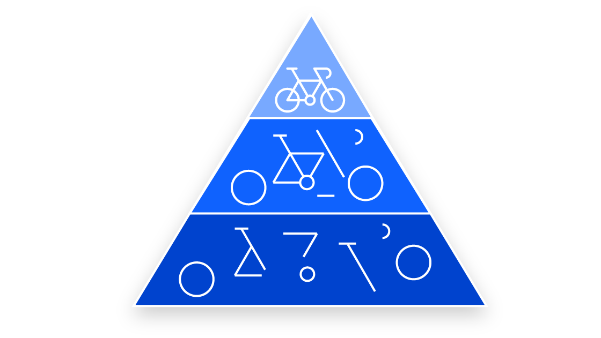

# CNN Lecture, Part 1: From Pixels to Learned Features

The goal is to build intuition gradually. We start with a problem, introduce convolution as a possible solution, and investigate what happens inside a CNN.

## 1. Why are CNNs needed?

Dense layers are already familiar for building deep neural networks. But what happens when working with images?

Consider a color photograph taken with a smartphone at a resolution of **3024 × 3024 pixels**.

Flattening this image produces:

$$
3024 \times 3024 \times 3 = 27,433,728
$$

Connecting these values to just **100 neurons** in a single dense layer requires approximately **2.74 billion trainable parameters** (including the 100 biases).

And that is only one layer.

> More [here](../cnn_benefits.md)

Clearly, a better approach is needed.

**Key question:** Can a network learn useful information from an image without connecting every pixel to every neuron?


## 2. Inspiration from biology

Consider how the human visual system processes images.

> https://www.perkins.org/higher-order-visual-pathways-and-the-cvi-brain/

The brain does not simply treat an image as one enormous list of pixels. Visual processing involves neurons that respond to different visual patterns, including edges, orientations, and more complex structures.

**Important:** This is a simplified analogy, not a complete explanation of biological vision.

Still, it suggests a useful idea:

**What if a network first extracts useful visual features and then uses those features for classification?**




> [!TIP]  
> [Demo: Edge Detection: Manual Filter vs. Learned Filter](./demo-b.md)


## 3. Feature extraction with traditional kernels

In traditional image processing, features are extracted using a **kernel**, or **filter**.

- [Kernel (Image Processing): Wikipedia](https://en.wikipedia.org/wiki/Kernel_(image_processing))

A kernel is a small matrix of numbers that slides across an image. At each position, image values are multiplied by the corresponding kernel values and the results are summed.

Different kernels produce different effects: blurring, sharpening, or detecting edges.

This operation can be explored interactively here:

- [Image Kernels: Explained Visually (Setosa)](https://setosa.io/ev/image-kernels/)

Consider a grayscale image of a bicycle.


Different filters emphasize different patterns. One responds strongly to vertical edges; another responds strongly to horizontal edges.

For example, here are two simple edge-detection kernels:

**Vertical edges**

$$
K_v = \begin{bmatrix}
-1 & 0 & 1 \\
-1 & 0 & 1 \\
-1 & 0 & 1
\end{bmatrix}
$$

**Horizontal edges**

$$
K_h = \begin{bmatrix}
-1 & -1 & -1 \\
 0 &  0 &  0 \\
 1 &  1 &  1
\end{bmatrix}
$$

Other common kernels—including blur, sharpen, and identity filters—are shown here:

- [Types of Convolution Kernels (GeeksforGeeks)](https://www.geeksforgeeks.org/deep-learning/types-of-convolution-kernels/)

So far, **the kernel values have been chosen manually**.

## 4. The core CNN idea: learning the kernels

In traditional image processing, the designer decides which kernel to apply.

In a convolutional neural network, **the kernel values are not chosen manually—they are learned from data.**

Training starts with kernel weights that are usually initialized randomly. Those weights are then updated through backpropagation and gradient-based optimization.

The network learns filters that help reduce classification loss.

It is no longer necessary to decide in advance that a particular filter must detect a vertical edge or a horizontal edge.

Different filters can learn different useful patterns. By stacking convolutional layers, a network builds increasingly complex representations.

## 5. Inside an example CNN

The example uses **Fashion-MNIST**, which contains 28 × 28 grayscale images of clothing items across **10 categories**.

- [Keras Fashion-MNIST dataset documentation](https://keras.io/api/datasets/fashion_mnist/)

The [Fashion-MNIST CNN notebook](cnn.ipynb) can be opened in [Google Colab](https://colab.research.google.com/) using **File → Upload notebook**. The same model is used throughout this investigation.

Training the CNN produces **test accuracy**—the proportion of test predictions that are correct. In the saved experiment, the model achieved **90.58% test accuracy**. An F1 score was not calculated in that run; macro and weighted F1 can be added later to explore performance across classes.

Before examining each layer, take a quick look at the overall architecture. Every entry does not need to make sense yet.

<details>
<summary><strong>Reveal the trained CNN summary and evaluation</strong></summary>

| Layer | Output shape | Trainable parameters |
|---|---|---:|
| Input | 28 × 28 × 1 | 0 |
| Conv_1 | 27 × 27 × 32 | 160 |
| MaxPool2D | 13 × 13 × 32 | 0 |
| Conv_2 | 12 × 12 × 32 | 4,128 |
| MaxPool2D | 6 × 6 × 32 | 0 |
| Flatten | 1,152 | 0 |
| Dense + ReLU | 256 | 295,168 |
| Dense + Softmax | 10 | 2,570 |

**Total trainable parameters: 302,026.**

**Test accuracy in the saved notebook run: 90.58%.** The exact score can vary when retrained.

</details>

Now comes the more interesting question:

**How does the CNN actually process an image?**

The next sections inspect the network one layer at a time.

For now, the focus is on the calculation performed by a convolutional filter. The actual model also uses ReLU, pooling, and flattening, which are covered in later sections.

## 6. The first convolutional layer

Here is the code for the first layer:

```python
from tensorflow import keras

inputs = keras.Input(shape=(28, 28, 1))
x = keras.layers.Conv2D(
    32,                    # Number of filters
    kernel_size=(2, 2),    # Size of each filter
    activation="relu",     # We will explain ReLU in Section 19
    name="Conv_1"
)(inputs)
```

This notebook uses a **2 × 2** kernel, which also keeps the hand calculations easy to trace. In many practical CNNs, **3 × 3** kernels are more common: they have a center pixel and can be padded symmetrically to preserve spatial dimensions.

Although the code already includes `activation="relu"`, first consider the convolution calculation *before* ReLU changes its output. Section 19 covers ReLU in detail.

What does this layer definition specify?

The layer uses **32 filters**, each with a spatial size of **2 × 2**.

Each filter moves across the image, looking for a pattern determined by its learned weights.

Every filter produces one output called a **feature map**.

A feature map indicates where that filter responds strongly in the image.

Note that a feature map is **not necessarily a recognizable object or an easily identifiable feature**. It is a numerical representation of filter responses.

## 7. Following a single filter

Suppose a small 2 × 2 filter is:

$$
K = \begin{bmatrix}1 & -1 \\ 
1 & -1
\end{bmatrix}
$$

And a small region of the image is:

$$
I = \begin{bmatrix}
1 & 0 & 0 \\
1 & 0 & 0 \\
1 & 0 & 0
\end{bmatrix}
$$

The filter slides across the image. At each position, matching entries are multiplied and summed.

For the first position:

$$
(1\times1) + (0\times-1) + (1\times1) + (0\times-1) = 2
$$

Repeating this operation at the remaining positions gives:

$$
\text{Feature map} = \begin{bmatrix}
2 & 0 \\ 
2 & 0
\end{bmatrix}
$$

*In this illustrative calculation, stride 1, no padding, no bias, and no activation are used. Like the operation in most CNN libraries, this is technically cross-correlation (the kernel is not flipped), though it is commonly called convolution.*

This produces a new matrix: the **feature map**.

**One filter produces one feature map, not just one number.**

## 8. Scaling up to 32 filters

Returning to the Fashion-MNIST image, the input shape is **28 × 28 × 1**.

Each of the **32 filters** processes the same input image, but each filter has different learned weights.


Why **27 × 27** rather than **28 × 28**?

This layer uses stride 1 and the default `padding="valid"`, meaning no padding. A 2 × 2 filter therefore has **27 horizontal positions** and **27 vertical positions**.

This produces **32 different feature maps**, each of size **27 × 27**.

$$
\underbrace{28\times28\times1}_{\text{Input}}
\quad\longrightarrow\quad
\underbrace{27\times27\times32}_{\text{Output}}
$$

**One grayscale image has been transformed into 32 channels of learned feature responses.**

Here is an important distinction: the layer outputs **32 feature maps**, not 32 independent input images.

With one grayscale input channel, each 2 × 2 filter has **four weights and one bias**. The complete first convolutional layer therefore has only:

$$
32 \times (2\times2\times1 + 1) = 160
$$

trainable parameters.

That is possible because the same filter weights are reused at every spatial position.

When ReLU is applied afterward, negative responses are replaced by zero.

Further reading:

- [Keras Conv2D documentation](https://keras.io/api/layers/convolution_layers/convolution2d/)

## 9. Quick check

**Check your understanding.**

Given a grayscale image of **28 × 28** and **32 filters of size 2 × 2** with **stride 1** and **no padding**, what output shape should the convolutional layer produce?

<details>
<summary>Reveal the answer</summary>

**27 × 27 × 32**

The layer produces **32 feature maps**. Each map contains **27 × 27** values because a 2 × 2 filter fits at 27 positions along each axis of a 28 × 28 image without padding.

</details>

## 10. Transition to deeper layers

The behavior of the first convolutional layer is now clear.

This raises a new question:

The network started with **one image** and now has **32 feature maps**.

**What happens when another convolutional layer is applied to those 32 feature maps?**

That leads to the next core idea: **how CNNs combine simple features to learn more complex patterns**.

---

# CNN Lecture, Part 2: What Really Happens Inside a CNN?

## 11. How a filter calculation actually works

So far, a filter takes an image and produces a feature map—and 32 filters produce 32 feature maps.

However, the underlying arithmetic has only been sketched briefly. Next is a closer look at how every number in a feature map is computed.

Recall that images are matrices of numbers. For a grayscale image, each number represents pixel intensity.

A kernel is another matrix, usually much smaller.

**The idea is simple:** slide this small matrix across the image, multiply overlapping values, and add the results.

What do those results look like?

## 12. Calculating a feature map step by step

Consider this grayscale image represented by an 8 × 8 matrix of pixel values.


On the left is the image. In the middle is a 3 × 3 kernel. On the right is the result when the kernel overlaps one small region of the image.

The kernel is:

$$
K = \begin{bmatrix}
-1 & -2 & -1 \\
0 & 0 & 0 \\
1 & 2 & 1
\end{bmatrix}
$$

This is a horizontal-edge detection kernel. It responds to changes in intensity between the upper and lower parts of a region.

For this example, the values are chosen manually. Inside a CNN, these values are learned during training.

Focus on the highlighted region:

$$
I = \begin{bmatrix}
60 & 60 & 68 \\
44 & 60 & 60 \\
68 & 76 & 76
\end{bmatrix}
$$

Multiply each image value by the corresponding kernel value:

$$
I\odot K =
\begin{bmatrix}
-60 & -120 & -68 \\
0 & 0 & 0 \\
68 & 152 & 76
\end{bmatrix}
$$

Then add all nine values:

$$
-60-120-68+68+152+76=\boxed{48}
$$

That is **one value in the feature map**.

What does 48 indicate?

It indicates how strongly this particular filter responds to this region. A positive value means the local intensity pattern aligns with the pattern encoded by the filter.

Note that 48 is not a probability or a class prediction—it is simply a filter response.

Next, the kernel moves across the rest of the image.

## 13. Repeating the calculation across the image

Place the kernel at the top-left corner of the image.

$$
K = \begin{bmatrix}
-1 & -2 & -1 \\
0 & 0 & 0 \\
1 & 2 & 1
\end{bmatrix}
$$

Multiply, add, and record the result.

Then shift the kernel one pixel to the right and repeat.

At the end of a row, move down one pixel and continue.

Examine the very first position. The first 3 × 3 region is:

$$
\begin{bmatrix}
60 & 58 & 60 \\
68 & 60 & 60 \\
76 & 44 & 60
\end{bmatrix}
$$

The calculation becomes:

$$
-60-116-60+76+88+60=\boxed{-12}
$$

The first feature-map value is −12.

Moving one position to the right and repeating gives −14.

Completing the first row yields:

$$
\begin{bmatrix}-12&-14&8&8&-8&-8\end{bmatrix}
$$

Here is the complete result.

<details>
<summary><strong>Reveal the complete 6 × 6 feature map</strong></summary>

$$
\begin{bmatrix}
-12 & -14 & 8 & 8 & -8 & -8 \\
32 & 48 & 32 & 8 & -16 & -64 \\
120 & 112 & 80 & 32 & -8 & -16 \\
16 & 16 & 16 & 16 & 8 & 8 \\
-96 & -80 & -32 & 16 & 48 & 72 \\
-48 & -48 & -40 & -24 & 8 & 48
\end{bmatrix}
$$


The highlighted region in the original image produces the value 48 in the second row, second column of this feature map.

</details>

An 8 × 8 image produces a 6 × 6 feature map.

Why 6 × 6?

A 3 × 3 kernel can start at six horizontal positions and six vertical positions without extending beyond the 8 × 8 image.

So the output contains 36 values.

Notice something else: even though the spatial dimensions decreased, the spatial arrangement of the filter responses is preserved. Neighboring positions in the feature map correspond to neighboring regions in the original image.

This spatial structure is one of the defining properties of convolution.

### Reproducing the experiment in Python

This calculation can be reproduced using NumPy, without training a network.

<details>
<summary><strong>Show Python code: convolution from scratch</strong></summary>

```python
import numpy as np

image = np.array([
    [60, 58, 60, 60, 60, 60, 60, 52],
    [68, 60, 60, 68, 68, 52, 76, 76],
    [76, 44, 60, 60, 68, 52, 60, 52],
    [68, 68, 76, 76, 68, 52, 60, 44],
    [92, 84, 84, 84, 76, 44, 60, 44],
    [76, 68, 84, 76, 76, 52, 60, 52],
    [68, 60, 60, 76, 84, 52, 84, 60],
    [60, 60, 68, 68, 68, 52, 76, 68]
])

kernel = np.array([
    [-1, -2, -1],
    [ 0,  0,  0],
    [ 1,  2,  1]
])

height, width = image.shape
kh, kw = kernel.shape

feature_map = np.zeros(
    (height - kh + 1, width - kw + 1),
    dtype=int
)

for row in range(height - kh + 1):
    for col in range(width - kw + 1):
        patch = image[row:row+kh, col:col+kw]
        feature_map[row, col] = np.sum(patch * kernel)

print(feature_map)
print("Shape:", feature_map.shape)
```

The output shape is `(6, 6)`.

</details>

In these steps, the kernel always moved by one pixel.

**What happens if it does not move by one pixel—what if it jumps two pixels at a time?**

That brings up the next concept.

## 14. Stride: moving the filter two pixels at a time

So far, the kernel has moved one pixel at a time.

This step size is called the **stride**.

> https://developer.ibm.com/articles/introduction-to-convolutional-neural-networks/

With stride 1, the kernel shifts by one pixel at each step.

With stride 2, it jumps two pixels at each step.

Compare the two choices for the 8 × 8 image and 3 × 3 kernel:

| Stride setting | Output size | Number of output values |
|---|---:|---:|
| Stride 1 | 6 × 6 | 36 |
| Stride 2 | 3 × 3 | 9 |

With stride 1, every possible neighboring position is examined.

With stride 2, intermediate positions are skipped, reducing the spatial resolution.

Why might this be useful?

When processing a very large image, moving the filter one pixel at a time can produce an enormous feature map.

Increasing the stride reduces the number of positions at which the filter is evaluated.

That means fewer output values and less computation.

There is a trade-off, however: some fine details may be missed because not every position is evaluated.

Keep this rule in mind:

**Stride controls how far a filter moves, and therefore how densely the image is sampled.**

The Fashion-MNIST CNN uses stride 1 in its convolutional layers.

Another way to reduce feature-map size appears shortly.

## 15. Padding: handling the image borders

Return to the 8 × 8 example: after applying a 3 × 3 filter, the output became a 6 × 6 feature map.

Every convolution without padding shrinks the spatial dimensions whenever the kernel is larger than 1 × 1.

What happens if many convolutional layers are stacked?

The spatial representation shrinks further at each layer, and eventually too much spatial information may be lost.

There is also a second issue.

Think about a pixel near the center of the image: as the kernel slides, that pixel participates in several overlapping calculations.

**Now think about a pixel in the top-left corner: without padding, that corner pixel appears in far fewer kernel positions.**

**Can the kernel examine borders more thoroughly while controlling the output size?**

Yes—by adding a border around the image. This is called **padding**.

> https://developer.ibm.com/articles/introduction-to-convolutional-neural-networks/

### What padding looks like

Suppose an image is 3 × 3:

$$
\begin{bmatrix}
1&2&3\\
4&5&6\\
7&8&9
\end{bmatrix}
$$

Surround it with zeros:

$$
\begin{bmatrix}
0&0&0&0&0\\
0&1&2&3&0\\
0&4&5&6&0\\
0&7&8&9&0\\
0&0&0&0&0
\end{bmatrix}
$$

One layer of zeros has been added around the original image, making the padded image 5 × 5.

Applying a 3 × 3 kernel with stride 1 produces a 3 × 3 output—matching the original spatial dimensions.

In Keras, this behavior is requested with:

```python
padding="same"
```

For stride 1, this preserves the input height and width.

Without padding, Keras uses:

```python
padding="valid"
```

This means the kernel is only placed where it fits completely inside the input.

Padding is useful because it controls output dimensions and allows filters to process boundary regions more fully. It does not guarantee that every original pixel has exactly the same influence.

The example CNN uses the default `padding="valid"`.

### A quick formula for output dimensions

Instead of counting kernel positions by hand every time, the spatial output size for any square input and kernel can be computed with:

$$
\text{Output size} = \left\lfloor \frac{N + 2P - K}{S} \right\rfloor + 1
$$

where $N$ is the input height (or width), $P$ is the number of padding pixels added to **each side** of that dimension, $K$ is the kernel size, and $S$ is the stride. Apply the formula separately to height and width. This assumes dilation 1 and equal padding on both sides; with asymmetric padding, add the padding on the two sides separately. For the $8 \times 8$ image, $3 \times 3$ kernel, $P=0$, and $S=2$, the formula gives $\lfloor (8 - 3)/2 \rfloor + 1 = 3$.

This creates two design choices: spatial dimensions can be preserved when detailed layout matters, or deliberately reduced when a more compact representation is preferred.

How does a network reduce dimensions deliberately? That leads to another operation.

## 16. Pooling: summarizing values in a feature map

Suppose a convolutional filter has just been applied.

The resulting feature map shows where particular patterns appear in the image.

If a filter produces large values within a small neighborhood, keeping every single value in that region may be unnecessary—it may be enough to know that a strong response occurred somewhere nearby.

Summarize small groups of values. Consider the feature map:

$$
F=\begin{bmatrix}
1&3&2&4\\
0&5&1&2\\
7&1&6&0\\
2&4&8&3
\end{bmatrix}
$$

Divide it into non-overlapping 2 × 2 regions.

For the top-left region:

$$
\begin{bmatrix}
1&3
\\0&5
\end{bmatrix}
$$

What is the largest value?

It is 5.

Replace that entire region with the single value 5, then repeat for the remaining regions:

$$
\underbrace{
\begin{bmatrix}
1&3&2&4\\
0&5&1&2\\
7&1&6&0\\
2&4&8&3
\end{bmatrix}
}_{4\times4}
\quad\longrightarrow\quad
\underbrace{
\begin{bmatrix}
5&4
\\7&8\
end{bmatrix}
}_{2\times2}
$$

The 4 × 4 feature map has been reduced to 2 × 2.

This operation is called **max pooling**.

Why max?

Because it retains the strongest response in each region.

Average or minimum values could be taken instead, giving average pooling or min pooling. For CNN image classification, max pooling is a common choice.

Notice that pooling introduces no additional learned weights—it simply applies a fixed rule.

### Connecting pooling to the CNN

The first convolutional layer produces:

$$
27\times27\times32
$$

Applying:

```python
x = keras.layers.MaxPool2D()(x)
```

The max-pooling layer uses 2 × 2 regions with stride 2 by default, so the output becomes:

$$
\boxed{13\times13\times32}
$$

Notice what changed.

Height and width became smaller, while all 32 feature maps remained.

**Pooling reduces the spatial dimensions, not the number of channels.**

Like stride, pooling introduces a trade-off: it creates a more compact representation at the cost of losing some precise spatial information.

## 17. Discussion: why use padding to preserve size, then pooling to reduce it?

At first glance, this seems contradictory.

First, shrinking feature maps is framed as a problem, motivating padding.

Then, reducing feature maps is framed as useful, motivating stride and pooling.

Why do both appear?

The distinction is between **uncontrolled loss of spatial resolution and deliberate reduction of spatial resolution**.

Sometimes several filters should be applied while keeping detailed spatial layout intact; padding supports that.

Later, once useful patterns have been extracted, a more compact representation may be sufficient—at which point downsampling via pooling or strided convolution helps.

The goal is neither to keep feature maps large forever nor to shrink them as aggressively as possible, but to balance preserved spatial detail against computation and representation size.

Importantly, a network does not always need both padding and pooling; the choice depends on the architecture.

## 18. Combining multiple feature maps in a second convolutional layer


Return to the Fashion-MNIST CNN.

The first convolutional layer used 32 filters, each producing one feature map.

After max pooling, there are 32 feature maps of size 13 × 13.

The next convolutional layer receives this entire collection as its input. Look at the code:

```python
x = keras.layers.Conv2D(
    32,
    kernel_size=(2, 2),
    activation="relu",
    name="Conv_2"
)(x)
```

Here is the crucial question:

**Does the second layer apply one filter independently to each of the 32 incoming feature maps?**

Not quite.

The second convolutional layer learns to combine information across all 32 incoming channels.

Imagine one incoming feature map responds to one kind of pattern while another responds to a different pattern.

Combining them can help capture a more complex local structure.

There is also a second important change: **how much of the original image can affect a single response?**

The first 2 × 2 convolution looks at a 2 × 2 region. One 2 × 2 pooling window then combines nearby responses, covering a **3 × 3 region** of the original image. When `Conv_2` applies its 2 × 2 filter to the pooled maps, each new response can depend on a **5 × 5 region** of the original 28 × 28 image.

This region is called the **receptive field**. Deeper layers therefore combine information across *channels* and across *larger areas of the image*, helping build more complex representations—though individual learned filters do not always correspond to concepts with simple names.

How does a filter in `Conv_2` combine these channels?

Each filter in the second layer has a 2 × 2 set of weights **for every one of the 32 input channels**.

So a single second-layer filter contains:

$$
2\times2\times32=128
$$

weights, plus one bias.

Its weights are applied to each channel, the channel contributions are summed, and the result is **one output feature map**.

The shape transformation is:

$$
\underbrace{13\times13\times32}_{\text{32 incoming feature maps}}
\quad\xrightarrow{\text{one 2 × 2 × 32 filter}}\quad
\underbrace{12\times12\times1}_{\text{one output feature map}}
$$

Repeating this with 32 different learned filters produces:

$$
\boxed{12\times12\times32}
$$

Thus, the layer does not produce 32 × 32 independent output feature maps; it produces 32 output feature maps because 32 output filters were specified.

This also explains the parameter count in the model summary.

The first convolutional layer had only 160 trainable parameters.

The second layer has:

$$
(2\times2\times32+1)\times32=\boxed{4,128}
$$

parameters.

Why so many more?

Because each filter now processes 32 channels rather than one.

## 19. Two remaining operations: ReLU and Flatten

### First, why is ReLU needed?

Return to the convolution calculation: filters can produce both positive and negative values, such as:

$$
[-12,-14,8,8,-8,-8]
$$

In the CNN, convolution does not stop at these raw sums—the layer specifies:

```python
activation="relu"
```

ReLU stands for *Rectified Linear Unit*.

Its rule is simple:


$$
\mathrm{ReLU}(x)=\max(0,x)
$$


Negative values are replaced with zero; positive values remain unchanged.

Applied to the example row:

$$
[-12,-14,8,8,-8,-8]
\quad\longrightarrow\quad
[0,0,8,8,0,0]
$$

Why apply ReLU?

The primary reason is **nonlinearity**.

Stacking only convolutional and dense layers with linear activations would yield a combined operation that is still an **affine transformation**. ReLU introduces nonlinearity so the network can learn more complex relationships. (Pooling is also nonlinear, but ReLU provides a simple, widely used activation between learned layers.)

ReLU also has a simple gradient for positive inputs, which supports gradient-based training.

Keep in mind that ReLU is not simply an edge detector, and zeroing negative responses is not the same as discarding unimportant information.

### Next, why is Flatten needed?

Follow the network one step further.

After the second convolution and pooling operation, the tensor has shape:

$$
6\times6\times32
$$

This is still a 3D collection of 32 feature maps.

However, the next layer is a dense layer with 256 neurons, which expects a 1D vector of values and computes learned weighted combinations.

Therefore, the shape of the feature-map tensor must be changed using:

```python
x = keras.layers.Flatten()(x)
```

Flatten arranges all values into one long vector:

$$
6\times6\times32=\boxed{1152}
$$

The output is now a vector containing 1,152 values.

No values are deleted and no new parameters are learned—the data is simply reorganized.

Note that after flattening, the dense layer no longer processes local image neighborhoods with shared convolutional filters.

The representation is now ready for classification: the 256-neuron dense layer combines the extracted information, and the final 10-neuron softmax layer produces class probabilities for the 10 Fashion-MNIST categories.

## 20. Putting the complete CNN together

Now every layer in the complete CNN has a clear purpose.

| Layer | What happens? | Output shape |
|---|---|---|
| Input | Starts with the grayscale image | 28 × 28 × 1 |
| Conv 1 + ReLU | Learns 32 filters and applies a nonlinearity | 27 × 27 × 32 |
| Max Pool 1 | Reduces spatial resolution | 13 × 13 × 32 |
| Conv 2 + ReLU | Combines features across channels | 12 × 12 × 32 |
| Max Pool 2 | Reduces spatial resolution again | 6 × 6 × 32 |
| Flatten | Arranges all values into a vector | 1,152 |
| Dense + ReLU | Learns combinations for classification | 256 |
| Softmax | Estimates probabilities for the 10 classes | 10 |

The complete network has **302,026 trainable parameters**.

Part 1 began with an example requiring approximately 2.74 billion parameters in just one dense layer.

By contrast, this CNN extracts spatial features using reusable filters and gradually reduces the representation before classification.

In the saved notebook experiment, this architecture reached **90.58% test accuracy** on Fashion-MNIST. Precision, recall, and F1 scores can also be inspected—since the original run did not compute them, they should be calculated directly rather than estimated.

<details>
<summary><strong>Show optional Colab code: precision, recall, and F1</strong></summary>

```python
from sklearn.metrics import classification_report, f1_score
import numpy as np

# We have already trained `model` and prepared x_test, y_test.
probabilities = model.predict(x_test, verbose=0)
predicted_classes = np.argmax(probabilities, axis=1)

print(classification_report(y_test, predicted_classes, digits=3))
print("Macro F1:", f1_score(y_test, predicted_classes, average="macro"))
print("Weighted F1:", f1_score(y_test, predicted_classes, average="weighted"))
```

**Macro F1** gives each of the ten classes equal weight, whereas **weighted F1** accounts for the number of examples in each class. Always report the values actually produced by the trained model.

</details>

### Check your understanding

Answer these three questions before revealing the solutions.

**Question 1:** Given a 28 × 28 image and a 3 × 3 kernel with stride 1 and no padding, what is the output size?

**Question 2:** If the second convolutional layer uses 32 filters, how many output feature maps does it produce?

**Question 3:** Pooling has already reduced the feature maps. Why is Flatten still needed before the dense layer?

<details>
<summary><strong>Reveal the answers</strong></summary>

**1.** The output is **26 × 26** because a 3 × 3 kernel can occupy 26 positions along each dimension.

**2.** The layer produces **32 output feature maps**. Each output filter combines information across all incoming channels.

**3.** Pooling reduces the spatial dimensions, but the output is still a three-dimensional collection of feature maps. Flatten rearranges those values into the 1D vector expected by the dense classifier.

</details>

### Looking ahead

How this CNN processes grayscale images—and what each layer contributes—is now clear.

Before looking inside a trained network to visualize what its learned filters actually respond to, one important gap remains: most real-world photographs are not grayscale—they have color.

**How does convolution work when every pixel has Red, Green, and Blue values instead of a single intensity?**

Part 3 addresses that question.

---

# CNN Lecture, Part 3: From Grayscale to Color Images

## 21. From grayscale to color images

So far, the examples have used grayscale images, where each pixel holds a single intensity value.

In contrast, a typical smartphone camera captures color images.

How is color represented?

Instead of storing one number per pixel, standard color images store three numbers:

- **Red (R)**: the intensity of red.
- **Green (G)**: the intensity of green.
- **Blue (B)**: the intensity of blue.

These three values combine to produce the color of each pixel.

For example, in a standard 8-bit RGB image, a pixel with values `(255, 0, 0)` is bright red, while `(0, 0, 0)` is black.

The three color channels can be visualized side by side.


Consider an RGB image of size 28 × 28 pixels.

Its shape is:

$$
\boxed{28\times28\times3}
$$

The first number is height, the second is width, and the third is the number of channels—equivalent to three 28 × 28 matrices stacked together.

This raises a key question:

**How does convolution work when each pixel has three values instead of one?**

## 22. Extending convolution to three channels

Recall how convolution worked on a grayscale image: a kernel multiplied a small patch of values, summed the products, and produced a single number.

Does the same idea work for RGB?

Yes—the principle is almost identical, except the filter must now span all three color channels.

Suppose a filter has spatial size 2 × 2.

For grayscale, its shape was:

$$
2\times2\times1
$$

For RGB, the same spatial filter has shape:

$$
\boxed{2\times2\times3}
$$

Why three?

Because it needs one 2 × 2 set of weights for red, another for green, and another for blue.

Look at the structure of a single filter:

| Red-channel weights | Green-channel weights | Blue-channel weights |
|:---:|:---:|:---:|
| 
$$\begin{bmatrix}
1&0\\
0&1
\end{bmatrix}
$$ 
| 
$$
\begin{bmatrix}
0&1\\
1&0
\end{bmatrix}
$$ 
| 
$$
\begin{bmatrix}
-1&0\\
0&1
\end{bmatrix}
$$ 
|


Here is a critical detail:

These are not three independent filters producing three separate output feature maps.

In a standard convolutional layer, **all three sets of weights belong to one filter**.

Red image values are multiplied by the red weights, green values by the green weights, and blue values by the blue weights.

All three sums are then added together, along with a bias, to produce **one number**.

One filter produces one feature map, even when it processes three input channels.

Work through a small numerical example to make this concrete.

## 23. Calculating one RGB convolution step

Use a tiny patch so every number is easy to follow.

Suppose the filter is positioned over a 2 × 2 region of an RGB image, with three image patches (one per channel) and three corresponding sets of kernel weights.

| Channel | Image patch | Kernel weights | Sum of element-wise products |
|---|---|---|---:|
| Red | $\begin{bmatrix}2&1\\0&2\end{bmatrix}$ | $\begin{bmatrix}1&0\\0&1\end{bmatrix}$ | $4$ |
| Green | $\begin{bmatrix}1&0\\2&1\end{bmatrix}$ | $\begin{bmatrix}0&1\\1&0\end{bmatrix}$ | $2$ |
| Blue | $\begin{bmatrix}1&2\\0&1\end{bmatrix}$ | $\begin{bmatrix}-1&0\\0&1\end{bmatrix}$ | $0$ |

Combine the results from all three channels:

$$
4+2+0=6
$$

Add a bias of 1:

$$
6+1=\boxed{7}
$$

The result is a single value: **7**.

Notice what happened:

Three channels were combined into **one output value**, not three.

The complete filter then slides to the next spatial position and repeats the calculation, eventually producing one full feature map.

The core idea of convolution has not changed—it has simply been extended to multiple input channels.

In a CNN, all of these weights are learned during training.

### A quick prediction

Suppose an RGB image has size 6 × 6 × 3, and **one filter** of spatial size 3 × 3 is applied with stride 1 and no padding.

What is the output shape?

<details>
<summary>Reveal the solution</summary>

The output is **4 × 4 × 1**.

The spatial dimensions become 4 × 4 because a 3 × 3 filter fits at four positions along each axis.

There is only one output channel because only one filter was applied across the three input channels.

</details>

## 24. Using multiple filters on an RGB image

To detect many different patterns in an RGB image, a layer uses multiple learned filters.

Suppose a layer has 32 filters.

Each filter has its own weights for the red, green, and blue channels.

One filter might learn to respond to a particular combination of colors and spatial patterns, while another learns something entirely different.

All 32 filters process the same RGB input with different learned weights, and each produces one feature map.


The input had 3 channels; the output has 32 channels.

Why 32?

Because 32 filters were chosen.

**The number of output channels is determined by the number of filters, not by the number of input channels.**

And those 32 output channels are no longer red, green, and blue—they are learned feature maps.

Now check the parameter count.

Each 2 × 2 × 3 filter has:

$$
2\times2\times3=12
$$

weights, plus one bias.

With 32 filters, the layer has:

$$
(12+1)\times32=\boxed{416}
$$

trainable parameters.

That remains small compared with connecting every image pixel directly to a dense layer, because the same filter weights are reused at every spatial position.

## 25. Padding, stride, and pooling with RGB images

Does handling color require new versions of padding, stride, or pooling?

No—the exact same principles apply.

Take a 28 × 28 × 3 image and apply 32 filters, each of spatial size 3 × 3:

| Convolution settings | Output shape | Why? |
|---|---|---|
| Stride 1, no padding | **26 × 26 × 32** | A 3 × 3 kernel fits at 26 positions in each direction. |
| Stride 1, `padding="same"` | **28 × 28 × 32** | Padding preserves spatial dimensions at stride 1. |
| Stride 2, no padding | **13 × 13 × 32** | The filter moves two pixels at a time and evaluates fewer positions. |

Notice that changing padding or stride alters the spatial dimensions, while the channel count stays at 32 because 32 filters are still used.

Max pooling is applied separately to each output feature map.

For example, applying 2 × 2 max pooling with stride 2 to 28 × 28 × 32 feature maps yields:

$$
14\times14\times32
$$

Again, pooling reduces height and width while preserving the number of channels.

The same operations work seamlessly on both grayscale and RGB images.

## 26. Verifying shapes in Colab

Having examined a grayscale Fashion-MNIST CNN, test the shapes on a small RGB example. The full follow-up notebook is available here:

<!-- - [Color images and transfer learning: Google Colab](https://colab.research.google.com/drive/18TNYD4_5a2PA3UTPOc4j2RNBFrofuk_T) -->

This test does not train a network; its only goal is to inspect how Keras handles input channels, filters, and output dimensions.

### Experiment

Start with a 28 × 28 RGB image and apply 32 filters of size 2 × 2.

<details>
<summary>Show Python code: RGB convolution and pooling</summary>

```python
import tensorflow as tf
from tensorflow import keras

# One example RGB image
rgb_image = tf.random.uniform((1, 28, 28, 3))

# Our convolutional layer
conv = keras.layers.Conv2D(
    32,
    kernel_size=(2, 2),
    activation="relu"
)

feature_maps = conv(rgb_image)

print("Input:", rgb_image.shape)
print("Kernel weights:", conv.kernel.shape)
print("Output:", feature_maps.shape)
print("Parameters:", conv.count_params())

# Now apply pooling
pooled = keras.layers.MaxPooling2D(
    pool_size=(2, 2)
)(feature_maps)

print("After pooling:", pooled.shape)
```

</details>

Before running the code, predict what it will print.

<details>
<summary>Reveal expected output and explanation</summary>

```text
Input:          (1, 28, 28, 3)
Kernel weights: (2, 2, 3, 32)
Output:         (1, 27, 27, 32)
Parameters:     416
After pooling:  (1, 13, 13, 32)
```

The first dimension, 1, is the batch size.

Notice that the kernel weights have shape `(2, 2, 3, 32)`: Keras automatically accounts for the three input channels and creates 32 output filters.

Because this layer is untrained, these are random weights rather than learned features—the goal here is purely to verify shapes.

</details>

Compare the grayscale CNN with this RGB example.

The grayscale first convolution had:

$$
(2\times2\times1+1)\times32=160
$$

parameters.

The RGB version has:

$$
(2\times2\times3+1)\times32=416
$$

parameters.

The filter requires more weights because it processes three channels instead of one, yet the output still contains 32 feature maps.

This connects directly back to Part 2.

Recall that the second convolutional layer in the Fashion-MNIST CNN received 32 feature maps from the first layer.

**Exactly the same principle applies.**

Whether the input contains 3 color channels or 32 learned feature maps, a standard convolutional filter spans all input channels and combines them into one output feature map.

Deeper layers do not need a different convolution operation.

## 27. The complete CNN pipeline

All the individual components of a convolutional neural network are now in place.

Together, a complete CNN flows through four main stages:

**1. Input image** → RGB pixels: height × width × 3.

**2. Feature extraction** → Convolution → ReLU → Pooling. The network learns local patterns, introduces nonlinearity, and reduces spatial dimensions where useful.

**3. Classification** → Flatten → Fully connected layers. The extracted features are combined to distinguish among classes.

**4. Output** → Predicted class probabilities.


This matches the general structure used in the Fashion-MNIST classifier and illustrated in the IBM introduction:

**IBM Developer: Introduction to Convolutional Neural Networks:**  
https://developer.ibm.com/articles/introduction-to-convolutional-neural-networks/

Looking at the full network, the role of each component is clear.

Convolutional layers extract features, ReLU introduces nonlinearity, pooling reduces spatial resolution, Flatten prepares the representation for dense layers, and the final classifier outputs predictions.

Note also that these layers do not train independently.

During training, learned parameters throughout the network are updated jointly to improve the final prediction.

A CNN does not learn its first layer and freeze it before training the next—all layers learn together through backpropagation.

### Why is it called a fully connected layer?

Dense layers are already familiar from earlier neural networks.

A fully connected (dense) layer connects each output neuron to every value in its input vector.

That contrasts sharply with convolution: convolution operates on small local regions and reuses weights across spatial positions, whereas a fully connected layer assigns a separate learned weight between every input value and each output neuron.

That is why convolution is so effective at the front of an image classifier: it extracts spatial patterns efficiently before combining them for classification.

One architectural note: flattening followed by dense layers is a common classifier head, but not the only option—many modern CNNs use alternatives such as global average pooling.

## 28. Check your understanding

One final exercise before moving on.

The input is an RGB image of size **32 × 32 × 3**.

A convolutional layer applies **16 filters**, each with spatial kernel size **3 × 3**, **stride 1**, and **`padding="same"`**.

Predict:

1. How many output feature maps are produced? (3, 16, or 48?)
2. What is the output shape? (30 × 30 × 16, 32 × 32 × 16, or 32 × 32 × 48?)
3. How many trainable parameters does the convolutional layer have, including biases? (144, 448, or 432?)

<details>
<summary>Reveal the answers</summary>

**1. 16 feature maps**, because the layer has 16 output filters.

**2. 32 × 32 × 16**, because `padding="same"` preserves spatial dimensions at stride 1.

**3. 448 trainable parameters:**

$$
(3\times3\times3+1)\times16=448
$$

</details>

## Where to go from here

This completes the walkthrough of how CNNs handle both grayscale and RGB images.

One takeaway deserves special emphasis:

**The input depth determines how many channels each filter must span; the number of filters determines how many output feature maps are produced.**

How convolution, ReLU, padding, stride, pooling, and fully connected layers fit together is also now clear.

So far, however, the focus has been on shapes, weights, and numerical calculations.

Although filters clearly update during training, it remains to be seen what those learned filters actually respond to in real images.

The next investigation visualizes the feature maps of a trained CNN to see what it has learned.

---

## References and Colab resources

- **Image-processing kernels: Wikipedia:** https://en.wikipedia.org/wiki/Kernel_(image_processing)
- **Image Kernels: Setosa interactive explanation:** https://setosa.io/ev/image-kernels/
- **Types of Convolution Kernels: GeeksforGeeks:** https://www.geeksforgeeks.org/deep-learning/types-of-convolution-kernels/
- **Keras Conv2D documentation:** https://keras.io/api/layers/convolution_layers/convolution2d/
- **Fashion-MNIST: Keras:** https://keras.io/api/datasets/fashion_mnist/
- **Fashion-MNIST benchmarks: Zalando Research (GitHub):** https://github.com/zalandoresearch/fashion-mnist#benchmark
- **Deep Learning with Python, Second Edition: François Chollet:** https://www.manning.com/books/deep-learning-with-python-second-edition
- **IBM Developer: Introduction to Convolutional Neural Networks:** https://developer.ibm.com/articles/introduction-to-convolutional-neural-networks/
- **MIT: Foundations of Computer Vision, multichannel convolution:** https://visionbook.mit.edu/convolutional_neural_nets.html
- **Google Colab:** https://colab.research.google.com/
- **Next Colab: Color images and transfer learning:** https://colab.research.google.com/drive/18TNYD4_5a2PA3UTPOc4j2RNBFrofuk_T