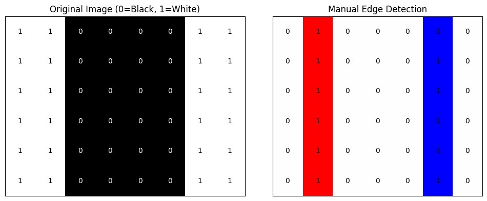
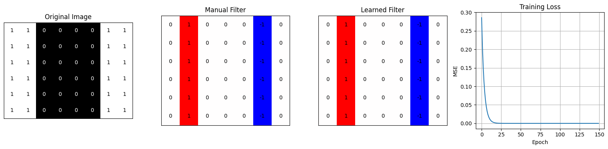
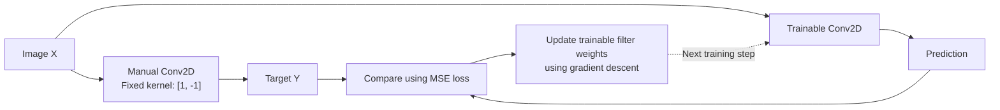

# Keras Edge Detection: Manual Filter vs. Learned Filter

> This demo is adapted from the [Dive into Deep Learning tutorial](https://d2l.ai/chapter_convolutional-neural-networks/conv-layer.html?utm_source=chatgpt.com), which provides implementations in PyTorch and TensorFlow; the example has been modified to use the Keras API.

---

## Manual Filter

This cell creates the black-and-white image and applies the manually defined kernel `[1, -1]` using Keras.

```python
import numpy as np
import tensorflow as tf
import matplotlib.pyplot as plt

# 1. Create image: 0 = black, 1 = white
X = np.ones((6, 8), dtype=np.float32)
X[:, 2:6] = 0

# 2. Define manual edge detection filter
K = np.array([[1.0, -1.0]], dtype=np.float32)

# 3. Create Keras convolutional layer
model = tf.keras.Sequential([
    tf.keras.Input(shape=(6, 8, 1)),
    tf.keras.layers.Conv2D(
        filters=1,
        kernel_size=(1, 2),
        use_bias=False,
        padding="valid"
    )
])

# Set manually defined filter weights
model.layers[0].set_weights([K.reshape(1, 2, 1, 1)])

# 4. Apply filter
Y = model(X.reshape(1, 6, 8, 1)).numpy()[0, :, :, 0]

print("Original image:\n", X)
print("\nManual filter:\n", K)
print("\nDetected edges:\n", Y)

# 5. Visualize
fig, axes = plt.subplots(1, 2, figsize=(10, 4))

axes[0].imshow(X, cmap="gray", vmin=0, vmax=1)
axes[0].set_title("Original Image (0=Black, 1=White)")

axes[1].imshow(Y, cmap="bwr", vmin=-1, vmax=1)
axes[1].set_title("Manual Edge Detection")

for ax, data in zip(axes, [X, Y]):
    for i in range(data.shape[0]):
        for j in range(data.shape[1]):
            value = data[i, j]
            color = "white" if ax == axes[0] and value == 0 else "black"
            ax.text(j, i, f"{value:.0f}",
                    ha="center", va="center", color=color)
    ax.set_xticks([])
    ax.set_yticks([])

plt.tight_layout()
plt.show()

```

This code creates a **convolutional layer in Keras**, inserts our manually designed filter `[1, -1]`, and applies it to an image to detect vertical edges.

Let's explain each part, including the tensor shapes and what happens mathematically.

1. Create the Keras convolutional model

```python
model = tf.keras.Sequential([
    tf.keras.Input(shape=(6, 8, 1)),
    tf.keras.layers.Conv2D(
        filters=1,
        kernel_size=(1, 2),
        use_bias=False,
        padding="valid"
    )
])
```




`tf.keras.Sequential([...])`

This creates a neural network in which layers are executed sequentially.

Our network is very simple:

```text
 Input             Conv2D              Output
 6 × 8 × 1   →   1 × 2 filter   →    6 × 7 × 1
```

There is only one convolutional layer. No pooling, no activation function, and no dense layers.

`tf.keras.Input(shape=(6, 8, 1))`

This tells Keras the dimensions of each input image.

| Dimension | Value | Meaning |
|---|---|---|
| Height | 6 | 6 rows of pixels |
| Width | 8 | 8 columns of pixels |
| Channels | 1 | Grayscale image |

Why one channel? Because every pixel has only one number, either `0` (black) or `1` (white).

`filters=1`

This means we use **one convolutional filter**, producing one output feature map.

If we wrote `filters=3`, Keras would create three different filters and produce three output channels.

`kernel_size=(1, 2)`

The filter has:

- Height = 1 pixel
- Width = 2 pixels

Its shape is:

$$
K=\begin{bmatrix}1 & -1\end{bmatrix}
$$

It compares two horizontally neighboring pixels to detect vertical boundaries.

`use_bias=False`

A convolution normally computes:

$$
Y = X * K + b
$$

Here, we disable the bias, so:

$$
Y = X * K
$$

Strictly, Keras computes cross-correlation, which slides the kernel without flipping it.

We disable the bias because we only want to study the effect of our manually defined filter.

`padding="valid"`

This means Keras does not add extra pixels around the image.

For our input:

$$
6\times8
$$

And kernel:

$$
1\times2
$$

The output dimensions are:

$$
H_{\mathrm{out}}=6-1+1=6
$$

$$
W_{\mathrm{out}}=8-2+1=7
$$

Therefore, the output has shape **6 × 7 × 1**.


2. Set the manual filter weights

```python
model.layers[0].set_weights([K.reshape(1, 2, 1, 1)])
```

This is probably the most important line.

We already defined:

```python
K = np.array([[1.0, -1.0]], dtype=np.float32)
```

Its original shape is:

```python
(1, 2)
```

But Keras `Conv2D` expects its weight tensor in this format:

$$
(\text{kernel height},\text{kernel width},
\text{input channels},\text{filters})
$$

For our example:

$$
(1,2,1,1)
$$

That's why we write:

```python
K.reshape(1, 2, 1, 1)
```

The filter's numerical values remain unchanged. Only its tensor dimensions change.

Then:

```python
model.layers[0]
```

selects our `Conv2D` layer, and:

```python
.set_weights([...])
```

replaces its initial weights with our manually defined values.

**Important:** We are not training the model here. We directly specify the weights.


3. Apply the filter to the image

```python
Y = model(X.reshape(1, 6, 8, 1)).numpy()[0, :, :, 0]
```

Let's divide it into smaller operations.

Step A — Reshape the input image

```python
X.reshape(1, 6, 8, 1)
```

Originally, `X` is a NumPy matrix with shape:

```python
(6, 8)
```

Keras expects a four-dimensional input:

$$
(\text{batch},\text{height},\text{width},\text{channels})
$$

So we reshape it to:

```python
(1, 6, 8, 1)
```

The first `1` means one image in the batch. The last `1` means one grayscale channel.

Step B — Run the convolution

```python
model(X.reshape(1, 6, 8, 1))
```

This slides the kernel across the image.

For example:

**What happens at a white-to-black boundary?**

```text
Image pixels       Kernel          Output
   [1, 0]     ×    [1, -1]    =      1
```

$$
(1\times1)+(0\times-1)=1
$$

At a black-to-white boundary:

$$
(0\times1)+(1\times-1)=-1
$$

When both pixels are the same:

$$
(1\times1)+(1\times-1)=0
$$

or

$$
(0\times1)+(0\times-1)=0
$$

That is how we detect the edges.

Step C — Convert the result into NumPy

```python
.numpy()
```

Keras returns a TensorFlow tensor. `.numpy()` converts it to a NumPy array, which is convenient for printing and visualization.

Step D — Remove the extra dimensions

```python
[0, :, :, 0]
```

The output from Keras has shape:

```python
(1, 6, 7, 1)
```

The indexing means:

| Index | Meaning |
|---|---|
| `0` | Select the first image |
| `:` | Select all 6 rows |
| `:` | Select all 7 columns |
| `0` | Select the first output channel |

So `Y` becomes an ordinary 2D matrix with shape:

```python
(6, 7)
```

4. Summary of all the shapes

| Operation | Tensor shape |
|---|---|
| Original image `X` | `(6, 8)` |
| Reshaped input | `(1, 6, 8, 1)` |
| Original kernel `K` | `(1, 2)` |
| Keras kernel | `(1, 2, 1, 1)` |
| Keras output | `(1, 6, 7, 1)` |
| Final output `Y` | `(6, 7)` |

The key concept is that **a convolutional layer can either use filters that we define manually or learn its filters through training**.

In this code, `set_weights()` supplies the filter directly. In your second cell, training adjusts the filter automatically until it produces approximately the same edge-detection result.


---

## Train Keras to learn the same filter

This cell independently creates the image and manual target, trains the Keras convolutional layer, and compares the learned filter with the manual one.

```python
import numpy as np
import tensorflow as tf
import matplotlib.pyplot as plt

tf.keras.utils.set_random_seed(42)

# 1. Create image independently
X = np.ones((6, 8), dtype=np.float32)
X[:, 2:6] = 0
X_batch = X.reshape(1, 6, 8, 1)

# 2. Create target using manual kernel
K = np.array([[1.0, -1.0]], dtype=np.float32)

manual_model = tf.keras.Sequential([
    tf.keras.Input(shape=(6, 8, 1)),
    tf.keras.layers.Conv2D(1, (1, 2), use_bias=False)
])
manual_model.layers[0].set_weights([K.reshape(1, 2, 1, 1)])

Y_target = manual_model(X_batch).numpy()

# 3. Create trainable Keras convolutional layer
model = tf.keras.Sequential([
    tf.keras.Input(shape=(6, 8, 1)),
    tf.keras.layers.Conv2D(
        filters=1,
        kernel_size=(1, 2),
        use_bias=False,
        kernel_initializer="zeros"
    )
])

model.compile(
    optimizer=tf.keras.optimizers.SGD(learning_rate=0.5),
    loss="mse"
)

# 4. Train the model
history = model.fit(
    X_batch,
    Y_target,
    epochs=150,
    verbose=0
)

# 5. Get learned filter and output
K_learned = model.layers[0].get_weights()[0].reshape(1, 2)
Y_pred = model(X_batch).numpy()[0, :, :, 0]
Y_manual = Y_target[0, :, :, 0]

print("Manual kernel:\n", K)
print("\nLearned kernel:\n", K_learned)
print("\nManual output:\n", Y_manual)
print("\nLearned output:\n", Y_pred)
print("\nOutputs match:",
      np.allclose(Y_manual, Y_pred, atol=1e-4))

# 6. Visualize
fig, axes = plt.subplots(1, 4, figsize=(16, 4))

images = [X, Y_manual, Y_pred]
titles = ["Original Image", "Manual Filter", "Learned Filter"]

for ax, data, title in zip(axes[:3], images, titles):
    if title == "Original Image":
        ax.imshow(data, cmap="gray", vmin=0, vmax=1)
    else:
        ax.imshow(data, cmap="bwr", vmin=-1, vmax=1)

    ax.set_title(title)
    ax.set_xticks([])
    ax.set_yticks([])

    for i in range(data.shape[0]):
        for j in range(data.shape[1]):
            value = data[i, j]
            color = "white" if title == "Original Image" and value == 0 else "black"
            ax.text(j, i, f"{value:.0f}",
                    ha="center", va="center", color=color)

axes[3].plot(history.history["loss"])
axes[3].set_title("Training Loss")
axes[3].set_xlabel("Epoch")
axes[3].set_ylabel("MSE")
axes[3].grid(True)

plt.tight_layout()
plt.show()

```

Results: 



This example shows how to use **TensorFlow/Keras** to learn the same edge-detection filter that we first define manually.

- The original image has **6 rows and 8 columns**.
- A `0` represents a **black** pixel, and a `1` represents a **white** pixel.
- The manual filter is `K = [[1, -1]]`.
- The Keras model starts with a filter containing zeros and learns to reproduce the manual filter's output.

The central idea is:



1. Import the libraries and set the seed

```python
import numpy as np
import tensorflow as tf
import matplotlib.pyplot as plt

tf.keras.utils.set_random_seed(42)
```

- **NumPy** creates our image and filter as arrays.
- **TensorFlow/Keras** creates and trains the convolutional layers.
- **Matplotlib** visualizes the original image, convolution outputs, and training loss.
- `set_random_seed(42)` makes results more reproducible (although this example explicitly initializes the learned filter to zeros).

2. Create the input image

```python
X = np.ones((6, 8), dtype=np.float32)
X[:, 2:6] = 0
X_batch = X.reshape(1, 6, 8, 1)
```

`np.ones((6, 8))` makes a 6 × 8 array filled with white pixels (`1`). `X[:, 2:6] = 0` changes columns 2, 3, 4, and 5 to black (`0`):

```text
X =
[[1. 1. 0. 0. 0. 0. 1. 1.]
 [1. 1. 0. 0. 0. 0. 1. 1.]
 [1. 1. 0. 0. 0. 0. 1. 1.]
 [1. 1. 0. 0. 0. 0. 1. 1.]
 [1. 1. 0. 0. 0. 0. 1. 1.]
 [1. 1. 0. 0. 0. 0. 1. 1.]]
```

`X.shape` is `(6, 8)`, but Keras `Conv2D` expects input in the form:

```text
(batch size, height, width, channels)
```

Therefore:

```python
X_batch = X.reshape(1, 6, 8, 1)
```

has shape `(1, 6, 8, 1)`: one image, six rows, eight columns, one grayscale channel.

3. Create the manual filter

```python
K = np.array([[1.0, -1.0]], dtype=np.float32)
```

The filter is a small array containing **one row and two columns**:

$$
K = \begin{bmatrix}1 & -1\end{bmatrix}
$$

It compares horizontally neighboring pixels:

| Two neighboring pixels | Calculation | Output |
|---|---|---|
| White → white (`1, 1`) | `1×1 + 1×(-1)` | `0` |
| White → black (`1, 0`) | `1×1 + 0×(-1)` | `+1` |
| Black → white (`0, 1`) | `0×1 + 1×(-1)` | `-1` |
| Black → black (`0, 0`) | `0×1 + 0×(-1)` | `0` |

Therefore, this filter responds to **vertical edges** (changes as we move horizontally), not to the interior of the rectangle.

4. Why do we use `K.reshape(1, 2, 1, 1)`?

This is an important line:

```python
manual_model.layers[0].set_weights([K.reshape(1, 2, 1, 1)])
```

#Step A — Look at the original kernel

```python
K = np.array([[1.0, -1.0]], dtype=np.float32)
print(K.shape)  # (1, 2)
```

The kernel is a **2D** NumPy array:

```text
[[ 1. -1. ]]
```

#Step B — Understand Keras' expected shape

For a Keras `Conv2D` layer, the kernel weights have **four dimensions**:

```text
(kernel_height, kernel_width, input_channels, output_filters)
```

In our model:

| Dimension | Value | Explanation |
|---|---:|---|
| Kernel height | `1` | One row |
| Kernel width | `2` | Two columns |
| Input channels | `1` | Grayscale image |
| Output filters | `1` | One edge-detection filter |

So Keras expects a weight array of shape **`(1, 2, 1, 1)`**, not `(1, 2)`.

#Step C — Reshape without changing the values

```python
K_4d = K.reshape(1, 2, 1, 1)
print(K_4d.shape)    # (1, 2, 1, 1)
print(K_4d)
```

The result is:

```text
[[[[ 1.]]

  [[-1.]]]]
```

The two values are **still `1` and `-1`**. The extra dimensions only tell Keras which input channel and which output filter the values belong to.

We can verify them with four indices:

```python
print(K_4d[0, 0, 0, 0])  #  1.0: first kernel position
print(K_4d[0, 1, 0, 0])  # -1.0: second kernel position
```

**Important distinction:** The first `1` in `(1, 2, 1, 1)` means **kernel height**, not batch size. Filters do **not** have a batch dimension. Batch size appears in the input shape `(1, 6, 8, 1)` instead.

#Step D — Why is there a list around `K.reshape(...)`?

```python
.set_weights([K.reshape(1, 2, 1, 1)])
```

`set_weights()` receives a **list of arrays**, one array for each weight tensor of the layer. Here, `use_bias=False`, so the layer has only **one** weight tensor: its convolution kernel.

If bias were enabled, the list would normally include an additional bias array.

#A tiny independent example you can run

```python
import numpy as np

K = np.array([[1.0, -1.0]], dtype=np.float32)
K_4d = K.reshape(1, 2, 1, 1)

print('Original K:', K)
print('Original shape:', K.shape)
print('Reshaped K:', K_4d)
print('Reshaped shape:', K_4d.shape)
print('First weight:', K_4d[0, 0, 0, 0])
print('Second weight:', K_4d[0, 1, 0, 0])
```

Expected output:

```text
Original K: [[ 1. -1.]]
Original shape: (1, 2)
Reshaped K: [[[[ 1.]]

  [[-1.]]]]
Reshaped shape: (1, 2, 1, 1)
First weight: 1.0
Second weight: -1.0
```

5. Create the manual Keras model and target

```python
manual_model = tf.keras.Sequential([
    tf.keras.Input(shape=(6, 8, 1)),
    tf.keras.layers.Conv2D(1, (1, 2), use_bias=False)
])

manual_model.layers[0].set_weights([K.reshape(1, 2, 1, 1)])

Y_target = manual_model(X_batch).numpy()
```

- `tf.keras.Input(shape=(6, 8, 1))` defines each image's size, excluding the batch dimension.
- `Conv2D(1, (1, 2), use_bias=False)` creates **one** filter with height 1 and width 2 and no bias.
- `set_weights(...)` **manually sets** the filter values to `[1, -1]`. This step does **not** train the model.
- `manual_model(X_batch)` applies that filter to the image to produce the **target output** the trainable model should learn.
- `.numpy()` converts the TensorFlow output to a NumPy array.

Because the kernel has width 2 and the default padding is `"valid"`, the output width is `8 - 2 + 1 = 7`; its height stays 6.

Thus `Y_target.shape` is `(1, 6, 7, 1)`. Each of its six rows is:

```text
[ 0.  1.  0.  0.  0. -1.  0.]
```

This output detects the two sides of the black rectangle.

6. Create a second model that will learn the kernel

```python
model = tf.keras.Sequential([
    tf.keras.Input(shape=(6, 8, 1)),
    tf.keras.layers.Conv2D(
        filters=1,
        kernel_size=(1, 2),
        use_bias=False,
        kernel_initializer="zeros"
    )
])
```

This second model has the **same layer structure** as the manual model, but we do **not** call `set_weights()` on it.

Instead, `kernel_initializer="zeros"` initializes the trainable filter to:

$$
K_{\mathrm{initial}} = \begin{bmatrix}0 & 0\end{bmatrix}
$$

Because this filter initially contains only zeros, its first prediction is an array of zeros. Training will change these two weights so that the predictions become close to `Y_target`.

7. Compile the trainable model

```python
model.compile(
    optimizer=tf.keras.optimizers.SGD(learning_rate=0.5),
    loss="mse"
)
```

- **SGD** means *stochastic gradient descent*: it updates the filter weights using gradients of the loss.
- `learning_rate=0.5` controls the size of each update in this small demonstration.
- `loss="mse"` stands for **mean squared error**. It measures how different the learned output is from the manual target:

$$
\mathrm{MSE}=\frac{1}{N}\sum_{i=1}^N(\widehat{Y}_i-Y_i)^2
$$

Here, `Y` is the manually generated target, and `\widehat{Y}` is the trainable model's output.

8. Train the convolutional layer

```python
history = model.fit(
    X_batch,
    Y_target,
    epochs=150,
    verbose=0
)
```

This supplies:

- **Input**: `X_batch`, the black-and-white image.
- **Target**: `Y_target`, the edge map created by the manual filter.
- **Epochs**: `150`, meaning 150 passes over the training input.
- **`verbose=0`**: no epoch-by-epoch logging is printed.

During training, Keras repeatedly:

1. Applies its current filter to `X_batch`.
2. Measures the MSE between its prediction and `Y_target`.
3. Computes gradients by backpropagation.
4. Adjusts the two filter weights using SGD.

Over time, it learns a kernel close to `[1, -1]`, and the training loss decreases.

**Note:** This demonstration trains on **one image and one target edge map**, not a large image dataset. It teaches the filter to reproduce this specific mapping; it is not an object classification model.

9. Inspect the learned weights and predictions

```python
K_learned = model.layers[0].get_weights()[0].reshape(1, 2)
Y_pred = model(X_batch).numpy()[0, :, :, 0]
Y_manual = Y_target[0, :, :, 0]
```

`get_weights()[0].reshape(1, 2)`

`get_weights()` returns a list of weight tensors. `[0]` selects the convolution kernel, whose shape is `(1, 2, 1, 1)`. `reshape(1, 2)` removes the extra singleton dimensions so we can view the learned filter in the same simple format as `K`.

The learned kernel should look approximately like:

```text
[[ 1. -1.]]
```

Why `[0, :, :, 0]`?

Both convolution outputs have four dimensions:

```text
(batch, height, width, output_channels) = (1, 6, 7, 1)
```

`[0, :, :, 0]` selects the **first image**, **all rows**, **all columns**, and **first output channel**, giving a 2D array of shape `(6, 7)` that is easier to print or plot.

10. Print and compare the results

```python
print("Manual kernel:\n", K)
print("\nLearned kernel:\n", K_learned)
print("\nManual output:\n", Y_manual)
print("\nLearned output:\n", Y_pred)
print("\nOutputs match:",
      np.allclose(Y_manual, Y_pred, atol=1e-4))
```

`np.allclose(...)` checks whether the two output arrays are **approximately equal**, using an absolute tolerance of `0.0001` (plus NumPy's default relative tolerance). Floating-point training results need not be mathematically identical to the manually computed values.

For this example, after successful training, the learned kernel should be close to `[1, -1]` and the comparison should return `True`.

11. Visualize all four results

```python
fig, axes = plt.subplots(1, 4, figsize=(16, 4))

images = [X, Y_manual, Y_pred]
titles = ["Original Image", "Manual Filter", "Learned Filter"]

for ax, data, title in zip(axes[:3], images, titles):
    if title == "Original Image":
        ax.imshow(data, cmap="gray", vmin=0, vmax=1)
    else:
        ax.imshow(data, cmap="bwr", vmin=-1, vmax=1)

    ax.set_title(title)
    ax.set_xticks([])
    ax.set_yticks([])

    for i in range(data.shape[0]):
        for j in range(data.shape[1]):
            value = data[i, j]
            color = "white" if title == "Original Image" and value == 0 else "black"
            ax.text(j, i, f"{value:.0f}",
                    ha="center", va="center", color=color)

axes[3].plot(history.history["loss"])
axes[3].set_title("Training Loss")
axes[3].set_xlabel("Epoch")
axes[3].set_ylabel("MSE")
axes[3].grid(True)

plt.tight_layout()
plt.show()
```

The four panels display:

1. **Original image** — black (`0`) rectangle on a white (`1`) background.
2. **Manual filter** — edge map produced with `[1, -1]`.
3. **Learned filter** — edge map produced by the trained convolutional layer.
4. **Training loss** — MSE across the training epochs, which should decrease toward zero.

The nested `for` loops write the rounded value of each pixel directly on the displayed matrices. `plt.tight_layout()` adjusts spacing so the plots fit comfortably.

12. Summary of shapes

| Variable | Shape | Meaning |
|---|---|---|
| `X` | `(6, 8)` | Original 2D image |
| `X_batch` | `(1, 6, 8, 1)` | Batched image for Keras |
| `K` | `(1, 2)` | Manually designed 2D filter |
| `K.reshape(1, 2, 1, 1)` | `(1, 2, 1, 1)` | Convolution kernel in Keras format |
| `Y_target` | `(1, 6, 7, 1)` | Target created by the manual filter |
| `model.layers[0].get_weights()[0]` | `(1, 2, 1, 1)` | Learned Keras weight tensor |
| `K_learned` | `(1, 2)` | Learned kernel, reshaped for display |
| `Y_pred` | `(6, 7)` | Learned output, reshaped for display |
| `Y_manual` | `(6, 7)` | Manual output, reshaped for display |

Key takeaway

The two uses of `reshape` serve different purposes:

```python
X.reshape(1, 6, 8, 1)   # Add batch and channel dimensions to the image
K.reshape(1, 2, 1, 1)   # Add input-channel and output-filter dimensions to the kernel
```

They do **not change the pixel or filter values**. They only change how the arrays are organized to match what Keras expects.

The manual model **uses weights that we provide**, while the trainable model **learns weights from the target edge map**. That is why their final outputs can become nearly identical.

----


## reference

- https://d2l.ai/chapter_convolutional-neural-networks/conv-layer.html