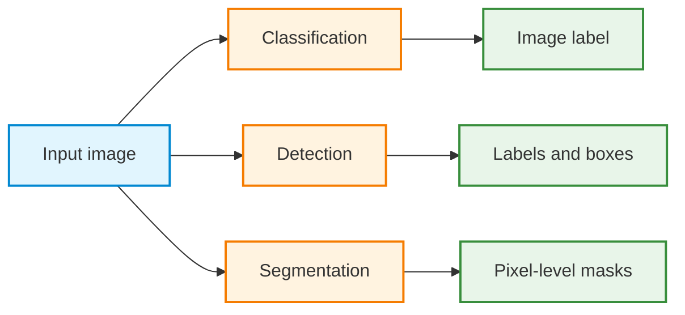
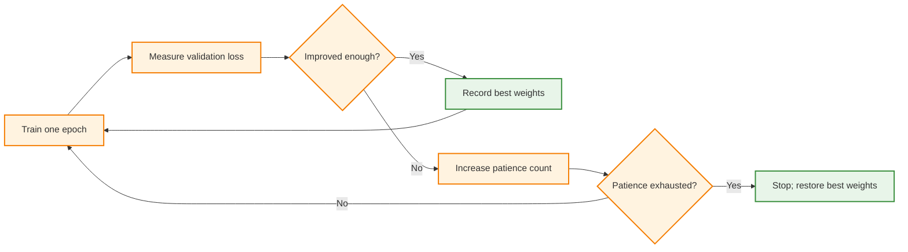
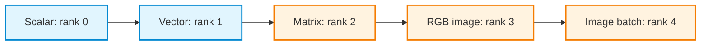
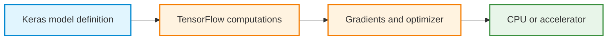
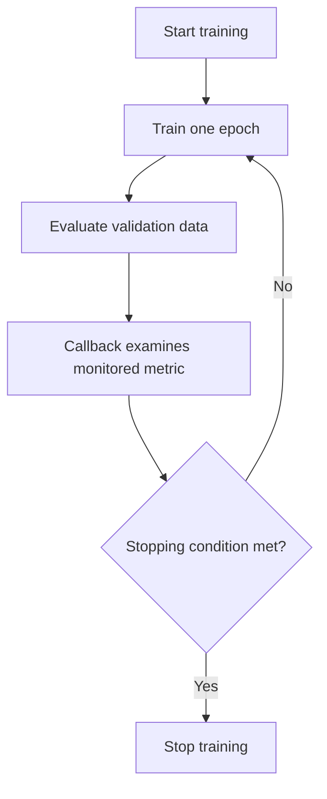

# Image Classification with Deep Neural Networks

## Purpose and learning outcomes

Computer vision aims to extract useful information from images. In image classification, a neural network receives pixel values and predicts a category. The same underlying learning process applies to handwritten digits, clothing, and color photographs, although the inputs and difficulty differ.

This chapter explains how to represent images numerically, construct a dense neural network, represent categorical targets, convert output scores into probabilities, train the model, and evaluate whether its predictions generalize. It also introduces tensors, TensorFlow, and three ways of defining models in Keras.

By the end of the chapter, the following distinctions should be clear:

1. **Image classification** predicts a label for an image; detection and segmentation produce additional location or pixel-level information.
2. **Grayscale** and **RGB** images differ in their number of channels, while both consist of numerical pixel values.
3. A **tensor's rank** counts its axes; its **shape** describes the length of each axis.
4. **Class identifiers** are category indices, not numerical measurements. Sparse integer targets and one-hot targets can represent the same class.
5. **Softmax** describes a mutually exclusive multiclass prediction; independent **sigmoids** are appropriate when multiple labels may be true at once.
6. **Backpropagation computes gradients**; an **optimizer uses gradients to update parameters**.
7. An **epoch** is one pass through the training set; a **training step** generally updates the model using one batch.
8. **Early stopping** monitors validation performance to limit overfitting; a low training loss alone does not establish generalization.
9. **Sequential**, **Functional**, and **model subclassing** are different model-construction interfaces, not different learning algorithms.

---

**Python setup:** [Python setup for Week 3](1-python_setup.md). The supplied examples use NumPy, Matplotlib, and TensorFlow/Keras. Architecture diagrams additionally require IPython, pydot, and the Graphviz executable. Dataset downloads require internet access on first use.

# Part I: From grayscale images to a trained classifier

## 1. Computer vision: different questions about an image

A computer vision task is defined partly by **what information the model must return**. An image may contain several objects, but different tasks require different kinds of predictions.

| Task | Question answered | Typical output |
|---|---|---|
| **Image classification** | What category best describes the image? | One class label, such as `cat` |
| **Classification and localization** | What is the main object, and where is it? | One class label and one bounding box |
| **Object detection** | Which objects are present, and where are they? | Multiple class labels and bounding boxes |
| **Semantic segmentation** | What category belongs to each pixel? | A class label for every pixel |
| **Instance segmentation** | Which pixels belong to each separate object? | Object identities and pixel-level masks |



**Classification is the focus of the models below.** A single-label classifier learns which of a fixed set of mutually exclusive categories best matches the entire image. It does not automatically draw boxes around objects or identify individual pixels belonging to them. An image can contain multiple objects even when its dataset supplies only one label; the *prediction task* is determined by the target annotations.

## 2. A grayscale image is a matrix of numbers

An ordinary 8-bit grayscale image stores one intensity per pixel. The intensity usually ranges from `0` (black) to `255` (white); intermediate values represent shades of gray.

A handwritten-digit image with 28 rows and 28 columns has shape `(28, 28)` and contains:

$$
28\times 28=784
$$

pixel intensities. They are arranged in a matrix rather than stored as a single numerical feature.

A small illustrative pixel patch might be:

$$
\begin{bmatrix}
0 & 0 & 0 & 0 \\
0 & 80 & 210 & 0 \\
0 & 190 & 255 & 30 \\
0 & 0 & 0 & 0
\end{bmatrix}
$$

The numbers describe brightness at *particular positions*. A value of `255` is not intrinsically the label of a digit; it simply describes a bright pixel at one location.

### Normalization

Pixel intensities are often converted from integers to floating-point values between `0` and `1`:

$$
 x_{\mathrm{normalized}}=\frac{x_{\mathrm{original}}}{255}
$$

For example, an intensity of `128` becomes approximately `0.502`. Normalization changes the numerical scale, not the visible content or target label. It commonly makes optimization easier, although normalization alone does not guarantee good training.

### Visual explanation: the image and its pixels

The code displays one **original MNIST** digit and an enlarged crop labeled with its exact pixel values. The crop is part of the image, not a different image or a simulated drawing. Run the supplied code, observe the plot, and explain how a matrix becomes a visible digit.

<details>
<summary>Python visualization: MNIST image and pixel intensities</summary>

```python
import numpy as np
import matplotlib.pyplot as plt
from tensorflow import keras

(x_train, y_train), _ = keras.datasets.mnist.load_data()
image = x_train[0]
label = int(y_train[0])
patch = image[10:18, 10:18]

fig, axes = plt.subplots(1, 2, figsize=(10, 4))
axes[0].imshow(image, cmap="gray", vmin=0, vmax=255)
axes[0].set_title(f"MNIST image: label {label}")
axes[0].axis("off")

axes[1].imshow(patch, cmap="gray", vmin=0, vmax=255)
axes[1].set_title("Central 8 × 8 pixel intensities")
axes[1].set_xticks(range(8))
axes[1].set_yticks(range(8))
for row in range(8):
    for col in range(8):
        value = int(patch[row, col])
        axes[1].text(col, row, str(value), ha="center", va="center",
                     fontsize=8, color="black" if value > 140 else "white")
plt.tight_layout()
plt.show()
```

</details>

**Interpretation:** Dark and bright areas emerge from the arrangement of intensity values. A single pixel contributes only local brightness; the spatial pattern makes the digit recognizable.

## 3. From pixels to a dense neural network

A **dense layer** computes weighted combinations of all values in its input. A **multilayer perceptron (MLP)** is a feedforward network built from layers of such operations. A sufficiently deep MLP is one type of deep neural network (DNN), although not every DNN is an MLP.

For a grayscale digit image, a simple DNN can use this architecture:


This is a **layer-level diagram**. Each dense layer contains many neurons and trainable connections; the diagram intentionally summarizes them rather than drawing every edge.

### Flatten: changing shape, not learning

`Flatten` reshapes a `(28, 28)` image into a vector of length `784`. It does not learn weights, change pixel values, or recognize patterns on its own. It changes the representation so that a dense layer can process the values.

### Dense layer: weighted sums and bias

For one unit in a dense layer, the preactivation score is:

$$
 z = \sum_{j=1}^{d}w_jx_j+b
$$

Here, $x_j$ is an input feature, $w_j$ is its trainable weight, $b$ is a trainable bias, and $d$ is the number of input features. In matrix form, a full dense layer computes:

$$
 \boldsymbol{z}=W\boldsymbol{x}+\boldsymbol{b}
$$

An **activation function** is then applied to the scores. A common hidden-layer choice is the rectified linear unit (ReLU):

$$
 \mathrm{ReLU}(z)=\max(0,z)
$$

Without nonlinear activations, a stack of dense linear transformations would still be equivalent to a single affine transformation. ReLU allows the network to represent more complex relationships.

### Counting parameters

A dense layer with $d$ input features and $h$ output units contains $d\times h$ weights and $h$ biases:

$$
\text{Trainable parameters}=dh+h
$$

For the example network:

| Operation | Output size | Trainable parameters |
|---|---:|---:|
| Flatten, `28 × 28 → 784` | 784 | 0 |
| Dense, `784 → 128` | 128 | `784 × 128 + 128 = 100,480` |
| Dense, `128 → 64` | 64 | `128 × 64 + 64 = 8,256` |
| Dense, `64 → 10` | 10 | `64 × 10 + 10 = 650` |
| **Total** | | **109,386** |

The ten output units correspond to ten possible classes, not to ten separate input pixels. Their interpretation depends on the output activation.

## 4. Class labels: identifiers, not measured quantities

A handwritten digit has one class label from `0` to `9`. A color-image dataset may use the same ten integers to identify categories such as `cat`, `ship`, and `truck`.

An integer class ID is **not** a measured quantity. For example, a label `7` does not imply greater importance, more severe error, or more information than a label `1`.

### Two correct representations of one class

Suppose the correct class is `3` in a ten-class problem.

**Sparse integer representation:**

```text
3
```

**One-hot representation:**

```text
[0, 0, 0, 1, 0, 0, 0, 0, 0, 0]
```

In the one-hot vector, the single `1` appears at position `3`, counting from index `0`. The vector makes the category interpretation visually explicit; the sparse integer stores the same information more compactly.

**Crucial distinction:** Using `3` as an index with **sparse categorical cross-entropy** does *not* tell the model that class `3` is numerically closer to class `2` than to class `8`. The loss uses the integer to select the predicted probability of the correct class.

Treating the same class IDs as continuous regression targets—for example, fitting them directly with mean squared error—*would* introduce artificial numerical distances and would generally be inappropriate for a nominal classification task.

One-hot encoding is therefore valuable for understanding and sometimes for implementation, but it is **not necessary to prevent ordinal meaning** when the correct categorical loss is used.

## 5. Logits, softmax, and sigmoid answer different questions

The last dense layer first produces raw scores called **logits**. Logits can be positive or negative and do not themselves have to add to one.

For ten mutually exclusive categories, **softmax** converts ten logits into ten nonnegative class probabilities that sum to one. Let $z_k$ be the logit for class $k$:

$$
 p_k=\frac{e^{z_k}}{\sum_{j=0}^{9}e^{z_j}}
$$

For the resulting probabilities:

$$
0<p_k<1,\qquad \sum_{k=0}^{9}p_k=1
$$

The predicted category is typically the index of the largest probability:

$$
\hat c=\arg\max_k p_k
$$

The winning probability expresses the model's relative preference among the supplied classes. It is not a guarantee that the prediction is correct or perfectly calibrated.

### Worked three-class example

Consider three illustrative logits `2`, `1`, and `0` rather than a full ten-class image problem. Their exponentials are approximately `7.389`, `2.718`, and `1`. Dividing each by their sum gives:

| Class | Logit | Softmax probability |
|---|---:|---:|
| A | 2 | 0.665 |
| B | 1 | 0.245 |
| C | 0 | 0.090 |

All three probabilities sum to approximately `1`. Increasing one class's logit, while holding the others fixed, changes the normalized probability distribution for *all* classes.

### Why ten independent sigmoids are different

The sigmoid activation maps a single score into a value between zero and one:

$$
\sigma(z)=\frac{1}{1+e^{-z}}
$$

If sigmoid is applied separately to ten outputs, the resulting values are **independent** and are not constrained to sum to one. For example, a multi-label image might have high scores for both `person` and `bicycle`.

| Task | Output design | Typical loss |
|---|---|---|
| Binary, one yes/no target | One sigmoid output | Binary cross-entropy |
| Multiclass, exactly one category | One softmax distribution over classes | Categorical cross-entropy |
| Multilabel, several categories may apply | One independent sigmoid per category | Binary cross-entropy across labels |

The key decision is **whether the target categories are mutually exclusive**, not whether the labels happen to be stored as one-hot vectors.

### Visual explanation: scores and probability normalization

The following figure computes the three-class example using NumPy. Run the supplied code and compare the probabilities produced by softmax with those produced by independent sigmoids.

<details>
<summary>Python visualization: Softmax versus independent sigmoids</summary>

```python
import numpy as np
import matplotlib.pyplot as plt

logits = np.array([2.0, 1.0, 0.0])
shifted = logits - logits.max()  # Numerical stability
exp_scores = np.exp(shifted)
softmax = exp_scores / exp_scores.sum()
sigmoid = 1.0 / (1.0 + np.exp(-logits))

x = np.arange(3)
fig, ax = plt.subplots(figsize=(8, 4))
ax.bar(x - 0.18, softmax, width=0.36, label="Softmax")
ax.bar(x + 0.18, sigmoid, width=0.36, label="Independent sigmoid")
ax.set_xticks(x, ["A", "B", "C"])
ax.set_ylabel("Output value")
ax.set_ylim(0, 1)
ax.set_title("Same logits, different output interpretations")
ax.legend()
plt.tight_layout()
plt.show()
print("Softmax sum:", softmax.sum())
print("Independent sigmoid sum:", sigmoid.sum())
```

</details>

## 6. Cross-entropy: how the correct-class probability affects loss

A classifier must be trained to assign high probability to the correct class. **Cross-entropy** is a loss function that penalizes assigning low probability to the observed target.

For a one-hot target vector $\boldsymbol{y}$ and predicted softmax probabilities $\boldsymbol{p}$, categorical cross-entropy is:

$$
L=-\sum_{k=0}^{C-1}y_k\ln(p_k)
$$

Here, $C$ is the number of classes. Because a one-hot target has a `1` at only the correct class $c$, every other term is zero:

$$
L=-\ln(p_c)
$$

**Sparse categorical cross-entropy** computes the same expression directly from the integer target $c$:

$$
L_{\mathrm{sparse}}=-\ln(p_c)
$$

For a sample whose correct class has predicted probability `0.7`, either encoding produces approximately:

$$
L=-\ln(0.7)\approx0.357
$$

The same probability of the correct category yields the same loss, regardless of whether its class index is `1`, `3`, or `9`. The integer ID does **not** multiply the loss.

For an illustration of how confidence affects loss:

| Probability assigned to the correct class | Cross-entropy loss |
|---:|---:|
| 0.90 | 0.105 |
| 0.70 | 0.357 |
| 0.10 | 2.303 |

A confident wrong classification receives a large penalty. In practical software, cross-entropy can be computed **directly from logits** for numerical stability. In that case, the loss must be configured to expect logits, rather than probabilities already passed through softmax.

### Matching label format, output activation, and loss

| Target format | Model output | Keras loss configuration |
|---|---|---|
| Integer class ID | Softmax probabilities | `sparse_categorical_crossentropy` |
| One-hot class vector | Softmax probabilities | `categorical_crossentropy` |
| Binary 0/1 target | Sigmoid probability | `binary_crossentropy` |
| Multiple independent 0/1 labels | Independent sigmoid probabilities | `binary_crossentropy` |

These combinations refer to *probability outputs*. When training with **raw logits**, use an appropriate cross-entropy loss configured with `from_logits=True` instead, and do **not** apply softmax or sigmoid in the final model layer for that loss calculation.

## 7. Training: prediction, loss, gradients, and updates

Training adjusts the model's weights and biases so that its predictions better match the training labels. The same conceptual cycle applies to small hand-calculated networks and large image classifiers:


**Forward pass:** The model computes activations, scores, and a prediction with the *current* parameter values. No parameters change during the forward pass.

**Loss:** A numerical function measures the discrepancy between predictions and targets. The loss does not, by itself, describe how every weight should change.

**Backpropagation:** By repeatedly applying the chain rule, the model computes derivatives of the loss with respect to trainable weights and biases. These derivatives are called **gradients**. Backpropagation computes gradients; it is not itself the parameter-update operation.

**Optimizer update:** An optimizer uses those gradients and an update rule to change parameters. For ordinary gradient descent:

$$
\theta_{\mathrm{new}}=\theta_{\mathrm{old}}-\eta\frac{\partial L}{\partial\theta}
$$

Here, $\theta$ is one trainable parameter and $\eta$ is the learning rate. A positive derivative indicates that increasing the parameter slightly would increase the loss locally, so gradient descent moves in the opposite direction. A large learning rate can overshoot; decreasing the loss on every step is not guaranteed.

### Connecting multiclass loss to gradients

For a softmax output trained with categorical cross-entropy, the derivative of the single-example loss with respect to an output logit $z_k$ simplifies to:

$$
\frac{\partial L}{\partial z_k}=p_k-y_k
$$

This result combines the derivatives of softmax and cross-entropy through the chain rule. It compares the predicted probability with the target indicator for each category.

For the earlier three-class example with class A as the correct category:

- Predicted probabilities: approximately `[0.665, 0.245, 0.090]`.
- One-hot target: `[1, 0, 0]`.
- Gradient with respect to the three output logits: approximately `[-0.335, 0.245, 0.090]`.

The negative first component indicates that increasing the correct class's logit would reduce loss locally. Positive components for the other classes indicate that decreasing those logits would help. Backpropagation continues through the earlier layers to calculate gradients for their weights and biases.

**A gradient is a local slope, not a guarantee of reaching the globally best model.** Optimization and generalization must be assessed separately.

## 8. Epochs, batches, and parameter updates

**One epoch** is one pass through the training examples selected for optimization. That does not necessarily mean one parameter update.

A **batch** is the group of training examples used to calculate one update. The amount of data used per update determines the training regime:

| Regime | Examples used for one update | Updates for 48,000 examples in one epoch |
|---|---|---:|
| Full-batch gradient descent | All 48,000 | 1 |
| Pure stochastic gradient descent (SGD) | 1 | 48,000 |
| Mini-batch training, batch size 64 | 64 | 750 |

For $N$ training examples and a batch size $B$, the number of steps per epoch is typically:

$$
\text{Steps per epoch}=\left\lceil\frac{N}{B}\right\rceil
$$

The final batch may be smaller when $N$ is not divisible by $B$. The example of 48,000 examples arises if a dataset of 60,000 training images is split into 48,000 training and 12,000 validation examples.


In strict terminology, **pure SGD** updates after each individual example. Many deep-learning discussions use “SGD” informally to include **mini-batch SGD**; the batch size clarifies the actual behavior.

**Optimizer choice is a separate issue from batch size.** For example, `Adam` uses a different update rule from ordinary SGD but still typically receives gradients computed from mini-batches. Calling an Adam training run “full-batch gradient descent” merely because it uses epochs would be incorrect.

### Training, validation, and testing

These dataset partitions have distinct purposes:

- **Training set:** Used to compute gradients and adjust model parameters.
- **Validation set:** Used to examine generalization during development and to make decisions such as when to stop training.
- **Test set:** Held out until final evaluation to estimate performance on unseen examples.

If a validation subset is removed from the original training data, the number of examples used for parameter updates is reduced accordingly. The test set should not be repeatedly used to select the best architecture, epoch, or hyperparameters, because doing so makes the reported test result less independent.

## 9. Underfitting, overfitting, and regularization

A model must capture useful patterns without relying excessively on details of the training examples.

**Underfitting** occurs when the model fails to learn the relevant patterns well; both training and validation performance may be poor.

**Overfitting** occurs when the model increasingly fits training-specific details that do not transfer well to unseen examples. Training loss can continue to decrease while validation loss increases. Overfitting is not established solely by having many parameters; it is identified through generalization behavior.

### Early stopping

Early stopping is a regularization strategy that monitors a validation metric (often `val_loss`) and stops training when sufficient improvement has not occurred for a configured number of epochs.



The restoration step is included when `restore_best_weights=True` is configured. With a **patience** setting, stopping usually does not occur immediately at the first increase in validation loss; the callback allows subsequent epochs to improve again.

**Early stopping is not a guarantee of preventing every kind of overfitting.** Validation outcomes vary with the split, random initialization, sample size, and noise. The best observed validation epoch may also differ from the best epoch on truly unseen data.

### Optional illustrative learning curves

The next plot is a **synthetic illustration**, not the result of fitting a model. It shows one possible pattern: training loss decreases throughout, while validation loss first decreases and then rises. The vertical line marks the lowest displayed validation loss.

<details>
<summary>Python visualization: Illustrative training and validation loss</summary>

```python
import numpy as np
import matplotlib.pyplot as plt

epochs = np.arange(1, 31)
training_loss = 0.85 * np.exp(-epochs / 11.0) + 0.07
validation_loss = 0.70 * np.exp(-epochs / 8.0) + 0.13
validation_loss += 0.0017 * np.maximum(epochs - 12, 0) ** 1.8
best_epoch = int(np.argmin(validation_loss)) + 1

fig, ax = plt.subplots(figsize=(8, 4))
ax.plot(epochs, training_loss, label="Training loss")
ax.plot(epochs, validation_loss, label="Validation loss")
ax.axvline(best_epoch, linestyle="--", color="gray",
           label=f"Lowest validation loss: epoch {best_epoch}")
ax.set(xlabel="Epoch", ylabel="Loss",
       title="Illustrative learning curves (not model results)")
ax.legend()
plt.tight_layout()
plt.show()
```

</details>

### Dropout: the central idea

Dropout is another regularization technique. During training, it randomly sets a selected fraction of layer outputs to zero. The set of disabled outputs changes between training steps, discouraging excessive reliance on specific intermediate units. During inference, dropout is not randomly applied. Modern implementations commonly rescale activations during training so that no additional inference-time correction is needed.

Dropout and early stopping address generalization in different ways. Early stopping changes **how long training continues**; dropout changes **how the network is exposed to intermediate features during training**. Neither replaces careful validation or evaluation.

---

# Part II: Color images, tensors, and the software used to train models

## 10. RGB images have three channels

A standard 8-bit RGB image stores **three numbers per pixel**: red, green, and blue intensities. Each channel generally has values from `0` to `255`.

An image with height $H$ and width $W$ has the channel-last shape:

$$
(H,W,3)
$$

A CIFAR-10 image has 32 rows and 32 columns, so its shape is `(32, 32, 3)`. The total number of numerical pixel values is:

$$
32\times32\times3=3072
$$

These are **pixel values**, not 3,072 independently annotated objects or color categories.

For one pixel, the color might be represented as `[200, 40, 30]`, meaning a strong red component and much weaker green and blue components. The visible color results from combining the channels.

### RGB channels versus grayscale conversion

Splitting a color image into three channels reveals its red, green, and blue intensity matrices. Recombining those matrices in their original order recreates the original RGB values exactly.

Converting RGB to grayscale is **different**: it produces one brightness value per pixel and generally discards color information. A simple, common luminance approximation is:

$$
Y\approx0.299R+0.587G+0.114B
$$

This weighted expression is intended for typical gamma-encoded RGB values as an approximation to perceived brightness; it is not a universal color-science conversion for every RGB encoding.

### Visual explanation: RGB decomposition and grayscale

The following code displays an original CIFAR-10 image, its three isolated color channels, and a grayscale approximation. Run the supplied code and compare the results. Isolating a channel is not the same operation as converting to grayscale.

<details>
<summary>Python visualization: CIFAR-10 RGB channels and grayscale</summary>

```python
import numpy as np
import matplotlib.pyplot as plt
from tensorflow import keras

(x_train, y_train), _ = keras.datasets.cifar10.load_data()
image = x_train[0]
channel_names = ["Red channel", "Green channel", "Blue channel"]

isolated_images = []
for index in range(3):
    isolated = np.zeros_like(image)
    isolated[:, :, index] = image[:, :, index]
    isolated_images.append(isolated)

gray = 0.299 * image[:, :, 0] + 0.587 * image[:, :, 1] + 0.114 * image[:, :, 2]

fig, axes = plt.subplots(1, 5, figsize=(15, 3))
axes[0].imshow(image)
axes[0].set_title("Original RGB")
for index, isolated in enumerate(isolated_images):
    axes[index + 1].imshow(isolated)
    axes[index + 1].set_title(channel_names[index])
axes[4].imshow(gray, cmap="gray", vmin=0, vmax=255)
axes[4].set_title("Grayscale approximation")
for ax in axes:
    ax.axis("off")
plt.tight_layout()
plt.show()

reconstructed = np.stack([image[:, :, 0], image[:, :, 1], image[:, :, 2]], axis=-1)
print("Original shape:", image.shape)
print("Reconstructed shape:", reconstructed.shape)
print("Reconstruction matches:", np.array_equal(image, reconstructed))
```

</details>

## 11. Tensors: rank, shape, axes, and batches

A **tensor** in a deep-learning framework is a multidimensional array of values. It generalizes familiar mathematical objects such as scalars, vectors, and matrices. The **rank** is the number of axes (dimensions), while the **shape** lists the number of elements along each axis.

| Object | Example shape | Rank | Interpretation |
|---|---|---:|---|
| Scalar | `()` | 0 | One loss value |
| Vector | `(10,)` | 1 | Ten class probabilities |
| Matrix | `(28, 28)` | 2 | One grayscale digit image |
| Grayscale image with explicit channel | `(28, 28, 1)` | 3 | Height, width, channel |
| RGB image | `(32, 32, 3)` | 3 | Height, width, color channels |
| Batch of RGB images | `(64, 32, 32, 3)` | 4 | Batch, height, width, channels |

**Rank is not the same as shape.** A `(28, 28)` matrix and a `(3, 3)` matrix both have rank 2 despite having different sizes. Here “rank” means number of tensor axes, not the rank of a matrix from linear algebra.



### Why the batch dimension appears

Suppose a model processes 64 CIFAR-10 images together. Each image has shape `(32, 32, 3)`, and the batch has shape `(64, 32, 32, 3)`. Axis 0 identifies which image is being processed; axes 1 and 2 locate pixels; axis 3 specifies their RGB channels.

A common TensorFlow/Keras image representation places channels last. Other frameworks or configurations can use a channels-first convention. The number and meaning of axes must be understood from the specific model and input pipeline.

A flatten operation changes one CIFAR-10 image from `(32, 32, 3)` to `(3072,)`. Applied to a batch of 64 images, it produces `(64, 3072)`—the **batch axis is preserved**.

### Small executable tensor example

```python
import numpy as np
import tensorflow as tf

scalar = tf.constant(3.0)
vector = tf.constant([0.2, 0.3, 0.5])
image = tf.zeros((32, 32, 3), dtype=tf.float32)
batch = tf.zeros((64, 32, 32, 3), dtype=tf.float32)

for name, value in [("scalar", scalar), ("vector", vector),
                    ("image", image), ("batch", batch)]:
    print(name, "shape:", value.shape, "rank:", len(value.shape))

flattened = tf.reshape(batch, (64, 3072))
print("Flattened batch shape:", flattened.shape)
```

## 12. Comparing grayscale and color classification

Three small, commonly used image datasets illustrate the range of input representations:

| Dataset | Images | Image shape | Categories |
|---|---:|---|---:|
| Original MNIST | 70,000 | `(28, 28)` grayscale | 10 handwritten digits |
| Fashion-MNIST | 70,000 | `(28, 28)` grayscale | 10 clothing types |
| CIFAR-10 | 60,000 | `(32, 32, 3)` RGB | 10 object categories |

The standard splits are 60,000 training and 10,000 test examples for both MNIST datasets, and 50,000 training and 10,000 test examples for CIFAR-10. A separate validation subset may be taken from the training data.

The classification principles stay the same: ten mutually exclusive labels, one softmax distribution, and categorical cross-entropy. What changes is the input representation and the visual complexity of the categories.

### Comparing dense-network parameter counts

If the same dense architecture uses 128 and 64 hidden units, the first dense layer becomes much larger when moving from grayscale digits to CIFAR-10:

| Input | Flattened features | First dense layer parameters | Total model parameters |
|---|---:|---:|---:|
| Grayscale `28 × 28` | 784 | 100,480 | 109,386 |
| RGB `32 × 32 × 3` | 3,072 | 393,344 | 402,250 |

A larger number of raw inputs does not by itself mean that color classification will be more accurate. CIFAR-10 includes more varied visual structure, changes of pose, background objects, and variations in lighting. A flattened dense network also does not explicitly preserve the neighborhood relationships among nearby pixels.

This limitation motivates architectures such as convolutional neural networks, which exploit local spatial relationships. Their internal operations are a separate topic; the present model remains a dense network for a controlled comparison.

## 13. TensorFlow and Keras: computation versus model-building interface

**TensorFlow** is a framework for manipulating tensors, differentiating computations, and executing numerical operations on supported hardware such as CPUs and GPUs. Automatic differentiation calculates the derivatives required by learning algorithms.

**Keras** provides a high-level interface for building and training models. A model contains layers and parameters; its training process can be configured with a loss function, an optimizer, and metrics.

Keras 3 can operate with multiple supported backends, including TensorFlow, JAX, and PyTorch. The examples here consistently use **`tf.keras` with the TensorFlow backend**, as in many introductory TensorFlow courses.



A typical supervised training workflow includes:

| Method | Responsibility |
|---|---|
| `model.summary()` | Shows model layers, shapes, and parameter counts |
| `model.compile(...)` | Selects optimizer, loss, and evaluation metrics |
| `model.fit(...)` | Runs the training process over batches and epochs |
| `model.evaluate(...)` | Computes loss and metrics on supplied data |
| `model.predict(...)` | Produces model outputs for supplied inputs |
| `keras.utils.plot_model(...)` | Creates a diagram of supported model architectures; requires Graphviz and pydot |

`fit()` orchestrates forward computation, loss calculation, automatic differentiation, and optimizer updates. It does **not** mean that backpropagation and the optimizer are the same operation.

### Three Keras ways to define a model

The examples below implement the **same conceptual model**:

- Input image: `(28, 28)`.
- Flatten: `784` features.
- Hidden layer 1: `128` units, ReLU.
- Hidden layer 2: `64` units, ReLU.
- Output layer: `10` softmax probabilities.

All three implementations create an architecture with **109,386 trainable parameters**. Individual predictions can differ because independently initialized models begin with different parameter values. Their API choice does not inherently change the mathematical task.

#### A. Sequential API: simplest linear stack

`Sequential` is appropriate when layers form a single straightforward path from one input to one output. Layers are written in the order in which data flows through the model. It is compact and readable, but cannot directly express arbitrary branching or shared-layer graphs.

<details>
<summary>Python example: Sequential API</summary>

```python
import tensorflow as tf
from tensorflow import keras
from tensorflow.keras import layers

sequential_model = keras.Sequential([
    keras.Input(shape=(28, 28)),
    layers.Flatten(),
    layers.Dense(128, activation="relu"),
    layers.Dense(64, activation="relu"),
    layers.Dense(10, activation="softmax"),
], name="sequential_digit_classifier")

sequential_model.summary()
```

</details>

#### B. Functional API: an explicit graph of layers

The Functional API connects symbolic input and output tensors. It can represent a simple chain like `Sequential`, but also supports architectures with multiple inputs, multiple outputs, branches, and shared layers.

<details>
<summary>Python example: Functional API</summary>

```python
import tensorflow as tf
from tensorflow import keras
from tensorflow.keras import layers

inputs = keras.Input(shape=(28, 28), name="image")
x = layers.Flatten()(inputs)
x = layers.Dense(128, activation="relu")(x)
x = layers.Dense(64, activation="relu")(x)
outputs = layers.Dense(10, activation="softmax")(x)

functional_model = keras.Model(
    inputs=inputs,
    outputs=outputs,
    name="functional_digit_classifier",
)
functional_model.summary()
```

</details>

#### C. Model subclassing: explicitly defined forward computation

With model subclassing, a Python class defines layers in its constructor and implements the **forward pass** in a `call()` method. This is the most flexible interface for unusual behavior or dynamic computation, but requires more code and often more care with debugging, serialization, and architecture inspection.

<details>
<summary>Python example: Model subclassing</summary>

```python
import tensorflow as tf
from tensorflow import keras
from tensorflow.keras import layers

class DigitClassifier(keras.Model):
    def __init__(self):
        super().__init__(name="subclassed_digit_classifier")
        self.flatten = layers.Flatten()
        self.hidden1 = layers.Dense(128, activation="relu")
        self.hidden2 = layers.Dense(64, activation="relu")
        self.classifier = layers.Dense(10, activation="softmax")

    def call(self, inputs, training=False):
        x = self.flatten(inputs)
        x = self.hidden1(x)
        x = self.hidden2(x)
        return self.classifier(x)

subclassed_model = DigitClassifier()
_ = subclassed_model(tf.zeros((1, 28, 28)))  # Build by calling once
subclassed_model.summary()
```

</details>

**Comparison:**

| Property | Sequential | Functional | Subclassing |
|---|---|---|---|
| Model definition | Ordered layer list | Connected symbolic tensors | Python class and `call()` |
| Simple single-path model | Excellent | Excellent | Possible, but verbose |
| Multiple branches or inputs | Not directly | Supported | Supported |
| Arbitrary dynamic Python control flow | Limited | Limited by graph definition | Most flexible |
| Architecture visualization | Usually straightforward | Usually straightforward | More limited; internal call logic is not always represented |
| Typical reason to choose | Simplest architecture | Explicit graph and flexibility | Custom or dynamic forward behavior |

After construction, each model can normally use the same `compile()`, `fit()`, `evaluate()`, and `predict()` interfaces. For a standard single-path image classifier, **Sequential or Functional** is usually preferable to subclassing; subclassing is most valuable when its extra flexibility is actually required.

### Common training configuration

The following example assumes that one of the three model objects above has been created. It uses **softmax outputs with sparse integer labels**:

```python
model = sequential_model  # Alternatively: functional_model or subclassed_model
model.compile(
    optimizer=keras.optimizers.Adam(learning_rate=0.001),
    loss=keras.losses.SparseCategoricalCrossentropy(),
    metrics=["accuracy"],
)
```

To train with early stopping, a standard callback is:

```python
early_stopping = keras.callbacks.EarlyStopping(
    monitor="val_loss",
    patience=3,
    restore_best_weights=True,
)

# After providing normalized x_train, integer y_train,
# and a held-out validation split:
# history = model.fit(x_train, y_train, batch_size=64,
#                     epochs=30, validation_split=0.2,
#                     callbacks=[early_stopping])
```

`patience=3` allows three consecutive epochs without a qualifying improvement before stopping, subject to callback settings. It does not guarantee exactly three training epochs or that the last epoch has the best weights.


<details>
<summary><b>Keras Callbacks: Controlling the Training Process</b></summary>

**What is a callback?**

Training a neural network involves repeating the same process over many epochs: computing predictions, calculating loss, computing gradients, and updating model parameters.

However, training does not always need to continue for the maximum number of epochs. It may be useful to monitor validation performance and stop training when the model is no longer improving.

A **callback** is an object that allows Keras to execute additional actions automatically at specific points during training.

For example, a callback can:

- Monitor training or validation metrics.
- Stop training when validation performance stops improving.
- Save model weights during training.
- Adjust the learning rate.

Callbacks can act at events such as the beginning or end of training, the beginning or end of an epoch, or the beginning or end of a batch.

**How callbacks interact with training**



The callback does not replace the optimizer or backpropagation. It controls or monitors aspects of the training process.

**EarlyStopping: A callback for regularization**

A neural network may continue improving on training data while its performance on unseen data stops improving.

**Early stopping** is a regularization technique that limits training based on validation performance.

Keras provides an `EarlyStopping` callback:

```python
early_stop = keras.callbacks.EarlyStopping(
    monitor="val_loss",
    mode="min",
    min_delta=0.001,
    patience=3,
    restore_best_weights=True
)
```

**Understanding the parameters**

| Parameter | Meaning |
|---|---|
| `monitor="val_loss"` | Monitor the loss calculated on validation data at the end of each epoch |
| `mode="min"` | Lower values indicate improvement |
| `min_delta=0.001` | A decrease must exceed 0.001 to count as an improvement |
| `patience=3` | Allow three consecutive epochs without sufficient improvement |
| `restore_best_weights=True` | Restore weights from the epoch with the best monitored value |

The parameter `min_delta` helps prevent very small fluctuations from repeatedly resetting the patience counter.

Setting `restore_best_weights=True` is important because the final training epoch may not be the epoch with the best validation performance.

**Example: Tracking validation loss**

Consider a model trained with `patience=2`, `min_delta=0`, and `mode="min"`.

| Epoch | Validation loss | Interpretation |
|---|---:|---|
| 1 | 0.50 | Initial best |
| 2 | 0.42 | Improvement |
| 3 | 0.38 | Improvement |
| 4 | 0.40 | No improvement: first waiting epoch |
| 5 | 0.43 | No improvement: second waiting epoch |

Training stops after epoch 5, provided no other stopping condition applies.

With `restore_best_weights=True`, the model restores the weights saved at epoch 3, where validation loss was lowest.

**Important distinction:** Early stopping does not necessarily wait until validation loss begins increasing. Training can also stop when validation loss remains unchanged or improves by less than `min_delta`.

**Using the callback with model.fit()**

The callback is passed to `model.fit()` through the `callbacks` argument.

```python
history = model.fit(
    x_train,
    y_train,
    epochs=30,
    batch_size=64,
    validation_split=0.2,
    callbacks=[early_stop]
)
```

The value `epochs=30` represents the maximum number of epochs. Early stopping may terminate training sooner.

The validation set is used to monitor performance and determine when training should stop. The test set should remain separate and be used for final evaluation.

**Python demonstration: Early stopping on MNIST**

The following complete example trains a dense neural network and displays training and validation loss.


Run the supplied Python code: Early stopping and validation loss

```python
import numpy as np
import matplotlib.pyplot as plt
from tensorflow import keras
from tensorflow.keras import layers

# Load and normalize MNIST
(x_train, y_train), (x_test, y_test) = keras.datasets.mnist.load_data()

x_train = x_train.astype("float32") / 255.0
x_test = x_test.astype("float32") / 255.0

# Define the neural network
model = keras.Sequential([
    keras.Input(shape=(28, 28)),
    layers.Flatten(),
    layers.Dense(128, activation="relu"),
    layers.Dense(64, activation="relu"),
    layers.Dense(10, activation="softmax")
])

model.compile(
    optimizer="adam",
    loss="sparse_categorical_crossentropy",
    metrics=["accuracy"]
)

# Define the callback
early_stop = keras.callbacks.EarlyStopping(
    monitor="val_loss",
    mode="min",
    min_delta=0.001,
    patience=3,
    restore_best_weights=True,
    verbose=1
)

# Train with early stopping
history = model.fit(
    x_train,
    y_train,
    validation_split=0.2,
    epochs=30,
    batch_size=64,
    callbacks=[early_stop],
    verbose=1
)

# Examine training history
epochs_run = len(history.history["loss"])
best_epoch = np.argmin(history.history["val_loss"]) + 1

print("Epochs completed:", epochs_run)
print("Best validation-loss epoch:", best_epoch)
print("Minimum validation loss:",
      min(history.history["val_loss"]))

# Plot the observed training history
epochs = np.arange(1, epochs_run + 1)

plt.figure(figsize=(9, 5))

plt.plot(
    epochs,
    history.history["loss"],
    label="Training loss"
)

plt.plot(
    epochs,
    history.history["val_loss"],
    label="Validation loss"
)

plt.axvline(
    best_epoch,
    linestyle="--",
    label="Lowest recorded validation loss"
)

plt.xlabel("Epoch")
plt.ylabel("Loss")
plt.title("Training and Validation Loss")
plt.legend()
plt.grid(alpha=0.3)
plt.tight_layout()
plt.show()
```

The number of epochs completed depends on the observed validation losses. Early stopping is not guaranteed to activate before the maximum epoch count.

The lowest plotted validation loss identifies the best recorded epoch. The callback's `min_delta` determines which improvements are sufficient to reset its patience counter, so the callback's internal improvement tracking may not always match the absolute minimum marked on the plot.

**Check understanding**

**Question 1:** Why is validation loss usually more appropriate than training loss for early stopping?

Training loss measures performance on examples used to update the model.

A sufficiently flexible network may continue reducing training loss even when its ability to generalize stops improving.

Validation loss provides information about performance on held-out examples. Monitoring it helps identify when continued training is no longer producing meaningful improvements in generalization.

**Question 2:** Does `patience=3` mean the model always trains for three epochs?

No. The patience parameter counts consecutive monitored epochs without sufficient improvement.

Every improvement resets the waiting counter.

For example, a model might improve for eight epochs and then complete three additional epochs without sufficient improvement. In that situation, training can stop after epoch 11.

**Other useful Keras callbacks**

Keras also provides callbacks such as:

- `ModelCheckpoint`: Save model weights or the complete model during training.
- `ReduceLROnPlateau`: Reduce the learning rate when a monitored metric stops improving.
- `CSVLogger`: Record training metrics in a CSV file.

Early stopping is the primary callback considered here because it connects training control directly to regularization and generalization.

</details>


### Architecture plot: what it can and cannot show

`plot_model()` draws a graph of layers and tensor connections for supported models. It is **not** a visualization of every individual connection among 784 input features and hundreds of hidden units. For subclassed models, the internal `call()` structure may not be available as a static graph for this utility.

<details>
<summary>Python visualization: Keras architecture plot</summary>

```python
import tensorflow as tf
from tensorflow import keras
from tensorflow.keras import layers

inputs = keras.Input(shape=(28, 28), name="image")
x = layers.Flatten()(inputs)
x = layers.Dense(128, activation="relu")(x)
x = layers.Dense(64, activation="relu")(x)
outputs = layers.Dense(10, activation="softmax")(x)
model = keras.Model(inputs, outputs, name="digit_classifier")

model.summary()
keras.utils.plot_model(
    model,
    to_file="digit_classifier_architecture.png",
    show_shapes=True,
    show_layer_names=True,
)

# In a Jupyter or Colab notebook:
from IPython.display import Image, display
display(Image(filename="digit_classifier_architecture.png"))
```

</details>

This plotting utility requires a functioning Graphviz installation and the Python `pydot` package. In Colab, run `%pip install pydot` if needed; if Graphviz is unavailable, install it using a separate code cell such as `!apt-get -qq install graphviz`.

## 14. Evaluating and interpreting results

A trained classifier is assessed on examples not used for gradient updates. For a single-label image classification problem:

- **Accuracy** is the fraction of predictions whose most probable class matches the target.
- **Cross-entropy loss** evaluates the probability assigned to correct categories, not just whether the top category is right.
- A **confusion matrix** counts which true classes are predicted as which other classes, revealing recurring confusions.
- **Prediction examples** show both the image and the predicted probability distribution, making errors easier to interpret.

High accuracy does not imply that every softmax probability is perfectly calibrated. A class prediction with probability `0.95` can still be wrong; numerical confidence must not be confused with certainty.

When comparing models or datasets, record the training data, architecture, optimizer, batch size, training epochs, validation strategy, and evaluation split. Differences in reported performance may reflect changes in several of these factors rather than a single cause.

<details>
<summary><b>Evaluating Classification Models Beyond Accuracy</b></summary>

Accuracy reports the proportion of correctly classified examples.

Although accuracy is useful, it does not explain **which classes the model predicts well and which classes it frequently confuses**.

This distinction remains important for multiclass image classification, including MNIST, Fashion-MNIST, and CIFAR-10.

**Recall: Classification metrics**

| Metric | What it helps examine |
|---|---|
| Accuracy | Overall proportion of correct predictions |
| Precision | How often predictions of a particular class are correct |
| Recall | How many actual examples of a particular class the model identifies |
| F1-score | Balance between precision and recall |
| Confusion matrix | Which classes are confused with one another |

For multiclass classification, precision, recall, and F1-score can be calculated separately for each class.

A model may achieve high overall accuracy while performing noticeably worse on certain classes. This can occur even when the dataset is reasonably balanced.

**Python: Classification report and confusion matrix**

After training a multiclass Keras model, predictions can be compared with the true labels using scikit-learn.

The following code assumes that `model`, `x_test`, and `y_test` are already available. The class names below correspond to original MNIST; replace them when using a different dataset.

Run the supplied Python code: Classification metrics and confusion matrix

```python
import numpy as np
import matplotlib.pyplot as plt

from sklearn.metrics import (
    classification_report,
    ConfusionMatrixDisplay
)

# MNIST class names
class_names = [str(i) for i in range(10)]

# Obtain class probabilities
probabilities = model.predict(x_test, verbose=0)

# Select the predicted class
y_pred = np.argmax(probabilities, axis=1)

# Ensure labels are a one-dimensional array
y_true = np.asarray(y_test).reshape(-1)

# Print classification metrics
print(
    classification_report(
        y_true,
        y_pred,
        labels=list(range(10)),
        target_names=class_names,
        zero_division=0
    )
)

# Display confusion matrix
fig, ax = plt.subplots(figsize=(9, 8))

ConfusionMatrixDisplay.from_predictions(
    y_true,
    y_pred,
    labels=list(range(10)),
    display_labels=class_names,
    cmap="Blues",
    ax=ax,
    colorbar=False
)

ax.set_title("Confusion Matrix")
plt.tight_layout()
plt.show()
```

**Interpretation questions**

1. Which class has the lowest recall?
2. Which class has the lowest precision?
3. Which two classes are most frequently confused?
4. Does overall accuracy adequately describe the classifier's performance?
5. If the dataset has unequal class frequencies, how might macro-average and weighted-average F1 scores differ?

These questions reinforce previously studied evaluation metrics while connecting them to neural-network image classification.

</details>


## 15. Consolidated mental model

An image classifier can be understood as a sequence of linked decisions:


During **inference**, the model follows the forward path to produce predictions. During **training**, the predicted probabilities are compared against labels, gradients are calculated by backpropagation, and the optimizer changes parameters. Those updates are repeated across batches and epochs. Validation measurements assess generalization and can guide early stopping, while the held-out test set provides a final performance estimate.

The central ideas remain the same whether the input is a grayscale handwritten digit, a grayscale clothing image, or a three-channel color photograph. Differences in representation, dataset complexity, and architecture affect how successfully a particular model can learn.

## Terminology reference

| Term | Meaning |
|---|---|
| **Pixel** | A numerical measurement at an image location |
| **Channel** | One component of the representation, such as red, green, or blue |
| **Tensor** | A multidimensional array with a shape and a rank |
| **Flatten** | Reshaping image dimensions into a feature vector |
| **Weight / bias** | Trainable parameters used to compute layer outputs |
| **ReLU** | Common nonlinear activation used in hidden layers |
| **Logit** | Raw class score before a probability activation |
| **Softmax** | Converts multiclass logits into a distribution summing to one |
| **Sparse label** | Integer class identifier |
| **One-hot label** | Vector with a `1` in the correct category's position |
| **Cross-entropy** | Loss based on the probability assigned to the target class |
| **Gradient** | Derivative information describing local loss sensitivity |
| **Backpropagation** | Procedure for calculating parameter gradients through the network |
| **Optimizer** | Algorithm that uses gradients to update trainable parameters |
| **Batch** | Examples processed together for an update |
| **Epoch** | One pass through the training examples |
| **Early stopping** | Validation-based rule to stop training when improvement stalls |
| **Generalization** | Performance on data not used to fit model parameters |

## Optional technical references

- [TensorFlow: Keras overview](https://www.tensorflow.org/guide/keras)
- [Keras: Sequential model](https://keras.io/guides/sequential_model/)
- [Keras: Functional API](https://keras.io/guides/functional_api/)
- [Keras: Model and layer subclassing](https://keras.io/guides/making_new_layers_and_models_via_subclassing/)
- [CIFAR-10 dataset](https://www.cs.toronto.edu/~kriz/cifar.html)
- [Keras EarlyStopping documentation](https://keras.io/api/callbacks/early_stopping/)
- [Scikit-learn classification metrics](https://scikit-learn.org/stable/modules/model_evaluation.html#classification-metrics)