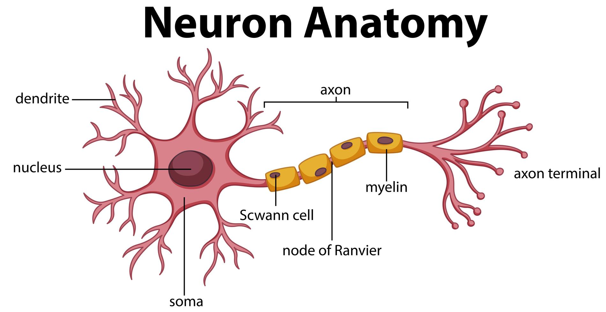
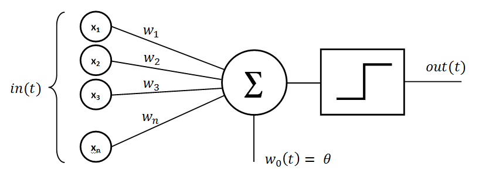
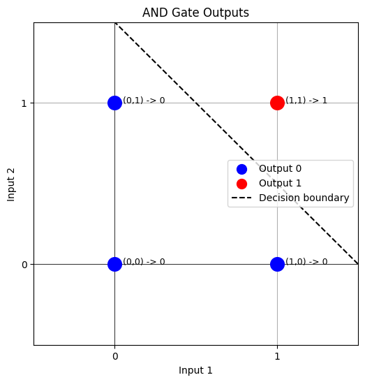
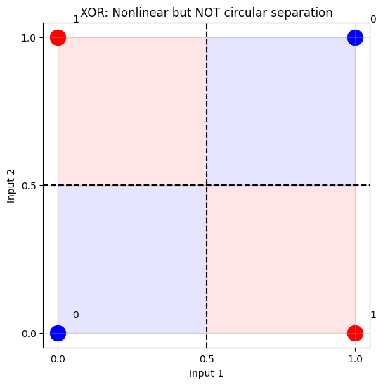
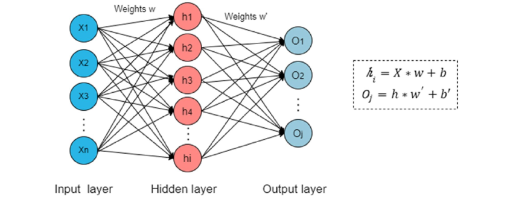
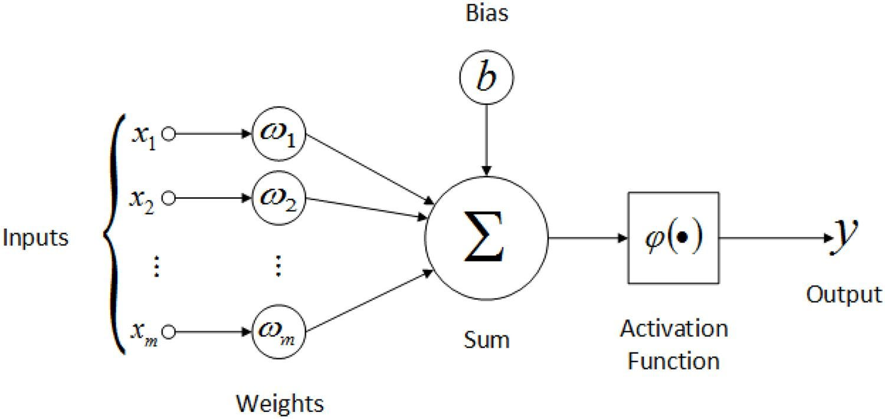
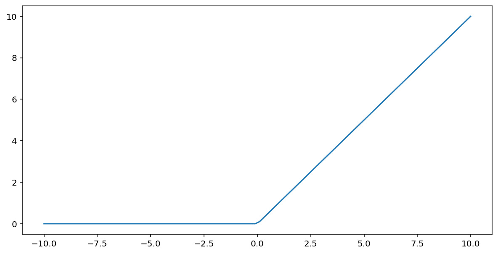
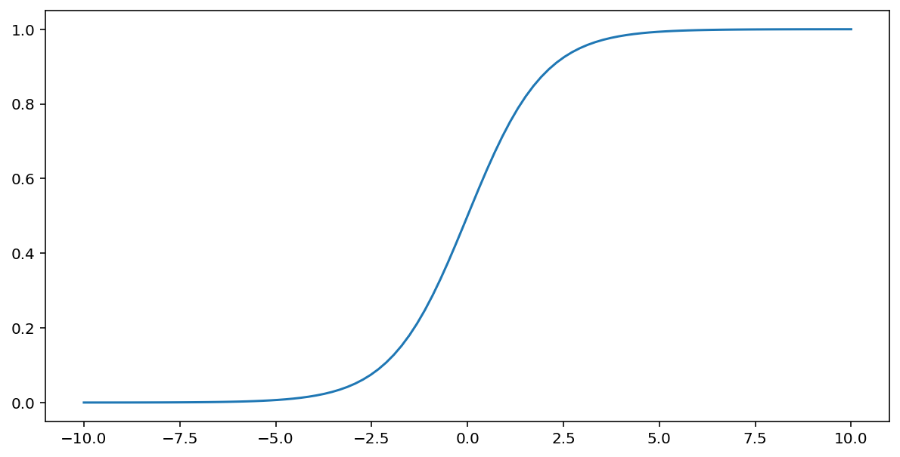

# Introduction to Neural Networks: From Perceptrons to MLPs

**Learning objectives:** By the end of this introduction, you should be able to:

- Identify the main components of an artificial neuron: inputs, weights, bias, and activation function.
- Explain how a perceptron implements simple logic gates.
- Recognize why a single perceptron cannot solve XOR.
- Describe how an MLP combines neurons in layers to model non-linear relationships.
- Trace how an input moves through an MLP to produce an output (a **forward pass**).

**Contents**

1. Inspiration: The Biological Neuron
2. The Basic Unit: The Artificial Neuron (Perceptron)
3. Simple Computations: AND, OR, and NOT
4. The Limitation: Linear Separability and XOR
5. Overcoming the Limitation: Multi-Layer Perceptrons (MLPs)
6. How an MLP Produces an Output: The Forward Pass
7. Key Terminology Recap
8. Further Exploration

> [!NOTE]
> **Today:** what a perceptron and an MLP are, why hidden layers matter, and how they calculate an output. **Next week:** how networks learn by adjusting their weights (training, loss functions, backpropagation, and optimization).

---

## 1. Inspiration: The Biological Neuron

Artificial Neural Networks (ANNs) are conceptually derived from the biological structure of the brain. The human brain operates using a vast, interconnected network of specialized cells known as **neurons**. 

In a biological neural network, information processing occurs through the following mechanisms:
*   **Signal Reception:** A neuron receives chemical and electrical signals from surrounding neurons through branch-like structures called **dendrites**.
*   **Processing:** These signals travel to the cell body (soma), which contains the **nucleus**. The cell body aggregates these incoming signals.
*   **Activation:** If the cumulative strength of the incoming signals exceeds a specific biological threshold, the neuron generates an electrical impulse. This is commonly referred to as the neuron "firing."
*   **Signal Transmission:** The electrical impulse travels down a long fiber called the **axon** and is transmitted to the dendrites of subsequent neurons across gaps known as synapses.



*(Figure 1: Diagram of a biological neuron detailing the dendrites, nucleus, and axon)*

> [!NOTE]  
> While biological neurons inspire ANNs, modern artificial neural networks do not attempt to perfectly simulate brain biology. They are mathematical abstractions optimized for computational efficiency.

<details>
<summary><b>Deeper Dive: Neuroplasticity and Learning</b></summary>
<br>
Learning in biological systems is largely attributed to <i>neuroplasticity</i>—the brain's ability to modify its connections. When neurons fire together repeatedly, the synapse (the connection) between them strengthens. This biological concept, summarized by the phrase "neurons that fire together, wire together" (Hebb's rule), is directly analogous to how Artificial Neural Networks adjust their mathematical "weights" during the training phase.
</details>

---

## 2. The Basic Unit: The Artificial Neuron (Perceptron)

The foundational unit of an Artificial Neural Network is the artificial neuron. One of the earliest mathematical models of an artificial neuron is the **Perceptron**, introduced by Frank Rosenblatt in 1958. The perceptron serves as a simplified, linear computational model of its biological counterpart.



*(Figure 2: Architecture of a Perceptron, illustrating inputs, weights, summation, bias, activation function, and output)*

**Mathematical Model of a Perceptron:**

1.  **Inputs ($x$):** The perceptron accepts a vector of numerical inputs $(x_1, x_2, ..., x_n)$. In practical applications, these represent features of the dataset (e.g., pixel intensities in an image). This corresponds to biological dendrites.
2.  **Weights ($w$):** Every input is multiplied by a corresponding weight $(w_1, w_2, ..., w_n)$. Weights represent the signal strength of a specific input connection. A positive weight implies an excitatory connection; a negative weight implies an inhibitory connection.
3.  **Summation and Bias ($b$):** The perceptron calculates the weighted sum of its inputs. To control the activation threshold effectively, a constant term called a **bias** ($b$) is added to the sum. 
    *   $\text{Weighted Sum} = (x_1w_1 + x_2w_2 + ... + x_nw_n) + b$
4.  **Activation Function:** The resulting sum is passed through an **activation function** to determine the final output. The original perceptron utilized a **Heaviside step function**:
    *   If $\text{Sum} \ge 0$, the output is 1.
    *   If $\text{Sum} < 0$, the output is 0.
5.  **Output:** The discrete value returned by the activation function serves as the final output.

> [!IMPORTANT]  
> **The Role of the Bias:** The bias is critical because it allows the activation threshold to shift left or right on the mathematical plane. Without a bias, the perceptron's decision boundary would be forced to pass exactly through the origin $(0,0)$, severely limiting the types of functions it could model.

<details>
<summary><b>Mathematical Context: Vector Notation (The Dot Product)</b></summary>

In computer science and linear algebra, the weighted sum $(x_1w_1 + x_2w_2 + ... + x_nw_n)$ is rarely calculated using loops. Instead, it is expressed as the <b>dot product</b> of two vectors. 
<br><br>
If $\mathbf{x}$ is the input vector and $\mathbf{w}$ is the weight vector, the calculation is written as:
<br>
$z = \mathbf{w} \cdot \mathbf{x} + b$
<br><br>
Libraries like NumPy (used in the subsequent section) optimize this dot product at the hardware level, which is why neural networks rely heavily on parallel matrix multiplication.
</details>

---

## 3. Simple Computations: Modeling Logic Gates (AND, OR, NOT)

Because a single perceptron calculates a linear function, it can perform basic mathematical computations and model standard Boolean logic gates. 

The following Python code implements a perceptron computationally:

```python
import numpy as np

def perceptron(inputs, weights, bias):
    """Calculates the output of a basic linear perceptron utilizing a step function."""
    assert len(inputs) == len(weights), "Input and weight vectors must be of equal length."

    # Calculate the dot product of inputs and weights, then add the bias
    weighted_sum = np.dot(inputs, weights) + bias 

    # Apply the step activation function
    if weighted_sum >= 0:
        return 1
    else:
        return 0
```

> [!TIP]  
> **Code Experimentation:** You can run this code in a Jupyter Notebook or any standard Python environment. Try altering the weights and biases slightly to see how the outputs change.

By defining specific static weights and biases, this generalized perceptron function acts as different logical gates.

### OR Gate
The OR function outputs 1 if at least one input is 1.
```python
# Configuration for an OR Gate
weights_or = [1.0, 1.0]
bias_or = -0.5
inputs = [[0,0], [0,1], [1,0], [1,1]]

print("--- OR Gate Output ---")
for input_pair in inputs:
    output = perceptron(input_pair, weights_or, bias_or)
    print(f"Input: {input_pair}, Output: {output}")
```

<details>
<summary><b>Why this works (Mathematical Breakdown for OR)</b></summary>

The perceptron evaluates the inequality: $1.0(x_1) + 1.0(x_2) - 0.5 \ge 0$.

- If input is [0, 0]: $0 + 0 - 0.5 = -0.5$ (Less than 0 $\rightarrow$ Output 0)
- If input is [1, 0]: $1.0 + 0 - 0.5 = 0.5$ (Greater than 0 $\rightarrow$ Output 1)
- If input is [0, 1]: $0 + 1.0 - 0.5 = 0.5$ (Greater than 0 $\rightarrow$ Output 1)
- If input is [1, 1]: $1.0 + 1.0 - 0.5 = 1.5$ (Greater than 0 $\rightarrow$ Output 1)

</details>

### AND Gate
The AND function outputs 1 strictly when both inputs are 1.
```python
# Configuration for an AND Gate
weights_and = [1.0, 1.0]
bias_and = -1.5
inputs = [[0,0], [0,1], [1,0], [1,1]]

print("\n--- AND Gate Output ---")
for input_pair in inputs:
    output = perceptron(input_pair, weights_and, bias_and)
    print(f"Input: {input_pair}, Output: {output}")
```

<details>
<summary><b>Why this works (Mathematical Breakdown for AND)</b></summary>

The perceptron evaluates the inequality: $1.0(x_1) + 1.0(x_2) - 1.5 \ge 0$.
<br>
Unlike the OR gate, a single input of 1 yields $1.0 - 1.5 = -0.5$ (Output 0). It strictly requires both inputs to be 1 to yield $2.0 - 1.5 = 0.5$, successfully crossing the zero threshold to output 1.
</details>

### NOT Gate
The NOT function inverts a single input.
```python
# Configuration for a NOT Gate
weights_not = [-1.0]
bias_not = 0.5
inputs = [[0], [1]] 

print("\n--- NOT Gate Output ---")
for input_val in inputs:
    output = perceptron(input_val, weights_not, bias_not)
    print(f"Input: {input_val}, Output: {output}")
```

---

## 4. The Limitation: Linear Separability and the XOR Problem

While the single-layer perceptron successfully models basic logic gates, it possesses a fundamental theoretical limitation regarding the types of data it can classify. This limitation is defined by the concept of **linear separability**.

When data points for logical AND or OR operations are plotted on a Cartesian plane, it is possible to draw a single, straight line (a hyperplane) that perfectly separates the coordinates resulting in an output of 1 from those resulting in an output of 0. Data sets that can be separated in this manner are *linearly separable*. 



*(Figure 3: Linearly separable data. A single hyperplane can successfully divide the two output classes.)*

However, the perceptron mathematically fails when presented with the **XOR (Exclusive OR)** function. The XOR logic gate outputs 1 if the inputs are mutually exclusive (one is 1, the other is 0), and outputs 0 if the inputs are identical.

| Input 1 | Input 2 | Output |
| :------ | :------ | :----- |
| 0       | 0       | 0      |
| 0       | 1       | 1      |
| 1       | 0       | 1      |
| 1       | 1       | 0      |

When plotting the XOR outputs, the data points form a diagonal opposition. 



*(Figure 4: Non-linearly separable data representing the XOR problem. No single linear boundary can separate the output classes.)*

Because the underlying mathematics of a single perceptron ($\mathbf{w} \cdot \mathbf{x} + b = 0$) exclusively define a linear boundary, a single perceptron is mathematically incapable of solving the XOR problem. 

> [!IMPORTANT]  
> **Historical Impact (The "AI Winter"):** This specific mathematical limitation was formally proven by Marvin Minsky and Seymour Papert in their 1969 book *Perceptrons*. Because most real-world data is non-linear, this proof led to heavy skepticism regarding neural networks, causing a significant decline in funding and research during the 1970s—a period often referred to as the first "AI Winter."

<details>
<summary><b>Conceptual Preview: How to overcome the XOR limitation</b></summary>

If a single straight line cannot solve XOR, how is it solved? The solution requires drawing <i>multiple</i> lines and combining their results.
<br><br>
In architectural terms, this means combining multiple perceptrons together. You can mathematically construct an XOR gate by combining an OR gate, a NAND (NOT-AND) gate, and an AND gate. This requires routing the outputs of the first set of perceptrons into the inputs of a final perceptron. This concept introduces <b>hidden layers</b>, which leads to the next topic: Multi-Layer Perceptrons.
</details>


---

## 5. Overcoming the Limitation: Multi-Layer Perceptrons (MLPs)

XOR shows why **one straight decision boundary is not enough**. One solution is to combine multiple neurons so that their outputs become inputs to other neurons. This is the basic idea behind a **Multi-Layer Perceptron (MLP)**, a type of feedforward neural network.



*Figure 5a: An MLP combines neurons into layers.*

### The three parts of an MLP

1. **Input layer:** Receives the input features (for example, the two inputs of XOR). It passes these values into the network.
2. **Hidden layer(s):** Each neuron combines its inputs using weights and a bias, then applies an activation function. Multiple hidden neurons allow the network to represent more than one linear boundary.
3. **Output layer:** Combines the values from the preceding layer to produce the final output, such as a class score or predicted numerical value.



*Figure 5b: A neuron in an MLP computes a weighted sum and applies an activation function.*

### Why activation functions matter

The original perceptron uses a **step function** to return either 0 or 1. Modern MLPs generally use other activation functions. In particular, **non-linear** activations are essential: without them, stacking linear layers would still be equivalent to a single linear transformation, and the network would not overcome the XOR limitation.

For now, recognize these two examples:

- **ReLU:** $f(z) = \max(0,z)$. It outputs zero for negative inputs and the input itself for positive inputs; it is often used in hidden layers.
- **Sigmoid:** $f(z) = \frac{1}{1+e^{-z}}$. It maps a number to a value between 0 and 1; it can be used in an output layer for binary classification.




> [!IMPORTANT]
> **Key idea:** A single perceptron can draw one straight boundary. By combining neurons with non-linear activations, an MLP can represent non-linear decision boundaries, including those needed for XOR.

**Think about it:** If we add more layers but use *no* non-linear activation functions, can we solve XOR? Why or why not?

---

## 6. How an MLP Produces an Output: The Forward Pass

A **forward pass** is simply the calculation from inputs to output, using the network's current weights and biases. It does not, by itself, change those weights.

1. Give the network an input, such as `[0, 1]` for XOR.
2. Each neuron in the first hidden layer calculates $z = \mathbf{w}\cdot\mathbf{x} + b$ and applies its activation function.
3. The outputs of those neurons become the inputs of the next layer.
4. The output layer calculates the network's final prediction.

**Notice the connection:** Each neuron performs the same kind of weighted-sum calculation you saw in the perceptron. An MLP simply connects many such computations together.

**Mini-check:** In a network with two inputs, three hidden neurons, and one output neuron, how many values does the hidden layer pass to the output layer? (Answer: three.)

> [!NOTE]
> We will investigate **how the network finds useful weights** in the next session. Today, the goal is to understand what the network computes and why its layered structure is useful.

---

## 7. Key Terminology Recap

- **Perceptron:** A single artificial neuron with a step activation; it defines a linear decision boundary.
- **Weights and bias:** Numbers used to calculate a neuron's weighted sum.
- **Activation function:** A function applied to the weighted sum; non-linear activations make MLPs more expressive.
- **Linear separability:** Whether a straight line (or, in higher dimensions, a hyperplane) can separate classes.
- **XOR:** A simple example that cannot be solved by a single linear decision boundary.
- **MLP:** A network with an input layer, one or more hidden layers, and an output layer.
- **Forward pass:** Computing the output of a network from a given input, without updating its weights.

---

## 8. Further Exploration

For further academic study and practical experimentation with neural network architectures, the following resources are recommended:

- **Interactive Modeling:** [TensorFlow Playground](https://playground.tensorflow.org/) - A browser-based interface for visualizing neural network behavior, parameter adjustment, and decision boundary formation.
- **Mathematical Foundations:** [Notes on Single-Layer Neural Networks](https://humphryscomputing.com/Notes/Neural/single.neural.html)
- **University Course Materials:** [UW Madison Data Science: Neural Networks Overview](https://uw-madison-datascience.github.io/2022-10-26-machine-learning-novice-sklearn/06-neural-networks/index.html)
- **Applied Deep Learning:** [Kaggle Introduction to Deep Learning](https://www.kaggle.com/learn/intro-to-deep-learning)
- **Google Developer Documentation:** [Machine Learning Crash Course – Activation Functions](https://developers.google.com/machine-learning/crash-course/neural-networks/activation-functions)


---

<details>
<summary><b>Python Code for AND OR and XOR Data Visualization</b></summary>

Here's the Python code to generate the scatter plots for the AND data points:

```python
import matplotlib.pyplot as plt
import numpy as np

# Define the input points (corners of the unit square)
inputs = np.array([[0, 0], [0, 1], [1, 0], [1, 1]])
x_coords = inputs[:, 0]
y_coords = inputs[:, 1]

# AND outputs
outputs_and = np.array([0, 0, 0, 1])

# Colors: 0 -> blue, 1 -> red
colors = ['blue', 'red']

# --- Plot AND Gate ---
plt.figure(figsize=(6, 6))
plt.title('AND Gate Outputs')
plt.xlabel('Input 1')
plt.ylabel('Input 2')

# Plot points
for i in range(len(inputs)):
    plt.scatter(
        x_coords[i], y_coords[i],
        color=colors[outputs_and[i]],
        s=200,
        zorder=3
    )

# Labels
for i in range(len(inputs)):
    plt.text(
        x_coords[i] + 0.05,
        y_coords[i],
        f'({x_coords[i]},{y_coords[i]}) -> {outputs_and[i]}',
        fontsize=9
    )

# --- Decision boundary for AND ---
# x1 + x2 = 1.5  -> x2 = 1.5 - x1
x = np.linspace(-0.5, 1.5, 100)
y = 1.5 - x
plt.plot(x, y, 'k--', label='Decision boundary')

# Axis styling
plt.xticks([0, 1])
plt.yticks([0, 1])
plt.xlim(-0.5, 1.5)
plt.ylim(-0.5, 1.5)
plt.grid(True, zorder=0)
plt.axhline(0, color='black', linewidth=0.5)
plt.axvline(0, color='black', linewidth=0.5)

# Legend
legend_handles = [
    plt.scatter([], [], color='blue', s=100, label='Output 0'),
    plt.scatter([], [], color='red', s=100, label='Output 1'),
    plt.Line2D([0], [0], linestyle='--', color='black', label='Decision boundary')
]

plt.legend(handles=legend_handles, loc='center right')

plt.show()
```

Here's the Python code to generate the scatter plots for the OR data points:

```python
import matplotlib.pyplot as plt
import numpy as np

# Inputs (unit square corners)
inputs = np.array([[0, 0], [0, 1], [1, 0], [1, 1]])
x_coords = inputs[:, 0]
y_coords = inputs[:, 1]

# OR outputs
outputs_or = np.array([0, 1, 1, 1])

# Colors: 0 -> blue, 1 -> red
colors = ['blue', 'red']

# --- Plot OR Gate ---
plt.figure(figsize=(6, 6))
plt.title('OR Gate Outputs')
plt.xlabel('Input 1')
plt.ylabel('Input 2')

# Plot points
for i in range(len(inputs)):
    plt.scatter(
        x_coords[i], y_coords[i],
        color=colors[outputs_or[i]],
        s=200,
        zorder=3
    )

# Labels
for i in range(len(inputs)):
    plt.text(
        x_coords[i] + 0.05,
        y_coords[i],
        f'({x_coords[i]},{y_coords[i]}) -> {outputs_or[i]}',
        fontsize=9
    )

# --- Decision boundary for OR ---
# One valid separator: x1 + x2 = 0.5
# (anything above this line is class 1)
x = np.linspace(-0.5, 1.5, 100)
y = 0.5 - x
plt.plot(x, y, 'k--', label='Decision boundary')

# Axes styling
plt.xticks([0, 1])
plt.yticks([0, 1])
plt.xlim(-0.5, 1.5)
plt.ylim(-0.5, 1.5)
plt.grid(True, zorder=0)
plt.axhline(0, color='black', linewidth=0.5)
plt.axvline(0, color='black', linewidth=0.5)

# Legend
legend_handles = [
    plt.scatter([], [], color='blue', s=100, label='Output 0'),
    plt.scatter([], [], color='red', s=100, label='Output 1'),
    plt.Line2D([0], [0], linestyle='--', color='black', label='Decision boundary')
]

plt.legend(handles=legend_handles, loc='center right')

plt.show()
```

Here's the Python code to generate the scatter plots for the XOR data points:

```python
import matplotlib.pyplot as plt
import numpy as np

# XOR points
inputs = np.array([
    [0, 0],
    [0, 1],
    [1, 0],
    [1, 1]
])

labels = np.array([0, 1, 1, 0])

colors = ['blue', 'red']

plt.figure(figsize=(6, 6))
plt.title("XOR: Nonlinear separation")
plt.xlabel("Input 1")
plt.ylabel("Input 2")

# plot points
for i in range(len(inputs)):
    x, y = inputs[i]
    plt.scatter(x, y, color=colors[labels[i]], s=250)
    plt.text(x + 0.05, y + 0.05, str(labels[i]))

plt.axvline(0.5, color='black', linestyle='--')
plt.axhline(0.5, color='black', linestyle='--')

# highlight quadrants
plt.fill_between([0, 0.5], 0, 0.5, color='blue', alpha=0.1)
plt.fill_between([0.5, 1], 0.5, 1, color='blue', alpha=0.1)
plt.fill_between([0, 0.5], 0.5, 1, color='red', alpha=0.1)
plt.fill_between([0.5, 1], 0, 0.5, color='red', alpha=0.1)

plt.xticks([0, 0.5, 1])
plt.yticks([0, 0.5, 1])
plt.grid(True, alpha=0.3)

plt.show()
```


</details>

<!-- 
- https://carpentries-incubator.github.io/machine-learning-novice-sklearn/07-neural-networks/index.html
- Practical NN with Scikit-Learn:** [Stack Abuse Tutorial](https://stackabuse.com/introduction-to-neural-networks-with-scikit-learn/) 
-->


<!-- 
Here's the Python code using Matplotlib to generate the scatter plots for the AND and XOR data points:

```python
import matplotlib.pyplot as plt
import numpy as np

# Define the input points (corners of the unit square)
inputs = np.array([[0, 0], [0, 1], [1, 0], [1, 1]])
x_coords = inputs[:, 0] # First column (Input 1)
y_coords = inputs[:, 1] # Second column (Input 2)

# Define the outputs for AND and XOR
outputs_and = np.array([0, 0, 0, 1])
outputs_xor = np.array([0, 1, 1, 0])

# Define colors for visualization (e.g., blue for 0, red for 1)
colors = ['blue', 'red']

# --- Plotting AND Gate ---
plt.figure(figsize=(6, 6))
plt.title('AND Gate Outputs')
plt.xlabel('Input 1')
plt.ylabel('Input 2')

# Plot points based on their output class
for i in range(len(inputs)):
    plt.scatter(x_coords[i], y_coords[i],
                color=colors[outputs_and[i]], # Color determined by AND output
                s=200, # Size of points
                zorder=3) # Plot points on top of gridlines

# Add text labels for clarity (optional)
for i in range(len(inputs)):
    plt.text(x_coords[i] + 0.05, y_coords[i], f'({x_coords[i]},{y_coords[i]}) -> {outputs_and[i]}', fontsize=9)

# Customize plot appearance
plt.xticks([0, 1])
plt.yticks([0, 1])
plt.xlim(-0.5, 1.5)
plt.ylim(-0.5, 1.5)
plt.grid(True, zorder=0) # Grid behind points
plt.axhline(0, color='black', linewidth=0.5)
plt.axvline(0, color='black', linewidth=0.5)

# Create legend handles manually
legend_handles = [plt.scatter([], [], color='blue', s=100, label='Output 0'),
                  plt.scatter([], [], color='red', s=100, label='Output 1')]
plt.legend(handles=legend_handles, loc='center right')

plt.show()


# --- Plotting XOR Gate ---
plt.figure(figsize=(6, 6))
plt.title('XOR Gate Outputs')
plt.xlabel('Input 1')
plt.ylabel('Input 2')

# Plot points based on their output class
for i in range(len(inputs)):
    plt.scatter(x_coords[i], y_coords[i],
                color=colors[outputs_xor[i]], # Color determined by XOR output
                s=200,
                zorder=3)

# Add text labels for clarity (optional)
for i in range(len(inputs)):
     plt.text(x_coords[i] + 0.05, y_coords[i], f'({x_coords[i]},{y_coords[i]}) -> {outputs_xor[i]}', fontsize=9)


# Customize plot appearance
plt.xticks([0, 1])
plt.yticks([0, 1])
plt.xlim(-0.5, 1.5)
plt.ylim(-0.5, 1.5)
plt.grid(True, zorder=0)
plt.axhline(0, color='black', linewidth=0.5)
plt.axvline(0, color='black', linewidth=0.5)

# Reuse legend handles from above
plt.legend(handles=legend_handles, loc='center right')

plt.show()
```

This code will generate two separate plots:

1.  **AND Plot:** Shows the four input points, colored according to the AND output ( (1,1) will be red, the others blue). You can clearly see these points *are* linearly separable.
2.  **XOR Plot:** Shows the four input points, colored according to the XOR output ( (0,1) and (1,0) will be red, (0,0) and (1,1) will be blue). This visually demonstrates the non-linear separability challenge. 
-->