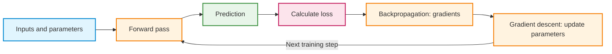
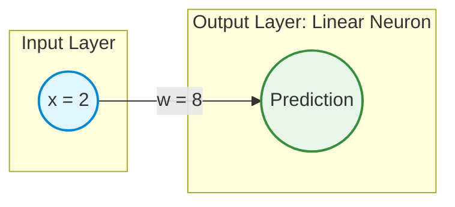
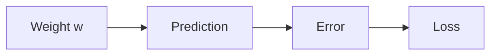
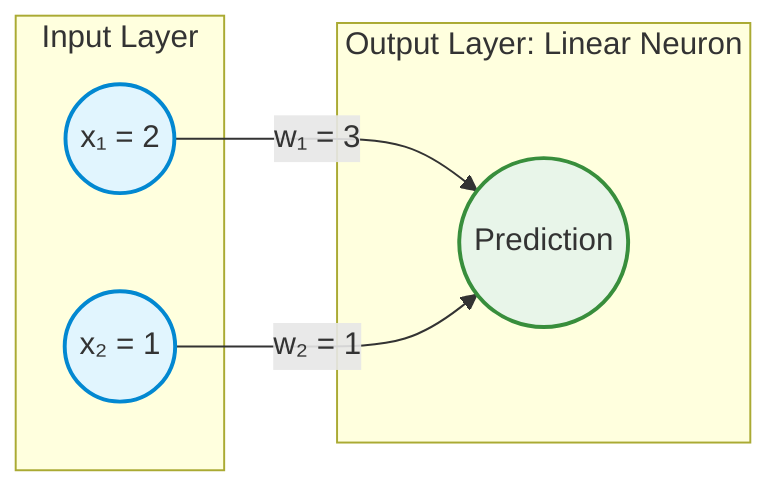
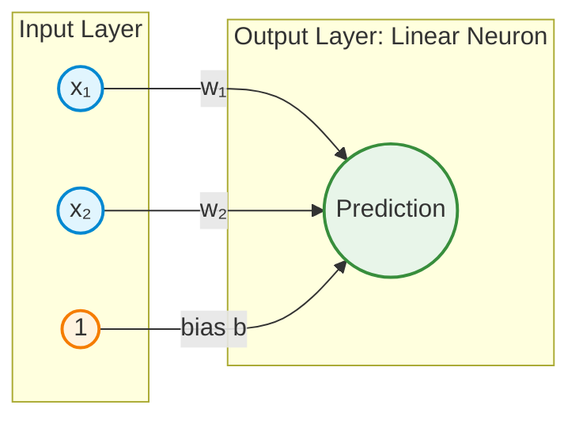
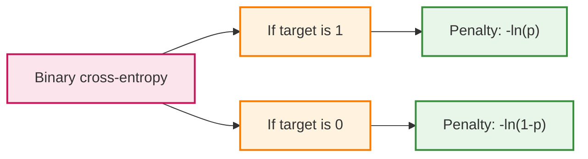
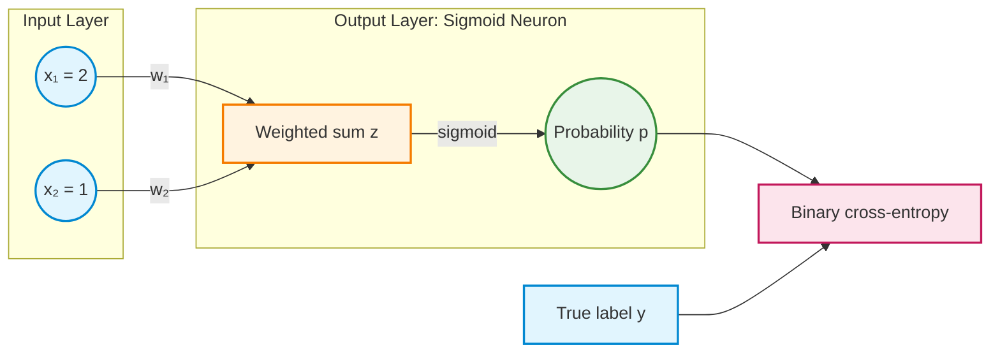
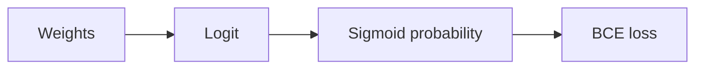

# How Neural Networks Learn: From Regression to Binary Classification

*Theory companion to the one-weight demonstration, the two-weight regression activity, and the binary-classification activity*

## How to use this reading

This chapter introduces one new idea at a time. It begins with a regression model containing one weight, extends the same reasoning to two weights and an optional bias, and then changes the output and loss function for binary classification. The numerical examples match the corresponding demonstrations and guided activities.

The central learning cycle remains the same throughout:

**Forward pass → Calculate loss → Backpropagation → Gradient descent → Repeat**

## Learning objectives

After studying this chapter, the following distinctions should be clear:

1. A forward pass calculates a prediction; a loss function measures how the prediction differs from the target.
2. One trainable weight requires one ordinary derivative; independently trainable weights require partial derivatives.
3. Backpropagation calculates gradients through the chain rule; gradient descent uses those gradients to update parameters.
4. The learning rate controls the size of a parameter update, not the gradient calculation itself.
5. Regression can use a linear output with squared-error loss; binary classification commonly uses a sigmoid probability with binary cross-entropy.
6. The same learning cycle applies to both regression and binary classification.

**Notation:** $x$ denotes an input, $y$ a target, $\hat y$ a prediction, $w$ a weight, $b$ a bias, $L$ a loss, and $\eta$ a learning rate. For binary classification, $z$ is a logit and $p$ is the predicted probability of class 1. The symbol $\ln$ always means the natural logarithm.

---

## 1. The basic idea: how a model learns

A model begins with some parameter values. Those parameters produce a prediction for an input. A loss function measures how poorly the prediction matches the target. Derivatives then describe how the loss would change if the parameters changed slightly.

A training step consists of four separate operations:

1. **Forward pass:** calculate the prediction using the current parameters.
2. **Loss calculation:** convert the prediction error into a numerical penalty.
3. **Backpropagation:** calculate derivatives of that loss with respect to trainable parameters.
4. **Gradient descent:** adjust the parameters using the derivatives and a learning rate.



These operations have different jobs. **Backpropagation does not update weights.** The parameter update happens during gradient descent. The following sections calculate each operation explicitly.

---

## 2. Regression with one input and one weight

### 2.1 The model and its linear activation

Regression predicts a **continuous numerical value**. Consider the simplest possible linear model: one input, one trainable weight, and no bias.

$$
\hat y=wx
$$



An output neuron first calculates a weighted sum and may then apply an **activation function**. In this regression example, the activation is implicitly the **identity (linear) activation**: it returns the weighted sum unchanged.

$$
\phi(z)=z
$$

Therefore, if $z=wx$, then $\hat y=\phi(z)=wx$. No extra nonlinear transformation is being applied.

### 2.2 Forward pass: calculate the prediction

The values are the same as in the one-weight demonstration.

| Quantity | Value |
|---|---:|
| Input $x$ | 2 |
| Target $y$ | 6 |
| Initial weight $w$ | 8 |
| Learning rate $\eta$ | 0.1 |

The prediction is:

$$
\hat y=wx=(8)(2)=16
$$

The signed prediction error is:

$$
 e=\hat y-y=16-6=10
$$

A forward pass produces the prediction. It does not change $w$.

### 2.3 Loss: measure the error

The example uses **half squared-error loss**:

$$
L=\frac12(\hat y-y)^2
$$

Substituting the current values:

$$
L=\frac12(16-6)^2=50
$$

Squaring prevents positive and negative errors from canceling and penalizes larger mistakes more strongly. The factor $1/2$ is a convenience: differentiation of a square introduces a factor of $2$, which cancels it.

$$
\frac{d}{de}\left(\frac12 e^2\right)=e
$$

The factor is not compulsory. Using squared error without $1/2$ gives the same minimizing weight, but changes the magnitude of the loss and gradient.

**Important distinction:** Error $e$ can be positive or negative; squared-error loss $L$ is nonnegative. Loss reports the size of the penalty but does not itself specify the weight update.

### 2.4 Ordinary derivative: how does the loss respond to a weight change?

Only one independently trainable parameter, $w$, is present. The loss is therefore a function of one variable:

$$
L(w)=\frac12(wx-y)^2
$$

The **ordinary derivative** $dL/dw$ describes the local rate of change of loss when $w$ changes, with the input and target fixed.

The loss depends on $w$ through intermediate quantities:



The **chain rule** differentiates the successive operations and multiplies the results:

$$
\frac{dL}{dw}=\frac{dL}{de}\frac{de}{d\hat y}\frac{d\hat y}{dw}
$$

Each factor has a simple meaning:

- **Loss sensitivity to error:** $dL/de=e=10$.
- **Error sensitivity to prediction:** $de/d\hat y=1$ because the target is fixed.
- **Prediction sensitivity to weight:** $d\hat y/dw=x=2$ because the input is fixed.

Consequently:

$$
\frac{dL}{dw}=10\times1\times2=20
$$

A **positive derivative** means that a small increase in the weight would increase the loss at the current point. A small decrease is the locally helpful direction.

### 2.5 Gradient descent: update the weight

For a one-weight model, gradient descent uses:

$$
w_{\mathrm{new}}=w_{\mathrm{old}}-\eta\frac{dL}{dw}
$$

With learning rate $\eta=0.1$:

$$
w_{\mathrm{new}}=8-0.1(20)=6
$$

A new forward pass gives:

$$
\hat y_{\mathrm{new}}=(6)(2)=12
$$

$$
L_{\mathrm{new}}=\frac12(12-6)^2=18
$$

After one update, the loss decreased from **50 to 18**. The target has not yet been reached, so the cycle repeats.

| Completed updates | Weight | Prediction | Loss |
|---:|---:|---:|---:|
| 0 | 8.000 | 16.000 | 50.000 |
| 1 | 6.000 | 12.000 | 18.000 |
| 2 | 4.800 | 9.600 | 6.480 |
| 3 | 4.080 | 8.160 | 2.333 |
| 4 | 3.648 | 7.296 | 0.840 |
| Target minimum | 3.000 | 6.000 | 0 |

The minimum for this particular example occurs at $w=3$ because $(3)(2)=6$.

### 2.6 Why subtract the gradient? The hill metaphor

A loss function can be imagined as a landscape. The weight is a horizontal position, and loss is the height. The derivative describes the local slope of the landscape.

- A **positive** derivative means the curve rises when the weight increases.
- A **negative** derivative means the curve falls when the weight increases.
- A **zero** derivative identifies a stationary point, which is not necessarily a global minimum in general.

The gradient points in the direction of steepest **local increase** in loss. Basic gradient descent moves in the **negative-gradient direction**, locally downhill. The learning rate controls how large the step is.

A very large step can jump past a minimum and increase the loss, even though the initial direction was downhill.

### 2.7 Learning rate: how far should the weight move?

The learning rate $\eta$ scales the gradient during the update. It does not change the derivative calculated at the current weight.

For the initial gradient $20$:

| Learning rate | First updated weight | Interpretation |
|---:|---:|---|
| 0.01 | 7.8 | Small adjustment |
| 0.10 | 6.0 | Moderate adjustment |
| 0.40 | 0.0 | Large overshoot |
| 0.60 | -4.0 | Excessive step for this loss |

For this specific quadratic example, repeated updates converge to $w=3$ when $0<\eta<0.5$. This interval is a property of the example, not a universal rule for every learning problem.

The supplied Python snippet repeats the four training operations without any machine-learning library:

<details>
<summary>Run the Python code — One-weight regression training</summary>

```python
x = 2.0
y = 6.0
w = 8.0
learning_rate = 0.1

for step in range(6):
    prediction = w * x                  # Forward pass
    error = prediction - y
    loss = 0.5 * error**2              # Loss
    gradient = error * x               # Chain rule / backpropagation
    print(step, round(w, 4), round(prediction, 4), round(loss, 4))
    w -= learning_rate * gradient      # Gradient descent
```

</details>

**Main connection:** A model with one trainable weight needs one derivative. Adding more independent weights does not change the learning cycle; it changes the number of derivatives that must be calculated.

---

## 3. Regression with two weights: why partial derivatives are needed

### 3.1 Two inputs contribute to one prediction

The next model uses two input features and two weights, without bias:

$$
\hat y=w_1x_1+w_2x_2
$$

The output activation is still the **identity function**. This is still a linear regression model; the difference is that two input contributions are added.



Use the values from the two-weight activity:

| Quantity | Value |
|---|---:|
| Inputs $x_1,x_2$ | 2, 1 |
| Target $y$ | 6 |
| Initial weights $w_1,w_2$ | 3, 1 |
| Learning rate $\eta$ | 0.1 |

### 3.2 Forward pass and loss

$$
\hat y=(3)(2)+(1)(1)=7
$$

$$
e=7-6=1
$$

$$
L=\frac12(7-6)^2=0.5
$$

The model again knows the size of its loss, but the loss does not directly indicate how each weight should change.

### 3.3 Ordinary derivative versus partial derivative

The loss now depends on **two** independent trainable weights:

$$
L(w_1,w_2)=\frac12(2w_1+w_2-6)^2
$$

A partial derivative answers a focused question:

- $\frac{\partial L}{\partial w_1}$: how would loss change if only $w_1$ changed slightly?
- $\frac{\partial L}{\partial w_2}$: how would loss change if only $w_2$ changed slightly?

When differentiating with respect to one weight, the other independent weight is held fixed. **Partial derivatives are not partial differential equations**; they are ordinary differentiation applied to one coordinate of a multivariable function at a time.

### 3.4 Backpropagation: calculate both partial derivatives

The shared chain-rule factor is the prediction error:

$$
\frac{\partial L}{\partial \hat y}=\hat y-y=1
$$

For the first weight:

$$
\frac{\partial \hat y}{\partial w_1}=x_1=2
$$

$$
\frac{\partial L}{\partial w_1}=\frac{\partial L}{\partial\hat y}\frac{\partial\hat y}{\partial w_1}=(1)(2)=2
$$

For the second weight:

$$
\frac{\partial \hat y}{\partial w_2}=x_2=1
$$

$$
\frac{\partial L}{\partial w_2}=\frac{\partial L}{\partial\hat y}\frac{\partial\hat y}{\partial w_2}=(1)(1)=1
$$

The two partial derivatives together form the **gradient**:

$$
\nabla L=\left(\frac{\partial L}{\partial w_1},\frac{\partial L}{\partial w_2}\right)=(2,1)
$$

The two gradients have different magnitudes because each weight multiplies a different input value. The first weight influences the prediction twice as strongly at this example's input.

### 3.5 Gradient descent: update both weights

Each parameter uses its own gradient and the same learning rate. **Both gradients are calculated at the original parameter values before either weight is updated.**

$$
w_{1,\mathrm{new}}=3-0.1(2)=2.8
$$

$$
w_{2,\mathrm{new}}=1-0.1(1)=0.9
$$

The new forward pass gives:

$$
\hat y_{\mathrm{new}}=(2.8)(2)+(0.9)(1)=6.5
$$

$$
L_{\mathrm{new}}=\frac12(6.5-6)^2=0.125
$$

The loss decreased from **0.5 to 0.125**. The model now has two trainable parameters, but the stages remain identical: forward pass, loss, backpropagation, and update.

A single training example does **not** uniquely identify the two weights. Every pair satisfying $2w_1+w_2=6$ achieves zero loss on that example.

### 3.6 Adding a bias: one more parameter, one more derivative

A bias adds a trainable constant to the weighted sum:

$$
\hat y=w_1x_1+w_2x_2+b
$$

The bias can also be viewed as the weight on an additional input that is always equal to 1. The output activation remains linear.



As a separate restart, use $w_1=3$, $w_2=1$, $b=1$, $x_1=2$, $x_2=1$, and $y=6$. The prediction is 8, so the error is 2 and the loss is 2.

The gradients are:

$$
\frac{\partial L}{\partial w_1}=2(2)=4
$$

$$
\frac{\partial L}{\partial w_2}=2(1)=2
$$

$$
\frac{\partial L}{\partial b}=2(1)=2
$$

With $\eta=0.1$, the updated parameters are $w_1=2.6$, $w_2=0.8$, and $b=0.8$. The updated prediction is 6.8 and the new loss is 0.32.

A bias therefore adds one gradient component and one parameter update; it does not create a different training algorithm.

---

## 4. The transition from regression to binary classification

The regression examples predict an unrestricted numerical value using an identity activation. **Binary classification asks a different question:** what is the estimated probability that the target belongs to class 1 rather than class 0?

For binary classification, the target is either 0 or 1. Instead of interpreting the weighted sum directly as a probability, the model transforms it using **sigmoid**.

| Component | Regression in the earlier examples | Binary classification |
|---|---|---|
| Target | Continuous number | Label 0 or 1 |
| Weighted sum | $z=w_1x_1+w_2x_2$ | $z=w_1x_1+w_2x_2$ |
| Output activation | Identity: $\hat y=z$ | Sigmoid: $p=\sigma(z)$ |
| Predicted output | A continuous value | Probability of class 1 |
| Example loss | Half squared error | Binary cross-entropy |
| Training procedure | Forward, loss, gradients, update | Forward, loss, gradients, update |

The common computation of a weighted sum remains. Only the interpretation of the output, activation, and loss function changes.

---

## 5. Sigmoid, probability, odds, and logit

### 5.1 Sigmoid converts a score into a probability

A weighted sum such as $z=w_1x_1+w_2x_2$ can be negative, zero, or positive. Such an unrestricted score cannot itself be a probability.

The sigmoid function converts that score into a number between 0 and 1:

$$
p=\sigma(z)=\frac{1}{1+e^{-z}}
$$

| Score $z$ | Sigmoid probability $p$ |
|---:|---:|
| -2 | 0.1192 |
| -1 | 0.2689 |
| 0 | 0.5000 |
| 1 | 0.7311 |
| 2 | 0.8808 |

A negative score corresponds to a probability below 0.5. A zero score gives exactly 0.5. A positive score corresponds to a probability above 0.5.

**Run the supplied Python code and observe the sigmoid curve.** Notice the central point $(0,0.5)$ and the flattening of the curve toward 0 and 1.

<details>
<summary>Run the Python code — Sigmoid curve</summary>

```python
import numpy as np
import matplotlib.pyplot as plt

z = np.linspace(-8, 8, 400)
p = 1 / (1 + np.exp(-z))

plt.figure(figsize=(8, 4.5))
plt.plot(z, p, label="Sigmoid probability")
plt.axhline(0.5, linestyle="--", label="Probability 0.5")
plt.axvline(0, linestyle=":")
plt.xlabel("Logit z")
plt.ylabel("Probability of class 1")
plt.title("Sigmoid converts a score into a probability")
plt.grid(alpha=0.25)
plt.legend()
plt.tight_layout()
plt.show()
```

</details>

### 5.2 Probability, odds, and log-odds are different quantities

A probability $p$ lies between 0 and 1. **Odds** compare the probability of an event occurring with the probability of it not occurring:

$$
\frac{p}{1-p}
$$

For example, a probability of rain tomorrow of $p=0.20$ corresponds to odds of $0.20/0.80=0.25$, or 1 to 4 in favor of rain. A probability of $p=0.80$ corresponds to odds of $0.80/0.20=4$, or 4 to 1 in favor.

A **logit** is the *natural logarithm of the odds*, not the logarithm of the probability alone:

$$
z=\ln\left(\frac{p}{1-p}\right)
$$

| Probability | Odds | Logit |
|---:|---:|---:|
| 0.20 | 0.25 | -1.3863 |
| 0.50 | 1.00 | 0 |
| 0.80 | 4.00 | +1.3863 |

This explains why the logit is **zero-centered**. Equal odds, 1 to 1, have logarithm 0. Odds below 1 produce a negative logit; odds above 1 produce a positive logit. Values equally likely in opposite directions, such as probabilities 0.2 and 0.8, produce logits of the same magnitude with opposite signs.

### 5.3 Why use log-odds instead of raw odds?

Raw odds are always positive and not centered at zero. In contrast, log-odds range over all real numbers and treat reciprocal odds symmetrically: odds of $4$ and $1/4$ correspond to $+\ln(4)$ and $-\ln(4)$.

A linear weighted sum can therefore represent a logit naturally. **Sigmoid reverses the log-odds transformation** and returns the corresponding probability:

$$
p=\frac{1}{1+e^{-z}}
$$

The terms have distinct meanings:

- **Logit $z$:** the model's score, interpreted as log-odds.
- **Sigmoid $\sigma$:** the transformation from logit to probability.
- **Probability $p$:** the predicted chance of class 1.

These are properties of the classifier's output; they are not loss functions.

---

## 6. Binary cross-entropy: measuring classification loss

### 6.1 Why use a classification loss?

The predicted probability should be **high** when the true label is 1 and **low** when the true label is 0. Binary cross-entropy (BCE) gives large penalties to confident, incorrect probability predictions.

Squared error can also be applied to probabilities, but BCE is a natural choice for binary targets because it is the negative log-likelihood of a Bernoulli outcome. With sigmoid, it also gives a particularly simple gradient.

### 6.2 When the true label is 1

For $y=1$, only the probability of the positive class matters:

$$
L=-\ln(p)
$$

A probability close to 1 gives low loss; a probability close to 0 gives very high loss.

| Predicted probability $p$ | BCE loss if $y=1$ |
|---:|---:|
| 0.9 | 0.1054 |
| 0.5 | 0.6931 |
| 0.1 | 2.3026 |

### 6.3 When the true label is 0

For $y=0$, the relevant probability is $1-p$, the predicted probability of the negative class:

$$
L=-\ln(1-p)
$$

A probability of class 1 close to 0 gives low loss; a probability close to 1 gives very high loss.

| Predicted probability $p$ | BCE loss if $y=0$ |
|---:|---:|
| 0.1 | 0.1054 |
| 0.5 | 0.6931 |
| 0.9 | 2.3026 |

### 6.4 One formula represents both cases

A binary label acts as a selector. If $y=1$, the second term disappears. If $y=0$, the first term disappears:

$$
L=-\left[y\ln(p)+(1-y)\ln(1-p)\right]
$$



The two cases have opposite shapes as the probability of class 1 changes. Run the supplied Python code and compare both curves.

<details>
<summary>Run the Python code — BCE loss curves for both labels</summary>

```python
import numpy as np
import matplotlib.pyplot as plt

# Avoid endpoints because logarithm of zero is undefined.
p = np.linspace(0.001, 0.999, 500)
loss_y1 = -np.log(p)
loss_y0 = -np.log1p(-p)

plt.figure(figsize=(8, 4.5))
plt.plot(p, loss_y1, label="True label 1")
plt.plot(p, loss_y0, label="True label 0")
plt.axvline(0.5, linestyle="--", label="Probability 0.5")
plt.xlabel("Predicted probability of class 1")
plt.ylabel("Binary cross-entropy loss")
plt.title("Binary cross-entropy for two possible labels")
plt.grid(alpha=0.25)
plt.legend()
plt.tight_layout()
plt.show()
```

</details>

**Numerical note:** A logarithm of zero is undefined. Practical code often evaluates BCE directly from logits using a numerically stable expression. The probability-based equation above remains useful for understanding the loss.

---

## 7. Binary classification: the same training cycle with two weights

The final worked example uses **two inputs, two weights, and no bias**, just like the core classification activity. It is a single sigmoid output neuron (binary logistic regression), not a network with a hidden layer.



The calculation has two stages before loss:

$$
z=w_1x_1+w_2x_2
$$

$$
p=\sigma(z)=\frac{1}{1+e^{-z}}
$$

### 7.1 Starting values

| Quantity | Value |
|---|---:|
| Inputs $x_1,x_2$ | 2, 1 |
| True label $y$ | 1 |
| Initial weights $w_1,w_2$ | 0, 0 |
| Learning rate $\eta$ | 0.1 |
| Bias | Not included |

### 7.2 Forward pass: logit and probability

The weighted sum is:

$$
z=(0)(2)+(0)(1)=0
$$

Sigmoid converts the logit to a class-1 probability:

$$
p=\sigma(0)=\frac{1}{1+e^0}=0.5
$$

At this point, the model assigns equal probabilities to both classes. It has not yet changed either weight.

### 7.3 Loss: binary cross-entropy

Since the true label is 1:

$$
L=-\ln(p)=-\ln(0.5)\approx0.693147
$$

This is the numerical penalty for the current probability. The next question is how each weight affects it.

### 7.4 Backpropagation: differentiate through BCE and sigmoid

The weight does not affect the loss directly. It changes the logit, the logit changes the probability, and the probability changes the loss.



The chain rule therefore passes through three sensitivities:

$$
\frac{\partial L}{\partial w_j}=\frac{\partial L}{\partial p}\frac{\partial p}{\partial z}\frac{\partial z}{\partial w_j}
$$

**First factor — BCE derivative.** When $y=1$, the loss is $-\ln(p)$, so:

$$
\frac{\partial L}{\partial p}=-\frac{1}{p}=-2
$$

**Second factor — sigmoid derivative.** A useful property of sigmoid is:

$$
\frac{\partial p}{\partial z}=p(1-p)
$$

At $p=0.5$:

$$
\frac{\partial p}{\partial z}=(0.5)(0.5)=0.25
$$

**Combine the two factors:**

$$
\frac{\partial L}{\partial z}=(-2)(0.25)=-0.5
$$

For any binary target with **natural-log BCE and sigmoid**, the same chain-rule product simplifies to:

$$
\frac{\partial L}{\partial z}=p-y
$$

This result is important because it reuses the familiar idea of **prediction minus target**, even though the prediction is now a probability and the loss is BCE.

**Third factor — logit derivatives with respect to the weights:**

$$
\frac{\partial z}{\partial w_1}=x_1=2
$$

$$
\frac{\partial z}{\partial w_2}=x_2=1
$$

The complete gradients are:

$$
\frac{\partial L}{\partial w_1}=(p-y)x_1=(-0.5)(2)=-1
$$

$$
\frac{\partial L}{\partial w_2}=(p-y)x_2=(-0.5)(1)=-0.5
$$

Together, these are the two components of the gradient:

$$
\nabla L=\left(\frac{\partial L}{\partial w_1},\frac{\partial L}{\partial w_2}\right)=(-1,-0.5)
$$

The negative values indicate that increasing either weight slightly would decrease the BCE loss for this positive example. **Backpropagation has computed the gradients; no weight has changed yet.**

### 7.5 Gradient descent: update both weights

Gradient descent subtracts the learning rate times each gradient, using the gradients computed at the same original parameter values.

$$
w_{1,\mathrm{new}}=0-0.1(-1)=0.1
$$

$$
w_{2,\mathrm{new}}=0-0.1(-0.5)=0.05
$$

The updated logit is:

$$
z_{\mathrm{new}}=(0.1)(2)+(0.05)(1)=0.25
$$

The updated probability is:

$$
p_{\mathrm{new}}=\sigma(0.25)\approx0.562177
$$

The updated loss is:

$$
L_{\mathrm{new}}=-\ln(0.562177)\approx0.575939
$$

| Measurement | Before update | After update |
|---|---:|---:|
| First weight | 0 | 0.10 |
| Second weight | 0 | 0.05 |
| Logit | 0 | 0.25 |
| Class-1 probability | 0.500000 | 0.562177 |
| BCE loss | 0.693147 | 0.575939 |

The probability assigned to the true class increased, and the loss decreased. This is the same training cycle used in regression.

### 7.6 What changes when the label is 0?

As a **separate restart**, keep $x_1=2$, $x_2=1$, $w_1=w_2=0$, and $\eta=0.1$, but change the target to $y=0$.

The initial logit and probability remain 0 and 0.5, so the initial BCE loss is again approximately 0.693147. The shared logit gradient now has the opposite sign:

$$
\frac{\partial L}{\partial z}=p-y=0.5-0=+0.5
$$

Therefore, the gradients are $(+1,+0.5)$ and the updated weights are $(-0.1,-0.05)$. The new logit is $-0.25$, the probability of class 1 is approximately 0.437823, and BCE decreases to approximately 0.575939.

The update rule has not changed. Only the true label—and therefore the gradient direction—has changed.

### 7.7 A small Python check

The supplied code reproduces **one update** for each possible label. It calculates the loss directly from the logit for better numerical stability.

<details>
<summary>Run the Python code — One classification update for each label</summary>

```python
import numpy as np

x1, x2 = 2.0, 1.0
learning_rate = 0.1

for y in [1.0, 0.0]:
    w1, w2 = 0.0, 0.0  # Restart for each label

    z = w1*x1 + w2*x2               # Forward: logit
    p = 1.0 / (1.0 + np.exp(-z))   # Forward: probability
    loss = np.logaddexp(0.0, z) - y*z  # Stable BCE

    shared_gradient = p - y          # Backpropagation
    grad_w1 = shared_gradient*x1
    grad_w2 = shared_gradient*x2

    w1 -= learning_rate*grad_w1      # Gradient descent
    w2 -= learning_rate*grad_w2

    z_new = w1*x1 + w2*x2
    p_new = 1.0 / (1.0 + np.exp(-z_new))
    loss_new = np.logaddexp(0.0, z_new) - y*z_new

    print("label", int(y), "weights", round(w1, 3), round(w2, 3),
          "probability", round(p_new, 6), "loss", round(loss_new, 6))
```

</details>

**Scope of this example:** One labeled observation is enough to explain a gradient and a single update. It is not enough to establish how well a classifier generalizes to different observations. For a single positive observation, BCE approaches zero as its predicted probability approaches 1, but finite logits do not produce exactly zero loss.

---

## 8. One learning mechanism, two prediction tasks

The training procedure does not need to be learned again from the beginning for classification. The same four stages are reused:

| Stage | Linear regression | Binary classification |
|---|---|---|
| Forward pass | Weighted sum is the prediction | Weighted sum is a logit; sigmoid produces probability |
| Loss | Half squared error | Binary cross-entropy |
| Backpropagation | Error times input gives weight gradients | Probability-minus-label times input gives weight gradients |
| Gradient descent | Subtract learning rate times each gradient | Subtract learning rate times each gradient |
| Next pass | Check updated continuous prediction and loss | Check updated probability and loss |

The essential distinctions are:

- **Ordinary derivative vs. partial derivative:** one independent trainable variable versus a separate derivative for each of several independently trainable variables.
- **Loss vs. gradient:** loss is a penalty; a gradient describes local sensitivity of that penalty to parameters.
- **Backpropagation vs. gradient descent:** backpropagation computes gradients; gradient descent applies parameter updates.
- **Gradient vs. negative gradient:** the gradient points locally uphill, and basic gradient descent steps in the negative-gradient direction.
- **Learning rate:** controls the scale of the update; excessively large steps may increase loss.
- **Linear activation vs. sigmoid:** the linear output is an unrestricted value; sigmoid converts a logit into a probability.
- **Sigmoid vs. BCE:** sigmoid produces the probability; BCE measures how poorly it matches the binary label.

The same central learning loop therefore connects the one-weight regression demo, the two-weight regression activity, and the two-weight binary-classification activity.

## Short understanding check

1. Why does adding a second independently trainable weight require another derivative?
2. What changes, and what stays the same, when moving from a linear regression output to a sigmoid classification output?
3. Why does calculating the loss not change the parameters? Which operation actually updates the weights?
4. When the class label changes from 1 to 0 in the final worked example, why do the gradient signs reverse?
5. Why can the negative gradient be a locally correct direction even when an excessively large learning rate increases loss?

**Core mental model:** **The forward pass predicts, the loss evaluates, backpropagation calculates local slopes, and gradient descent uses those slopes to move the parameters.**
