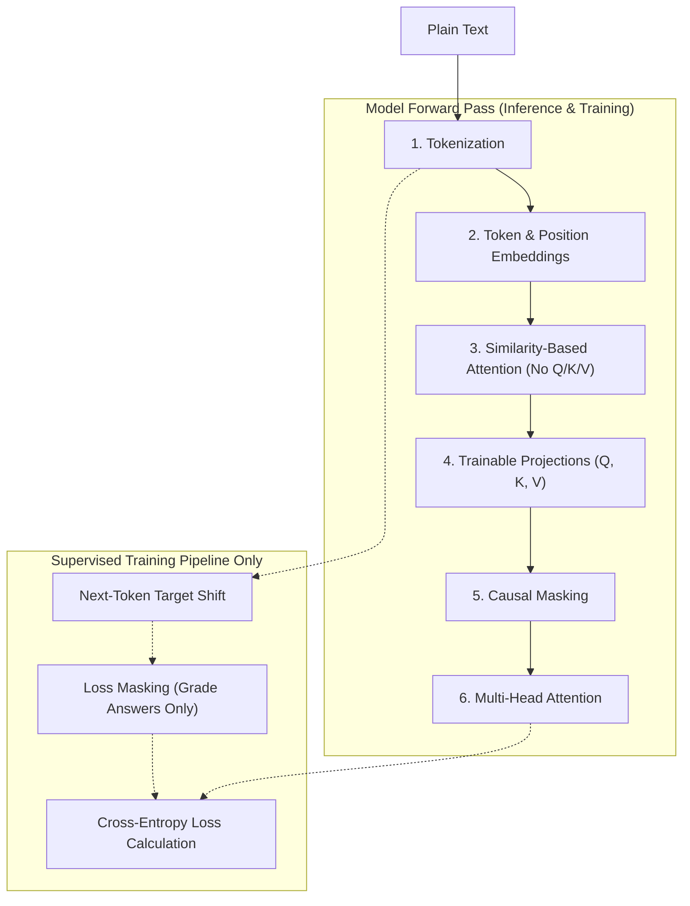
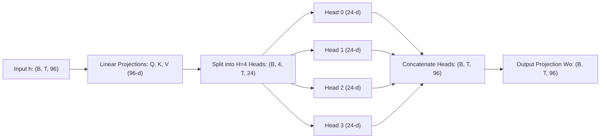

# Module 1 Theory: From Text to Multi-Head Causal Attention

> [!NOTE]
> **Scope of This Lesson:** The explanations and examples in this module are intentionally simplified to focus on core intuition using a small character-level model [(`Tiny-2.1`)](https://github.com/WollyMonjac/Tiny-2.1). In practice, full-scale production language models use additional engineering techniques—such as subword tokenization, specialized positional encodings, and optimized memory layouts—which are summarized at the end of this lesson alongside standard reference material for further study.

---

> [!NOTE]
> **Module Overview:** This lesson traces how a short question-and-answer sequence—such as `"2+2?\n4\n"`—moves from plain text into a numerical representation where every character gathers context from previous characters. All examples focus on **Tiny-2.1**, a compact character-level Transformer (`VOCAB = 97`, `CTX = 128`, `D = 96`, `H = 4`).



---

## 1. Tokenization (Turning Text into Numbers)

Neural networks operate on numbers, not strings. **Tokenization** splits text into basic units (**tokens**) and maps each unit to an integer ID from a fixed vocabulary.

While large models typically split text into tens of thousands of common word pieces (subwords), **Tiny-2.1** uses **single characters** so its vocabulary stays at just `97` entries:
* `0`: padding token (used to equalize lengths inside a batch)
* `1`: newline `"\n"` (separates the question from the answer, and marks the end of the answer)
* `2..96`: printable ASCII characters (`space` through `~`)

**Example 1 (A single word):**
```text
Text:   "cat"
Tokens: ['c', 'a', 't']
IDs:    [69, 67, 86]
```

**Example 2 (A Tiny-2.1 question-and-answer pair):**
```text
Text:   "2+2?\n4\n"
Tokens: ['2', '+', '2', '?', '\n', '4', '\n']
IDs:    [ 20,  13,  20,  33,    1,  22,   1 ]
```

**General rule:**
$$
\text{ID}(c) = \begin{cases}
1 & \text{if } c = \text{'}{\backslash}\text{n'} \\
\text{ASCII}(c) - 30 & \text{otherwise (values } 2\dots96\text{)}
\end{cases}
$$

> [!TIP]
> Token ID `1` (`\n`) acts as Tiny-2.1's stop signal. During text generation, as soon as the model predicts ID `1`, generation stops.


> https://platform.openai.com/tokenizer

---

## 2. Training Mechanics: Next-Token Shift and Loss Masking

> [!IMPORTANT]
> The operations in this section belong exclusively to the **training pipeline**. They do not run inside the model during inference.

A language model learns by predicting the **next token** at every position in a sequence. During training, we create input–target pairs by shifting the token sequence one position:

In Tiny-2.1, we also attach a **loss mask** (`0` for question tokens, `1` for answer tokens) so the model is only penalized for mistakes on the answer—not for failing to guess which question the user chose to ask.

**Example 1 (Word prediction without masking):**
```text
Full sequence: ['c', 'a', 't', '\n']
Inputs:        ['c', 'a', 't']
Targets:       ['a', 't', '\n']
```

**Example 2 (Tiny-2.1 Q&A with a loss mask):**
```text
Full sequence: ['2', '+', '2', '?', '\n', '4', '\n']
Inputs:        ['2', '+', '2', '?', '\n', '4']
Targets:       ['+', '2', '?', '\n', '4', '\n']
Loss Mask:     [  0,   0,   0,   0,   1,   1 ]
```
Here, only the predictions for `'4'` (after reading `"2+2?\n"`) and `'\n'` (after reading `"2+2?\n4"`) contribute to the training loss.

**General rule:**
For a token sequence $(t_0, t_1, \dots, t_{T-1})$ of length $T$, the training pipeline feeds inputs $(t_0, \dots, t_{T-2})$ and compares the model's output logits against targets $(t_1, \dots, t_{T-1})$.

---

## 3. Token Embeddings and Positional Embeddings

Integer IDs are arbitrary labels: ID `86` (`'t'`) is not numerically "larger" or "more meaningful" than ID `67` (`'a'`). Two lookup tables convert IDs and position indices into continuous vectors:

1. **Token Embedding Table ($E$):** Maps each token ID to a learned vector of $D$ numbers. Tokens used in similar contexts gradually move closer together in this space.
2. **Position Embedding Table ($P$):** Maps the position index `0, 1, ..., T-1` to a learned vector of $D$ numbers.

### Why Positional Embeddings Are Crucial
In bidirectional attention (like BERT), self-attention is strictly permutation-equivariant: shuffling the input tokens shuffles the output vectors identically. In causal autoregressive attention, the causal mask breaks full permutation symmetry because early tokens cannot see later tokens. However, without explicit position embeddings, the model still struggles to measure exact distances (e.g., distinguishing whether a token appeared 1 step ago versus 10 steps ago) and cannot differentiate identical repeated tokens at different locations. Adding $P[t]$ provides an explicit coordinate for each slot in the sequence.

**Example 1 (2D numerical example):**
Suppose character `'2'` has token vector $[1.0, 0.0]$, position `0` has $[0.1, 0.2]$, and position `2` has $[0.4, -0.1]$:
* First `'2'` (at index `0`): $[1.0, 0.0] + [0.1, 0.2] = [1.1, 0.2]$
* Second `'2'` (at index `2`): $[1.0, 0.0] + [0.4, -0.1] = [1.4, -0.1]$

The two `'2'` tokens now possess distinct vectors reflecting both *identity* and *location*.

**Example 2 (Tiny-2.1 tensor shapes for `"2+2?\n4\n"`):**
* Input length: $T = 7$ tokens, embedding width: $D = 96$, max context: $\text{CTX} = 128$.
* Lookup from `emb` (`97 × 96`) gives shape `(7, 96)`.
* Lookup from `pos` (`128 × 96`) for indices `0..6` gives shape `(7, 96)`.
* Adding them element-wise gives input matrix $X$ of shape `(7, 96)` (or `(B, T, 96)` for a batch of `B` sequences).

**General formula:**
$$X_t = E[\text{ID}_t] + P[t]$$

> https://ai-learning-repo.github.io/resources/demo/nlp/visualization_2_token_and_position_embeddings.html

---

## 4. Similarity-Based Attention Without Learned Q/K/V Projections

After Step 3, each token vector represents only one character at one position—it has no information from neighboring tokens. Before introducing trainable projection layers, we can build intuition by inspecting pure **similarity-based self-attention** using the raw embeddings:

1. **Score similarity** between every pair of tokens using the **dot product** ($X X^T$).
2. **Normalize scores** into positive weights summing to `1.0` using **softmax**.
3. **Compute a context vector** as the weighted sum of all token vectors.

**Example 1 (3 tokens in 2D):**
Let $x_0 = [1, 0]$, $x_1 = [1, 1]$, and $x_2 = [0, 1]$. Compute the context vector for $x_0$:
1. Dot products with $[x_0, x_1, x_2]$: $[1\cdot1 + 0\cdot0,\; 1\cdot1 + 0\cdot1,\; 1\cdot0 + 0\cdot1] = [1, 1, 0]$.
2. Softmax: $[e^1, e^1, e^0] / (e^1 + e^1 + e^0) \approx [0.42, 0.42, 0.16]$.
3. Weighted sum: $0.42[1, 0] + 0.42[1, 1] + 0.16[0, 1] = [0.84, 0.58]$.

**Example 2 (4 tokens `"2+2?"` in 3D):**
Suppose `'2'`, `'+'`, `'2'`, `'?'` have 3D vectors, and `'?'` has dot products `[0.8, 0.2, 0.8, 1.1]` with the four tokens. Applying softmax produces weights `[0.25, 0.14, 0.25, 0.36]`, blending the four vectors into a new representation for `'?'`.

**General formula:**
$$\text{Context}(X) = \text{softmax}(X X^T) \, X$$

### Why Pure Similarity Is Insufficient
While the embedding tables $E$ and $P$ are learned, the attention operation above has no internal projection weights. Under pure similarity ($X X^T$), a token can only attend strongly to tokens whose vectors are already mathematically similar. In language, tokens often need to attend to fundamentally *different* tokens (for example, an operator `'+'` or a question mark `'?'` must attend to digits `'2'`). To enable such asymmetric relationships, we need learnable projections.

> https://ai-learning-repo.github.io/resources/demo/nlp/visualization_3_similarity_attention.html

---

## 5. Trainable Attention: The Query, Key, and Value Metaphor

To overcome the limits of pure similarity, Transformers introduce three distinct roles for every token vector. 

### The Search Engine Metaphor
Think of self-attention as a **search and retrieval system** (a conceptual model popularized in deep learning literature):
* **Query ($Q$):** The search term you type into the search bar. It represents *what the current token is looking for*.
* **Key ($K$):** The index, tags, or metadata describing each webpage in the database. It represents *what each candidate token has to offer*.
* **Value ($V$):** The actual text or content on the webpage. Once a query matches a key, this is the *actual information retrieved and aggregated*.

Instead of comparing raw embeddings directly, we project input $X$ into Query, Key, and Value spaces using three learned weight matrices ($W_Q, W_K, W_V$):
* $Q = X W_Q^T$
* $K = X W_K^T$
* $V = X W_V^T$

```text
Input Token X ───┬───> [ W_Q ] ───> Query (Q): "What am I looking for?"
                 ├───> [ W_K ] ───> Key   (K): "What role/label do I advertise?"
                 └───> [ W_V ] ───> Value (V): "What content do I transmit?"
```

By separating Query and Key, a token representing `'?'` can have a Query vector that matches strongly with the Key vector of a digit `'2'`, even though their raw token representations are completely different.

### Scaling by $\sqrt{d_k}$
Before applying `softmax`, dot products $Q K^T$ are divided by $\sqrt{d_k}$ (the dimension of each head's key vectors). As vector dimensionality grows, dot products grow larger in magnitude. Large positive or negative values cause `softmax` to saturate (yielding `1.0` for one token and `0.0` everywhere else), which squashes training gradients toward zero. Scaling keeps score variance close to `1.0`.

> [!NOTE]
> **Comparison with Traditional Neurons:** Traditional feedforward layers apply an activation function like $\sigma(Wx + b)$ on every neuron. In self-attention, projections $W_Q, W_K, W_V$ are strictly linear (no `ReLU`); the nonlinearity comes entirely from `softmax` operating across sequence positions.

**General formula:**
$$\text{Attention}(Q, K, V) = \text{softmax}\left(\frac{Q K^T}{\sqrt{d_k}}\right) V$$

> https://ai-learning-repo.github.io/resources/demo/nlp/visualization_4_qkv_causal_attention.html

---

## 6. Causal Attention and Masking

During training, an entire sequence (such as `"2+2?\n4\n"`) is fed into the model in parallel. If position `4` (`'\n'`) were allowed to attend forward to position `5` (`'4'`), the model could trivially memorize the answer by copying it rather than learning to compute it.

A **causal mask** enforces strict autoregressive ordering: token $i$ may attend only to tokens at positions $j \le i$. 

To implement this, before calculating `softmax`, all disallowed positions ($j > i$) are overwritten with $-\infty$ (or a large negative number like `-1e9`). Because $e^{-\infty} = 0$, masked tokens receive exactly `0.0` probability, and `softmax` automatically normalizes the remaining past tokens to sum to `1.0`.

**Example 1 (Masking one row of scores):**
* Raw scores for the middle token (`i = 1`): `[1.2, 2.0, 3.5]`
* Apply causal mask to future position (`j = 2`): `[1.2, 2.0, -inf]`
* Softmax output: `[0.31, 0.69, 0.00]` (future position is zeroed out; past tokens sum to `1.0`)

**Example 2 (Causal mask structure):**
```text
Allowed attention matrix (1 = allowed, 0 = blocked):
       2  +  2  ?
  2  [ 1  0  0  0 ]   <- '2' can only attend to '2'
  +  [ 1  1  0  0 ]   <- '+' can attend to '2', '+'
  2  [ 1  1  1  0 ]   <- '2' can attend to '2', '+', '2'
  ?  [ 1  1  1  1 ]   <- '?' can attend to all previous tokens
```

**General formula:**

$$
\text{CausalAttention}(Q, K, V) = \text{softmax}\left(\frac{Q K^T}{\sqrt{d_k}} + M\right) V, \quad
M_{ij} = \begin{cases}
0 & \text{if } j \le i \\
-\infty & \text{if } j > i
\end{cases}
$$

> https://ai-learning-repo.github.io/resources/demo/nlp/#visualization_4_qkv_causal_attention.html

---

## 7. Multi-Head Attention

A single attention head produces a single attention distribution per token. However, when predicting the next token, a position often needs to integrate multiple independent relationships simultaneously—such as tracking the immediately preceding character, identifying punctuation boundaries, and retrieving relevant numerical arguments.

**Multi-head attention** divides the $D$-dimensional representations of $Q, K, V$ into $H$ parallel subspaces (**heads**), each with dimension $d_k = D / H$. Each head executes causal attention independently:



After each head independently computes its context vectors, the $H$ context tensors are concatenated along the feature dimension back to width $D$ and projected through an output weight matrix $W_O$. This output projection mixes information learned across the different heads.

**General formula:**
$$\text{MultiHead}(Q, K, V) = \text{Concat}(\text{head}_1, \dots, \text{head}_H) W_O^T, \quad \text{head}_h = \text{CausalAttention}(Q_h, K_h, V_h)$$

> [!WARNING]
> **Interpreting Attention Weights Carefully:**
> Visualizing attention heatmaps from early layers (such as Block 0) shows **how particular heads distribute routing weights across tokens**. It does **not** prove that an individual head "understands arithmetic" or possesses an assigned linguistic role. Attention distributions reflect dynamic weightings, while semantic computation and feature transformations occur through the combination of attention mixing and downstream feedforward layers.

> https://ai-learning-repo.github.io/resources/demo/nlp/#visualization_5_multihead_attention.html

---

### Moving From Simplified Intuition to Production Models

While Tiny-2.1 provides an accessible character-level playground, production LLMs apply several standard upgrades to the same underlying foundation:
1. **Subword Tokenization (BPE):** Instead of individual characters, modern models use Byte-Pair Encoding or WordPiece with vocabularies of 32,000–128,000 tokens, significantly reducing sequence length $T$.
2. **Rotary Position Embeddings (RoPE):** Instead of additive learned positional embeddings ($X + P$), models like LLaMA and Mistral rotate query and key vectors in the complex plane, naturally encoding relative token distances.
3. **KV Caching:** During text generation, keys and values of previous tokens are cached in memory so each new token only requires computing a single new query vector $Q_{new}$, avoiding recomputing $O(T^2)$ steps.

---

## References and Further Reading

* **Project Repository:**
  * [Tiny-2.1 on GitHub](https://github.com/WollyMonjac/Tiny-2.1) — The reference character-level Transformer implementation used throughout this module.

* **Textbooks & Interactive Notebooks:**
  * [Deep Learning with Python (Ch. 15: Language Models and the Transformer)](https://deeplearningwithpython.io/chapters/chapter15_language-models-and-the-transformer/) by François Chollet — Core concepts of sequence modeling and self-attention.
  * [Build a Large Language Model From Scratch (Sebastian Raschka)](https://github.com/rasbt/LLMs-from-scratch):
    * [Chapter 2: Working with Text Data](https://github.com/rasbt/LLMs-from-scratch/blob/main/ch02/01_main-chapter-code/ch02.ipynb) — Tokenization, vocabulary creation, and embedding tables.
    * [Chapter 3: Coding Attention Mechanisms](https://github.com/rasbt/LLMs-from-scratch/blob/main/ch03/01_main-chapter-code/ch03.ipynb) — Step-by-step implementation of scaled dot-product, causal, and multi-head attention.
    * [Chapter 4: Implementing a GPT Model from Scratch](https://github.com/rasbt/LLMs-from-scratch/blob/main/ch04/01_main-chapter-code/ch04.ipynb) — Assembling attention into complete Transformer blocks.


<!-- * https://github.com/WollyMonjac/Tiny-2.1
* https://deeplearningwithpython.io/chapters/chapter15_language-models-and-the-transformer/
* https://github.com/rasbt/LLMs-from-scratch/blob/main/ch02/01_main-chapter-code/ch02.ipynb
* https://github.com/rasbt/LLMs-from-scratch/blob/main/ch03/01_main-chapter-code/ch03.ipynb
* https://github.com/rasbt/LLMs-from-scratch/blob/main/ch04/01_main-chapter-code/ch04.ipynb -->
