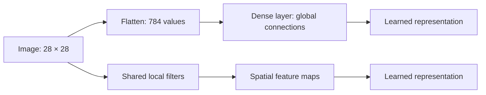
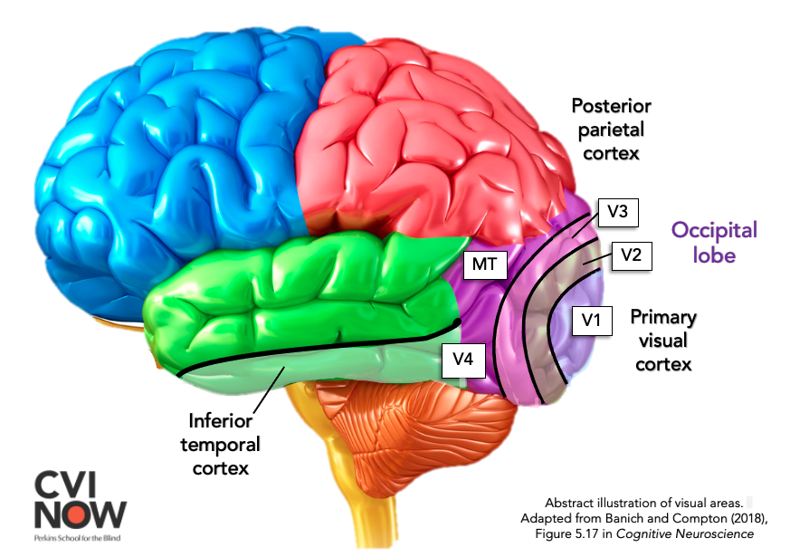
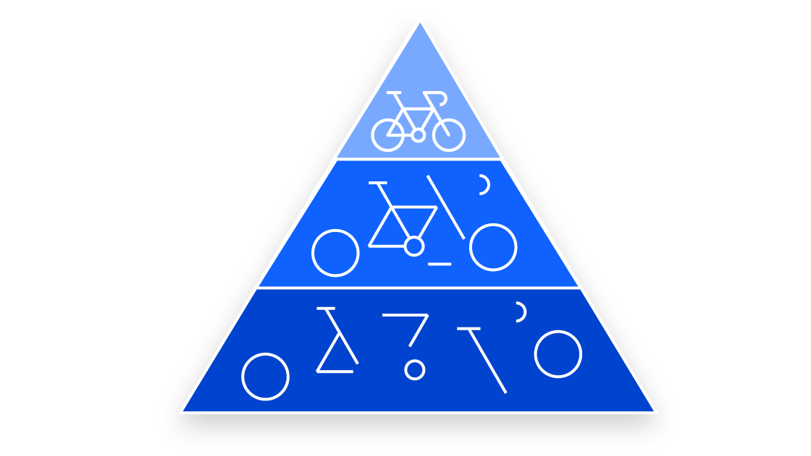
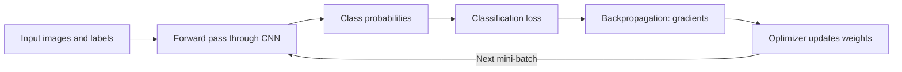
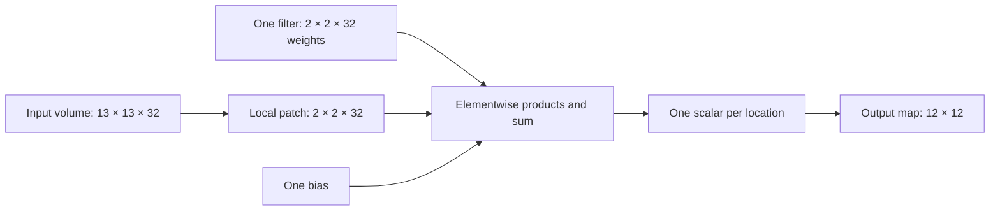
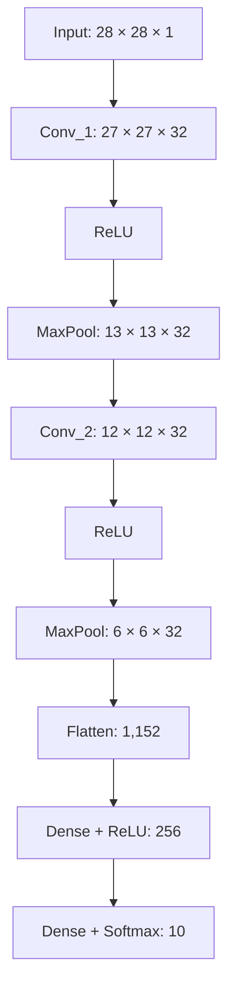

# Theory 1: Convolutional Neural Networks: From Pixels to Learned Features

*Companion theory for [Demo 1](demo1-nc.md) and Activity 1 · Fashion-MNIST · Convolutional neural networks (CNNs)*

## Learning objectives and prerequisites

This chapter develops the concepts behind a convolutional neural network (CNN), beginning with the weighted sums already familiar from fully connected neural networks. Its central question is how a model can exploit **local spatial relationships** in an image while still learning through the familiar forward-pass, loss, backpropagation, and optimizer-update cycle.

The chapter assumes familiarity with input vectors, weights, biases, dense layers, ReLU, softmax, class probabilities, and the distinction between training and evaluation. Basic matrix multiplication is helpful; the convolution calculations are developed first with ordinary arithmetic.

After studying the chapter, the following ideas should be clear:

- Why flattening is permissible but does not give a dense layer an explicit local, shared feature detector.
- How a convolutional filter differs from a dense neuron, even though both compute weighted sums.
- How sliding one filter over an image generates **many** output numbers, arranged as a feature map.
- Why horizontal and vertical filters produce different signed responses.
- How a trainable CNN learns filters and why ReLU changes their feature maps.
- How a filter combines information across all input channels.
- Why deeper convolutional layers have different receptive fields and representational capacities.
- How image, feature-map, pooling, flattening, and classification shapes fit together.
- How to count trainable parameters correctly and distinguish parameter efficiency from guaranteed generalization.
- How the complete CNN is trained and evaluated without confusing feature extraction with the training algorithm.

**Scope.** The model used throughout is a Fashion-MNIST classifier with 28 × 28 grayscale input, two convolutional layers, two max-pooling operations, a 256-unit dense layer, and ten softmax outputs. Pooling is explained sufficiently to read the architecture. Detailed pooling choices, padding, stride variations, and transfer learning belong to Theory 2.

---

## Using the supplied code

The explanations can be read without running code. Hand calculations are optional practice. The expandable examples provide code to run, observe, and interpret; writing plotting code from scratch is not assessed.

Google Colab is the primary execution environment. The examples use NumPy, Matplotlib, and TensorFlow/Keras; see the [shared Python setup](../../week3/material/1-python_setup.md). If an import is missing in Colab, install only the missing package in a **notebook cell**, using the relevant command:

```text
%pip install numpy
%pip install matplotlib
%pip install tensorflow
```

After installing a missing package, restart the Colab session/runtime and rerun the example's imports and setup. In a local notebook, select the course environment's kernel. These `%pip` commands are notebook commands, not terminal commands.

Each example includes its own imports and inputs, except the two plotting blocks in Section 11.6, which explicitly reuse the preceding training example. Section 8.7 also needs the supplied [trained model](assets/fashion_mnist_cnn.keras): download it and upload it to the Colab working directory. When run locally from this theory file's directory, the code finds the same file in `assets`. The Fashion-MNIST loader downloads data on its first use if necessary.

## 1. Why use a CNN when a dense network can classify images?

### 1.1 An image is structured data

A grayscale Fashion-MNIST image has 28 rows and 28 columns. Every pixel describes an intensity at a particular location. An image containing a shoe can have nearby pixels that jointly form a boundary, a contour, or a region of approximately uniform intensity.

The image contains 784 pixel values. A dense classifier commonly begins with a `Flatten` operation:

$$
28\times28=784
$$

Flattening rearranges the two-dimensional array into one vector. **It does not discard the pixel values**, and a dense network may still learn which combinations of input positions are predictive. However, the network no longer represents rows and columns as explicit spatial axes at that stage. A conventional dense layer does not intrinsically reuse one small pattern detector at every image location.

For example, a horizontal edge appearing near the upper-left part of an image and an otherwise identical edge appearing near the lower-right part of the image involve different coordinates in the flattened vector. A dense neuron has independent weights for those coordinates. The architecture does not require the same local weights to be used at both locations.

This is the main architectural motivation for convolution: **local connectivity** and **weight sharing** provide a built-in way to apply the same learned operation throughout an image.

### 1.2 Dense processing versus convolutional processing



The diagram compares *initial processing strategies*, not two complete classifiers. Both branches can eventually feed a dense classification head. A CNN is not prevented from using dense layers near its output.

A dense neuron can use pixels from the entire image at once. A convolutional output at one location uses a smaller neighborhood, usually from every incoming channel. The same convolutional weights are reused at neighboring output locations. Several output feature maps can be produced using different learned filters.

### 1.3 The parameter-count comparison

Consider two **individual layers** receiving the same 28 × 28 grayscale image:

| Quantity | Dense layer | Convolutional layer |
|---|---:|---:|
| Input | 784 flattened values | 28 × 28 × 1 image |
| Output design | 32 units | 32 filters, each 2 × 2 |
| Weights | 784 × 32 = 25,088 | 2 × 2 × 1 × 32 = 128 |
| Biases | 32 | 32 |
| **Trainable parameters** | **25,120** | **160** |
| Output per image | 32 values | 27 × 27 × 32 values (with valid padding, stride 1) |

The dense parameter count is:

$$
N_{\mathrm{dense}}=n_{\mathrm{in}}n_{\mathrm{out}}+n_{\mathrm{out}}
=784(32)+32=25{,}120
$$

The convolutional parameter count is:

$$
N_{\mathrm{conv}}=(k_hk_wC_{\mathrm{in}}+1)C_{\mathrm{out}}
=(2\cdot2\cdot1+1)32=160
$$

The `+1` inside the parentheses counts **one bias per output filter**. Each filter's bias, like its weights, is reused at all spatial positions.

The large difference is real, but the comparison has limits. These layers produce different numbers and arrangements of activations: 32 scalars from the dense layer versus 23,328 values from the convolutional layer. **Parameter count is not the same as activation count, computation time, memory use, or accuracy.** A convolutional layer can perform a substantial amount of computation while using relatively few distinct trainable parameters.

Weight sharing gives CNNs an architectural bias that is often useful for images. It can make learning more parameter-efficient, but **fewer parameters do not guarantee that overfitting disappears**. Data size, training duration, regularization, architecture, and task difficulty still matter.

### 1.4 A distinction that prevents a common misconception

A flattened representation still contains the original pixel information, including its ordering. It is therefore inaccurate to say that flattening *destroys the spatial information*. The more precise claim is that **a standard dense layer does not explicitly enforce locality or translation-related weight sharing**. A CNN makes those ideas part of its computation.

<details>
<summary>Check understanding: What exactly does flattening remove?</summary>

Flattening removes the explicit two-dimensional axes in the tensor representation. The underlying pixel values are retained. The limitation is not a loss of pixel data, but the absence of a built-in operation that scans and reuses a small set of weights over local neighborhoods.

</details>

---

## 2. What biological vision suggests—and what it does not

### 2.1 A useful organizing idea: local information becomes part of larger representations

Visual perception involves several stages of neural processing. Early visual mechanisms are sensitive to local features such as contrast and orientation; later processing integrates information over wider regions and supports increasingly complex representations. This provides an *inspiration* for a layered architecture that begins with local information and combines it through successive computations.


This is a **conceptual hierarchy**, not a biological wiring diagram and not a promise that any particular CNN layer will correspond to a named stage of the visual cortex.

Two architectural ideas follow from the analogy:

**Local processing.** Early operations can examine nearby values instead of requiring every output to use every pixel in the complete image.

**Hierarchy.** Later operations can use the outputs of earlier operations, potentially combining simpler local responses into more complex patterns.

### 2.2 Where the analogy must stop

CNNs are engineering models trained using numerical optimization. Biological vision uses much richer circuits, dynamics, feedback, adaptation, and other mechanisms. The eye is not literally a stack of Keras `Conv2D` layers, and a CNN's feature maps are not direct measurements of biological neurons. Many CNNs also fail to exhibit robust human-like perception under changes in context or image distribution.

The scientifically careful claim is that hierarchical local processing **motivated useful architectural ideas**, not that CNNs accurately recreate the biological visual system.

### 2.3 From an analogy to an operation

The first concrete question is how to implement “examine a small neighborhood.” A **filter**, also called a **kernel**, provides a compact set of weights that is applied to a local image patch. The same set is reused at other positions. The resulting collection of local responses forms a feature map.

---
<details>
<summary><b>Extra: Inspiration from the Brain: Hierarchical Vision</b></summary>

Before diving into the mechanics of CNNs, it's helpful to understand their inspiration: the human visual system. Our brains don't process an entire scene instantly. Instead, visual information travels through different areas of the brain, particularly the visual cortex located in the occipital lobe, processing features in a hierarchical manner.



> Image source: [Perkins School for the Blind, Adapted from Banich and Compton (2018)](https://www.perkins.org/higher-order-visual-pathways-and-the-cvi-brain/)

As shown in the illustration above:

1.  Information first hits the **Primary Visual Cortex (V1)**. Neurons here respond to simple features like edges, lines, and orientations.
2.  This output is passed to subsequent areas like **V2** and **V3**. Neurons in these areas combine the simple features detected in V1 to recognize more complex shapes, corners, and textures.
3.  Further processing in higher-level areas (like the Inferior Temporal Cortex, not fully detailed here) combines these shapes to recognize complex objects (like faces, chairs, or the apple from our earlier example).




**The Connection to CNNs:**

Convolutional Neural Networks are designed to mimic this hierarchical feature learning. The **Convolutional layers** in a CNN act similarly to these stages in the visual cortex:

*   **Early convolutional layers** (closer to the input image) automatically learn to detect simple features like edges and corners.
*   **Deeper convolutional layers** (further into the network) receive input from earlier layers and learn to combine those simple features to detect more complex patterns, textures, parts of objects, and eventually entire objects.

This biological inspiration helps explain why CNNs are structured with multiple layers and why convolution is such a fundamental operation for image understanding. Now, let's look at how the convolution operation actually achieves this feature extraction.

</details>

---

## 3. From a dense neuron to a convolutional filter

### 3.1 The familiar arithmetic

A dense neuron calculates a weighted sum and bias before its activation. For three inputs, the pre-activation value is:

$$
z=w_1x_1+w_2x_2+w_3x_3+b
$$

For example, with inputs 2, 1, and 3; weights 0.5, −1, and 0.25; and bias 0.2:

$$
z=(0.5)(2)+(-1)(1)+(0.25)(3)+0.2=0.95
$$

The same arithmetic appears in convolution. The difference is **which inputs are selected** and **how the weights are reused**.

### 3.2 One filter on one local patch

Consider a 2 × 2 grayscale patch and one 2 × 2 filter:

$$
X=\begin{bmatrix}
2&3 \\
1&4
\end{bmatrix}
\qquad
W=\begin{bmatrix}
-1&1 \\
-1&1
\end{bmatrix}
$$

With bias 0.5, the weighted response is:

$$
\begin{aligned}
z&=2(-1)+3(1)+1(-1)+4(1)+0.5\\
 &=-2+3-1+4+0.5\\
 &=4.5
\end{aligned}
$$

This is still a weighted sum. It differs from a standard dense neuron because the filter's weights apply to a local 2 × 2 patch, then **the same four weights are reused at the next patch**.

The filter itself is not one independent neuron covering the whole image. More accurately, each *output position* performs a neuron-like local weighted sum, while **all positions share the same filter parameters**.

### 3.3 Similarities and differences

| Property | Dense neuron | One convolutional filter |
|---|---|---|
| Basic arithmetic | Weighted sum plus bias | Weighted sum plus bias |
| Trainable parameters | Weights and often bias | Weights and often bias |
| Activation | May be followed by ReLU or another function | May be followed by ReLU or another function |
| Typical input per calculation | A full input vector to that layer | A local spatial patch spanning all input channels |
| Weight reuse across spatial positions | Not built into a conventional dense layer | The same kernel is used at every spatial position |
| Result | One value per dense unit and example | One **feature map** per filter and example |
| Spatial structure | Generally not explicitly encoded by the layer | Explicitly maintained in feature-map height and width |

A convolutional **layer** contains several filters. One filter produces one output channel; 32 filters produce 32 output channels. The filters may learn very different weights even though all are applied to the same incoming tensor.

### 3.4 How bias behaves

A convolutional filter normally has one trainable bias. This bias is added at every output location for that filter. If a patch yields a weighted sum of −0.2 and the bias is +0.5, the pre-activation response becomes +0.3. Bias can move values across the ReLU threshold. It does not guarantee that a filter acquires any particular human-interpretable meaning.

### 3.5 Why this connection matters

A CNN uses the same weighted-sum arithmetic and learning cycle as a dense network. Its local connections and shared parameters change how those calculations are organized across an image.

<details>
<summary>Check understanding: Is one filter equivalent to one dense neuron?</summary>

No. Both use weighted sums, but one filter is applied at many positions and produces a full feature map. Each output position performs one local neuron-like calculation using the **same** weights. A conventional dense neuron instead produces one scalar per example and typically has distinct weights for each element of its input vector.

</details>

---

## 4. How convolution slides: all four outputs of a tiny example

### 4.1 Start with a small image

Consider a 3 × 3 image with intensities chosen to reveal vertical contrast:

$$
X=\begin{bmatrix}
10&20&10 \\
10&20&10 \\
10&20&10
\end{bmatrix}
$$

Use a 2 × 2 filter:

$$
W=\begin{bmatrix}
-1&1 \\
-1&1
\end{bmatrix}
$$

The left-hand weights are negative and the right-hand weights are positive. The filter will respond positively when the right side of a patch is brighter and negatively when the left side is brighter.

For this first example, use **stride 1**, **no padding**, and **zero bias**. Stride 1 means that the filter advances one position between neighboring evaluations. Without padding, the filter must remain entirely inside the image.

### 4.2 First position: top left

The first 2 × 2 image patch is:

$$
P_{0,0}=\begin{bmatrix}
10&20 \\
10&20
\end{bmatrix}
$$

Its response is:

$$
y_{0,0}=10(-1)+20(1)+10(-1)+20(1)=20
$$

The output array's top-left cell receives the value 20.

### 4.3 Second position: one column to the right

The filter moves one column to the right, using:

$$
P_{0,1}=\begin{bmatrix}
20&10 \\
20&10
\end{bmatrix}
$$

The weights have **not changed**, but the pixels under them have. The new response is:

$$
y_{0,1}=20(-1)+10(1)+20(-1)+10(1)=-20
$$

### 4.4 Third and fourth positions: one row down

The bottom-left patch is identical to the original top-left patch, so the response is +20. The bottom-right patch is identical to the top-right patch, so the response is −20.

| Filter's top-left position | Patch columns and rows | Weighted response | Output cell |
|---|---|---:|---|
| Row 0, column 0 | Rows 0–1, columns 0–1 | +20 | `(0, 0)` |
| Row 0, column 1 | Rows 0–1, columns 1–2 | −20 | `(0, 1)` |
| Row 1, column 0 | Rows 1–2, columns 0–1 | +20 | `(1, 0)` |
| Row 1, column 1 | Rows 1–2, columns 1–2 | −20 | `(1, 1)` |

Combining the four scalar calculations gives the **2 × 2 output feature map**:

$$
Y=\begin{bmatrix}
20&-20 \\
20&-20
\end{bmatrix}
$$

This answers the key mechanical question: **a filter's output map contains one weighted sum for every allowed placement of the filter**. Each number is not invented by the library; it corresponds to a specific input patch and a specific local calculation.

### 4.5 A small Python trace that reveals the sliding mechanism

The complete example below does not require TensorFlow. It shows the pixel patch, its multiplication by the filter, and the resulting number at every position.

<details>
<summary>Run supplied Python code: Display the four sliding-window calculations</summary>

```python
import numpy as np

image = np.array([
    [10, 20, 10],
    [10, 20, 10],
    [10, 20, 10]
], dtype=np.float32)

kernel = np.array([
    [-1, 1],
    [-1, 1]
], dtype=np.float32)

output = np.zeros((2, 2), dtype=np.float32)

for r in range(2):
    for c in range(2):
        patch = image[r:r + 2, c:c + 2]
        products = patch * kernel
        response = float(products.sum())
        output[r, c] = response
        print(f"Position ({r},{c})")
        print("Patch:\n", patch)
        print("Elementwise products:\n", products)
        print("Weighted response:", response, "\n")

print("Complete 2 × 2 feature map:\n", output)
np.testing.assert_array_equal(output, [[20, -20], [20, -20]])
```

</details>

### 4.6 The output-size calculation

For an input of side length $n$, a filter of side length $k$, stride 1, and no padding, the filter can begin at $n-k+1$ valid positions along that axis:

$$
n_{\mathrm{out}}=n-k+1
$$

Here, $n=3$ and $k=2$, giving $3-2+1=2$ positions per axis, hence a 2 × 2 output grid. For Fashion-MNIST, a 28 × 28 image with a 2 × 2 filter gives:

$$
28-2+1=27
$$

There are 27 positions across and 27 positions down, or **729 local calculations per filter**. A layer with 32 filters therefore produces 32 feature maps, each measuring 27 × 27.

For a rectangular image with height $H$, width $W$, and rectangular kernel $k_h\times k_w$, the stride-1, no-padding output is:

$$
H_{\mathrm{out}}=H-k_h+1,\qquad
W_{\mathrm{out}}=W-k_w+1
$$

Padding can preserve or change these dimensions; changing stride changes which positions are evaluated. Those design choices are developed in Theory 2.

### 4.7 Technical vocabulary: convolution versus cross-correlation

Most deep-learning libraries implement the operation demonstrated above as **cross-correlation**: the kernel is used in its supplied orientation, without first being flipped horizontally and vertically. In CNN usage, it is conventionally called *convolution*. The examples in this chapter follow the standard TensorFlow/Keras convention. This matters when reproducing horizontal or vertical edge-filter responses by hand.

---

## 5. Feature maps: interpreting horizontal, vertical, and signed responses

### 5.1 Two manually designed filters

A vertical-contrast filter and a horizontal-contrast filter can be represented by:

$$
W_{\mathrm{vertical}}=
\begin{bmatrix}
-1&1 \\
-1&1
\end{bmatrix}
\qquad
W_{\mathrm{horizontal}}=
\begin{bmatrix}
-1&-1 \\
1&1
\end{bmatrix}
$$

The **vertical-contrast** kernel compares the right and left sides of a local patch. The **horizontal-contrast** kernel compares the bottom and top sides. The names refer to the orientation of the boundary to which the filter often responds; positive or negative signs depend on the *direction* of the contrast.

For a uniformly bright patch, all four entries might equal 10. Both kernels then produce zero because their positive and negative weights cancel. This shows why these particular filters are **contrast detectors rather than simple brightness meters**.

The filter weights are fixed by design in these examples. They were not learned from Fashion-MNIST. A learned filter could have different values and could respond to other combinations of local pixels.

### 5.2 Positive and negative values are both meaningful measurements

If the bottom of a patch is brighter than the top, the horizontal-contrast filter tends to produce a positive response. Reversing that contrast tends to produce a negative response. A response near zero can arise when the two sides are similar or when positive and negative contributions cancel.

A **positive pre-activation** does not universally prove the presence of a named object part. A **negative pre-activation** does not universally mean that a pattern is absent. These values are weighted responses determined by the filter and bias. The simple edge kernels make their interpretation unusually transparent.

### 5.3 Why the output is a map

A feature map retains the spatial organization of output responses. If a filter responds strongly along the boundary of a shoe, the response map may visually trace that boundary. It does not mean that one filter sees or recognizes the entire shoe. The recognizable large-scale pattern emerges from collecting many separate, local responses in their spatial arrangement.

For the signed plots in Demo 1, a diverging color scale is useful:

| Color in the example plots | Mathematical meaning |
|---|---|
| Red | Positive weighted response |
| White or neutral | Response near zero |
| Blue | Negative weighted response |

Color is a visualization convention. It is not an intrinsic property of convolution or an interpretation of “good” versus “bad” signals. The **same color limits** should be used when comparing before and after versions of a feature map.

### 5.4 A reproducible image experiment

The following standalone snippet loads Fashion-MNIST, applies both manually defined filters **without ReLU**, and displays the signed outputs. TensorFlow and Matplotlib are required, as in the accompanying Colab demo.

<details>
<summary>Run supplied Python code: Apply fixed edge filters to an ankle boot</summary>

```python
import numpy as np
import matplotlib.pyplot as plt
import tensorflow as tf
from tensorflow import keras

(_, _), (test_images, test_labels) = keras.datasets.fashion_mnist.load_data()
image = test_images[0].astype("float32") / 255.0
image_batch = image[None, :, :, None]  # (1, 28, 28, 1)

vertical_kernel = np.array([[-1, 1], [-1, 1]], dtype=np.float32)
horizontal_kernel = np.array([[-1, -1], [1, 1]], dtype=np.float32)

def apply_kernel(kernel):
    kernel_tensor = kernel.reshape(2, 2, 1, 1)
    return tf.nn.conv2d(
        image_batch, kernel_tensor, strides=1, padding="VALID"
    ).numpy()[0, :, :, 0]

vertical_map = apply_kernel(vertical_kernel)
horizontal_map = apply_kernel(horizontal_kernel)
limit = max(np.abs(vertical_map).max(), np.abs(horizontal_map).max(), 1e-6)

fig, axes = plt.subplots(1, 3, figsize=(13, 4))
axes[0].imshow(image, cmap="gray")
axes[0].set_title("Fashion-MNIST image")
axes[1].imshow(vertical_map, cmap="coolwarm", vmin=-limit, vmax=limit)
axes[1].set_title("Vertical contrast")
im = axes[2].imshow(horizontal_map, cmap="coolwarm", vmin=-limit, vmax=limit)
axes[2].set_title("Horizontal contrast")
for ax in axes:
    ax.axis("off")
fig.colorbar(im, ax=axes[1:], shrink=0.75)
plt.show()

print("Input:", image_batch.shape)
print("Each feature map:", vertical_map.shape)
print("Actual label ID:", int(test_labels[0]))
```

</details>

These plots are calculated from real pixel values. They are not diagrams of idealized filter behavior. A 2 × 2 kernel detects only very small local contrast patterns; it does not independently identify heels, sleeves, or other complete object parts.

### 5.5 Weight sharing, translation, and a careful distinction

When the same local pattern moves to a new image position, the same filter can respond at that new position. Under ordinary conditions away from borders, a translated input tends to produce a correspondingly translated feature-map response; this property is called **translation equivariance**. It is not the same as saying the complete network's class prediction will always be unchanged by movement. Pooling, padding, finite image boundaries, stride, and later classifier layers can affect translation behavior.

**Translation invariance** means that an output stays unchanged when the input shifts. In contrast, an **equivariant** feature map shifts along with the input. For stride-1 convolution, this correspondence holds at matching valid positions away from boundary effects; it does not imply that the final class probabilities remain unchanged.

Pooling or learned combinations of features can reduce sensitivity to some shifts, but **neither pooling nor a dense classification head guarantees translation invariance**. In particular, downsampling can change which responses share a pooling window, and a flattened dense head can use different weights at different spatial positions. Whether the class prediction stays the same under a shift must be checked for the actual model. Theory 2 examines how pooling, padding, and stride affect this behavior.

The architectural benefit remains: **a convolutional filter does not need to relearn its local weights separately at every pixel location**.

---

## 6. From manually chosen filters to learned filters

### 6.1 Fixed filters explain the mechanism; learned filters make the model adaptable

The vertical and horizontal filters above were selected manually. Their responses can be predicted because their weights are known and interpretable. A trainable convolutional layer instead begins with initial parameter values and changes them during training to reduce the model's loss on its task.

A learned kernel is **not guaranteed** to look like a textbook edge detector. The training objective is classification, not the recovery of filters whose visual interpretations are convenient for humans. Some learned responses may resemble boundaries or texture, while others may be difficult to label.

### 6.2 The familiar learning cycle is still in force



The training stages have distinct responsibilities:

**Forward pass.** Current convolutional and dense parameters are used to compute predictions. The forward pass does not update those parameters.

**Loss.** An objective such as sparse categorical cross-entropy measures how poorly the predicted probabilities align with the known class labels. Loss by itself does not say how each weight should move.

**Backpropagation.** Automatic differentiation applies the chain rule backward through the model to calculate gradients of loss with respect to trainable parameters. Calculating a gradient is not a weight update.

**Optimizer step.** An optimizer such as Adam uses gradients to update the trainable convolutional and dense weights and biases. The same pattern repeats over mini-batches and epochs.

**Evaluation.** Performance on examples not used for gradient updates helps estimate generalization. A low training loss alone does not establish strong performance on unseen images.

### 6.3 What changes when weights are shared?

A given convolutional weight participates in calculations at **many spatial positions**. Its gradient therefore reflects its influence through all relevant uses of that weight, as well as through the rest of the network. Training changes one shared parameter, and its new value affects the filter at every position in the next forward pass.

This provides an additional explanation for parameter efficiency: one learned local rule is reused instead of storing a separate local rule for every output position.

### 6.4 A tiny numerical example of a shared weight's gradient

Consider a deliberately simplified model in which one shared parameter $w$ is used at two positions. The local inputs are $x_1=2$ and $x_2=1$, and the target responses are $t_1=3$ and $t_2=0$:

$$
z_1=wx_1,\qquad z_2=wx_2
$$

Use half-squared error across the two positions:

$$
L(w)=\frac12(z_1-t_1)^2+\frac12(z_2-t_2)^2
$$

At $w=1$, the predictions are $z_1=2$ and $z_2=1$, giving:

$$
L(1)=\frac12(2-3)^2+\frac12(1-0)^2=1
$$

The derivative of the total loss includes both uses of the shared weight:

$$
\begin{aligned}
\frac{dL}{dw}
&=(z_1-t_1)x_1+(z_2-t_2)x_2\\
&=(2-3)(2)+(1-0)(1)\\
&=-2+1=-1
\end{aligned}
$$

With learning rate 0.1, one gradient-descent update gives:

$$
w_{\mathrm{new}}=1-0.1(-1)=1.1
$$

After the update, $z_1=2.2$ and $z_2=1.1$. The new loss is:

$$
L(1.1)=\frac12(2.2-3)^2+\frac12(1.1-0)^2=0.925
$$

This calculation is a **small analogy for weight sharing**, not a full CNN training example. It demonstrates that the shared parameter collects gradient contributions from more than one location. Real CNN training additionally includes multiple filters, input channels, nonlinear activations, batches, and a task-specific loss.

---
## 7. ReLU: from signed convolution responses to nonlinear activations

### 7.1 Separate the convolution from its activation

A convolution first computes a **pre-activation response** $z$. An activation function then transforms that value into $a$. For the rectified linear unit (ReLU):

$$
a=\operatorname{ReLU}(z)=\max(0,z)
$$

The rule is simple:

- If $z$ is positive, ReLU leaves it unchanged.
- If $z$ is zero, the output is zero.
- If $z$ is negative, ReLU replaces it with zero.

For an example row of convolution responses:

$$
z=\begin{bmatrix}
-3&-0.5&0&1.5&4
\end{bmatrix}
$$

ReLU produces:

$$
a=\begin{bmatrix}
0&0&0&1.5&4
\end{bmatrix}
$$

The positive values keep both their locations and magnitudes. The negative values are **discarded in that output channel**. ReLU is not simply a relabeling of the signs: the mapping loses information because all negative inputs become the same output value, zero.

### 7.2 Interpreting a feature map before and after ReLU

Suppose a fixed horizontal-contrast filter produces strong positive responses along some parts of a shoe boundary and strong negative responses along other parts. A signed, pre-ReLU heatmap can show both polarities. After ReLU, the negative response regions become zero, while the positive regions remain.

A complete zero-valued feature map is also possible. This happened in the accompanying Fashion-MNIST investigation for **learned first-layer filter 2** on one ankle-boot image: the chosen filter had no positive pre-activation responses at any spatial location. That does not mean the entire CNN produces zeros or that the filter is useless for all images. It describes one filter's response to one particular input.

In the same investigation, **filter 12** had positive and negative responses. Its post-ReLU output preserved the positive patterns and suppressed the negative ones. These examples show that a feature map can have a very different appearance before and after activation, even though the convolutional weights are unchanged between those two observations.

### 7.3 Does ReLU decide which information is useful?

ReLU is sometimes described as a gate that “keeps important features.” This is a helpful initial metaphor, but it is not a literal semantic test. The function does not know whether a positive response is relevant to classifying a boot or whether a negative response would be useful if preserved. It applies the same threshold rule to every element.

During training, earlier filters and later layers can adapt to the fact that negative pre-activations will be suppressed. Different filters may learn contrasting responses, and biases may shift weighted sums across zero. These are possibilities of learning, **not guarantees** that all potentially useful negative information is recovered elsewhere.

### 7.4 Why nonlinearity matters

A dense layer computes an affine transformation of its input. A convolutional layer, viewed over the complete input tensor, is also an affine transformation before its activation. Composing affine transformations without any nonlinear operations produces another affine transformation.

For a simple dense example:

$$
z_1=W_1x+b_1
$$

and a second affine transformation:

$$
\begin{aligned}
z_2&=W_2z_1+b_2\\
&=W_2(W_1x+b_1)+b_2\\
&=(W_2W_1)x+(W_2b_1+b_2)
\end{aligned}
$$

Despite having two stages, the overall computation is still affine. Inserting a nonlinear operation such as ReLU prevents this simple collapse in general. It permits the model to express piecewise nonlinear relationships that cannot be represented by a single affine transformation alone.

This argument applies to a stack containing only affine layers; max pooling and other nonlinear operations also affect the resulting function. The presence of many convolutional layers by itself does not guarantee sophisticated representations—the arrangement of transformations and the learned parameters matter.

### 7.5 Sparsity and the biological analogy

Because ReLU turns negative inputs into zero, it often creates **sparse activations**: many feature-map entries may be exactly zero. Sparsity can affect later computations and feature selectivity. It does **not** automatically make every standard convolution implementation faster; computational efficiency depends on the software and hardware actually exploiting the zeros.

ReLU's threshold behavior can be compared loosely with the idea of activation thresholds in biological neurons. The comparison is limited: real neuronal signaling involves much more than the function $\max(0,z)$, and no exact biological equivalence is implied.

### 7.6 A small verification using NumPy

<details>
<summary>Run supplied Python code: Compare negative and positive values before and after ReLU</summary>

```python
import numpy as np
import matplotlib.pyplot as plt

z = np.array([
    [-2.0, -1.0, 0.0, 1.0],
    [-0.5,  2.0, 3.0, -3.0],
    [ 1.5, -2.5, 0.0, 0.5]
])
a = np.maximum(z, 0.0)

limit = max(float(np.abs(z).max()), 1e-6)
fig, axes = plt.subplots(1, 2, figsize=(9, 3.5), layout="constrained")
for ax, values, title in zip(
    axes, (z, a), ("Before ReLU", "After ReLU")
):
    im = ax.imshow(values, cmap="coolwarm", vmin=-limit, vmax=limit)
    ax.set_title(title)
    ax.set_xlabel("Column")
    ax.set_ylabel("Row")
fig.colorbar(im, ax=axes, shrink=0.75)
plt.show()

print("Before ReLU:\n", z)
print("After ReLU:\n", a)
print("Fraction of zeros after ReLU:", np.mean(a == 0))
```

</details>

The shared color scale makes the before/after comparison meaningful. A separate automatic color scale for each panel can obscure whether values have changed in magnitude.

---

## 8. Multichannel convolution: how one filter uses a 3D input patch

### 8.1 One channel is only the simplest case

In the first convolution on Fashion-MNIST, the input is grayscale and therefore has **one channel**. Each filter has size 2 × 2 × 1. In the second convolution, the input is no longer a grayscale image: it is a stack of **32 feature maps** from the previous part of the network. Each output filter must therefore have the same input depth, 32.

The rule is:

> One standard, ungrouped convolutional filter (`groups=1` in Keras) has spatial dimensions $k_h\times k_w$ and **spans all input channels**. It computes one number at each output location; moving across all locations creates **one output feature map**.

If the input has 32 channels and the kernel spans a 2 × 2 spatial patch, one filter contains:

$$
2\times2\times32=128\text{ weights}
$$

It also has one bias in the architecture used here. With 32 separate output filters, the complete kernel bank has shape `(2, 2, 32, 32)` in TensorFlow/Keras's channel-last kernel convention:

`(kernel height, kernel width, input channels, output filters)`.

The last dimension does **not** indicate that one filter returns 32 feature maps. It indicates that the **layer has 32 distinct filters**, each returning one map.

### 8.2 A diagram of one filter, not the entire layer



The 12 × 12 size assumes no padding and stride 1. Repeating the computation with the same filter at every valid location produces one 2D output map. Repeating with 32 *different* filters produces 32 maps.

### 8.3 Begin with only two input channels

Consider two input channels before extending the calculation to 32. Let channel 0 have the familiar image patch:

$$
X^{(0)}=\begin{bmatrix}
2&3 \\
1&4
\end{bmatrix}
$$

Use a channel-0 filter slice:

$$
W^{(0)}=\begin{bmatrix}
-1&1 \\
-1&1
\end{bmatrix}
$$

The channel-0 weighted contribution is:

$$
2(-1)+3(1)+1(-1)+4(1)=4.0
$$

Now suppose the same spatial position also has a second input channel:

$$
X^{(1)}=\begin{bmatrix}
1&0 \\
0&2
\end{bmatrix}
$$

A different slice of **the same output filter** provides the weights for channel 1:

$$
W^{(1)}=\begin{bmatrix}
0.5&0 \\
0&1
\end{bmatrix}
$$

Its contribution is:

$$
1(0.5)+0(0)+0(0)+2(1)=2.5
$$

There is **one shared bias for this output filter**, not one independent bias added for each input channel. With $b=0.5$, the complete pre-activation scalar is:

$$
z=4.0+2.5+0.5=7.0
$$

After ReLU:

$$
a=\max(0,7.0)=7.0
$$

This is the entire idea of ordinary multichannel convolution at a **single spatial position**: multiply matching values, sum within every input channel, sum across channels, add one output-filter bias, and optionally apply an activation. The same full-depth filter then moves across spatial positions.

### 8.4 Verify the two-channel calculation directly

<details>
<summary>Run supplied Python code: A multichannel weighted sum without specialized convolution APIs</summary>

```python
import numpy as np

channel_0 = np.array([[2, 3], [1, 4]], dtype=np.float32)
channel_1 = np.array([[1, 0], [0, 2]], dtype=np.float32)

weights_0 = np.array([[-1, 1], [-1, 1]], dtype=np.float32)
weights_1 = np.array([[0.5, 0], [0, 1]], dtype=np.float32)

patch_3d = np.stack([channel_0, channel_1], axis=-1)
filter_3d = np.stack([weights_0, weights_1], axis=-1)
bias = 0.5

per_channel = (patch_3d * filter_3d).sum(axis=(0, 1))
pre_activation = float(per_channel.sum() + bias)
post_activation = max(0.0, pre_activation)

print("Patch shape:", patch_3d.shape)
print("Filter shape:", filter_3d.shape)
print("Contribution of each channel:", per_channel)
print("Pre-activation:", pre_activation)
print("After ReLU:", post_activation)

np.testing.assert_allclose(per_channel, [4.0, 2.5])
np.testing.assert_allclose(pre_activation, 7.0)
```

</details>

The NumPy calculation sums within each channel first, then sums across channels. These intermediate channel contributions are parts of one weighted sum, not separate output feature maps.

### 8.5 Signed contributions can cancel

Suppose three input channels contribute +1.8, −1.2, and −0.9, with bias +0.1. Then:

$$
z=1.8-1.2-0.9+0.1=-0.2
$$

ReLU changes this final value to zero. Positive and negative channel contributions may partially or completely offset one another before activation. A positive contribution in one channel is not automatically preserved if the *combined* pre-activation value is negative.

### 8.6 From arithmetic to the general notation

For one channel and one output filter, at spatial output position $(r,c)$, the familiar sliding-window weighted sum is:

$$
z_{r,c}=\sum_{i=0}^{k_h-1}\sum_{j=0}^{k_w-1}
W_{i,j}X_{r+i,c+j}+b
$$

To include several input channels and several output filters, add two indices: $q$ for the incoming channel and $o$ for the selected output filter.

$$
z_{r,c,o}=\sum_{q=0}^{C_{\mathrm{in}}-1}
\left(
\sum_{i=0}^{k_h-1}\sum_{j=0}^{k_w-1}
W_{i,j,q,o}X_{r+i,c+j,q}
\right)+b_o
$$

| Symbol | Meaning |
|---|---|
| $r,c$ | Spatial location of an output value |
| $i,j$ | Position inside the small kernel window |
| $q$ | Input channel index |
| $o$ | Output-filter / output-channel index |
| $k_h,k_w$ | Kernel height and width |
| $C_{\mathrm{in}}$ | Number of input channels |
| $W_{i,j,q,o}$ | Weight at one kernel position, input channel, and output filter |
| $X_{r+i,c+j,q}$ | Input value under that weight |
| $b_o$ | Bias shared across positions for output filter $o$ |
| $z_{r,c,o}$ | Pre-activation output at one position and output channel |

The input-channel index $q$ appears inside the sum on the right, but does **not** appear in $z_{r,c,o}$ on the left: it has been summed over. For a fixed output filter $o$, 32 input-channel contributions combine into **one scalar at each position** $(r,c)$. A different value of $o$ selects another filter and therefore another output map.

This equation describes the **cross-correlation convention**, stride 1, and no padding. Theory 2 extends the indexing to padding and other strides. The formula is a compact description of the explicit sums already calculated above.

### 8.7 One pixel from the actual second convolution

For the Fashion-MNIST model, the second convolution receives a pooled tensor of shape `(batch, 13, 13, 32)`. A filter has shape `(2, 2, 32)`. The following example demonstrates the local calculation using simple NumPy slicing, which makes the correspondence to the full-depth filter visible.

The following standalone example loads the supplied saved model and the first Fashion-MNIST test image, using the same preprocessing as Demo 1. Its `Conv_2` layer includes ReLU, so compare the manual calculation **after ReLU** with that layer’s output.

<details>
<summary>Run supplied Python code: Reconstruct one value from Conv_2</summary>

```python
from pathlib import Path
import numpy as np
from tensorflow import keras

model_path = Path("fashion_mnist_cnn.keras")
if not model_path.exists():
    model_path = Path("assets/fashion_mnist_cnn.keras")
if not model_path.exists():
    raise FileNotFoundError("Upload fashion_mnist_cnn.keras to Colab first.")
trained_model = keras.models.load_model(model_path, compile=False)

(_, _), (test_images, _) = keras.datasets.fashion_mnist.load_data()
image_batch = (test_images[0:1].astype("float32") / 255.0)[..., None]
conv2 = trained_model.get_layer("Conv_2")
weights, biases = conv2.get_weights()

probe = keras.Model(trained_model.inputs, [conv2.input, conv2.output])
pooled_batch, output_batch = probe.predict(image_batch, verbose=0)

patch_3d = pooled_batch[0, 0:2, 0:2, :]  # (2, 2, 32)
filter_3d = weights[:, :, :, 0]          # (2, 2, 32)

single_value = float(np.sum(patch_3d * filter_3d) + biases[0])
relu_value = max(0.0, single_value)

print("Input patch shape:", patch_3d.shape)
print("Filter shape:", filter_3d.shape)
print("Pre-activation [0,0,0]:", round(single_value, 6))
print("After ReLU:", round(relu_value, 6))
print("Saved model output:", round(float(output_batch[0, 0, 0, 0]), 6))

np.testing.assert_allclose(
    relu_value, output_batch[0, 0, 0, 0], rtol=1e-4, atol=1e-5
)
```

</details>

The saved model in Demo 1 combines convolution and ReLU inside `Conv_2`. Thus its `Conv_2` output is the **post-ReLU** value. The first calculated value above is pre-ReLU; the second is the value compared with the saved layer.

---

## 9. Why deeper convolutional layers can represent different patterns

### 9.1 The number of feature maps is not the level of abstraction

In the Fashion-MNIST architecture, `Conv_1` and `Conv_2` both produce **32 output channels**. The matching number 32 indicates only the number of distinct filters in each layer. It says nothing by itself about how abstract, meaningful, or interpretable the learned representations are.

`Conv_1` receives a one-channel image, so each filter uses a local 2 × 2 × 1 patch. `Conv_2` receives 32 pooled feature maps, so each filter combines 2 × 2 neighborhoods across all 32 channels. It can therefore respond to combinations of earlier learned responses rather than only direct grayscale pixel arrangements.

This is the capacity that supports hierarchical feature extraction. It does **not** guarantee that a second-layer map corresponds to a named object part such as a shoe heel or collar.

### 9.2 Receptive fields: what portion of the original image can influence one response?

The **receptive field** of a feature-map value is the region of the original input that can influence it through the network's operations. Receptive fields become larger as operations combine neighborhoods across successive layers.

For the specific model used in Demo 1, spatial receptive fields can be calculated layer by layer. Let $R$ be the receptive-field side length and $J$ be the spacing, in original-image pixels, between adjacent feature positions. Beginning at the input, $R=1$ and $J=1$.

For a kernel of size $k$ and stride $s$, applied along one spatial axis:

$$
R_{\mathrm{new}}=R_{\mathrm{old}}+(k-1)J_{\mathrm{old}}
$$

$$
J_{\mathrm{new}}=J_{\mathrm{old}}s
$$

In this model all kernels and pooling windows are 2 × 2. The convolutions use stride 1; the max-pooling operations use stride 2.

| Stage | Receptive-field side $R$ | Jump $J$ | Interpretation |
|---|---:|---:|---|
| Original pixels | 1 | 1 | One input pixel |
| Conv_1 (kernel 2, stride 1) | 2 | 1 | A 2 × 2 input neighborhood |
| First max pool (window 2, stride 2) | 3 | 2 | Combines nearby Conv_1 responses |
| Conv_2 (kernel 2, stride 1) | **5** | 2 | A 5 × 5 original-image neighborhood can influence one response |
| Second max pool (window 2, stride 2) | **7** | 4 | A 7 × 7 original-image neighborhood can influence one pooled response |

Thus, an output of `Conv_2` can be influenced by a **5 × 5 patch of original pixels**, even though its learned kernel is 2 × 2 spatially. The distinction between *kernel dimensions within a layer* and *receptive field measured back at the original image* is essential.

Pooling is included here only to track how the receptive field expands. Its deeper purpose, alternatives, and information tradeoffs are treated in Theory 2.

### 9.3 What can actually be concluded from activation visualizations?

Feature maps can show which spatial regions elicited responses in selected channels. In the companion demo, several first-layer maps retain recognizable elements of the ankle-boot silhouette, while second-layer maps often look coarser or emphasize different regions.

These images are **consistent with** successive transformations of the input, but visual similarity alone cannot prove that a channel has learned a semantic concept. Also, second-layer maps are spatially smaller **partly because of the preceding pooling**, not merely because deeper layers are more abstract.

There are several reasonable ways to investigate a learned representation: comparing responses over many images, examining controlled input changes, studying class-specific behavior, or visualizing patterns that cause strong activation. No single activation image settles a filter's meaning.

### 9.4 A careful hierarchy analogy

An analogy with strokes, letters, and words can help: some early operations respond to local elementary patterns, while later operations can combine earlier responses into more elaborate configurations. The analogy illustrates a possibility, not a strict rule. A two-layer 2 × 2 CNN is not guaranteed to learn literal “strokes” and then literal “words” or to recognize complete object parts in Conv_2.

---

## 10. Reading the complete Fashion-MNIST CNN: shapes and parameters

### 10.1 From one image to ten class probabilities

The saved model in [Demo 1](demo1-nc.md) contains the following transformations. In the model built later in that demo, convolution and ReLU are separate layers, making each operation explicit. Writing `Conv2D(..., activation="relu")` is mathematically equivalent to a convolution followed immediately by ReLU when the weights and other settings match.



This is an **architecture diagram**, not the training cycle. The training cycle was shown separately in Section 6, where loss and backpropagation belong.

### 10.2 Explain every shape change

**Input.** One grayscale image has shape `(28, 28, 1)`. A batch adds a leading batch dimension, giving `(batch_size, 28, 28, 1)`.

**Conv_1.** There are 32 filters of spatial size 2 × 2. With valid padding and stride 1, each spatial dimension becomes $28-2+1=27$. The output is `(27, 27, 32)`.

**ReLU.** Elementwise activation changes values but not shape. The result remains `(27, 27, 32)`.

**First max pooling.** With a 2 × 2 window, stride 2, and valid padding, each channel is downsampled to 13 × 13. There are still 32 channels. The output is `(13, 13, 32)`. Along each axis, 13 complete pairs cover indices 0–25. The final pair is 24–25, leaving the row and column at index 26 unused; no padding is added (`27 // 2 = 13`).

**Conv_2.** There are 32 filters, each spanning all 32 input channels, so each filter is 2 × 2 × 32. The spatial size becomes $13-2+1=12$. The output is `(12, 12, 32)`.

**Second ReLU.** Values change, but the output remains `(12, 12, 32)`.

**Second max pooling.** The 12 × 12 spatial grid becomes 6 × 6, with 32 channels retained. The output is `(6, 6, 32)`.

**Flatten.** The remaining spatial values are rearranged into a vector:

$$
6\times6\times32=1{,}152
$$

Flattening introduces **no trainable parameters** and discards no numerical entries. It changes their tensor arrangement.

**Dense(256).** The flattened vector is sent to 256 learned dense units. Their output is a 256-value vector.

**Dense(10) + softmax.** The final dense layer generates ten class scores (logits). Softmax converts them to ten probabilities corresponding to Fashion-MNIST's ten classes.

### 10.3 Trainable parameters at every stage

| Layer | Input → output | Parameter calculation | Trainable parameters |
|---|---|---|---:|
| Conv_1 | 28 × 28 × 1 → 27 × 27 × 32 | `(2×2×1 + 1)×32` | **160** |
| ReLU | 27 × 27 × 32 → same | No weights or biases | 0 |
| MaxPool_1 | 27 × 27 × 32 → 13 × 13 × 32 | No weights or biases | 0 |
| Conv_2 | 13 × 13 × 32 → 12 × 12 × 32 | `(2×2×32 + 1)×32` | **4,128** |
| ReLU | 12 × 12 × 32 → same | No weights or biases | 0 |
| MaxPool_2 | 12 × 12 × 32 → 6 × 6 × 32 | No weights or biases | 0 |
| Flatten | 6 × 6 × 32 → 1,152 | No weights or biases | 0 |
| Dense(256) | 1,152 → 256 | `(1,152 + 1)×256` | **295,168** |
| Dense(10) | 256 → 10 | `(256 + 1)×10` | **2,570** |
| **Total** | | `160 + 4,128 + 295,168 + 2,570` | **302,026** |

The model's first convolution uses very few parameters. Yet the **dense 256-unit classifier dominates the total parameter count** in this particular architecture. CNNs are not automatically free of large dense layers. Alternative classifier heads can change the balance of parameters, but redesigning the head is outside this chapter's central comparison.

### 10.4 Why the final output has ten values

Fashion-MNIST contains ten mutually exclusive labeled classes: T-shirt/top, trouser, pullover, dress, coat, sandal, shirt, sneaker, bag, and ankle boot. The final layer therefore has ten class scores and a softmax activation.

For scores $z_0,\ldots,z_9$, indexed by the dataset's class IDs 0–9, softmax produces:

$$
p_k=\frac{e^{z_k}}{\sum_{j=0}^{9}e^{z_j}},\qquad k=0,\ldots,9
$$

The resulting probabilities are nonnegative and sum to 1. The predicted class is the class with the highest estimated probability. This does not guarantee that every reported probability is perfectly calibrated or that the highest-probability prediction is always correct.

### 10.5 A compact Keras architecture reference

The following code defines the complete architecture independently of any saved model. It does not train until a later `fit` call is made. It can be used to check shapes and parameter counts. Both convolutions and pooling layers explicitly use `padding="valid"`, meaning that no border padding is added. The pooling windows advance by two positions (`strides=2`); the convolutions advance by one position, their default stride.

<details>
<summary>Run supplied Python code: Build the CNN and verify 302,026 parameters</summary>

```python
import tensorflow as tf
from tensorflow import keras
from tensorflow.keras import layers

inputs = keras.Input(shape=(28, 28, 1))
x = layers.Conv2D(32, (2, 2), padding="valid", name="Conv_1")(inputs)
x = layers.ReLU(name="ReLU_1")(x)
x = layers.MaxPooling2D(pool_size=(2, 2), strides=2, padding="valid", name="Pool_1")(x)
x = layers.Conv2D(32, (2, 2), padding="valid", name="Conv_2")(x)
x = layers.ReLU(name="ReLU_2")(x)
x = layers.MaxPooling2D(pool_size=(2, 2), strides=2, padding="valid", name="Pool_2")(x)
x = layers.Flatten(name="Flatten")(x)
x = layers.Dense(256, activation="relu", name="Dense_256")(x)
outputs = layers.Dense(10, activation="softmax", name="Softmax_10")(x)

model = keras.Model(inputs, outputs, name="fashion_mnist_cnn")
model.summary()
print("Total parameters:", model.count_params())
assert model.count_params() == 302026
```

</details>

---

## 11. Training, validation, classification, and generalization

### 11.1 The dataset and preprocessing

Fashion-MNIST contains 60,000 training images and 10,000 test images. Each image is 28 × 28 grayscale, and each label is one of ten integer class IDs. Pixel intensities are originally stored as integers in the range 0–255; dividing by 255 produces floating-point values in the range 0–1.

In the common channel-last arrangement used by TensorFlow/Keras, a batch of images has shape:

$$
(N,28,28,1)
$$

Here $N$ is the number of images in the batch. The fourth axis represents the grayscale channel, **not** the class label. The model's final ten probabilities refer to class labels, which are distinct from image input channels.

The same preprocessing must be applied to training, validation, and test inputs. A test set should not be used to tune the model's architecture or select the best epoch, because doing so makes the final test result a less independent estimate of generalization.

### 11.2 Predictions and classification loss

The CNN transforms an input into ten class probabilities. For an image with integer label $y$, sparse categorical cross-entropy takes the negative natural logarithm of the probability assigned to the correct class:

$$
L=-\ln(p_y)
$$

If the correct-class probability is 0.8, the loss is approximately:

$$
L=-\ln(0.8)\approx0.2231
$$

If the correct-class probability is 0.1, the loss is approximately:

$$
L=-\ln(0.1)\approx2.3026
$$

A low probability for the correct class therefore produces a larger penalty. For a mini-batch, the framework aggregates the individual example losses, normally by averaging under the default configuration. The optimizer changes trainable parameters to seek a lower loss; a lower loss is not guaranteed at every individual step or on unseen data.

Sparse integer labels such as 0 and 9 are **class indices**, not numerical importance weights. With the appropriate sparse categorical loss, the model does not treat class 9 as nine times more important than class 1.

### 11.3 Mini-batches, epochs, and parameter updates

During model fitting, images are typically processed in mini-batches. In an example training run with 60,000 Fashion-MNIST images and a 20% validation split, 48,000 examples are used for parameter updates and 12,000 are reserved for validation. With batch size 64:

$$
\text{training steps per completed epoch}=\frac{48{,}000}{64}=750
$$

An **epoch** is one pass through the training portion of the dataset. A **step** is one optimizer update based on the current mini-batch. Adam is a specific optimizer; it uses gradients calculated on successive mini-batches, but it is not identical to the strict single-example definition of SGD.

A full training run of ten completed epochs in this illustrative configuration would schedule 7,500 training mini-batch steps. Early stopping, if enabled, can reduce the number of completed epochs. Randomization, library versions, and hardware can change the observed learning trajectory.

### 11.4 What validation loss and accuracy reveal

Training loss measures the objective on examples used to fit the parameters. Validation loss measures the objective on held-out examples, without using them for the training gradient updates. Training accuracy and validation accuracy report fractions of correct predictions on their respective datasets.

A training loss that continues to fall while validation loss rises over several epochs can indicate **overfitting**: the model is improving on training examples without correspondingly improving its held-out predictions. A single noisy rise in validation loss does not establish a permanent trend.

Accuracy is easy to interpret, but it discards information about how confident the model is and which categories it confuses. Loss and accuracy should therefore be read together rather than as interchangeable numbers.

Early stopping can monitor validation loss and retain weights from a better observed epoch. It does not guarantee good performance on all future examples or eliminate the need for an independent final evaluation.

### 11.5 The confusion matrix adds class-level detail

A confusion matrix counts how often each true class is predicted as each possible class. For a conventional matrix with **true labels on rows** and **predicted labels on columns**, diagonal entries are correct predictions; off-diagonal entries are mistakes.

For example, suppose a model is tested on three classes in an **illustrative** toy dataset:

| True \ Predicted | A | B | C |
|---|---:|---:|---:|
| A | 18 | 2 | 0 |
| B | 3 | 15 | 2 |
| C | 0 | 1 | 19 |

There are 60 predictions in total, of which $18+15+19=52$ are correct. The accuracy is:

$$
\mathrm{Accuracy}=\frac{52}{60}\approx86.7\%
$$

Yet class B has more mistakes than the other two classes. This distinction matters when interpreting visually similar garments: two models can have similar overall accuracy but different patterns of class confusion.

For more detailed class-level assessment:

- **Precision for a class** asks how often predictions of that class are correct.
- **Recall for a class** asks how many examples truly belonging to that class were found.
- **F1-score** summarizes the balance between precision and recall.

These metrics can complement accuracy, especially when errors are unevenly distributed across classes. They do not reveal every type of failure, and results on one test set do not guarantee equivalent performance under changes in image distribution.

### 11.6 A self-contained training and evaluation reference

The following optional code reconstructs the exact CNN architecture, loads Fashion-MNIST, trains it with a validation split, and evaluates the test set. The code uses the TensorFlow/Keras backend and can take longer without GPU acceleration. Training outcomes will vary with the software environment and initialization despite a fixed seed.

<details>
<summary>Run supplied Python code: Train and evaluate the complete Fashion-MNIST CNN</summary>

```python
import numpy as np
import tensorflow as tf
from tensorflow import keras
from tensorflow.keras import layers

keras.utils.set_random_seed(42)

(x_train, y_train), (x_test, y_test) = keras.datasets.fashion_mnist.load_data()
x_train = (x_train.astype("float32") / 255.0)[..., None]
x_test = (x_test.astype("float32") / 255.0)[..., None]

inputs = keras.Input(shape=(28, 28, 1))
x = layers.Conv2D(32, (2, 2), padding="valid", name="Conv_1")(inputs)
x = layers.ReLU()(x)
x = layers.MaxPooling2D((2, 2), strides=2, padding="valid")(x)
x = layers.Conv2D(32, (2, 2), padding="valid", name="Conv_2")(x)
x = layers.ReLU()(x)
x = layers.MaxPooling2D((2, 2), strides=2, padding="valid")(x)
x = layers.Flatten()(x)
x = layers.Dense(256, activation="relu")(x)
outputs = layers.Dense(10, activation="softmax")(x)
model = keras.Model(inputs, outputs)

model.compile(
    optimizer=keras.optimizers.Adam(),
    loss="sparse_categorical_crossentropy",
    metrics=["accuracy"]
)

history = model.fit(
    x_train, y_train,
    batch_size=64,
    epochs=10,
    validation_split=0.2,
    verbose=2
)

test_loss, test_accuracy = model.evaluate(x_test, y_test, verbose=0)
print("Test loss:", round(float(test_loss), 4))
print("Test accuracy:", round(float(test_accuracy), 4))
print("Trainable model parameters:", model.count_params())
```

</details>

The accompanying plot uses the `history` object generated by the training code. Run it in the same environment **after** the preceding training example.

<details>
<summary>Run supplied Python code: Plot training and validation results</summary>

```python
import numpy as np
import matplotlib.pyplot as plt

epochs = np.arange(1, len(history.history["loss"]) + 1)
fig, axes = plt.subplots(1, 2, figsize=(12, 4))

axes[0].plot(epochs, history.history["loss"], marker="o", label="Training")
axes[0].plot(epochs, history.history["val_loss"], marker="o", label="Validation")
axes[0].set_title("Cross-entropy loss")
axes[0].set_ylabel("Loss")

axes[1].plot(epochs, history.history["accuracy"], marker="o", label="Training")
axes[1].plot(epochs, history.history["val_accuracy"], marker="o", label="Validation")
axes[1].set_title("Classification accuracy")
axes[1].set_ylabel("Accuracy")

for ax in axes:
    ax.set_xlabel("Epoch")
    ax.legend()
    ax.grid(alpha=0.25)
plt.tight_layout()
plt.show()
```

</details>

The next optional plot shows examples of incorrect predictions and summarizes class-level confusions. It requires the trained `model`, `x_test`, and `y_test` from the same training example.

<details>
<summary>Run supplied Python code: Inspect misclassifications and the confusion matrix</summary>

```python
import numpy as np
import matplotlib.pyplot as plt
import tensorflow as tf

class_names = [
    "T-shirt/top", "Trouser", "Pullover", "Dress", "Coat",
    "Sandal", "Shirt", "Sneaker", "Bag", "Ankle boot"
]

probabilities = model.predict(x_test, verbose=0)
predictions = np.argmax(probabilities, axis=1)
wrong = np.flatnonzero(predictions != y_test)

fig, axes = plt.subplots(2, 5, figsize=(13, 6))
for ax in axes.flat:
    ax.axis("off")
chosen = np.random.default_rng(42).choice(
    wrong, size=min(10, len(wrong)), replace=False
) if len(wrong) else []
for ax, index in zip(axes.flat, chosen):
    ax.imshow(x_test[index, :, :, 0], cmap="gray")
    ax.set_title(
        f"True: {class_names[int(y_test[index])]}\n"
        f"Pred: {class_names[int(predictions[index])]}",
        fontsize=9
    )
plt.tight_layout()
plt.show()

cm = tf.math.confusion_matrix(y_test, predictions, num_classes=10).numpy()
fig, ax = plt.subplots(figsize=(9, 7))
im = ax.imshow(cm, cmap="Blues")
ax.set_xticks(range(10), class_names, rotation=55, ha="right")
ax.set_yticks(range(10), class_names)
ax.set_xlabel("Predicted class")
ax.set_ylabel("True class")
fig.colorbar(im, ax=ax, shrink=0.8)
plt.tight_layout()
plt.show()
```

</details>

### 11.7 What the complete model demonstrates

The image passes through local filters, nonlinear activations, pooling, flattening, and the dense classifier. Convolution introduces local processing and weight sharing; the dense head combines the resulting learned representation into class scores. Training still uses the same learning cycle studied in previous fully connected models.

The model does **not** guarantee object recognition from arbitrary viewpoints, robustness to every background, or performance on images far outside the training distribution. Its test result is evidence about its behavior on the sampled Fashion-MNIST test set, not a universal claim about machine vision.

---

## 12. Consolidating the mental model and preparing for Theory 2

The key thread running through the chapter is that **convolution reorganizes familiar weighted-sum computations to respect spatial locality**.

The complete reasoning chain is:

1. A dense layer can classify a flattened image, but it does not intrinsically share a local pattern detector across image positions.
2. Hierarchical visual processing provides a useful architectural inspiration, without making CNNs equivalent to biological vision.
3. A small filter computes a weighted sum over a local patch; the same weights are reused across the image.
4. Repeated local calculations create a spatial feature map. The 3 × 3 to 2 × 2 example makes every output value explicit.
5. Manually designed contrast filters help interpret signed responses; learned filters are adjusted by training and need not have simple visual meanings.
6. ReLU keeps positive values and suppresses negative values. It discards some information while adding nonlinearity.
7. A standard, ungrouped convolutional filter spans all input channels. One filter produces one output feature map after combining those channels.
8. Deeper layers can combine earlier representations, and their receptive fields cover larger regions of the original input.
9. The complete CNN transforms 28 × 28 × 1 input into ten class probabilities through explicitly traceable tensor shapes.
10. The forward-pass, loss, backpropagation, optimizer-update, and evaluation cycle remains the same as in previous neural-network lessons.

### Questions left open for Theory 2

The shape calculations raise several architectural questions that are worth separating from the fundamentals:

**Padding.** Why does a 2 × 2 valid convolution reduce 28 × 28 to 27 × 27? How could input borders be handled to preserve a chosen spatial size?

**Stride.** What changes when the filter advances by more than one pixel between evaluations? How does this affect spatial resolution and computation?

**Pooling.** Why does max pooling retain a selected value from a neighborhood? What information does downsampling preserve, discard, or make less sensitive to small changes?

**Transfer learning.** If earlier layers can learn useful local and hierarchical representations, under what conditions can a pretrained feature extractor be reused for a related task? What changes when pretrained layers are frozen or fine-tuned?

Theory 2 addresses these questions while preserving the mathematical and architectural foundations developed here.

---

## Reference glossary

| Term | Meaning in this chapter |
|---|---|
| **Image tensor** | Numerical image data with height, width, and channel axes; a batch adds a leading axis |
| **Dense neuron** | Unit that computes a weighted sum plus bias from its input vector, usually followed by an activation |
| **Filter / kernel** | Shared set of convolutional weights applied to local input patches across all input channels |
| **Feature map** | Spatial grid of responses produced by one convolutional filter |
| **Input channel** | One component of the incoming tensor's depth, such as grayscale intensity or an earlier feature map |
| **Output channel** | One feature map produced by one output filter |
| **Pre-activation** | Weighted sum plus bias before an activation function |
| **ReLU** | Elementwise nonlinear function that leaves positive values unchanged and maps negative values to zero |
| **Weight sharing** | Reuse of the same kernel parameters at many spatial positions |
| **Local connectivity** | Each output position depends on a limited nearby region of the incoming tensor |
| **Receptive field** | Region of the original input that can influence a particular deeper-layer value |
| **Stride** | Spatial step between consecutive filter positions; varied in Theory 2 |
| **Padding** | Treatment of input borders, often by adding values around the input; developed in Theory 2 |
| **Max pooling** | Non-trainable operation selecting the maximum from each pooling window |
| **Flatten** | Rearrangement of a tensor into a vector without dropping values or learning weights |
| **Softmax** | Transformation of class scores into nonnegative probabilities that sum to one |
| **Backpropagation** | Chain-rule calculation of gradients of loss with respect to trainable parameters |
| **Optimizer** | Algorithm that uses gradients to update trainable parameters |
| **Epoch** | One pass through the training portion of the data |
| **Validation set** | Held-out data used to assess or select model configurations during development |
| **Test set** | Data reserved for final evaluation, separate from training and model-selection decisions |

---

## Independent study checks

**1. How can one filter produce 729 values from a 28 × 28 input?**

<details>
<summary>Worked answer</summary>

With a 2 × 2 filter, valid padding, and stride 1, the filter fits at 27 row positions and 27 column positions. There are 27 × 27 = 729 placements. Each placement produces a weighted-sum scalar. The 729 numbers form one 27 × 27 feature map.

</details>

**2. Why does the first convolution have 160 parameters rather than 27 × 27 × 32 independent parameter sets?**

<details>
<summary>Worked answer</summary>

Each of 32 filters has four weights for its 2 × 2 × 1 kernel and one bias. These five values are reused across all 27 × 27 spatial positions, giving (4 + 1) × 32 = 160 distinct trainable parameters.

</details>

**3. Why does Conv_2 need 128 weights per filter rather than four?**

<details>
<summary>Worked answer</summary>

Its input has 32 channels. A 2 × 2 filter has four weights for every input channel, so the filter needs 2 × 2 × 32 = 128 weights. It combines all incoming channel contributions into one scalar at each location, and one bias is added per output filter.

</details>

**4. If a convolution's pre-activation is -2.5, what value is passed forward by ReLU? Is the negative value preserved in that channel?**

<details>
<summary>Worked answer</summary>

ReLU outputs zero for -2.5. The original negative value is not preserved in the post-ReLU feature map for that channel. Other channels may still carry useful responses, but this is not guaranteed for every input or model.

</details>

**5. Why is the complete Fashion-MNIST CNN not a parameter-free model even though early convolutional filters share weights?**

<details>
<summary>Worked answer</summary>

The convolutions still learn 160 and 4,128 parameters. The 256-unit dense head learns 295,168 parameters, and the ten-way classifier learns 2,570. The total is 302,026 trainable parameters. Weight sharing reduces duplication in the convolutional layers but does not remove trainable parameters.

</details>

**6. Does lower training loss prove that the model classifies unseen images better?**

<details>
<summary>Worked answer</summary>

No. Training loss evaluates the model on examples used in optimization. Generalization must be assessed using data not used for parameter updates. A model may continue improving on training examples while validation performance worsens. A separate test set supports final evaluation.

</details>
