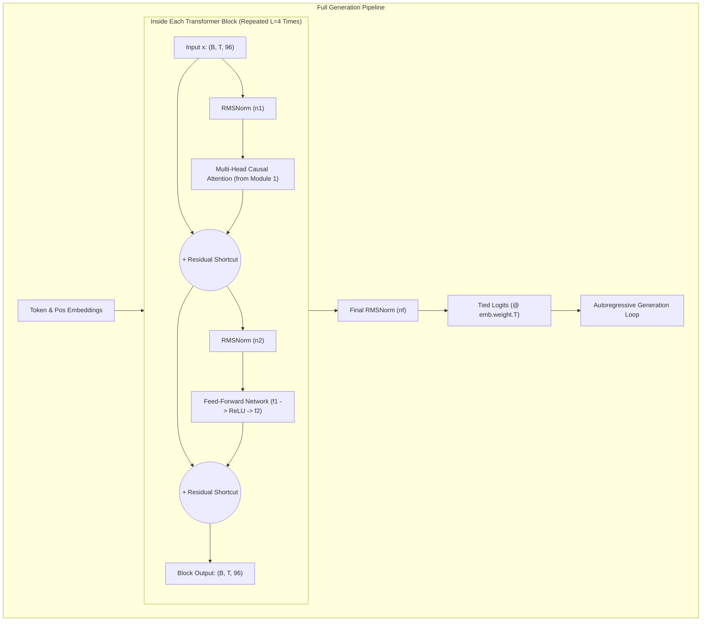
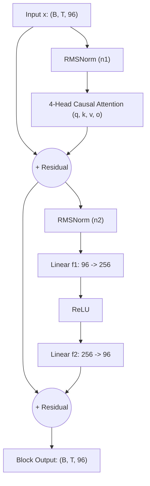
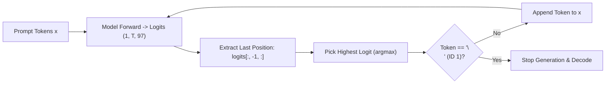

# Module 2 Theory: Completing the Transformer, Generating Text, and Compressing the Model

> [!NOTE]
> **Scope of This Lesson:** The explanations and examples in this module are intentionally simplified to build clear intuition using a small character-level model (`Tiny-2.1`, `VOCAB=97`, `CTX=128`, `D=96`, `L=4`, `H=4`, `HID=256`). Standard production language models use additional variations—such as alternative normalization layers, activation functions, and sampling strategies—which are summarized at the end of this lesson alongside references for further study.

> [!NOTE]
> **Where We Left Off:** In Module 1, we examined **Multi-Head Causal Attention** in isolation. In this lesson, we place that attention mechanism into its proper architectural home—inside a **Pre-LayerNorm Transformer Block**—alongside residual connections, RMSNorm, and a feed-forward MLP. We then stack 4 blocks, predict next characters autoregressively, and examine how 8-bit quantization compresses the model into a 373 KB file.

---

## 1. Normalizing Activations (`RMSNorm`)

As vectors pass through repeated matrix multiplications across layers, their activations can drift—growing exponentially larger or shrinking toward zero. **Normalization** rescales each token vector back to a stable magnitude before it enters Attention or the MLP.

**Tiny-2.1** uses **RMSNorm (Root Mean Square Normalization)**, the same normalization method adopted by modern large language models:
1. Compute the mean of the squared elements across the token's $D$-dimensional vector.
2. Add a small stabilizer $\epsilon = 10^{-5}$ to prevent division by zero, then take the square root (the **RMS** magnitude).
3. Divide each element of the token vector by this RMS value.
4. Multiply element-wise by a learned gain vector $g$ (initialized to `1.0`), which allows the model to scale individual feature dimensions if needed.

**Example 1 (2-number vector with exact mental math):**
Suppose a token vector is $x = [1.0, 7.0]$ and the learned gain is $g = [1.0, 2.0]$ (ignoring $\epsilon$ for simplicity):
1. Squares: $[1^2, 7^2] = [1, 49]$.
2. Mean of squares: $(1 + 49) / 2 = 25$.
3. $\text{RMS} = \sqrt{25} = 5.0$.
4. Divide by RMS: $[1.0 / 5.0,\; 7.0 / 5.0] = [0.2, 1.4]$.
5. Multiply by $g$: $[0.2 \times 1.0,\; 1.4 \times 2.0] = [0.2, 2.8]$.

**Example 2 (Why scale invariance helps in `Tiny-2.1`):**
Suppose an earlier layer outputs a vector scaled by $10\times$: $x_{\text{loud}} = [10.0, 70.0]$:
* Squares: $[100, 4900] \rightarrow \text{mean} = 2500 \rightarrow \text{RMS} = \sqrt{2500} = 50.0$.
* Divide by RMS: $[10.0 / 50.0,\; 70.0 / 50.0] = [0.2, 1.4]$.

> [!NOTE]
> **Subtle Detail Regarding $\epsilon$ and $g$:**
> In practice, scaling an input vector by $10\times$ produces **approximately**, not mathematically identically, the same vector because the denominator includes $\epsilon = 10^{-5}$:
> $$\frac{10x}{\sqrt{\text{mean}((10x)^2) + \epsilon}} \approx \frac{x}{\sqrt{\text{mean}(x^2) + 10^{-2}\epsilon}}$$
> Furthermore, because the normalized vector is subsequently multiplied by the learned parameter $g$, the final output of `RMSNorm` does **not** necessarily have an RMS of exactly $1.0$—the gain vector allows the network to learn feature-specific scales.

**General formula:**
$$\text{RMSNorm}(x) = \frac{x}{\sqrt{\frac{1}{D}\sum_{i=1}^{D} x_i^2 + \epsilon}} \odot g$$

> https://ai-learning-repo.github.io/resources/demo/nlp/visualization_6_rmsnorm.html

---

## 2. Shortcut (Residual) Connections

In modern Transformer blocks, the input $x$ is not replaced by the output of a sublayer; instead, the sublayer computes a delta that is **added** back to the input:

$$x_{\text{mid}} = x + \text{Attention}(\text{RMSNorm}(x))$$
$$x_{\text{out}} = x_{\text{mid}} + \text{MLP}(\text{RMSNorm}(x_{\text{mid}}))$$

Why is this additive shortcut critical when stacking deep networks?

**Example 1 (Why multiplication chains degrade signals):**
Imagine a signal passing through 4 successive layers:
* **Without shortcuts (repeated multiplication by $\approx 0.5$ per layer):** $1.0 \times 0.5 \times 0.5 \times 0.5 \times 0.5 = 0.0625$. Across deeper stacks, both forward representations and backward gradients decay exponentially toward zero.
* **With residual shortcuts ($x + \Delta$):** If each layer adds an adjustment $\Delta = +0.05$, the signal becomes $1.0 + 0.05 + 0.05 + 0.05 + 0.05 = 1.20$. Even if a sublayer's weights produce an output close to zero, the input representation propagates forward unaltered.

**Example 2 (`Tiny-2.1` residual shapes on `"2+2?\n"`):**
* Input entering `Block 0`: $x$ has shape `(1, 5, 96)`.
* Attention sublayer returns `attn_output` with shape `(1, 5, 96)`.
* Residual addition preserves tensor dimensions: `x_mid = x + attn_output` `(1, 5, 96)`.

Every sublayer in a Transformer acts as an incremental refinement over an underlying representation highway rather than attempting to rewrite the full representation at each step.

**General formula:**
$$x_{l+1} = x_l + \text{Sublayer}(\text{RMSNorm}(x_l))$$

> https://ai-learning-repo.github.io/resources/demo/nlp/visualization_7_residual_connections.html

---

## 3. The Feed-Forward Network / MLP (`f1 → ReLU → f2`)

Attention mixes information **across different token positions** (for example, allowing `'\n'` to attend to `'2'` and `'+'`). However, once tokens gather context from their neighbors, each token must process and transform that combined context on its own.

The **Feed-Forward Network (MLP)** performs this position-wise processing independently for every token:
1. Normalize the representation (`n2`).
2. Project the token vector from model dimension $D=96$ up to hidden dimension $\text{HID}=256$ via linear layer `f1`.
3. Apply the **`ReLU`** non-linearity ($\max(0, z)$), setting all negative values to zero.
4. Project back down from $256$ to $96$ via linear layer `f2`, and add the residual shortcut.

> [!NOTE]
> **Connection to Classic Neural Networks:** While Attention layers use dynamic, input-dependent softmax weights across tokens, the MLP sublayer applies classic feedforward neural network neurons independently to each token position.

**Example 1 (A tiny `2 → 4 → 2` ReLU MLP):**
Take a 2D token vector $h = [1.0, -1.0]$:
1. **Expand (`f1`):** Suppose multiplying by 4 hidden units yields $[2.0,\; -3.0,\; 0.5,\; -1.0]$.
2. **`ReLU`:** Negative activations are suppressed: $[2.0,\; 0.0,\; 0.5,\; 0.0]$.
3. **Project back (`f2`):** A weighted sum of those 4 units maps back down to 2 dimensions: e.g., $[0.8,\; -0.4]$.

**Example 2 (`Tiny-2.1` MLP capacity vs. Attention capacity):**
Inside each `Block` of `Tiny-2.1`:
* Attention (`q, k, v, o`) contains $4 \times (96 \times 96) = 36,864$ weights.
* MLP (`f1: 96 → 256`, `f2: 256 → 96`) contains $(96 \times 256) + (256 \times 96) = 49,152$ weights.

The MLP sublayers account for more parameters than Attention. In Transformer architectures, attention acts primarily as a communication router between tokens, whereas the MLP stores and transforms distributed factual and associative knowledge.

**General formula:**
$$\text{MLP}(h) = \text{ReLU}(h W_1^T) W_2^T$$

> https://ai-learning-repo.github.io/resources/demo/nlp/visualization_8a_feed_forward_mlp.html

---

## 4. The Complete Transformer Block and Stacking `L = 4` Layers

A full **Transformer Block** combines Pre-LayerNorm, Multi-Head Attention, residual connections, and an MLP. `Tiny-2.1` stacks $L = 4$ identical blocks sequentially:

### Why Stack Multiple Blocks?
Stacking blocks provides depth, allowing the network to compose successive non-linear transformations:
* A single block can only route information once and apply one non-linear MLP transformation.
* Stacking $L = 4$ blocks allows the network to iteratively re-route context and compose representations (e.g., aggregating characters into morphemes/words, then associating questions with answers).

> [!WARNING]
> **Avoid Assigning Fixed Roles to Specific Blocks:**
> While it is tempting to claim that "Block 0 handles character pairs and Block 3 handles high-level arithmetic," deep neural networks distribute representations across layers. Such interpretations should be treated as illustrative possibilities of what depth enables, rather than proven, measured properties of individual blocks in `Tiny-2.1`.

**Parameter Breakdown for Tiny-2.1 (`366,528` total parameters):**
* Token & Position Embeddings (`emb` + `pos`): $9,312 + 12,288 = 21,600$ ($5.9\%$)
* 4 × Multi-Head Attention (`q, k, v, o`): $4 \times 36,864 = 147,456$ ($40.2\%$)
* 4 × MLP (`f1, f2`): $4 \times 49,152 = 196,608$ ($53.6\%$)
* All `RMSNorm` gains (`n1, n2, nf`): $9 \times 96 = 864$ ($0.2\%$)

> https://ai-learning-repo.github.io/resources/demo/nlp/visualization_8b_complete_transformer_block.html

---

## 5. From Vectors to Character Scores: Final Norm and Weight Tying

After passing through Block 3, each token is represented by a 96-dimensional hidden vector $(B, T, 96)$. To predict the next character, these vectors must be converted into **97 unnormalized scores (logits)**—one per vocabulary character.

Rather than allocating a separate $96 \times 97$ projection matrix, **Tiny-2.1** applies a final `RMSNorm` (`nf`) and multiplies by the **transpose of the token embedding matrix `emb`**—an optimization known as **weight tying**:

$$\text{Logits} = \text{RMSNorm}_{\text{final}}(X_{\text{blocks}}) \, E^T$$

* During input embedding, matrix $E$ maps a character ID to a 96-dimensional continuous vector.
* At the output, multiplying by $E^T$ calculates the dot product between the final hidden vector and every character's embedding vector. The character whose embedding best aligns with the output vector receives the highest logit.

**Example 1 (Toy 3-character vocabulary `{'2', '4', '\n'}` in 2D):**
Suppose the final normalized vector is $h = [0.8, 0.6]$, and candidate embedding rows are:
* `'2'`: $[0.1, 0.9] \rightarrow \text{score} = 0.8(0.1) + 0.6(0.9) = 0.62$
* `'4'`: $[0.9, 0.7] \rightarrow \text{score} = 0.8(0.9) + 0.6(0.7) = 1.14$  *(highest score)*
* `'\n'`: $[0.0, -0.5] \rightarrow \text{score} = 0.8(0.0) + 0.6(-0.5) = -0.30$

The character `'4'` receives the largest logit. Weight tying saves $97 \times 96 = 9,312$ parameters in `Tiny-2.1` and aligns the semantic geometry of input and output spaces.

> https://ai-learning-repo.github.io/resources/demo/nlp/visualization_9a_weight_tying.html

---

## 6. Autoregressive Text Generation

Given logits of shape $(1, T, 97)$, how does a language model generate a complete answer?

It executes an **autoregressive loop**—generating text sequentially, **one character at a time**:
1. Pass the current sequence of token IDs $x$ of length $T$ through the model to obtain logits $(1, T, 97)$.
2. Extract the logits at the **very last sequence position** (`logits[:, -1, :]`), which predict the token that should follow the prompt.
3. Select the token with the highest logit (`argmax`, known as **greedy decoding**).
4. If the predicted token is newline `\n` (ID `1`), stop. Otherwise, append the new token to $x$ and repeat the process.

> [!NOTE]
> **Illustrative Decoding Example:**
> As an idealized walkthrough, if the prompt is `"2+2?\n"`, greedy decoding might proceed as:
> * Step 1: Input `"2+2?\n"` $\rightarrow$ position $-1$ predicts `'4'`. Append `'4'`.
> * Step 2: Input `"2+2?\n4"` $\rightarrow$ position $-1$ predicts `'\n'`. Stop generation.
> In practice, the actual text produced depends on training convergence and prompt format; small models may generate longer continuations (e.g., full explanatory sentences) or experience compounding errors if an early character is selected suboptimally.

> https://ai-learning-repo.github.io/resources/demo/nlp/visualization_9b_autoregressive_generation.html

---

## 7. Training Loss and 8-Bit Model Compression

### Training Loss: Cross-Entropy Against Baseline
During training, the logits at each answer position where `loss_mask == 1` are converted by `softmax` into probabilities $p_0, \dots, p_{96}$. The **cross-entropy loss** evaluates the negative log-probability assigned to the ground-truth target token $y$:

$$\mathcal{L} = -\ln(p_{\text{true}})$$

* **Uniform Guessing Baseline:** If a model predicted all $V=97$ tokens with equal probability ($p = 1/97$), the expected loss would be $-\ln(1/97) = \ln(97) \approx 4.575$. A randomly initialized network serves as a baseline comparison against this theoretical value.
* **Trained Confidence:** As training converges and the model places high probability on target characters (e.g., $p_{\text{true}} \approx 0.90$), loss decreases toward zero ($-\ln(0.90) \approx 0.105$).

### 8-Bit Quantization (`TINY.BIN`)
Full-precision weights are stored as 32-bit floating-point numbers (`4 bytes` each). In `Tiny-2.1`, the $366,528$ parameters would require $\approx 1.47\text{ MB}$. To fit on constrained vintage architectures (like MS-DOS), weights are quantized into **signed 8-bit integers (`int8`, values $-127 \dots 127$, `1 byte`)**:

1. For each row of a 2D weight matrix, find the maximum absolute value $w_{\max} = \max_j |w_j|$.
2. Calculate a per-row scale factor: $s = \frac{w_{\max}}{127}$.
3. Quantize each weight: $q_j = \text{clip}\left(\text{round}\left(\frac{w_j}{s}\right), -127, 127\right)$.
4. Store $s$ as a 32-bit float (`4 bytes`) and all row weights $q_j$ as 8-bit integers (`1 byte` each).
5. When running inference, weights are dequantized on the fly: $\hat{w}_j = q_j \times s$.

This per-row quantization compresses `Tiny-2.1` from $\approx 1.4\text{ MB}$ to **`381,808 bytes` (`373 KB`)**—an approximate $4\times$ footprint reduction with negligible impact on accuracy.

> https://ai-learning-repo.github.io/resources/demo/nlp/visualization_10_quantization.html

---

### Moving From Simplified Intuition to Production Models

While `Tiny-2.1` illustrates the mechanics of the Transformer block cleanly, production systems use standard enhancements:
* **Activations:** While `Tiny-2.1` uses `ReLU`, state-of-the-art models typically use smooth or gated activations such as **SwiGLU** or **GELU**.
* **Sampling Strategies:** Rather than greedy `argmax`, production LLMs use temperature-scaled stochastic sampling ($z / T$) combined with **top-$k$** and **nucleus (top-$p$)** truncation to balance coherence and diversity.
* **Quantization Scales:** Large models commonly apply post-training quantization (PTQ) such as **FP8**, **INT4** (e.g., AWQ, GPTQ), or **BitNet (1.58-bit)** representations for high-throughput serving.

---

## References and Further Reading

* **Project Repository:**
  * [Tiny-2.1 on GitHub](https://github.com/WollyMonjac/Tiny-2.1) — Full training, generation, and quantization code for the model used in this course.

* **Textbooks & Code Walkthroughs:**
  * [Deep Learning with Python (Ch. 15: Language Models and the Transformer)](https://deeplearningwithpython.io/chapters/chapter15_language-models-and-the-transformer/) by François Chollet.
  * [Build a Large Language Model From Scratch (Sebastian Raschka)](https://github.com/rasbt/LLMs-from-scratch):
    * [Chapter 2: Working with Text Data](https://github.com/rasbt/LLMs-from-scratch/blob/main/ch02/01_main-chapter-code/ch02.ipynb)
    * [Chapter 3: Coding Attention Mechanisms](https://github.com/rasbt/LLMs-from-scratch/blob/main/ch03/01_main-chapter-code/ch03.ipynb)
    * [Chapter 4: Implementing a GPT Model from Scratch](https://github.com/rasbt/LLMs-from-scratch/blob/main/ch04/01_main-chapter-code/ch04.ipynb) — Detailed breakdown of normalization, residual connections, feedforward MLPs, and generation loops.

* **Foundational Paper & Annotated Guides:**
  * [Attention Is All You Need (Vaswani et al., 2017)](https://arxiv.org/abs/1706.03762) — The original research paper introducing the Transformer architecture.
  * [The Annotated Transformer (Harvard NLP)](https://nlp.seas.harvard.edu/annotated-transformer/) ([GitHub Repository](https://github.com/harvardnlp/annotated-transformer/)) — Line-by-line PyTorch implementation and explanation of the 2017 paper.

* **Video Lectures:**
  * [Attention Is All You Need — Paper Explained](https://www.youtube.com/watch?v=XowwKOAWYoQ) — Detailed visual breakdown of the architecture, equations, and mechanics.
  * [CS480/680 Lecture 19: Attention and Transformer Networks](https://www.youtube.com/watch?v=OyFJWRnt_AY) by Prof. Pascal Poupart (University of Waterloo) — Academic lecture covering attention math and Transformer blocks on the blackboard.

<!-- * https://github.com/WollyMonjac/Tiny-2.1
* https://deeplearningwithpython.io/chapters/chapter15_language-models-and-the-transformer/
* https://github.com/rasbt/LLMs-from-scratch/blob/main/ch02/01_main-chapter-code/ch02.ipynb
* https://github.com/rasbt/LLMs-from-scratch/blob/main/ch03/01_main-chapter-code/ch03.ipynb
* https://github.com/rasbt/LLMs-from-scratch/blob/main/ch04/01_main-chapter-code/ch04.ipynb
* Attention Is All You Need paper (annotated)
  * https://nlp.seas.harvard.edu/annotated-transformer/
  * https://github.com/harvardnlp/annotated-transformer/
  * https://www.youtube.com/watch?v=XowwKOAWYoQ
  * https://www.youtube.com/watch?v=OyFJWRnt_AY
  * https://arxiv.org/abs/1706.03762 -->