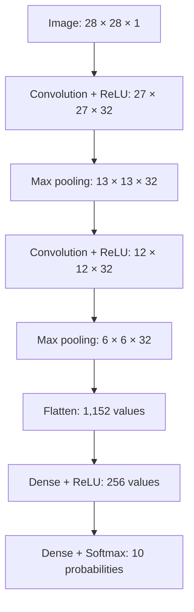
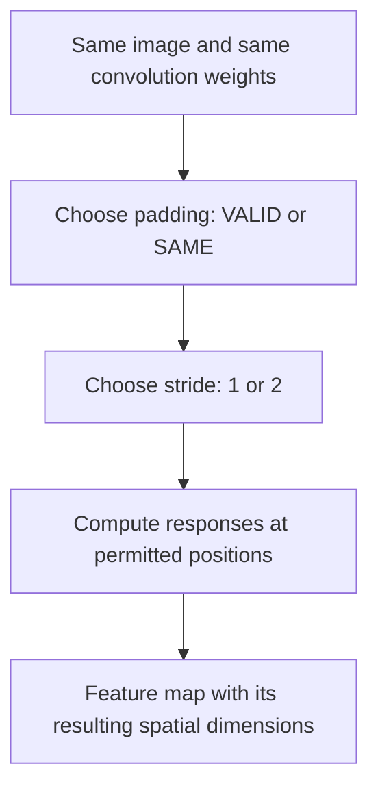
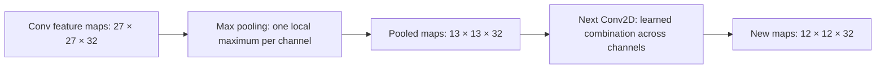
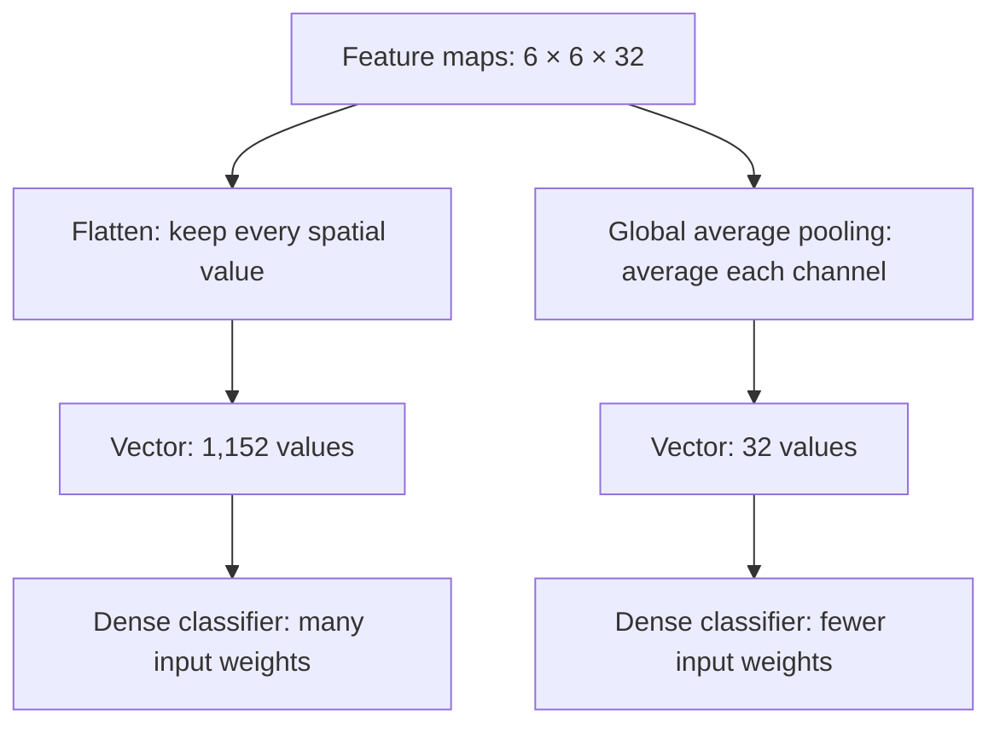
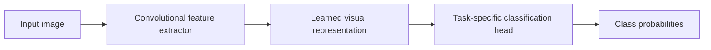
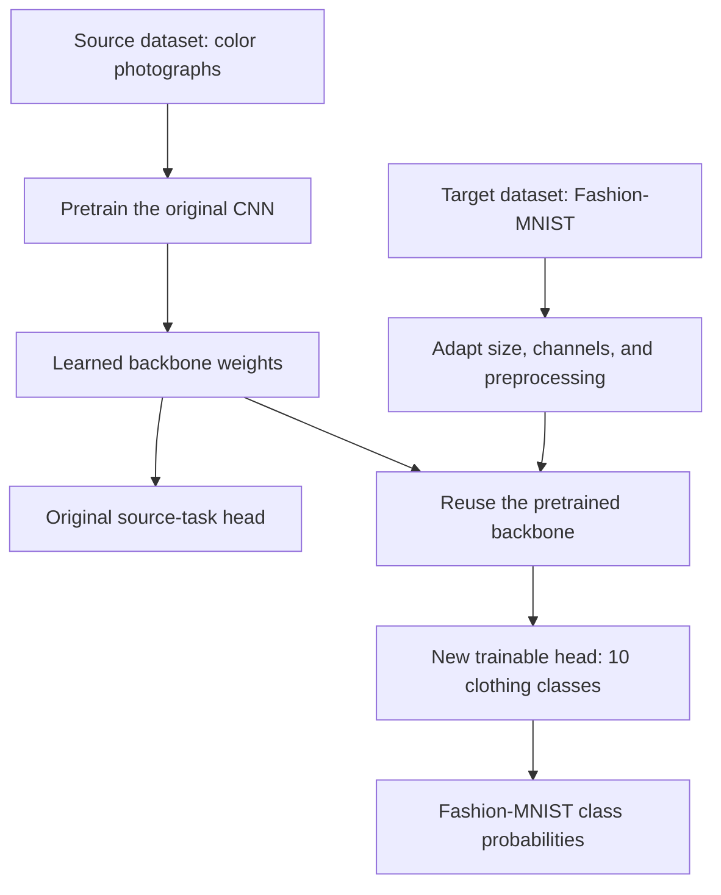
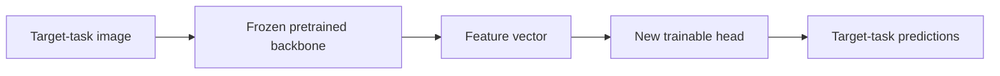
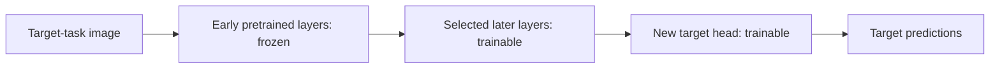
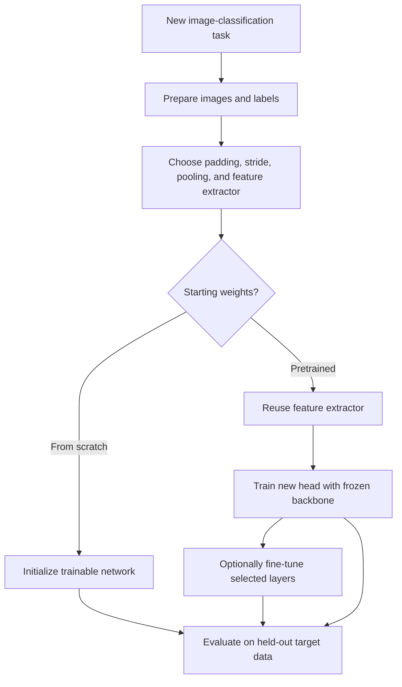

# Theory 2: Convolutional Neural Networks: Spatial Design and Transfer Learning

*From the CNN in Theory 1 to padding, stride, pooling, global average pooling, and reusable learned representations*

## Learning objectives

After completing this chapter, the following distinctions and calculations should be clear:

- Why a convolution with no padding reduces spatial dimensions, and why valid max pooling can omit an input border.
- How padding and stride change the positions at which a filter is evaluated, without changing the filter's learned weights.
- How to calculate output dimensions, including the meaning of `VALID` and `SAME` in TensorFlow/Keras.
- How max pooling, average pooling, and global average pooling summarize information differently.
- Why pooling can provide limited local tolerance to a shift without guaranteeing translation invariance.
- Why the original CNN's `Flatten` and dense layers depend on particular tensor dimensions, and how global average pooling changes that dependency.
- What it means to reuse a pretrained feature extractor, freeze parameters, attach a new classification head, and fine-tune selected layers.
- How to judge whether transfer learning helped, rather than assuming that pretrained weights always improve a model.

The discussion uses the **Fashion-MNIST CNN** from Demo 1 and Theory 1 as its reference architecture. Individual numerical examples are deliberately smaller, allowing each computation to be checked without a framework. Optional runnable Python examples reinforce the numerical work; the underlying explanations do not depend on running them.

### Setup for the optional Python examples

Follow the [shared Python setup guide](../activity/1-python_setup.md) to verify NumPy, Matplotlib, and TensorFlow. It includes Colab notebook `%pip` commands for missing packages and runtime restart guidance. Google Colab is the primary environment. The small numerical examples include their own setup; Section 10.3 is a continuation of Section 9.2 and must run after it in the same session. After a runtime or kernel restart, rerun the prerequisite cell before continuing.

Section 9.2 requires the [saved Fashion-MNIST CNN](../../assets/fashion_mnist_cnn.keras). Download and upload it to the Colab working directory. For local execution, set the working directory to `week4/material/part2/theory`; the loading code also supports the repository root. Dataset-loading examples download data on first use if it is not already cached.

For the earlier architecture, see [Theory 1](../../part1/theory/theory1.md). [Demo 2](../demo/demo2-nc.md) supplies the matching spatial experiments, and [Activity 2](../activity/activity2.md) provides guided practice and a within-MNIST transfer experiment.

---

## 1. Revisit the CNN: where did the spatial information go?

A Fashion-MNIST image contains **28 × 28 grayscale values**. In Theory 1, a convolutional filter was introduced as a local weighted sum whose weights are reused as the filter moves over the image. Multiple filters create multiple feature maps. ReLU converts negative responses to zero; later convolutional layers combine responses from earlier layers.

The complete classifier also contained operations that changed its spatial dimensions:



These shapes omit the batch dimension. The two convolutions use 32 standard **2 × 2 filters**, stride 1, and no padding. The two pooling layers use **2 × 2 windows**, stride 2, and no padding. ReLU does not change shape.

At first sight, two operations seem to do the same thing: both convolution and pooling can reduce spatial dimensions. The reasons differ.

**Convolution** computes a weighted sum at each allowed filter position. With no padding, the whole filter must fit inside the image. A 2 × 2 kernel can start in 27 different rows and 27 different columns of a 28 × 28 input.

**Pooling** summarizes values already present in a feature map. A 2 × 2 max-pooling window with stride 2 visits locations 0, 2, 4, and so on. Along a length of 27, it forms complete pairs covering indices 0–25; index 26 is not included in a valid window. Therefore the length becomes 13.

The two numerical transitions are:

| Operation | Input side | Calculation | Output side |
|---|---:|---|---:|
| Convolution, 2 × 2, stride 1, valid | 28 | 28 − 2 + 1 | 27 |
| Max pooling, 2 × 2, stride 2, valid | 27 | Complete pairs starting at 0, 2, …, 24 | 13 |
| Convolution, 2 × 2, stride 1, valid | 13 | 13 − 2 + 1 | 12 |
| Max pooling, 2 × 2, stride 2, valid | 12 | Six complete pairs | 6 |

A smaller grid can lower the computational and memory costs of later layers, but it may also remove spatial detail. The architecture must balance how much detail to preserve against how much computation and model capacity to use.

### A five-by-five border example

Consider a feature map containing the integers 1 through 25:

| 1 | 2 | 3 | 4 | 5 |
|---:|---:|---:|---:|---:|
| 6 | 7 | 8 | 9 | 10 |
| 11 | 12 | 13 | 14 | 15 |
| 16 | 17 | 18 | 19 | 20 |
| 21 | 22 | 23 | 24 | **25** |

Valid max pooling with a 2 × 2 window and stride 2 examines four non-overlapping regions:

- Top left: 1, 2, 6, 7 → maximum **7**.
- Top right: 3, 4, 8, 9 → maximum **9**.
- Bottom left: 11, 12, 16, 17 → maximum **17**.
- Bottom right: 13, 14, 18, 19 → maximum **19**.

The output is:

$$
\begin{bmatrix}
7 & 9 \\
17 & 19
\end{bmatrix}
$$

The original last row and last column, including 25, are outside every complete pooling window. This is not the convolution's reason for changing 28 to 27: **convolution discards invalid window starting positions; valid stride-2 pooling omits trailing positions not covered by complete windows**.

<details>
<summary>Run the supplied Python code: Inspect omitted pooling positions</summary>

```python
import numpy as np

original = np.arange(1, 26).reshape(5, 5)
pooled = np.array([
    [original[r:r+2, c:c+2].max() for c in (0, 2)]
    for r in (0, 2)
])
print("Original 5 × 5 map:\n", original)
print("Max pooled 2 × 2 map:\n", pooled)
np.testing.assert_array_equal(pooled, [[7, 9], [17, 19]])
```

</details>

This raises a design question: **can a convolution retain responses at the border instead of shrinking the spatial grid?**

---

## 2. Padding: deciding what happens at image borders

### 2.1 The idea of padding

A convolutional kernel can only be evaluated at a position when the required input values are available. With **valid convolution**, the input is not extended, so a filter cannot start in a location where it would extend beyond the last row or column.

**Padding** extends the input with extra values along its spatial boundaries. Zero padding is common: the newly created positions contain zero rather than observed image pixels. A filter can then overlap the original border while still having a complete window of values to multiply by its weights.

The important distinction is that padding creates **positions**, not new observed details. For example, a zero-padded edge response may differ from an interior response because the filter sees zeros outside the image.

In the Keras/TensorFlow examples, two useful settings are:

- `padding="valid"`: no implicit zero padding.
- `padding="same"`: enough implicit padding to obtain an output size equal to the input size **when stride is 1**. With larger strides, the output size follows a different rule described below.

Neither setting changes a convolution's filter coefficients, number of filters, or bias values. Changing padding can change the **number and values of activations**, even when the trainable parameter count remains constant.

### 2.2 An even-sized filter: why the padding can be asymmetric

Consider the same 28 × 28 image and **2 × 2 kernel** from Demo 1.

With valid padding and stride 1, the output is 27 × 27. For an output of 28 × 28, an extra position is needed along each spatial dimension. A single extra row cannot be divided equally between the top and bottom, and a single extra column cannot be divided equally between the left and right.

In TensorFlow's `SAME` convention for this configuration, the extra row goes **below** the image and the extra column goes **to its right**:

| Border | Added positions |
|---|---:|
| Top | 0 |
| Bottom | 1 |
| Left | 0 |
| Right | 1 |

Thus the padded input is effectively 29 × 29, and a valid 2 × 2 convolution at stride 1 produces 28 × 28 outputs.

A 2 × 2 vertical-contrast filter from Demo 1 is:

$$
W=\begin{bmatrix}-1 & 1 \\
-1 & 1\end{bmatrix}
$$

At an interior location, it compares the two input columns. At the right border, one of the right-side values may come from the zero padding. The filter is still the same, but the data seen at the boundary differ.

<details>
<summary>Run the supplied Python code: Reproduce SAME padding explicitly</summary>

```python
import numpy as np
import tensorflow as tf

image = np.arange(1, 29 * 29, dtype=np.float32)[:28 * 28].reshape(1, 28, 28, 1)
weights = np.array([[-1., 1.], [-1., 1.]], dtype=np.float32).reshape(2, 2, 1, 1)

same = tf.nn.conv2d(image, weights, strides=1, padding="SAME")
explicit = tf.pad(image, [[0, 0], [0, 1], [0, 1], [0, 0]])
checked = tf.nn.conv2d(explicit, weights, strides=1, padding="VALID")

print("Original:", image.shape, "Explicitly padded:", explicit.shape)
print("SAME output:", same.shape)
np.testing.assert_allclose(same.numpy(), checked.numpy())
print("Explicit padding reproduces SAME for this configuration.")
```

</details>

This is a statement about **this particular shape, kernel, and stride**. `SAME` does not always add precisely one row or column. It chooses the necessary total padding based on the configuration.

### 2.3 Odd-sized versus even-sized kernels

A thoughtful question follows: if 2 × 2 kernels can require unequal border padding, why do many well-known CNN designs use 3 × 3 kernels?

An odd-sized kernel has a natural central element. At stride 1, preserving the original spatial size with a **3 × 3 kernel** requires one padding position on **each of the four sides**. A **5 × 5 kernel** similarly requires two positions on each side.

| Kernel | Total padding per dimension for `SAME`, stride 1 | Symmetric allocation |
|---|---:|---|
| 1 × 1 | 0 | None needed |
| 2 × 2 | 1 | Necessarily uneven |
| 3 × 3 | 2 | 1 before and 1 after |
| 4 × 4 | 3 | Necessarily uneven |
| 5 × 5 | 4 | 2 before and 2 after |

Symmetric padding is one advantage of odd-sized kernels, **not the sole reason** that 3 × 3 kernels are popular. Small spatial kernels also keep individual layers relatively economical, and stacking several 3 × 3 convolutions can expand the receptive field while inserting nonlinearities between layers. Other useful kernel sizes exist: 1 × 1 convolutions mix channel information, larger kernels can capture wider neighborhoods, and the 2 × 2 kernels in the supplied Fashion-MNIST network remain perfectly valid.

It would also be too strong to claim that a 2 × 2 kernel inherently makes a CNN biased toward the upper-left. The padding convention defines the alignment of the operation, but whether an architecture exhibits a problematic directional preference depends on the full model, data, and task. Uneven padding does not make the convolution invalid.

### 2.4 `SAME` does not always mean identical input and output sizes

The phrase “same padding” often causes confusion. In TensorFlow/Keras, `SAME` produces the **same spatial size when the stride is 1**. For stride 2, the expected spatial size is approximately half, rounded upward.

For a 28-pixel input, a 2-pixel kernel, and stride 2:

- Valid convolution produces **14** positions.
- `SAME` convolution also produces **14** positions.
- In this particular case the 2-pixel kernel fits 14 times with no remainder, so `SAME` requires **zero** added padding. The outputs are identical if the filter weights and input are the same.

For a 27-pixel input with the same kernel and stride:

- Valid convolution produces **13** positions.
- `SAME` convolution produces **14** positions and must add padding.

The formal rules and exact calculations appear in Section 4.

**The next question:** Padding changes the allowed boundary locations. What happens when the filter stops moving one pixel at a time?

---

## 3. Stride: controlling where convolution is evaluated

### 3.1 A stride is a step size, not a new set of weights

A stride specifies how far the convolutional window moves between successive output positions. At stride 1, every possible starting row and column is considered, provided the kernel fits. At stride 2, the window starts two pixels farther along for each next output value.

The kernel's weighted-sum operation remains the same. Stride 2 simply evaluates that operation **at fewer positions**. The number of trainable kernel weights does not become smaller because the stride is larger; the number of produced activations usually becomes smaller.

### 3.2 One numerical example, two strides

Consider the same 5 × 5 array of values from 1 to 25, now using a **2 × 2 filter of four ones**. One output is the sum of the four values in the current patch.

With **stride 1**, the kernel starts at rows 0, 1, 2, 3 and columns 0, 1, 2, 3, giving 4 × 4 outputs:

$$
Y_{s=1}=\begin{bmatrix}
16 & 20 & 24 & 28 \\
36 & 40 & 44 & 48 \\
56 & 60 & 64 & 68 \\
76 & 80 & 84 & 88
\end{bmatrix}
$$

For example, the first value comes from 1 + 2 + 6 + 7 = 16. The next value to its right comes from 2 + 3 + 7 + 8 = 20. The same filter moves only one column.

With **stride 2**, the kernel starts at rows 0 and 2 and columns 0 and 2, giving 2 × 2 outputs:

$$
Y_{s=2}=\begin{bmatrix}
16 & 24 \\
56 & 64
\end{bmatrix}
$$

These four values are a subset of the stride-1 responses. Many other possible responses are never calculated.

<details>
<summary>Run the supplied Python code: Verify every stride-1 and stride-2 sum</summary>

```python
import numpy as np

x = np.arange(1, 26, dtype=np.float32).reshape(5, 5)

def patch_sums(values, step):
    return np.array([
        [values[r:r+2, c:c+2].sum()
         for c in range(0, values.shape[1] - 1, step)]
        for r in range(0, values.shape[0] - 1, step)
    ])

y1, y2 = patch_sums(x, 1), patch_sums(x, 2)
print("Stride 1:\n", y1)
print("Stride 2:\n", y2)
np.testing.assert_array_equal(y2, y1[::2, ::2])
```

</details>

The important distinction is between **a smaller output grid** and **a better representation**. A larger stride reduces the number of output locations, but it may also skip informative intermediate responses. The best choice depends on the task and other layers.

### 3.3 Padding and stride are independent choices

Padding determines which boundary positions can be considered; stride determines how densely the resulting positions are sampled.



Neither setting changes the learned weights in a standard Conv2D layer. They can change the tensor shapes and the values that downstream layers receive.

The reference comparison on a **28 × 28 input with a 2 × 2 kernel** is:

| Padding | Stride | Convolution output |
|---|---:|---:|
| `VALID` | 1 | 27 × 27 |
| `SAME` | 1 | 28 × 28 |
| `VALID` | 2 | 14 × 14 |
| `SAME` | 2 | 14 × 14 |

The last two rows have identical outputs for the same input and kernel in this specific configuration, not as a universal rule. A later section connects these shapes to pooling and the full CNN.

---

## 4. Spatial-size mathematics: from arithmetic to general rules

The previous examples establish the ideas needed for the formulas. The symbols describe **one spatial dimension**; calculate height and width separately when they differ.

| Symbol | Meaning |
|---|---|
| $n$ | Input length, measured in spatial positions |
| $k$ | Kernel or pooling-window length |
| $s$ | Stride, measured in input positions |
| $p$ | Number of padding positions on **each** side, when padding is symmetric |
| $p_{\mathrm{before}}$, $p_{\mathrm{after}}$ | Unequal padding before and after the input |
| $n_{\mathrm{out}}$ | Output length |

### 4.1 Valid convolution or pooling

For no padding and a filter that fits within the input, the last permitted starting position is $n-k$. Starting positions are visited at increments of $s$.

$$
n_{\mathrm{out}}=\left\lfloor\frac{n-k}{s}\right\rfloor+1
$$

Here $\lfloor u\rfloor$ means round **down** to the largest integer no greater than $u$.

Worked examples:

- First convolution: $n=28$, $k=2$, $s=1$. The result is $\lfloor 26/1\rfloor+1=27$.
- First pooling operation: $n=27$, $k=2$, $s=2$. The result is $\lfloor25/2\rfloor+1=13$.
- Second convolution: $n=13$, $k=2$, $s=1$. The result is $\lfloor11/1\rfloor+1=12$.
- Second pooling operation: $n=12$, $k=2$, $s=2$. The result is $\lfloor10/2\rfloor+1=6$.

The formula assumes a positive integer stride and an effective kernel length no greater than the available input. If the kernel is larger than the available padded input, a valid window may not exist.

### 4.2 Explicit symmetric padding

If $p$ positions are added before and after the input, its effective length is $n+2p$. The rule becomes:

$$
n_{\mathrm{out}}=\left\lfloor\frac{n+2p-k}{s}\right\rfloor+1
$$

For asymmetric padding, the more general form is:

$$
n_{\mathrm{out}}=\left\lfloor
\frac{n+p_{\mathrm{before}}+p_{\mathrm{after}}-k}{s}
\right\rfloor+1
$$

These are formulas for the **ordinary, nondilated** operations used in Demo 2. Dilated convolutions use an effective kernel size different from $k$; dilation is not needed for the current examples.

Consider the 28-pixel input and 2-pixel kernel at stride 1. One additional position is required in total. The formula with unequal padding gives:

$$
n_{\mathrm{out}}=\left\lfloor\frac{28+0+1-2}{1}\right\rfloor+1=28
$$

### 4.3 TensorFlow/Keras `SAME` output and total padding

For a standard convolution with `padding="same"`, the output size follows:

$$
n_{\mathrm{out}}=\left\lceil\frac{n}{s}\right\rceil
$$

Here $\lceil u\rceil$ means round **up** to the smallest integer not less than $u$. The total padding needed along the dimension can be calculated as:

$$
P_{\mathrm{total}}=
\max\bigl(0,(n_{\mathrm{out}}-1)s+k-n\bigr)
$$

TensorFlow normally allocates the smaller part before the input and any extra position after it:

$$
p_{\mathrm{before}}=\left\lfloor\frac{P_{\mathrm{total}}}{2}\right\rfloor,
\qquad
p_{\mathrm{after}}=P_{\mathrm{total}}-p_{\mathrm{before}}
$$

Examples:

| Input $n$ | Kernel $k$ | Stride $s$ | `SAME` output | Total padding | Before / after |
|---:|---:|---:|---:|---:|---|
| 28 | 2 | 1 | 28 | 1 | 0 / 1 |
| 28 | 3 | 1 | 28 | 2 | 1 / 1 |
| 28 | 2 | 2 | 14 | 0 | 0 / 0 |
| 27 | 2 | 2 | 14 | 1 | 0 / 1 |
| 5 | 3 | 2 | 3 | 2 | 1 / 1 |

**A key distinction:** `SAME` is a padding algorithm tied to a target output shape, not a promise of identical spatial dimensions for every stride.

<details>
<summary>Run the supplied Python code: Check the spatial formulas</summary>

```python
import math

def valid_size(n, k, stride):
    return (n - k) // stride + 1

def same_size_and_padding(n, k, stride):
    out = math.ceil(n / stride)
    total = max(0, (out - 1) * stride + k - n)
    return out, total // 2, total - total // 2

for n, k, stride in [(28, 2, 1), (28, 3, 1),
                     (28, 2, 2), (27, 2, 2), (5, 3, 2)]:
    print(f"n={n}, k={k}, s={stride}:",
          "VALID=", valid_size(n, k, stride),
          "SAME=", same_size_and_padding(n, k, stride))
```

</details>

---
## 5. Pooling: summarizing responses instead of learning new filters

### 5.1 What pooling receives

Convolution computes feature responses using weights. Pooling acts **after** feature extraction and summarizes nearby responses according to a fixed rule. A standard pooling layer has no learned kernel weights or biases. It does not create a new set of channel combinations: it processes the spatial grid of **each channel independently**.

The two basic choices are:

- **Max pooling:** keep the largest activation in each window.
- **Average pooling:** keep the arithmetic mean of all activations in each window.

A conventional `MaxPooling2D(pool_size=2, strides=2, padding="valid")` partitions the covered region into non-overlapping 2 × 2 windows. Each group of four values produces one value, reducing each spatial dimension by approximately a factor of two.

### 5.2 A complete four-window comparison

The following 4 × 4 feature map contains one strong response, 9, near the top left:

$$
X=\begin{bmatrix}
1 & 2 & 0 & 0 \\
3 & 9 & 1 & 0 \\
0 & 0 & 2 & 3 \\
0 & 0 & 4 & 5
\end{bmatrix}
$$

The first 2 × 2 window contains 1, 2, 3, and 9. Its max-pooled value is **9**. Its average-pooled value is:

$$
\frac{1+2+3+9}{4}=3.75
$$

Repeating the calculations for the other three windows gives:

$$
\mathrm{MaxPool}(X)=
\begin{bmatrix}
9 & 1 \\
0 & 5
\end{bmatrix}
$$

$$
\mathrm{AvgPool}(X)=
\begin{bmatrix}
3.75 & 0.25 \\
0 & 3.5
\end{bmatrix}
$$

These outputs have the **same shape**, because the window size, stride, and padding are identical. They carry **different numerical information**, because one preserves a maximum and the other preserves a mean.

| Property | Max pooling | Average pooling |
|---|---|---|
| Retains | Largest response in the window | Mean response in the window |
| Sensitive to | A very strong activation | All the activations contributing to the mean |
| Exact location of peak | Not retained | Not retained |
| All original values recoverable? | No | No |
| Number of learned parameters | Zero | Zero |

Pooling is therefore not just an image-resizing command. It makes a choice about what summary of local responses is useful for the next layer.

<details>
<summary>Run the supplied Python code: Compare pooling with NumPy</summary>

```python
import numpy as np

x = np.array([[1, 2, 0, 0],
              [3, 9, 1, 0],
              [0, 0, 2, 3],
              [0, 0, 4, 5]], dtype=np.float32)

max_out = np.zeros((2, 2), dtype=np.float32)
mean_out = np.zeros((2, 2), dtype=np.float32)
for r in range(2):
    for c in range(2):
        window = x[2*r:2*r+2, 2*c:2*c+2]
        max_out[r, c] = window.max()
        mean_out[r, c] = window.mean()

print("Max pooling:\n", max_out)
print("Average pooling:\n", mean_out)
np.testing.assert_allclose(max_out, [[9, 1], [0, 5]])
np.testing.assert_allclose(mean_out, [[3.75, 0.25], [0, 3.5]])
```

</details>

### 5.3 Pooling does not combine channels

Suppose the first convolution has produced a tensor of shape **27 × 27 × 32**. The final dimension represents 32 distinct response maps. A standard 2 × 2 max-pooling layer with stride 2 produces **13 × 13 × 32**.

The output still has 32 channels. Pooling has reduced **height and width**, not the number of channels. The following convolution can then combine information **across** those 32 channels through its learned 3D filters, as developed in Theory 1.



### 5.4 Does max pooling produce translation invariance?

The most important distinction is between **local tolerance** and **guaranteed invariance**.

A model is invariant to a particular transformation if applying that transformation leaves its relevant output unchanged. For example, if moving an object one pixel always left the model's prediction exactly unchanged, that prediction would be invariant to that one-pixel shift. Such a guarantee generally does not follow from using max pooling.

Consider a 4 × 4 feature map with one positive response of 9. Max pooling uses 2 × 2 windows and stride 2.

**Case A: the response stays in the same window.** A value of 9 at position (0, 0) and a value of 9 at position (0, 1) both produce the top-left pooled value 9. Moving between these positions changes the input but not the pooled output.

**Case B: the response crosses a window boundary.** Moving the response from position (0, 1) to (0, 2) transfers that maximum from the top-left output cell to the top-right output cell.

In both cases, the response moves by just one pixel. Whether the pooled result changes depends on the alignment between the feature and the pooling windows.

| Position of the response 9 | Pooled output |
|---|---|
| (0, 0) | `[[9, 0], [0, 0]]` |
| (0, 1) | `[[9, 0], [0, 0]]` |
| (0, 2) | `[[0, 9], [0, 0]]` |

**Conclusion:** max pooling may make a local feature representation less sensitive to certain small displacements, but it is not universally invariant to translation. It also does not guarantee invariance to rotation, scaling, or changes in lighting.

<details>
<summary>Run the supplied Python code: Shift one activation across a pooling boundary</summary>

```python
import numpy as np

def pool_2x2_max(values):
    return np.array([
        [values[r:r+2, c:c+2].max() for c in (0, 2)]
        for r in (0, 2)
    ])

results = []
for col in (0, 1, 2):
    x = np.zeros((4, 4), dtype=np.float32)
    x[0, col] = 9
    result = pool_2x2_max(x)
    results.append(result)
    print(f"Response at column {col}:\n{result}\n")

print("Within-window shift unchanged:", np.array_equal(results[0], results[1]))
print("Cross-boundary shift unchanged:", np.array_equal(results[1], results[2]))
```

</details>

### 5.5 Strided convolution versus pooling

Both operations can reduce spatial resolution, but they do different computations.

| Characteristic | Strided convolution | Standard max/average pooling |
|---|---|---|
| Operation | Weighted sums using filters | Maximum or mean over windows |
| Learned weights? | Yes for an ordinary trainable Conv2D | No |
| Channels | Can change output-channel count | Normally preserves channel count |
| Spatial reduction | Evaluates fewer convolution positions | Summarizes neighboring existing responses |
| Information discarded? | Intermediate positions may not be evaluated | Details within a summarized window are lost |

A CNN can be designed with pooling, strided convolutions, or both. Neither choice is automatically better for every task; evaluation must consider accuracy, computational cost, and how much spatial precision is needed.

---

## 6. Putting the spatial operations together

Return to the exact setup from Demo 2: a 28 × 28 image and the **same fixed 2 × 2 contrast kernel**, followed by valid 2 × 2 max pooling with stride 2.

Changing only padding and convolutional stride gives four configurations:

| Convolution padding | Convolution stride | Convolution output | After 2 × 2 max pooling, stride 2 |
|---|---:|---:|---:|
| `VALID` | 1 | 27 × 27 | 13 × 13 |
| `SAME` | 1 | 28 × 28 | 14 × 14 |
| `VALID` | 2 | 14 × 14 | 7 × 7 |
| `SAME` | 2 | 14 × 14 | 7 × 7 |

The last two outputs have the same shapes **and**, for the same image/filter in this particular setup, the same numerical values: the 2 × 2 kernel and stride 2 cover a length of 28 exactly, so `SAME` requires no added padding.

This illustrates an important lesson in reading neural-network software: **a configuration name does not imply a particular numerical effect independently of the dimensions and other settings**.

### 6.1 Spatial dimensions versus trainable parameters

For a standard Conv2D layer with $k_h\times k_w$ kernels, $C_{\mathrm{in}}$ input channels, and $C_{\mathrm{out}}$ output filters, its parameter count with biases is:

$$
N_{\mathrm{params}}=(k_h k_w C_{\mathrm{in}}+1)C_{\mathrm{out}}
$$

This count depends on kernel size and channel counts, **not directly on input height, input width, padding, or stride**.

For example, the first Fashion-MNIST convolution has:

$$
(2\times2\times1+1)\times32=160
$$

It has 160 parameters whether it produces 27 × 27 × 32 outputs (`VALID`, stride 1), 28 × 28 × 32 outputs (`SAME`, stride 1), or 14 × 14 × 32 outputs (stride 2). These configurations have different activation counts and generally different computational costs.

This distinguishes **parameter efficiency** from **computational efficiency**. Sharing a small number of weights across many locations can use relatively few parameters while performing many arithmetic operations.

### 6.2 An architectural dependency: Flatten expects a particular size

In the original network, two valid convolutions and two pooling operations produce **6 × 6 × 32** feature maps. `Flatten` rearranges all of them into **1,152 values**. The first dense layer has 256 neurons, so its weight matrix expects 1,152 inputs.

The first dense layer's parameter count is:

$$
1152\times256+256=295{,}168
$$

Changing earlier padding or stride may produce a different feature-map size, such as 7 × 7 × 32. Flatten would then produce 1,568 values instead of 1,152. A dense layer with a preexisting 1,152 × 256 weight matrix cannot accept 1,568 inputs without a structural change.

Even when a modification leaves the dimensions unchanged, it may alter the representation and therefore the predictions. **Matching shapes are necessary for compatibility, but they do not guarantee comparable learned behavior.**

The full original parameter count is:

| Trainable layer | Parameters |
|---|---:|
| Conv_1 | 160 |
| Conv_2 | 4,128 |
| Dense(256) after Flatten | 295,168 |
| Dense(10) | 2,570 |
| **Total** | **302,026** |

Most parameters in this small example belong to the first dense layer rather than the convolutional layers. That creates a natural question: **could the final classification stage avoid depending so strongly on spatial width and height?**

---

## 7. Global Average Pooling: an alternative to Flatten

### 7.1 Local average pooling versus global average pooling

Ordinary average pooling computes means within many small windows, leaving a smaller spatial map. **Global Average Pooling**, commonly implemented as `GlobalAveragePooling2D` (GAP), computes one average over the **entire spatial grid of each input channel**.

For a tensor of shape 6 × 6 × 32, GAP produces **32 values**: one number for each of the 32 feature maps. It does not mix channels, introduce trainable weights, or compute class probabilities by itself.

If the spatial grid were 7 × 7 × 32 or 14 × 14 × 32, the output would still contain **32 values**. GAP removes height and width from the output shape while retaining the number of channels.



### 7.2 A fully worked two-channel example

Suppose two feature maps each have shape 2 × 2:

$$
A=\begin{bmatrix}1 & 2 \\
3 & 4\end{bmatrix},
\qquad
B=\begin{bmatrix}0 & 0 \\
2 & 2\end{bmatrix}
$$

Flattening lists all eight values. With the channels-last convention, the two channel values at each spatial position appear consecutively:

$$
\mathrm{Flatten}(A,B)=
[1,0,2,0,3,2,4,2]
$$

Global average pooling computes a single mean for each map:

$$
\bar A=\frac{1+2+3+4}{4}=2.5
$$

$$
\bar B=\frac{0+0+2+2}{4}=1.0
$$

The GAP output is the two-value vector:

$$
\mathrm{GAP}(A,B)=[2.5,1.0]
$$

The two representations answer different questions. Flatten preserves where every activation appears in the grid; GAP describes **how active each channel is on average**, without retaining the full spatial arrangement.

### 7.3 Why GAP changes the classifier's parameter count

Return to the real CNN's 6 × 6 × 32 feature maps. If the next layer has 256 dense neurons:

- With **Flatten**, the dense input size is 1,152 and the layer uses **295,168 parameters**.
- With **GAP**, the dense input size is 32 and the layer uses **8,448 parameters**: 32 × 256 weights plus 256 biases.

Keeping the same two convolutional layers, the Dense(256) layer, and the ten-class output produces this *illustrative architectural comparison*:

| Architecture | First classifier-layer parameters | Full model parameters |
|---|---:|---:|
| Original Flatten-based CNN | 295,168 | 302,026 |
| Replace Flatten with GAP, keep Dense(256) and Dense(10) | 8,448 | 15,306 |

The parameter difference is large because the Dense(256) layer no longer receives a separate weight for every spatial position in every feature map.

**This comparison does not imply that the two models have the same accuracy.** GAP discards detailed spatial arrangement. That can be useful when the task depends on whether a feature appears somewhere rather than precisely where it appears. It can also be harmful when exact position and geometry are important. The models must be trained and compared before making performance claims.

<details>
<summary>Run the supplied Python code: Verify Flatten and GAP shapes and values</summary>

```python
import numpy as np
import tensorflow as tf
from tensorflow import keras

maps = np.array([[[1., 0.], [2., 0.]],
                 [[3., 2.], [4., 2.]]], dtype=np.float32)
# Shape: (2, 2, 2), with the two channels in the last dimension.
batch = maps[np.newaxis, ...]

flattened = keras.layers.Flatten()(batch).numpy()
gap = keras.layers.GlobalAveragePooling2D()(batch).numpy()
print("Input:", batch.shape)
print("Flatten:", flattened.shape, flattened)
print("GAP:", gap.shape, gap)
np.testing.assert_allclose(gap[0], [2.5, 1.0])
```

</details>

A frequent programming mistake is to assume that `Flatten` and GAP are interchangeable in a pretrained model merely because both return vectors. They return vectors of **different sizes and meanings**. Replacing Flatten requires adapting and generally retraining the classifier on top.

### 7.4 Does GAP make every image size acceptable?

GAP removes the dependency of its own output length on height and width. However, a complete model may still have other constraints: fixed-size input specifications, earlier layers that require minimum dimensions, flattening elsewhere, position-dependent operations, or data preprocessing requirements. GAP also does not guarantee that the model's predictions are invariant to arbitrary changes in image size or position.

Within a suitable convolutional feature extractor, GAP is a useful way to connect a variable-sized spatial representation to a classifier head with a fixed number of inputs. This is one reason it often appears in modern image classifiers and transfer-learning examples.

The idea also leads naturally to dividing a model into **a reusable feature extractor and a task-specific classifier**.

---
## 8. Transfer learning: reusing previously learned representations

### 8.1 The idea begins with learned filters

Theory 1 established that convolutional filters do not have to be hand designed. During training, their weights are adjusted through the familiar cycle: forward prediction, loss, backpropagated gradients, and optimizer updates. Earlier filters often respond to relatively local visual patterns, and later layers can combine them into more task-dependent representations.

Suppose a model has already learned to extract visual information from one dataset. For a new task, it might be unnecessary to begin learning every useful pattern from random weights. **Transfer learning** uses knowledge obtained from a **source task** to help learn a **different target task**.

A common classification model can be viewed as two conceptual parts:

1. A **feature extractor** or **backbone**, which turns an image into a learned representation.
2. A **classification head**, which maps that representation to a task-specific set of classes.



The division does not imply that the two parts were originally trained separately. In an ordinary CNN, the backbone and head may have been optimized together for one source classification task.

### 8.2 A source-task and target-task example

Consider a CNN pretrained on a large set of color photographs. Its existing backbone has learned useful patterns for the **source dataset**, and its source head predicts the source categories. The new task is Fashion-MNIST classification: ten categories of grayscale clothing images.

A transfer-learning workflow can reuse the pretrained backbone, remove or bypass the original classification head, and attach a new head suitable for **ten clothing categories**.



The diagram represents the **reuse of learned weights**, not simultaneous training on source and target datasets. Pretraining takes place first. Then the target task starts from those weights rather than from a completely random feature extractor.

The source head should not simply have its class names relabeled. Its learned weights map features to the original source classes. A new target head must learn the mapping for the new labels.

### 8.3 Which patterns can transfer?

Some visual features are shared across tasks. Brightness changes, edges, corners, local shapes, and certain textures may occur in many kinds of images. Reusing a representation that already responds to these patterns can be useful, particularly when the new dataset is small.

But transfer is **not guaranteed**. A feature extractor trained on photographs may be poorly matched to medical scans, highly abstract diagrams, or small grayscale drawings. Deeper features may also specialize in categories or statistics peculiar to the source dataset.

Two illustrative comparisons make the limitation concrete:

| Source task | Target task | Potential benefit | Main limitation |
|---|---|---|---|
| Fashion-MNIST clothing classification | MNIST digit classification | Reuse of local strokes, boundaries, and shape contrasts | Many clothing-specific patterns may not describe digits |
| Large color-photograph classification | Fashion-MNIST clothing classification | Reuse of visual edge and texture representations | Very different resolutions, color channels, and image statistics |
| Large color-photograph classification | CIFAR-10 object classification | Reuse of representations from related kinds of color objects | Images and label sets still differ; target resolution is much smaller |

The expected usefulness of transfer depends on the source and target distributions, model architecture, number of labeled examples, preprocessing, and which layers are reused.

### 8.4 Adapting Fashion-MNIST to a pretrained color-image backbone

Fashion-MNIST images are **28 × 28 × 1**. Many pretrained vision backbones expect **three-channel RGB inputs** and may require larger images. Input adaptation commonly involves:

1. Converting one grayscale channel into three channels by replicating or otherwise mapping the intensity information.
2. Resizing each image to a size accepted by the chosen model.
3. Applying exactly the input normalization or preprocessing required by that pretrained model.

These transformations meet the expected input **format**. They do not restore fine detail that was never captured by the original 28 × 28 image. Repeating a grayscale channel three times also does not create genuine color information.

The following optional example prepares a normalized Fashion-MNIST image for the **MobileNetV2 preprocessing convention**. It does not download a pretrained model or train a classifier; it demonstrates the adaptation step only.

<details>
<summary>Run the supplied Python code: Adapt one Fashion-MNIST image for a color-image backbone</summary>

```python
import tensorflow as tf
from tensorflow import keras

(_, _), (x_test_raw, _) = keras.datasets.fashion_mnist.load_data()
# Start from one grayscale image, normalized to [0, 1].
x = tf.cast(x_test_raw[:1, ..., None], tf.float32) / 255.0
x_rgb = tf.image.grayscale_to_rgb(x)            # (1, 28, 28, 3)
x_resized = tf.image.resize(x_rgb, (96, 96))    # (1, 96, 96, 3)
# This specific application preprocessing function expects values in [0, 255].
x_prepared = keras.applications.mobilenet_v2.preprocess_input(
    x_resized * 255.0
)
print("Grayscale:", x.shape)
print("RGB format:", x_rgb.shape)
print("Resized:", x_resized.shape)
print("Prepared range:", float(tf.reduce_min(x_prepared)),
      float(tf.reduce_max(x_prepared)))
```

</details>

Other pretrained backbones can require **different** input preprocessing. The correct preprocessing must be checked for the actual model rather than copied automatically from MobileNetV2.

### 8.5 What does pretraining actually provide?

Pretraining provides a **starting set of parameter values** that were optimized on the source task. It does not guarantee that the target model is already a good classifier for the new classes. Even when the backbone is frozen, a new classification head typically needs supervised training using the target labels.

The natural next question is: **which weights should change during that target-task training?**

---

## 9. Freezing a backbone: learning a new task without changing old features

### 9.1 What freezing means

Every trainable layer contains parameters that an optimizer may update from gradients. Setting a Keras layer's `trainable` property to `False` excludes its trainable weights from the model's trainable parameter set during training.

A **frozen backbone still performs its forward computation**. It still transforms input images into features. The newly attached head can learn from those features; the existing backbone weights remain fixed.



This is a common form of feature extraction. The number of trainable parameters can become much smaller because the head, rather than the whole backbone, is optimized. Freezing does **not** eliminate the backbone's forward-pass computational cost.

### 9.2 A concrete Keras example using the supplied CNN

A short code example can demonstrate the exact meaning of freezing without requiring a complete new training experiment.

The following cell uses the saved Fashion-MNIST CNN from Demo 1. It extracts the feature-processing network **through its second max-pooling layer**, freezes that backbone, and attaches a hypothetical five-class classification head. The five-class output is only a **model-construction illustration**: no five-class dataset is loaded, no target labels are supplied, and no transfer-learning accuracy is claimed.

The code finds the pooling layer by its **type**, so it does not depend on an automatically generated layer name. The architecture check still requires the supplied CNN with two max-pooling layers. The loaded model is used only for this illustration; the backbone shares its layers, so changing backbone trainability also changes those layers in `source_model`.

<details>
<summary>Run the supplied Python code: Freeze the real saved CNN backbone and inspect trainable parameters</summary>

```python
from pathlib import Path
import numpy as np
import tensorflow as tf
from tensorflow import keras
from tensorflow.keras import layers

model_candidates = [
    Path("fashion_mnist_cnn.keras"),
    Path("../../assets/fashion_mnist_cnn.keras"),
    Path("week4/material/assets/fashion_mnist_cnn.keras"),
]
model_path = next((path for path in model_candidates if path.is_file()), None)
if model_path is None:
    raise FileNotFoundError(
        "Download the supplied CNN using the setup link. Upload it in Colab, "
        "or run locally from week4/material/part2/theory or repository root."
    )

source_model = keras.models.load_model(model_path, compile=False)
pooling_layers = [
    layer for layer in source_model.layers
    if isinstance(layer, keras.layers.MaxPooling2D)
]
if len(pooling_layers) != 2:
    raise ValueError("Expected the supplied CNN with two max-pooling layers.")

backbone = keras.Model(
    inputs=source_model.inputs,
    outputs=pooling_layers[-1].output,
    name="fashion_feature_backbone"
)
backbone.trainable = False

# This is an illustrative five-class target head, not a trained classifier.
new_inputs = keras.Input(shape=(28, 28, 1), name="target_image")
# Keep the backbone in inference mode; see Section 10.4 for BatchNormalization.
features = backbone(new_inputs, training=False)
vector = layers.GlobalAveragePooling2D()(features)
new_outputs = layers.Dense(5, activation="softmax",
                           name="target_head")(vector)
transfer_example = keras.Model(new_inputs, new_outputs)

print("Backbone trainable:", backbone.trainable)
print("Trainable variables:", len(transfer_example.trainable_weights))
print("Frozen/non-trainable variables:",
      len(transfer_example.non_trainable_weights))
print("Trainable scalar parameter count:", sum(
    int(np.prod(w.shape)) for w in transfer_example.trainable_weights
))
transfer_example.summary()
```

</details>

The output head contains **32 × 5 + 5 = 165 trainable scalar parameters**. The preceding backbone's convolutions still contain their learned weights, but those weights are counted as non-trainable in this illustrative target model.

A useful distinction when reading Keras output is that:

- `trainable_weights` is a list of weight **variables**, not a count of individual scalar weights.
- `non_trainable_weights` is also a list of variables.
- `model.summary()` displays the count of scalar **parameters**, allowing the frozen and trainable totals to be compared.

A five-class head cannot be trained directly against the original **ten-class** Fashion-MNIST labels without first defining an appropriate five-class target task and labels. A new output size alone does not specify a new learning problem.

### 9.3 Why this code is not yet a transfer-learning result

The original source network was trained to classify Fashion-MNIST. Extracting its backbone and freezing it demonstrates the *mechanics* of reuse, but merely creating a new head is not evidence that knowledge has transferred to another task. A genuine transfer-learning evaluation would additionally require:

1. A clearly defined, different target classification task.
2. Target examples and valid target labels.
3. Training the new head on target training data.
4. Evaluating the adapted model on separate target validation and test examples.

The conceptual source-to-target example in Section 8 and the Keras syntax in this section play **different roles**: one explains what transfer learning means; the other shows how a frozen feature extractor is represented in software.

[Activity 2](../activity/activity2.md) provides a complete target-task workflow: source training uses MNIST digits 0–4, and target training uses digits 5–9 with target labels encoded as 0–4. Its source model is trained within the activity; it does not use this saved Fashion-MNIST model.

---

## 10. Fine-tuning: adapting selected pretrained layers

### 10.1 Two stages of adaptation

A common workflow begins with a frozen backbone and a trainable target head. After the head has learned a useful mapping, some backbone layers are unfrozen. Target-task gradients can then update those selected pretrained weights in addition to the head.

The two stages have different parameter-update rules:

| Stage | Feature extractor | New classification head |
|---|---|---|
| Initial target-head training | Frozen | Trainable |
| Partial fine-tuning | Selected later layers trainable; other layers frozen | Trainable |

Later layers are frequently candidates for fine-tuning because they can be more specialized for the original source task. Earlier layers often learn relatively local patterns that remain useful across tasks. **This is a heuristic, not a guarantee** that every early filter transfers well or that later layers always need updating.



### 10.2 Why a small learning rate is common

Fine-tuning begins from useful previously learned parameter values. An excessively large optimizer step can alter those values abruptly and reduce their usefulness. A **small learning rate** is therefore commonly chosen during fine-tuning.

The optimizer still uses the usual training cycle:

1. Compute predictions from the current parameters.
2. Measure target-task loss.
3. Backpropagate to calculate gradients for trainable parameters.
4. Update the new head and any unfrozen backbone weights.
5. Evaluate the target validation performance and stop or adjust training as appropriate.

Fine-tuning is not guaranteed to improve accuracy. A target dataset may be too small, too dissimilar from the source, or too noisy. Updating more weights can increase the risk of overfitting.

### 10.3 A short continuation of the Keras freezing example

The following code continues from the previous optional cell. It makes **only the last convolution in the backbone** trainable, leaves the other backbone layers frozen, and recompiles the target model with a small learning rate.

It does **not** train the model, because no separate five-class target dataset has been supplied. Recompiling here demonstrates the correct Keras sequence after changing trainability.

<details>
<summary>Run the supplied Python code: Selectively unfreeze and recompile</summary>

```python
# Run only after the previous Keras freezing example.
backbone.trainable = True
for layer in backbone.layers:
    layer.trainable = False

conv_layers = [
    layer for layer in backbone.layers
    if isinstance(layer, keras.layers.Conv2D)
]
assert conv_layers, "No convolutional layers found in backbone."
conv_layers[-1].trainable = True

# Keras training configuration must be refreshed after trainability changes.
transfer_example.compile(
    optimizer=keras.optimizers.Adam(learning_rate=1e-5),
    loss="sparse_categorical_crossentropy",
    metrics=["accuracy"]
)

print("Unfrozen convolution:", conv_layers[-1].name)
print("Scalar trainable parameters now:", sum(
    int(np.prod(w.shape)) for w in transfer_example.trainable_weights
))
print("The model is compiled but has not been trained on a target dataset.")
```

</details>

For the supplied architecture, unfreezing `Conv_2` adds **4,128 trainable parameters** to the five-class head's 165. The illustrative model therefore has **4,293 trainable scalar parameters**. The first convolution remains frozen.

Because trainable status determines which weights the optimizer may update, **recompile after changing `trainable` flags** before beginning a new `fit()` stage. The choice of `learning_rate=1e-5` is a plausible illustration, not a universally optimal learning rate.

### 10.4 The special case of BatchNormalization

Some larger pretrained backbones contain BatchNormalization layers. These layers maintain moving statistics as well as parameters used to scale and shift activations. Their behavior requires care during fine-tuning.

A common Keras transfer-learning pattern is to call a pretrained backbone with `training=False`, especially when it contains BatchNormalization, so that its moving mean and variance statistics are not inadvertently updated during target-task fine-tuning. This call mode is **distinct from** setting `trainable=False`: trainability controls which weights can receive optimizer updates, while call mode controls training/inference behavior of layers that distinguish them.

BatchNormalization has a specific Keras exception to that general distinction: setting a BatchNormalization layer's `trainable=False` also makes it use inference behavior, keeping its moving statistics fixed. Frozen BatchNormalization layers therefore do **not** continue updating those statistics. When a backbone is unfrozen for fine-tuning, an explicit `training=False` call keeps its BatchNormalization layers using their stored statistics. Trainable scale and offset parameters may still receive optimizer updates. See the [Keras BatchNormalization documentation](https://keras.io/api/layers/normalization_layers/batch_normalization/) for this behavior.

Inference mode does not block gradients through convolutional layers. The selected convolution in Section 10.3 can therefore receive updates during a later training stage even though the backbone was called with `training=False`.

The small Fashion-MNIST reference CNN does not rely on BatchNormalization, so this complication is mainly relevant when reusing larger architectures such as many ImageNet-pretrained backbones.

### 10.5 Three methods that should not be confused

| Method | Starting backbone | Backbone updates on target data? | New head updates? |
|---|---|---|---|
| From scratch | Randomly initialized | Yes | Yes |
| Frozen feature extractor | Pretrained | No | Yes |
| Fine-tuning | Pretrained | Some or all, depending on settings | Yes |

A frozen feature extractor can be effective when the target dataset is small and the pretrained representation is relevant. Fine-tuning can adapt a representation but introduces more optimization decisions. From-scratch training remains useful when enough appropriate data and computational resources are available, or when source-task features transfer poorly.

---

## 11. How to evaluate architectural choices and transfer learning

### 11.1 Geometry experiments and training experiments answer different questions

The numerical padding, stride, and pooling examples establish **what a particular operation computes**. They do not establish which complete classifier will perform best after training.

Changing a saved model's spatial operations can change tensor sizes, invalidate a dense layer, or alter internal distributions. Even if a modified architecture remains shape-compatible, existing weights were optimized for the original configuration. A meaningful comparison may require adapting or retraining the affected classifier.

The appropriate comparisons depend on the question:

- **Spatial geometry:** keep the image and filter weights fixed while varying padding or stride. Compare output sizes, actual values, border responses, and computational implications.
- **Pooling method:** hold the input feature maps and window settings fixed while applying max and average pooling. Compare the resulting maps rather than assuming they represent the same information.
- **Alternative classifier head:** train and evaluate comparable Flatten-based and GAP-based models. Consider both accuracy and parameter count.
- **Transfer learning:** compare a target-task baseline trained from scratch, a frozen pretrained backbone with a trained head, and optionally a partially fine-tuned model.

### 11.2 A fair transfer-learning comparison

A fair comparison should keep as much of the target-task evaluation protocol fixed as possible.

| Choice | What to keep consistent or record |
|---|---|
| Data partition | Same target training, validation, and independent test sets |
| Preprocessing | Appropriate preprocessing for each model, documented explicitly |
| Labels | Identical target class definitions and valid output heads |
| Model selection | Choose models and training duration using validation data, not the test set |
| Metrics | Accuracy, class-level errors, confusion patterns, and task-appropriate measures |
| Compute budget | Record runtime, training steps, input resolution, and trainable parameter counts |
| Randomness | Use seeds where possible and acknowledge run-to-run variability |

Do not compare two models only by their highest training accuracy. The goal is performance on the **target task** and on examples not used to fit the model.

### 11.3 Why an accuracy improvement cannot be assumed

Pretraining may provide a useful starting representation, which can improve learning speed or generalization on some target tasks. But no improvement is guaranteed. Negative transfer can occur when pretrained representations or biases make the target task harder to learn.

A particularly relevant caveat is that Fashion-MNIST is small, grayscale, and visually unlike typical high-resolution photographs. An ImageNet-pretrained backbone may require resizing and channel conversion without gaining new image detail. Its success or failure should be determined empirically. The within-MNIST experiment in [Activity 2](../activity/activity2.md) keeps the image format consistent while changing the digit classes; this reduces one source of mismatch but still does not guarantee useful transfer.

### 11.4 A coherent view of the design decisions



The diagram is a learning-workflow overview, not a claim that pretraining is required or always beneficial.

---

## 12. Consolidation: one connected picture of CNN design

The first CNN lesson introduced local learned filters. This chapter adds control over **where those filters operate**, **how responses are summarized**, and **whether earlier learned representations can be reused**.

| Concept | Central idea | What it does not guarantee |
|---|---|---|
| Padding | Extends the spatial input to permit boundary operations | New observed pixel information |
| Stride | Changes the spacing between evaluated filter positions | Better accuracy or richer features |
| Max pooling | Retains local maxima within pooling windows | Universal translation invariance |
| Average pooling | Retains local mean responses | Reconstruction of the original values |
| Global average pooling | Converts each feature map to one mean value | Preservation of spatial arrangement |
| Flatten | Lists all feature-map values in one vector | A fixed-size dense classifier that works with arbitrary upstream shapes |
| Transfer learning | Starts from a representation learned on another task | Improved target performance in every case |
| Freezing | Keeps selected pretrained parameters fixed | Elimination of the backbone's forward-pass cost |
| Fine-tuning | Updates selected pretrained weights on the target task | Improvement without risk of overfitting |

Three comparisons are especially important:

**First: convolution versus pooling.** Convolution uses trainable or manually specified weighted sums to produce features. Pooling applies fixed rules to summarize existing features.

**Second: Flatten versus GAP.** Flatten preserves all spatial values and can require a large dense weight matrix. GAP compresses each channel to one average, reducing classifier parameters but discarding spatial details.

**Third: freezing versus fine-tuning.** A frozen backbone retains its parameters and still computes features. A fine-tuned backbone allows some previously learned parameters to adapt to the target task. In both cases, a new head generally needs target-task training.

Continue with [Activity 2](../activity/activity2.md): predict tensor shapes, interpret pooling behavior, compare Flatten and GAP, and examine transfer from MNIST source digits 0–4 to target digits 5–9. Compare training from scratch, a frozen backbone, and selective fine-tuning using held-out target data.

---
## Glossary

| Term | Meaning in this chapter |
|---|---|
| **Kernel / filter** | A set of weights applied to a local spatial neighborhood across the available input channels. |
| **Feature map** | A spatial grid of a filter's responses; multiple filters produce multiple maps. |
| **Valid padding** | No implicit padding; only complete windows within the input are evaluated. |
| **Same padding** | Framework-defined padding that yields output size $\lceil n/s\rceil$ for a standard convolution along one dimension. |
| **Stride** | Number of input positions advanced between adjacent window starting positions. |
| **Max pooling** | A fixed operation that selects the maximum value in a local window, separately for each channel. |
| **Average pooling** | A fixed operation that calculates the mean value in a local window, separately for each channel. |
| **Translation invariance** | A property in which an output remains unchanged for a specified translation of the input. |
| **Local shift tolerance** | Reduced sensitivity to some small shifts, without a guarantee of invariance to all shifts. |
| **Flatten** | Rearranges all values of an activation tensor into one vector without averaging or learning weights. |
| **Global Average Pooling (GAP)** | Averages every spatial position within each feature map to produce one scalar per channel. |
| **Backbone / feature extractor** | A model component that transforms inputs into learned feature representations. |
| **Classification head** | A component mapping the extracted representation to task-specific class scores or probabilities. |
| **Source task** | The learning problem on which the reusable model weights were originally learned. |
| **Target task** | The new learning problem that makes use of the pretrained representation. |
| **Frozen layer** | A layer whose trainable weights are excluded from optimizer updates. |
| **Fine-tuning** | Training some or all pretrained weights on the target task, often after initially training a new head. |
| **Negative transfer** | A situation in which reusing a source representation makes target-task performance worse than a suitable alternative. |

---

## Worked understanding checks

Each check revisits a major conceptual distinction. The worked answers are collapsible so that the question can be attempted before the explanation is revealed.

### Check 1: Two different reasons for shrinking

A 28 × 28 input passes through a valid 2 × 2 convolution with stride 1, then through valid 2 × 2 max pooling with stride 2. Determine both output shapes and explain why the last row and column are omitted by the pooling operation.

<details>
<summary>Show worked answer: Check 1</summary>

The convolution produces 27 × 27 positions, because the 2 × 2 kernel has 27 permitted starting rows and columns in the original 28 × 28 input. Pooling then produces 13 × 13 positions because only 13 non-overlapping complete pairs fit along a length of 27. Pooling windows cover indices 0 through 25; index 26 is outside the complete windows. This omitted pooled border is a different phenomenon from the convolution's invalid starting positions.

</details>

### Check 2: Odd and even filters

A 28 × 28 image is convolved at stride 1 with `SAME` padding. Compare the border padding needed for a 2 × 2 kernel and a 3 × 3 kernel. Does this imply that 2 × 2 filters are incorrect?

<details>
<summary>Show worked answer: Check 2</summary>

The 2 × 2 kernel requires one total extra position per spatial dimension. TensorFlow places the extra row at the bottom and the extra column at the right in this configuration. The 3 × 3 kernel requires two extra positions per dimension, allowing one on each side. A 2 × 2 filter is not incorrect; it simply has no single center pixel and can require asymmetric padding for SAME at stride 1. Kernel selection also depends on receptive-field needs, computation, and the architecture.

</details>

### Check 3: Same dimensions, different values

Two CNN layers both produce a 14 × 14 output from a 28 × 28 image. Must their numeric feature maps be identical?

<details>
<summary>Show worked answer: Check 3</summary>

No. Equal output shapes do not imply equal values. The filters, input data, stride, padding, bias, activation, and other computations can differ. In the specific Demo 2 comparison with the same 2 × 2 kernel and stride 2, VALID and SAME happen to agree because no padding is needed. That example does not establish equality in other configurations.

</details>

### Check 4: A moving feature

Max pooling uses 2 × 2 windows with stride 2. A single activation of 9 moves from column 0 to column 1, then from column 1 to column 2, remaining in the first row of a 4 × 4 map. Predict when the pooled output changes.

<details>
<summary>Show worked answer: Check 4</summary>

Positions (0, 0) and (0, 1) belong to the same top-left pooling window, so moving the activation between them does not change the pooled map. Moving from (0, 1) to (0, 2) crosses the window boundary, so the maximum moves to the neighboring pooled cell. Max pooling provides limited local tolerance, not universal shift invariance.

</details>

### Check 5: Flatten versus GAP

A network outputs 7 × 7 × 32 feature maps and then uses 256 dense neurons. Calculate the number of trainable parameters in that Dense(256) layer if the feature maps are (a) flattened, or (b) passed through GAP. Include biases.

<details>
<summary>Show worked answer: Check 5</summary>

Flatten produces 7 × 7 × 32 = 1,568 inputs, so the dense layer has 1,568 × 256 + 256 = 401,664 parameters. GAP produces 32 inputs, so the dense layer has 32 × 256 + 256 = 8,448 parameters. GAP removes detailed spatial information from the feature maps; it is not simply a free reduction in parameter count with guaranteed equivalent performance.

</details>

### Check 6: What is actually frozen?

A pretrained backbone is frozen, and a new ten-class head is trained on a different target dataset. Does the backbone stop producing features? Which parameters receive optimizer updates?

<details>
<summary>Show worked answer: Check 6</summary>

The frozen backbone still computes representations during the forward pass. Its weights are excluded from optimizer updates. The newly attached ten-class head is trainable and receives updates based on the target-task loss. Freezing reduces the trainable parameter set but does not remove the backbone's forward-pass computation.

</details>

### Check 7: When does an example count as transfer learning?

A CNN trained on Fashion-MNIST is frozen. A new five-class output layer is attached, but no five-class dataset has been used. Has a successful transfer-learning result been demonstrated?

<details>
<summary>Show worked answer: Check 7</summary>

No. The construction demonstrates how a frozen backbone and a new head can be connected in Keras. Genuine transfer-learning evidence additionally requires a target task, its labeled training data, learning the new head or selected backbone layers, and evaluation on independent target examples. Merely attaching a head does not establish that the new task can be solved.

</details>

### Check 8: Why fine-tune cautiously?

After training a new head with the backbone frozen, selected later backbone layers are unfrozen. Explain why the model should be recompiled and why a small learning rate is often chosen.

<details>
<summary>Show worked answer: Check 8</summary>

Recompilation allows Keras to reflect the newly selected trainable variables in the training configuration. A small learning rate can help avoid large updates that abruptly alter useful pretrained weights. Fine-tuning may improve the representation for the target, but it can also overfit or damage useful features, so validation results should guide whether it is beneficial.

</details>

---

## Further reading and companion materials

- [Theory 1: From Pixels to Learned Features](../../part1/theory/theory1.md): the weighted-sum operation, learned filters, ReLU, multichannel convolution, and the original Fashion-MNIST architecture.
- [Demo 2: What can a CNN preserve, discard, and reuse?](../demo/demo2-nc.md): matching experiments for padding, stride, max/average pooling, local shifts, GAP, and freezing/fine-tuning configuration.
- [Activity 2](../activity/activity2.md): guided spatial calculations and the within-MNIST source-to-target training comparison.
- [Keras: GlobalAveragePooling2D API](https://keras.io/api/layers/pooling_layers/global_average_pooling2d/): precise input/output shape behavior.
- [Keras: Transfer learning and fine-tuning](https://keras.io/guides/transfer_learning/): freezing, recompiling after trainability changes, training a new head, and the BatchNormalization caveat.
- [TensorFlow/Keras: Conv2D API](https://www.tensorflow.org/api_docs/python/tf/keras/layers/Conv2D): kernel, stride, padding, channel, and output-shape definitions.

The central connection is unchanged from the previous neural-network lessons: **the optimizer learns weights by minimizing a loss**. Padding, stride, pooling, and global average pooling affect how information reaches those weights; transfer learning changes where the starting weights come from and which ones are allowed to change for the new task.
