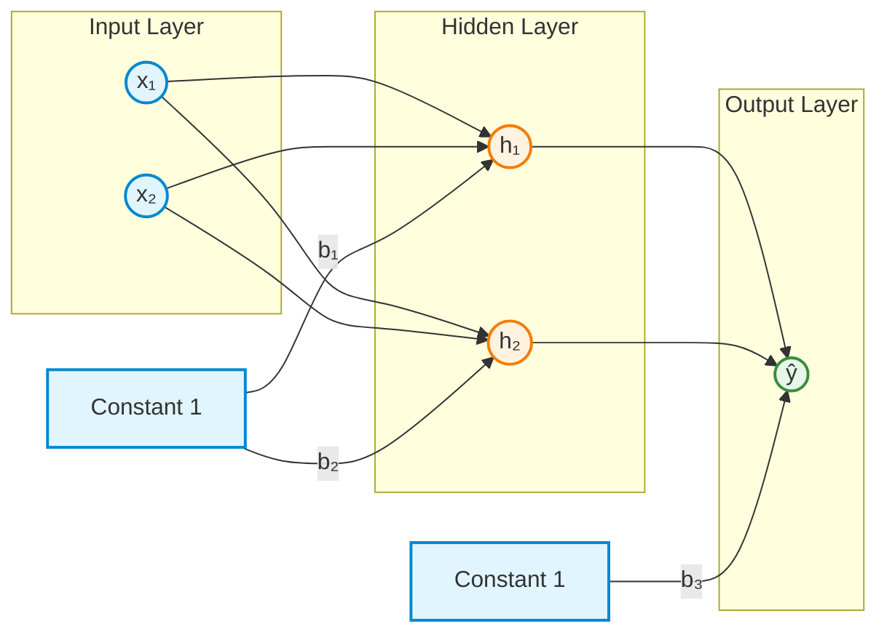
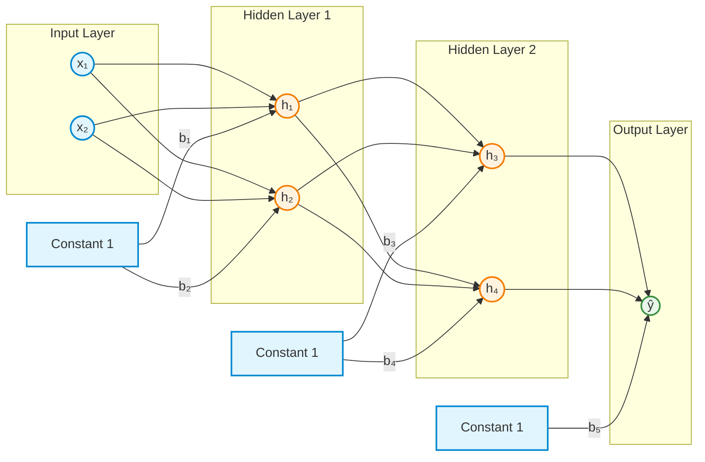
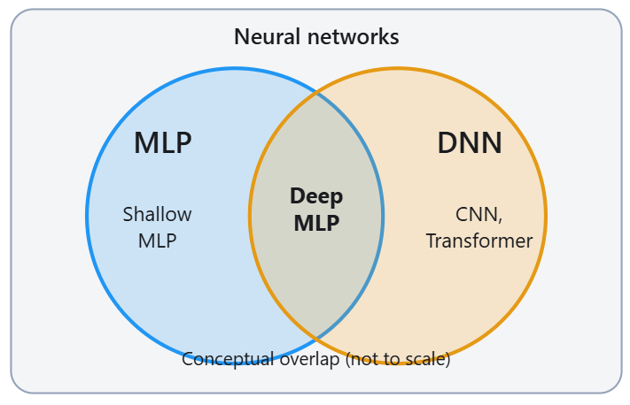
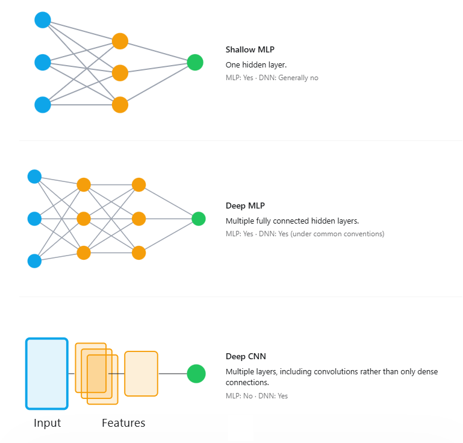
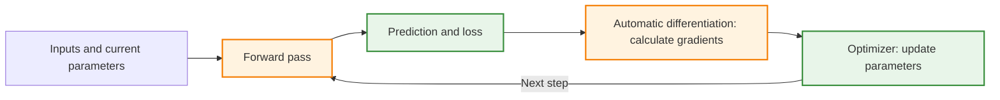

# From Small Neural Networks to Large-Scale Training

*An introductory connection between multilayer perceptrons, deep neural networks, automatic differentiation, and stochastic gradient descent*

1. [From a neuron to an MLP and a deep neural network](#1-from-a-neuron-to-an-mlp-and-a-deep-neural-network)
2. [From three parameters to billions: how are gradients calculated?](#2-from-three-parameters-to-billions-how-are-gradients-calculated)
3. [From gradient descent to SGD: how much data is used for each update?](#3-from-gradient-descent-to-sgd-how-much-data-is-used-for-each-update)

## Purpose of this reading

This is a conceptual reading with no complete Python programs to run.

The earlier examples used one or two weights to make predictions, calculate a loss, and update the model. Larger neural networks follow the **same fundamental learning cycle**:

**Forward pass → Loss → Backpropagation → Parameter update → Repeat**

This reading introduces three questions without requiring new calculus techniques:

1. How does a small neural network become a deep neural network?
2. How can a network with millions or billions of parameters calculate gradients?
3. How can training proceed when the dataset contains millions of observations?

The central distinction is that **network architecture**, **gradient calculation**, and **selection of training observations** answer different questions.

---

## 1. From a neuron to an MLP and a deep neural network

### 1.1 Starting with a familiar neuron

A neuron with two inputs first calculates a weighted sum and adds a bias:

$$
z=w_1x_1+w_2x_2+b
$$

Here, $x_1$ and $x_2$ are input features, $w_1$ and $w_2$ are trainable weights, and $b$ is a trainable bias.

The neuron's output depends on the task:

- **Regression:** The prediction can be $\hat y=z$. This uses the **identity activation**, which passes the calculated value through unchanged.
- **Binary classification:** A **sigmoid activation** converts $z$ into a probability between 0 and 1:

$$
p=\sigma(z)=\frac{1}{1+e^{-z}}
$$

A single sigmoid output neuron with no hidden layers is equivalent to **logistic regression**, not an MLP with hidden layers.

This provides the starting point for understanding larger neural networks. Instead of producing an output immediately, the network can pass information through one or more **hidden layers**. Each hidden layer performs another stage of computation before the final prediction.

### 1.2 What is a multilayer perceptron (MLP)?

A **multilayer perceptron (MLP)** is a type of *feedforward neural network*. It typically consists of an input layer, one or more hidden layers of fully connected neurons, and an output layer.

In a fully connected layer, each neuron receives information from all neurons in the preceding layer. Each hidden neuron calculates a weighted sum, adds a bias, and typically applies a **nonlinear activation function**, such as ReLU or sigmoid.

Nonlinear activations are important because stacking layers that perform only linear or affine transformations is mathematically equivalent to a single affine transformation. Nonlinearity allows the network to represent more complex relationships between inputs and outputs.

**Example — a shallow MLP with one hidden layer:**

This network contains two input features, two hidden neurons, and one output neuron.

Each connection between neurons has a trainable weight. The constant-1 nodes provide bias inputs, with trainable bias values shown on their outgoing connections. The other weight labels are omitted for readability.

The network is an MLP because it uses fully connected layers in a feedforward arrangement. With only one hidden layer, it is commonly described as a **shallow MLP**.

### 1.3 When is an MLP also a DNN?

A **deep neural network (DNN)** is a neural network with multiple layers of learned computation. The word *deep* describes the network's depth rather than a particular connection pattern or architecture.

The distinction is therefore:

- **MLP describes the architecture:** a feedforward network built primarily from fully connected layers.
- **DNN describes the depth:** a network with multiple layers of learned transformations.

These terms are not mutually exclusive. An MLP can be shallow or deep, and a **deep MLP is also a DNN**. However, not every DNN is an MLP. Deep convolutional neural networks (CNNs) and Transformers are examples of architectures that do not consist solely of conventional MLP layers.

**Example — a deeper MLP with two hidden layers:**

This network has the same two inputs and one output as the previous example, but it contains **two hidden layers instead of one**. Each hidden layer applies another learned transformation to the information received from the preceding layer.

It is still an MLP because the layers remain fully connected. It is also deeper than the first MLP and may be classified as a DNN under conventions that consider multiple hidden layers deep.

There is **no universally agreed minimum number of hidden layers** that defines a network as deep. The diagrams illustrate increasing depth, rather than a strict boundary between MLPs and DNNs.

**Where MLPs and DNNs overlap**

<!--  -->

<!--  -->

The overlap is the **deep MLP**: a network that has both the fully connected architecture of an MLP and sufficient depth to be considered a DNN.

| Network | MLP? | DNN? | Explanation |
|---|---|---|---|
| Shallow MLP | Yes | Generally no | Fully connected network with one hidden layer |
| Deep MLP | Yes | Yes | Fully connected network with multiple hidden layers |
| Deep CNN | No | Yes | Uses convolutional layers and has substantial depth |
| Deep Transformer | No | Yes | Uses attention-based processing and multiple layers |

Increasing network depth introduces additional stages of computation. This can help the model learn more complex representations, but **more layers do not necessarily mean more trainable parameters or better performance**. Parameter count also depends on layer widths and connection patterns.

Importantly, adding hidden layers does not change the fundamental learning cycle:

**Forward pass → Loss calculation → Backpropagation → Gradient-descent update → Repeat and evaluate.**

The forward pass becomes a sequence of computations through several layers. During backpropagation, gradients are calculated through those layers using the chain rule. An optimizer then uses the gradients to update the trainable parameters.

**Main idea:** An MLP describes *how a network is structured*, while a DNN describes *how deep it is*. A deep MLP belongs to both categories. Increasing depth changes the amount and organization of computation, but not the basic process through which the network learns.

---

## 2. From three parameters to billions: how are gradients calculated?

### 2.1 The same derivative principle still applies

For a neuron with two weights and a bias, the trainable parameters are $w_1$, $w_2$, and $b$. Backpropagation calculates three partial derivatives:

$$
\frac{\partial L}{\partial w_1},\qquad
\frac{\partial L}{\partial w_2},\qquad
\frac{\partial L}{\partial b}
$$

Every independently trainable scalar parameter has a corresponding loss sensitivity. If a hypothetical network has billions of *trainable* parameters participating in the loss, its gradient calculation can involve billions of components.

The principle does not change: **the chain rule connects the parameters to the final loss**. What changes is the number of operations and derivatives that must be handled.

### 2.2 Why calculate gradients with software?

Calculating a few derivatives by hand is useful for understanding backpropagation. Repeating a separate manual calculation for every weight in a large network is not practical.

Libraries such as **PyTorch** and **TensorFlow** use **automatic differentiation**. At a high level, the process is:

1. The forward pass computes predictions and the loss.
2. The differentiation system records or traces how the calculations depend on one another.
3. Starting from the loss, it applies the chain rule backward through those operations.
4. The resulting gradients become available to an **optimizer**, which performs the parameter updates.

This is commonly called *reverse-mode automatic differentiation*. It reuses intermediate calculations rather than rerunning the entire model independently for every parameter. The computation still requires resources and grows with model complexity.

### 2.3 Backpropagation is not the parameter update

| Task | PyTorch example | TensorFlow example |
|---|---|---|
| Calculate gradients | `loss.backward()` | `GradientTape` and `tape.gradient(...)` |
| Update parameters | `optimizer.step()` | `optimizer.apply_gradients(...)` |

The names differ, but the distinction is the same as in the hand calculations:

**Backpropagation calculates how loss depends on the parameters. An optimizer uses those gradients to change the parameters.**

The library does not change the mathematical purpose of a gradient; it makes gradient calculation practical at a much larger scale.

---

## 3. From gradient descent to SGD: how much data is used for each update?

### 3.1 A second scaling challenge: the number of observations

Large networks may have many parameters. Training datasets may also contain very many **observations**. These are two different kinds of scale.

In **full-batch gradient descent**, each update uses the average gradient calculated from the **entire training dataset**. If the dataset contains one million observations, a full-batch update requires processing those one million observations first.

A different approach is to update the parameters after processing a smaller number of observations.

### 3.2 Three ways to choose the data for an update

| Method | Observations contributing to one update | Main consequence |
|---|---|---|
| **Full-batch gradient descent** | Entire dataset | One full-data gradient per update |
| **Mini-batch gradient descent** | A small group of observations | More frequent updates using approximate full-data gradients |
| **Pure stochastic gradient descent (SGD)** | One observation | Very frequent updates; individual gradients can vary substantially |

In deep-learning discussions, the term **SGD** is also commonly used for an SGD optimizer trained with *mini-batches*. The batch size makes the precise meaning clear.

**Example:** With **1,000,000 observations**, processed once per epoch:

- Full-batch gradient descent makes **1 update per epoch**.
- Mini-batches containing **100 observations** produce **10,000 updates per epoch**.
- One-observation updates produce **1,000,000 updates per epoch**.

An **epoch** is one complete pass through the dataset. An **iteration** or **step** is one parameter update. More updates do not automatically mean faster or better training: gradient variability and computational efficiency also matter.

### 3.3 What stays the same?

All three methods use the familiar gradient-descent idea:

$$
\theta_{\mathrm{new}}=\theta_{\mathrm{old}}-\eta g
$$

Here, $\theta$ represents a trainable parameter (or the parameter collection), $\eta$ is the learning rate, and $g$ is the gradient calculated from the selected observations.

What changes is **which observations contribute to the calculated gradient**. Because different observations may produce different gradients, single-example and mini-batch updates may move in different directions from a full-batch update.

A small numerical illustration uses the same current weight, $w=10$, and learning rate, $0.1$. Suppose the gradients from four observations are $4$, $2$, $-2$, and $0$:

| Method | Gradient selected or averaged | Updated weight |
|---|---:|---:|
| Full batch: all four observations | $1$ | $9.9$ |
| Mini-batch: first two observations | $3$ | $9.7$ |
| Pure SGD: third observation | $-2$ | $10.2$ |

The update rule has **not changed**. The gradient differs because the selected data differ. These are illustrative single updates; in actual training, gradients are calculated again after each parameter update.

---

## 4. Connecting all three ideas

The earlier one-weight and two-weight examples already contain the essential mathematics for understanding much larger systems:

| Question | Main concept | What it determines |
|---|---|---|
| **What computation does the model perform?** | MLP or another neural-network architecture | How inputs become predictions |
| **How is the loss sensitivity calculated?** | Backpropagation / automatic differentiation | Gradients for trainable parameters |
| **Which data contribute to this update?** | Full batch, mini-batch, or single-example SGD | The gradient used at that step |
| **How are parameters changed?** | Gradient-descent optimizer and learning rate | The next parameter values |

The same sequence remains recognizable in small and large models:

**Forward pass → Loss → Calculate gradients → Update parameters → Repeat**

A deep network adds computational layers. Automatic differentiation makes the chain-rule calculations manageable. Mini-batch SGD changes how much training data contributes to each update. These ideas work together, but they do **different jobs**.

## Quick concept check

**Question 1. Is every MLP a deep neural network?**

Show answer

No. An MLP can be shallow or deep. A sufficiently deep MLP is a DNN, while many DNNs use architectures other than MLPs.

**Question 2. Does backpropagation update the weights?**

Show answer

No. Backpropagation calculates gradients by applying the chain rule. A separate optimizer uses these gradients to update trainable parameters.

**Question 3. What changes when full-batch gradient descent is replaced with mini-batch SGD?**

Show answer

The selected training observations used for each gradient calculation change. The basic chain rule and gradient-descent update idea remain the same, but updates occur more frequently and gradients can vary between mini-batches.

---

**Key takeaway:** Larger neural networks still learn through the same sequence practiced with a few weights. **Architecture** specifies the computations, **backpropagation** calculates gradients, and **the optimizer** updates parameters using gradients from the selected training observations.
