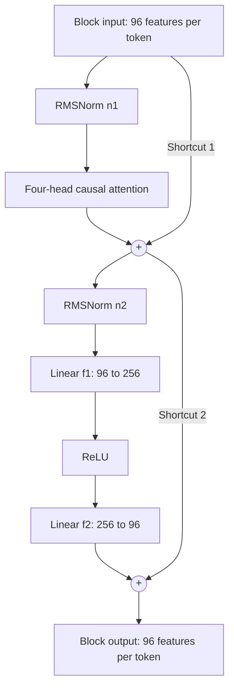

# Module 2 Theory — Simplified: Completing the Transformer and Generating Text

**A beginner-friendly guide to the complete Tiny-2.1 model**

> [!NOTE]
> **How to use this reading:** Read one section, try the linked visualization, and answer its check-your-understanding question. Then complete **Activity 2 — Simplified**. You can skip the expandable **More detail** boxes on a first reading.
>
> We continue using the familiar example `"2+2?\n"`. In the text diagrams, `↵` represents a newline (`\n`). Numerical examples are illustrative unless explicitly described as a real model calculation.

## What will you learn?

Module 1 ended with **multi-head causal attention**. Here we learn how Tiny-2.1 combines attention with the rest of a Transformer block and how it produces an answer.

By the end of Module 2, you should be able to:

1. explain why the model uses RMSNorm;
2. explain residual connections;
3. describe the feed-forward network (MLP);
4. follow the operations inside one block and through four blocks;
5. understand how a final vector becomes character scores; and
6. explain why generation happens one character at a time.

### Visualizations for this module

| Visualization | What it shows | Link |
|---|---|---|
| **6 — RMSNorm** | Normalizing values and learned gain | [Open Visualization 6](https://ai-learning-repo.github.io/resources/demo/nlp/visualization_6_rmsnorm.html) |
| **7 — Residual Connections** | The shortcut paths | [Open Visualization 7](https://ai-learning-repo.github.io/resources/demo/nlp/visualization_7_residual_connections.html) |
| **8a — Feed-Forward MLP** | Linear layers and ReLU | [Open Visualization 8a](https://ai-learning-repo.github.io/resources/demo/nlp/visualization_8a_feed_forward_mlp.html) |
| **8b — Complete Transformer Block** | How the components connect and stack | [Open Visualization 8b](https://ai-learning-repo.github.io/resources/demo/nlp/visualization_8b_complete_transformer_block.html) |
| **9a — Weight Tying** | Turning a vector into character scores | [Open Visualization 9a](https://ai-learning-repo.github.io/resources/demo/nlp/visualization_9a_weight_tying.html) |
| **9b — Autoregressive Generation** | Predict, append, repeat, stop | [Open Visualization 9b](https://ai-learning-repo.github.io/resources/demo/nlp/visualization_9b_autoregressive_generation.html) |
| **10 — Quantization** | Optional background on a smaller model file | [Open Visualization 10](https://ai-learning-repo.github.io/resources/demo/nlp/visualization_10_quantization.html) |

---

## Before we begin — The important code names

These names appear in Tiny-2.1's code. You don't have to memorize them all now; this table is a reference.

| Code name | Value or role | What it means |
|---|---|---|
| `VOCAB = 97` | 97 characters/IDs | The model predicts a score for each of 97 possible character IDs |
| `CTX = 128` | Maximum sequence length | Up to 128 character positions can be processed in one model input |
| `D = 96` | Model width | Each token position is represented by 96 numbers |
| `L = 4` | Number of blocks | Four complete Transformer blocks run **in sequence** |
| `H = 4` | Number of attention heads | Four heads run **in parallel inside each block** |
| `HID = 256` | MLP hidden width | The MLP temporarily expands **96 → 256 → 96** |
| `emb` | Token embedding table | Maps character IDs to vectors |
| `pos` | Position embedding table | Adds information about position |
| `blocks` | Collection of Transformer blocks | `model.blocks[0]` means the first block |
| `n1`, `n2` | Normalization layers inside a block | `n1` is before attention; `n2` is before the MLP |
| `q`, `k`, `v`, `o` | Attention projections | Query, Key, Value, and output projection |
| `f1`, `f2` | MLP linear layers | `f1` expands to 256; `f2` returns to 96 |
| `nf` | Final normalization | Normalization after all four blocks |

### Why is `HID = 256` different from `D = 96`?

A **Transformer block** passes a 96-dimensional representation to its next block, so the outside width stays `D = 96`.

**Inside the MLP**, the model temporarily creates **256 intermediate features**. That temporary width is called `HID` (short for *hidden dimension*). The MLP then projects back to 96.

```text
A token's representation entering the MLP:  96 numbers
                     |
          First linear layer f1
                     v
                  256 numbers   <-- HID = 256
                     |
                    ReLU
                     |
          Second linear layer f2
                     v
A token's representation leaving the MLP:   96 numbers
```

**Important:** `HID` does **not** count attention heads or Transformer blocks. It controls only the intermediate width of the MLP.

Also remember:

- `B` means batch size (number of sequences).
- `T` means sequence length (number of character positions).
- `(B, T, D)` is the shape of the model's representations. For our five-character prompt `2+2?↵`, this is `(1, 5, 96)`.

---

## 1. RMSNorm — Keep values at a useful scale

**Main idea:** As information passes through many layers, some numbers can become much larger or smaller. **RMSNorm** rescales a token's vector before attention or the MLP.

### Worked example: same pattern, different magnitude

Take this vector:

$$
x=[1,\;7,\;1,\;7]
$$

Calculate its **root mean square (RMS)**:

1. Square each value: $[1,\;49,\;1,\;49]$.
2. Find the mean: $(1+49+1+49)/4 = 25$.
3. Take the square root: $\sqrt{25}=5$.
4. Divide each value by 5:

$$
[1,\;7,\;1,\;7]/5=[0.2,\;1.4,\;0.2,\;1.4]
$$

If we multiply the original vector by ten, the vector becomes $[10,70,10,70]$. Its RMS becomes 50, so the normalized result is **almost the same**.

Finally, RMSNorm multiplies by a learned **gain** vector. For example, with $g=[1,2,1,0.5]$:

$$
[0.2,\;1.4,\;0.2,\;1.4]\odot[1,\;2,\;1,\;0.5]
=[0.2,\;2.8,\;0.2,\;0.7]
$$

Here $\odot$ means multiply **matching positions element by element**.

**Inside Tiny-2.1:** Each block has two separate RMSNorm layers, named `n1` and `n2`. They have their own learned gain values. The model also has a final `nf` after the last block.

**See it:** [Visualization 6 — RMSNorm](https://ai-learning-repo.github.io/resources/demo/nlp/visualization_6_rmsnorm.html).

**Check your understanding:** Why do `[1,7,1,7]` and `[10,70,10,70]` have nearly the same normalized representation?

<details>
<summary>Answer</summary>

Both the original values and the RMS grow by a factor of ten. Dividing the values by their RMS cancels most of that difference.

</details>

<details>
<summary>More detail — RMSNorm formula</summary>

$$
\operatorname{RMSNorm}(x)
=\frac{x}{\sqrt{\frac{1}{D}\sum_{i=1}^{D}x_i^2+\epsilon}}\odot g
$$

- $D$ is the number of features; in Tiny-2.1, $D=96$.
- $\epsilon=10^{-5}$ is a small value that prevents division by zero.
- $g$ contains learned gain values.

Because $\epsilon$ remains fixed, rescaling the input makes the normalized results **approximately**, not perfectly, equal. After gain $g$, the final output need not have RMS exactly 1.

</details>

---

## 2. Residual connections — Preserve the input and add an update

**Main idea:** Instead of discarding the original representation, a sublayer calculates an **update** and adds it to the original input.

$$
\text{Output}=\text{Input}+\text{Update}
$$

### Worked example

If the input is 5 and the update is 2:

$$
5+2=7
$$

If the update is 0:

$$
5+0=5
$$

Even when a sublayer produces no useful update, the original information can still pass through unchanged.

A full Transformer block has **two** residual shortcuts:

1. one around the **attention** part;
2. one around the **MLP** part.

These shortcuts also provide direct routes that can help gradients during training. They do **not** guarantee that every gradient will be large.

**See it:** [Visualization 7 — Residual Connections](https://ai-learning-repo.github.io/resources/demo/nlp/visualization_7_residual_connections.html).

**Check your understanding:** What happens to the output of a residual addition when its update is zero?

<details>
<summary>Answer</summary>

The output equals the input. The residual connection allows an identity shortcut.

</details>

<details>
<summary>More detail — The two residual equations</summary>

The first addition follows attention:

$$
x_{\mathrm{mid}}=x+\operatorname{MHA}(\operatorname{RMSNorm}_{n1}(x))
$$

The second addition follows the MLP:

$$
x_{\mathrm{out}}=x_{\mathrm{mid}}+\operatorname{MLP}(\operatorname{RMSNorm}_{n2}(x_{\mathrm{mid}}))
$$

`MHA` means **multi-head attention**. Notice that the second shortcut carries $x_{\mathrm{mid}}$, not the original $x$.

</details>

---

## 3. Feed-forward MLP — Process each token's features

**Main idea:** Attention gathers information **between token positions**. The **MLP** then transforms the features **within each token position**.

MLP stands for *multi-layer perceptron*. In Tiny-2.1 it consists of:

```text
Input: 96 features
       |
       v
 f1: 96 -> 256
       |
       v
      ReLU
       |
       v
 f2: 256 -> 96
       |
       v
Output: 96 features
```

The same `f1` and `f2` weights are used at each token position, but each position supplies its own input vector.

### Worked example: what does ReLU do?

Suppose the first linear layer produces these four numbers:

$$
z=[2,\;-3,\;0.5,\;-1]
$$

ReLU turns negative values into zero:

$$
\operatorname{ReLU}(z)=[2,\;0,\;0.5,\;0]
$$

A second linear layer can combine those numbers to produce an output such as $[0.8,-0.4]$ in the small 2D example used by Visualization 8a.

### Why expand to `HID = 256`?

A 96-dimensional vector is temporarily mapped to **256 hidden features**, so the MLP has more room to construct intermediate combinations. After ReLU, the second layer (`f2`) returns to **96 features**, so the result can be added through a residual connection.

**See it:** [Visualization 8a — Feed-Forward MLP](https://ai-learning-repo.github.io/resources/demo/nlp/visualization_8a_feed_forward_mlp.html).

**Check your understanding:** Why does `f2` produce 96 numbers instead of keeping 256?

<details>
<summary>Answer</summary>

The block's main representation has width 96. Returning to 96 lets the MLP output be added to the 96-dimensional residual shortcut.

</details>

<details>
<summary>More detail — MLP equation and code names</summary>

$$
\operatorname{MLP}(h)=\operatorname{ReLU}(hW_1^T)W_2^T
$$

`f1` stores $W_1$ with shape `(256, 96)`. `f2` stores $W_2$ with shape `(96, 256)`. These are learned linear weight matrices. The MLP operates on **each position independently**; it does not perform attention across positions.

</details>

---

## 4. One complete Transformer block — Then four blocks

We can now assemble everything from Modules 1 and 2.

### One block



**Follow the two shortcuts:**

- **Shortcut 1** carries the original block input around the first normalization and attention calculations, then adds it to the attention result.
- **Shortcut 2** carries the result of the first addition around the second normalization and MLP, then adds it to the MLP result.

The block output has the same width as its input: **96 numbers per token**.

### Four blocks in sequence

Tiny-2.1 uses four separate Transformer blocks:

```text
Character + position embeddings
             |
          Block 0
             |
          Block 1
             |
          Block 2
             |
          Block 3
             |
       Final RMSNorm
             |
       Character scores
```

Every block has the **same structure** but its **own learned weights**. The blocks run **one after another**. By contrast, the four attention heads **inside each block** operate in parallel.

For the prompt `"2+2?\n"` (five characters), the representation has shape `(1, 5, 96)` before and after each complete block.

**See it:** [Visualization 8b — Complete Transformer Block](https://ai-learning-repo.github.io/resources/demo/nlp/visualization_8b_complete_transformer_block.html).

**Check your understanding:** What is the difference between **four Transformer blocks** and **four attention heads**?

<details>
<summary>Answer</summary>

The four blocks are stacked **sequentially**; the output of one becomes the input of the next. Inside **each** block, four attention heads process different 24-feature parts in parallel.

</details>

<details>
<summary>More detail — How to read the model code</summary>

The following short excerpt shows the **idea** of the forward computation using the actual module names (it omits some batching and implementation details):

```python
# First turn character IDs into vectors and add positions.
x = model.emb(ids) + model.pos(position_ids)

# Pass the representation through all four blocks.
for blk in model.blocks:
    x = blk(x)

# Normalize once more after the last block.
h = model.nf(x)

# Reuse token embeddings to calculate character scores.
logits = h @ model.emb.weight.T
```

- `ids` contains the character IDs.
- `position_ids` contains the corresponding position numbers, starting at zero.
- `model.blocks` is the collection of four blocks.
- `blk(x)` applies one block to the current representation.
- `model.nf(x)` performs the **final** RMSNorm.
- The `@` operator means **matrix multiplication**; `.T` transposes a matrix (swaps rows and columns).

Each line follows the same flow you see in the architecture diagram.

</details>

---

## 5. Weight tying — From a vector to character scores

**Main idea:** The four blocks produce vectors, but the model must finally choose a **character**. It therefore calculates one **score** for each possible character.

A raw character score is called a **logit**. Higher logits indicate stronger model preference before converting scores to probabilities.

Tiny-2.1 uses a technique called **weight tying**: it reuses the token embedding table at the output.

- At the **input**, the embedding table looks up a vector from an ID.
- At the **output**, the model compares the final vector to **every row** of that same table using dot products.

It does **not** reverse the embedding lookup.

### Worked example with three-dimensional vectors

Suppose the final normalized vector at the last position is:

$$
h=[0.8,\;0.6,\;0.2]
$$

Use a small, illustrative embedding table:

| Candidate | Embedding row | Dot-product logit |
|---|---|---:|
| `2` | $[1,0,0.2]$ | $0.84$ |
| `+` | $[0,1,0.1]$ | $0.62$ |
| `?` | $[0.3,0.4,0.9]$ | $0.66$ |
| `4` | $[2,1,0.2]$ | **$2.24$** |
| `↵` | $[-0.4,-0.3,0.2]$ | $-0.46$ |

For candidate `4`, the calculation is:

$$
0.8(2)+0.6(1)+0.2(0.2)=1.6+0.6+0.04=2.24
$$

Here `4` has the highest score, so **greedy decoding** selects `4`.

This is a five-candidate toy example, **not the actual pretrained model's output**. Real Tiny-2.1 calculates scores for **97 character IDs** from vectors containing 96 numbers.

**Code names:** `model.emb.weight` is the embedding table. Its shape is `(97, 96)`. Transposing it produces `(96, 97)` for scoring all characters.

**See it:** [Visualization 9a — Weight Tying](https://ai-learning-repo.github.io/resources/demo/nlp/visualization_9a_weight_tying.html).

**Check your understanding:** Does weight tying mean the model finds the original character by reversing the embedding lookup?

<details>
<summary>Answer</summary>

No. It reuses the embedding weights as a collection of candidate vectors and compares them with the final hidden vector using dot products.

</details>

<details>
<summary>More detail — Logits and softmax</summary>

For a last-position vector $h$ and embedding matrix $E$:

$$
\operatorname{logits}=hE^T
$$

The shape calculation is:

$$
(1,96)\,(96,97)=(1,97)
$$

Softmax can turn these logits into probabilities:

$$
p_i=\frac{e^{z_i}}{\sum_j e^{z_j}}
$$

Choosing the largest logit gives the same character as choosing the largest softmax probability, because softmax preserves the score ordering.

For all sequence positions, the model's logits have shape `(B, T, 97)`. During generation, it chooses the **last** position's 97 logits.

</details>

---

## 6. Autoregressive generation — Predict, append, repeat, stop

**Main idea:** Tiny-2.1 generates **one character at a time**, then uses the newly generated character to predict the next one. This is called *autoregressive generation*.

### A two-step example

```text
Input to model:  2+2?↵
Prediction:      4
Append:          2+2?↵4

Input to model:  2+2?↵4
Prediction:      ↵
Action:          STOP

Displayed answer: 4
```

The **first newline** is already part of the prompt. It marks where the question ends and the answer begins.

The **second newline** is predicted by the model. That is what stops generation in this example.

This is a teaching example. Actual output depends on the trained model's predictions.

### What does the generation code mean?

Here is the key part of a simple PyTorch generation loop:

```python
with torch.no_grad():
    logits = model(x)[:, -1, :]
    next_id = int(logits.argmax(dim=-1).item())
```

Read it one line at a time:

- `torch.no_grad()` says **we are making predictions, not training**, so PyTorch need not record gradients.
- `model(x)` runs the complete Transformer on the current sequence of character IDs.
- `[:, -1, :]` takes the scores from the **last position**. The colon `:` means “all” along that dimension, and `-1` means “the last one.”
- `argmax(dim=-1)` finds the character ID with the highest score.
- `.item()` converts the result into a regular Python number.

The next step is either to **stop** (if the predicted ID is newline `1`, or padding `0` in this implementation) or **append** the predicted character ID and run the model again.

The simple classroom loop runs the model on the updated prefix each time; it does not use a key/value cache.

**See it:** [Visualization 9b — Autoregressive Generation](https://ai-learning-repo.github.io/resources/demo/nlp/visualization_9b_autoregressive_generation.html).

**Check your understanding:** Why must the newly predicted character be added to the next model input?

<details>
<summary>Answer</summary>

Because the next prediction should depend on all characters generated so far. After producing `4`, the model needs to see that `4` when deciding whether to produce another character or stop.

</details>

<details>
<summary>More detail — Shapes during generation</summary>

For the prompt `"2+2?\n"`, the input IDs have shape `(1, 5)`.

Running the model produces logits with shape `(1, 5, 97)`: one set of 97 character scores at each of five positions.

Selecting the last position with `logits[:, -1, :]` gives shape `(1, 97)`.

If a new character is appended, the next input contains six positions. The model runs again using the updated sequence. The implementation must respect Tiny-2.1's maximum context length `CTX = 128`.

</details>

---

## 7. Optional background — Learning and compact model files

> [!NOTE]
> **Optional reading only.** There is no programming exercise for this section. The main goal of Module 2 is to understand the complete block and character generation.

### How the model learns

During training, the model compares its next-character predictions with the correct answers. A **loss function** measures prediction error. Training updates the model weights so that correct answer characters become more likely.

<details>
<summary>More detail — One simple loss equation</summary>

If the model assigns the correct character a probability $p_{\mathrm{true}}$, a common loss is:

$$
\mathcal{L}=-\ln(p_{\mathrm{true}})
$$

A larger probability for the correct answer gives a smaller loss. In Tiny-2.1's question-and-answer training, the loss mask selects which answer positions contribute to this loss, as explained in Module 1.

</details>

### A brief note on model size

We used Tiny-2.1's **PyTorch checkpoint** `tiny2.pt` in the activities. The project also includes a smaller model file, `TINY.BIN`, for running on DOS. It stores an approximate representation of the trained weights using fewer bits. This is called **quantization**.

You do **not** need to understand or implement this process for the simplified activities.

**Optional visualization:** [Visualization 10 — Quantization](https://ai-learning-repo.github.io/resources/demo/nlp/visualization_10_quantization.html).

---

## Module 2 — What should you remember?

1. **RMSNorm** helps keep token-vector magnitudes under control.
2. **Residual connections** preserve the input while adding an update.
3. **The MLP** transforms the features of each token using `96 → 256 → 96`.
4. **A Transformer block** contains attention, an MLP, two RMSNorms, and two residual shortcuts.
5. **Tiny-2.1 stacks four blocks**, each with four attention heads.
6. **Weight tying** reuses embedding weights to score candidate characters.
7. **Generation** runs the model, chooses one character, appends it, and repeats until it predicts the stop character.

**Practice:** Continue with *Activity 2 — Simplified*, Part B. The detailed version of Theory 2 remains available if you want a deeper mathematical explanation.

### Optional further reading

- [Tiny-2.1 project and source code](https://github.com/WollyMonjac/Tiny-2.1)
- [Build a Large Language Model From Scratch — Sebastian Raschka](https://github.com/rasbt/LLMs-from-scratch)
- [Attention Is All You Need — original Transformer paper](https://arxiv.org/abs/1706.03762)
- [The Annotated Transformer](https://nlp.seas.harvard.edu/annotated-transformer/)

